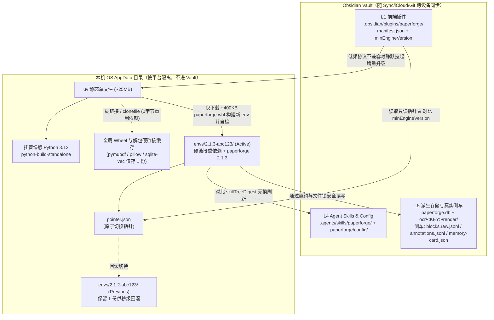
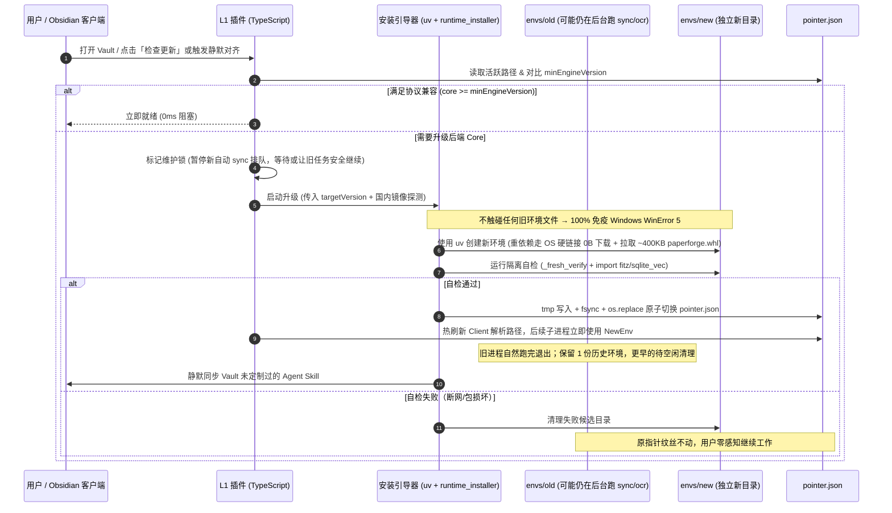

# PaperForge 全平台桌面安装、热修与协同升级架构蓝图

> **定位**：面向维护者与工程演进的架构设计文档。  
> **适用范围**：Obsidian 桌面端全平台（**Windows x64/ARM64、macOS Apple Silicon/Intel、Linux x64/ARM64**；移动端 iOS/Android 暂不纳入）。  
> **当前基线版本**：`2.0.0`（[**init**.py](../paperforge/__init__.py) / [manifest.json](../paperforge/plugin/manifest.json) / [versions.json](../versions.json)）。

> [!IMPORTANT]
> **当前已上线架构边界说明（Single-Channel GitHub Release + v2.1 全阶段落地）：**
>
> - **当前已上线（Phase 1 + Phase 2 + Phase 3 + 单源 GitHub Release 分发均已落地）**：
>   - **单一分发源**：仓库根目录 `manifest.json` + `versions.json` 使用纯三位 SemVer（`2.0.0`），通过 GitHub Pre-release 区分内测（BRAT）与正式发布（Obsidian 商店自动同步）；Python Wheel（`paperforge-<ver>-py3-none-any.whl`）优先直连 GitHub Release（含 `ghfast.top` 镜像）下载至 `~/.paperforge/runtime/cache/wheels/` 并通过 `--find-links` 安装，不强制依赖 PyPI 发包或国内镜像同步，PyPI 在 `publish.yml` 中仅保留为可选发布开关。
>   - **Phase 1（隔离运行时指针）**：由 Python `runtime_installer` 在 `~/.paperforge/runtime/` 下创建隔离虚拟环境并原子发布 `pointer.json`；SemVer ↔ PEP 440 版本统一由 `paperforge/core/versioning.py`（与插件 `normalizePep440Version`）双端对齐。
>   - **Phase 2（四维解耦与极速热修）**：`manifest.json` 声明 `minEngineVersion`，`probe`/`runtime status` 支持 `--min-engine-version` 兼容窗口校验；`pointer.json` 记录 `deps_lock_hash` 与 `runtime_abi` 并校验实装 `.dist-info/METADATA` 区间，纯代码补丁命中时复用 `site-packages` 进行 `--no-deps` 秒级升级；`paperforge skill sync` 基于状态摘要与暂存原子替换无损更新未改动的 Skill。
>   - **Phase 3（便携 `uv 0.13.9` 零前置引导）**：无本机 Python 3.11+ 时，插件与 `paperforge/runtime_uv.py` 可自动下载经官方 SHA-256 校验的便携 `uv` 并拉取独立托管 Python 3.12（含国内镜像兜底）完成全自动安装；真实桌面端 Obsidian Vault 的首装/热修体感验收仍在持续跟进中。

---

## §0 核心结论（TL;DR）

对于 PaperForge 这类 **「Obsidian TypeScript 前端 + 重度 Python 数据引擎（PyMuPDF / Pillow / sqlite-vec）」** 的科研桌面工具，既不能走“全靠用户自备 Python + 原地 `pip install`”（前置门槛高、Windows 易被文件锁死、跨电脑 Vault 同步错位），也不适合走“PyInstaller 冻结大二进制”（每次热修重下 150MB+、macOS Gatekeeper 公证/Win Defender 误报、国内 GitHub 下载慢）。

**最适合我们的终态架构是：**

1. **后端引擎分发：`uv` 单文件静态引导器 + 托管绿色版 Python（`python-build-standalone`）+ 全局硬链接 Wheel 缓存 + 蓝绿目录 `pointer.json` 原子切换**
   - 用户**无需预装任何 Python 或 Conda**；
   - 依赖库不变时，日常代码热修仅下载 `~300–500 KB` 的 `paperforge` 纯代码 Wheel，通过 OS 文件系统硬链接/COW 克隆挂载 `pymupdf` / `sqlite-vec`，**1.5～3 秒完成原子热升级**；
   - 彻底免疫 Windows `.pyd` / `.dll` 进程占用导致的 `WinError 5` 原地覆写失败；保留上一健康版本支持秒级回滚；内置 PyPI / 清华 TUNA 镜像降级。
2. **前后端版本契约：将单一版本号死锁拆解为四维独立演进字段**
   - 用 `minEngineVersion`（协议兼容基线）替代当前的 1:1 相等校验，使**纯前端 UI/交互热修无需触发后端重装（0 秒生效）**；
   - 用 `depsLockHash` 区分“仅代码快修通道”与“全量依赖增量”；
   - 用 `skillTreeDigest` 实现 Vault Agent Skills 的无感自动对齐（不覆盖用户自定义修改）。
3. **跨设备协同升级**：插件本体随 Obsidian Sync / 社区插件市场（正式版）或 BRAT（高频内测）同步；当设备 B 拉取到新版前端时，若本机 `pointer.json` 低于 `minEngineVersion`，后台非侵入式 3 秒拉齐本机引擎，不弹出阻断性报错遮挡阅读。

---

## §1 全景拆解：PaperForge 需要安装与升级的 5 层组件

在设计升级机制前，必须明确“什么跟着 Vault 走、什么必须留在本机 OS 目录、什么昂贵不可丢、什么随时可丢弃重建”：

| 层级                      | 组件                                                                                    | 存储位置                                                             | 体积 / 频次                        | 权威性 & 多设备同步属性                                                                                                   |
| :------------------------ | :-------------------------------------------------------------------------------------- | :------------------------------------------------------------------- | :--------------------------------- | :------------------------------------------------------------------------------------------------------------------------ |
| **L1 前端插件**           | `main.js`、`styles.css`、`manifest.json`                                                | `<vault>/.obsidian/plugins/paperforge/`                              | `~600 KB` 最高频更新            | 随 Vault 跨设备同步（`isDesktopOnly: true`），只读消费后端契约                                                            |
| **L2 Python 解释器**      | CPython 3.12（`python.exe` / `python3`）                                                | **OS 本机用户目录**（见 §5 矩阵）                                    | `~65 MB` 极低频更新             | **严禁放入 Vault**：跨 OS 不可共享，且小文件极多会拖垮同步网盘                                                            |
| **L3 引擎与原生依赖**     | `paperforge`（纯 Python Wheel）+ `pymupdf`、`pillow`、`sqlite-vec`、`openai`、`keyring` | **OS 本机目录**（独立版本化 `envs/<ver>-<hash>/` + 全局 Wheel 缓存） | 依赖 `~150 MB` 业务包 `~400 KB` | L3 代码高频更新、重依赖低频更新；通过 `pointer.json` 原子指针暴露给 L1                                                    |
| **L4 Vault 协同资产**     | Agent Skill 树（`.agents/skills/paperforge/SKILL.md`）、配置（`.paperforge/config/`）   | Vault 内部                                                           | `< 200 KB` 随后端升级           | 跨设备同步；升级需尊重用户本地改写（先验摘要再覆写）                                                                      |
| **L5 派生索引与渲染缓存** | `paperforge.db`（FTS5 + Vec0）、`ocr/<KEY>/render/`、`structure/`                       | Vault `.paperforge/` 内部                                            | 数十 MB ~ GB 按需演化           | **可丢弃重建的派生层**：真实来源（BBT 导出、`annotations.jsonl`、`memory-card.json`、`blocks.raw.jsonl`）全在独立侧车文件 |

> **关键设计约束**：L1 随 Vault 跨机漂移，L2/L3 绑定当前电脑 OS 与 CPU 架构，L4/L5 在 Vault 内共享。只要遵守这一物理边界，**多台电脑之间（如办公室 Windows 台式机 + 家里 MacBook）就不会发生二进制污染**。

---

## §2 现状痛点与跨平台真实暗坑复盘

结合当前 [runtime_installer.py](../paperforge/runtime_installer.py)、[installation.py](../paperforge/probes/installation.py)、[runtime-installer-launcher.ts](../paperforge/plugin/src/services/runtime-installer-launcher.ts) 及 [check_version_sync.py](../scripts/check_version_sync.py) 的实现，现有体系已具备“候选目录检验 + `pointer.json` 原子发布 + 保留 1 个旧版本回滚 + `ocr.rebuild_derived` 与 `ocr.run` 解耦”等优良护栏，但在实际桌面发行与快速热修上仍有 **5 个结构性痛点**：

1. **前置 Python 门槛过重（新手劝退）**：
   - `discover_base_python()`（[runtime_installer.py](../paperforge/runtime_installer.py)）依赖用户机器已安装 Python >= 3.11。
   - **Windows 暗坑**：系统自带的 `C:\Users\...\WindowsApps\python.exe` 是微软商店跳转空壳（exit code 9009），常误导探测或让新手迷失在 `PATH` 勾选。
   - **macOS / Conda 暗坑**：macOS 系统不再自带可用新版 Python（或弹出 Command Line Developer Tools 弹窗）；部分用户有旧版 Anaconda，被卷入全局复杂包冲突。
2. **版本号 1:1 死锁 + 每次小修全量重装**：
   - [installation.py](../paperforge/probes/installation.py#L48-L63) 要求 `manifest.json` 版本号与 Python `__version__` 完全相等，改 1 行 CSS（`2.0.0 → 2.0.1`）也会在控制中心红/黄警示 `installation.version_mismatch`。
   - `_install_runtime_locked()`（[runtime_installer.py](../paperforge/runtime_installer.py#L446-L461)）每次安装都会新建空 `.venv-candidate-<uuid>` 并从零执行 `pip install paperforge[vector]==<version>`，即使第三方依赖一行未改也要重新下载/解压 `pymupdf`、`pillow`、`sqlite-vec`。
   - 此外存在 **SemVer `-rc.6` vs PEP 440 `rc6` 比较不一致**（已在本次修复中统一归一化）。
3. **Windows NTFS 文件句柄锁（`WinError 5: Access is denied`）**：
   - 在 Windows 上，如果后台正运行 `paperforge ocr` / `sync` 或刚被 Obsidian 拉起的守护查重进程仍持有 `_fitz.pyd`（PyMuPDF）、`vec0.dll`（sqlite-vec）或 `python.exe` 句柄，任何“原地升级 `pip install -U`”都会直接报错失败并把原环境留在半残状态。
   - 蓝绿独立目录是正确的方向，但前提是能**几乎零网络成本**地克隆底层依赖。
4. **多设备 Vault 同步造成的前后端时间差**：
   - 用户在台式机升级了 Obsidian 插件（Vault 内的 `.obsidian/plugins/paperforge/main.js` 同步到笔记本），但笔记本 AppData 里的 Python 核心还是上一版，打开即触发“版本不匹配”。
5. **Skill 树与派生缓存升级缺自动联动**：
   - 后端升级带来 `/pf-deep` 或 `SKILL.md` 修复时，虽然 [skill_deploy.py](../paperforge/services/skill_deploy.py) 已计算 `_skill_tree_digest`，但升级流程完成后缺乏主动检测提示与一键/自动无损刷新（仅保留未被用户定制改写过的覆盖路径）。
   - 国内用户在直连 `pypi.org` / `github.com` 时易因连接重置导致安装器中断。

---

## §3 四大跨平台桌面方案横向对比（Win / macOS / Linux）

针对 Obsidian 桌面插件形态，我们评估了社区常见的四类架构路径：

| 对比维度                        | 方案 A：系统 Python + `venv` + `pip`（现状） | 方案 B：PyInstaller / Nuitka 单包二进制（GitHub Releases）                                             | **方案 C：`uv` 静态引导 + 托管绿版 Python + 硬链接缓存 + 蓝绿指针（推荐）**                           | 方案 D：Docker / 常驻后台服务安装器    |
| :------------------------------ | :------------------------------------------- | :----------------------------------------------------------------------------------------------------- | :---------------------------------------------------------------------------------------------------- | :------------------------------------- |
| **用户前置依赖**                | 需自装 Python 3.11+（新手阻力极大）          | 零前置                                                                                                 | **零前置**（`uv` 自动按需拉取免安装 `python-build-standalone`）                                       | 需装 Docker 或系统守护服务（不可接受） |
| **首次冷启动耗时**              | 1~3 分钟（需先引导装 Python）                | 1~3 分钟（下载 ~120MB 压缩包）                                                                         | **8~15 秒**（并行下载 Wheel + 毫秒级硬链接解包）                                                      | 数分钟                                 |
| **1 行代码热修耗时**            | 30~90 秒（重装全量依赖）                     | **1~3 分钟（必须重下 ~120MB 整包）**                                                                   | **1.5~3 秒**（重依赖走全局硬链接 0 字节下载，仅更 ~400KB 包）                                         | ~1 分钟                                |
| **macOS Gatekeeper / 杀软误报** | 无（官方 Python 签名）                       | **极高**：未买 $99 Apple 公证会被“已损坏/无法验证开发者”拦截；Win Defender 对 PyInstaller 引导头常误报 | **极低**：`uv` 与 Python 均来自官方/Astral 正式发布渠道且支持 SHA-256 校验，无冻结自解压外壳          | 中                                     |
| **CI 构建成本**                 | 仅需发布纯 Python `py3-none-any.whl`         | **极重**：需维护 Win x64 / Win ARM64 / macOS arm64 / macOS x64 / Linux 五套交叉编译打包矩阵            | **极轻**：`paperforge` 仍是纯 Python Wheel（跨平台仅 1 个包！），C 扩展直接复用 PyPI 官方预编译 Wheel | 重                                     |
| **国内网络体验**                | 依赖用户自行配 pip 镜像                      | 依赖 GitHub Release 大文件镜像/代理，极易断流                                                          | **可控**：自动探测连通性，超时自动回退清华 TUNA / 阿里云镜像 + 国内可用源下载 `uv` / Python           | 差                                     |
| **热更新防文件锁**              | 若用独立候选目录则安全，否则极易锁死         | Windows 无法覆盖运行中 `.exe`，需额外两阶段自替换重启逻辑                                              | **天然安全**：独立 `envs/<id>/` + 原子切换 `pointer.json`                                             | 需停服务                               |

**为什么坚决淘汰“PyInstaller 打包单个 `.exe`/`.app`”？**  
看起来“一个安装包直接跑”似乎很美，但在科研高频迭代场景是**热修灾难**：改一句正则或修一个排版 Bug，CI 要跑 5 个平台编 15 分钟，用户要在国内环境下重新拖一个 120MB 的未公证压缩包，还可能被 Windows Defender 隔离。而 **方案 C（`uv` + 绿版 Python）** 既拥有**“用户电脑不用装 Python”的零门槛**，又完全保留了**“纯 Python `~400 KB` Wheel 秒级增量发布”的极速热修红利**。

---

## §4 终态版本解耦与全组件协同升级机制设计

### 4.1 整体运行时架构

### 4.2 四维版本解耦契约（彻底解决“改一行前端也要重装后端”）

不再用单一的 `plugin.version == core.__version__` 死锁一切，而是将契约拆分为四个正交维度，由后端 `probe("installation")` 与插件 `manifest.json` 共同声明：

1. **前端展示版本（`pluginVersion`，SemVer，例如 `2.1.4`）**
   - 负责 Obsidian 插件市场 / BRAT 识别与更新。
2. **协议兼容性基线（`minEngineVersion` + `schemaProtocolVersion`）**
   - `manifest.json`（或内嵌构建常量）声明插件所需的最低后端版本 `minEngineVersion`（例如 `2.1.0`），后端报告当前引擎版本 `coreVersion`（例如 `2.1.2`）及自身要求的 `minPluginVersion`。
   - **判定规则**：
     - 只要 `coreVersion >= minEngineVersion` 且 `pluginVersion >= minPluginVersion` → **直接绿色 Ready**！
     - **红利**：发一个 `2.1.4` 纯 UI 修复版（只要未改 CLI 出参契约），老用户的本地引擎保持 `2.1.2` **直接无缝使用，0 秒等待，零网络请求**。
3. **依赖锁指纹（`depsLockHash`，基于 `pyproject.toml` 核心及 vector 依赖段计算）**
   - **快修通道（Fast Patch，`~2 秒`）**：当 `depsLockHash` 与当前活跃环境一致（绝大部分后端 Bug 修复均如此）时，无需公网解析依赖树，`uv` 直接复用本地缓存（或现有环境 `site-packages`）硬链接生成新环境，并仅从 Wheel/PyPI 拉取 `--no-deps paperforge==<target>`，校验通过后切换 `pointer.json`。
   - **依赖升级通道（Deps Sync，`~10 秒`）**：仅当新增或升级第三方库（如 `pymupdf` 升级）导致 `depsLockHash` 变化时，由 `uv` 增量拉取差量包，老包依然走本地硬链接。
4. **内容演进标记（`skillTreeDigest`、`dbSchemaVersion`、`ocrDerivedVersion`）**
   - `skillTreeDigest`：引擎升级完成后，自动核对 `<vault>/.agents/skills/paperforge/`：
     - 若文件摘要匹配上一版官方发行摘要（说明用户未魔改）→ **自动静默更新到新版 Skill**；
     - 若用户自行定制过 → 记录状态并在设置页提示“发现新版本 Skill，是否查看差异并覆盖/保留”，绝不覆盖用户心血。
   - `dbSchemaVersion` & `ocrDerivedVersion`：遵循“增量 `CREATE TABLE IF NOT EXISTS` / `ALTER TABLE ADD COLUMN` + 侧车可重建”原则，不轻易触发全库清零；OCR 渲染规则升级后仅提示按需本地执行秒级 `ocr.rebuild_derived`，永不浪费已付费的远端解析配额。

### 4.3 跨平台热升级时序与 Windows 文件锁免疫流程

### 4.4 镜像容错与防断流策略（适配国内科研网络）

安装器内置轻量级 2 秒测速探测（可由用户设置覆盖，也支持企业代理 `HTTP_PROXY`/`HTTPS_PROXY` 环境变量自动透传）：

1. **`uv` 二进制获取**：优先包内自带校验清单 + GitHub Release 直链 / 镜像代理；首次拉取后缓存到 OS 用户目录永久复用。
2. **绿版 Python 下载（`python-build-standalone`）**：默认走 GitHub Release；若 3 秒首包超时，自动切换国内镜像源（如 `UV_PYTHON_INSTALL_MIRROR` 指向高校/云加速镜像），并强校验官方 SHA-256。
3. **PyPI 包拉取**：按顺序探测 `pypi.org/simple` 与清华 `pypi.tuna.tsinghua.edu.cn/simple` / 阿里云 `mirrors.aliyun.com/pypi/simple`；且开启全局 `UV_CACHE_DIR`，常用重依赖只在首次下载一次。

### 4.5 多端分发渠道与单标签（Single-Tag）发版流水线

- **用户更新通道双轨制**：
  1. **正式稳定版**：上架 **Obsidian Community Plugins**（每次 GitHub Release 自动挂载合规的三件套：`main.js`、`styles.css`、`manifest.json`）。用户一键点击 Obsidian 原生「检查更新」，打开新版后插件自动在 3 秒内对齐后端。
  2. **内测与当日快修版**：支持 **BRAT（Beta Reviewers Auto-tester）** 仓库订阅，开发者打完热修 Tag 1 分钟内测试用户即可拉取最新 `main.js` + 自动对齐 PEP 440 对应的 PyPI Wheel。
- **GitHub Actions 统一发布流**：
  - 维护者只需执行**一个动作**：确保 `paperforge/__init__.py`、`manifest.json`、`versions.json` 通过 [check_version_sync.py](../scripts/check_version_sync.py) 校验后，推送 `git tag v2.1.1`（或预发布 `v2.1.1-rc.1`）；
  - CI 自动完成：
    1. Python 单测 + V3 OCR 核心集 + `check_module_graph.py --check`；
    2. TypeScript `typecheck` + Vitest + esbuild 构建 `main.js`；
    3. 自动规范化 SemVer → PEP 440（`2.1.1-rc.1` → `2.1.1rc1`）构建单一跨平台 Pure-Python Wheel（`paperforge-*-py3-none-any.whl`）并推至 **PyPI**；
    4. 创建 GitHub Release 并上传 `main.js`、`styles.css`、`manifest.json`（及可选离线兜底 Wheel 包 `paperforge.whl`）。

---

## §5 全平台标准路径矩阵 & 落地演进路线图

### 5.1 跨平台目录与链接策略矩阵

| 路径项                             | Windows (10/11 x64 & ARM64)                                                                     | macOS (Apple Silicon & Intel)                       | Linux (x64 & ARM64)                                                                                 |
| :--------------------------------- | :---------------------------------------------------------------------------------------------- | :-------------------------------------------------- | :-------------------------------------------------------------------------------------------------- |
| **引擎根目录** (`RUNTIME_HOME`) | `%LOCALAPPDATA%\PaperForge\runtime\`                                                            | `~/Library/Application Support/PaperForge/runtime/` | `${XDG_DATA_HOME:-~/.local/share}/paperforge/runtime/` _(兼容迁移旧版 `~/.paperforge/runtime/`)_ |
| **便携 `uv` 位置**                 | `<RUNTIME_HOME>\bin\uv.exe`                                                                     | `<RUNTIME_HOME>/bin/uv` (`chmod +x`)                | `<RUNTIME_HOME>/bin/uv` (`chmod +x`)                                                                |
| **托管绿版 Python**                | `<RUNTIME_HOME>\python\`                                                                        | `<RUNTIME_HOME>/python/`                            | `<RUNTIME_HOME>/python/`                                                                            |
| **全局硬链接缓存**                 | `<RUNTIME_HOME>\cache\uv`（NTFS Hardlink）                                                      | `<RUNTIME_HOME>/cache/uv`（APFS `clonefile` COW）   | `<RUNTIME_HOME>/cache/uv`（Hardlink / Reflink）                                                     |
| **版本化运行时**                   | `<RUNTIME_HOME>\envs\<ver>-<hash>\Scripts\python.exe`                                           | `<RUNTIME_HOME>/envs/<ver>-<hash>/bin/python3`      | `<RUNTIME_HOME>/envs/<ver>-<hash>/bin/python3`                                                      |
| **原子切换指针**                   | `<RUNTIME_HOME>\pointer.json`                                                                   | `<RUNTIME_HOME>/pointer.json`                       | `<RUNTIME_HOME>/pointer.json`                                                                       |
| **跨盘符退化处理**                 | 保证 `cache` 与 `envs` 同在 `RUNTIME_HOME` 同分区下，确保 NTFS 硬链接 100% 命中，不退化为慢拷贝 | 保证同卷 APFS，几乎零额外磁盘开销                   | 若 `/tmp` 与 `$HOME` 分区不同，`UV_CACHE_DIR` 固定设于 `RUNTIME_HOME` 下避免跨挂载点复制            |

> **兼容历史环境**：若检测用户已有老版本 `~/.paperforge/runtime/pointer.json`，启动时按旧路径只读兼容并优先迁移；卸载或切换后旧文件按 `keep_previous=1` 自动回收，绝不破坏用户现有数据。

### 5.2 三阶段平滑落地路线（供评审确认后按阶段实施）

1. **Phase 1（已纳入本次修复范围的“低风险前置加固”）**：
   - 修复 `runtime_installer.py` / `runtime-installer-launcher.ts` 中 SemVer vs PEP 440 比较不一致 Bug；
   - 修复侧车持久化与历史重导入，保证引擎任意重启/库重建不丢数据。
2. **Phase 2（版本解耦 + 增量热修通道 — 立即让更新提速 10 倍）**：
   - 在 `manifest.json` / `probes/installation.py` 引入 `minEngineVersion` 协议基线（纯前端修复免重装后端）；
   - 在 `runtime_installer.py` 实现“同依赖锁 `depsLockHash` 复用缓存/站点包 `--no-deps` 秒级安装” + 国内 PyPI 镜像超时自动降级；
   - Engine 升级后接入 `_skill_tree_digest` 自动同步未定制 Vault Skill。
3. **Phase 3（完全零依赖体验 — `uv` 静态引导 + 单 Tag 自动发布）**：
   - 插件端集成便携 `uv` 自动引导器 + `uv python install 3.12`，彻底告别“用户必须自装 Python”；
   - 打通 GitHub Actions 单 Tag 同时发布 PyPI Wheel 与 Obsidian Release 三件套，支持 Community Plugins 与 BRAT 双渠道。
