# PaperForge Obsidian UI 全景设计与 `.base` 交互规范

> 本文档完整记录 PaperForge 插件在 Obsidian 中的全局设计语言（**MyGo AsterLab 暖灰精密科研体系** + Obsidian 原生主题适配）、精简后的单一 **`.base` 文献库视图与表头多选上下文动作栏**、**Companion 伴读侧栏与持续演进研究认知记忆**，以及对标 **macOS 预览 (`预览.app`)** 的双层工具栏 PDF 阅读批注体验与 **Zotero 式笔记引述桥**。
> 文档内全部 13 张界面截图均由真实生产 TypeScript 视图组件配合 `paperforge/plugin/styles.css` 在无头浏览器中实时渲染生成，确保规范与上线代码始终同构。

---

## 1. 组件驱动截图架构与一键刷新流程

本规范不依赖人工拼贴静态线框图，而是通过仓库内置管线直接挂载生产源码中的视图类与真实 CSS Token，确定性渲染 `@2x` 高分截图至 `docs/images/ui-states/`（遵守静态门禁，绝不使用 `docs/evidence/`）：

| 组成部分 | 仓库路径 | 职责 |
| --- | --- | --- |
| 渲染编排器 | `scripts/dev/render_obsidian_ui_docs.py` | 调用 `esbuild` 打包展示入口并注入 `paperforge/plugin/styles.css`，通过 Playwright Chromium 截取 13 张 `@2x` Retina PNG |
| 场景构造入口 | `scripts/dev/_obsidian_ui_showcase.ts` | 实例化真实 `PaperForgeBasesView`、`PaperForgeStatusView`、`PaperForgePdfView`、`PaperForgeSettingTab`、`OcrWorkspaceView` 与三大安全弹窗，覆写合成快照与桩客户端 |
| Obsidian 运行时垫片 | `scripts/dev/_obsidian_browser_shim.ts` | 模拟 Obsidian 1.12 运行时（`BasesView`、`ItemView`、`PluginSettingTab`、`Modal`、`Setting`、`Menu`、`createEl` 及按画布缩放比例自适应的 `loadPdfJs` 双栏科研 PDF 页） |
| 产物图片目录 | `docs/images/ui-states/` | 存放 `v4-01-*.png` 至 `v4-13-*.png` 共 13 张最新状态截图（采用版本号前缀避免 Obsidian / 编辑器 Markdown 预览的同 URL 位图内存缓存命中旧图） |

> [!NOTE]
> 为保证离线确定性与静态路径门禁通过，展示场景仅构造合成文献库路径（例如 `D:/ResearchVault`、`C:/Users/Researcher/Zotero`），不读取任何本机个人库或敏感真实路径。

每当修改界面视图、交互契约或样式表后，在仓库根目录执行单条命令即可全部重绘：

```bash
python scripts/dev/render_obsidian_ui_docs.py
```

---

## 2. 全局视觉系统：MyGo AsterLab 设计契约与 Obsidian 双模式适配

全局设计约束集中定义于 `paperforge/plugin/DESIGN.md`，技术决策记录于 `docs/ARCHITECTURE.md` **ADR-015**，所有 Obsidian 界面严格共享同一套比例尺、图标口径与配色 Token：

### 2.1 双模式配色架构（`ui_theme_mode`）

在 `Settings → PaperForge 控制中心 → 界面配色` 中提供显式切换项，并在插件加载与切换时即时写入 `body` 类名：

| 模式 | `body` 类名 | 背景画布 / 卡片表面 | 高亮强调色 (`--pf-accent`) | 适用场景 |
| --- | --- | --- | --- | --- |
| **`asterlab`（默认）** | `pf-theme-asterlab` | Light: `#f7f6f3` / `#ffffff` / `#faf9f7`<br>Dark: `#171614` / `#1e1d1a` / `#242320` | Light: `#5b45c9`<br>Dark: `#a996ff` | 默认开启；暖灰纸质感高对比科研工作区 |
| **`obsidian`** | `pf-theme-obsidian` | 实时映射 `--background-secondary` / `--background-primary` | 实时映射 `--interactive-accent` | 需要严格跟随用户第三方 Obsidian 主题时启用 |

### 2.2 比例尺、图标、苹果原生质感与 `vibedesign.tips` 微交互准则

1. **统一线条图标库（零界面 Emoji）**：全部视图图标由纯 DOM/SVG 工具 `paperforge/plugin/src/views/icons.ts`（`1.65px` 均匀描边、`round` 端帽 Lucide 几何图标）渲染；`🤖`、`🔍`、`🧠`、`📄` 等 UI 装饰 Emoji 已清零，防止视觉噪音与平台字体差异。
2. **苹果式无边框磨砂工具栏与分组胶囊（`macOS Preview` + `vibedesign.tips #010`）**：PDF 主/次工具栏采用磨砂半透明背景（`backdrop-filter: blur(18px) saturate(180%)`），图标按钮静息态零边框，悬停显现柔光胶囊；翻页（`‹ 2 / 12 ›`）、缩放（`− 88% +`）、几何图形、图形化线宽条（`.pf-stroke-bar`）与字号（`Aa 12 · 14 · 16`）按语义归组为胶囊簇。
3. **去套娃表面与内嵌分组表单（`macOS System Settings` + `#015`）**：消除多层嵌套描边盒——`.base` 表格无边框齐平嵌入工作区，Dashboard 统计漏斗合并为单卡细线分隔指标带，设置控制中心 `01–05` 能力行、模块切换分段槽（白底微凸激活态）与 OCR / 智能检索端点配置均采用「左标签 + 右控件 + `1px` 内嵌分割线」的 Inset Grouped 列表架构。
4. **零原生裸表单控件与情境缓动曲线（`#001` / `#004` / `#011`）**：全量接管原生浏览器控件——`16×16` 超椭圆复选框、`32×18` macOS 胶囊拨杆（`.pf-switch`，配合 `--pf-ease-overshoot` 回弹曲线，用于向导第 3 步与单篇高级开关）、双箭头弹出式 `<select>`、内凹输入槽、旋转折叠箭头，以及孤儿清理弹窗的语义化绯红危险主按钮（`.paperforge-orphan-delete-btn`）；搭配 `--pf-ease-out` / `--pf-ease-in-out` / `--pf-ease-overshoot` 情境曲线与 `superellipse(1.25)` 同心连续曲率。
6. **Obsidian 原生骨架对齐与跨视图零断流 UX（v4 统一架构）**：
   - **侧栏去插件品牌壳化**：Companion 顶部采用 Obsidian 原生 `.nav-header` + `.clickable-icon` 图标条（`打开文献库` / `刷新` / `设置`），隐藏重复的插件名称/版本号横幅；主体分区收敛为 **Minimal Theme** 风格细线分隔扁平区块，取消窄侧栏多层套娃描边卡片。
   - **上下文锁定与零闪烁读模型缓存**：点击内置 `PaperForgePdfView` 阅读器或点击侧栏自身不再丢失当前文献或回退至全局模式（`60ms` 响应防抖 + `PDF` / `Note` / `Companion` 三端同步锁定）；引入文章概览与研究认知记忆内存 LRU 缓存及滚动条位置记忆，来回切换已读文献 0ms 直出；移除全局 `document` `/` 热键避免劫持 Obsidian CodeMirror 6 编辑器输入。
   - **全视图生态联动**：在 `.base`、伴读侧栏与搜索卡片统一接入 Obsidian 原生 `hover-link`（按住 `Ctrl/Cmd` 悬停预览笔记）与共享 `Menu`（支持 `左右分栏对照精读`、`复制 Key`、`打开内置 PDF`）；设置面板移除全局 DOM `<style>` 注入与宿主容器污染，全部归入 `.pf-settings-scope` 并在控制中心顶栏提供实时关键词快筛框（`.pf-cc-quick-filter`）及独立引导对话框 `PaperForgeSetupWizardModal`。

---

## 3. 精简 `.base` 工作台与多选表头上下文栏（`PaperForgeBasesView`）

### 3.1 架构聚焦：单一「文献库」主视图 + 原生属性融合

遵循「聚焦文献收集整理、状态隐于文件属性」的设计决策，`.base` 工作台完成两项结构性精简（`paperforge/worker/base_views.py` 与 `paperforge/plugin/src/views/paperforge-base-view.ts`）：

1. **收敛为单一「文献库」主视图**：`build_base_views` 仅产出单一主视图 `"文献库"`（`type: "paperforge-table"`）；通过 `RETIRED_PF_VIEWS` 在增量迁移与健康检查阶段自动清理旧版队列分页（`控制面板`、`待 OCR`、`待深度阅读`、`重做OCR` 等），同时完整保留用户自建自定义视图、筛选器与列宽配置。
2. **去除行内操作墙与队列开关列**：不再每行堆砌 `[解析]`/`[诊断]` 按钮矩阵，也不默认展示 `do_ocr` / `analyze` 布尔开关列。状态以 `.pf-badge-outline` 克制边框胶囊呈现（如 `已精读`、`解析中 2/5`、`未解析`、`解析异常`）；有 PDF 的条目在标题左侧直接提供 14 px 线条文档图标入口，点击标题直接打开笔记、右键呼出 Obsidian 原生 `Menu`。
3. **原生 Bases API 兼容 + 粘性多维筛选条**：严格读取 Obsidian `config.getOrder()`、`config.getDisplayName()`（兼容用户在 Bases UI 新增自定义列，如 `note.priority` → `课题优先级`）以及 `data.groupedData`（渲染 AsterLab 8 色科学分类圆点分组标题）；表头内建持久化 `.pf-base-filter-bar`（关键词检索、专题 / 二级子分类级联筛选、状态胶囊 `全部 / 待解析 / 已解析 / 已精读` 与 `IF` 阈值选择），筛选态按视图键自动持久保留，不随切换标签或重渲染丢失；若影响因子来源为 OpenAlex 2 年平均被引（`impact_factor_source === "openalex_2yr"`），数值旁以 `.pf-if-approx` 弱提示 `≈` 标志区分。

### 3.2 最左侧勾选框与表头多选上下文操作栏

每行最左侧设置 `32px` 复选框（表头全选 + 支持 `Shift+Click` 连续区间选中）。选中 `>= 1` 篇条目时，表格上方滑出 `.pf-base-selection-bar` 上下文动作栏：

- 左侧显示已选计数（`.pf-tnum`，如 `已选 3 篇`）与 `取消选择`。
- 右侧提供面向所选集合的上下文操作：`查看诊断`、`同步文献库`、以及唯一主强调动作 `解析全文`——直接以 `ActionScope { kind: "papers", keys }` 派发至 `requestOcrRun`，不再需要人工切换 `待 OCR` 分页或逐行点击解析。

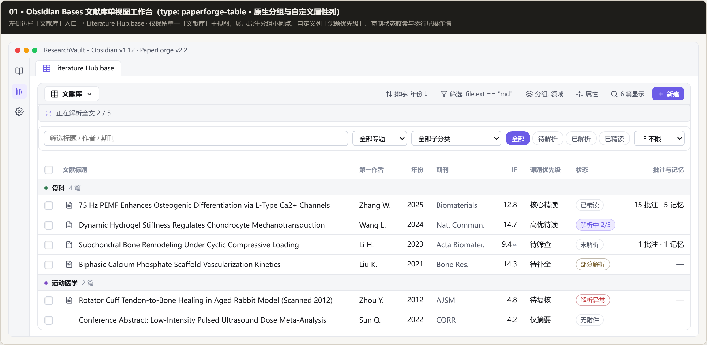

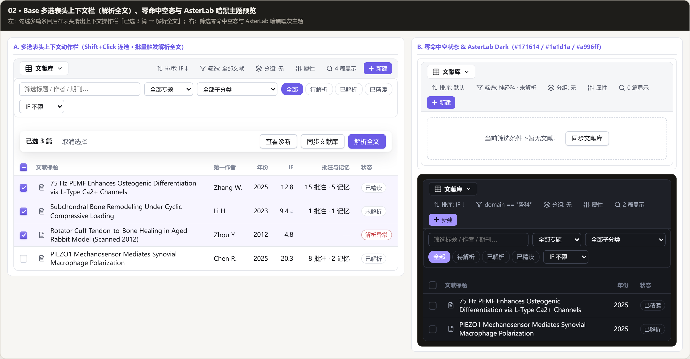

---

## 4. Companion 伴读侧栏（`PaperForgeStatusView`）与检索交互

`PaperForgeStatusView` 根据当前焦点叶节点自动在四种模式间切换，同样遵循 AsterLab 暖灰分层卡片、`高级选项与技术标识`折叠披露与克制单主 CTA：

1. **Global Mode（全局概览）**：展示文献总数、系统状态行、环境缺失或索引过期恢复引导，以及系统检索入口。
2. **Collection Mode（集合漏斗）**：在激活特定领域或 `.base` 视图时，并排呈现「总文献 → PDF 就绪 → OCR 完成 → 精读沉淀」漏斗与 OCR 流水线分布。
3. **Paper Mode（单篇伴读 + 5 维度研究认知记忆）**：展示一句话精读总览与 5 维度 **研究认知记忆**（`研究思路与逻辑链`、`实验技术与关键参数`、`研究技巧与巧思`、`硬伤、边界与存疑`、`课题迁移与灵感` —— 采用 Refine-Don't-Append 原位演进机制，移除 `rev` 版本噪声标签），将流程控制与工程元数据收入 `高级选项与技术标识` 折叠区块。
4. **检索状态矩阵**：区分 `M` 元数据快速检索、`@` 混合语义深度检索，以及索引/向量未就绪时的就地重建引导卡。

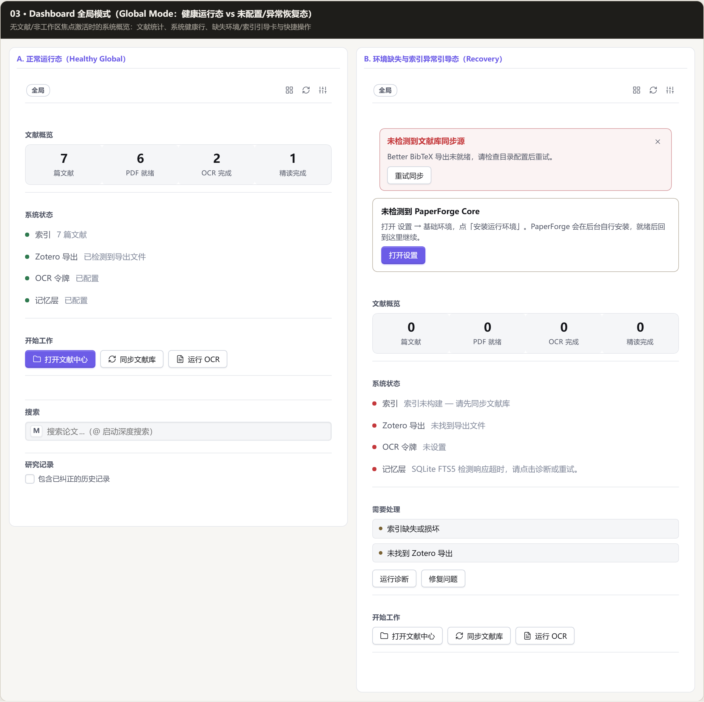

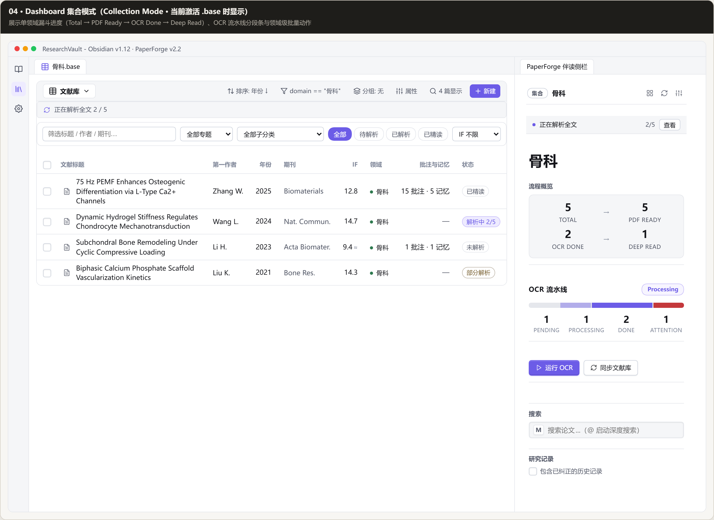

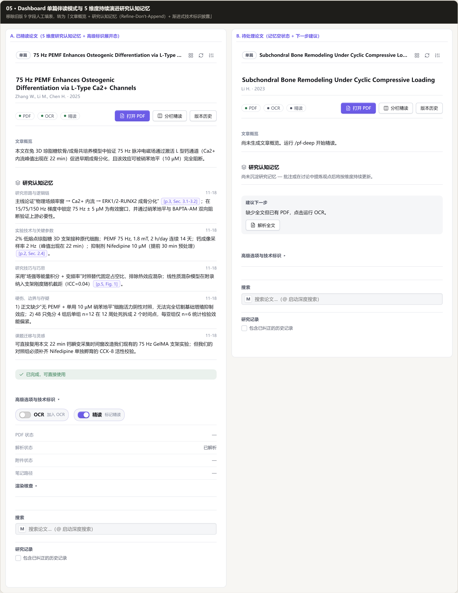

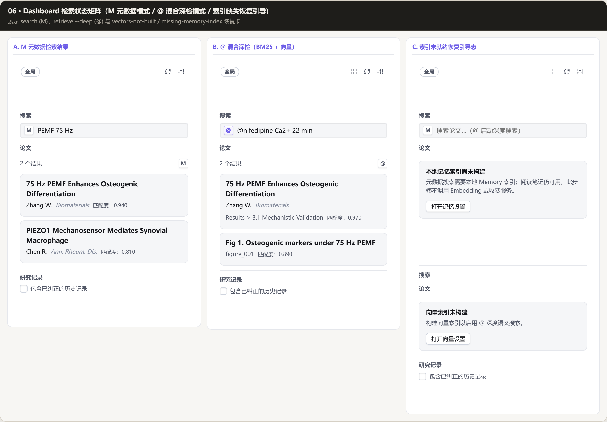

---

## 5. macOS 预览级双层 PDF 阅读器与 Zotero 笔记引述桥（`PaperForgePdfView`）

### 5.1 两级克制工具栏设计（零划词抢断弹窗）

对标 **Apple Preview (`预览.app`)** 极简工具条体系，内置侧车 PDF 阅读器由 `42px` 一级常驻磨砂栏与按需展开的 `38px` 二级「标记」栏组成，**普通阅读模式下划词选字不主动弹出任何浮动窗口**：

- **42 px 无边框磨砂一级主栏（`.pf-pdf-toolbar`）**：
  - 左侧：侧栏开关（`panel-left`）、文献标题（仅在文件哈希发生变动时显示条件警告胶囊 `原 PDF 文件已变更`）。
  - 中部：分组胶囊簇承载页码前后翻页与 `pf-tnum` 页码输入（`.pf-pdf-nav-cluster`），以及缩放加减与 `适合宽度`（`.pf-pdf-zoom-cluster`）。
  - 右侧：
    - **Apple Preview 分裂「高亮 | ▾」控件**（`.pf-pdf-split-highlight`）：已有文本选区时点击主段**零弹窗即刻落下**当前颜色与样式的高亮/下划线/删除线；无选区时切换连续高亮笔模式（`.is-active`）。点击 `▾` 展开磨砂下拉面板，提供 5 枚粉彩墨色圆点（黄 / 绿 / 蓝 / 粉 / 紫）、`下划线`、`删除线` 与 `添加笔记`。
    - **`标记` 开关（`pen-tool`）**：展开/收起二级标记工具栏。
    - **`AI 导读标注` 开关（`sparkles`）**：静默显隐 AI 批注与页边定位括号层。
    - **`并排打开文献笔记`（`columns-2`）** 与 **内置聚焦环全文搜索框**。
- **38 px 二级「标记」工具栏（`.pf-pdf-markup-bar`）**：
  - 工具组：`文本选择`、`矩形框选`（拖出选区后显示轻量 `[插入笔记引用 | 存为框选 | 添加笔记]` 浮条）、`自由画笔`（`ink` SVG `<polyline>`）、归组胶囊内的`形状`（`矩形` / `椭圆` / `箭头` / `直线`，带方向保真 `<marker>` 箭头）、`文本框 T`（页面点击原地行内输入）与 `便签`（`note`）。
  - 样式组：5 枚线条色板、透明/半透明填充开关、内凹胶囊内的 **3 档图形化线宽条（`.pf-stroke-bar`）** 与 **`Aa 12 · 14 · 16` 字号选择器**。

### 5.2 非破坏性侧车存储与 `style_json` 持久化

所有标注继续坚持**零污染源 PDF 字节**契约：事件流写入 `<workspace>/annotations.jsonl`，经 `paperforge/services/annotations_service.py` 校验 `kind`、`color` 与 `_normalize_style()` 后同步到 SQLite `paper_annotations.style_json` 列（含 `shape_type`、`stroke_color`、`fill_color`、`stroke_width`、`font_size`、`points` 等矢量坐标与样式字段）。

### 5.3 268 px 左侧检查器栏与 Zotero 式「拷贝引用至笔记」

左侧可折叠栏提供 Apple Preview 一致的 `.pf-segmented` 三标签：`缩略图`（实时画布缩略图 + 当前页紫框高亮）、`目录`（读取 PDF Outline 并兼容 OCR `section_path` 回退）与 `批注`（`全部 | 我的 | AI 导读` 筛选、`清空 AI 标注`、语义化类型与 AI 透镜徽章、`p.N` 右对齐页码、与标注同色的单条左侧引文竖线、`采纳`、以及 Zotero 风格的 **`拷贝引用至笔记`** 一键生成带双链页码的引用文本 `> "<exact_text>" — [[<note_rel>|<key> p.<page>]]`）。

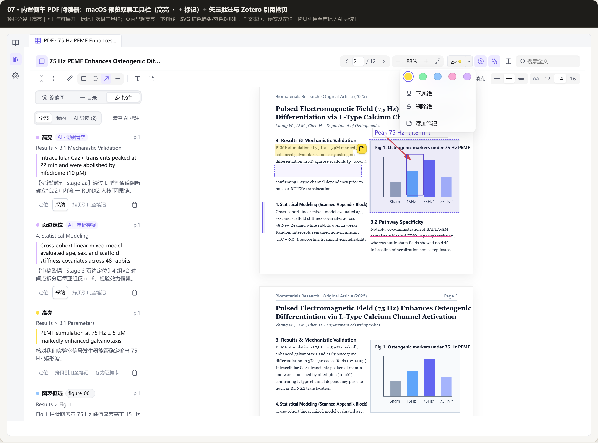

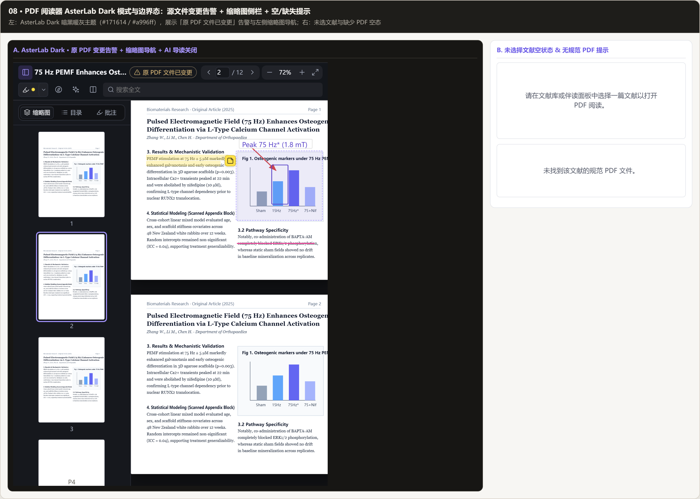

---

## 6. 设置控制中心、一屏极速引导与二级批量维护台

1. **一屏极速引导（默认新户入口 · `_renderExpressSetup`）**：面向零代码科研工作者砍掉繁琐四步跳转——**单屏整合**「① 计算引擎（后台自动安装不阻塞后续选项）→ ② 直连 Zotero（`zotero.sqlite` 免 BBT、同名 `Literature/` 自动隔离防护、交互式 A/B 目录与 Base 总表实时预览）→ ③ 可折叠可选 AI 与期刊数据源预设（硅基流动 / 百炼 / 智谱 / OpenAI / Ollama 一键填参 + 实测连接）→ 底部单一主按钮保存并同步」；右上角仍保留「分步详情模式」以便高级排查。
2. **设置控制中心（`PaperForgeSettingTab`）**：`01–05` 编号能力列表清晰展示 6 种状态胶囊（Ready / Checking / Setup Required / Action Required / Not Enabled / Detection Failed），底部集成 `界面配色` 双模式开关；模块详情与 `MaintenanceItem` 提供结构化错误剖析与「复制诊断信息」。
3. **四阶段安装向导（分步详细视图）**：支持逐阶细致检验托管运行时、Zotero 库路径、可选能力与就绪检查。
4. **二级维护台与安全弹窗（`OcrWorkspaceView` & Modals）**：仅按需进入的批量 OCR 重跑、版本恢复对比、只读 OCR 排版诊断预览与 Zotero 孤儿清理弹窗均已统一切换至 AsterLab 语义变量与线条图标体系。

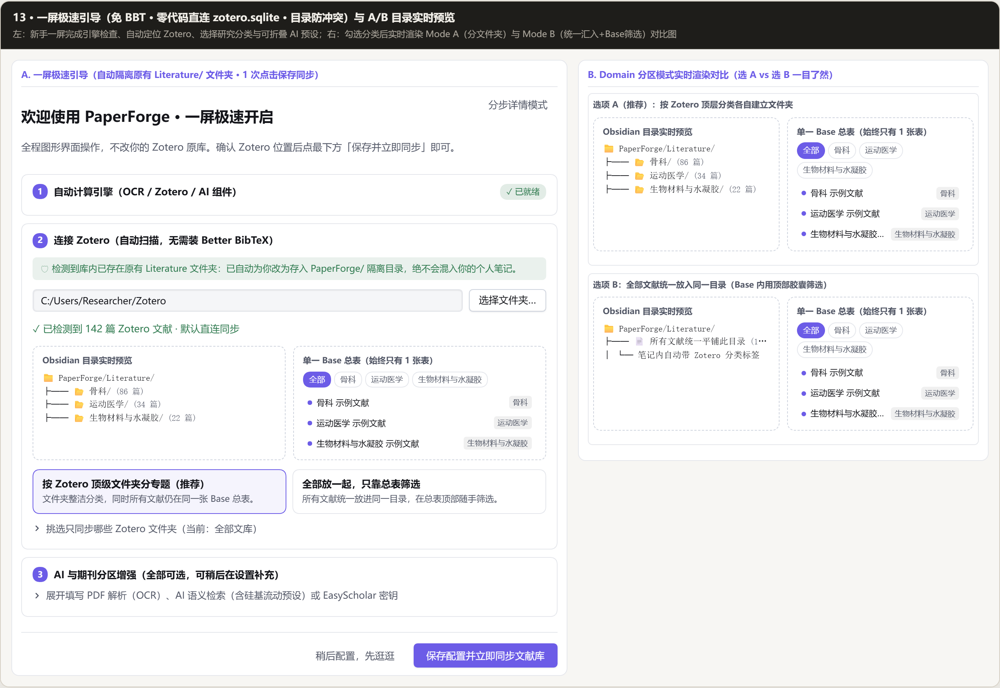

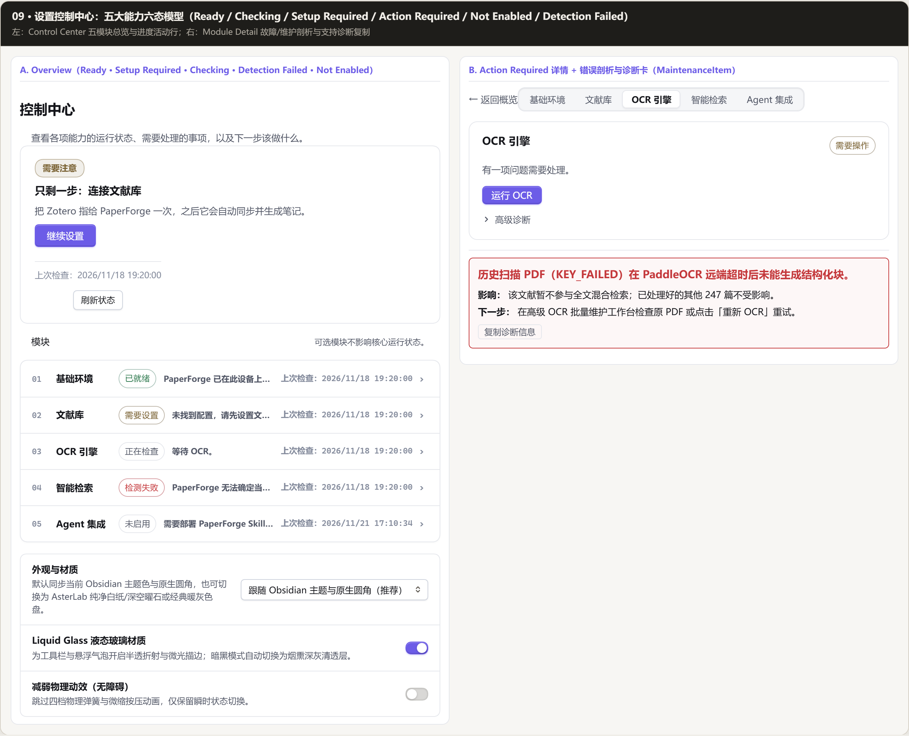

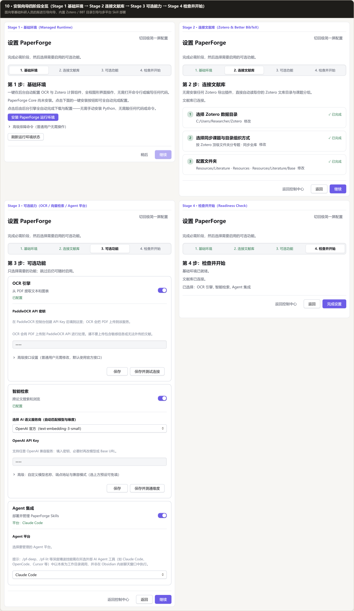

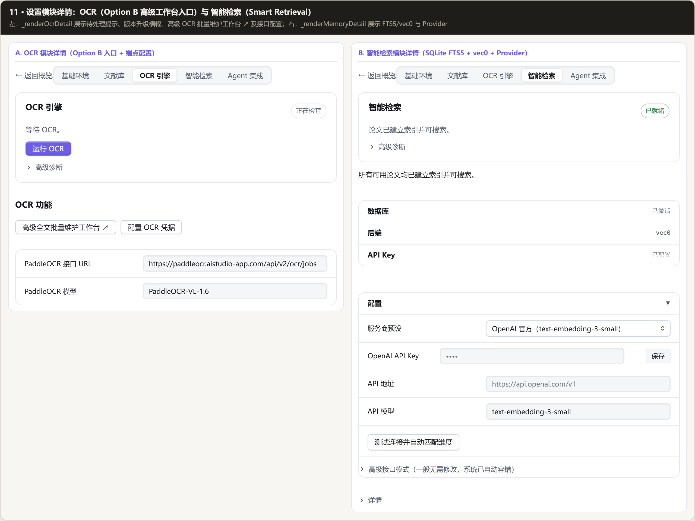

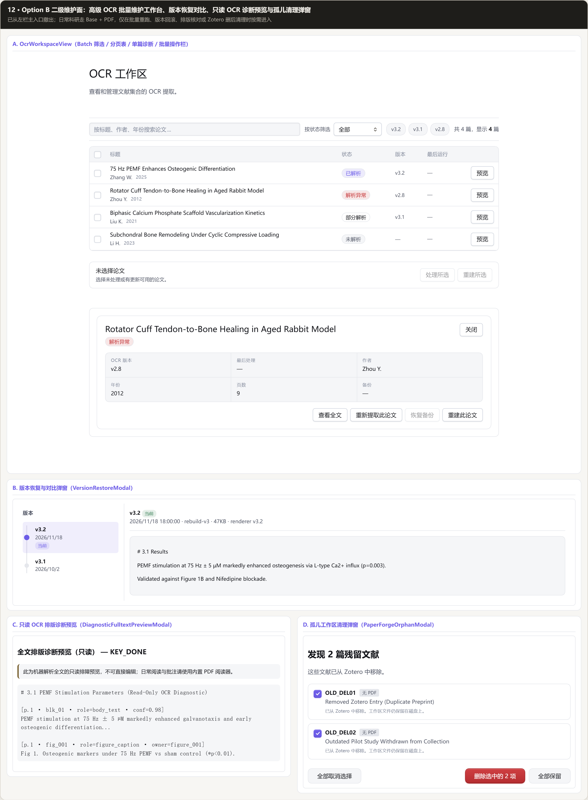

---

## 7. AsterLab UX 契约深度对齐（ADR-016）

围绕任务收敛、可恢复反馈与窄分栏可读性，UI 在现有暖灰体系之上补充了五项可门禁验收的交互约束：

1. **三档圆角与零日志前缀门禁**：全量 `styles.css` 收口至 `--pf-radius-control`（`6px`）/ `--pf-radius-panel`（`10px`）/ `--pf-radius-dialog`（`12px`）三档（零 `5/7/8/9px` 散落字面量），所有界面视图移除 `[!!]` / `[OK]` / `[i]` 工程师前缀。
2. **全端统一词表**：Companion 模式切换徽章统一使用本地化语义词（`全局` / `单篇` / `集合` / `版本历史`）；Base 表格与 `OcrWorkspaceView` 共用同一套状态词表（`已精读` / `已解析` / `解析中` / `排队中` / `部分解析` / `解析异常` / `未解析` / `无附件`）；高技术字段折叠区统一本地化为 `渲染核查`、`PDF 状态`、`解析状态`、`附件状态`、`笔记路径`。
3. **行内可恢复报错横幅（`.pf-recovery-banner`）**：遇到库未同步、`.base` 目录缺失、PDF/全文定位失败、同步或版本读取异常时，不再只弹一闪而过的 Toast，而是在 Companion 顶部保留带 **原因说明 + 直达修复/重试按钮** 的持久化恢复条。
4. **单主 CTA 约束 + 零占位后台活动条（`.pf-global-activity-strip`）**：单一视口只保留一个高亮主按钮；通过 `PaperForgePlugin.getActiveBackgroundTasks()` 聚合后台同步/OCR/向量任务，空闲态 `0px` 不占位，运行态实时显示进度并支持一键 DeepLink 跳转对应文献或 OCR 工作台。
5. **研究认知记忆 ↔ PDF 原位 DeepLink 与窄分栏响应**：研究记忆正文中的页码引用（如 `[p.3, Sec. 3.1]`、`第 5 页`）自动渲染为可点击 `.pf-memory-deeplink` 芯片，直接定位并滚动内置 `PaperForgePdfView`；PDF 视图在 `<= 680px` 分栏宽度下自动切换 `.is-narrow` 折叠换行，保证工具按钮与全文搜索框不被裁切。

---

## 8. Obsidian 原生圆角同步、Liquid Glass 材质与四档物理动效（ADR-017）

对照最新 [AsterLab Handbook · Design System & Liquid Glass](https://docs.asterlab.party/?doc=docs%2Fhandbook%2Fdesign-system.md)，补充插件的宿主原生融合与触感精致度规范：

1. **默认同步 Obsidian 主题与三档原生圆角**：`ui_theme_mode` 默认设为 `obsidian`（自动对齐当前 Obsidian 主题配色及 `--input-radius` / `--button-radius` / `--radius-s/m/l` / `--modal-radius`），同时保留 `asterlab`（纯净白纸 `#ffffff` / 深空曜石 `#111215` + `#6c5ce7`）与 `warm`（经典暖纸 `#f7f6f3` / `#171614`）两套显式预设。
2. **Liquid Glass 浅透 / 深烟熏双通道材质（严禁 Glass-on-Glass）**：仅在顶栏工具条与悬浮气泡（`.pf-pdf-toolbar`、`.pf-base-selection-bar`、`.pf-pdf-highlight-dropdown`、`.pf-pdf-popover`）开启毛玻璃折射 + 顶部内高光白边；Dark 模式采用 `rgba(20, 22, 28, 0.86/0.92)` 烟熏清透遮罩而非抬灰白雾；侧栏卡片（Anti-XP-Box 去重框）与 Dark 弹窗保持纯实底，设置面板支持一键开关（`ui_liquid_glass`）。
3. **四档物理微动效与无障碍降级**：覆盖按钮按压微缩 `scale(0.97)`（`100ms`）、选区条与活动条平滑托出（`160ms`）、悬浮下拉面板微弹展开（`220ms`）及空保存/校验拒绝轻晃 `.pf-nudge`（`±5px`），并同时尊重 `prefers-reduced-motion` 与设置开关（`reduce_motion`）。
