# PaperForge Obsidian UI 状态全景与原生 `.base` 设计规范

> 本文档完整记录 PaperForge 插件在 Obsidian 中的全部界面视图、交互状态机、原生 `.base` 物理读写分离契约，以及面向科研伴读的 Living Paper Memory 与双层 PDF 批注系统设计。
> 文档中的所有截图均由真实生产 TypeScript 视图组件配合生产样式表在无头浏览器中实时渲染生成，用于保证设计规范与上线代码的一致性，并支持后续 UI / `.base` 演进后一键重绘更新。

---

## 1. 文档约定与截图一键更新机制

### 1.1 真实组件驱动截图架构

本设计文档不依赖手工拼贴静态原型图，而是通过浏览器渲染管线直接挂载生产源码中的视图类与真实样式文件 `paperforge/plugin/styles.css`：

| 组成部分 | 路径 | 职责 |
| --- | --- | --- |
| 渲染编排脚本 | `scripts/dev/render_obsidian_ui_docs.py` | 使用 `esbuild` 打包展示场景入口并内联 `styles.css`，启动 headless Chromium 截取 12 张 `@2x` Retina PNG 至 `docs/images/ui-states/` |
| 场景构建入口 | `scripts/dev/_obsidian_ui_showcase.ts` | 导入真实 `PaperForgeBasesView`、`PaperForgeStatusView`、`PaperForgePdfView`、`PaperForgeSettingTab`、`OcrWorkspaceView` 与三大安全弹窗，为各状态注入合成快照与受控桩响应 |
| Obsidian DOM 垫片 | `scripts/dev/_obsidian_browser_shim.ts` | 提供 Obsidian API 运行时垫片（含 `BasesView`、`ItemView`、`PluginSettingTab`、`Modal`、`Setting`、`createEl` 三参数扩展及 `loadPdfJs` 学术双栏矢量页渲染） |
| 产物图片目录 | `docs/images/ui-states/` | 存放 `01-*.png` 至 `12-*.png` 共 12 张高分截图（不使用 `docs/evidence/`，遵守静态追踪门禁） |

> [!NOTE]
> 为保证离线、确定性渲染与静态路径门禁通过，展示场景仅使用合成仓库路径（如 `D:/ResearchVault`、`C:/Users/Researcher/Zotero`），不读取本机真实文献库。

### 1.2 一键更新流程与受影响源码清单

每当以下源文件发生交互、样式、列定义或状态枚举变更时，应重新生成截图并同步修订对应章节：

- **`.base` 与表格视图**：`paperforge/worker/base_views.py`、`paperforge/plugin/src/views/paperforge-base-view.ts`
- **Dashboard 伴读与检索**：`paperforge/plugin/src/views/dashboard.ts`
- **PDF 双层批注与定位**：`paperforge/plugin/src/views/pdf-annotator.ts`
- **设置中心与向导**：`paperforge/plugin/src/views/settings.ts`
- **Option B 批量维护与弹窗**：`paperforge/plugin/src/views/ocr-workspace.ts`、`paperforge/plugin/src/views/modals.ts`
- **视觉样式表**：`paperforge/plugin/styles.css`

在仓库根目录执行单条命令即可重绘全部 12 张截图：

```bash
python scripts/dev/render_obsidian_ui_docs.py
```

脚本会在首次导航失败（超过 `15s` 超时）或捕获未处理页面异常时快速失败退出；执行完成后通过 `git diff` 检查图片与文档联动变更即可。

---

## 2. Obsidian 全局交互拓扑与无守护实时状态机

### 2.1 Option B 主工作区入口架构

PaperForge v2.2 采用 **Option B 精简主入口设计**，将日常高频研究闭环收敛到左侧 Ribbon 的 2 个核心入口，并将重度批量 OCR 运维下沉为二级维护工作台：

1. **Literature Hub（`library` 图标）**：调用 `openLiteratureBase()` 打开 `<base_dir>/Literature Hub.base`；若 `.base` 文件尚未生成或打开失败，则自动回退到 Dashboard。
2. **PaperForge Dashboard（`book-open` 图标）**：打开 `PaperForgeStatusView`，根据当前激活文档自动切换全局总览、集合漏斗、单篇深度伴读与历史版本模式。
3. **内置 PDF 侧车阅读器（`PaperForgePdfView`）**：从 `.base` 操作列 `[📄 PDF]` 或 Dashboard Paper Mode `[📄 打开 PDF]` 唤起，直接读写侧车批注并叠加 AI 精读层。
4. **设置控制中心（`PaperForgeSettingTab`）**：通过六态能力模型与四步引导向导管理安装、文献库连接、OCR、记忆索引与多平台 Agent 集成。
5. **二级维护工作台（`OcrWorkspaceView`）**：原 Ribbon `"scan-text"` 图标已从主工具栏移除；仅通过 `Settings → OCR → 高级 OCR 批量维护工作台 ↗`、`.base` 行内 `[🔧 诊断]` 按钮或命令面板（`paperforge-ocr-workspace`）进入。

### 2.2 无常驻守护进程的 `.state-seq.json` 实时同步循环

PaperForge 不在 Obsidian 进程内维持重型后台守护进程，而是通过轻量的本地文件序列号信号驱动多视图毫秒级协同刷新：

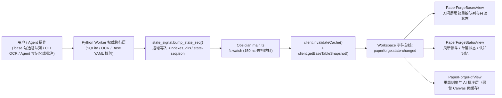

- **单向权威写回边界**：Python 后端负责全部持久态写入（SQLite 数据库、`Living Paper Memory`、`Base` 结构化属性生成及 `state_signal.bump_state_seq()` 触发）；Obsidian 前端只在显式用户交互时通过受控指令与 Worker 通信。
- **Canvas 防闪烁原则**：`PaperForgePdfView` 响应 `"paperforge:state-changed"` 时仅重算批注叠加层与右侧卡片栏，不重建底层 PDF 渲染画布。

---

## 3. 原生 Obsidian `.base` 文献工作台设计（`PaperForgeBasesView`）

### 3.1 `.base` YAML 结构契约与视图合并策略

`paperforge/worker/base_views.py` 通过 `build_base_views(domain)` 与 `merge_base_views` 生成并维护 `.base` 文件，统一绑定自定义视图类型 `type: "paperforge-table"`（对应前端类 `PaperForgeBasesView`）：

- **根级过滤规则（`filters.and`）**：
  - `file.inFolder("<folder_filter>")`（限定所属文献域文件夹）
  - `file.ext == "md"`（仅纳入主笔记条目）
  - `"!zotero_key.isEmpty()"`（确保与 Zotero 唯一标识关联）
- **标准属性集合（`properties:`）**：共定义 14 个声明属性，从 `zotero_key` 到 `pdf_path`，覆盖元数据（标题、年份、一作、期刊、影响因子）、文件可用性（`has_pdf`、`pdf_path`）、用户队列意图（`do_ocr`、`analyze`）与后端只读状态（`ocr_status`、`deep_reading_status` 等）。
- **内置三视图定义**：
  1. **`控制面板`**：展示全量文献工作台列（`file.name`, `title`, `year`, `first_author`, `journal`, `impact_factor`, `has_pdf`, `do_ocr`, `analyze`, `ocr_status`, `deep_reading_status`, `pdf_path`）。
  2. **`待 OCR`**：内置过滤表达式 `do_ocr == true && ocr_status == "pending"`。
  3. **`待深度阅读`**：内置过滤表达式 `analyze == true && ocr_status == "done" && deep_reading_status == "pending"`。
- **用户视图与列宽保留机制**：所有由 PaperForge 管理的视图头部均带有 `# PAPERFORGE_VIEW: <name>` 标记；执行 `merge_base_views` 刷新 `.base` 定义时，系统自动识别并原样保留用户自建的自定义视图（无该标记的 view 块）以及现有 `widths:` 列宽配置，支持用户自由扩展筛选/排序视图并与 `PaperForgeBasesView` 无缝协作。

### 3.2 物理读写分离模型

为根治早期纯 YAML 同步导致的频繁磁盘改写与竞态覆盖，`.base` 工作台实施严格的物理读写分离：

| 数据维度 | UI 列归属 | 物理存储层与写入权限 | 更新触发链路 |
| --- | --- | --- | --- |
| **用户队列意图** | `队列意图`（`OCR` / `精读` 复选框） | **YAML Frontmatter 可写**（`do_ocr`、`analyze`） | 勾选复选框调用 `client.setNoteFlag` 写回笔记 YAML 并递增 `.state-seq.json` |
| **处理流水线状态** | `处理状态 (只读)` | **SQLite 权威只读快照**（`ocr_status`、`deep_reading_status`、实时运行进度） | 仅由 Python OCR / 精读任务更新，前端禁止直接篡改笔记头 |
| **认知沉淀统计** | `认知沉淀` | **SQLite + 侧车只读聚合计数** | 统计 `🧠 M`（记忆版本/条数）、`🖍️ U`（人工批注）、`🤖 A`（AI 批注）；全无时显示 `—` |
| **元数据与文件定位** | `文献` / `操作` | **Formal Library & Snapshot 只读映射** | `zotero_key` 主键对齐，支持标题点击打开主笔记 |

**行标识回退解析链（Row-Key Resolution）**：`PaperForgeBasesView` 从 `this.data?.data` 读取 Obsidian Bases 引擎筛选后的条目时，按 `note.zotero_key` → `entry.file.path === main_note_path` → `entry.file.basename` 三级回退定位后端快照行；若当前尚未接入 Bases 引擎数据源，则安全回退展示 `Object.values(snapshot.rows)`。

### 3.3 全状态与边界场景矩阵（含截图）

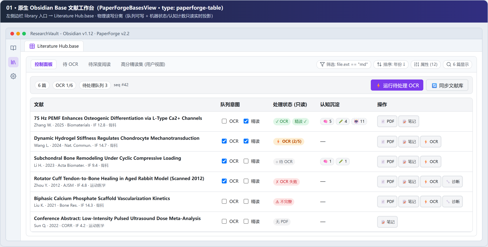

*图 3.1：`PaperForgeBasesView` 完整状态展示 — 顶部汇总工具栏与全部单篇处理状态行（运行中进度、OCR 完成 + 精读完成 + 认知沉淀徽章、待 OCR 排队、部分成功/不完整、OCR 失败诊断、无 PDF、未知状态及双行高亮行）。*

**顶部工作台工具栏固定信息密度**：
- 统计摘要：`<N> 篇`、`OCR <done>/<N>`、`待处理队列 <queued>`、同步序号 `seq #<seq>`
- 核心全局操作：`[⚡ 运行待处理 OCR]`（当存在待处理或队列任务时高亮可点击）、`[🔄 同步文献库]`

**行级 `处理状态 (只读)` 与 `操作` 按钮渲染矩阵**：

| 状态标识 / 条件 | `处理状态 (只读)` 胶囊文本 | `认知沉淀` 显示 | `操作` 列可用按钮 |
| --- | --- | --- | --- |
| 实时运行中（`isOcrRunningForKey`） | `⚡ OCR (<cur>/<tot>)` | 已有则展示徽章，否则 `—` | `📄 PDF`、`📝 笔记`（有则显示） |
| 处理完成（`done`） | `✓ OCR`（若已精读叠加 `精读 ✓`） | `🧠 M` / `🖍️ U` / `🤖 A` | `📄 PDF`、`📝 笔记` |
| 等待处理（`pending`） | `○ 待 OCR` | 通常 `—` 或已有 `🖍️ U` | `📄 PDF`、`📝 笔记`、`⚡ OCR` |
| 后台排队/执行（`processing`） | `⚡ 处理中` | 已有则展示，否则 `—` | `📄 PDF`、`📝 笔记` |
| 产物不完整（`done_incomplete` / `needs_diagnostic`） | `⚠ 不完整` | 按实统计 | `📄 PDF`、`📝 笔记`、`⚡ OCR`、`🔧 诊断` |
| OCR 失败（`failed`） | `✗ OCR 失败` | 按实统计 | `📄 PDF`、`📝 笔记`、`⚡ OCR`、`🔧 诊断` |
| 无 PDF 附件（`has_pdf == false`） | `无 PDF` | 按实统计 | 仅 `📝 笔记`（隐藏 `📄 PDF` 与 `⚡ OCR`） |
| 未知 / 待校验（`unknown`） | `○ 待 OCR` / 状态 fallback | `—` | 按 `has_pdf` / `main_note_path` 条件渲染 |

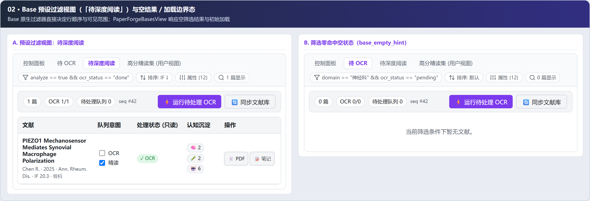

*图 3.2：`.base` 边界与过滤空态 — 面板 A（待处理队列全清 / 空数据集占位）、面板 B（已筛选视图命中子集 + 部分论文待诊断状态）。*

---

## 4. Dashboard 四模式伴读与检索状态规范（`PaperForgeStatusView`）

`PaperForgeStatusView` 作为右侧边栏常驻伴读中枢，依据工作区焦点自动在四种模式间切换，不要求用户手动切页：

| 模式 | 触发焦点条件 | 核心职责 |
| --- | --- | --- |
| **`global`（全局模式）** | 未选中特定文献笔记或 `.base` 文件（或显式返回全局） | 展示全库健康度（总篇数/待 OCR/待精读/PDF 就绪）、4 项系统状态行、异常摘要、快捷动作与混合检索 |
| **`collection`（集合模式）** | 当前激活叶节点为 `.base` 文献域文件 | 展示该领域漏斗指标、OCR 分段进度条与域内限定快捷指令 |
| **`paper`（单篇伴读模式）** | 当前打开某篇 Zotero 文献主笔记 | 展示单篇 PDF/OCR/精读三态、`文章概览`、`🧠 动态认知记忆（5 分区）`、`建议下一步`、`最近讨论`、折叠技术详情与域内检索 |
| **`versions`（版本模式）** | 在单篇模式下触发版本历史查看 | 展示全文历史构建版本时间线与差异恢复入口 |

### 4.1 全局模式（健康态 vs 缺失后端 / 异常提示）

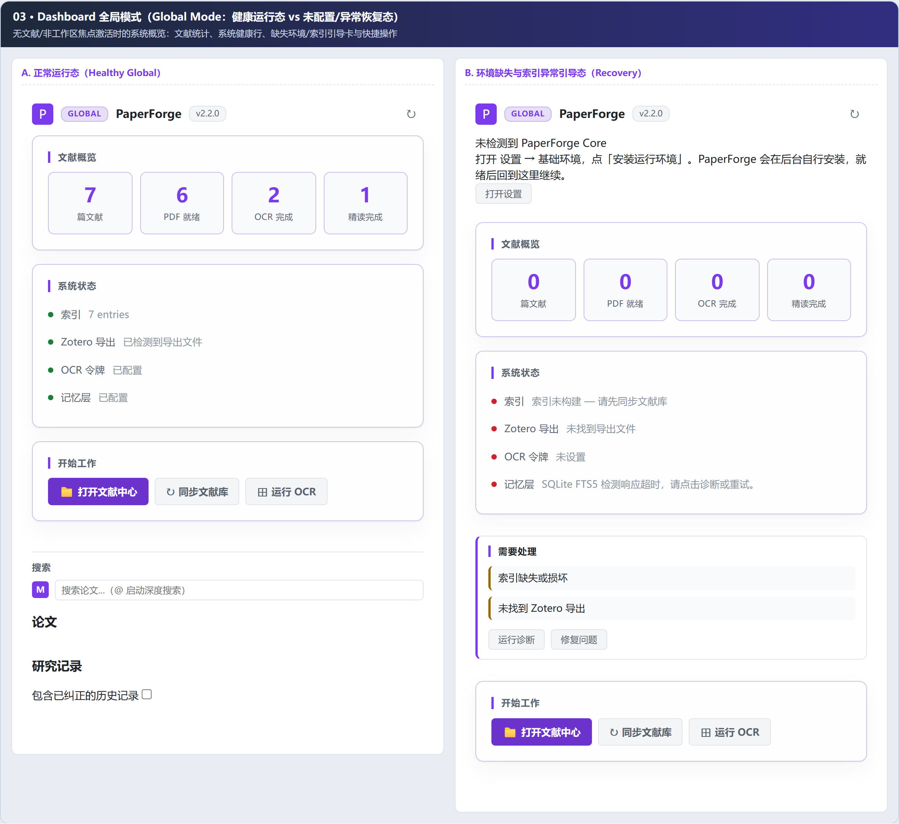

*图 4.1：Dashboard Global 模式对比 — 面板 A 为全模块就绪的健康工作态；面板 B 演示未配置好或后端异常时的降级提示、异常统计告警与诊断/设置引导动作。*

### 4.2 集合模式（域 `.base` 激活漏斗与流水线进度）

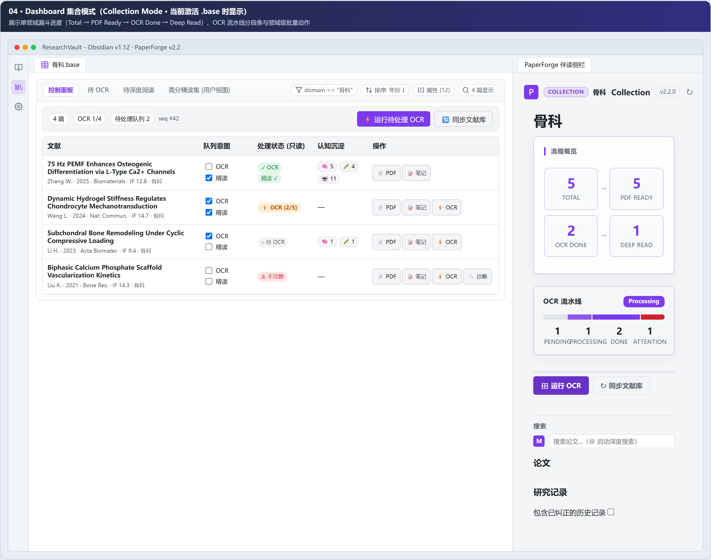

*图 4.2：Dashboard Collection 模式 — 与 `.base` 文献库视图协同联动，右侧侧边栏实时呈现当前文献域的四阶段漏斗（Total / PDF Ready / OCR Done / Deep Read）、分段式 OCR 进度条与一键域内操作按钮。*

### 4.3 单篇伴读模式与 5 分区 Living Paper Memory

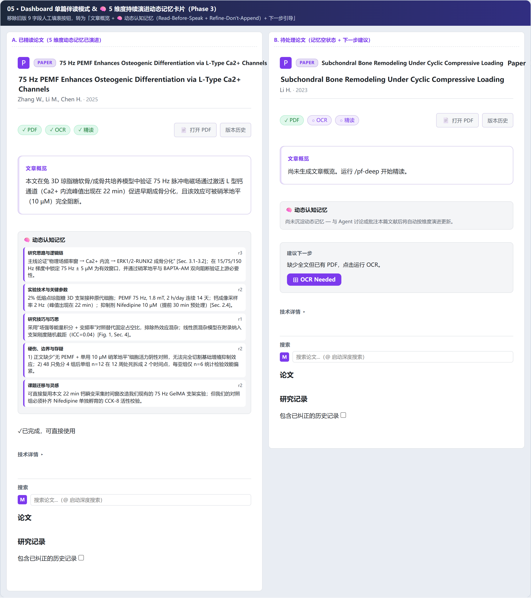

*图 4.3：Dashboard Paper 模式 — 完整展示 v2.2 精简伴读布局：移除旧版 9 字段人工科研意图填表按钮，转为以 `🧠 动态认知记忆` 为核心的连续演进视图，覆盖全 5 个认知分区与多轮讨论修订记录。*

Paper Mode 的关键设计约束如下：
- **状态胶囊与直达操作**：顶部固定展示论文标题、PDF / OCR / 精读三枚状态胶囊，以及 `[📄 打开 PDF]` 与 `[版本历史]` 按钮。
- **去除静态表单负担**：不再向科研用户展示复杂的前端 9 字段意图填表按钮；改为由用户在对话中与 Agent 讨论后，由 Agent 通过统一记忆写入工具增量更新数据库。
- **`🧠 动态认知记忆` 5 分区契约**：系统将每篇文献的长期认知沉淀结构化为 5 个正交分区，每次更新均携带修订轮次（如 `rev #N`）并基于历史记忆持续深化而非无意义堆叠：
  1. `idea_logic`（研究思路与核心逻辑）
  2. `methods_params`（实验技术与关键参数）
  3. `research_craft`（写作与研究技巧）
  4. `critique_limits`（局限性与批判审视）
  5. `my_connection`（与我课题的关联）
- **决策建议与详情折叠**：卡片底部根据当前状态渲染 `建议下一步`（或完成态提示 `✓ 已完成，可直接使用`）、`最近讨论` 摘录，以及默认折叠的 `技术详情`（隐藏 `zotero_key`、路径等低频排障信息，保持阅读区清爽）。

### 4.4 全局检索与全部错误/恢复状态枚举

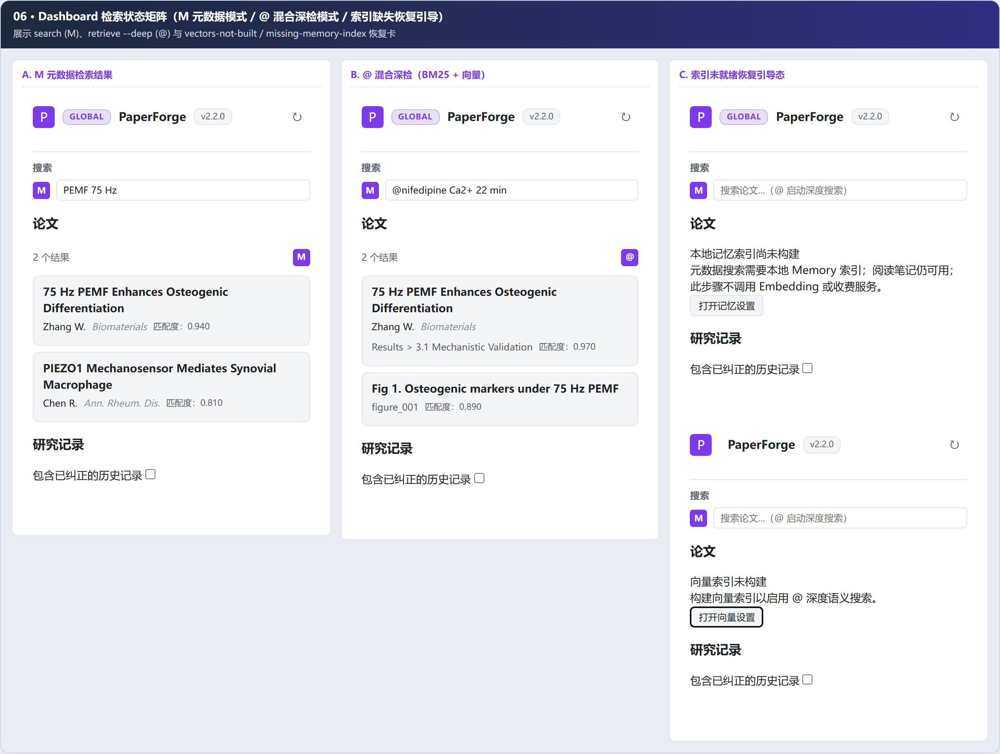

*图 4.4：`_renderSearchState` 八态覆盖矩阵 — 完整覆盖空闲（`idle`）、检索中（`searching`）、混合命中结果（`results`：`M` 元数据匹配 vs `@` 深度语义/记忆匹配）、无结果（`empty`）、向量库未构建（`vectors-not-built`）、缺失记忆索引（`missing-memory-index`）、后端不可达（`backend-unavailable`）与请求超时（`timeout`）及对应单键恢复动作。*

---

## 5. 内置侧车 PDF 阅读与 `[🤖 AI 批注层]`（`PaperForgePdfView`）

为规避用户直接编辑可重生成的 `fulltext.md` 并在重建后丢失批注，PaperForge 将阅读与批注工作流完全收口至随文献持久化存储的 PDF 侧车批注体系，支持人工批注与 Agent 精读批注同屏双层协作。

### 5.1 双层批注、极简创建浮窗与三级精准定位视觉分层

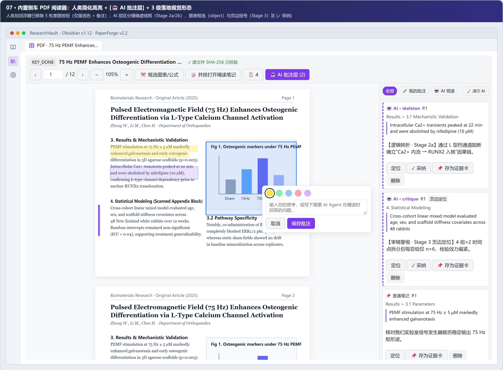

*图 5.1：`PaperForgePdfView` 主界面 — 顶部工具栏（含 SHA-256 校验徽章、页码导航、`[🤖 AI 批注层 (N)]` 开关）、中央学术双栏 PDF 画布（叠加热区框、极简新建批注浮窗、跨栏/单句紫虚线框及三级左页边距括号 `.pf-pdf-margin-bracket`），以及右侧过滤选项卡与人工/AI 双色卡片流。*

**核心交互与视觉规范**：
1. **极简人类批注创建浮窗**：框选文本或矩形区域后，只保留 5 枚颜色色块（黄/绿/蓝/紫/红）、多行批注输入框与 `[取消]` / `[保存]` 按钮，固定以极简意图 `intent: "general"` 写入侧车，消除任何打断阅读的表单选项。
2. **工具栏与右侧边栏双层过滤**：
   - 工具栏按钮 `[🤖 AI 批注层 (N)]` 控制画布上全部 Agent 精读叠加层的即时显隐。
   - 右侧卡片列表支持三路过滤标签 `[全部]` / `[🖍️ 我的批注]` / `[🤖 AI 领读]`，并提供 `[🧹 清空 AI]` 一键重置 Agent 建议批注（绝对不误删用户人工批注）。
3. **三阶段误差容忍定位引擎的视觉呈现层级**：
   - **Stage 1/2 精确句级 / 跨栏文本定位（`exact_sentence` / `exact_cross_column`）**：在 PDF 画布上以紫罗兰虚线边框高亮（`.pf-pdf-hl-agent`），卡片显示高置信定位徽章，精准贴合双栏折行文本。
   - **Stage 2 图表 / 公式对象框定位（`exact_object`）**：基于 OCR 图像或表格 bbox 绘制独立区域选框，卡片内置高清裁剪缩略图，支持 `[📌 证据卡]` 与 `[📋 复制图片嵌入]`。
   - **Stage 3 段级边距回退定位（`margin` fallback）**：当 OCR 识别存在字词误差导致句级坐标无法唯一锁定、仅能对齐到段落 bbox 时，不在正文中强行乱飞高光，而是在页面左侧边距绘制带锚点与页边批注括号的标记（`.pf-pdf-margin-bracket`），向用户诚实传达段级对齐区间。
4. **AI 建议采纳闭环**：AI 卡片独有 `[✓ 采纳]` 动作按钮，点击后将该条 Agent 批注转正为个人科研笔记留存；所有卡片共享 `[定位]` 与 `[删除]` 操作（人工/图框卡片按类型开放 `[📌 证据卡]` / `[📋 复制图片嵌入]`）。

### 5.2 源文件 SHA-256 校验态与缺失 PDF 空态

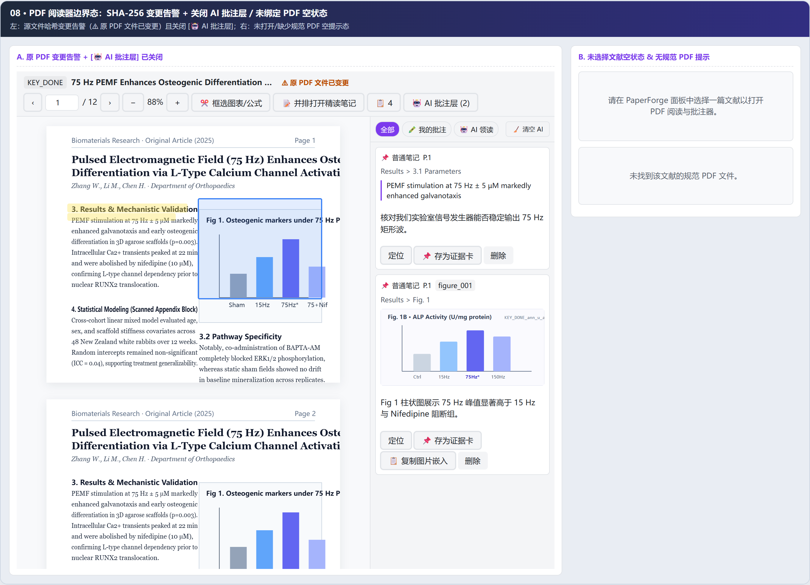

*图 5.2：`PaperForgePdfView` 校验与空态 — 面板 A 展示原 PDF 替换或哈希漂移时的警告胶囊（`⚠ 原 PDF 文件已变更`）；面板 B 展示尚未挂载 PDF 附件或文献缺失时的安全空态提示。*

- **文件溯源校验（Provenance Guard）**：打开 PDF 时核对侧车记录的源文件哈希，一致时于顶部显示绿色 `✓ 源文件 SHA-256 已校验`；若检测到 Zotero/磁盘替换了新版 PDF，则亮起琥珀色 `⚠ 原 PDF 文件已变更`，提示用户注意坐标偏移风险。

---

## 6. 设置控制中心、六态能力模型与四步安装向导（`PaperForgeSettingTab`）

### 6.1 六态能力模型与五大核心模块

`PaperForgeSettingTab` 彻底取代过去依赖代码报错与隐式配置文件排查的设置页，采用结构化的六态能力评估模型覆盖 **5 大能力模块**（`01 安装环境` / `02 文献库连接` / `03 OCR 处理` / `04 语义记忆与检索` / `05 Agent 集成`）：

| `UserState` 枚举值 | 中文状态标签 | 状态语义与前端引导行为 |
| --- | --- | --- |
| `ready` | **已就绪** | 依赖完整、路径可达、功能正常可用；折叠为低噪绿标并展示关键摘要 |
| `checking` | **正在检查** | 异步诊断探测进行中；禁用冲突操作按钮并展示动态进度提示 |
| `setup_required` | **需要设置** | 初次安装或必填路径（如 Zotero 库 / Vault 目录）尚未配置；高亮“开始引导配置”动作 |
| `action_required` | **需要操作** | 已配置但存在可自动或半自动修复的阻塞（如依赖缺包、模型未下载、配置过期）；给出直接修复按钮 |
| `not_enabled` | **未启用** | 可选能力模块（如语义检索或特定 Agent 集成）被用户主动关闭或尚未开启；不报错，提供一键开启切换 |
| `detection_failed` | **检测失败** | 自检命令超时或进程退出异常；在 `Maintenance Inbox` 展示结构化排障建议、命令上下文与复制诊断信息入口 |

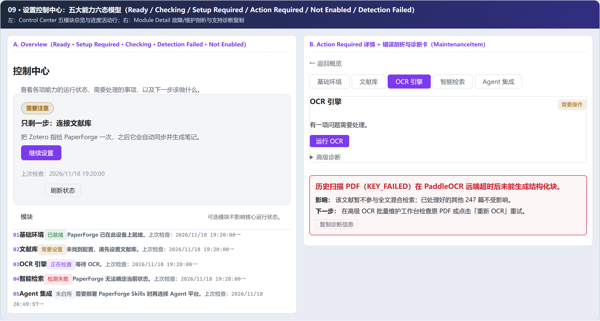

*图 6.1：设置控制中心概览与状态分层 — 展示总览页中五大模块的真实六态混排（含 `05 Agent 集成` 的 `not_enabled` 未启用态），以及 `Module Activity`（执行进度）与 `Maintenance Inbox`（结构化异常收件箱）的双栏/分区排障模型。*

### 6.2 四阶段零基础 Setup Journey 安装向导

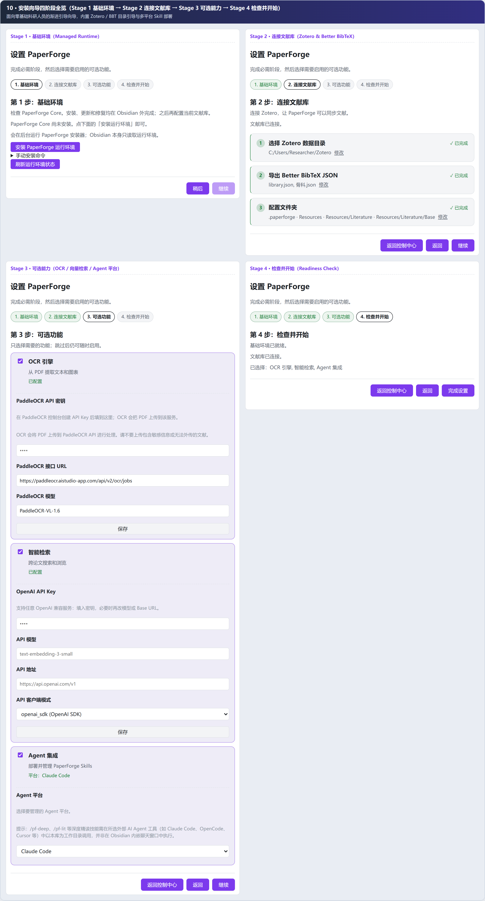

*图 6.2：四步安装引导全览 — Stage 1（基础 Python / CLI 环境校验）、Stage 2（连接 Zotero 数据库、Better BibTeX 自动导出检测与目标 Vault 目录绑定）、Stage 3（可选 OCR / 向量记忆开启与 15 大 Agent 平台配置）、Stage 4（全链路检查确认与一键完成启动）。*

### 6.3 OCR 与记忆子模块详情页及 Option B 二级工作台入口

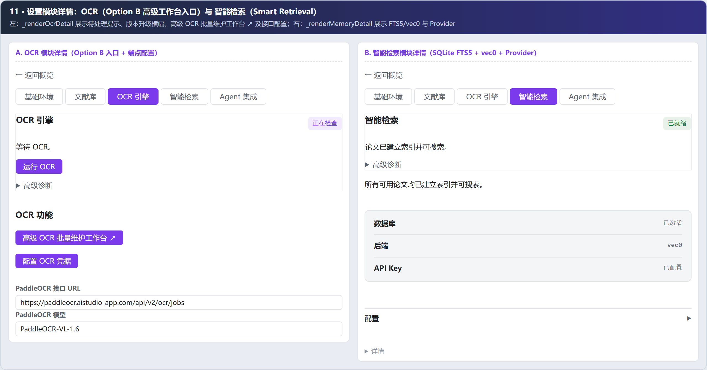

*图 6.3：子模块详情面板 — 左侧展示 `03 OCR` 引擎配置、待处理量与 Option B 下沉入口按钮 `高级 OCR 批量维护工作台 ↗`；右侧展示 `04 语义记忆与检索` 模型配置、向量索引构建状态与重建控制项。*

---

## 7. Option B 二级维护工作台与核心安全弹窗（`OcrWorkspaceView` & Modals）

### 7.1 `OcrWorkspaceView` 十二态批量运维台

按照 Option B 架构，常规文献阅读与队列勾选均在 `.base` 与 Dashboard 中完成；当用户需要一次性排查数百篇历史文献的 OCR 失败原因、强制重建特定 PDF 或处理版本降级时，可通过 `Settings → OCR → 高级 OCR 批量维护工作台 ↗`、`.base` 行内 `[🔧 诊断]` 或命令面板打开 `OcrWorkspaceView`。

系统精确区分以下 **12 种论文级 OCR 状态**：
- **可用与更新态**：`done`（最新完成）、`update_available`（有新版引擎可升级）
- **降级与缺损态**：`done_degraded`（部分页面回退渲染）、`done_incomplete`（缺失图表/段落结构）
- **失败态**：`failed` / `error` / `fatal_error`（不可自动重试阻断错误）、`retryable_error`（可重试瞬时错误）
- **调度态**：`processing` / `running`（正在解析）、`queued`（排队中）、`blocked`（依赖前置任务受阻）
- **前提与初态**：`nopdf`（无有效 PDF）、`pending`（待首次构建）、`unknown`（状态未同步或缺失清单）

### 7.2 三大核心安全弹窗边界

1. **`VersionRestoreModal`（全文构建版本对比与安全恢复）**：按段落粒度的对比视图展示不同 OCR 版本间的增量与差异，支持用户将某一历史干净构建版本安全恢复为当前激活版本，并保留版本谱系防误删。
2. **`DiagnosticFulltextPreviewModal`（只读排障预览弹窗）**：响应用户“不直接向日常阅读暴露可编辑的 `fulltext.md`”设计原则——仅在点击诊断时以 **严格只读模态框** 展示结构化识别原文与块级映射，引导所有批注行为回到侧车 PDF 阅读器，防止用户直接在 `fulltext.md` 批注而在 Rebuild 时被覆盖。
3. **`PaperForgeOrphanModal`（孤儿笔记与跨库对齐处理）**：当 Vault 中存在 Zotero 键失效或目录迁移产生的游离 Markdown 文件时，提供逐篇检查、安全解绑或归档指引，杜绝批注与记忆孤立丢失。

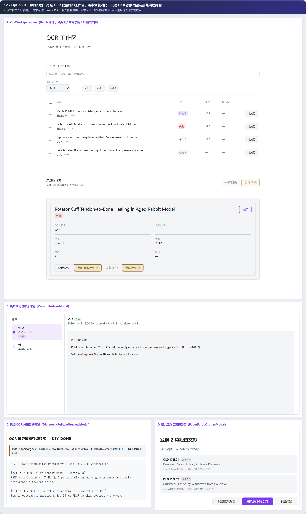

*图 7.1：Option B 二级批量维护工作台与三大核心弹窗 — 顶部完整展示 `OcrWorkspaceView` 的汇总过滤条、多态任务表格与单篇详情卡；底部并列呈现 `VersionRestoreModal`（版本段落差异恢复）、`DiagnosticFulltextPreviewModal`（只读全文排障预览）与 `PaperForgeOrphanModal`（孤儿文献对齐恢复）。*
