# PaperForge Obsidian UI 全景设计与 `.base` 交互规范

> 本文档完整记录 PaperForge 插件在 Obsidian 中的全局设计语言（**MyGo AsterLab 暖灰精密科研体系** + Obsidian 原生主题适配）、精简后的单一 **`.base` 文献库视图与表头多选上下文动作栏**、**Companion 伴读侧栏与持续演进研究认知记忆**，以及对标 **macOS 预览 (`预览.app`)** 的双层工具栏 PDF 阅读批注体验与 **Zotero 式笔记引述桥**。
> 文档内全部 12 张界面截图均由真实生产 TypeScript 视图组件配合 `paperforge/plugin/styles.css` 在无头浏览器中实时渲染生成，确保规范与上线代码始终同构。

---

## 1. 组件驱动截图架构与一键刷新流程

本规范不依赖人工拼贴静态线框图，而是通过仓库内置管线直接挂载生产源码中的视图类与真实 CSS Token，确定性渲染 `@2x` 高分截图至 `docs/images/ui-states/`（遵守静态门禁，绝不使用 `docs/evidence/`）：

| 组成部分 | 仓库路径 | 职责 |
| --- | --- | --- |
| 渲染编排器 | `scripts/dev/render_obsidian_ui_docs.py` | 调用 `esbuild` 打包展示入口并注入 `paperforge/plugin/styles.css`，通过 Playwright Chromium 截取 12 张 `@2x` Retina PNG |
| 场景构造入口 | `scripts/dev/_obsidian_ui_showcase.ts` | 实例化真实 `PaperForgeBasesView`、`PaperForgeStatusView`、`PaperForgePdfView`、`PaperForgeSettingTab`、`OcrWorkspaceView` 与三大安全弹窗，覆写合成快照与桩客户端 |
| Obsidian 运行时垫片 | `scripts/dev/_obsidian_browser_shim.ts` | 模拟 Obsidian 1.12 运行时（`BasesView`、`ItemView`、`PluginSettingTab`、`Modal`、`Setting`、`Menu`、`createEl` 及按画布缩放比例自适应的 `loadPdfJs` 双栏科研 PDF 页） |
| 产物图片目录 | `docs/images/ui-states/` | 存放 `v2-01-*.png` 至 `v2-12-*.png` 共 12 张最新状态截图（采用版本号前缀避免 Obsidian / 编辑器 Markdown 预览的同 URL 位图内存缓存命中旧图） |

> [!NOTE]
> 为保证离线确定性与静态路径门禁通过，展示场景仅构造合成文献库路径（例如 `D:/ResearchVault`、`C:/Users/Researcher/Zotero`），不读取任何本机个人库或敏感真实路径。

每当修改界面视图、交互契约或样式表后，在仓库根目录执行单条命令即可全部重绘：

```bash
python scripts/dev/render_obsidian_ui_docs.py
```

---

## 2. 全局视觉系统：MyGo AsterLab 设计契约与 Obsidian 双模式适配

全局设计约束集中定义于 `paperforge/plugin/DESIGN.md`，技术决策记录于 `docs/ARCHITECTURE.md` **ADR-015**，所有 Obsidian 界面严格共享同一套比例尺、图标口径与配色 Token：

### 2.1 双模式配色架构（`ui_theme_mode`）

在 `Settings → PaperForge 控制中心 → 界面配色` 中提供显式切换项，并在插件加载与切换时即时写入 `body` 类名：

| 模式 | `body` 类名 | 背景画布 / 卡片表面 | 高亮强调色 (`--pf-accent`) | 适用场景 |
| --- | --- | --- | --- | --- |
| **`asterlab`（默认）** | `pf-theme-asterlab` | Light: `#f7f6f3` / `#ffffff` / `#faf9f7`<br>Dark: `#171614` / `#1e1d1a` / `#242320` | Light: `#5b45c9`<br>Dark: `#a996ff` | 默认开启；暖灰纸质感高对比科研工作区 |
| **`obsidian`** | `pf-theme-obsidian` | 实时映射 `--background-secondary` / `--background-primary` | 实时映射 `--interactive-accent` | 需要严格跟随用户第三方 Obsidian 主题时启用 |

### 2.2 比例尺、图标、物理微交互与克制排版准则

1. **统一线条图标库（零界面 Emoji）**：全部视图图标由纯 DOM/SVG 工具 `paperforge/plugin/src/views/icons.ts`（`1.65px` 均匀描边、`round` 端帽 Lucide 几何图标）渲染；`🤖`、`🔍`、`🧠`、`📄` 等 UI 装饰 Emoji 已清零，防止视觉噪音与平台字体差异。
2. **同心连续曲率（`vibedesign.tips #004`）**：仅使用 `6px`（控件/胶囊 `--pf-radius-control`）、`10px`（卡片/工作区面板 `--pf-radius-panel`）和 `12px`（浮窗/弹窗 `--pf-radius-dialog`）三档圆角，并在支持的 Chromium 引擎下启用 `corner-shape: superellipse(1.25)` 连续曲率，严格保持容器内嵌控件满足 $R_{\text{inner}} = R_{\text{outer}} - \text{padding}$。
3. **顶光微凸三级按钮层级（`#001`）**：全面落实 `--pf-btn-lift` / `--pf-primary-lift` 顶光渐变与 `--pf-btn-press` 按压反馈，显式区分 Primary（单主强调）、Secondary（白底描边微凸）与 Ghost（默认透明、悬停显面），消除早先设置向导与侧栏按钮紫框/紫底泛滥问题。
4. **内凹轨道与一体化搜索槽（`#007`）**：`.pf-segmented` 分段轨道与 Dashboard 检索输入区统一采用 `--pf-well-inset` 内嵌微阴影槽（`M` / `@` 模式徽章与无边框 `<input>` 共槽，且空结果态不渲染孤立小标题）。
5. **柔光浮层、双环色板与中西文排版连续性（`#009` / `#015`）**：高亮/标记下拉面板采用磨砂微透明与柔和描边阴影；色板选中态使用「`2px` 表面白隔断环 + `1.5px` `--pf-accent` 外环」双环体系；全界面启用 `tabular-nums`（`.pf-tnum`）及「单个 `paperforge-header` 不重复类型标签 + 高级选项折叠披露」的渐进信息架构。

---

## 3. 精简 `.base` 工作台与多选表头上下文栏（`PaperForgeBasesView`）

### 3.1 架构聚焦：单一「文献库」主视图 + 原生属性融合

遵循「聚焦文献收集整理、状态隐于文件属性」的设计决策，`.base` 工作台完成两项结构性精简（`paperforge/worker/base_views.py` 与 `paperforge/plugin/src/views/paperforge-base-view.ts`）：

1. **收敛为单一「文献库」主视图**：`build_base_views` 仅产出单一主视图 `"文献库"`（`type: "paperforge-table"`）；通过 `RETIRED_PF_VIEWS` 在增量迁移与健康检查阶段自动清理旧版队列分页（`控制面板`、`待 OCR`、`待深度阅读`、`重做OCR` 等），同时完整保留用户自建自定义视图、筛选器与列宽配置。
2. **去除行内操作墙与队列开关列**：不再每行堆砌 `[解析]`/`[诊断]` 按钮矩阵，也不默认展示 `do_ocr` / `analyze` 布尔开关列。状态以 `.pf-badge-outline` 克制边框胶囊呈现（如 `已精读`、`解析中 2/5`、`未解析`、`解析异常`）；有 PDF 的条目在标题左侧直接提供 14 px 线条文档图标入口，点击标题直接打开笔记、右键呼出 Obsidian 原生 `Menu`。
3. **原生 Bases API 兼容**：严格读取 Obsidian `config.getOrder()`、`config.getDisplayName()`（兼容用户在 Bases UI 新增自定义列，如 `note.priority` → `课题优先级`）以及 `data.groupedData`（渲染 AsterLab 8 色科学分类圆点分组标题）。

### 3.2 最左侧勾选框与表头多选上下文操作栏

每行最左侧设置 `32px` 复选框（表头全选 + 支持 `Shift+Click` 连续区间选中）。选中 `>= 1` 篇条目时，表格上方滑出 `.pf-base-selection-bar` 上下文动作栏：

- 左侧显示已选计数（`.pf-tnum`，如 `已选 3 篇`）与 `取消选择`。
- 右侧提供面向所选集合的上下文操作：`查看诊断`、`同步文献库`、以及唯一主强调动作 `解析全文`——直接以 `ActionScope { kind: "papers", keys }` 派发至 `requestOcrRun`，不再需要人工切换 `待 OCR` 分页或逐行点击解析。

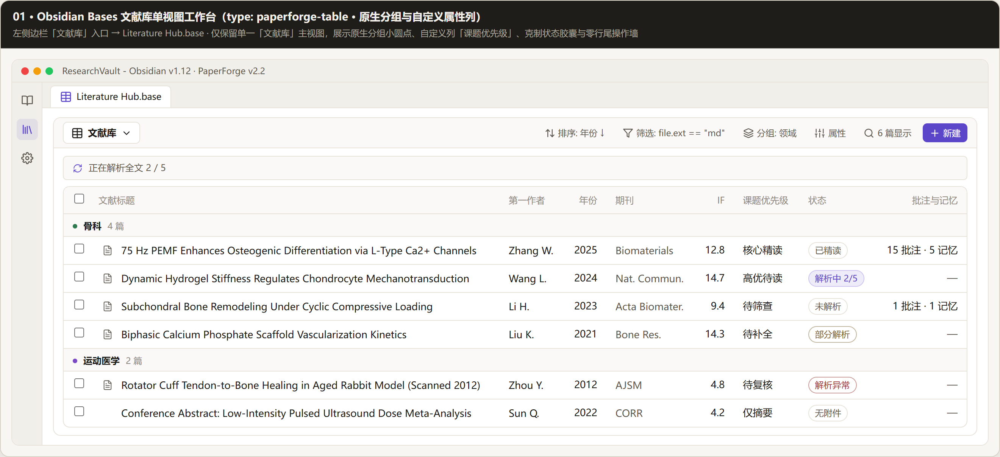

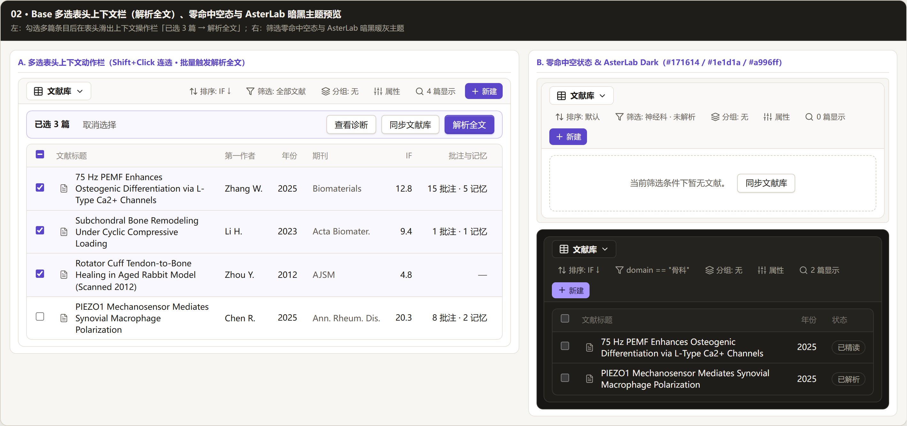

---

## 4. Companion 伴读侧栏（`PaperForgeStatusView`）与检索交互

`PaperForgeStatusView` 根据当前焦点叶节点自动在四种模式间切换，同样遵循 AsterLab 暖灰分层卡片、`高级选项与技术标识`折叠披露与克制单主 CTA：

1. **Global Mode（全局概览）**：展示文献总数、系统状态行、环境缺失或索引过期恢复引导，以及系统检索入口。
2. **Collection Mode（集合漏斗）**：在激活特定领域或 `.base` 视图时，并排呈现「总文献 → PDF 就绪 → OCR 完成 → 精读沉淀」漏斗与 OCR 流水线分布。
3. **Paper Mode（单篇伴读 + 5 维度研究认知记忆）**：展示一句话精读总览与 5 维度 **研究认知记忆**（`研究思路与逻辑链`、`实验技术与关键参数`、`研究技巧与巧思`、`硬伤、边界与存疑`、`课题迁移与灵感` —— 采用 Refine-Don't-Append 原位演进机制，移除 `rev` 版本噪声标签），将流程控制与工程元数据收入 `高级选项与技术标识` 折叠区块。
4. **检索状态矩阵**：区分 `M` 元数据快速检索、`@` 混合语义深度检索，以及索引/向量未就绪时的就地重建引导卡。

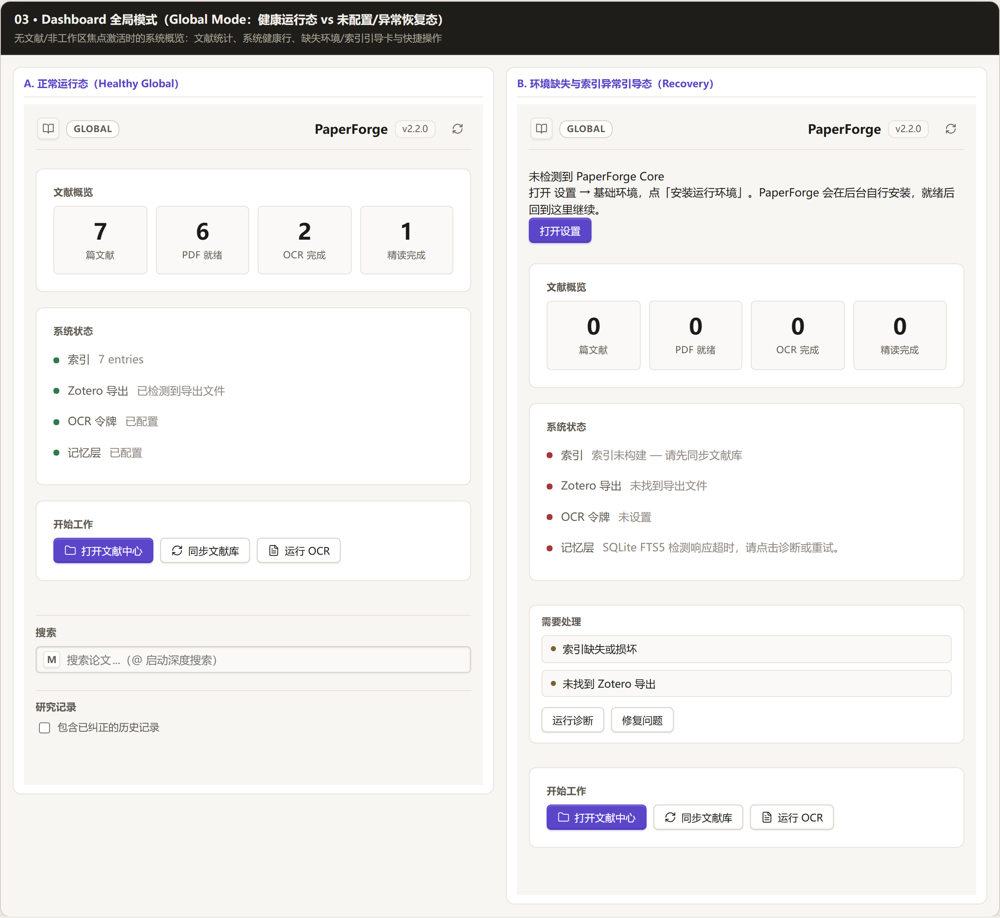

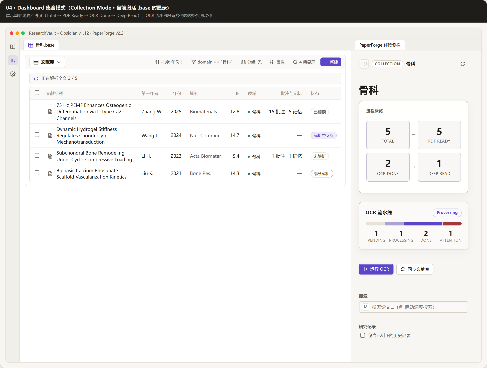

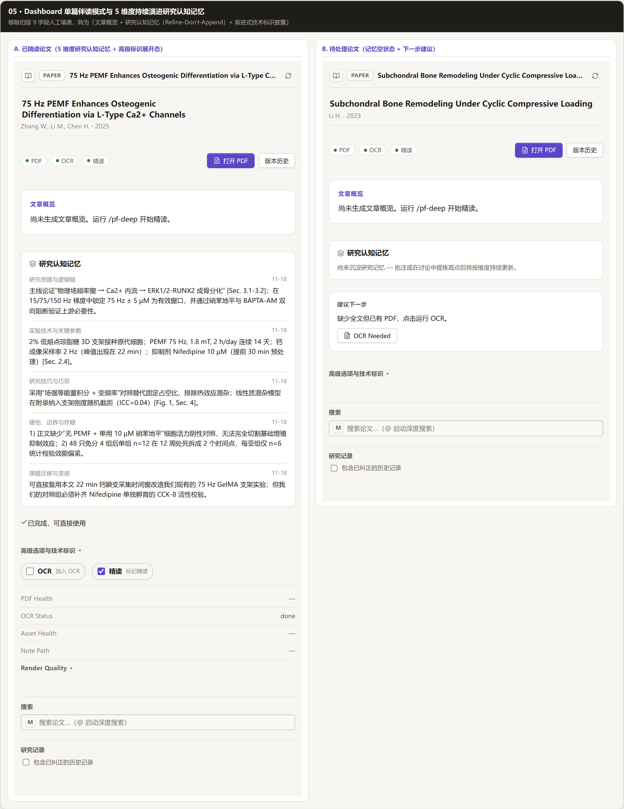

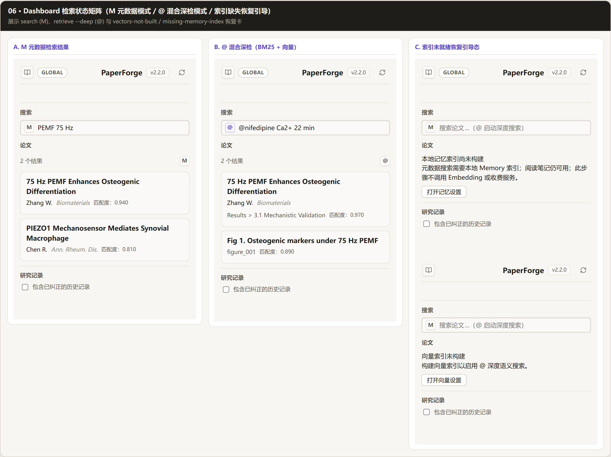

---

## 5. macOS 预览级双层 PDF 阅读器与 Zotero 笔记引述桥（`PaperForgePdfView`）

### 5.1 两级克制工具栏设计（零划词抢断弹窗）

对标 **Apple Preview (`预览.app`)** 极简工具条体系，内置侧车 PDF 阅读器由 `40px` 一级常驻栏与按需展开的 `36px` 二级「标记」栏组成，**普通阅读模式下划词选字不主动弹出任何浮动窗口**：

- **40 px 一级主栏（`.pf-pdf-toolbar`）**：
  - 左侧：侧栏开关（`panel-left`）、文献标题（仅在文件哈希发生变动时显示条件警告胶囊 `原 PDF 文件已变更`）。
  - 中部：页码前后翻页、`pf-tnum` 页码输入与总页数、缩放与 `适合宽度`。
  - 右侧：
    - **Apple Preview 分裂「高亮 | ▾」控件**（`.pf-pdf-split-highlight`）：已有文本选区时点击主段**零弹窗即刻落下**当前颜色与样式的高亮/下划线/删除线；无选区时切换连续高亮笔模式（`.is-active`）。点击 `▾` 展开下拉面板，提供 5 枚粉彩墨色圆点（黄 / 绿 / 蓝 / 粉 / 紫）、`下划线`、`删除线` 与 `添加笔记`。
    - **`标记` 开关（`pen-tool`）**：展开/收起二级标记工具栏。
    - **`AI 导读标注` 开关（`sparkles`）**：静默显隐 AI 批注与页边定位括号层。
    - **`并排打开文献笔记`（`columns-2`）** 与 **全文搜索框**。
- **36 px 二级「标记」工具栏（`.pf-pdf-markup-bar`）**：
  - 工具组：`文本选择`、`矩形框选`（拖出选区后显示轻量 `[插入笔记引用 | 存为框选 | 添加笔记]` 浮条）、`自由画笔`（`ink` SVG `<polyline>`）、`形状`（`矩形` / `椭圆` / `箭头` / `直线`，带方向保真 `<marker>` 箭头）、`文本框 T`（页面点击原地行内输入）与 `便签`（`note`）。
  - 样式组：5 枚线条色板、透明/半透明填充开关、3 档线宽（`1.5pt` / `2.5pt` / `4pt`）与 3 档文本框字号（`12px` / `14px` / `16px`）。

### 5.2 非破坏性侧车存储与 `style_json` 持久化

所有标注继续坚持**零污染源 PDF 字节**契约：事件流写入 `<workspace>/annotations.jsonl`，经 `paperforge/services/annotations_service.py` 校验 `kind`、`color` 与 `_normalize_style()` 后同步到 SQLite `paper_annotations.style_json` 列（含 `shape_type`、`stroke_color`、`fill_color`、`stroke_width`、`font_size`、`points` 等矢量坐标与样式字段）。

### 5.3 268 px 左侧栏与 Zotero 式「拷贝引用至笔记」

左侧可折叠栏提供 Apple Preview 一致的 `.pf-segmented` 三标签：`缩略图`（实时画布缩略图 + 当前页紫框高亮）、`目录`（读取 PDF Outline 并兼容 OCR `section_path` 回退）与 `批注`（`全部 | 我的 | AI 导读` 筛选、`清空 AI 标注`、`采纳`、以及 Zotero 风格的 **`拷贝引用至笔记`** 一键生成带双链页码的引用文本 `> "<exact_text>" — [[<note_rel>|<key> p.<page>]]`）。

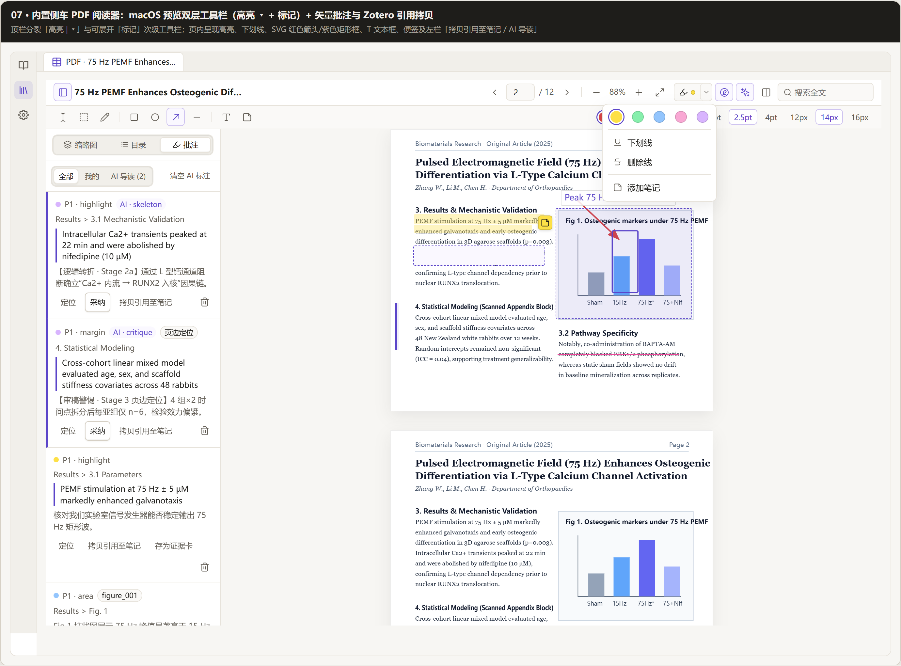

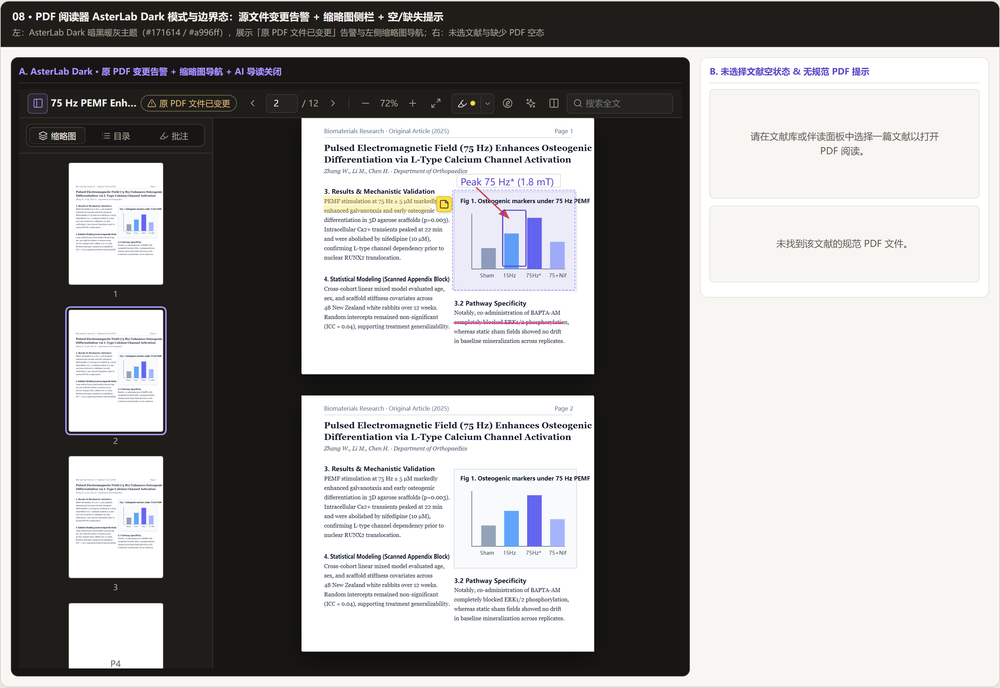

---

## 6. 设置控制中心、四步向导与二级批量维护台

1. **设置控制中心（`PaperForgeSettingTab`）**：`01–05` 编号能力列表清晰展示 6 种状态胶囊（Ready / Checking / Setup Required / Action Required / Not Enabled / Detection Failed），底部集成 `界面配色` 双模式开关；模块详情与 `MaintenanceItem` 提供结构化错误剖析与「复制诊断信息」。
2. **四阶段安装向导**：引导科研人员完成托管运行时准备、Zotero/BBT 连接、可选能力选择与就绪检查。
3. **二级维护台与安全弹窗（`OcrWorkspaceView` & Modals）**：仅按需进入的批量 OCR 重跑、版本恢复对比、只读 OCR 排版诊断预览与 Zotero 孤儿清理弹窗均已统一切换至 AsterLab 语义变量与线条图标体系。

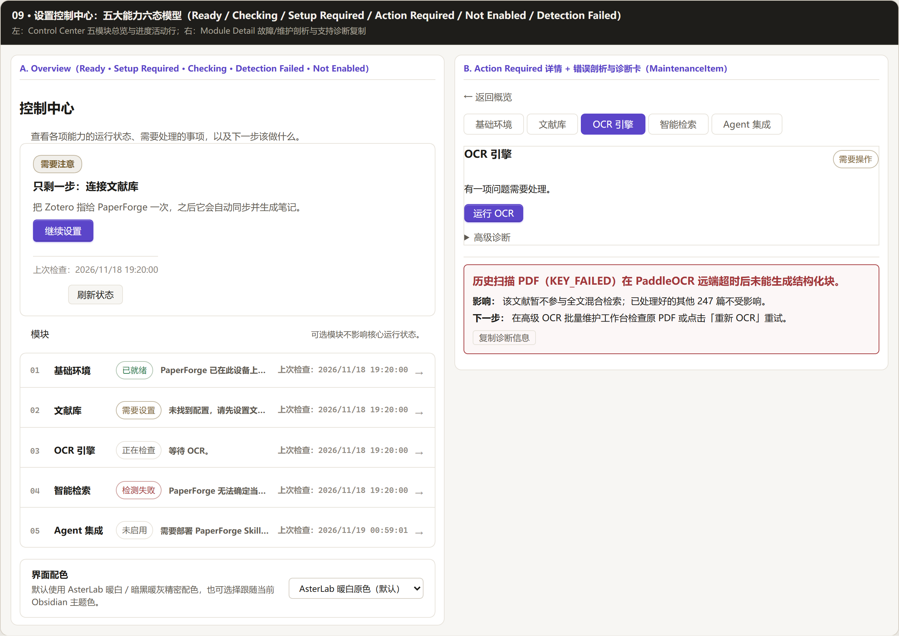

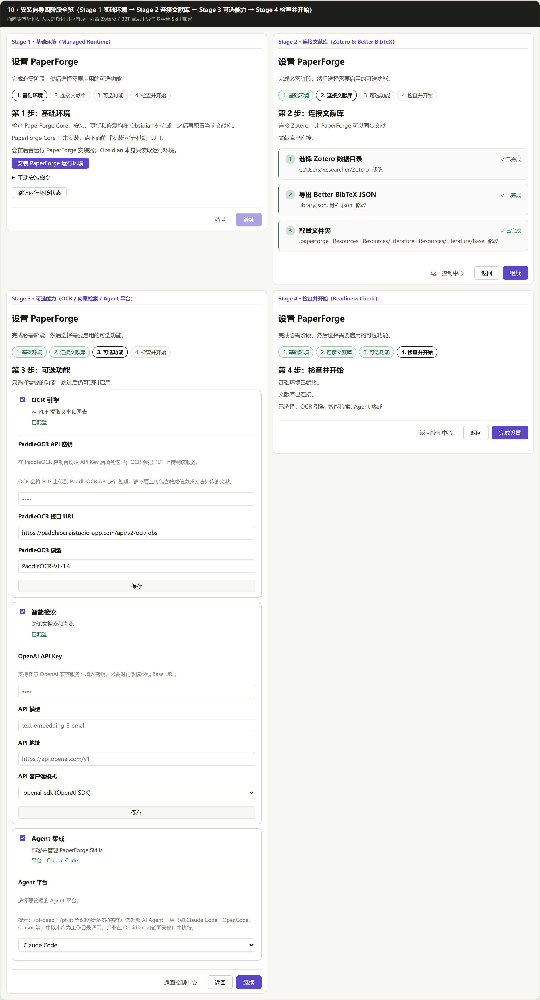

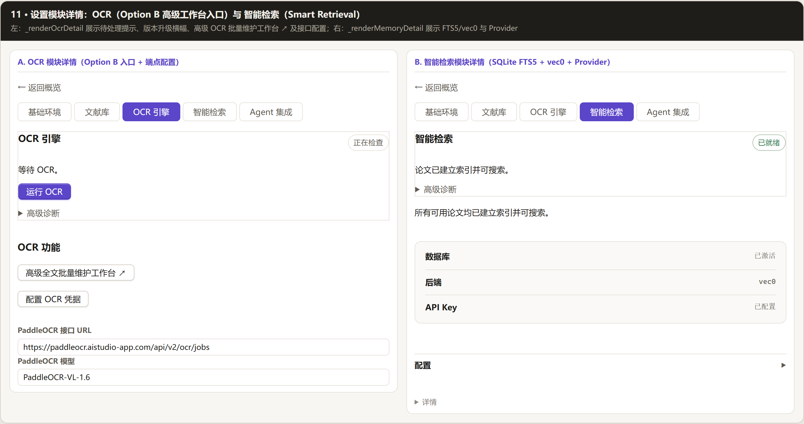

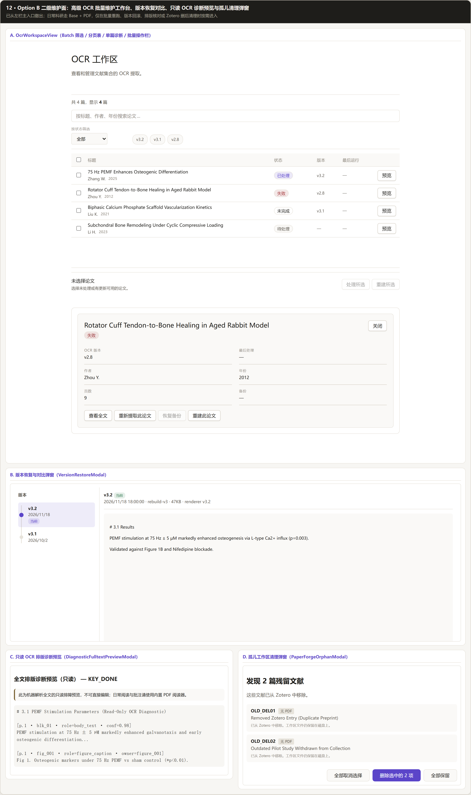
