<!-- prettier-ignore-start -->
<!-- AUTO-GENERATED FILE — DO NOT EDIT MANUALLY. Regenerate via: python scripts/build_technical_reference.py -->

# PaperForge 全量技术参考手册（Compiled Technical Reference）

> **版本**：`2.0.0rc6` | **章节数**：`14` | **分册指纹**：`sha256:3ef70098581a25e1`
>
> 本文档由 `scripts/build_technical_reference.py` 从 `docs/handbook/01`–`14` 自动汇编而成，供维护者与 AI Agent 作为单文件全景检索底本使用。所有结构、字段、CLI、Probe、Action 与 SQLite Schema 均有自动化同步门禁 `tests/test_technical_docs_sync.py` 与源码双向锁定。

## 目录（Table of Contents）

| 章节 | 主题 | 分册源文件 |
| :--- | :--- | :--- |
| [01](#chapter-01) | [第 01 章：系统架构、分层约束与磁盘存储契约](#chapter-01) | [`01-architecture-and-storage.md`](handbook/01-architecture-and-storage.md) |
| [02](#chapter-02) | [第 02 章：配置系统、凭据鉴权与运行时安装器](#chapter-02) | [`02-config-auth-and-runtime.md`](handbook/02-config-auth-and-runtime.md) |
| [03](#chapter-03) | [第 03 章：CLI 路由、PFResult 协议与流式取消机制](#chapter-03) | [`03-protocol-pfresult-and-stream.md`](handbook/03-protocol-pfresult-and-stream.md) |
| [04](#chapter-04) | [第 04 章：控制面状态探针与 Reconcile 缺口推导](#chapter-04) | [`04-probes-and-reconcile.md`](handbook/04-probes-and-reconcile.md) |
| [05](#chapter-05) | [第 05 章：Action 注册表、双阶段 Preflight 与安全分级](#chapter-05) | [`05-action-registry-and-safety.md`](handbook/05-action-registry-and-safety.md) |
| [06](#chapter-06) | [第 06 章：Zotero/BBT 同步、PDF 解析、谱系与 Obsidian Base 生成](#chapter-06) | [`06-zotero-sync-and-lineage.md`](handbook/06-zotero-sync-and-lineage.md) |
| [07](#chapter-07) | [第 07 章：OCR Provider、异步作业与 Canonical 持久化](#chapter-07) | [`07-ocr-provider-and-canonical.md`](handbook/07-ocr-provider-and-canonical.md) |
| [08](#chapter-08) | [第 08 章：V3 OCR 结构化管线、图表归属与渲染契约](#chapter-08) | [`08-ocr-v3-pipeline-and-objects.md`](handbook/08-ocr-v3-pipeline-and-objects.md) |
| [09](#chapter-09) | [第 09 章：Render Audit、R/P 事务晋升与版本快照管理](#chapter-09) | [`09-render-audit-and-reconcile.md`](handbook/09-render-audit-and-reconcile.md) |
| [10](#chapter-10) | [第 10 章：SQLite Memory DB v7、Embedding 与混合检索](#chapter-10) | [`10-memory-db-and-retrieval.md`](handbook/10-memory-db-and-retrieval.md) |
| [11](#chapter-11) | [第 11 章：无损 Sidecar PDF 批注、Living Memory Card 与永久日志](#chapter-11) | [`11-annotations-and-living-memory.md`](handbook/11-annotations-and-living-memory.md) |
| [12](#chapter-12) | [第 12 章：Agent Skills 分发、斜杠工作流与 AI 上下文命令](#chapter-12) | [`12-agent-skills-and-workflows.md`](handbook/12-agent-skills-and-workflows.md) |
| [13](#chapter-13) | [第 13 章：Obsidian Thin-Client 插件、IPC 传输与五大视图交互](#chapter-13) | [`13-obsidian-plugin-and-views.md`](handbook/13-obsidian-plugin-and-views.md) |
| [14](#chapter-14) | [第 14 章：测试金字塔、静态契约门禁与维修升级手册](#chapter-14) | [`14-testing-gates-and-maintenance.md`](handbook/14-testing-gates-and-maintenance.md) |

---

<a id="chapter-01"></a>

## 第 01 章：系统架构、分层约束与磁盘存储契约

> 源文件：`docs/handbook/01-architecture-and-storage.md`

> 本文档面向 PaperForge 核心维护者与系统审计人员，完整定义 v2.0+ 系统的控制面/数据面边界、模块静态依赖门禁、Vault 磁盘目录契约，以及从 v1 可见存储向 `.paperforge/` 隐藏引擎布局与可恢复回收站机制演进的工程约束。相关章节参见 [第 02 章：配置系统、凭据鉴权与运行时安装器](#chapter-02)、[第 03 章：CLI 路由、PFResult 协议与流式取消机制](#chapter-03) 及 [ARCHITECTURE.md](ARCHITECTURE.md)。

---

### 1. 职责与非目标边界

PaperForge 采用 **Python Core Single Authority（Python 核心单一权威）+ Thin-Client（薄客户端）** 架构，将系统的运行职责严格切分为四个正交平面：

1. **控制面（Control Plane）**：由 `paperforge/config.py`、`paperforge/credentials.py`、`paperforge/runtime_installer.py`、`paperforge/actions/` 及 `paperforge/probes/` 组成，独占配置解析/写入、凭据存储、隔离运行时发布、声明式动作策略与只读能力探测。Obsidian 插件侧的 `PaperForgeClient`（`paperforge/plugin/src/client/paperforge-client.ts`）与 `NodeProcessTransport`（`paperforge/plugin/src/client/node-transport.ts`）仅充当强类型传输与子进程生命周期控制器。
2. **数据面（Data Plane）**：由 `paperforge/adapters/`、`paperforge/providers/`、`paperforge/worker/`、`paperforge/services/`、`paperforge/render_audit.py` 与 `paperforge/figure_reconciliation.py` 组成，负责将 Zotero Better BibTeX（BBT）导出转为规范笔记、工作区目录、标准化 OCR 原始块（`blocks.raw.jsonl`）、V3 结构化块、裁剪图元及一致性审计报告。
3. **检索面（Retrieval & Embedding Plane）**：由 `paperforge/memory/`、`paperforge/retrieval/` 与 `paperforge/embedding/` 组成，基于 `.paperforge/indexes/paperforge.db` 维护 SQLite FTS5 全文检索、结构单元与 `sqlite-vec`（`vec0`）向量表。
4. **智能体层（Agent Layer）**：位于 `paperforge/skills/paperforge/`，以只读与 CLI 合同调用（`query-plan`、`paper-context`、`search`、`retrieve`、`inspect`）为主，仅在正式笔记的 `## 精读` 章节或通过受控 CLI 命令写入认知分析，绝不绕过 Worker/Service 层直接修改 SQLite 或 OCR 原始存储。

#### 非目标边界（Non-Goals）

- **客户端不做语义推断**：插件前端与 Agent 不得直接解析 `paperforge.json`、`formal-library.json`、`paperforge.db` 或 OCR `meta.json` 来推导系统能力状态、论文主键或下一步动作策略；唯一例外是引导适配器只读 `~/.paperforge/runtime/pointer.json` 以定位 Python 解释器。
- **仅限受控 stdio JSON-RPC 复用（无网络服务守护进程）**：长任务与流式命令仍按独立子进程执行（受 `NodeProcessTransport` 与取消令牌约束）；短 RPC 读/写可通过无网络端口的 `paperforge daemon --stdio` 按 Vault 会话复用同一进程并受 `idle_timeout` 与 stdin EOF 自动退出制约，跨端刷新继续经由 `.state-seq.json` 状态序号通知。
- **不做无审计物理删目录**：用户数据或孤儿论文的清理必须经由 `paperforge/worker/trash.py` 移入 `.paperforge/trash/` 并生成清单，禁止业务层直接调用裸 `shutil.rmtree()` 删除库目录。
- **Worker 层禁止反向依赖上层入口**：`paperforge/worker/` 是确定性执行层，禁止导入 `paperforge.commands` 或 `paperforge.plugin`。

---

### 2. 核心源码与单测映射表

#### 2.1 核心源码模块

| 模块路径                                            | 核心职责                        | 关键对外入口 / 不变量                                                                                                                                    |
| --------------------------------------------------- | ------------------------------- | -------------------------------------------------------------------------------------------------------------------------------------------------------- |
| `paperforge/__init__.py`                            | 包版本定义                      | 定义源码基准版本 `__version__`（当前 `"2.0.0rc6"`）                                                                                                      |
| `paperforge/config.py`                              | 配置解析与 Vault 路径单一权威   | `load_config()`、`resolve_paths()`、`paperforge_paths()`、`resolve_paperforge_dir()`、`fallback_paperforge_dir()`、`resolve_vault()`、`LEGACY_PATH_KEYS` |
| `paperforge/core/stat_cache.py`                     | 库外 STAT 指纹 SHA-256 缓存     | `cached_sha256_hex()`、`cached_concat_sha256_hex()`（SQLite WAL 于 OS 用户缓存目录，含 2s Racy-Git 保护，恪守 X13 零写 Vault）                           |
| `paperforge/services/storage_migration.py`          | v1→v2 隐藏存储引擎事务迁移服务  | `migrate_vault_storage()`（precheck + `.migration-journal.json` 回滚）、`rewrite_visual_embeds_for_key()`                                                |
| `paperforge/commands/migrate_storage.py`            | `migrate-storage` CLI 适配器    | `run()`，输出 `PFResult` 或人类可读摘要                                                                                                                  |
| `paperforge/worker/asset_index.py`                  | 规范索引与论文工作区物化        | `build_index()`、`refresh_index_entry()`、`sync_workspace_visual_assets()`、`cleanup_or_preserve_workspace_fulltext()`、`_build_entry()`                 |
| `paperforge/worker/paper_meta.py`                   | 单论文工作区元数据读写          | `write_paper_meta()`、`read_paper_meta()`（`SCHEMA_VERSION = 1`）                                                                                        |
| `paperforge/worker/base_views.py`                   | Obsidian `.base` 视图生成与清洗 | `ensure_base_views()`、`build_base_views()`、`merge_base_views()`、`RETIRED_PF_VIEWS`                                                                    |
| `paperforge/worker/ocr_artifacts.py`                | 单论文 OCR 存储路径与缓存清理   | `artifact_paths_for_root()`、`OCRArtifactPaths`、`cleanup_ocr_artifact_cache()`                                                                          |
| `paperforge/worker/trash.py`                        | Fail-Closed 回收站隔离删除层    | `validate_target()`、`trash_remove()`、`list_trash()`、`restore_trash()`、`purge_trash()`                                                                |
| `paperforge/worker/prune.py`                        | 孤儿论文清理调度                | `prune_orphan_papers()`，受 `WriterLock` 保护后调用 `trash_remove()`                                                                                     |
| `paperforge/lineage.py`                             | 跨载体残留检测与工作区定位      | `_detect_residuals()`、`_workspace_dir_for_key()`                                                                                                        |
| `paperforge/services/skill_deploy.py`               | Agent Skill 安全部署服务        | `deploy_skills()`、`_validate_target()`、`_skill_tree_digest()`                                                                                          |
| `scripts/check_module_graph.py`                     | P0 AST 静态依赖门禁（R1-R4）    | `build_snapshot()`、`check()`、`reach()`、`HEAVY_TOP_LEVELS`、`FORBIDDEN_WORKER_TARGETS`                                                                 |
| `tests/architecture_import_ratchet.json`            | R1/R2/R2b/R3/R4 冻结棘轮快照    | 仅允许收缩、禁止新增跨模块私有导入与顶层重导入                                                                                                           |
| `paperforge/architecture_audit/__init__.py`         | 跨层架构审计门面                | 导出 `ArchitectureContract`、`ArchitectureSurvey`、`reconcile`、`compose`                                                                                |
| `paperforge/architecture_audit/layers.py`           | 五层不可变审计模型定义          | 严格分离人工声明 Contract、静态/运行时 Survey、审计结论、Agent Review 与视图                                                                             |
| `paperforge/plugin/src/client/paperforge-client.ts` | 插件侧强类型客户端              | `PaperForgeClient`（封装探针、动作、配置与读模型调用）                                                                                                   |
| `paperforge/plugin/src/client/node-transport.ts`    | 插件侧唯一子进程通道            | `NodeProcessTransport`、`runLongTask()`、`NdjsonStreamParser`                                                                                            |

#### 2.2 配套单元测试与门禁测试

| 测试文件路径                                    | 验证目标与断言重点                                                                                                                                           |
| ----------------------------------------------- | ------------------------------------------------------------------------------------------------------------------------------------------------------------ |
| `tests/test_module_graph.py`                    | 验证 `scripts/check_module_graph.py` 的导入解析、Tarjan 环检测（R1）、跨包私有导入（R2）、跨模块私有成员访问（R2b）、层级违规（R3）及顶层重库拦截（R4）逻辑  |
| `tests/test_architecture_boundaries.py`         | 扫描 `paperforge/actions/`、`paperforge/services/`、`paperforge/materialization/`，断言 `KNOWN_EXEMPTIONS` 为空，杜绝后台层反向导入 `paperforge.commands.*`  |
| `tests/test_import_weight.py`                   | 在干净子进程中导入 `paperforge.worker.ocr`，断言 `sys.modules` 中不含 `torch`、`chromadb`、`pdfplumber`、`fitz`、`pymupdf`、`PIL`                            |
| `tests/unit/test_dot_paperforge_and_scale.py`   | 验证 `resolve_paths()` 对 `.paperforge` 的叶子折叠、单论文前缀图像物化、工作区隐藏 `fulltext.md` 清理、`SyncService` 快路径与 `migrate-storage` 端到端行为   |
| `tests/unit/test_storage_migration_safety.py`   | 验证 `migrate-storage` 事务回滚（坏 `paperforge.json` 事前拦截、`set_config` 失败逆向恢复目录与笔记）、幂等复跑及工作区用户编辑过 `fulltext.md` 无损入回收站 |
| `tests/unit/test_path_authority_and_staging.py` | 验证自定义 `system_dir` / `.paperforge` 路径权威解析无旁路、及外置 OS 用户数据目录 R/P 舞台写入与遗留 `<tmp>` 回退检索                                       |
| `tests/unit/test_stat_cache_and_fastpaths.py`   | 验证 `stat_cache` 2s Racy-Git 失效窗口、`read_index` `(size, mtime_ns)` 缓存与 `annotations.jsonl` 压缩前后端一致性                                          |
| `tests/unit/test_upgrade_resilience.py`         | 验证外置 `zotero_data_dir` 修复、标题命名旧笔记重命名迁移、以及 `paperforge.db` 销毁重建后由 `ai/memory-card.json` 无损恢复记忆历史                          |
| `tests/unit/worker/test_trash.py`               | 钉住 2026-08-14 事故回归：断言空路径/`.`/`..`/`allowed_root` 本身及越界路径触发 `DangerousPathError`，`trash_remove` 仅移动到 `.paperforge/trash/` 且可恢复  |

---

### 3. 磁盘文件、数据库表与协议 JSON 字段字典

#### 3.1 `resolve_paths()` 返回的路径字典（共 16 个键）

所有业务模块均须通过 `paperforge/config.py` 中的 `resolve_paths(vault, snapshot)`（或其兼容薄包装 `paperforge_paths()`）获取规范路径。设 Vault 根目录经过 `Path(vault).expanduser().resolve()` 规范化后为 `{vault}`：

| 键名              | 推导公式                                                                   | 典型解析示例（`.paperforge` 布局）                                                | 典型解析示例（v1 传统 `System` 布局）                               | 说明                                                                                                     |
| ----------------- | -------------------------------------------------------------------------- | --------------------------------------------------------------------------------- | ------------------------------------------------------------------- | -------------------------------------------------------------------------------------------------------- |
| `vault`           | `Path(vault).expanduser().resolve()`                                       | `D:/ResearchVault`                                                                | `D:/ResearchVault`                                                  | 规范化 Vault 根目录                                                                                      |
| `system`          | `vault / sys_rel`                                                          | `D:/ResearchVault/.paperforge`                                                    | `D:/ResearchVault/System`                                           | `sys_rel` 来自配置项 `system_dir`                                                                        |
| `paperforge`      | `system if Path(sys_rel).name == ".paperforge" else system / "PaperForge"` | `D:/ResearchVault/.paperforge`                                                    | `D:/ResearchVault/System/PaperForge`                                | 引擎根目录：末端为 `.paperforge` 时折叠，不再嵌套 `PaperForge/`                                          |
| `exports`         | `paperforge / "exports"`                                                   | `D:/ResearchVault/.paperforge/exports`                                            | `D:/ResearchVault/System/PaperForge/exports`                        | Zotero Better BibTeX 自动导出 JSON 目录                                                                  |
| `ocr`             | `paperforge / "ocr"`                                                       | `D:/ResearchVault/.paperforge/ocr`                                                | `D:/ResearchVault/System/PaperForge/ocr`                            | 按 `zotero_key` 分目录存储的 OCR 全生命周期产物                                                          |
| `zotero_dir`      | 见右侧说明                                                                 | `D:/ResearchVault/.paperforge/Zotero` 或外置目录                                  | `D:/ResearchVault/System/Zotero` 或外置目录                         | 若 `zotero_data_dir` 非空且为相对路径则拼在 `vault` 下，绝对路径直接使用；为空时回退 `system / "Zotero"` |
| `resources`       | `vault / resources_dir`                                                    | `D:/ResearchVault/Resources`                                                      | `D:/ResearchVault/Resources`                                        | 用户笔记与资产根目录（受 Obsidian 索引）                                                                 |
| `literature`      | `resources / literature_dir`                                               | `D:/ResearchVault/Resources/Literature`                                           | `D:/ResearchVault/Resources/Literature`                             | 按领域划分的文献笔记与单论文工作区根目录                                                                 |
| `control`         | `resources / control_dir`                                                  | `D:/ResearchVault/Resources/LiteratureControl`                                    | `D:/ResearchVault/Resources/LiteratureControl`                      | v2.1+ 已退役控制目录（保留键位兼容）                                                                     |
| `library_records` | `control / "library-records"`                                              | `D:/ResearchVault/Resources/LiteratureControl/library-records`                    | `D:/ResearchVault/Resources/LiteratureControl/library-records`      | Phase 37 起停止写入的旧记录目录                                                                          |
| `bases`           | `vault / base_dir`                                                         | `D:/ResearchVault/Bases`                                                          | `D:/ResearchVault/Bases`                                            | Obsidian `.base` 数据库视图输出目录                                                                      |
| `worker_script`   | `Path(__file__).parent / "worker" / "__init__.py"`                         | `<pkg>/paperforge/worker/__init__.py`                                             | `<pkg>/paperforge/worker/__init__.py`                               | 包内 Worker 入口锚点                                                                                     |
| `skill_dir`       | `vault / skill_dir_val`                                                    | `D:/ResearchVault/.agents/skills`                                                 | `D:/ResearchVault/.agents/skills`                                   | 配置项 `skill_dir` 对应的 Vault 内路径                                                                   |
| `pf_deep_script`  | 优先取 `<skill_dir>/paperforge/` 内的 `pf_deep.py`，不存在则回退包内路径   | `<vault>/.agents/skills/paperforge/` 下的 `pf_deep.py`（位于其 `scripts` 子目录） | 缺失时回退至 `paperforge/skills/paperforge/scripts/pf_deep.py`      | 精读辅助脚本定位路径                                                                                     |
| `config`          | `paperforge / "config" / "domain-collections.json"`                        | `D:/ResearchVault/.paperforge/config/domain-collections.json`                     | `D:/ResearchVault/System/PaperForge/config/domain-collections.json` | 领域与 Zotero 集合映射配置                                                                               |
| `index`           | `paperforge / "indexes" / "formal-library.json"`                           | `D:/ResearchVault/.paperforge/indexes/formal-library.json`                        | `D:/ResearchVault/System/PaperForge/indexes/formal-library.json`    | v2 信封格式规范文献资产索引                                                                              |

#### 3.2 完整 Vault 磁盘目录树

以推荐的 `.paperforge` 引擎布局（`D:/ResearchVault` 或 `/Users/researcher/Vault`）为例，完整磁盘布局如下：

```text
{vault_root}/
|-- paperforge.json                             # Schema v2 唯一规范配置文件
|-- .env                                        # 仅用于非密钥本地覆盖或一次性 auth migrate 来源
|-- AGENTS.md                                   # Vault 级 Agent 操作指引（已存在则 setup 保留不覆盖）
|-- .agents/skills/paperforge/                  # 默认跨客户端 Skill 部署目录 (SKILL.md, atoms/, molecules/, scripts/, workflows/)
|-- .opencode/command/                          # 默认 command_dir 配置指向目录
|-- Bases/                                      # Obsidian Base 视图目录 (<base_dir>)
|   |-- Literature Hub.base                     # 全库视图 (type: paperforge-table, 视图名 "文献库")
|   |-- <domain_slug>.base                      # 按领域切分的 Base 文件
|-- Resources/                                  # Obsidian 可见数据区 (<resources_dir>)
|   |-- Literature/                             # 文献库根目录 (<literature_dir>)
|   |   |-- <domain>/
|   |       |-- <KEY> - <Title_Slug>/           # 单论文工作区 (Workspace)
|   |           |-- <KEY>.md                    # 规范正式笔记 (含 frontmatter 与 "## 🔍 精读")
|   |           |-- paper-meta.json             # 内部管线状态旁路 JSON (ocr_job_id/health/maturity)
|   |           |-- annotations.jsonl           # 非破坏性 PDF 侧车批注日志
|   |           |-- assets/                     # 从 .paperforge/ocr/<KEY>/assets/ 同步而来
|   |               |-- <KEY>_figure_001.jpg    # 带 KEY 前缀的图表裁剪，避免 Vault 内同名冲突
|   |               |-- <KEY>_table_001.jpg     # 带 KEY 前缀的表格裁剪
|   |               |-- <KEY>_ann_xxx.jpg       # PDF 阅读器区域截图裁剪
|   |           |-- ai/
|   |               |-- memory-card.json        # Living Memory 5 维认知卡片及修订历史旁路备份
|   |-- LiteratureControl/                      # 历史 control_dir (Phase 37 后不再新建 library-records/)
|-- .paperforge/                                # 隐藏引擎根目录 (对 Obsidian 索引器不可见；v1 为 <system_dir>/PaperForge/)
|   |-- exports/
|   |   |-- <domain>.json                       # Better BibTeX 自动导出的文献元数据 JSON
|   |-- indexes/
|   |   |-- formal-library.json                 # v2 文献资产规范索引 (含 paper_count, export_hash, items)
|   |   |-- formal-library.json.lock            # FileLock 跨进程锁文件 (10s 超时)
|   |   |-- paperforge.db                       # SQLite 主库 (papers, paper_fts, body_units, object_units, vec_*, paper_annotations, paper_memory_*)
|   |   |-- .state-seq.json                     # 无守护进程 UI 实时刷新单调序号文件
|   |   |-- .sync-fastpath.json                 # SyncService O(1) 短路缓存状态
|   |-- config/
|   |   |-- domain-collections.json             # 领域-Zotero 集合映射表
|   |-- ocr/
|   |   |-- <KEY>/                              # 按 zotero_key 隔离的单论文 OCR 存储
|   |       |-- meta.json                       # OCR 状态机、版本指纹与结果路径事实源
|   |       |-- fulltext.md                     # 内部兼容全文投影 (不暴露到隐藏布局的工作区)
|   |       |-- json/result.json                # 供应商原始响应 JSON
|   |       |-- raw/                            # source_metadata.json, raw_meta.json
|   |       |-- canonical/blocks.raw.jsonl      # 经 OCRProvider 边界标准化后的原始块真值
|   |       |-- structure/                    # blocks.structured.jsonl, figure_inventory.json, table_inventory.json, reader_figures.json
|   |       |-- render/                         # fulltext.md, render-map.json, render.consistency.json, materialization.provenance.json
|   |       |-- assets/                         # figures/*.jpg, tables/*.jpg 源裁剪图
|   |       |-- health/ocr_health.json          # OCR 结构与角色门禁健康度报告
|   |       |-- index/                          # structure-tree.json, role-index.json, result-hash.txt (发布门禁)
|   |       |-- versions/                       # 重建前显示文本快照 (受 PAPERFORGE_MAX_OCR_VERSIONS 限制)
|   |       |-- pages/                          # 可再生页面渲染缓存 (可被 cleanup_ocr_artifact_cache 清理)
|   |-- trash/
|       |-- <YYYYMMDDTHHMMSSZ>/<12-hex-uuid>/
|           |-- manifest.json                   # 隔离删除审计清单
|           |-- <trashed_dir_or_file>           # 移入回收站的原始工作区或 OCR 目录
```

> **重要结构细节**：在 `paperforge/worker/asset_index.py` 的 `_build_entry()` 中，工作区内的规范正式笔记文件名是 `<KEY>.md`（位于 `<KEY> - <Title_Slug>/<KEY>.md`）。若磁盘上残留旧版 `{KEY} - {Title}.md`，同步过程会自动将其重命名为 `{KEY}.md` 并在 YAML frontmatter 注入 `aliases` 字段。当引擎目录末端为 `.paperforge` 时，`hidden_engine = True` 生效：工作区内任何遗留的 `fulltext.md` 副本都会被主动删除，仅将裁剪图片以 `<KEY>_figure_NNN.jpg` / `<KEY>_table_NNN.jpg` 形式物化到 `<workspace>/assets/`，避免 Obsidian 搜索被机器 OCR 文本污染。

#### 3.3 关键存储元数据 JSON 字段字典

##### 3.3.1 `paper-meta.json`（`paperforge/worker/paper_meta.py`）

将高频变化的管线状态从正式笔记 YAML frontmatter 中剥离，保持笔记精简：

| 字段                                                          | 类型          | 说明                                                         |
| ------------------------------------------------------------- | ------------- | ------------------------------------------------------------ |
| `schema_version`                                              | `int`         | 固定为 `1`                                                   |
| `paperforge_version`                                          | `str`         | 写入该元数据的 PaperForge 版本                               |
| `zotero_key`                                                  | `str`         | 论文 8 位 Zotero 主键                                        |
| `created_at` / `updated_at`                                   | `str`         | ISO-8601 时间戳（固定 `+08:00` 时区）；`created_at` 幂等保留 |
| `ocr_job_id` / `ocr_md_path` / `ocr_json_path` / `ocr_status` | `str`         | OCR 作业与输出索引投影                                       |
| `lifecycle` / `next_step`                                     | `str`         | 派生生命周期阶段与建议下一步                                 |
| `health` / `maturity`                                         | `dict`        | 四维健康度与成熟度拆解对象                                   |
| `fulltext_path` / `ai_path`                                   | `str`         | 内部全文相对路径及工作区 `ai/` 相对路径                      |
| `migrated_from`                                               | `dict` (可选) | 从旧版 `library-records/` 迁移时的不可变历史标记             |

##### 3.3.2 回收站 `manifest.json`（`paperforge/worker/trash.py`）

| 字段            | 类型  | 说明                                                              |
| --------------- | ----- | ----------------------------------------------------------------- |
| `trash_id`      | `str` | 12 位小写十六进制 UUID 前缀（`uuid.uuid4().hex[:12]`）            |
| `operation`     | `str` | 触发隔离删除的操作标识（如 `"library.prune"`）                    |
| `paper_key`     | `str` | 关联的 `zotero_key`，全局操作可为空字符串                         |
| `original_path` | `str` | 移动前经 `.resolve()` 解析的绝对路径（用于 `restore_trash` 还原） |
| `trash_path`    | `str` | 移动到 `.paperforge/trash/<timestamp>/<trash_id>/` 后的绝对路径   |
| `timestamp`     | `str` | UTC 批次目录时间戳，格式 `%Y%m%dT%H%M%SZ`                         |
| `trashed_at`    | `str` | 实际完成移动记录时的 UTC 时间戳                                   |

##### 3.3.3 跨层架构审计模型（`paperforge/architecture_audit/layers.py`）

`architecture_audit` 将架构验证建模为五个严格单向、不可变的数据层（使用 `@dataclass(frozen=True)` 与 `MappingProxyType` 冻结）：

| 层模型类                 | `SCHEMA_VERSION` | 认识论定位                          | 关键字段与不变量                                                                                                    |
| ------------------------ | ---------------- | ----------------------------------- | ------------------------------------------------------------------------------------------------------------------- |
| `ArchitectureContract`   | `1`              | 人工声明的权威意图                  | `asset_groups`、`publication_units`、`operations`、`rules`、`exceptions`、`interfaces`、`traces`                    |
| `ArchitectureSurvey`     | `1`              | 静态/运行时确定性事实采集           | 含 `CoverageEntry`、`EffectFact`、`SignalFact`、`UnitAuthorityFact`、`RoleAuthorityFact`、`OperationBindingFact` 等 |
| `DeterministicAudit`     | `1`              | Contract 与 Survey 的纯函数对账结果 | 按 `RuleKind` 生成 `Finding`，不可被 Review 篡改                                                                    |
| `ArchitectureReview`     | `1`              | Agent/人工覆盖层                    | 通过摘要绑定（digest-bound）作用于审计结论，仅作咨询建议（advisory）                                                |
| `ArchitectureReportView` | `1`              | 只读展示投影                        | 经 `compose()` 生成最终人类与 CI 可读报告                                                                           |

---

### 4. 核心执行链路、状态机与顺序不变量

#### 4.1 模块依赖分层与静态门禁体系

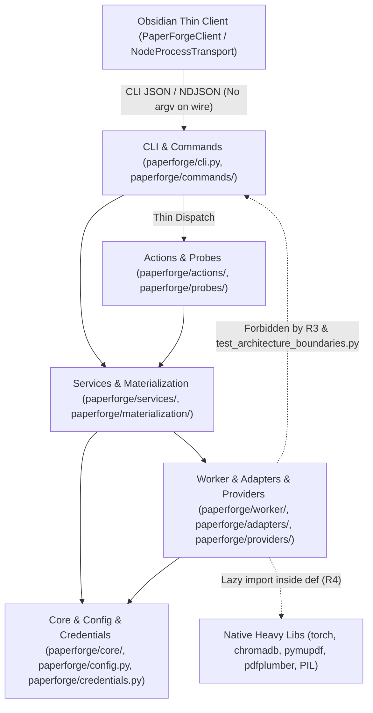

CI 门禁 `scripts/check_module_graph.py --check` 对 `paperforge/` 下所有 `.py` 文件执行纯 AST 扫描（结合 `tests/architecture_import_ratchet.json` 冻结棘轮，遵循“只减不增”原则）：

- **R1（导入环检测）**：通过 Tarjan 强连通分量算法检测模块级（含类体与 `try`/`if` 守卫分支，跳过 `if TYPE_CHECKING:` 与函数体内部导入）循环依赖和自引用（`from P import M` 位于 `P/M.py` 内）。当冻结环数 `len(frozen_rings) < CYCLE_DOWNGRADE_THRESHOLD`（当前阈值 `10`，当前基线 `rings: []`）时，任何环都将导致门禁失败。
- **R2 与 R2b（跨包私有成员隔离）**：扫描所有导入点（含函数内部导入），禁止跨一级子包导入 `_` 开头（非双下划线 `__dunder__`）的私有模块或符号（R2）；同时追踪模块导入别名（含局部遮蔽），拦截 `module._private` 形式的属性访问（R2b），历史豁免锁定在 `private_member_access_exceptions`。
- **R3（Worker 向下隔离）**：`paperforge.worker` 及其子模块在任何作用域均禁止导入 `FORBIDDEN_WORKER_TARGETS = ("paperforge.commands", "paperforge.plugin")`，当前 `layer_violations` 基线为 `{}`。此外 `tests/test_architecture_boundaries.py` 额外强制 `actions/`、`services/`、`materialization/` 不得导入 `paperforge.commands.*`（`KNOWN_EXEMPTIONS = {}`），彻底阻断 Action→CLI→stdout→JSON 解析的回环链。
- **R4（顶层重库零导入）**：`HEAVY_TOP_LEVELS = ("torch", "chromadb", "fitz", "pymupdf", "pdfplumber", "PIL")` 禁止出现在模块顶层执行流中，确保 Windows `multiprocessing` spawn 子进程和轻量 CLI 命令启动不被重型原生库拖垮或崩溃（仅历史 `paperforge.embedding.backends.chroma_backend` 的第 6 行 `chromadb` 留于棘轮白名单）。

#### 4.2 v1 → `.paperforge` 隐藏存储迁移执行链路（`migrate-storage`）

`migrate_vault_storage(vault, dry_run=False)` 必须严格遵循以下 Fail-Closed 与事务回滚顺序不变量，以保证迁移可幂等重试、不损坏配置且不静默丢弃用户编辑：

1. **配置预检与解析源/目标路径**：若已有 `paperforge.json` 却损坏/无法解析，非 `--dry-run` 模式在移动任何目录前直接 Fail-Closed 抛出 `ConfigError`；若无配置文件则按传统默认路径 `System/PaperForge` 与 `Resources/Literature` 回退，目标引擎目录固定为 `vault / ".paperforge"`。同时检测若 `old_sys.resolve() == target_pf.resolve()`，仅补齐残余资产/重写并幂等返回。
2. **日志落盘与迁移引擎子树（`.migration-journal.json`）**：写入 `target_pf / ".migration-journal.json"`（记录 `status="in_progress"`、`moved_pairs` 与 `rewritten_notes`），调用 `_move_tree_entries(old_pf, target_pf)` 递归移动条目——目标不存在时直接 `shutil.move`，同名目录则递归合并且绝不覆盖已存在文件（计入 `entries_skipped_existing`），搬空后清理空源目录；若 `old_sys / "Zotero"` 存在、非符号链接且目标 `.paperforge/Zotero` 不存在则一并迁移。
3. **物化单论文裁剪资产**：遍历 `<literature>/<domain>/<KEY> - <Title>/` 工作区，非 `dry_run` 模式下调用 `sync_workspace_visual_assets(paper_ocr_dir, ws_dir, key)`，将 `.paperforge/ocr/<KEY>/assets/{figures,tables}/*.jpg` 以 size + mtime 守卫增量拷贝为 `<workspace>/assets/<KEY>_*.jpg`（绝不覆盖 `<KEY>_ann_*.jpg` 截图）。
4. **重写嵌入链接与哈希护栏清理工作区全文**：对工作区内的 `{key}.md`、`{ws_dir.name}.md` 与领域目录下 `{key}.md`（去重后）在首次修改前记录原字节备份于日志事务上下文，将 `![[.../figure_001.md|别名]]` 或 `.jpg` 统一重写为 `![[<KEY>_figure_001.jpg|别名]]` 并以 `write_text_atomic()` 落盘；随后调用 `cleanup_or_preserve_workspace_fulltext()` 检查工作区 `fulltext.md`——**仅当原字节或 LF 归一化 SHA-256 与 `.paperforge/ocr/<KEY>/fulltext.md` 或 `.pre-rebuild` 一致时才物理 `unlink()`**，若包含用户手工修改或缺失权威 OCR 副本，则通过 `trash_remove(..., operation="workspace_fulltext_preserve")` 无损移入 `.paperforge/trash/`。
5. **原子更新配置、失败回滚与清理残余**：调用 `set_config(vault_root, "system_dir", ".paperforge")` 写入 Schema v2 配置；若此步抛出异常，事务层逆向复原所有被重写笔记的原字节、按 `moved_pairs` 逆序归位已迁移文件，并将 `.migration-journal.json` 置为 `"rolled_back"` 后向上抛出异常。成功后再将日志置为 `"completed"` 并移除已清空且不等于 `.paperforge` 的旧目录。

---

### 5. 配置项、环境变量、CLI 入口与错误码

#### 5.1 路径相关配置项与环境变量

存储布局相关的全部字段由 `paperforge/config.py` 的 `FIELD_SPECS` 定义（均支持在 `paperforge.json` 的 `vault_config` 块或通过对应环境变量覆写，详细字段规格见 [第 02 章](#chapter-02)）：

| 配置键            | 环境变量                    | `FIELD_SPECS` 默认值                                  | 特殊路径语义说明                                                 |
| ----------------- | --------------------------- | ----------------------------------------------------- | ---------------------------------------------------------------- |
| `system_dir`      | `PAPERFORGE_SYSTEM_DIR`     | `"System"`（`cli.py` 新建初始化设为 `".paperforge"`） | 末端为 `.paperforge` 时 `resolve_paths()` 不再拼接 `/PaperForge` |
| `resources_dir`   | `PAPERFORGE_RESOURCES_DIR`  | `"Resources"`                                         | 必须为 Vault 相对路径                                            |
| `literature_dir`  | `PAPERFORGE_LITERATURE_DIR` | `"Literature"`                                        | 相对于 `resources_dir` 解析                                      |
| `control_dir`     | `PAPERFORGE_CONTROL_DIR`    | `"LiteratureControl"`                                 | 相对于 `resources_dir` 解析（v2.1+ 已退役写入）                  |
| `base_dir`        | `PAPERFORGE_BASE_DIR`       | `"Bases"`                                             | 相对于 Vault 根目录解析                                          |
| `skill_dir`       | `PAPERFORGE_SKILL_DIR`      | `".agents/skills"`                                    | 相对于 Vault 根目录解析                                          |
| `command_dir`     | `PAPERFORGE_COMMAND_DIR`    | `".opencode/command"`                                 | 相对于 Vault 根目录解析                                          |
| `zotero_data_dir` | `ZOTERO_DATA_DIR`           | `""`                                                  | 允许绝对路径；为空时回退至 `system / "Zotero"`                   |
| —                 | `PAPERFORGE_VAULT`          | —                                                     | `resolve_vault()` 第二优先级定位 Vault 根目录                    |

#### 5.2 架构与存储运维 CLI / 脚本入口

| 命令 / 脚本                                                 | 核心参数                                                 | 退出码与输出语义                                                                                                                                       |
| ----------------------------------------------------------- | -------------------------------------------------------- | ------------------------------------------------------------------------------------------------------------------------------------------------------ |
| `paperforge paths [--json]`                                 | `--json`                                                 | `0` 成功；`--json` 仅输出 D-Path 合约精简键（`vault`、`worker_script`、`pf_deep_script`、`ld_deep_script`），文本模式打印 `resolve_paths()` 全量 16 键 |
| `paperforge migrate-storage [--dry-run] [--json]`           | `--dry-run`, `--json`                                    | `0` 成功（返回 `PFResult` 包含移动/物化/重写计数），异常返回 `1`（`ErrorCode.INTERNAL_ERROR`）                                                         |
| `paperforge trash list`                                     | —                                                        | `0`，按时间倒序打印 `trash_id`、`operation`、`paper_key`、`trashed_at`、`original_path`                                                                |
| `paperforge trash restore <trash_id>`                       | `trash_id`                                               | `0` 恢复成功；`2` 空 ID 或找不到 `trash_id`；`1` 回收站副本缺失或原路径已被占用                                                                        |
| `paperforge trash purge [--older-than DAYS]`                | `--older-than`                                           | `0`，仅物理清理严格位于 `.paperforge/trash/` 下的过期批次目录                                                                                          |
| `paperforge skill deploy [--to DIR] [--overwrite] [--json]` | `--to`（默认 `.agents/skills`）、`--overwrite`、`--json` | `0` 部署成功或全树一致 no-op；`1` 路径越界、已有不同版本未传 `--overwrite` 或源缺失；`2` 未知子动作                                                    |
| `paperforge base-refresh [--force]`                         | `--force` / `-f`                                         | `0`，重建或增量清洗 `<base_dir>/*.base` 视图                                                                                                           |
| `python scripts/check_module_graph.py --check`              | `--check`, `--write-ratchet`, `--reach --entry MOD:func` | `0` 通过；`1` 出现新增 R1-R4/R2b 违规；`2` 参数错误或缺失棘轮文件                                                                                      |

---

### 6. 边界防护与 Fail-Closed 防呆规则

1. **回收站能力边界防呆（`paperforge/worker/trash.py`）**：
   - `validate_target(target, allowed_root=...)` 在执行任何移动前强制执行能力校验：拒绝 `None`、空字符串、`"."`、`".."`、不存在路径；对目标与 `allowed_root` 均先调用 `.resolve()` 穿透符号链接与 Windows Junction，随后拒绝 `resolved` 等于 `root`、`root.parent` 或根目录锚点 `Path(root.anchor)`，再通过 `resolved.relative_to(root)` 确认严格嵌套在允许目录内，否则抛出 `DangerousPathError`。
   - `trash_remove()` 禁用 `ignore_errors`，使用 `shutil.move` 而非拷贝+删除，移动失败时原始数据保持原地不动。
   - `purge_trash()` 是全系统唯一的真实物理删除函数，再次对每个待删时间戳目录执行 `.resolve()`，确认 `resolved != root_resolved and root_resolved in resolved.parents` 后才允许调用 `shutil.rmtree()`。
   - **代码现状注意**：`trash_root(vault)` 固定指向 `Path(vault) / ".paperforge" / "trash"`（即使 Vault 仍配置为传统 `System` 布局）；同样地，`paperforge/commands/ocr.py` 中的 `_collect_batch_unsettled()` 也存在一处硬编码 `vault / "System" / "PaperForge" / "ocr"` 的历史路径，向 `.paperforge` 迁移后或非默认目录 Vault 中若依赖批次续传需先排查该点。
2. **Skill 部署防逃逸与防覆盖（`paperforge/services/skill_deploy.py`）**：
   - `_validate_target(vault, target_dir)` 禁止绝对路径、`..` 逃逸出 Vault 根目录或直接将目标设为 Vault 根目录本身。
   - 使用 `_skill_tree_digest()` 对包内技能树与已部署目录进行全文件相对路径+CRLF 归一化字节哈希比对：一致时跳过（`noop=True`），不一致且未传 `--overwrite` 时报错 `already_exists` 并拒绝静默合并。
   - `AGENTS.md` 若在 Vault 根目录已存在，则 `deploy_skills()` 与 `AgentInstaller.deploy_agent_config()` 均保留用户定制版本不覆盖。
3. **只读索引构建与隐藏引擎隔离（`paperforge/worker/asset_index.py`）**：
   - 遵循 SSOT 边界：OCR 子系统是 `meta.json` 的唯一写入者；`_build_entry()` 读取到损坏的 `meta.json` 时标记 `_meta_unreadable=True` 并导出 `ocr_status="unknown"`，绝不自动覆盖修复 `meta.json`。
   - 当检测到 `Path(str(paths["paperforge"])).name == ".paperforge"` 时，`_build_entry()` 与 `_sync_workspace_fulltexts()` 均调用 `cleanup_or_preserve_workspace_fulltext()` 清理工作区内冗余 `fulltext.md`：仅当原始或 LF 归一化 SHA-256 与 OCR 输出一致时才直接 `unlink()`，若存在用户手工修改或缺失比对源则移入 `.paperforge/trash/`。
4. **棘轮只缩不扩不变量（`scripts/check_module_graph.py`）**：
   - 静态分析的局限性（如动态 `importlib`、`__import__`、`getattr` 及运行期 monkeypatch）由运行时测试 `tests/test_import_weight.py` 补位覆盖，不允许用动态导入绕过 R1–R4 约束。

---

### 7. 维修、调试与升级 Checklist

- [ ] **变更模块导入前跑通静态门禁**：执行 `python scripts/check_module_graph.py --check` 与 `pytest tests/test_module_graph.py tests/test_architecture_boundaries.py tests/test_import_weight.py`，确认 R1 环数为 0、R3 层级违规为 `{}`、Worker 导入重量无退化。
- [ ] **消减历史棘轮债务后收敛快照**：若重构移除了 `tests/architecture_import_ratchet.json` 中的旧私有导入，运行 `python scripts/check_module_graph.py --write-ratchet` 并检查 `git diff tests/architecture_import_ratchet.json` 确认仅有条目减少、无新增债务。
- [ ] **追踪调用链与遗留迁移影响面**：优先使用 `python scripts/check_module_graph.py --reach --entry paperforge.worker.<mod>:<func>` 确定最小可达函数闭包。
- [ ] **排查 Vault 路径解析异常**：运行 `paperforge --vault <VAULT> config paths --json` 与 `paperforge --vault <VAULT> paths` 核对 16 个解析路径，确认 `system_dir == ".paperforge"` 时 `paperforge` 键是否已正确折叠。
- [ ] **执行 v1→v2 隐藏存储迁移**：先运行 `paperforge --vault <VAULT> migrate-storage --dry-run --json` 预演并检查 `entries_moved`、`notes_rewritten` 与 `workspace_fulltexts_removed`；确认无误后再去掉 `--dry-run` 执行，随后运行 `paperforge --vault <VAULT> sync` 重刷 `.base` 视图与资产索引。
- [ ] **误删数据从回收站抢救**：执行 `paperforge --vault <VAULT> trash list` 定位对应 `paper_key` 的 `trash_id`，确认原路径已腾空后运行 `paperforge --vault <VAULT> trash restore <trash_id>` 无损恢复。
- [ ] **跨层合约修改后同步审计**：若改动命令入口、权限控制或文件发布权威，需同步通过 `paperforge/architecture_audit/` 验证声明合约与代码观测事实一致。

---

<a id="chapter-02"></a>

## 第 02 章：配置系统、凭据鉴权与运行时安装器

> 源文件：`docs/handbook/02-config-auth-and-runtime.md`

> 本文档完整记录 PaperForge 的三项基础设施单一权威：Schema v2 配置文件（`paperforge/config.py`）、系统级密钥环凭据管理（`paperforge/credentials.py`）与独立受管 Python 运行时安装器（`paperforge/runtime_pointer.py` + `paperforge/runtime_installer.py`），并涵盖 `setup` 编排与 `doctor`/`runtime-health` 诊断协议。关联章节参见 [第 01 章：系统架构、分层约束与磁盘存储契约](#chapter-01) 与 [第 03 章：CLI 路由、PFResult 协议与流式取消机制](#chapter-03)。

---

### 1. 职责与非目标边界

- **配置权威（`paperforge/config.py`）**：Python 是 `paperforge.json`（`SCHEMA_VERSION = 2`）的唯一解析器、校验器、优先级合并器与原子写入器。业务命令不得绕过 `load_config()` 自行拼接默认路径或容忍损坏/遗留配置。
- **凭据权威（`paperforge/credentials.py`）**：采用“进程环境变量 → 操作系统 Keyring → 缺失”的三级解析顺序。Keyring 是唯一的持久化存储后端；禁止落盘明文、禁止进程全局内存密钥缓存、禁止在运行时回退读取 `.env`、Windows HKCU 注册表、旧版环境变量名或插件设置。
- **运行时指针权威（`paperforge/runtime_pointer.py` & `paperforge/runtime_installer.py`）**：通过 `paperforge runtime install|update|repair|status` 在用户主目录 `~/.paperforge/runtime/` 下独立构建并验证隔离虚拟环境，仅在版本与向量依赖验证全部通过后原子发布 `pointer.json`。Obsidian 插件与 Vault 级 `paperforge setup` 对此指针仅有只读权限，绝不原地修改已激活的虚拟环境。
- **引导与诊断分离（`paperforge/setup/` & `paperforge/doctor/`）**：`SetupPlan` 负责单个 Vault 的目录、配置与 Skill 初始化；`run_doctor()` 与 `validate_entry_fields()` / `get_runtime_health()` 负责只读状态校验，不得在无指针或无配置时臆测替代路径。

#### 非目标边界（Non-Goals）

- `paperforge.json` 与 `.env` 不承担任何 API 密钥的运行时存储职责；任何包含敏感词片段的键都会被配置层 Fail-Closed 拦截。
- `paperforge setup` 不负责安装 Python 包或发布 `pointer.json`（由 `paperforge runtime` 独立完成）。
- `paperforge auth` 命令族永远不提供读取或导出明文密钥的子命令，也不接受通过命令行 `argv` 传入明文密钥。

---

### 2. 核心源码与单测映射表

#### 2.1 核心源码模块

| 模块路径                                | 核心职责                                      | 关键符号                                                                                                                                                                            |
| --------------------------------------- | --------------------------------------------- | ----------------------------------------------------------------------------------------------------------------------------------------------------------------------------------- |
| `paperforge/config.py`                  | Schema v2 配置权威与路径解析                  | `SCHEMA_VERSION`、`FIELD_SPECS`、`AGENT_PLATFORM_IDS`、`ConfigError`、`load_config()`、`set_config()`、`unset_config()`、`bootstrap_config()`、`migrate_config()`、`_transaction()` |
| `paperforge/commands/config.py`         | `paperforge config` 8 动词 CLI 适配器         | `run()`（处理 `list/get/set/unset/validate/paths/init/migrate` 并包装 `PFResult`）                                                                                                  |
| `paperforge/credentials.py`             | 密钥环与规范环境变量凭据权威                  | `CredentialKey`、`CredentialStatus`、`CredentialError`、`resolve()`、`store()`、`delete()`、`status()`                                                                              |
| `paperforge/commands/auth.py`           | `paperforge auth` CLI 适配器                  | `run_status()`、`run_set()`、`run_delete()`、`run_migrate()`、`LEGACY_NAMES`                                                                                                        |
| `paperforge/runtime_pointer.py`         | `~/.paperforge/runtime/pointer.json` 读写边界 | `POINTER_SCHEMA_VERSION`、`pointer_dir()`、`pointer_path()`、`read_pointer()`、`publish_pointer()`                                                                                  |
| `paperforge/runtime_installer.py`       | 独立受管运行时构建、校验与剪枝                | `install_runtime()`、`inspect_runtime()`、`install_lock()`、`_normalize_release_version()`、`RuntimeInstallError`                                                                   |
| `paperforge/commands/runtime_health.py` | `runtime-health` CLI 适配器                   | `run()`，输出 `PFResult` 或分层终端摘要                                                                                                                                             |
| `paperforge/memory/runtime_health.py`   | 记忆层 5 维度健康检查                         | `get_runtime_health()`、`_runtime_identity()`                                                                                                                                       |
| `paperforge/worker/status.py`           | Vault 全量诊断 `doctor` 与基础 `status`       | `run_doctor()`、`_query_resolved_version()`、`_query_resolved_package()`                                                                                                            |
| `paperforge/doctor/field_validator.py`  | 笔记 Frontmatter 字段注册表校验器             | `validate_entry_fields()`、`validate_collection()`、`validate_frontmatter_from_file()`                                                                                              |
| `paperforge/schema/__init__.py`         | 字段注册表加载器                              | `load_field_registry()`、`get_owner_fields()`                                                                                                                                       |
| `paperforge/schema/field_registry.yaml` | Frontmatter 等结构的规范字段 Schema           | 定义各字段 `type`、`required`、`public`、`owner`                                                                                                                                    |
| `paperforge/setup/__init__.py`          | 模块化引导步骤结果数据模型                    | `SetupStepResult`                                                                                                                                                                   |
| `paperforge/setup/checker.py`           | 引导前置条件校验器                            | `SetupChecker`（检查 Python `>= 3.11`、`pip`、Vault、Zotero、BBT 导出）                                                                                                             |
| `paperforge/setup/config_writer.py`     | 引导配置写入薄门面                            | `ConfigWriter`（仅委托给 `bootstrap_config()` 与 `set_config()`）                                                                                                                   |
| `paperforge/setup/plan.py`              | 模块化 5 步引导编排器                         | `SetupPlan`（支持 `--json` 触发 `#137` NDJSON 流与协作取消）                                                                                                                        |
| `paperforge/setup/runtime.py`           | 向量运行时依赖校验与子进程探针                | `VECTOR_CAPABILITY_IMPORTS`、`check_runtime_dependencies()`、`verify_runtime_in_child()`                                                                                            |
| `paperforge/setup/vault.py`             | Vault 目录树与 Zotero Junction 创建           | `VaultInitializer`                                                                                                                                                                  |
| `paperforge/setup/agent.py`             | Vault 级 Skill 与 `AGENTS.md` 部署            | `AgentInstaller`                                                                                                                                                                    |
| `paperforge/setup_wizard.py`            | 兼容壳与环境探测工具集                        | `EnvChecker`、`headless_setup()`（已弃用，转发至 `SetupPlan`）                                                                                                                      |

#### 2.2 配套单元测试与契约测试

| 测试文件路径                                      | 验证目标与断言重点                                                                                                                  |
| ------------------------------------------------- | ----------------------------------------------------------------------------------------------------------------------------------- |
| `tests/test_config.py`                            | 验证 17 项 `FIELD_SPECS` 完整覆盖、4 级优先级覆盖、缺失/损坏/未来/遗留/含密钥配置 Fail-Closed 分类、事务锁与原子写                  |
| `tests/test_credentials.py`                       | 使用注入的内存 `FakeKeyring` 隔离测试环境变量覆盖优先级、冲突拒绝、`--stdin` 写入、回读失败回滚、`--yes` 删除门控及 `.env`/环境迁移 |
| `tests/harness/test_a03_config_authority.py`      | 端到端 CLI 验证 `config set` 落盘、`config paths` 解析、`../escape` 拒绝后文件字节零变化及跨进程持久化                              |
| `tests/harness/test_a04_config_migration.py`      | 验证 v1 顶层路径键与 `agent_key` 无损迁移至 Schema v2、未知字段保留、派生字段删除及二次迁移字节幂等性                               |
| `tests/harness/test_a05_credential_authority.py`  | 验证 `auth set --stdin` 仅入 Keyring，绝不出现在进程 `argv` 或 Vault 任何文件中                                                     |
| `tests/test_runtime_installer.py`                 | 验证候选环境创建与验证先于指针发布、失败自动丢弃候选并保留旧指针、安装并发锁拦截及保留最近 1 个旧环境剪枝                           |
| `tests/test_runtime_pointer.py`                   | 验证 `pointer.json` 原子发布无残留 `.tmp`、四字段全校验与绝对路径要求                                                               |
| `tests/test_runtime_pointer_version_authority.py` | 回归 `#267`：在 CWD 存在伪造源码包的子进程中，验证 `publish_pointer()` 以环境安装的 `dist-info` 元数据版本为准                      |
| `tests/test_doctor.py`                            | 验证无指针时不触发目标解释器探针、缺失/版本不一致/依赖缺失诊断分支及 JSON 输出契约                                                  |
| `tests/test_setup_plan_v2.py`                     | 验证 `ConfigWriter` 嵌套 `vault_config` 写入、无顶层路径键残留、v1 文件 Fail-Closed 及 `SetupPlan` 配置透传                         |
| `tests/test_setup_wizard.py`                      | 验证 `AGENT_PLATFORM_IDS`（15 项）、`AGENT_SHARED_SKILL_DIR == ".agents/skills"` 及 `EnvChecker` 各环境探针                         |
| `tests/unit/doctor/test_field_validator.py`       | 验证 `MISSING_REQUIRED`、`MISSING_OPTIONAL`、`DRIFT` 与 `NO_FRONTMATTER` 诊断分类                                                   |

---

### 3. 磁盘文件、数据库表与协议 JSON 字段字典

#### 3.1 `FIELD_SPECS` 全量配置字段字典（共 17 个字段）

下表逐项核对自 `paperforge/config.py` 第 94–129 行的 `FIELD_SPECS` 元组（`writable` 默认值均为 `True`）：

| `key`                     | `storage_path`                       | `value_type` | `default`                                              | `env`                            | `choices`                    | `allow_empty` | `vault_relative` |
| ------------------------- | ------------------------------------ | ------------ | ------------------------------------------------------ | -------------------------------- | ---------------------------- | ------------- | ---------------- |
| `system_dir`              | `("vault_config", "system_dir")`     | `"path"`     | `"System"`                                             | `"PAPERFORGE_SYSTEM_DIR"`        | `()`                         | `False`       | `True`           |
| `resources_dir`           | `("vault_config", "resources_dir")`  | `"path"`     | `"Resources"`                                          | `"PAPERFORGE_RESOURCES_DIR"`     | `()`                         | `False`       | `True`           |
| `literature_dir`          | `("vault_config", "literature_dir")` | `"path"`     | `"Literature"`                                         | `"PAPERFORGE_LITERATURE_DIR"`    | `()`                         | `False`       | `True`           |
| `control_dir`             | `("vault_config", "control_dir")`    | `"path"`     | `"LiteratureControl"`                                  | `"PAPERFORGE_CONTROL_DIR"`       | `()`                         | `False`       | `True`           |
| `base_dir`                | `("vault_config", "base_dir")`       | `"path"`     | `"Bases"`                                              | `"PAPERFORGE_BASE_DIR"`          | `()`                         | `False`       | `True`           |
| `skill_dir`               | `("vault_config", "skill_dir")`      | `"path"`     | `".agents/skills"`                                     | `"PAPERFORGE_SKILL_DIR"`         | `()`                         | `False`       | `True`           |
| `command_dir`             | `("vault_config", "command_dir")`    | `"path"`     | `".opencode/command"`                                  | `"PAPERFORGE_COMMAND_DIR"`       | `()`                         | `False`       | `True`           |
| `zotero_data_dir`         | `("zotero_data_dir",)`               | `"path"`     | `""`                                                   | `"ZOTERO_DATA_DIR"`              | `()`                         | `True`        | `False`          |
| `agent_platform`          | `("agent_platform",)`                | `"enum"`     | `"opencode"`                                           | `"PAPERFORGE_AGENT_PLATFORM"`    | `AGENT_PLATFORM_IDS` (15 项) | `False`       | `False`          |
| `auto_analyze_after_ocr`  | `("auto_analyze_after_ocr",)`        | `"boolean"`  | `False`                                                | `None`                           | `()`                         | `False`       | `False`          |
| `ocr_profile`             | `("ocr_profile",)`                   | `"string"`   | `"default"`                                            | `"PAPERFORGE_OCR_PROFILE"`       | `()`                         | `False`       | `False`          |
| `paddleocr_job_url`       | `("paddleocr_job_url",)`             | `"string"`   | `"https://paddleocr.aistudio-app.com/api/v2/ocr/jobs"` | `"PADDLEOCR_JOB_URL"`            | `()`                         | `False`       | `False`          |
| `paddleocr_model`         | `("paddleocr_model",)`               | `"string"`   | `"PaddleOCR-VL-1.6"`                                   | `"PADDLEOCR_MODEL"`              | `()`                         | `False`       | `False`          |
| `embedding_profile`       | `("embedding_profile",)`             | `"string"`   | `"default"`                                            | `"PAPERFORGE_EMBEDDING_PROFILE"` | `()`                         | `False`       | `False`          |
| `vector_db_provider_type` | `("vector_db_provider_type",)`       | `"enum"`     | `"openai_sdk"`                                         | `"VECTOR_DB_PROVIDER_TYPE"`      | `("openai_sdk", "requests")` | `False`       | `False`          |
| `vector_db_api_base`      | `("vector_db_api_base",)`            | `"string"`   | `""`                                                   | `"VECTOR_DB_API_BASE"`           | `()`                         | `True`        | `False`          |
| `vector_db_api_model`     | `("vector_db_api_model",)`           | `"string"`   | `"text-embedding-3-small"`                             | `"VECTOR_DB_API_MODEL"`          | `()`                         | `False`       | `False`          |

> **注意**：`FIELD_SPECS` 中 `system_dir` 的结构体默认值为 `"System"`，但在通过 CLI 运行 `paperforge setup` 初始化全新 Vault（`paperforge.json` 与 `System/PaperForge` 均不存在且未显式传 `--system-dir`）时，`paperforge/cli.py` 会显式注入 `system_dir = ".paperforge"`。

#### 3.2 `AGENT_PLATFORM_IDS` 全量平台 ID（共 15 项）

定义于 `paperforge/config.py` 第 58–63 行（用于 `agent_platform` 枚举与 CLI `setup --agent` 选择约束）：

| 序号 | 平台 ID          | 说明与 Skill 部署位置关系                                   |
| ---- | ---------------- | ----------------------------------------------------------- |
| 1    | `opencode`       | 默认平台；`setup_wizard.py:AGENT_NAMES` 展示名 `"OpenCode"` |
| 2    | `claude`         | Claude Code；`AGENT_NAMES` 展示名 `"Claude Code"`           |
| 3    | `codex`          | Codex；`AGENT_NAMES` 展示名 `"Codex"`                       |
| 4    | `cursor`         | Cursor；`AGENT_NAMES` 展示名 `"Cursor"`                     |
| 5    | `gemini`         | Gemini CLI；`AGENT_NAMES` 展示名 `"Gemini CLI"`             |
| 6    | `kilo`           | Kilo                                                        |
| 7    | `pi`             | Pi                                                          |
| 8    | `omp`            | Oh My Pi                                                    |
| 9    | `crush`          | Crush                                                       |
| 10   | `kimi`           | Kimi CLI                                                    |
| 11   | `github_copilot` | GitHub Copilot；`AGENT_NAMES` 展示名 `"GitHub Copilot"`     |
| 12   | `cline`          | Cline；`AGENT_NAMES` 展示名 `"Cline"`                       |
| 13   | `windsurf`       | Windsurf；`AGENT_NAMES` 展示名 `"Windsurf"`                 |
| 14   | `augment`        | Augment；`AGENT_NAMES` 展示名 `"Augment"`                   |
| 15   | `trae`           | Trae；`AGENT_NAMES` 展示名 `"Trae"`                         |

**架构约定**：`AgentInstaller`（`paperforge/setup/agent.py`）不再按平台 ID 路由不同路径，统一部署到跨客户端共享目录 `AGENT_SHARED_SKILL_DIR = ".agents/skills"`；有专属目录需求的 Harness（如 `.omp/skills`）通过 `paperforge skill deploy --to <dir>` 自行部署。

#### 3.3 `paperforge.json` 与 `pointer.json` 结构字典

##### 3.3.1 `paperforge.json`（`SCHEMA_VERSION = 2`）

- **合法结构**：顶层必须含 `"schema_version": 2`（加载时兼容字符串 `"2"`，写入时一律规范化为整数 `2`）；7 个路径字段（`LEGACY_PATH_KEYS`）嵌套于 `"vault_config"` 对象内，其余 10 个标量字段位于顶层。
- **遗留触发条件**（满足任一即判为 `migration_required`）：缺失整型/字符串 `"2"` 的 `schema_version`、`schema_version < 2`、顶层存在任意 `LEGACY_PATH_KEYS`、存在 `"agent_key"` 或派生遗留键 `_DERIVED_LEGACY_FIELDS = ("paperforge_path", "zotero_link")`。
- **未知字段处理**：非敏感的未知键记录于 `ConfigSnapshot.unknown_keys` 并产生 `config.unknown_key` 告警，在变更事务中原样保留不丢失，但绝不被业务逻辑解释或上行传递。

##### 3.3.2 `~/.paperforge/runtime/pointer.json`（`POINTER_SCHEMA_VERSION = 1`）

| 字段                 | 类型  | 校验约束（`read_pointer()`）                                                                                                                        |
| -------------------- | ----- | --------------------------------------------------------------------------------------------------------------------------------------------------- |
| `schema_version`     | `int` | 必须严格等于 `1`                                                                                                                                    |
| `python_path`        | `str` | 非空字符串，且 `Path(python_path).is_absolute()` 必须为 `True`                                                                                      |
| `environment_root`   | `str` | 非空字符串，且 `Path(environment_root).is_absolute()` 必须为 `True`                                                                                 |
| `paperforge_version` | `str` | 非空字符串；由 `publish_pointer()` 优先取运行环境 `importlib.metadata.version("paperforge")`，仅在无安装发行版元数据时回退 `paperforge.__version__` |

##### 3.3.3 `CredentialKey` 与 `CredentialStatus`（`paperforge/credentials.py`）

- `CredentialKey(kind, profile="default")`：`kind` 仅允许 `"ocr"` 或 `"embedding"`；`profile` 必须匹配正则 `[a-z][a-z0-9_]{0,63}`。
  - `env_name`：`PAPERFORGE_CREDENTIAL_<KIND>__<PROFILE>`（如 `PAPERFORGE_CREDENTIAL_OCR__DEFAULT`）。
  - `keyring_username`：`<kind>:<profile>`（服务名固定 `SERVICE = "paperforge"`）。
- `CredentialStatus`：包含 `key`、`state`（`"available" | "missing" | "backend_unavailable" | "backend_locked" | "permission_denied" | "backend_error"`）、`source`（`"environment" | "keyring" | None`）、`backend` 与 `remediation_code`；永不携带密钥明文。

---

### 4. 核心执行链路、状态机与顺序不变量

#### 4.1 配置加载与单写入事务链（`paperforge/config.py`）

```text
优先级合并（后覆盖前）:
  SOURCE_DEFAULT (FIELD_SPECS) < SOURCE_FILE (paperforge.json) < SOURCE_ENVIRONMENT (os.environ) < SOURCE_OVERRIDE (invocation)

_transaction(vault, mutator):
  acquire FileLock(vault / "paperforge.json.lock", timeout=5.0)
    -> _read_document(path)
    -> _classify_document() [拦截 corrupt / future_schema / migration_required / invalid / secret_field]
    -> mutator(data) + 规范化 schema_version = 2
    -> 对候选文档再次执行 _classify_document() 全量校验
    -> 若 changed: _write_document_atomic() [mkstemp -> write -> flush -> os.fsync -> copymode -> os.replace -> POSIX parent dir fsync]
    -> _read_document(path) 回读校验（失败则尝试还原 prior 字节并抛 config.write_failed）
    -> 返回 MutationResult(changed, snapshot, warnings)
```

#### 4.2 受管运行时分阶段安装状态机（`paperforge/runtime_installer.py`）

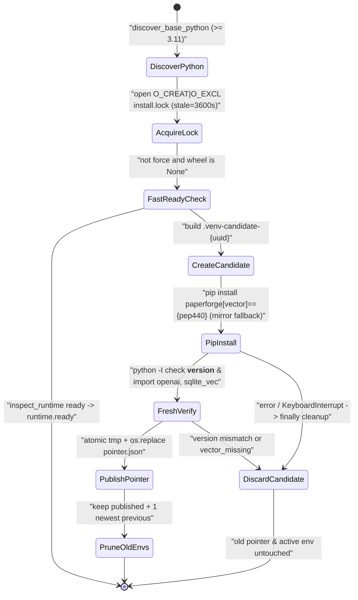

**核心顺序不变量**：

1. **SemVer → PEP 440 归一化**：`_normalize_release_version()` 将诸如 `2.0.0-rc.6` 或 `v2.0.0-beta.1` 的发行tag 统一归一化为 `2.0.0rc6`、`2.0.0b1`，确保 pip 安装规格与 `importlib.metadata` 回读版本比对一致。
2. **国内镜像条件回退**：`_pip_install()` 在主源失败、且未设置 `PIP_INDEX_URL`/`PIP_FIND_LINKS`、且安装目标非本地 `.whl` 文件时，自动使用 `--default-timeout=60` 回退至 `https://pypi.tuna.tsinghua.edu.cn/simple`（`--trusted-host pypi.tuna.tsinghua.edu.cn`）。
3. **仅限自建环境剪枝**：`ENV_DIR_PREFIXES = (".venv-candidate-",)`，`_prune_environments()` 仅删除带该前缀、严格位于 `runtime_dir` 子树内且排除当前发布环境与最新 1 个上一版本的旧目录，绝不误删用户手动环境。
4. **CWD 遮蔽防护（#267）**：`publish_pointer()` 优先读取运行环境中已安装发行版的 `dist-info` 元数据版本号，防止工作目录恰好位于源码仓根目录时，将尚未安装进受管 venv 的源码版本号误写进 `pointer.json`。

#### 4.3 凭据存储与一次性迁移流（`paperforge/credentials.py` & `paperforge/commands/auth.py`）

- **`store(key, secret, replace=False)`**：拒绝空字符串（`credential.input_required`）；读取 Keyring 现有值，若存在不同非空值且未传 `replace=True` 则抛出 `credential.conflict`；写入后立即执行 `kr.get_password()` 回读比对，任何异常或校验不一致都会触发 `_restore_prior()` 回滚至旧值（或删除部分写入）。
- **`auth migrate --from dotenv|environment|windows-registry`**：读取遗留源（`LEGACY_OCR_NAMES` + `LEGACY_EMBEDDING_NAMES`）→ 若非 `--dry-run` 且不冲突则写入 Keyring 并回读验证 → 仅 `.env` 来源在验证通过后通过 `_scrub_dotenv_key()` 原地删除该密钥行（保留 URL 等非敏感行）；进程环境变量与 Windows HKCU 注册表只会在 `manual_cleanup` 中列出待手动删除键名，绝不静默篡改用户外部环境。

#### 4.4 `SetupPlan` 引导编排链（`paperforge/setup/plan.py`）

`SetupPlan.execute()` 按不可逆顺序推进，任一步骤失败（`_step_outcome`）或收到协作取消信号（`rc=130`）即在下一步写入前熔断：

1. `checker`（`SetupChecker`，传 `--skip-checks` 跳过）→ 2. `config_writer`（仅写入显式传入的 CLI 键，不把未传参数覆盖为默认值）→ 3. `resolve_paths()` + `vault_initializer`（创建 5 个核心目录）+ `vault_initializer.zotero_junction`（若 `system.name == ".paperforge"` 则自动跳过 Junction 创建，直接使用 `zotero_data_dir`）→ 4. `runtime_dependencies`（只读校验 `openai` 与 `sqlite_vec` 可导入，缺漏时提示在 Obsidian 外运行 `paperforge runtime repair`）→ 5. `agent_installer`（按小步迭代 `deploy_skills`、`deploy_agent_config`，步间检查停止标记）。

---

### 5. 配置项、环境变量、CLI 入口与错误码

#### 5.1 环境变量全集

| 环境变量                                                                                       | 消费模块                          | 作用                                                                      |
| ---------------------------------------------------------------------------------------------- | --------------------------------- | ------------------------------------------------------------------------- |
| `PAPERFORGE_VAULT`                                                                             | `paperforge/config.py`            | 未传 `--vault` 时指定 Vault 路径                                          |
| 14 个 `FIELD_SPECS.env`                                                                        | `paperforge/config.py`            | 见 3.1 节（`PAPERFORGE_SYSTEM_DIR` 等 14 项）                             |
| `PAPERFORGE_CREDENTIAL_OCR__<PROFILE>` / `PAPERFORGE_CREDENTIAL_EMBEDDING__<PROFILE>`          | `paperforge/credentials.py`       | 显式进程级凭据覆盖，优先于 Keyring                                        |
| `PAPERFORGE_KEYRING_BACKEND`                                                                   | `paperforge/credentials.py`       | 覆盖底层 `PYTHON_KEYRING_BACKEND`（测试/无头部署控制）                    |
| `PIP_INDEX_URL` / `PIP_FIND_LINKS`                                                             | `paperforge/runtime_installer.py` | 存在任一变量时禁用默认清华镜像回退                                        |
| `PAPERFORGE_SETUP_TEST_HOLD_SECONDS`                                                           | `paperforge/setup/plan.py`        | NDJSON 模式下测试取消竞态窗口的延迟注入                                   |
| `PADDLEOCR_API_TOKEN`, `PADDLEOCR_API_KEY`, `OCR_TOKEN`, `VECTOR_DB_API_KEY`, `OPENAI_API_KEY` | `paperforge/commands/auth.py`     | **仅限** `auth migrate --from ...` 发现并迁移遗留凭据，运行时永不回退读取 |

#### 5.2 CLI 控制命令入口

- **配置管理**：`paperforge config {list|get <key>|set <key> <value>|unset <key>|validate|paths|init|migrate [--dry-run]} [--json]`（退出码：`0` 成功，`1` 运行失败，`2` 用法/未知键/只读键/敏感键）。
- **凭据管理**：
  - `paperforge auth status [ocr|embedding] [--profile P] [--json]`
  - `paperforge auth set <ocr|embedding> [--profile P] [--stdin] [--replace] [--json]`
  - `paperforge auth delete <ocr|embedding> [--profile P] --yes [--json]`（缺 `--yes` 返回退出码 `2`）
  - `paperforge auth migrate --from {dotenv|environment|windows-registry} [--dry-run] [--replace] [--kind ...] [--profile P] [--json]`
- **受管运行时**：`paperforge runtime {install|update|repair|status} [--expected-version V] [--base-python P] [--wheel W] [--json]`（`runtime` 分支在 `cli.py` 中直接路由，不解析 Vault 也不加载管线模块）。
- **初始化与健康检查**：`paperforge setup [--modular|--headless] [--agent ...] [--system-dir ...] [--zotero-data ...] [--skip-checks] [--json]`、`paperforge doctor [--json]`、`paperforge runtime-health [--json]`。

#### 5.3 错误码字典

##### 5.3.1 `ConfigError` 错误码（`paperforge/config.py`）

| 错误码                       | 触发场景                                                                                                   |
| ---------------------------- | ---------------------------------------------------------------------------------------------------------- |
| `config.not_found`           | `paperforge.json` 不存在，或 `bootstrap_config()` 时 Vault 目录不存在                                      |
| `config.corrupt`             | 文件无法读取、UTF-8/JSON 解码失败或根节点非 JSON Object                                                    |
| `config.migration_required`  | 缺失/`< 2` 的 `schema_version`、非整型版本，或存在 `LEGACY_PATH_KEYS`/`agent_key`/`_DERIVED_LEGACY_FIELDS` |
| `config.future_schema`       | `schema_version > 2`                                                                                       |
| `config.invalid`             | `vault_config` 非对象、字段类型/枚举/URL/Vault 相对路径校验失败                                            |
| `config.invalid_environment` | 环境变量中的配置覆盖值未通过 `validate_field_value()`                                                      |
| `config.secret_field`        | 顶层或 `vault_config` 内出现匹配 `_SECRET_KEY_PARTS` 的敏感键名                                            |
| `config.unknown_key`         | `set`/`unset`/`get` 传入未注册在 `FIELD_BY_KEY` 的键                                                       |
| `config.read_only_key`       | 尝试写入或删除 `writable=False` 的字段                                                                     |
| `config.write_failed`        | 原子写文件抛 `OSError` 或写入后回读校验失败                                                                |
| `config.locked`              | `FileLock` 在 `LOCK_TIMEOUT_SECONDS = 5.0` 秒内超时                                                        |

##### 5.3.2 凭据、运行时与字段验证错误码

- **凭据错误码**（`credentials.py` → `ErrorCode`）：`credential.missing`、`credential.backend_unavailable`、`credential.backend_locked`、`credential.permission_denied`、`credential.backend_error`、`credential.input_required`、`credential.conflict`、`credential.invalid_profile`、`credential.confirm_required`。
- **运行时安装错误码**（`RuntimeInstallError`）：`runtime.ready`（正常就绪状态码）、`runtime.install_in_progress`、`runtime.install_locked`、`runtime.directory_failed`、`runtime.wheel_invalid`、`runtime.no_python`、`runtime.python_too_old`、`runtime.venv_failed`、`runtime.pip_failed`、`runtime.verify_failed`、`runtime.vector_missing`、`runtime.install_failed`。
- **字段注册表验证码**（`field_validator.py`）：`MISSING_REQUIRED`（error）、`MISSING_OPTIONAL`（info）、`DRIFT`（warning，未在 `field_registry.yaml` 中注册的未知字段）、`READ_ERROR`（error）、`NO_FRONTMATTER`（warning）。

---

### 6. 边界防护与 Fail-Closed 防呆规则

1. **敏感键名全量拦截（`_SECRET_KEY_PARTS`）**：
   `paperforge/config.py` 定义 `_SECRET_KEY_PARTS = ("api_key", "api_token", "token", "password", "secret")`。无论在 `load_config()`、`validate_config()`、`set_config()`、`unset_config()` 还是 `migrate_config(--dry-run)` 中，只要顶层或 `vault_config.*` 下任一键名小写包含上述子串，立刻拒绝并抛出 `config.secret_field`。
2. **输入校验边界（`validate_field_value`）**：
   - `vault_relative=True` 的 7 个路径键强制禁止空白、`/`/`\` 开头、Windows 盘符前缀（如 `C:`）、NUL 字节 `\x00` 以及任何 `..` 路径段。
   - `paddleocr_job_url` 与 `vector_db_api_base` 强制要求 `http://` 或 `https://`，显式包含主机段且禁止嵌入 `user:pass@host`（`userinfo` 凭据）。
   - `ocr_profile` 与 `embedding_profile` 强制匹配 `[a-z][a-z0-9_]{0,63}`。
3. **无静默回退与绝不泄漏密钥（`credentials.py` & `auth.py`）**：
   - `auth set` 仅允许 TTY `getpass` 或 `--stdin` 管道读入（自动剥离末尾 `\r\n`），绝不在 `cli.py` 注册明文 `--value` 参数；任何错误消息、异常堆栈、`PFResult` 与日志均不回显密钥值。
   - 当 Keyring 后端锁定或不可用时，`ocr_doctor()` 与 `auth status` 必须明确报告 `credential.backend_locked` / `credential.backend_unavailable`，绝不伪装成 `credential.missing`。
4. **插件执行解释器单一来源（`run_doctor()`）**：
   `run_doctor()` 严格以 `read_pointer()` 发布的 `python_path` 作为插件执行目标进行版本与依赖探测；缺失、版本与当前进程不一致或可执行文件不存在时跳过目标探测并 Fail，绝不偷偷回退探测系统 `PATH` 上的 `python` 来制造虚假通过。
5. **已知遗留差异提示（`memory/runtime_health.py`）**：
   `paperforge/memory/runtime_health.py` 的 `_check_bootstrap()` 当前以 `vault / system_dir / "PaperForge"` 检查目录存在性，尚未适配 `.paperforge` 叶子折叠（见 [第 01 章](#chapter-01) 第 3.1 节）。在 `.paperforge` 布局下若 `runtime-health` 的 `bootstrap` 层报 `degraded`，需参考 `config paths` 与 `probe installation` 的权威结果。

---

### 7. 维修、调试与升级 Checklist

- [ ] **校验并修复配置状态**：运行 `paperforge --vault <VAULT> config validate --json`，若 `state == "migration_required"`，先运行 `paperforge config migrate --dry-run --json` 审查冲突警告再执行 `paperforge config migrate`。
- [ ] **核对当前有效配置来源**：运行 `paperforge --vault <VAULT> config list --json`，检查每个字段的 `source`（`default` / `file` / `environment` / `override`），排查是否存在误设的环境变量覆盖。
- [ ] **排查 Keyring 与凭据来源**：运行 `paperforge auth status --json` 确认 `ocr:default` 与 `embedding:default` 状态；无图形会话环境或测试环境可显式注入 `PAPERFORGE_CREDENTIAL_OCR__DEFAULT`，或通过 `echo <SECRET> | paperforge auth set ocr --stdin --replace` 写入。
- [ ] **清理旧版 `.env` 或环境变量中的遗留密钥**：运行 `paperforge --vault <VAULT> auth migrate --from dotenv --dry-run` 发现旧密钥后执行正式迁移，并根据 `manual_cleanup` 输出手动移除 OS 环境变量或 Windows 注册表项。
- [ ] **重建或升级受管运行时**：在 Obsidian 外部终端运行 `paperforge runtime status --json`；若版本不匹配或向量依赖异常，运行 `paperforge runtime update --json`（或强制重建 `paperforge runtime repair --json`）。
- [ ] **跨组件联动全量体检**：执行 `paperforge --vault <VAULT> doctor --json` 与 `paperforge --vault <VAULT> probe all --json`，核对指针版本、BBT 导出、Zotero 位置与笔记 Frontmatter 注册表一致性。

---

<a id="chapter-03"></a>

## 第 03 章：CLI 路由、PFResult 协议与流式取消机制

> 源文件：`docs/handbook/03-protocol-pfresult-and-stream.md`

> 本文档完整梳理 `paperforge/cli.py` 的全部命令行路由树、`paperforge/core/` 定义的 `PFResult` / `ErrorCode` / `NextAction` / `settlement` / `state` / `io` / `keys` / `timing` 基础契约，以及 `#137` NDJSON 结构化流与 `PAPERFORGE_STOP\n` 协作式取消协议。关联章节参见 [第 01 章：系统架构、分层约束与磁盘存储契约](#chapter-01)、[第 02 章：配置系统、凭据鉴权与运行时安装器](#chapter-02) 及 [ARCHITECTURE.md](ARCHITECTURE.md)。

---

### 1. 职责与非目标边界

- **CLI 路由器（`paperforge/cli.py`）**：负责解析全局参数、按需延迟加载 `pipeline`/Worker 模块、通过 `resolve_vault()` 定位 Vault、执行 Fail-Closed 配置门禁、初始化 stderr 日志与阶段计时，并将命令分派至 `paperforge/commands/` 或特定处理器。
- **双模式机读协议（`paperforge/core/result.py` & `paperforge/core/ndjson.py`）**：
  - **单结果模式（Single-Result Mode）**：在 `stdout` 输出单个 `PFResult` JSON 文档（或部分传统详情命令的结构化 JSON）。
  - **结构化流模式（Structured-Stream Mode, `#137`）**：在 `stdout` 按行输出 `schema_version: 1` 的 NDJSON 事件，并以有且仅有一个的终态事件（`result` | `error` | `cancelled`）结尾后立即到达 EOF；所有人工可读日志、诊断与性能计时均严格隔离到 `stderr`。
- **协作式取消（`paperforge/core/cancellation.py`）**：单进程内建立唯一取消标志，统一汇入两路信号——控制器通过管道写入 `PAPERFORGE_STOP\n` 至子进程 `stdin`，以及终端用户触发 `SIGINT`/`SIGTERM`。
- **底层共享原语（`paperforge/core/`）**：提供标准错误码（`errors.py`）、带校验的后续动作意图（`next_actions.py`）、单论文结算投影（`settlement.py`）、生命周期状态迁移校验（`state.py`）、原子文件写入（`io.py`）、跨平台键列表归一化（`keys.py`）与性能打点（`timing.py`）。

#### 非目标边界（Non-Goals）

- **不接受向客户端传递命令字符串或 `argv`**：`PFResult.next_actions` 与 `ActionSpec` 仅传递已注册 `action_id` 与结构化 `scope`，由插件客户端允许列表自行构造执行参数。
- **不支持已退役的冒号 Token 与跨进程停止控制面**：旧版 `EMBED_START`、`OCR_REBUILD_*`、`OCR_REDO_*`、`DONE`、`NOTICE` 文本标记流解析与 `embed` 独立停止子命令已永久退役，不得恢复双重解析。
- **不维护双向交互式 `stdin` 命令通道**：`stdin` 仅单向识别固定令牌 `PAPERFORGE_STOP\n`（以及 `auth set --stdin` 的单次密钥读取），不是通用 RPC 通道。

---

### 2. 核心源码与单测映射表

#### 2.1 核心源码模块

| 模块路径                                         | 核心职责                                   | 关键符号                                                                                                                                                                 |
| ------------------------------------------------ | ------------------------------------------ | ------------------------------------------------------------------------------------------------------------------------------------------------------------------------ | ------------ | -------------------------------------------------------------- | ---------------------------------------------------------------------------------------- |
| `paperforge/cli.py`                              | 顶层 `argparse` 树与全局门禁分派           | `build_parser()`、`main()`、`_run_cli()`、`_run_runtime_command()`、`_run_skill()`、`_cmd_paths()`                                                                       |
| `paperforge/commands/__init__.py`                | 动态命令模块注册表                         | `_COMMAND_REGISTRY`、`get_command_module()`                                                                                                                              |
| `paperforge/logging_config.py`                   | `paperforge` 根日志初始化（仅写 `stderr`） | `configure_logging()`、`get_paperforge_logger()`                                                                                                                         |
| `paperforge/core/result.py`                      | 统一结果信封与错误对象                     | `PFResult`、`PFError`（`to_dict()`、`to_json()`、`from_dict()`、`successful_keys`）                                                                                      |
| `paperforge/core/errors.py`                      | 集中式枚举错误码                           | `ErrorCode`（共 44 个成员 + `_missing_` 前向兼容映射）                                                                                                                   |
| `paperforge/core/ndjson.py`                      | `#137` NDJSON 流发射原语                   | `emit()`、`emit_start()`、`emit_phase()`、`emit_progress()`、`emit_preflight()`、`emit_paper_settled()`、`emit_heartbeat()`、`emit_item_result()`、`emit_terminal()`     |
| `paperforge/core/cancellation.py`                | 进程内协作式取消令牌                       | `STOP_TOKEN`（`"PAPERFORGE_STOP\n"`）、`make_cancellation_token()`                                                                                                       |
| `paperforge/core/next_actions.py`                | 类型化后续动作意图合约                     | `NextAction`、`NextActionScope`、`ACTION_REGISTRY`、`build_next_action()`、`validate_next_actions()`                                                                     |
| `paperforge/core/settlement.py`                  | 论文级操作标准化结算                       | `SettlementOutcome`、`settlement_payload()`、`successful_keys()`                                                                                                         |
| `paperforge/core/state.py`                       | 生命周期枚举与合法转移表                   | `OcrStatus`、`PdfStatus`、`Lifecycle`、`ALLOWED_TRANSITIONS`                                                                                                             |
| `paperforge/core/io.py`                          | 基础 JSON/JSONL/文本原子写入               | `read_json()`、`write_json_atomic()`、`write_text_atomic()`、`write_json()`、`read_jsonl()`                                                                              |
| `paperforge/core/keys.py`                        | 跨平台 Zotero Key 列表规范化               | `normalize_paper_keys()`（容忍 UTF-8 BOM、CRLF、逗号/空白并去重校验）                                                                                                    |
| `paperforge/core/timing.py`                      | `stderr` 独占的阶段耗时统计                | `phase()`、`reset()`、`set_command()`、`summary()`、`total_ms()`、`emit_total()`                                                                                         |
| `paperforge/core/date_utils.py`                  | 年份正则抽取辅助                           | `extract_year()`                                                                                                                                                         |
| `paperforge/actions/types.py`                    | 动作描述符与请求类型模型                   | `ActionSpec`、`ActionRequest`、`ActionScope`、`ActionExecutionHooks`                                                                                                     |
| `paperforge/actions/registry.py`                 | 冻结动作注册表与非注册动作表               | `ACTION_REGISTRY`（9 个注册动作）、`NON_REGISTRY_ACTIONS`                                                                                                                |
| `paperforge/actions/runner.py`                   | 动作管道执行器                             | `run_action()`、`ActionError`、`cancelled_result()`                                                                                                                      |
| `paperforge/commands/action.py`                  | `action list                               | describe                                                                                                                                                                 | preflight    | run` CLI                                                       | `run_dispatch()`、`EXIT_INVALID_REQUEST`、`EXIT_CONFIRMATION_REQUIRED`、`EXIT_CANCELLED` |
| `paperforge/commands/ocr.py`                     | `ocr` 族分派、诊断与流包装                 | `_run_ocr_dispatch()`、`_run_ocr_redo()`、`_run_ocr_rebuild()`、`_diagnose()`（支持 `--stream`）                                                                         |
| `paperforge/commands/embed.py`                   | `embed build                               | status                                                                                                                                                                   | migrate` CLI | `run()`（`--stream` 或无 `--json` 时发 `#137` 流错误终止事件） |
| `paperforge/commands/daemon.py`                  | 持久 stdio JSON-RPC 复用通道               | `serve_stdio()`、`_execute_request()`（每次 RPC 前 `timing.reset()` 防串味、重定向 logging `StreamHandler`，透传 `stdin` 凭据并隔离 `SystemExit`）                       |
| `paperforge/plugin/src/client/node-transport.ts` | TS 端唯一子进程与协议 Fail-Closed 解析器   | `NdjsonStreamParser`、`runLongTask()`、`hardKill()`、`paperforgeEnrichedEnv()`、暖 daemon 复用（`shutdownDaemon()` 先拒绝在途并发 RPC 并清定时器再杀进程）与一次性冷回退 |

#### 2.2 配套单元测试与契约测试

| 测试文件路径                                | 验证目标与断言重点                                                                                                             |
| ------------------------------------------- | ------------------------------------------------------------------------------------------------------------------------------ |
| `tests/cli/test_json_contracts.py`          | 校验 `paths --json`、`status --json`、`context`、`search --json`、`retrieve --json` 的信封键集与字段类型语义                   |
| `tests/cli/test_error_codes.py`             | 校验未知命令退出码、`--help`/`--version`、无 Vault 时禁止泄漏 Python Traceback 及确定性错误输出                                |
| `tests/cli/test_contract_helpers.py`        | 提供 `normalize_snapshot()`、`assert_valid_json()`、`assert_json_shape()` 契约测试助手                                         |
| `tests/test_cli_paths.py`                   | 断言 `paths --json` 与文本输出不含 `<system_dir>`/`<resources_dir>` 未解析占位符                                               |
| `tests/unit/test_daemon_and_stream_flag.py` | 验证 `paperforge daemon --stdio` 复用、`auth set --stdin` 秘钥透传、错误/嵌套隔离及各命令 `--stream` 参数解析                  |
| `tests/test_cli_worker_dispatch.py`         | 验证 `status`、`sync`、兼容别名及 `ocr` 向对应命令/服务模块的正确分派                                                          |
| `tests/test_x04_kill_terminal.py`           | 启动 `setup --json` 并注入硬杀（`SIGKILL`/`TerminateProcess`），断言退出码非零且绝不伪造 `result` 终态事件                     |
| `tests/test_x05_atomicity_hardening.py`     | 模拟临时文件写入后、`os.replace` 前崩溃，断言旧 `pointer.json` 完好且截断 JSON 被 Fail-Soft 拒绝                               |
| `tests/unit/core/test_errors.py`            | 校验 `ErrorCode` 枚举值、字符串转换及未知字符串向 `ErrorCode.UNKNOWN` 的前向容错                                               |
| `tests/unit/core/test_io.py`                | 校验 `write_json_atomic()` 自动创建父目录、原子替换且不残留 `.json.tmp`                                                        |
| `tests/unit/core/test_result.py`            | 校验 `PFResult` / `PFError` 布尔语义、序列化空字段省略规则（`warnings`/`next_actions`）及 `to_json()`/`from_dict()` 往返一致性 |
| `tests/unit/core/test_state.py`             | 校验 `OcrStatus` 9 态、`from_legacy()` 映射、`PdfStatus`、`Lifecycle` 及 `ALLOWED_TRANSITIONS` 非法迁移拦截                    |
| `tests/test_settlement.py`                  | 校验 `successful_keys` 与 `summary` 严格由 `per_key` 派生且透传 `reason_code`、`execution_id`                                  |
| `tests/test_core_keys.py`                   | 校验 `normalize_paper_keys()` 对 CRLF、BOM、逗号空格混排、空行、重复键及 `known_keys` 过滤                                     |
| `tests/test_timing.py`                      | 校验 `PAPERFORGE_TIMING=1/0/unset` 三种策略及“计时器永不写入 `stdout`”红线                                                     |

---

### 3. 磁盘文件、数据库表与协议 JSON 字段字典

#### 3.1 `PFResult` 与 `PFError` 信封协议（`paperforge/core/result.py`）

| 字段路径          | 类型                | 序列化规则（`to_dict()`）       | 说明                                                                                                                          |
| ----------------- | ------------------- | ------------------------------- | ----------------------------------------------------------------------------------------------------------------------------- |
| `ok`              | `bool`              | 必填                            | 成功为 `True`，任何错误或取消均为 `False`                                                                                     |
| `command`         | `str`               | 必填                            | 命令或操作名称（如 `"sync"`、`"config.set"`、`"action run"`）                                                                 |
| `version`         | `str`               | 必填                            | `paperforge.__version__`                                                                                                      |
| `data`            | `Any \| None`       | 始终序列化（无数据时为 `null`） | 成功载荷或诊断上下文                                                                                                          |
| `error`           | `dict \| None`      | 始终序列化（无错时为 `null`）   | 包含 `code`（`ErrorCode.value`）、`message`（`str`）、`details`（`dict`）；仅当 `suggestions` 非空时才输出 `suggestions` 列表 |
| `warnings`        | `list[str]`         | **非空时才输出**                | 面向机器调用方的警告列表（不写往 `stdout` 散文）                                                                              |
| `next_actions`    | `list[dict]`        | **非空时才输出**                | 序列化后的 `NextAction` 列表                                                                                                  |
| `successful_keys` | `list[str] \| None` | **永不序列化上行**              | `#167` 进程内元数据，供 `--follow auto` 链传递精确成功键作用域                                                                |

#### 3.2 `#137` NDJSON 流事件词汇表（`paperforge/core/ndjson.py`）

每行均为单行 UTF-8 JSON，公共必填字段：`schema_version: 1`、`event: str`、`operation: str`。

| `event`         | 发射函数                          | 附加载荷字段                                                            | 类别与语义                                         |
| --------------- | --------------------------------- | ----------------------------------------------------------------------- | -------------------------------------------------- |
| `start`         | `emit_start()`                    | `total: int \| None`, `scope: Any`                                      | 非终态：操作启动                                   |
| `preflight`     | `emit_preflight()`                | `availability: str`, `summary: {needed, noop, blocked, not_applicable}` | 非终态：执行前可用性与适用性摘要                   |
| `phase`         | `emit_phase()`                    | `phase: str`                                                            | 非终态：全局或长步骤阶段切换（如 `setup` 步骤 ID） |
| `progress`      | `emit_progress()`                 | `current: int`, `total: int \| None`, `item_id: str \| None`            | 非终态：条目级进度推进                             |
| `item_result`   | `emit_item_result()`              | `item_id: str`, `status: str`                                           | 非终态：单条目的中间状态（如 `ocr.rebuild`）       |
| `paper_settled` | `emit_paper_settled()`            | `key: str`, `outcome: str`, `reason_code?: str`                         | 非终态：单篇论文进入结算状态                       |
| `heartbeat`     | `emit_heartbeat()`                | `active: int`, `pending: int`                                           | 非终态：远端轮询存活心跳                           |
| `result`        | `emit_terminal("result", ...)`    | `result: dict`（完整 `PFResult`）                                       | **终态**：操作成功结束（紧接 EOF）                 |
| `error`         | `emit_terminal("error", ...)`     | `result: dict`（完整 `PFResult`，`ok=false`）                           | **终态**：操作失败结束（紧接 EOF）                 |
| `cancelled`     | `emit_terminal("cancelled", ...)` | `result: dict`（完整 `PFResult`，`code="action.cancelled"`）            | **终态**：协作取消结束（紧接 EOF，退出码 `130`）   |

#### 3.3 `NextAction` 与 `settlement_payload` 字段字典

- **`NextAction`**（`paperforge/core/next_actions.py`，`NEXT_ACTIONS_SCHEMA_VERSION = 1`）：
  - 字段：`schema_version`、`action_id`、`scope`（`{"kind": "all"}` 或 `{"kind": "papers", "keys": [...]}`）、`automatic`（`bool`）、`cost`（`"local" | "remote_possible"`）、`impact`（`"read_only" | "mutating" | "destructive"`）、`confirmation`（`"none" | "required"`）、`reason`、`dedupe_key`（非空时输出）。
  - 当前 `ACTION_REGISTRY` 注册条目仅两项：`memory.build`（`cost="local"`, `impact="destructive"`, `automatic=False`）与 `embed.resume`（`cost="remote_possible"`, `impact="mutating"`, `automatic=False`）。
- **`settlement_payload`**（`paperforge/core/settlement.py`）：
  - `SettlementOutcome` 6 种标准状态：`succeeded`、`noop`、`pending`、`blocked`、`failed`、`cancelled`。
  - 输出结构：`{"summary": {各状态计数}, "per_key": {key: {"outcome": ..., "reason_code"?: ..., "execution_id"?: ...}}, "successful_keys": sorted(outcome == "succeeded")}`。

#### 3.4 状态机枚举字典（`paperforge/core/state.py`）

- **`OcrStatus`**（9 态）：`none`、`pending`、`queued`、`processing`、`done`、`done_incomplete`、`failed`、`blocked`、`nopdf`。`from_legacy()` 映射旧值 `"running"` → `processing`、`"error"` → `failed`，未知字符串默认映射至 `pending`。
- **`PdfStatus`**（3 态）：`healthy`、`broken`、`missing`。
- **`Lifecycle`**（5 态）：`pdf_ready`、`ocr_ready`、`analyze_ready`、`deep_read_done`、`error_state`。

---

### 4. 核心执行链路、状态机与顺序不变量

#### 4.1 CLI 启动、门禁与分派流程

1. `main()` 重置阶段计时器（`timing.reset()`）并在 `finally` 中调用 `timing.emit_total()` 向 `stderr` 汇总耗时。
2. `_run_cli()` 解析参数后调用 `timing.set_command(args.command)`：
   - 若为 `runtime`：直接配置日志并进入 `_run_runtime_command()`，**不解析 Vault、不导入管线模块**。
   - 若在 `lightweight_commands` 集合（36 个命令）：调用 `_resolve_pipeline()`；若在 `worker_import_commands`（`status`、`deep-reading`、`ocr`、`selection-sync`、`index-refresh`、`base-refresh`）：通过 `_import_worker_functions()` 绑定未被打桩的 Worker Stub。
   - 调用 `resolve_vault(cli_vault=args.vault)`。
   - **Fail-Closed 配置加载**：除 `config_tolerant_commands = frozenset({"config", "setup", "probe", "auth", "action", "skill"})` 外，其余所有命令在调度前必须通过 `load_config(vault)` 与 `resolve_paths(vault, snapshot)`。若配置缺失/损坏/需迁移/含密钥且传入 `--json`，则向 `stdout` 打印构造好的 `PFResult(error.code=VALIDATION_ERROR)` 后退出码 `1`。
   - 调用 `configure_logging(verbose)` 初始化 `stderr` 日志后路由至对应命令模块。

#### 4.2 双输出模式选择真值（无全局 `--stream` 标志）

`paperforge/cli.py` **不存在全局 `--stream` CLI 参数**。结构化流由特定命令或注册表 `execution_mode` 自动决定：

| 入口命令                                                               | 非 `--json` 行为                                                    | `--json` 行为                                                                                                                                                                                       |
| ---------------------------------------------------------------------- | ------------------------------------------------------------------- | --------------------------------------------------------------------------------------------------------------------------------------------------------------------------------------------------- |
| `action run <id>`                                                      | 人类可读文本摘要                                                    | 若 `ACTION_REGISTRY[id].execution_mode == "stream"`（如 `foundation.update`、`embed.resume`、`embed.build`、`ocr.run`、`ocr.rebuild_derived`），发射 `#137` NDJSON 流；否则输出单条 `PFResult` JSON |
| `setup`                                                                | 人类可读步骤进度与总结                                              | `SetupPlan.execute(ndjson=True)` 发射 `#137` NDJSON 流（`operation="foundation.setup"`）                                                                                                            |
| `ocr` / 兼容子命令 `run`                                               | `_stream = True`，发射 `ocr.run` NDJSON 流（`diagnose` 除外）       | 关闭 NDJSON 流，结束后输出单条 `PFResult` JSON                                                                                                                                                      |
| `ocr rebuild`（非 `--dry-run`）                                        | 始终发射 `ocr.rebuild` NDJSON 流（无 `--json` 参数）                | —                                                                                                                                                                                                   |
| `ocr redo <KEYS...>`（非 `--dry-run`）                                 | 显式传入 `keys` 时始终发射 `ocr.redo` NDJSON 流（无 `--json` 参数） | —                                                                                                                                                                                                   |
| `embed build`                                                          | `emit_events=True`，发射 `embed.build` NDJSON 流                    | 关闭 NDJSON 流，由构建服务输出单条 `PFResult` JSON                                                                                                                                                  |
| 常规查询/修改命令（`sync`、`config`、`auth`、`probe`、`reconcile` 等） | 人类可读文本                                                        | 单条 `PFResult` 或域内 JSON                                                                                                                                                                         |

#### 4.3 协作式取消与强杀升级交互序列

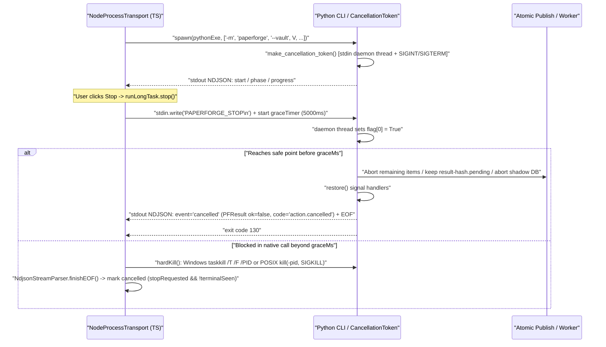

#### 4.4 `OcrStatus` 状态迁移矩阵（`ALLOWED_TRANSITIONS`）

- `none` → `pending`, `queued`, `nopdf`
- `pending` → `queued`, `processing`, `nopdf`, `blocked`
- `queued` → `processing`, `failed`
- `processing` → `done`, `done_incomplete`, `failed`
- `done` / `done_incomplete` / `failed` / `blocked` / `nopdf` → `pending`（显式重跑或修复后重入队）
- `DEEP_READING_STATUS`：`pending` ↔ `done`（通过 `--force` 重置）。
- `Lifecycle`：`pdf_ready` → `ocr_ready` → `analyze_ready` → `deep_read_done` ↔ `pdf_ready`，任何阶段均可转入 `error_state` 并经 `error_state` → `pdf_ready` 恢复。

---

### 5. 配置项、环境变量、CLI 入口与错误码

#### 5.1 全局参数与环境变量

- **全局参数**（必须位于子命令之前）：`--version`、`--vault VAULT`、`--verbose` / `-v`（强制日志级别为 `DEBUG`）、`--no-progress`（关闭进度条）。
- **协议级环境变量**：
  - `PAPERFORGE_VAULT`：Vault 根路径后备定位变量。
  - `PAPERFORGE_LOG_LEVEL`：日志级别（`DEBUG`/`INFO`/`WARNING`/`ERROR`），未配置时默认 `INFO`，非法值静默回退至 `WARNING`。
  - `PAPERFORGE_TIMING`：`1` 打印所有阶段耗时到 `stderr`；`0` 完全静默；未设置仅打印超过 `SLOW_MS = 1000.0` ms 的慢阶段。

#### 5.2 全部 47 个顶层 CLI 子命令全集（核对自 `build_parser()`）

##### 5.2.1 控制面、配置与安装运维（10 个）

| 顶层子命令       | 子动作 / 关键选项                                                                                                                                                 | 说明                                                     |
| ---------------- | ----------------------------------------------------------------------------------------------------------------------------------------------------------------- | -------------------------------------------------------- |
| `config`         | `list\|get\|set\|unset\|validate\|paths\|init\|migrate` (`--dry-run`, `--json`)                                                                                   | Schema v2 唯一配置入口                                   |
| `auth`           | `status\|set\|delete\|migrate` (`--stdin`, `--replace`, `--yes`, `--from`, `--json`)                                                                              | 凭据管理权威入口                                         |
| `runtime`        | `install\|update\|repair\|status` (`--expected-version`, `--base-python`, `--wheel`, `--json`)                                                                    | 独立受管运行时（无需 Vault）                             |
| `daemon`         | `--stdio`（默认启用）, `--idle-timeout SEC`（默认 `300`，`0` 禁用）                                                                                               | 单进程 stdio JSON-RPC 复用通道（无网络监听）             |
| `setup`          | `--modular`, `--headless`, `--agent`, `--system-dir`, `--resources-dir`, `--literature-dir`, `--base-dir`, `--zotero-data`, `--skip-checks`, `--stream`, `--json` | Vault 初始化编排（`--stream` / `--json` 输出 NDJSON 流） |
| `probe`          | `installation\|help\|library\|ocr\|memory\|maintenance\|lineage\|all` (`--json`, `--expected-version`, `--last-operation-exit-code`)                              | 只读能力探测包络                                         |
| `action`         | `list\|describe\|preflight\|run` (`--scope`, `--key`, `--keys-file`, `--confirm`, `--follow`, `--stream`, `--json`)                                               | 声明式动作策略管道（`--stream` 强制 `#137` 流）          |
| `reconcile`      | `--scope`, `--key`, `--json`                                                                                                                                      | 纯派生缺陷读模型与 `next_actions` 生成器                 |
| `doctor`         | `--json`                                                                                                                                                          | Vault 全链路诊断与字段注册表检查                         |
| `runtime-health` | `--json`                                                                                                                                                          | Memory/Vector 5 维健康检查                               |

##### 5.2.2 文献库同步、工作区与路径（7 个）

| 顶层子命令        | 子动作 / 关键选项                                                                                          | 说明                                         |
| ----------------- | ---------------------------------------------------------------------------------------------------------- | -------------------------------------------- |
| `paths`           | `--json`                                                                                                   | 打印解析后的 Vault 路径字典                  |
| `status`          | `--json`                                                                                                   | 报告库统计、OCR 队列与索引摘要               |
| `sync`            | `--dry-run`, `--domain`, `--selection`, `--index`, `--rebuild-index`, `--prune`, `--prune-force`, `--json` | Zotero 选择同步、资产索引重建与收敛触发      |
| `migrate-storage` | `--dry-run`, `--json`                                                                                      | 迁移引擎存储至 `.paperforge/`                |
| `base-refresh`    | `--force` / `-f`                                                                                           | 刷新 `.base` 视图文件                        |
| `prune`           | `--force`, `--json`, `keys...`                                                                             | 清理孤儿论文（默认 dry-run，实删移入回收站） |
| `trash`           | `list\|restore <trash_id>\|purge [--older-than DAYS]`                                                      | 回收站列表、恢复与物理清除                   |

##### 5.2.3 OCR、渲染审计与显示版本（5 个）

| 顶层子命令 | 子动作 / 关键选项                                                                                                                                            | 说明                                                         |
| ---------- | ------------------------------------------------------------------------------------------------------------------------------------------------------------ | ------------------------------------------------------------ |
| `ocr`      | 顶层 `--diagnose`, `--stream`, `--json`, `--key`；子命令 `pipeline-versions`, `status`, `resume`, `redo`, `list`, `rebuild`, 以及兼容子命令 `run` / `doctor` | OCR 队列执行、断点续传、派生重建与诊断（支持 `--stream`）    |
| `render`   | `audit\|reconcile\|promote-r\|accept-proposal` (`--include-pdf-media`, `--apply-r`, `--all`, `--plan-hash`, `--json`)                                        | 渲染一致性审计与 R/P 级联修复晋升                            |
| `versions` | `list\|show\|backups\|paths\|restore\|reset-live` (`--key`, `--label`, `--json`)                                                                             | 显示全文历史版本、安全恢复与切回最新规范全文                 |
| `repair`   | `--fix`, `--fix-paths`, `--json`                                                                                                                             | 修复笔记与 OCR 元数据分歧或失联 PDF 路径                     |
| `note`     | `set-flag` (`--key`, `--field`, `--value true\|false`, `--json`)                                                                                             | Python 权威改写笔记 Frontmatter 开关（`do_ocr` / `analyze`） |

##### 5.2.4 记忆底座、向量检索、阅读记录与智能体（19 个）

| 顶层子命令      | 子动作 / 关键选项                                                                                                                   | 说明                                                   |
| --------------- | ----------------------------------------------------------------------------------------------------------------------------------- | ------------------------------------------------------ |
| `memory`        | `build [--key ...] [--json]\|status [--json]\|restore-backup [--json]`                                                              | SQLite `paperforge.db` 底座构建与备份恢复              |
| `embed`         | `build [--force\|--resume] [--stream] [--json]\|status [--probe] [--json]\|migrate [--json]`                                        | 向量索引构建（支持显式 `--stream` 流模式）、探针与迁移 |
| `search`        | `query`, `--json`, `--limit`, `--domain`, `--year-from`, `--year-to`, `--ocr`, `--deep`, `--lifecycle`, `--next-step`, `--evidence` | FTS5 元数据检索                                        |
| `retrieve`      | `query`, `--json`, `--limit`, `--deep`, `--expand\|--no-expand`, `--paper`                                                          | 正文与图表语义混合检索（BM25 ∪ vec0）                  |
| `query-plan`    | `query`, `--intent discover\|locate\|content\|known-paper`, `--json`                                                                | 检索意图唯一路由器                                     |
| `inspect`       | `query`, `--json`                                                                                                                   | 单论文 6 阶段端到端瓶颈诊断（只读 `?mode=ro`）         |
| `paper-status`  | `query`, `--json`                                                                                                                   | 查询单篇论文状态                                       |
| `paper-context` | `key`, `--json`, `--structure`                                                                                                      | 获取论文元信息、章节结构树及批注                       |
| `read`          | `key`, `--find` (必选), `--source auto\|fulltext\|pdf`, `--json`                                                                    | 受控本地原文/PDF 字面量检索                            |
| `context`       | `key`, `--domain`, `--collection`, `--all`                                                                                          | 生成可溯源 AI 上下文包                                 |
| `dashboard`     | `--json`                                                                                                                            | 聚合仪表盘统计与权限投影                               |
| `annotations`   | `pdf-info\|list\|add\|update\|delete\|promote\|fulltext-preview\|agent-mark\|adopt\|clear-agent`                                    | 非破坏性侧车 PDF 批注与 Agent 句子锚定                 |
| `memory-card`   | `get\|refine\|history\|clear\|base-snapshot`                                                                                        | 5 维动态论文记忆卡片及 Base 快照                       |
| `reading-log`   | `--write`, `--render`, `--correct`, `--search`, `--lookup`, `--validate`, `--import`, `--json` 等                                   | 科研精读摘录记录与纠错账本                             |
| `project-log`   | `--write`, `--payload`, `--project`, `--list`, `--render`                                                                           | 项目级研究工作日志                                     |
| `deep-reading`  | `--json`                                                                                                                            | 查询待精读论文队列                                     |
| `deep-finalize` | `zotero_key`, `--json`                                                                                                              | 标记精读完成并刷新状态                                 |
| `agent-context` | `--json`                                                                                                                            | 生成智能体启动上下文包                                 |
| `skill`         | `deploy` (`--to`, `--overwrite`, `--json`)                                                                                          | 部署内嵌 `paperforge` 技能包                           |

##### 5.2.5 向后兼容历史子命令（6 个，文档已弃用）

| 顶层子命令 token    | 当前等价路由 / 说明                                             |
| ------------------- | --------------------------------------------------------------- |
| `selection-sync`    | 转发至 `sync`（强制 `selection=True, index=False`）             |
| `index-refresh`     | 转发至 `sync`（强制 `selection=False, index=True`）             |
| `paper-lookup`      | v1.5 前 Layer 4 网关遗留命令（支持 `--from-path` 与 `query`）   |
| `content-discovery` | v1.5 前 Layer 4 网关遗留命令（现由 `search` / `retrieve` 替代） |
| `paper-navigation`  | v1.5 前 Layer 4 网关遗留命令（现由 `paper-context` 替代）       |
| `scoped-fetch`      | v1.5 前 Layer 4 网关遗留命令（现由 `retrieve --paper` 替代）    |

#### 5.3 全部 44 个 `ErrorCode` 枚举码与统一退出码

##### 5.3.1 `ErrorCode` 完整清单（`paperforge/core/errors.py`）

| 子系统                          | 枚举成员名称及字符串 `.value`                                                                                                                                                                                                                                                                                                                                                                                                                                                                                                                                 |
| ------------------------------- | ------------------------------------------------------------------------------------------------------------------------------------------------------------------------------------------------------------------------------------------------------------------------------------------------------------------------------------------------------------------------------------------------------------------------------------------------------------------------------------------------------------------------------------------------------------- |
| **Runtime (4)**                 | `PYTHON_NOT_FOUND`, `PYTHON_VERSION_TOO_OLD`, `PAPERFORGE_NOT_INSTALLED`, `VERSION_MISMATCH`                                                                                                                                                                                                                                                                                                                                                                                                                                                                  |
| **Config / Vault (4)**          | `VAULT_NOT_FOUND`, `CONFIG_NOT_FOUND`, `CONFIG_INVALID`, `PATH_NOT_FOUND`                                                                                                                                                                                                                                                                                                                                                                                                                                                                                     |
| **BBT / Zotero (5)**            | `BBT_EXPORT_NOT_FOUND`, `BBT_EXPORT_INVALID`, `BBT_CITATION_KEY_MISSING`, `ZOTERO_DATA_NOT_FOUND`, `PDF_PATH_UNRESOLVED`                                                                                                                                                                                                                                                                                                                                                                                                                                      |
| **Credentials (9)**             | `CREDENTIAL_MISSING` (`"credential.missing"`), `CREDENTIAL_BACKEND_UNAVAILABLE` (`"credential.backend_unavailable"`), `CREDENTIAL_BACKEND_LOCKED` (`"credential.backend_locked"`), `CREDENTIAL_PERMISSION_DENIED` (`"credential.permission_denied"`), `CREDENTIAL_BACKEND_ERROR` (`"credential.backend_error"`), `CREDENTIAL_INPUT_REQUIRED` (`"credential.input_required"`), `CREDENTIAL_CONFLICT` (`"credential.conflict"`), `CREDENTIAL_INVALID_PROFILE` (`"credential.invalid_profile"`), `CREDENTIAL_CONFIRM_REQUIRED` (`"credential.confirm_required"`) |
| **Actions / Preconditions (9)** | `ACTION_UNKNOWN` (`"action.unknown"`), `ACTION_INVALID_REQUEST` (`"action.invalid_request"`), `ACTION_SCOPE_INVALID` (`"action.scope_invalid"`), `ACTION_UNAVAILABLE` (`"action.unavailable"`), `ACTION_BUSY` (`"action.busy"`), `ACTION_CONFIRMATION_REQUIRED` (`"action.confirmation_required"`), `ACTION_CANCELLED` (`"action.cancelled"`), `PARTIAL_FAILURE`, `PRECONDITION_FAILED`                                                                                                                                                                       |
| **OCR (4)**                     | `OCR_TOKEN_MISSING`, `OCR_UPLOAD_FAILED`, `OCR_POLL_TIMEOUT`, `OCR_RESULT_INVALID`                                                                                                                                                                                                                                                                                                                                                                                                                                                                            |
| **Sync (3)**                    | `SYNC_FAILED`, `CANDIDATE_BUILD_FAILED`, `NOTE_WRITE_FAILED`                                                                                                                                                                                                                                                                                                                                                                                                                                                                                                  |
| **Schema (3)**                  | `FIELD_MISSING`, `FIELD_TYPE_INVALID`, `INDEX_SCHEMA_INVALID`                                                                                                                                                                                                                                                                                                                                                                                                                                                                                                 |
| **Generic (3)**                 | `VALIDATION_ERROR`, `INTERNAL_ERROR`, `UNKNOWN`（未知代码经 `_missing_()` 降级至此）                                                                                                                                                                                                                                                                                                                                                                                                                                                                          |

##### 5.3.2 统一退出码规范

| 退出码 | 语义与触发场景                                                                                                                                                            |
| ------ | ------------------------------------------------------------------------------------------------------------------------------------------------------------------------- |
| `0`    | 操作完成 / `PFResult.ok=true` / 终态事件 `result`                                                                                                                         |
| `1`    | 操作级失败 / 配置未通过 / Pre-flight 不可用或忙碌 / `error` 终态事件                                                                                                      |
| `2`    | `argparse` 用法错误 / `action` pre-dispatch 非法请求（未知 `action_id`、非法 `scope`、空 `keys`、`--confirm` 不匹配）/ `config` 未知键或敏感键 / `auth delete` 缺 `--yes` |
| `3`    | `action run` pre-dispatch 缺 `--confirm <exact_action_id>`（同时输出携带确认摘要的描述符）                                                                                |
| `130`  | 协作式取消生效（`PAPERFORGE_STOP\n` / `SIGINT` / `SIGTERM`），对应 `cancelled` 终态事件，绝不折叠为 `1`                                                                   |

---

### 6. 边界防护与 Fail-Closed 防呆规则

1. **NDJSON 解析器 Fail-Closed（`NdjsonStreamParser`）**：
   客户端遇到以下任一状况立刻终止解析并判定 `protocolFailure`，绝不猜测或容忍脏数据：
   - `stdout` 出现任何非 JSON 行（如误用 `print()` 输出调试文本）。
   - `schema_version !== 1` 或 `event` 不在 `KNOWN_EVENTS`（10 个已知事件名）之内。
   - 收到终态事件（`result` | `error` | `cancelled`）后流未结束又收到后续事件或第二个终态事件。
   - 进程到达 EOF 却未观测到任何终态事件（补充附上 `exit <code>` / `signal <sig>` 以区分崩溃强杀与静默丢帧）。
   - **唯一向后兼容豁免**：同一主版本内已知事件中的未知增量字段会被忽略。
2. **管道阻塞与 `stdout` 洁癖红线**：
   - `timing.py` 与 `logging_config.py` 强制只向 `sys.stderr` 输出；`NodeProcessTransport` 持续消费并仅保留最近 `STDERR_TAIL = 8000` 字符的 `stderr`，防止 Windows 默认约 4KB 管道缓冲写满后反向卡死 Python 子进程。
   - `cli.py` 在 `--json` 模式下捕获 `ConfigError` 时强制走 `stdout` 输出完整 `PFResult`，避免错误原因因落到 `stderr` 而丢失。
3. **`NextAction` 不变量门禁（`validate_next_action`）**：
   - 凡 `cost == "remote_possible"` 或 `impact == "destructive"`，强制 `automatic == False` 且 `confirmation == "required"`。
   - `scope.kind == "papers"` 时绝对禁止空 `keys`（防止空列表被误解释为“全库论文”）；`scope.kind == "all"` 时禁止携带非空 `keys`；批内 `dedupe_key` 重复或未知 `action_id` 一律拒绝。
4. **Action 返回契约与按键清单净化**：
   - `runner.py:_validate_handler_result()` 校验处理器返回必须是 `PFResult` 且 `data` 为 `Mapping` 或 `None`，否则转为 `INTERNAL_ERROR`。
   - `core/keys.py:normalize_paper_keys()` 统一剥离 `\ufeff`（UTF-8 BOM）、`\r`（Windows CRLF）与空白/逗号分隔并保序去重，且 `action` 与 `ocr` 在接收 `--keys-file` 或空白键时会显式返回退出码 `2`，防止半截碎片或回车符导致键静默漏匹配。
5. **原始文件写入原子化（`core/io.py`）**：
   `write_json_atomic()` 与 `write_text_atomic()` 先在同级目录写 `.tmp` 文件再执行 `Path.replace()`，保证崩溃不会产生零字节或半截目标文件（需强持久化的 `config.py` 与 `asset_index.py` 在此基础上额外叠加 `FileLock` 与 `os.fsync()`）。

---

### 7. 维修、调试与升级 Checklist

- [ ] **定位慢命令瓶颈**：设置环境变量 `PAPERFORGE_TIMING=1` 并复跑慢命令，在 `stderr` 查看每段 `[PF:time] <phase> <ms>` 及总墙钟耗时（不影响 `stdout` 机器解析）。
- [ ] **打开全量调试日志**：传递全局标志 `--verbose`（须放在子命令前，如 `paperforge --vault <VAULT> -v sync --json`）或设置 `PAPERFORGE_LOG_LEVEL=DEBUG`，在 `stderr` 观察详细堆栈与状态转换。
- [ ] **排查插件报 `EOF without terminal event` 或 `non-JSON stdout line`**：在独立终端复跑完全相同的命令并重定向 `stdout` 与 `stderr` 分离检查，核实是否存在未走 `stderr` 的裸 `print()` 污染 `stdout`，或进程中途 OOM/强杀导致未发射终态事件。
- [ ] **排查 `action run` 返回退出码 2 或 3**：退出码 `2` 检查 `action_id` 拼写、`--scope papers` 是否漏传 `--key`/`--keys-file`（以及键文件是否存在无效空键）；退出码 `3` 表示需要交互确认，读取返回值中的 `preservation_facts` / `replacement_facts` 后附带 `--confirm <exact_action_id>` 重试。
- [ ] **验证批量键文件兼容性**：对从 Windows 粘贴或脚本生成的 `--keys-file`，确认其可通过 `paperforge.core.keys.normalize_paper_keys()` 正常剥离 BOM 与 `\r\n`。
- [ ] **回归核心协议单测矩阵**：修改 `cli.py`、`core/`、`actions/` 后，至少运行 `pytest tests/cli/ tests/unit/core/ tests/test_cli_paths.py tests/test_cli_worker_dispatch.py tests/test_x04_kill_terminal.py tests/test_x05_atomicity_hardening.py tests/test_settlement.py tests/test_core_keys.py tests/test_timing.py`。

---

<a id="chapter-04"></a>

## 第 04 章：控制面状态探针与 Reconcile 缺口推导

> 源文件：`docs/handbook/04-probes-and-reconcile.md`

本章系统剖析 PaperForge 控制面的只读观测层（Capability Probes）与缺口推导引擎（Reconcile）。两者共同构成了“先观测事实、再推导最小修复前沿、最后交由注册表与执行器落地”的闭环控制面，是前端插件（Control Center）与 CLI 自动化编排获取真实系统状态的唯一权威（Single Source of Truth, SSOT）。相关 Action 注册表、Preflight 投影与执行安全边界详见 [Chapter 05](#chapter-05)，Zotero/BBT 同步与谱系底层状态采集详见 [Chapter 06](#chapter-06)。

---

### 1. 职责与非目标边界

#### 1.1 控制面双引擎的职责划分

1. **Capability Probes（能力探针，`paperforge/probes/`）**
   - 负责将底层离散磁盘状态（Python 运行时指针、`paperforge.json` 配置、BBT 导出与索引、OCR 维护行与谱系、SQLite/vec0 向量状态、内置 Skill 源文件）归一化为 **Schema-v2 能力信封（Capability Envelope）**。
   - **纯只读观测**：在任何场景下不得修改 `paperforge.json`、`meta.json`、`paperforge.db` 或重新生成衍生文件；所有异常必须降级为结构化 `unknown` / `detection_failed` 信封，严禁抛栈中断聚合输出。
   - **Action 元数据投影**：通过 `build_action_primary()` 仅声明“为何展示该入口（`reason` / `label` / `verb`）”，`safety_class`、`confirmation_required`、`interruptible` 与 `execution_mode` 强制从 `ACTION_REGISTRY` 实时投影，杜绝探针私自覆盖安全策略。

2. **Reconcile（缺口推导引擎，`paperforge/reconcile.py`）**
   - 负责三层状态观测（全局期望配置 → 全局基底 `memory`/`vector` 兼容度 → 单篇论文 `ocr → retrieval → vector` 谱系），计算**全局优先、局部最小修复前沿（Minimal Repair Frontier）**，并将同构动作按 `action_id` 合并作用域后，通过单一的 `PFResult.next_actions` 通道输出。
   - **纯推导、零副作用**：`reconcile()` 本身只读不写（W2 门控仅读取 `reconcile-last-attempts.json`，写入责任归属于动作结算侧 `settle_attempt()`）。

3. **Render Consistency & Reconciliation 冻结契约（`docs/RECONCILE-EXTENSION-CONTRACT.md`）**
   - 针对单篇论文渲染产物（`render/render.consistency.json` 与 `render/reconciliation.proposals.json`），将检测（Audit）与变更（Promotion）彻底分离：检测器只读并输出 `R` / `P` / `BLOCKED` 分类，生产环境写回仅允许通过冻结的 `promote_r.py` 与 `accept_proposal.py` 边界完成。

#### 1.2 明确的非目标边界（Non-Goals）

| 能力域                        | 探针与 Reconcile 坚决不做的事                                                                                                               | 实际归属模块                                                                            |
| :---------------------------- | :------------------------------------------------------------------------------------------------------------------------------------------ | :-------------------------------------------------------------------------------------- |
| **动作执行与确认门控**        | 不执行任何修复工作流，不直接消费 `--confirm`，不携带 CLI `command` / `argv` 字符串                                                          | [Chapter 05](#chapter-05)（`paperforge/actions/runner.py`）        |
| **凭据可用性判断干扰基底**    | 探针中的 API 密钥缺失只作为 `ocr` 末尾门控或 `memory` 提示；`reconcile` 永不因缺少密钥而将 `vector_substrate_ok` 判为失败，也不阻塞本地修复 | `paperforge/actions/registry.py`（Preflight）与 `paperforge/credentials.py`             |
| **旧版静态快照文件读写**      | 绝不读取或写入已废弃的 `memory-runtime-state.json`、`vector-runtime-state.json`、`runtime-health.json`                                      | 仅在 `paperforge/commands/sync.py` 做最佳努力清理（`tests/test_read_model_cutover.py`） |
| **盲目重试调度（Retry DAG）** | `reconcile` 不是工作流 DAG 或历史重试队列，不保存多版本执行历史                                                                             | W2 仅保存按 `(action, scope)` 覆写的最后一次尝试摘要                                    |
| **单篇明细内联进探针信封**    | `probe ocr` 仅汇总 `pipeline_version_summary`，不内联逐篇版本明细；单篇详单归专属命令                                                       | `paperforge ocr pipeline-versions --json`                                               |

---

### 2. 核心源码与单测映射表

| 层级                     | 文件路径                                                                                                                                                                        | 核心职责与关键导出符号                                                                                                                                   |
| :----------------------- | :------------------------------------------------------------------------------------------------------------------------------------------------------------------------------ | :------------------------------------------------------------------------------------------------------------------------------------------------------- |
| **探针门面与常量**       | `paperforge/probes/__init__.py`                                                                                                                                                 | 统一导出 6 大模块探针、Envelope 常量、`build_action_primary`、`derive_maintenance`                                                                       |
| **信封契约与构造器**     | `paperforge/probes/envelope.py`                                                                                                                                                 | `SCHEMA_VERSION`、`SUPPORTED_MODULES`、`TTL_*`、`VALID_USER_STATES`、`VALID_SAFETY_CLASSES`、`build_envelope`、`build_action_primary`、`_load_pf_config` |
| **运行时安装探针**       | `paperforge/probes/installation.py`                                                                                                                                             | `probe_installation`、`normalize_release_version`（SemVer 与 PEP 440 版本规范化）                                                                        |
| **文献库探针**           | `paperforge/probes/library.py`                                                                                                                                                  | `probe_library`（配置、Zotero 目录、失败回传、`formal-library.json` 与 `export_hash`、DB 哈希交叉提示）                                                  |
| **OCR 探针**             | `paperforge/probes/ocr.py`                                                                                                                                                      | `probe_ocr`、`ocr_pipeline_version_summary`、`paper_pipeline_versions`                                                                                   |
| **Memory/Vector 探针**   | `paperforge/probes/memory.py`                                                                                                                                                   | `probe_memory`、`_probe_memory_impl`、`_memory_panel_details`、`_resume_feasible`                                                                        |
| **帮助文档探针**         | `paperforge/probes/help.py`                                                                                                                                                     | `probe_help`（校验内置 `paperforge/skills/paperforge/SKILL.md` 存在性）                                                                                  |
| **维护投影与聚合**       | `paperforge/probes/maintenance.py`                                                                                                                                              | `PROBE_ORDER`、`_probe_base_modules`、`derive_maintenance`、`probe_maintenance`、`_worst_severity`                                                       |
| **探针 CLI 分发**        | `paperforge/commands/probe.py`                                                                                                                                                  | `run`、`_run_probe_all`（单次 `probe_lineage` 快照复用与 6 模块聚合）                                                                                    |
| **缺口推导引擎**         | `paperforge/reconcile.py`                                                                                                                                                       | `RECONCILE_ACTIONS`、`FACET_STATES`、`FACET_REPAIR_ACTIONS`、`FACET_NO_ACTION`、`observe`、`reconcile`、`settle_attempt`、`record_last_attempt`          |
| **Reconcile CLI**        | `paperforge/commands/reconcile.py`                                                                                                                                              | `run`（输出 `PFResult` JSON 或人类可读摘要）                                                                                                             |
| **上游谱系与物化读模型** | `paperforge/lineage.py`、`paperforge/materialization/ocr.py`、`paperforge/materialization/retrieval.py`、`paperforge/embedding/substrate.py`                                    | `probe_lineage`、`observe_lineage_papers`、`_detect_residuals`、`detect_orphans`、`assess_vector_substrate`、`assess_vector_publication`                 |
| **渲染审计与扩展契约**   | `docs/RECONCILE-EXTENSION-CONTRACT.md`、`paperforge/render_audit.py`、`paperforge/figure_reconciliation.py`、`paperforge/promote_r.py`、`paperforge/accept_proposal.py`         | 冻结的 Reconcile 扩展规则（`R` / `P` / `BLOCKED`、`ALGORITHM_VERSION`、`SCHEMA_VERSION`）                                                                |
| **宿主与探针单测**       | `tests/test_probe.py`、`tests/test_host_probe_fields.py`、`tests/test_probe_all_lineage_reuse.py`、`tests/test_read_model_cutover.py`、`tests/integration/test_health_probe.py` | 验证 Schema-v2 信封、动作词汇表对齐、单次谱系观测复用、快照废除与 `vec0` 探针                                                                            |
| **Reconcile 单测**       | `tests/test_reconcile.py`、`tests/test_x14_loop_closure.py`                                                                                                                     | 验证全局优先、最小前沿、作用域合并、X14 状态闭环合约与 W2 防盲目重试门控                                                                                 |

---

### 3. 磁盘文件、数据库表与协议 JSON 字段字典

#### 3.1 核心常量与枚举词汇表（`paperforge/probes/envelope.py`）

1. **模块与 TTL 常量**
   - `SCHEMA_VERSION = 2`
   - `SUPPORTED_MODULES = frozenset({"installation", "library", "ocr", "memory", "help", "maintenance"})`
   - `MAINTENANCE_CONSTITUENT_MODULES = ("installation", "library", "ocr", "memory", "help")`（与 `paperforge/probes/maintenance.py` 中的 `PROBE_ORDER` 完全一致）
   - `MIN_PYTHON = (3, 11)`
   - `LEGACY_PATH_KEYS = frozenset({"system_dir", "resources_dir", "literature_dir", "base_dir", "control_dir", "skill_dir", "command_dir"})`
   - `TTL_INSTALLATION = 3600`（秒）
   - `TTL_HELP = 3600`（秒）
   - `TTL_LIBRARY = 300`（秒）
   - `TTL_MEMORY = 300`（秒）
   - `TTL_OCR = 60`（秒）
   - `TTL_MAINTENANCE = 60`（秒）

2. **用户态、能力级别与安全分类常量**
   - `VALID_USER_STATES = frozenset({"checking", "ready", "not_enabled", "setup_required", "action_required", "detection_failed"})`
     - `USER_STATE_CHECKING = "checking"`
     - `USER_STATE_READY = "ready"`
     - `USER_STATE_NOT_ENABLED = "not_enabled"`
     - `USER_STATE_SETUP_REQUIRED = "setup_required"`
     - `USER_STATE_ACTION_REQUIRED = "action_required"`
     - `USER_STATE_DETECTION_FAILED = "detection_failed"`
   - `CAPABILITY_REQUIRED = "required"`、`CAPABILITY_OPTIONAL = "optional"`
   - `VALID_SAFETY_CLASSES = frozenset({"safe", "destructive", "irreversible"})`
     - `SAFETY_SAFE = "safe"`、`SAFETY_DESTRUCTIVE = "destructive"`、`SAFETY_IRREVERSIBLE = "irreversible"`
   - 运行时内部状态值域（`capability_state` 与 `severity`）：
     - `capability_state`: `"ready"` | `"needs_action"` | `"limited"` | `"missing_input"` | `"unavailable"` | `"unknown"`
     - `severity`: `"ok"` | `"unknown"` | `"warning"` | `"error"`（`_worst_severity` 序关系：`ok=0 < unknown=1 < warning=2 < error=3`）

#### 3.2 Schema-v2 Capability Envelope 精确字段字典

`build_envelope()` 生成的权威字段如下（注意：后端**不存在** `metrics` 或裸 `capability` 字段，量化事实分别承载于 `details`、`activity_progress`、`pipeline_version_summary` 与 `items` 中）：

| 字段路径               | 类型           | 必填 | 说明与取值来源                                                                                          |
| :--------------------- | :------------- | :--- | :------------------------------------------------------------------------------------------------------ |
| `schema_version`       | `int`          | 是   | 固定为整数 `2`（`SCHEMA_VERSION`），非布尔或字符串                                                      |
| `module`               | `str`          | 是   | `SUPPORTED_MODULES` 之一；`probe all` 外层聚合包为 `"all"`                                              |
| `capability_state`     | `str`          | 是   | `ready` \| `needs_action` \| `limited` \| `missing_input` \| `unavailable` \| `unknown`                 |
| `activity_state`       | `str`          | 是   | `"idle"` \| `"running"`（仅 `memory` 在确认存活 PID 运行中时置 `"running"`）                            |
| `activity_label`       | `str \| null`  | 是   | 活动描述文本（如 `"Building vector index (690/811)"`）或 `null`                                         |
| `activity_progress`    | `dict \| null` | 是   | `{"current": int, "total": int}` 或 `null`                                                              |
| `severity`             | `str`          | 是   | `ok` \| `unknown` \| `warning` \| `error`                                                               |
| `reason`               | `dict`         | 是   | `{"code": str, "text": str}`，`code` 为 `<module>.<snake_case>`                                         |
| `action`               | `dict`         | 是   | `{"primary": dict \| null}`；`ready` 且无需动作时 `primary` 必须为 `null`                               |
| `notices`              | `list[dict]`   | 是   | 附加提示数组，如 `{"level": "warning" \| "info", "message": str}` 或 `{"kind": "warning", "text": str}` |
| `user_state`           | `str`          | 是   | `VALID_USER_STATES` 六态之一，直接驱动控制中心 UI 状态标签                                              |
| `capability_kind`      | `str`          | 是   | `"required"`（`installation`/`library`/`maintenance`）或 `"optional"`（`ocr`/`memory`/`help`）          |
| `maintenance_eligible` | `bool`         | 是   | 后端权威维护准入标记；`derive_maintenance()` 严格且仅凭此字段过滤                                       |
| `user_visible_failure` | `bool`         | 是   | 是否存在策略定义的“用户可见不可用结果”                                                                  |
| `user_impact`          | `str \| null`  | 是   | 面向用户的通俗影响说明，独立于技术性的 `reason.text`                                                    |
| `updated_at`           | `str`          | 是   | UTC ISO-8601 `Z` 结尾时间戳（`%Y-%m-%dT%H:%M:%SZ`）                                                     |
| `ttl_seconds`          | `int`          | 是   | 建议缓存有效期（秒），取自 `TTL_*` 常量（`memory.db_busy` 特例为 `60`）                                 |
| `pipeline_version`     | `str \| null`  | 是   | 仅 `ocr` 注入 `OCR_PIPELINE_VERSION`（当前 `"2.0.0"`），其余默认为 `null`                               |

##### 模块特有附加字段（Additive Envelope Fields）

- **`library`**：在 `library.index_stale` 与 `library.ready` 路径附加 `details: {"paper_count": int}`。
- **`ocr`**：所有含维护行的路径附加 `pipeline_version_summary: {"total": int, "on_current": int, "stale": int}`；当存在未结算历史状态（`running`/`processing`/`queued`）时附加 `historical_activity: {"current": int, "total": int, "unsettled": int}`（不将历史持久化状态伪造为活跃进程 `activity_state="running"`）。
- **`memory`**：`probe_memory()` 对**每条路径**均附加 `details`：
  - `api_key_configured` (`bool`)：来自 `credential_status(CredentialKey("embedding")).state == "available"`
  - `paper_count_db` (`int`)、`paper_count_index` (`int`)：来自 `get_memory_status(vault)`
  - `build_state` (`dict`)：`{"status": str, "current": int, "total": int}`（来自 `read_vector_build_state(vault)`，异常兜底 `status: "unknown"`）
- **`maintenance`**：附加 `items`（数组，每项含 `module`, `capability_state`, `severity`, `activity_state`, `activity_label`, `activity_progress`, `reason_code`, `reason_text`, `action`, `user_state`, `user_impact`, `maintenance_eligible`）以及 `orphan`（`{"count": int, "keys": list[str], "orphans": list[dict]}`；异常降级 `{"count": 0, "keys": []}`）。
- **`all` 聚合顶层结构（`_run_probe_all`）**：`{"schema_version": 2, "module": "all", "updated_at": str, "modules": {installation, library, ocr, memory, help, maintenance}}`。

##### `action.primary` 对象字段字典（`build_action_primary`）

`action.primary` **永久删除了旧版 `command` 字段**（`T8 / #169`），固定包含以下 13 个键：
`action_id`、`verb`、`label`、`availability`（默认 `"available"`）、`safety_class`（registered 动作按 `spec.impact == "destructive" or spec.confirmation == "required"` 投影为 `"destructive"`，否则 `"safe"`）、`preservation_facts`、`replacement_facts`、`interruptible`、`confirmation_required`、`confirmation_prompt`、`scope`（默认 `"module"`）、`scope_count`（默认 `1`）、`execution_mode`（registered 取 `spec.execution_mode`，non-registry 取 `"stream" if verb == "setup" else "result"`）。

#### 3.3 磁盘状态文件与数据库依赖表

| 存储载体             | 路径 / 表名                                                                   | 角色与关键字段                                                                                                                                                                         |
| :------------------- | :---------------------------------------------------------------------------- | :------------------------------------------------------------------------------------------------------------------------------------------------------------------------------------- |
| **运行时指针**       | `~/.paperforge/runtime/pointer.json`                                          | `schema_version` (`1`), `python_path`, `environment_root`, `paperforge_version`                                                                                                        |
| **Vault 主配置**     | `<vault>/paperforge.json`                                                     | `schema_version` (`2`), `vault_config.*`, `zotero_data_dir`, `paddleocr_*`, `vector_db_*`                                                                                              |
| **规范文献索引**     | `<paperforge>/indexes/formal-library.json`                                    | `schema_version`, `paper_count`, `export_hash`, `items[]`                                                                                                                              |
| **主索引与向量库**   | `<paperforge>/indexes/paperforge.db`                                          | `meta`（`schema_version=7`, `canonical_index_hash`, `manifest:<key>`）、`lineage`、`build_state`、`papers`、`body_units`、`object_units`、`vec_*`                                      |
| **Shadow 候选库**    | `<paperforge>/indexes/paperforge.db.build`                                    | 向量重建候选库；`effective_vector_db()` 在其存在且有向量行时优先观测                                                                                                                   |
| **W2 上次尝试记录**  | `<paperforge>/state/reconcile-last-attempts.json`                             | 按 `_canonical_key`（`<action_id>:all` 或 `<action_id>:papers:<sorted_keys>`）覆写存储：`action_id`, `scope_kind`, `scope_keys`, `input_digest`, `outcome`, `error_code`, `updated_at` |
| **同步确认缺失缓存** | `<paperforge>/indexes/sync-orphan-state.json`                                 | `orphans[]`, `count`；仅当实时 BBT 导出不可读时作为 `_detect_residuals()` 兜底白名单                                                                                                   |
| **渲染审计与提案**   | `<ocr>/<key>/render/render.consistency.json`、`reconciliation.proposals.json` | `state` (`NOT_RUN` \| `CLEAN` \| `REPAIRED` \| `DEGRADED` \| `FAILED` \| `UNKNOWN`)、`audit_algorithm_version`、`render_consistency_schema_version`、`summary`                         |

#### 3.4 `reconcile` 输出 `PFResult` 结构与 `next_actions` 协议

`paperforge reconcile --json` 返回标准 `PFResult`（`ok=True`, `command="reconcile"`）：

- `data`:
  - `schema_version`: `1`
  - `vault`: Vault 路径字符串
  - `scope`: `{"kind": "all"}` 或 `{"kind": "papers", "keys": [...]}`
  - `global`: `{"memory_substrate_ok": bool, "vector_substrate_ok": bool, "reasons": [...]}`
  - `facet_summary`: `{"current": int, "stale": int, "missing": int, "unknown": int, ...}`（**先于全局阻断从 `obs.papers` 统计**）
  - `per_paper`: `{key: {"ocr": str, "retrieval": str, "vector": str, "reasons": [...]}}`
  - `diagnostics`: 字符串列表，如 `"w2.suppressed:<action_id>:<canonical_key>"`、`"reconcile.facet_uncontracted:<key>:<layer>:<state>"`、`"reconcile.action_unregistered:<action_id>"`
- `next_actions`: 由 `emit_next_action(intent)` 从 `ACTION_REGISTRY` 权威水合的列表（严禁使用独立 `data.intents` 旁路字段），每项包含 `schema_version` (`1`), `action_id`, `scope`, `automatic`, `cost`, `impact`, `confirmation`, `reason`（不输出 `dedupe_key`）。

---

### 4. 核心执行链路、状态机与顺序不变量

#### 4.1 `probe all` 单次谱系复用与 `maintenance` 纯投影

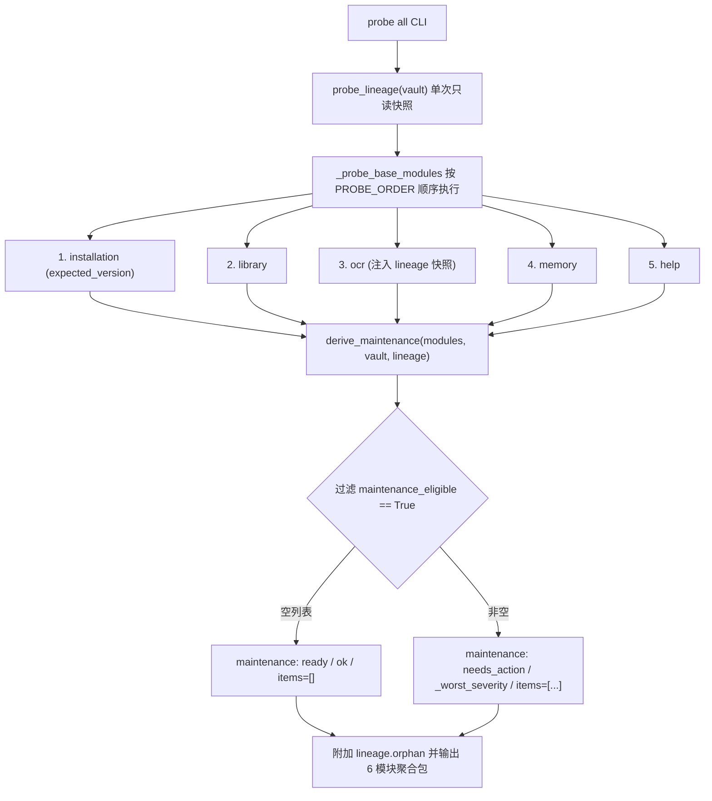

**顺序不变量**：

1. `_run_probe_all()` 与 `probe_maintenance()` 先调用一次 `probe_lineage(vault)` 并将快照注入 `ocr` 与 `derive_maintenance()`（由 `tests/test_probe_all_lineage_reuse.py` 锁定调用次数为 `1`）。
2. `derive_maintenance()` **绝对不重新调用任何基础探针或外部数据源**，只消费 `PROBE_ORDER = ("installation", "library", "ocr", "memory", "help")` 产出的五个信封（由 `tests/test_read_model_cutover.py` 锁定零重探）。
3. 任意单个基础探针在 `_probe_base_modules()` 内抛出未捕获异常时，当场捕获并降级为合法的 `detection_failed` 信封（`action_id="<mod>.probe"`、`ttl_seconds=60`），聚合流程绝不中止。

#### 4.2 各域探针内部优先级决策树

1. **`installation`（仅探测 Python Core，不受 Vault 配置缺失或损坏影响）**：
   - `sys.version_info[:2] < (3, 11)` → `installation.python_version_unsupported`（`limited`, `action_required`, `foundation.update_python`）
   - `expected_version` 与 `PAPERFORGE_VERSION` 经 `normalize_release_version()`（将 `2.0.0-rc.2` 统一为 `2.0.0rc2`）后不匹配 → `installation.version_mismatch`（`needs_action`, `foundation.update`）
   - `read_pointer()` 为 `None` → `installation.runtime_pointer_missing`（`needs_action`, `foundation.setup`）
   - 指针 `paperforge_version` 与当前包版本经规范化后不等 → `installation.runtime_pointer_stale`（`needs_action`, `foundation.update`, `SAFETY_DESTRUCTIVE`, `confirmation_required=True`）
   - `Path(pointer["python_path"]).is_file()` 为假 → `installation.runtime_executable_missing`（`needs_action`, `foundation.update`）
   - 否则 → `installation.ready`（`ready`）

2. **`library`**：
   - `_load_pf_config(vault)`：`err == "corrupt"` → `library.config_corrupt`（`unavailable`, `setup_required`, `maintenance_eligible=True`, `library.setup`）；`missing` 或 `migration_required` → `library.config_missing`（`missing_input`, `setup_required`, `library.configure`）
   - `zotero_data_dir` 为空 → `library.zotero_missing`；目录不存在 → `library.zotero_not_found`（`maintenance_eligible=True`）
   - `last_operation_exit_code` 非零 → `library.sync_failed`（`needs_action`, `error`, `maintenance_eligible=True`, `library.sync`）
   - `formal-library.json` 缺失时扫描 `exports/*.json`（调用 `detect_bbt_export_problem()` 拦截 CSL JSON 或损坏 JSON）与 `exports/*.bib`（报告 `library.bbt_invalid_format`）；均无则 `library.index_missing`
   - 索引存在时：老旧裸列表格式 → `library.index_legacy`（`maintenance_eligible=True`）；`stored_hash != compute_export_hash(paths)` → `library.index_stale`；若 DB `meta.canonical_index_hash` 与 `compute_hash(items)` 不一致仅附加 `notices` 警告而不阻断 `library.ready`。

3. **`ocr`（本地物化缺陷优先于远端凭据就绪，#161）**：
   - 缺失/损坏配置：`corrupt` → `ocr.config_corrupt`（`unavailable`, `maintenance_eligible=True`）；`missing` → `ocr.config_missing`（`not_enabled`, `ocr.enable`）
   - `ocr_doctor(live=False)` 仅记录 `notices` 并保存 `provider_reachable`，**不在顶部短路**
   - `collect_maintenance_rows(vault)` 异常 → `ocr.probe_failed`（`detection_failed`, `ocr.probe`）；空行 → `ocr.artifacts_missing`（`ocr.run`）
   - 基于 `probe_lineage(vault)` 聚合计数按严格优先级判定：
     1. `_n_failed > 0` → `ocr.failed`（`maintenance_eligible=True`, `user_visible_failure=True`, `ocr.run`）
     2. `_n_incomplete > 0` → `ocr.incomplete`（`maintenance_eligible=True`, `ocr.rebuild_derived`）
     3. `_n_blocks > 0`（`blocks_missing + blocks_empty + blocks_invalid`）→ `ocr.blocks_missing`（`maintenance_eligible=True`, `ocr.run`）
     4. `_n_pending > 0`（`not_started + raw_missing`）→ **`ready` + `ocr.pending` + info notice**（未运行 OCR 是正常待办工作，不是故障）
     5. `_n_nopdf > 0` → `ocr.no_pdf`（`needs_action`, 无 `action_primary`）
   - 维护行质量兜底优先级：`has_failed`（`ocr.quality_failures`, `action_primary=None`）>`has_redo`（`ocr.redo_needed`, `action_primary=None`，**严禁对外暴露 `ocr.redo`**）>`pending_rows`（`ready` / `ocr.pending`）>`has_degraded`（`ocr.artifacts_stale`, `ocr.rebuild_derived`）>`has_unexpected`（`ocr.unexpected_action`, `ocr.diagnose`）>`has_dead_end`（`ocr.quality_unacceptable`, `ocr.report_issue`）
   - 最后才检查 `credential_status(CredentialKey("ocr")).state != "available"` → `ocr.api_key_missing`（`not_enabled`, `ocr.configure`）及 `not provider_reachable` → `ocr.api_unreachable`（`limited`, `ocr.diagnose`）；全通过则 `ocr.ready`。

4. **`memory`**：
   - Gate 0：`load_config(vault)` 失败 → `memory.config_missing`（`foundation.setup`）
   - Gate 1-4：`get_memory_status(vault)`：`not db_exists` → `memory.db_missing`（`memory.build`）；`locked` → `memory.db_busy`（`unknown`, `ttl_seconds=60`）；`not schema_ok` 时若 `paper_count_db > 0` → `memory.migration_needed`（`memory.rebuild`），否则检查 `paperforge.db.backup` 是否存在以路由 `memory.restore_backup`（`SAFETY_DESTRUCTIVE`, `confirmation_required=True`）或 `memory.rebuild`；`not fresh` → **`ready` + `memory.index_stale` + info notice**（搜索仍可用）。
   - Gate 5（向量状态 `read_vector_build_state(vault)`）：
     - `completed`：先调 `assess_vector_publication(vault)` 检查 `publish_pending`（只看 `.db.build` 是否有行且完成，不被 live 库旧向量遮蔽）→ `memory.vector_publish_pending`（`embed.resume`）；再调 `assess_vector_substrate(vault, db_path=live)` 检查 `identity_changed or layout_incompatible` → `memory.vector_identity_changed`（`embed.build`）；再导入检查 `openai` 与 `sqlite_vec` → `memory.dependencies_missing`（`memory.install_vector_deps`）；最后检查 embedding 密钥缺失仅附加 warning `notices` 并返回 `memory.ready`。
     - `running`：检查 `is_pid_alive(pid)`；存活则 `memory.ready` + `activity_state="running"`；死进程（僵尸运行态）与 `interrupted`、`failed` 均调用 `_resume_feasible(vault)`（存在非 live 候选库或 live 基底兼容时选 `embed.resume`，否则 `embed.build`）。
     - `idle`/缺失：查询 `vec_body_meta` 是否有行，有则 `memory.ready`，无则 `memory.index_stale`（`embed.build`）。

#### 4.3 `reconcile` 三层推导与最小修复前沿

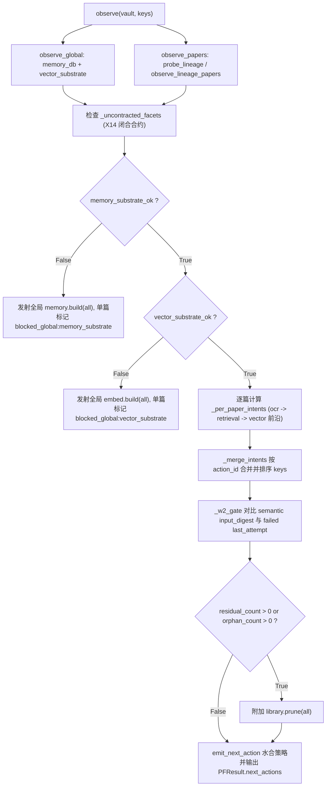

**核心推导规则与 X14 闭环合约**：

1. **单篇依赖边（`ocr → retrieval → vector`）**：
   - `ocr` 为根层，无前置条件，按 `paper.ocr` 与 `details["ocr"]` 精细分流：
     - `missing` + `queued` / `no_pdf` / `blocked` / `raw_not_file` / `raw_permission` → 不发射动作（运行中或环境权限缺陷）。
     - `missing` + `raw_*` → `ocr.run`（`lineage.ocr_raw_defect`）；`missing` + `blocks_*` → `ocr.rebuild_derived`（`lineage.ocr_blocks_defect`）；其他 `missing` → `ocr.run`（`lineage.ocr_missing`）。
     - `failed` → `ocr.run`（保留 `lineage.ocr_<detail>` 原因码）。
     - `stale` + `provenance_key_mismatch | provenance_pdf_changed | provenance_raw_mismatch` → `ocr.run`（源头不可信需重跑 OCR）；其他 `stale` → `ocr.rebuild_derived`（本地衍生刷新）。
     - `incomplete` + `*_not_file | *_permission` → 不发射动作；其他 `incomplete`（`tree_*`, `role_index_*`, `publish_pending_stale`）→ `ocr.rebuild_derived`。
   - `retrieval` 仅当 `paper.ocr == "current"` 且 `paper.retrieval in ("stale", "missing")` 时发射 `memory.build`。
   - `vector` 仅当 `paper.retrieval == "current"` 且 `paper.vector in ("stale", "missing")` 且 `details["vector"] != "vector_no_content"`（纯图无文本 PDF 属于合法终态，防止无限循环）时发射 `embed.resume`。
2. **X14 状态闭合合约（`FACET_STATES` / `FACET_REPAIR_ACTIONS` / `FACET_NO_ACTION`）**：
   - `FACET_STATES` 枚举了 `ocr`（6 态：`current`, `stale`, `missing`, `incomplete`, `failed`, `unknown`）、`retrieval`（5 态：`current`, `stale`, `missing`, `incomplete`, `unknown`）、`vector`（6 态：上述 5 态 + `not_required`）。
   - 每个 `(layer, state)` 要么在 `FACET_REPAIR_ACTIONS` 映射至 `RECONCILE_ACTIONS`（`memory.build`, `embed.build`, `embed.resume`, `ocr.run`, `ocr.rebuild_derived`, `library.prune`），要么在 `FACET_NO_ACTION` 给出书面无动作合约（`unknown` 永远按 Fail-Closed 不发射重建）。任何合约外状态将在 `diagnostics` 输出 `reconcile.facet_uncontracted:<key>:<layer>:<state>`。
3. **W2 防盲目重试门控（Not-a-Retry）**：
   - `_intent_input_digest()` 对 `papers` 作用域采集每个 key 的三层状态与 `identities`（`ocr`, `retrieval`, `vector`）及 `RETRIEVAL_POLICY_VERSION`；对 `all` 作用域采集 `_library_digest`、`_facet_summary` 与 `GlobalObservation`。
   - 当 `_w2_gate()` 发现 `<action_id>:<scope>` 的上次记录 `outcome == "failed"` 且当前 `input_digest` 与记录值一致时，抑制此次发射并在 `diagnostics` 记录 `w2.suppressed:...`。一旦任何论文变更或政策版本变更导致摘要改变，立即重新允许发射。

#### 4.4 冻结的 Render Reconciliation 扩展契约（`docs/RECONCILE-EXTENSION-CONTRACT.md`）

为防止渲染层排版启发式逻辑侵入变更引擎，核心引擎被永久冻结为只读检测（`render_audit.py` 当前 `ALGORITHM_VERSION = 4`, `SCHEMA_VERSION = 1`）与受控升格两阶段：

- **检测器读白名单 / 写黑名单**：仅可读 `structure/figure_inventory.json`、`structure/table_inventory.json`、`structure/blocks.structured.jsonl`、`render/figures/*.md`、`render/tables/*.md`、`assets/figures/*.jpg`、`assets/tables/*.jpg`、`render/materialization.provenance.json`、源 PDF 页、只读 `render/render.consistency.json`；**禁止写入任何生产产物**，暂存写入由 `paperforge/figure_reconciliation.py` 独占。
- **三态分类规则**：
  - `R`（Exact Repair）：目标已存在于规范 Inventory、资产块引用无歧义、无跨对象 `(page, block_id, bbox)` 冲突、仅属物化输出缺损（缺失 JPG / 断链 / 标题漂移）。通过 `paperforge/promote_r.py`（`paperforge render promote-r`）推广。
  - `P`（Proposal）：目标不在规范 Inventory 中，但存在未匹配的视觉簇与未匹配图注且边界有效，生成带 SHA-256 `final_plan_hash` 的暂存 `final-plan.json`。必须由人工传入精确 `--plan-hash` 经 `paperforge/accept_proposal.py`（`paperforge render accept-proposal`）批准。
  - `BLOCKED`：证据不完整、跨页割裂或冲突时默认 Fail-Closed 标记为 `BLOCKED`，严禁猜测性局部物化；当存在重复规范 ID 或缺失 Inventory 权威时设置 `mutation_blocked = True`。

---

### 5. 配置项、环境变量、CLI 入口与错误码

#### 5.1 CLI 入口与参数表

| 命令形式                                                                  | 参数与选项                                                                                                                                                                    | 行为与退出码语义                                                                                                                 |
| :------------------------------------------------------------------------ | :---------------------------------------------------------------------------------------------------------------------------------------------------------------------------- | :------------------------------------------------------------------------------------------------------------------------------- | --------------------------------------------------------- |
| `paperforge probe <module>`                                               | `module` 可选：`installation`, `help`, `library`, `ocr`, `memory`, `maintenance`, `lineage`, `all`；`--json`；`--expected-version VERSION`；`--last-operation-exit-code CODE` | `0` 成功输出信封或 `[mod] state: text`；`1` 运行时不支持模块；`2` argparse 非法参数。`all` 聚合 6 模块并复用单次 `probe_lineage` |
| `paperforge reconcile`                                                    | `--scope {all,papers}`（默认 `all`）；`--key KEY`（可重复）；`--json`                                                                                                         | 永远只读，返回 `0` 并输出 `PFResult`（含 `data` 与 `next_actions`）或人类可读摘要                                                |
| `paperforge ocr pipeline-versions --json`                                 | `--json`                                                                                                                                                                      | 逐篇 OCR 管线版本明细接口，将逐篇列表与 `probe ocr` 信封解耦                                                                     |
| `paperforge render audit` / `reconcile` / `promote-r` / `accept-proposal` | `promote-r <KEY> [OBJECT_ID ...                                                                                                                                               | --all]`；`accept-proposal <KEY> <LABEL> --plan-hash HASH`                                                                        | 遵循冻结的 Reconcile 扩展契约执行渲染一致性审计与受控升格 |

#### 5.2 关键环境变量与配置键

| 名称                                                                              | 类型              | 默认值                        | 影响范围                                                                                                         |
| :-------------------------------------------------------------------------------- | :---------------- | :---------------------------- | :--------------------------------------------------------------------------------------------------------------- |
| `PAPERFORGE_VAULT`                                                                | 环境变量          | 当前工作目录/向上查找         | CLI 未显式传入 `--vault` 时的 Vault 根解析（`paperforge/config.py`）                                             |
| `PAPERFORGE_ZOMBIE_TIMEOUT_MINUTES`                                               | 环境变量          | `30`                          | `materialization/ocr.py` `queued_is_zombie()` 判断 `queued`/`running`/`processing` 超时转为 `queued_interrupted` |
| `PAPERFORGE_CREDENTIAL_OCR__DEFAULT` / `PAPERFORGE_CREDENTIAL_EMBEDDING__DEFAULT` | 环境变量          | 未设置                        | `credentials.py` 凭据状态检查；影响 `probe ocr` 末尾门控与 `probe memory` `details.api_key_configured`           |
| `zotero_data_dir`                                                                 | `paperforge.json` | `<system_dir>/Zotero`         | `probe_library` 校验 Zotero 数据目录存在性                                                                       |
| `vector_db_api_model` / `vector_db_api_base`                                      | `paperforge.json` | `text-embedding-3-small` / 空 | 参与计算向量期望身份，驱动 `probe_memory` 与 `reconcile` 判定 `vector_substrate_ok`                              |

#### 5.3 核心错误码 / 诊断码速查

| 码值                                                                   | 产生位置             | 含义与处置建议                                                                                          |
| :--------------------------------------------------------------------- | :------------------- | :------------------------------------------------------------------------------------------------------ |
| `installation.version_mismatch` / `installation.runtime_pointer_stale` | `probe_installation` | 插件期望版本或已发布指针版本与当前包不匹配；运行 `foundation.update` 或外部 `paperforge runtime update` |
| `library.config_corrupt` / `library.bbt_invalid_format`                | `probe_library`      | 配置文件语法/结构损坏，或导出目录存在 CSL JSON / `.bib` 而非 Better BibTeX JSON                         |
| `ocr.failed` / `ocr.incomplete` / `ocr.blocks_missing`                 | `probe_ocr`          | 由 `probe_lineage` 判定的失败/结构不完整/正文块缺失；对应触发 `ocr.run` 或 `ocr.rebuild_derived`        |
| `memory.db_busy`                                                       | `probe_memory`       | 读取互斥锁超时属于瞬态争用而非坏库，`ttl_seconds=60` 引导重试 `memory.probe`                            |
| `memory.vector_publish_pending`                                        | `probe_memory`       | `.db.build` 候选库已 `completed` 且含数据但尚未原子切换至 `paperforge.db`；引导 `embed.resume` 完成发布 |
| `reconcile.facet_uncontracted:...`                                     | `reconcile`          | 谱系读模型返回了未在 `FACET_STATES` 合约中登记的状态组合                                                |
| `reconcile.action_unregistered:...`                                    | `reconcile`          | 推导出的 `ActionIntent` 未在 `ACTION_REGISTRY` 注册，Fail-Closed 阻断发射                               |
| `w2.suppressed:...`                                                    | `reconcile`          | 该 `(action_id, scope)` 上次尝试失败且语义输入摘要未变化，W2 抑制重复发射                               |

---

### 6. 边界防护与 Fail-Closed 防呆规则

1. **配置失效绝不猜测路径**：`_load_pf_config(vault)` 与 `probe_memory` 的 Gate 0 通过 `paperforge/config.py` 严格分类配置状态。`missing` 与 `migration_required` 均归入配置未就绪（引导显式迁移或初始化），`invalid` / `future_schema` / JSON 解析异常归入 `corrupt`，绝不回退默认猜测目录。
2. **Unknown 永不解释为 Stale**：`lineage.py`、`materialization/ocr.py` 与 `reconcile.py` 严格遵循“无法证明则判 `unknown`，绝不发起批量重建”。例如缺少 `raw_blocks_hash` / `pdf_fingerprint` 或无法读取规范 PDF 时返回 `PROVENANCE_UNKNOWN`（`unknown`），`FACET_NO_ACTION` 明确拒绝为 `unknown` 发射重建意图。
3. **死按钮拦截（Probe-Registry 词汇表闭环）**：`build_action_primary()` 内部强制调用 `classify_action_id(action_id)`。任何既不在 `ACTION_REGISTRY` 又不在 `NON_REGISTRY_ACTIONS` 的 ID 会在构造阶段直接抛出 `UnknownActionId`（并由 `tests/test_action_registry.py` 对 `paperforge/probes/` 做 AST 静态全扫校验）。
4. **并发读写争用与坏库隔离**：`probe_memory` 将 `status.get("locked")` 严格映射为 `memory.db_busy`（`detection_failed` + 60s TTL），绝不将并发锁争用误报为 `memory.db_corrupt` 而诱导用户覆盖数据库。
5. **候选库与线上库职责隔离（P0-D）**：`assess_vector_publication()` 只依据候选库 `.db.build` 判定 `publish_pending`，防止线上库保留旧向量时掩盖“已完成构建但未发布”的悬空状态；而 `memory.ready` 中的模型一致性判定则通过 `assess_vector_substrate(vault, db_path=live)` 针对实际提供检索服务的线上库核验。
6. **单篇作用域不越界**：`observe_papers(vault, keys)` 使用 `observe_lineage_papers(vault, keys)`，不执行全库目录扫描，`orphan_count` 与 `residual_count` 严格保持 `None`；`vector_no_content` 明确在 `_per_paper_intents` 中屏蔽 `embed.resume`，防止纯图文献死循环。
7. **历史状态非活跃进程保护**：`probe_ocr` 在 `meta.json` 仍残留 `queued`/`running` 时，仅记入 `historical_activity.unsettled` 字段而保持 `activity_state="idle"`，避免在无本地守护进程时欺骗前端永久转圈。
8. **扩展检测器禁止越权写入**：任何新扩展的 Render 审计规则必须维持 `RECONCILE-EXTENSION-CONTRACT` 的单向数据流，未确认的渲染不一致只能进入暂存或标记 `BLOCKED`，`render_audit` 崩溃必须原子覆盖报告为 `state="FAILED"`，严禁残留旧的 `CLEAN` 假绿灯。

---

### 7. 维修、调试与升级 Checklist

#### 7.1 线上问题排查与只读诊断命令

- [ ] **全局控制面快照检查**：运行 `paperforge --vault <VAULT> probe all --json`，确认 6 个模块的 `capability_state`、`user_state`、`reason.code` 与 `maintenance.items`；若涉及插件版本，追加 `--expected-version <PLUGIN_SEMVER>` 验证 `normalize_release_version` 对比结果。
- [ ] **单篇谱系与细节定位**：运行 `paperforge --vault <VAULT> probe lineage --json` 检查 `papers[KEY]` 的 `ocr`/`retrieval`/`vector` 三维状态、`details`（如 `raw_missing`、`blocks_invalid`、`provenance_pdf_changed`、`vector_no_content`）及 `integrity` 事实。
- [ ] **查看 Reconcile 推导结果与 W2 抑制**：运行 `paperforge --vault <VAULT> reconcile --json` 检查 `data.global`、`data.diagnostics`（是否出现 `w2.suppressed:...` 或 `reconcile.facet_uncontracted:...`）以及 `next_actions`。
- [ ] **若怀疑 W2 误抑制或需观测真实文件变更**：检查 `<paperforge>/state/reconcile-last-attempts.json` 中对应 `<action_id>:<scope>` 的 `outcome` 与 `input_digest`；修正环境问题（如补全凭据、修复文件权限）后，通过 `paperforge action run <action_id> ...` 显式执行，完成后 `settle_attempt()` 会自动覆写记录为 `succeeded`。
- [ ] **检查 Render 一致性**：对异常论文运行 `paperforge --vault <VAULT> render audit <KEY> --json` 与 `paperforge --vault <VAULT> render reconcile <KEY> --json`（只读/隔离暂存），不要手工篡改 `render.consistency.json`。

#### 7.2 回归验证与升级检查清单

- [ ] **核心探针与聚合单测**：
  ```bash
  pytest tests/test_probe.py tests/test_probe_all_lineage_reuse.py tests/test_read_model_cutover.py
  ```
- [ ] **Reconcile 与 X14 闭环单测**：
  ```bash
  pytest tests/test_reconcile.py tests/test_x14_loop_closure.py
  ```
- [ ] **宿主环境与 `vec0` 健康探针集成测试**：
  ```bash
  pytest tests/test_host_probe_fields.py tests/integration/test_health_probe.py
  ```
- [ ] **升级前契约核对**：
  - 若新增探针 `action_id`，必须同步在 `paperforge/actions/registry.py`（`ACTION_REGISTRY` 或 `NON_REGISTRY_ACTIONS`）登记，并确认 `validate_action_vocabulary()` 返回空列表。
  - 若新增 `lineage` 层或细粒度状态枚举，必须同步更新 `paperforge/reconcile.py` 的 `FACET_STATES` 与 `FACET_REPAIR_ACTIONS` / `FACET_NO_ACTION`，确保 `validate_facet_contract()` 零告警。
  - 若在 `paperforge/render_audit.py` 新增渲染缺陷检查项，必须递增 `ALGORITHM_VERSION` 并保持 `docs/RECONCILE-EXTENSION-CONTRACT.md` 读白名单与 `R`/`P`/`BLOCKED` 门槛不变。

---

<a id="chapter-05"></a>

## 第 05 章：Action 注册表、双阶段 Preflight 与安全分级

> 源文件：`docs/handbook/05-action-registry-and-safety.md`

本章深入解析 PaperForge 控制面的动作声明、双维度准入校验、确认门控与后置链式编排体系。所有变更操作统一收口至 `paperforge/actions/`：探针与 `reconcile` 只表达意图（见 [Chapter 04](#chapter-04)），真正决定副作用级别、是否需要人工确认、流式/一次性传输契约以及作用域合法性的唯一权威是 `ACTION_REGISTRY`。

---

### 1. 职责与非目标边界

#### 1.1 控制面执行内核职责

1. **单一动作权威表（`paperforge/actions/registry.py`）**
   - 声明式冻结注册表 `ACTION_REGISTRY`（当前 9 个可执行后端动作）与显式非注册路由表 `NON_REGISTRY_ACTIONS`（当前 19 个由插件或独立引导流消费的动作 ID），通过 `validate_registry()` 与 `validate_action_vocabulary()` 在模块导入期 Fail-Closed 校验所有策略不变量。
2. **双维度正交 Preflight（`runner.py` + `preflight_projection.py`）**
   - **Availability（系统可用性）**：回答“当前系统/凭据/基底/锁状态是否允许运行该动作”（`available | unavailable | busy`）。
   - **Applicability（单篇适用性）**：回答“针对指定 `PapersScope` 中每篇论文的当前谱系状态，该动作是否应该运行”（`needed | noop | blocked | not_applicable`），直接投影自 `reconcile._per_paper_intents()`，绝不另起第二套物化判定逻辑。
3. **受控执行管线与安全门控（`paperforge/actions/runner.py` & `commands/action.py`）**
   - 强制按 `注册校验 → 作用域校验 → Preflight → 描述符生成 → 确认门控 → Handler 执行 → 结果校验 → W2 结算 → 可选后置链` 顺序推进，并强制执行无 `command`/`argv` 下发契约。
4. **自动本地后置链编排（`paperforge/actions/chain.py`）**
   - 在 `--follow auto` 或终端模式 `sync` 下，仅对前一层的 `successful_keys` 调用 `reconcile()` 推导下一层，且只内联执行同时满足 `local` + 非 `destructive` + `confirmation="none"` + `automatic=True` 的后代动作，其余全部保留在 `pending` 队列等待显式授权。

#### 1.2 明确的非目标边界（Non-Goals）

| 边界主题                   | 本子系统坚决不做的事                                                                                                                   | 替代机制 / 责任归属                                                                                        |
| :------------------------- | :------------------------------------------------------------------------------------------------------------------------------------- | :--------------------------------------------------------------------------------------------------------- |
| **CLI 字符串或 Argv 透传** | 任何 `ActionSpec`、描述符（`descriptor_for`）或 `next_actions` 线缆载荷均严禁包含 `command`、`cmd`、`argv`、`shell`、`executable` 字段 | 前端通过 `paperforge/plugin/src/client/action-contract.ts` `buildActionArgv()` 构造固定 CLI 参数           |
| **插件侧导航与配置向导**   | `ACTION_REGISTRY` 不直接承接向导跳转、外置 Python 升级指引或单纯的重探动作                                                             | 统一登记于 `NON_REGISTRY_ACTIONS` 由前端按 `verb` 分流，`action run` 拒绝执行                              |
| **跨进程独立停止指令**     | 不提供旧版 `embed stop` 旁路控制文件或跨进程状态指令                                                                                   | 统一通过 stdin `PAPERFORGE_STOP\n` 与 `SIGINT`/`SIGTERM` 协作取消令牌（`paperforge/core/cancellation.py`） |
| **凭据读写与密钥存储**     | `ActionPreflight` 只检查 `credentials.status(CredentialKey(...)).state`，绝不读取明文密钥或写入密钥环                                  | `paperforge auth`（`paperforge/credentials.py`）                                                           |
| **非动作链的 Render 授权** | `render promote-r` 与 `render accept-proposal --plan-hash` 不走 `ACTION_REGISTRY`                                                      | 独立渲染权威通道（见 [Chapter 04](#chapter-04) 与 `docs/RECONCILE-EXTENSION-CONTRACT.md`）  |

---

### 2. 核心源码与单测映射表

| 模块分类                       | 文件路径                                                                                                                                                                                                                | 核心职责与关键导出符号                                                                                                                                                                      |
| :----------------------------- | :---------------------------------------------------------------------------------------------------------------------------------------------------------------------------------------------------------------------- | :------------------------------------------------------------------------------------------------------------------------------------------------------------------------------------------ |
| **核心类型契约**               | `paperforge/actions/types.py`                                                                                                                                                                                           | `ACTION_ID_RE`、`AllScope`、`PapersScope`、`ActionRequest`、`ActionExecutionHooks`、`ActionContext`、`PaperPreflight`、`PreflightResult`、`ActionIntent`、`ActionSpec`、`require_action_id` |
| **注册表与非注册词汇表**       | `paperforge/actions/registry.py`                                                                                                                                                                                        | `ACTION_REGISTRY`（9 项）、`NON_REGISTRY_ACTIONS`（19 项）、`validate_registry`、`validate_action_vocabulary`、`classify_action_id`、`emit_next_action`                                     |
| **单篇适用性投影**             | `paperforge/actions/preflight_projection.py`                                                                                                                                                                            | `project_applicability`、`_canonical_intent`、`_rule`（将 `observe_lineage_papers` 映射为四态 `Applicability`）                                                                             |
| **通用执行器**                 | `paperforge/actions/runner.py`                                                                                                                                                                                          | `ActionError`、`build_context`、`descriptor_for`、`validate_scope`、`run_action`、`_require_confirmation`、`_validate_handler_result`、`hydrate_from_registry`、`cancelled_result`          |
| **后置链执行器**               | `paperforge/actions/chain.py`                                                                                                                                                                                           | `MAX_FOLLOW_UP_DEPTH` (`4`)、`ChainStep`、`ChainResult`、`canonical_scope_key`、`_auto_inline`、`_settle_w2`、`_successful_keys`、`run_chain`                                               |
| **CLI 命令适配器**             | `paperforge/commands/action.py`                                                                                                                                                                                         | `run_list`、`run_describe`、`run_preflight`、`run_dispatch`、`_run_descendants`、`EXIT_INVALID_REQUEST` (`2`)、`EXIT_CONFIRMATION_REQUIRED` (`3`)、`EXIT_CANCELLED` (`130`)                 |
| **流式 / 结算 / 取消基础设施** | `paperforge/core/ndjson.py`、`paperforge/core/settlement.py`、`paperforge/core/cancellation.py`、`paperforge/core/next_actions.py`、`paperforge/core/errors.py`、`paperforge/core/result.py`、`paperforge/core/keys.py` | `#137` NDJSON 事件发射、`settlement_payload`、`STOP_TOKEN`、`NextAction` 线缆契约、`ErrorCode`、`PFResult`、`normalize_paper_keys`                                                          |
| **前端动作契约**               | `paperforge/plugin/src/client/action-contract.ts`                                                                                                                                                                       | `ActionRequest`、`ActionScope`、`buildActionArgv`                                                                                                                                           |
| **注册表与运行器单测**         | `tests/test_action_registry.py`                                                                                                                                                                                         | 验证 9 个注册动作、19+ 探针词汇覆盖、AST 静态扫描、线缆无 `command/argv`、退出码 `0/1/2/3/130` 与 NDJSON 流顺序                                                                             |
| **链式执行与线缆单测**         | `tests/test_chain.py`、`tests/test_next_actions.py`、`tests/test_t7_journey.py`、`tests/test_sync_next_actions.py`、`tests/test_x14_loop_closure.py`                                                                    | 验证深度上限、规范化作用域去重、`successful_keys` 传播、O2/O3 阻断、W2 结算闭环与同步后置链                                                                                                 |
| **端到端 Harness 用例**        | `tests/harness/test_e01_client_action.py`、`tests/harness/test_a06_provider_authority.py`                                                                                                                               | 验证客户端 `describe → preflight → run` 闭环及 `paperforge.json` 配置权威                                                                                                                   |

---

### 3. 磁盘文件、数据库表与协议 JSON 字段字典

#### 3.1 `ACTION_REGISTRY` 全量注册动作字典（共 9 项，`paperforge/actions/registry.py`）

下表列出当前代码中注册的**全部 9 个** `ActionSpec`，包含安全分类投影（`envelope.py` 中 `build_action_primary()` 按 `spec.impact == "destructive" or spec.confirmation == "required"` 映射 `safety_class`）：

| `action_id`           | `scope_kinds`       | `cost`            | `impact`      | `confirmation` | `automatic` | `interruptible` | `execution_mode` | 探针 `safety_class` | Preflight 前置条件与 Handler 语义                                                                                                                                                                                                                                                                 |
| :-------------------- | :------------------ | :---------------- | :------------ | :------------- | :---------- | :-------------- | :--------------- | :------------------ | :------------------------------------------------------------------------------------------------------------------------------------------------------------------------------------------------------------------------------------------------------------------------------------------------ |
| `foundation.update`   | `("all",)`          | `remote_possible` | `mutating`    | `required`     | `False`     | `True`          | `stream`         | `destructive`       | **Preflight**: `read_pointer()` 非 `None`（否则 `pointer.missing`）。**Handler**: 调用 `worker.update.perform_update()` 刷新运行时分发版。                                                                                                                                                        |
| `foundation.repair`   | `("all",)`          | `remote_possible` | `mutating`    | `required`     | `False`     | `True`          | `result`         | `destructive`       | **Preflight**: `read_pointer()` 非 `None`（否则 `pointer.missing`）。**Handler**: 调用 `worker.runtime_repair.perform_runtime_repair()` 修复依赖并重新发布指针。                                                                                                                                  |
| `memory.build`        | `("all", "papers")` | `local`           | `destructive` | `required`     | `False`     | `True`          | `result`         | `destructive`       | **Preflight**: 需 `ctx.config` 与 `formal-library.json`；`papers` 作用域校验全部 key 存在于索引（未知 key 抛 `ActionError` exit `2`）并附带 `per_key` 适用性投影。**Handler**: `memory.builder.build_for_keys()`；若返回 `global_rebuild_required` 则局部请求报错 `action.unavailable`。          |
| `memory.rebuild`      | `("all",)`          | `local`           | `destructive` | `required`     | `False`     | `True`          | `result`         | `destructive`       | **Preflight / Handler**: 复用 `_memory_build_preflight` 与 `_memory_build_handler`，仅限 `all` 作用域，执行全库 `papers`/FTS 重建并显式提示向量失效风险。                                                                                                                                         |
| `library.prune`       | `("all", "papers")` | `local`           | `mutating`    | `required`     | `False`     | `True`          | `result`         | `destructive`       | **Preflight**: 需 `ctx.config`，且 `_detect_residuals(vault)` 在请求作用域内至少命中 1 篇残余论文（否则 `library.no_orphans` / `library.no_selected_orphans`）。**Handler**: `prune_orphan_papers(..., dry_run=False)` 移入 `.paperforge/trash/` 并清理 DB/向量行。                               |
| `embed.resume`        | `("all", "papers")` | `remote_possible` | `mutating`    | `required`     | `False`     | `True`          | `stream`         | `destructive`       | **Preflight**: `embedding` 凭据 `available`；`build_state.status != "running"`（否则 `availability="busy"`, `vector.build_in_progress`）；`papers` 作用域若 `substrate` 不兼容且库存在则报错 `vector.substrate_incompatible`。**Handler**: `run_embedding_build(..., force=False, resume=True)`。 |
| `embed.build`         | `("all",)`          | `remote_possible` | `mutating`    | `required`     | `False`     | `True`          | `stream`         | `destructive`       | **Preflight**: 校验 `embedding` 凭据 `available`。**Handler**: `run_embedding_build(..., keys=None, force=True, resume=False)` 执行全局 Shadow 向量全量重建。                                                                                                                                     |
| `ocr.run`             | `("all", "papers")` | `remote_possible` | `mutating`    | `required`     | `False`     | `True`          | `stream`         | `destructive`       | **Preflight**: `papers` 作用域校索引存在性（未知 key exit `2`）；校验 `ocr` 凭据 `available`；投影 `per_key`。**Handler**: `worker.ocr.run_ocr()` 并经 `settlement_payload` 规范化结算、细分 `unconfirmed`/`result_unavailable`/`rate_limited`/`blocked`/`failed`/`pending` 终态。                |
| `ocr.rebuild_derived` | `("all", "papers")` | `local`           | `mutating`    | `none`         | `True`      | `True`          | `stream`         | `safe`              | **Preflight**: 需 `ctx.config`；`papers` 作用域投影 `per_key`；无远端费用故唯一允许 `automatic=True` 与 `confirmation="none"`。**Handler**: `all` 作用域取 `collect_maintenance_rows()` 中 `r.can_rebuild` 的 key，调用 `run_derived_rebuild_for_keys()` 本地重建衍生结构与渲染。                 |

#### 3.2 `NON_REGISTRY_ACTIONS` 声明表（共 19 项，`paperforge/actions/registry.py`）

此类 ID 可合法出现在探针信封 `action.primary` 中，由插件按 `verb` 分流或路由到专有 CLI 流程，但 `paperforge action run <id>` 必须始终拒绝执行：

| `action_id`                  | 声明的归属路由与 `verb` 说明                                                    |
| :--------------------------- | :------------------------------------------------------------------------------ |
| `foundation.setup`           | `setup journey (verb 'setup')`                                                  |
| `foundation.update_python`   | `manual Python-install guidance (verb 'update')`                                |
| `installation.probe`         | `installation re-probe after detection failure (verb 'probe')`                  |
| `help.probe`                 | `help re-probe after detection failure (verb 'probe')`                          |
| `help.restore`               | `help/skill redeploy flow (verb 'setup')`                                       |
| `library.setup`              | `setup journey from the Library module (verb 'setup')`                          |
| `library.configure`          | `setup guide at the module config step (verb 'set_config')`                     |
| `library.probe`              | `re-probe (verb 'probe')`                                                       |
| `library.sync`               | `client.sync() (verb 'sync'), not a pipeline action`                            |
| `memory.probe`               | `re-probe (verb 'probe')`                                                       |
| `memory.restore_backup`      | `client.memoryRestoreBackup (verb 'restore_backup')`                            |
| `memory.upgrade_backend`     | `client.embedMigrate (verb 'rebuild_index')`                                    |
| `memory.install_vector_deps` | `external runtime repair guidance (verb 'install') — paperforge runtime repair` |
| `ocr.probe`                  | `re-probe (verb 'probe')`                                                       |
| `ocr.enable`                 | `setup guide at the module config step (verb 'set_config')`                     |
| `ocr.configure`              | `setup guide at the module config step (verb 'set_config')`                     |
| `ocr.diagnose`               | `diagnostics report (verb 'investigate')`                                       |
| `ocr.report_issue`           | `issue-draft flow (verb 'investigate')`                                         |
| `ocr.setup`                  | `setup journey (verb 'setup')`                                                  |

> 注：`paperforge/core/next_actions.py` 保留了早期 `#127` 线缆校验模块及内部 `ACTION_REGISTRY` 子集（`memory.build`, `embed.resume`），而运行时与控制面权威全集位于 `paperforge/actions/registry.py`。

#### 3.3 线缆协议数据结构（Descriptor / Preflight / Chain / NDJSON / Settlement）

1. **Action Descriptor（`descriptor_for()`，`action describe` 与 `exit_code=3` 时返回）**
   - `schema_version` (`1`), `action_id`, `label_code`, `description_code`, `scope` (`{"kind": "all"}` 或 `{"kind": "papers", "keys": [...]}`), `availability`, `availability_reason_code`, `availability_reason`, `cost`, `impact`, `confirmation`, `automatic`, `interruptible`, `execution_mode`, `preservation_facts` (`list[str]`), `replacement_facts` (`list[str]`)。
2. **Action Preflight 响应（`run_preflight`，`--json`）**
   - `schema_version` (`1`), `action_id`, `scope`, `availability`, `availability_reason_code`, `availability_reason`, `summary` (`{"needed": int, "noop": int, "blocked": int, "not_applicable": int}`), `per_key` (`{key: {"applicability", "reason_code", "reason", "recommended_action_id"}}`)。
3. **Follow-up Chain Wire（`ChainResult.to_wire()`，挂载在 `PFResult.data["chain"]`）**
   - `schema_version` (`1`), `module` (`"chain"`), `steps`（每步含 `depth`, `action_id`, `scope`, `status` [`executed` \| `pending` \| `skipped` \| `failed`], `reason_code`, `reason`, `result`）, `pending`（保持原样 `next_actions` 线缆对象列表，同步覆写 `PFResult.next_actions`）。
4. **`#137` NDJSON 流式事件字典（`paperforge/core/ndjson.py`）**
   - 每行均为 UTF-8 JSON 对象，必含 `schema_version: 1`、`event`、`operation`：
     - `start`: `total`, `scope`
     - `preflight`: `availability`, `summary` (`needed`, `noop`, `blocked`, `not_applicable`)
     - `phase`: `phase`（如 `"ocr"`, `"render"`, `"embedding"`, `"preparing"`）
     - `progress`: `current`, `total`, `item_id`
     - `item_result`: `item_id`, `status`
     - `paper_settled`: `key`, `outcome`, `reason_code`（可选）
     - `heartbeat`: `active`, `pending`
     - 唯一终态事件 `result` | `error` | `cancelled`: `result`（完整的 `PFResult.to_dict()`）
5. **标准化单篇结算载荷（`paperforge/core/settlement.py`）**
   - `SettlementOutcome` 固定 6 态：`succeeded` | `noop` | `pending` | `blocked` | `failed` | `cancelled`。
   - `settlement_payload()` 输出 `{"summary": {6 态计数}, "per_key": {key: {"outcome", ...}}, "successful_keys": sorted([k for k, v in per_key if v == "succeeded"])}`。

---

### 4. 核心执行链路、状态机与顺序不变量

#### 4.1 `run_action()` 与确认门控流水线

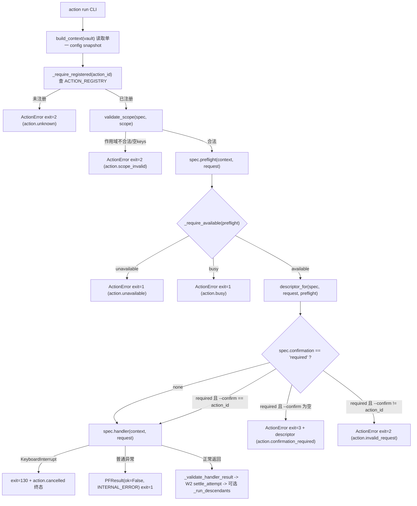

**关键确认与校验机制说明**：

- **精确动作 ID 确认机制（无独立随机 `confirmation_token`）**：`paperforge/actions/runner.py` 的 `_require_confirmation()` 并不签发独立的随机令牌字符串，而是采用**实时描述符 + 精确动作 ID 显式回传**模型：
  1. 初次未传 `--confirm` 调用需确认动作时，Runner 在 **Preflight 通过后**（确认失败不会跳过可用性检查）抛出 `exit_code=3`，并在 `data` 中返回当前实时计算的 `descriptor`（含 `preservation_facts`、`replacement_facts`、`cost`、`impact`）。
  2. 调用方（用户或插件确认弹窗）在审阅当前影响后，重新发起请求并携带 `--confirm <exact_action_id>`；Runner 校验 `confirmed_action_id == spec.action_id` 后放行。
  3. 注意区分渲染层提案命令：`paperforge render accept-proposal` 使用的是基于 `final-plan.json` 内容的 SHA-256 `--plan-hash` 校验，该命令不属于 `ACTION_REGISTRY`。

#### 4.2 双维度 Preflight 正交模型与 `project_applicability`

`PaperPreflight` 与 `PreflightResult` 严格分离两件事：

1. **全局可执行性（`PreflightResult.availability`）** 先在各动作的 `preflight` 函数中判断（例如无配置、无指数、无 API 密钥、后台运行中、基底不兼容）。
2. **单篇适用性（`PaperPreflight.applicability`）** 在 `request.scope.kind == "papers"` 时由 `project_applicability(vault, action_id, keys)` 调用 `observe_lineage_papers(vault, keys)` 计算，规则如下：
   - 论文不在规范索引中 → `not_applicable` (`paper.not_found`)。
   - 若 `reconcile._per_paper_intents(paper)` 中存在与 `action_id` 匹配的当前修复前沿意图 → **`needed`**（直接复用 `intent.trigger_reason_code` 与 `trigger_reason`）。
   - 若不处于第一前沿，`_rule()` 严格映射非前沿状态：
     - `ocr.run`: `no_pdf/nopdf` → `not_applicable`；`blocked/raw_not_file/raw_permission/queued` → `blocked`；`current` → `noop`；`incomplete/stale` → `not_applicable` 并附 `recommended_action_id="ocr.rebuild_derived"`。
     - `ocr.rebuild_derived`: `current` → `noop`；`blocked/*_not_file/*_permission` → `blocked`；`missing/failed/provenance_*` → `not_applicable` 并附 `recommended_action_id="ocr.run"`。
     - `memory.build`: `retrieval == "current"` → `noop`；`ocr != "current"` → `blocked` (`lineage.ocr_prereq`)；其余无法观测态 → `blocked` (`lineage.retrieval_unobservable`)。
     - `embed.resume`: `vector == "current"` → `noop`；`vector_no_content` → `not_applicable` (`vector.no_content`)；`retrieval != "current"` → `blocked` (`lineage.retrieval_prereq`)；其余 → `blocked` (`lineage.vector_unobservable`)。
     - `embed.build`: `vector_no_content` → `not_applicable`；`vector in ("stale", "missing")` → `needed`；`vector == "current"` → `noop`。

#### 4.3 `chain.py` 后置链状态机与编排规则

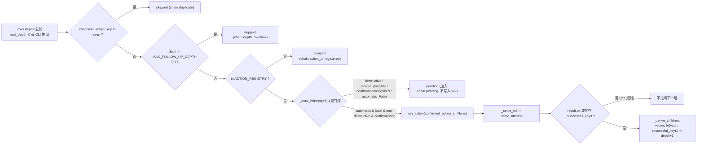

**链式执行核心不变量**：

1. **严格作用域解析（#167 P1-2）**：`scope_from_dict()` 遇到未知 `scope.kind` 时在 `_execute()` 记录 `skipped`（`chain.scope_invalid`），绝不降级放宽为 `AllScope`。
2. **父确认绝不继承给子动作**：`_execute()` 永远以 `confirmed_action_id=None` 调用 `run_action()`，且 `_auto_inline()` 拦截顺序固定为：`impact == "destructive"` (`chain.destructive`) → `cost == "remote_possible"` (`chain.remote_spend`) → `confirmation == "required"` (`chain.confirmation_required`) → `not automatic` (`chain.not_automatic`)。
3. **Successful-Scope 接力缝（#167 P0-5）**：批处理允许部分成功（25 篇中 24 篇成功、1 篇失败时，`PFResult.successful_keys` 仅包含成功的 24 篇）；`_derive_children()` 仅对这 24 篇调用 `reconcile(vault, successful_keys)` 推进下一层，避免单篇失败拖垮整批。若全军覆没（O2 规则），绝不推导任何子动作。
4. **W2 结算一致性（X14）**：`_settle_w2()` 与 `commands/action.py` 中的直接 `action run`（针对 `RECONCILE_ACTIONS`）共享同一写入入口 `reconcile.settle_attempt()`。仅**真正进入调度执行**的动作会覆写 `reconcile-last-attempts.json`；`pending`（如等待确认）与 `skipped` 永远不写入失败尝试记录。
5. **CLI `--follow auto` 边界**：`run_dispatch()` 先按 T2 管线执行根动作（根动作仍受确认门控）；根动作成功后 `_run_descendants()` 调用 `run_chain(..., root_depth=1)`（因为第 `0` 层已由根执行消费），并将 `chain.to_wire()` 挂载至 `root_result.data["chain"]`，未自动执行的挂起项覆盖至 `root_result.next_actions`。

---

### 5. 配置项、环境变量、CLI 入口与错误码

#### 5.1 CLI 命令与参数（`paperforge/cli.py` + `paperforge/commands/action.py`）

| 命令                                      | 必选 / 可选参数                                                                                                  | 输出形态与退出码                                                                                                |
| :---------------------------------------- | :--------------------------------------------------------------------------------------------------------------- | :-------------------------------------------------------------------------------------------------------------- |
| `paperforge action list`                  | `--json`                                                                                                         | 列出 `ACTION_REGISTRY` 全量动作策略；退出码 `0`                                                                 |
| `paperforge action describe <action_id>`  | `action_id`, `--json`                                                                                            | 输出单个动作当前 `Preflight` + 策略描述符；未知 ID 退出码 `2` (`action.unknown`)，正常 `0`                      |
| `paperforge action preflight <action_id>` | `--scope {all,papers}`, `--key KEY` (可重复), `--keys-file PATH`, `--json`                                       | 只读观测全局 `availability` 与单篇 `applicability` 汇总；正常 `0`，未知动作 `2`                                 |
| `paperforge action run <action_id>`       | `--scope {all,papers}`, `--key KEY`, `--keys-file PATH`, `--confirm ACTION_ID`, `--follow {none,auto}`, `--json` | `--json` 下按 `spec.execution_mode` 自动决定输出单行 `PFResult` JSON（`result`）或 `#137` NDJSON 流（`stream`） |

#### 5.2 环境变量与参数预处理

- **Key 列表规范化（`paperforge/core/keys.py` `normalize_paper_keys`）**：`--key` 与 `--keys-file` 统一剥离 UTF-8 BOM（`\ufeff`）与 Windows `\r`，支持空格/逗号/换行分隔并保序去重，防止 `\r` 污染 key 引发 `unknown paper keys`。
- **凭据环境变量**：`ocr.run` 依赖 `PAPERFORGE_CREDENTIAL_OCR__DEFAULT`（或系统 keyring）；`embed.build` / `embed.resume` 依赖 `PAPERFORGE_CREDENTIAL_EMBEDDING__DEFAULT`。

#### 5.3 Action 相关错误码与进程退出码映射表（`paperforge/core/errors.py` & `commands/action.py`）

| `ErrorCode` 常量                                                | 线缆字符串值                   | CLI 退出码 | 触发场景与契约意义                                                                                        |
| :-------------------------------------------------------------- | :----------------------------- | :--------- | :-------------------------------------------------------------------------------------------------------- |
| `ACTION_UNKNOWN`                                                | `action.unknown`               | `2`        | `action_id` 不在 `ACTION_REGISTRY`（包括属于 `NON_REGISTRY_ACTIONS` 的 ID）                               |
| `ACTION_INVALID_REQUEST`                                        | `action.invalid_request`       | `2`        | `--confirm` 指定的动作 ID 与目标 `action_id` 不一致，或不支持的 `action` 子命令                           |
| `ACTION_SCOPE_INVALID`                                          | `action.scope_invalid`         | `2`        | 传入不支持的 `scope_kind`（如对 `embed.build` 传 `papers`）、空 `keys` 列表、或 `keys` 中含索引未知的 key |
| `ACTION_UNAVAILABLE`                                            | `action.unavailable`           | `1`        | Preflight 判定 `availability="unavailable"`（缺配置/缺索引/缺凭据/无指针/无残余/基底不兼容等）            |
| `ACTION_BUSY`                                                   | `action.busy`                  | `1`        | Preflight 判定 `availability="busy"`（如 `vector.build_in_progress`）                                     |
| `ACTION_CONFIRMATION_REQUIRED`                                  | `action.confirmation_required` | `3`        | `confirmation="required"` 且未提供 `--confirm`；`data` 携带最新 `descriptor` 供前端弹窗展示               |
| `ACTION_CANCELLED`                                              | `action.cancelled`             | `130`      | 收到 `PAPERFORGE_STOP\n`、`SIGINT`、`SIGTERM` 或返回 `rc=130`，发射 `cancelled` 终态                      |
| `PARTIAL_FAILURE`                                               | `PARTIAL_FAILURE`              | `1`        | 如 `library.prune` 部分载体清理失败（`counts["failed"] > 0`）                                             |
| `OCR_UPLOAD_FAILED` / `OCR_RESULT_INVALID` / `OCR_POLL_TIMEOUT` | 同常量名                       | `1`        | `ocr.run` 终态细分：未确认提交/缺凭据源文件阻断、结果不可取/限流失败、或远端仍有任务待轮询                |
| `INTERNAL_ERROR`                                                | `INTERNAL_ERROR`               | `1`        | Handler 未捕获异常或返回非 `PFResult` / 非 `Mapping` 的 `data`                                            |

---

### 6. 边界防护与 Fail-Closed 防呆规则

1. **导入期注册表自检（`RegistryError`）**：`_build_registry(_SPECS)` 在模块加载时逐项检查重复 ID、命名正则 `^[a-z][a-z0-9_]*(\.[a-z][a-z0-9_]*)+$`、Handler/Preflight 可调用性、以及核心安全铁律——**凡 `cost == "remote_possible"` 或 `impact == "destructive"` 的动作，强制要求 `confirmation == "required"` 且 `automatic == False`**；`ACTION_REGISTRY` 与 `NON_REGISTRY_ACTIONS` 严禁存在交集。任何违规直接在 import 阶段崩溃阻断上线。
2. **确认绝不绕过可用性检查**：`run_action()` 的执行顺序不可颠倒：`_require_available(preflight)` 严密位于 `_require_confirmation()` 之前。即使传入正确 `--confirm`，只要处于 `unavailable` / `busy` 仍立即返回退出码 `1`，绝不会把一个不可运行的任务放行给用户确认。
3. **单快照冻结上下文（C0 Seam）**：`build_context(vault)` 从同一次 `load_config(vault)` 快照同时派生 `config` 与 `paths`；若配置缺失或损坏，返回空字典 Fail-Closed 上下文，交由各 Preflight 明确返回 `action.config_missing`。
4. **作用域子集保真与残余二次核验**：
   - `memory.build` 与 `ocr.run` 在 Preflight 阶段即核验 `PapersScope.keys` 均在 `formal-library.json` 中，任一未知 key 整批拒绝（`exit_code=2`），绝不静默丢弃或降级为全库执行。
   - `library.prune` 在 Handler 阶段重新读取当前实时 `_detect_residuals(vault)` 并与请求作用域求交集，若某篇论文在探针与执行间隙恢复了 Zotero 引用，绝不误删。
5. **流式线缆与单结果线缆严格对齐（Wire Parity）**：`run_dispatch` 仅根据 `spec.execution_mode == "stream"` 在 `--json` 模式下开启 `#137` NDJSON 流并挂载 `ActionExecutionHooks`（同时通过 `set_stream_diagnostics(True)` 把人类日志导向 `stderr`），保证 `stdout` 每一行都是合法 JSON 且以唯一终态事件封口，绝不混入遗留冒号进度文本或尾部重复 `PFResult`。
6. **Handler 返回值运行时护栏**：`_validate_handler_result()` 强制校验 Handler 返回必须是 `PFResult` 实例且 `result.data` 为 `Mapping` 或 `None`；同时捕获普通异常转为结构化 `PFResult`，但显式放行 `KeyboardInterrupt` 使其直达 `rc=130` 取消分支。
7. **取消安全点边界**：`make_cancellation_token()` 只在任务间隙、阶段前或远端调用前响应停止信号；如 `tests/test_action_registry.py` 验证的 `embed.build` 预检查阶段，若停止令牌已置位则在加锁与执行不可中断 `prepare` 步骤前立即以 `rc=130` 结算退出，不进入半初始化状态。

---

### 7. 维修、调试与升级 Checklist

#### 7.1 动作调试与故障排查流程

- [ ] **核对动作元数据与可用性**：运行 `paperforge --vault <VAULT> action list --json` 与 `paperforge --vault <VAULT> action describe <ACTION_ID> --json`，确认动作是否注册、`execution_mode` 是 `result` 还是 `stream`，以及当前 `availability_reason_code`。
- [ ] **单篇作用域适用性诊断**：运行 `paperforge --vault <VAULT> action preflight <ACTION_ID> --scope papers --key <KEY> --json`，排查单篇为何被判定为 `blocked`（上游未就绪或权限缺陷）、`not_applicable`（如 `vector_no_content` 或需走 `recommended_action_id`）还是 `needed`。
- [ ] **验证两步确认流程**：对 `confirmation == "required"` 动作，先不带 `--confirm` 执行观察 `rc=3` 返回的实时 `descriptor`；确认 `preservation_facts` 与 `replacement_facts` 后再附带 `--confirm <ACTION_ID>` 执行。
- [ ] **排查 `--follow auto` 停滞或未继续往下走**：检查返回 `PFResult.data["chain"]["steps"]` 与 `PFResult.next_actions`：
  - 若某步骤 `status == "pending"` 且 `reason_code` 为 `chain.remote_spend` / `chain.destructive` / `chain.confirmation_required`，属于安全策略刻意挂起，需显式单独授权触发。
  - 若 `status == "skipped"` 且 `reason_code == "chain.depth_overflow"`，检查是否存在动作成功后未能使 `reconcile` 观测到的状态收敛的循环缺口。
  - 若出现 `exit_code=130` 或 `action.cancelled`，检查调用方是否关闭 stdin 或发送了 `PAPERFORGE_STOP\n` / `SIGINT` / `SIGTERM`。

#### 7.2 测试验证与新增动作升级 Checklist

- [ ] **运行注册表、执行器、线缆与链式编排全套测试**：
  ```bash
  pytest tests/test_action_registry.py tests/test_chain.py tests/test_next_actions.py tests/test_t7_journey.py tests/test_sync_next_actions.py tests/test_x14_loop_closure.py
  ```
- [ ] **运行客户端动作与配置权威 Harness 验证**：
  ```bash
  pytest tests/harness/test_e01_client_action.py tests/harness/test_a06_provider_authority.py
  ```
- [ ] **新增或修改 `ACTION_REGISTRY` 动作时的必检项**：
  - `action_id` 必须符合 `ACTION_ID_RE`（小写字母数字下划线点分两段以上），且不能与 `NON_REGISTRY_ACTIONS` 冲突。
  - 若动作可能产生外部网络费用（`cost="remote_possible"`）或破坏性状态覆盖（`impact="destructive"`），**必须**配置 `confirmation="required"` 与 `automatic=False`。
  - 必须在 Handler 中合理接入 `ctx.execution_hooks`（若为 `execution_mode="stream"`）并在 `PFResult` 中准确填充 `successful_keys`（若支持部分成功的 `papers` 作用域）。
  - 在 `paperforge/plugin/src/client/action-contract.ts` 与前端分发逻辑核对客户端对新 `action_id` 或新 `NON_REGISTRY_ACTIONS` `verb` 的支持情况。

---

<a id="chapter-06"></a>

## 第 06 章：Zotero/BBT 同步、PDF 解析、谱系与 Obsidian Base 生成

> 源文件：`docs/handbook/06-zotero-sync-and-lineage.md`

本章全面拆解 PaperForge 从上游数据源（Zotero + Better BibTeX JSON 导出）到本地规范工作区、资产索引（`formal-library.json`）、Obsidian 文献笔记与 `.base` 视图、内容寻址谱系（Digest Lineage）、轻量级实时信号（`.state-seq.json`），再到一致性修复与可恢复回收站清理（`trash` / `prune`）的完整数据链路。与控制面探测/推导的衔接详见 [Chapter 04](#chapter-04) 与 [Chapter 05](#chapter-05)。

---

### 1. 职责与非目标边界

#### 1.1 核心职责

1. **上游摄入与路径规范化（`paperforge/adapters/` + `paperforge/pdf_resolver.py`）**
   - 解析 Zotero Better BibTeX（BBT）JSON 导出，重建完整集合树路径，按统一三段优先级挑选主 PDF 与增补附件，并将各类本地/软链接/存储前缀路径解析为可读物理 PDF 与 Obsidian `[[wikilink]]`。
2. **规范工作区与索引物化（`asset_index.py` + `asset_state.py` + `sync_service.py`）**
   - 在 `<literature>/<domain>/<KEY> - <title_slug>/` 下维护单篇工作区（主笔记 `<KEY>.md`、`ai/`、`assets/`、`paper-meta.json`），将全局索引以原子锁写入 `<paperforge>/indexes/formal-library.json`，并衍生计算 `lifecycle` / `health` / `maturity` / `next_step`。
3. **Obsidian Base 视图维护与实时响应（`base_views.py` + `state_signal.py`）**
   - 为每个领域与总库生成单视图 `paperforge-table`（`"文献库"`）`.base` 文件，增量清理已退役视图同时无损保留用户自定义视图；所有状态突变原子递增 `.state-seq.json` 供插件监听刷新。
4. **内容寻址谱系与可恢复清理（`lineage.py` + `repair.py` + `prune.py` + `trash.py`）**
   - 通过哈希链追踪 `OCR → Retrieval → Vector` 血缘与跨载体残余（Residuals）；对状态三方漂移和 `path_error` 执行修复；对已从 Zotero 移除的残余文献在 `WriterLock` 保护下移入可恢复回收站 `.paperforge/trash/`。

#### 1.2 明确的非目标边界（Non-Goals）

| 领域                                          | 本子系统坚决不做的事                                                                                                                      | 责任归属 / 边界说明                                                      |
| :-------------------------------------------- | :---------------------------------------------------------------------------------------------------------------------------------------- | :----------------------------------------------------------------------- |
| **直接读写 Zotero SQLite（`zotero.sqlite`）** | 不直接打开 Zotero 桌面端数据库，以 BBT 自动导出的 `exports/*.json` 作为文献目录唯一权威                                                   | 写回 Zotero 通过外部原生桥接队列（`writeback_command_for_candidate`）    |
| **WebDAV 远端协议抓取 PDF**                   | `pdf_resolver.py` 只解析本地文件系统、Windows Junction/Symlink 与本地同步后的 `storage/<KEY>/` 目录，不发起 WebDAV HTTP 下载              | 由 Zotero 客户端完成附件本地同步                                         |
| **反向篡改 OCR `meta.json`**                  | `sync` 与 `asset_index` 严格作为 OCR 状态的**只读消费者**，绝不在索引刷新时覆盖修复损坏的 `meta.json`（仅 `repair --fix` 可显式重置状态） | OCR 产物唯一写入权归属 OCR Worker                                        |
| **向隐藏 `.paperforge/` 外泄内部全文**        | 当引擎位于 `.paperforge/` 时，绝不向文献工作区复制 `fulltext.md`（且清理历史遗留副本），仅通过 `assets/<KEY>_*.jpg` 暴露渲染所需的裁切图  | 插件与 AI 通过命令网关读取内部全文                                       |
| **非可恢复的物理 `rmtree`**                   | `prune` 绝不直接对用户目录执行物理递归删除；一切文件系统删除必须经过 `trash_remove()` 移入 `.paperforge/trash/`                           | 仅显式调用 `paperforge trash purge` 才执行限定在回收站根目录内的物理删除 |

---

### 2. 核心源码与单测映射表

| 模块分组                      | 源码路径                                                                                                                                                                                                                                                                                                        | 核心导出与职责                                                                                                                                                                                                                               |
| :---------------------------- | :-------------------------------------------------------------------------------------------------------------------------------------------------------------------------------------------------------------------------------------------------------------------------------------------------------------- | :------------------------------------------------------------------------------------------------------------------------------------------------------------------------------------------------------------------------------------------- |
| **适配器层**                  | `paperforge/adapters/__init__.py`、`paperforge/adapters/bbt.py`、`paperforge/adapters/collections.py`、`paperforge/adapters/zotero_paths.py`、`paperforge/adapters/obsidian_frontmatter.py`                                                                                                                     | BBT JSON 校验与行加载、`identify_main_pdf`、Zotero 集合树递归展开、Obsidian `[[wikilink]]` 构造、YAML Frontmatter 安全读写与 `## 🔍 精读` 保护                                                                                               |
| **PDF 路径解析**              | `paperforge/pdf_resolver.py`                                                                                                                                                                                                                                                                                    | `resolve_pdf_path`、`resolve_source_pdf`、`resolve_junction`、`is_valid_pdf`、`_first_pdf_in_storage_dir`                                                                                                                                    |
| **同步编排层**                | `paperforge/commands/sync.py`、`paperforge/services/sync_service.py`、`paperforge/worker/sync.py`                                                                                                                                                                                                               | CLI 调度、`.sync-fastpath.json` O(1) 缓存、工作区迁移、清理、OCR 版本扫描与 T6 `reconcile` 链收口                                                                                                                                            |
| **索引与衍生状态**            | `paperforge/worker/asset_index.py`、`paperforge/worker/asset_state.py`、`paperforge/worker/paper_meta.py`、`paperforge/worker/_domain.py`、`paperforge/worker/_utils.py`                                                                                                                                        | `formal-library.json` 原子锁读写与 `read_index()` `(size, mtime_ns)` 内存缓存（写穿失效）、`build_index`、`refresh_index_entry`、`cleanup_or_preserve_workspace_fulltext`、`compute_lifecycle/health/maturity/next_step`、`write_paper_meta` |
| **Obsidian Base 与信号**      | `paperforge/worker/base_views.py`、`paperforge/services/state_signal.py`                                                                                                                                                                                                                                        | `build_base_views`、`RETIRED_PF_VIEWS`、`_sanitize_base_file`、`ensure_base_views`、`bump_state_seq`、`read_state_seq`                                                                                                                       |
| **谱系与物化状态**            | `paperforge/lineage.py`、`paperforge/materialization/ocr.py`、`paperforge/materialization/retrieval.py`                                                                                                                                                                                                         | 哈希血缘计算、`_probe_lineage`、`observe_lineage_papers`、`_detect_residuals`、`detect_orphans`、OCR 溯源与检索快照完整性验证                                                                                                                |
| **状态修复**                  | `paperforge/worker/repair.py`、`paperforge/commands/repair.py`                                                                                                                                                                                                                                                  | `run_repair`（三方 `ocr_status` 漂移检测与修复）、`repair_pdf_paths`                                                                                                                                                                         |
| **可恢复清理与回收站**        | `paperforge/worker/prune.py`、`paperforge/worker/trash.py`、`paperforge/commands/prune.py`、`paperforge/commands/trash.py`                                                                                                                                                                                      | `prune_orphan_papers`、`validate_target`、`trash_remove`、`list_trash`、`restore_trash`、`purge_trash`                                                                                                                                       |
| **同步/索引/适配器单测**      | `tests/test_sync.py`、`tests/test_asset_index.py`、`tests/test_asset_state.py`、`tests/unit/adapters/test_bbt.py`、`tests/unit/adapters/test_zotero_paths.py`、`tests/unit/adapters/test_obsidian_frontmatter.py`                                                                                               | BBT 格式与主 PDF 规则、原子索引锁、纯状态衍生、Wikilink 与 Frontmatter 保护                                                                                                                                                                  |
| **Base/PDF/修复/谱系单测**    | `tests/test_base_views.py`、`tests/test_base_preservation.py`、`tests/test_pdf_resolver.py`、`tests/test_repair.py`、`tests/test_lineage.py`                                                                                                                                                                    | Base 单视图与自定义视图保留、Junction/Storage 解析、三方漂移修复、哈希谱系                                                                                                                                                                   |
| **清理/回收站/信号/升级单测** | `tests/unit/services/test_sync_service_prune.py`、`tests/unit/worker/test_prune.py`、`tests/unit/worker/test_trash.py`、`tests/unit/test_upgrade_resilience.py`、`tests/unit/test_living_memory_and_state_seq.py`、`tests/unit/test_stat_cache_and_fastpaths.py`、`tests/unit/test_storage_migration_safety.py` | Zotero 权威裁剪、四载体删除、`.paperforge/trash/` 防越界恢复、`read_index` `(size, mtime_ns)` 缓存、`.state-seq.json` 并发互斥与工作区全文无损清理                                                                                           |

---

### 3. 磁盘文件、数据库表与协议 JSON 字段字典

#### 3.1 规范资产索引 `formal-library.json` Schema

位于 `<paperforge>/indexes/formal-library.json`（文件锁 `<paperforge>/indexes/formal-library.json.lock`，`LOCK_TIMEOUT = 10` 秒）：

**外层信封字段（`build_envelope()`）**：

- `schema_version`: 字符串 `"2"`（`CURRENT_SCHEMA_VERSION`；旧版裸 `list` 自动备份为 `formal-library.json.bak` 并升级）
- `generated_at`: UTC+8（`timezone(timedelta(hours=8))`）ISO-8601 时间戳
- `paper_count`: `int`（等于 `len(items)`）
- `paperforge_version`: 当前包版本号
- `export_hash`: 所有 `exports/*.json` 按文件名排序拼接字节流的 SHA-256 十六进制摘要
- `items`: 单篇索引条目数组

**单篇条目核心字段（`_build_entry()`，共 36 键）**：

| 类别               | 字段名                                                                                                                                    | 说明与来源                                                                                                                                                                                   |
| :----------------- | :---------------------------------------------------------------------------------------------------------------------------------------- | :------------------------------------------------------------------------------------------------------------------------------------------------------------------------------------------- |
| **文献身份**       | `zotero_key`, `citation_key`, `domain`, `title`, `authors`, `first_author`, `abstract`, `journal`, `impact_factor`, `year`, `doi`, `pmid` | 源自 BBT 导出；`impact_factor` 优先查 `zoterostyle.json` 否则回退 `extra` 中的 `影响因子[:：]`                                                                                               |
| **集合层次**       | `collection_path`, `collections`, `collection_tags`, `collection_group`                                                                   | `collection_path` 为 `" \| "` 拼接字符串；`collections` 为按深度/字典序排序的路径数组；`collection_tags` 为去重路径分段；`collection_group` 为最深主路径单元素列表                           |
| **工作流与 PDF**   | `has_pdf`, `do_ocr`, `analyze`, `pdf_path`, `ocr_redo`, `ocr_time`                                                                        | `do_ocr` / `analyze` 优先读正式笔记布尔 Frontmatter，回退旧 `library_records` 与 `meta.json`；`pdf_path` 经 `obsidian_wikilink_for_pdf` 转成 `[[...]]`                                       |
| **OCR 与精读路径** | `ocr_status`, `ocr_job_id`, `ocr_md_path`, `ocr_json_path`, `deep_reading_status`, `deep_reading_md_path`                                 | `ocr_status` 经 `validate_ocr_meta()` 实盘校验（`meta.json` 不可读置 `"unknown"`，缺失置 `"pending"`）；`deep_reading_status` 判定 `## 🔍 精读` 有效内容（Clarity + Figure 导读 + 遗留问题） |
| **工作区相对路径** | `note_path`, `paper_root`, `main_note_path`, `fulltext_path`, `deep_reading_path`, `ai_path`                                              | 统一使用 `/` 分隔的 Vault 相对路径；`fulltext_path` 仅在 `ocr/<key>/fulltext.md` 存在时非空；`deep_reading_path` 固定 `""`（已合并入主笔记）                                                 |
| **衍生状态投影**   | `lifecycle`, `health`, `maturity`, `next_step`                                                                                            | 由 `asset_state.py` 纯函数实时算出（`health` 含 `pdf_health`/`ocr_health`/`note_health`/`asset_health`；`maturity` 含 `level` `1..4` 与 `blocking`）                                         |

#### 3.2 其他核心磁盘文件与数据库表

| 路径 / 表名                                              | 关键字段与用途                                                                                                                                                                                                                 |
| :------------------------------------------------------- | :----------------------------------------------------------------------------------------------------------------------------------------------------------------------------------------------------------------------------- |
| `<paperforge>/config/domain-collections.json`            | `{"domains": [{"domain": str, "export_file": str, "allowed_collections": list[str]}]}`；由 `load_domain_config()` 每次全量比对 `exports/*.json` 重建                                                                           |
| `<paperforge>/indexes/.sync-fastpath.json`               | `{"digest": sha256, "data": PFResult.data}`；基于 `paperforge.json`、`exports/*.json`、`ocr/*/meta.json` 与 `literature/*/*.md` 的 `st_size` + `st_mtime_ns` 实现 O(1) 无变更跳过                                              |
| `<paperforge>/indexes/.state-seq.json`                   | `{"seq": int, "updated_at": str, "reason": str, "changed_keys": list[str]}`（最多保留最近 50 个去重 key）；注意文件名带前导点                                                                                                  |
| `<paperforge>/indexes/sync-orphan-state.json`            | `{"orphans": [...], "count": int}`；由 `commands/sync.py` `_write_orphan_state()` 维护，无孤立项时自动删除                                                                                                                     |
| `<paper_root>/paper-meta.json`                           | `schema_version` (`1`), `paperforge_version`, `zotero_key`, `created_at`, `updated_at`, `ocr_job_id`, `ocr_md_path`, `ocr_json_path`, `ocr_status`, `lifecycle`, `next_step`, `health`, `maturity`, `fulltext_path`, `ai_path` |
| `<bases>/<domain>.base` & `Literature Hub.base`          | Obsidian Base YAML 文件，内含 `filters`、`properties` 与 `views`（标准视图以 `# PAPERFORGE_VIEW: 文献库` 前缀标记，`type: paperforge-table`）                                                                                  |
| `<vault>/.paperforge/trash/<STAMP>/<UUID>/manifest.json` | `trash_id` (12位 hex), `operation`, `paper_key`, `original_path`, `trash_path`, `timestamp`, `trashed_at`                                                                                                                      |
| SQLite `lineage` 表（`paperforge/lineage.py`）           | `(paper_id, layer)` 主键，`identity`, `derived_from`, `embedding_identity`, `updated_at`                                                                                                                                       |

---

### 4. 核心执行链路、状态机与顺序不变量

#### 4.1 Better BibTeX 解析与 PDF 定位解析链

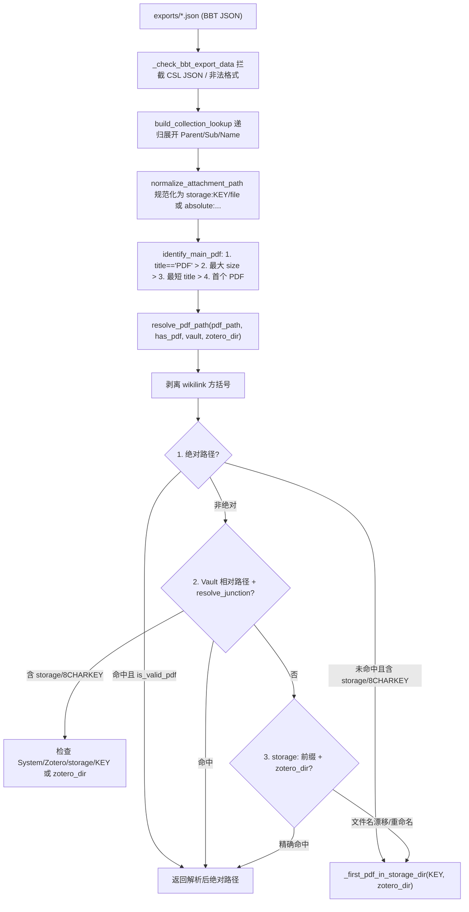

**关键实现细节**：

- **`zotero_dir` 权威解析（`paperforge/config.py` `resolve_paths`）**：读取 `paperforge.json` 的 `zotero_data_dir`（若为空回退 `<system_dir>/Zotero`；若为相对路径则相对 `vault` 解析），**不再**硬编码 `System/Zotero`。`resolve_source_pdf()` 同时通过 `pymupdf.open()` 校验 PDF 文件真实可读性。
- **Windows Junction 解析（`resolve_junction()`）**：首选 `os.path.realpath()`；在 Windows 目录挂载点未解开时，回退至 `ctypes.windll.kernel32` 的 `CreateFileW` + `GetFinalPathNameByHandleW`（剥离 `\\?\` 前缀）穿透目录联接。
- **Obsidian Wikilink 映射（`obsidian_wikilink_for_pdf()`）**：若目标在 Vault 外但位于 `resolve_junction(zotero_dir)` 内部，优先改写为经 Vault 内 Zotero 联接的相对 `[[...]]` 路径，确保 Obsidian 跨设备可读。

#### 4.2 `SyncService.run()` 与单篇索引构造顺序

1. **Fastpath 预判**：在普通全量同步（非 `--selection`/`--index`/`--rebuild-index`/`--prune`/`--prune-force`）下，计算 O(1) Stat 摘要；命中 `.sync-fastpath.json` 且 `formal-library.json` 存在则直接短路返回。
2. **Phase 1 Select（`run_selection_sync`）**：扫描导出行解析主 PDF、验证 OCR `meta.json`（只读）。
3. **Phase 2 Index（`migrate_to_workspace` → `asset_index.build_index`）**：
   - 先运行 `ensure_base_views()` 与 `migrate_to_workspace()`（将旧版平铺 `<domain>/<key> - <title>.md` 迁移至 `<domain>/<key> - <slug>/<key>.md`，合并旧 `library-records` 控制旗标，并通过 `cleanup_or_preserve_workspace_fulltext()` 按 SHA-256 核验清理工作区旧 `fulltext.md`、未匹配副本移入 `.paperforge/trash/`）。
   - `build_index()` 计算 `export_hash`；若 `export_hash`、`schema_version="2"` 及字段均未变（且非 `--rebuild-index`），仅调用 `_sync_workspace_fulltexts()` 同步图像资产并经 `cleanup_or_preserve_workspace_fulltext()` 核验清理旧工作区全文后快速返回。否则逐篇运行 `_build_entry()`：
     - **Slug 冻结与跨领域迁移**：若 `<domain>/<key> - *` 已存在，沿用原目录名；若不存在且其他域存在唯一 `<other_domain>/<key> - *` 目录（且该 key 不在旧域当前导出激活集合中），用 `shutil.move` 迁入新域。
     - **旧主笔记自愈重命名**：若工作区内仅有 `<key> - <title>.md`，重命名为 `<key>.md` 并补入 `aliases`。
     - **无损增量 Frontmatter 更新 & No-Op 护栏**：保留 `## 🔍 精读`、用户自定义 `tags`、`ocr_redo` 及非 `_KNOWN_FRONTMATTER_KEYS` 的自定义 YAML 键；仅当文本确实变化时才调用 `write_text_atomic()`（`tests/unit/test_living_memory_and_state_seq.py` 锁定不变不改写 mtime）。
     - **视觉资产同步**：`sync_workspace_visual_assets()` 仅按 `size + mtime_ns` 复制 OCR 裁切的图/表 `.jpg` 至 `<workspace>/assets/<KEY>_*.jpg`，绝不覆盖用户的 `<KEY>_ann_*.jpg`。
   - 最后通过 `atomic_write_index()` 加文件锁写入并触发 `bump_state_seq_in_dir(..., reason="index.write")`。
4. **Phase 3–5 Clean / Prune Preview / OCR Version Scan**：清理孤立无 PDF 重复平铺笔记、以实时 Zotero 导出 key 集 `_zotero_keys` 做 `prune(dry_run=True)`（或 `--prune-force` 实删）、扫描各篇 OCR 版本与隐式 legacy 回填。
5. **T6 收口（`paperforge/commands/sync.py`）**：写 `sync-orphan-state.json` → 清理 3 个退役快照文件 → 调用 `_reconcile_and_attach()`（`--json` 模式仅挂载 `next_actions`；终端模式调用 `run_chain()` 自动内联本地非破坏性后续动作）。

#### 4.3 `base_views.py` 增量保真与 Retired 清理机制

- **单一标准视图**：`build_base_views()` 现只定义 1 个视图：`"文献库"`（`type: "paperforge-table"`，列序 `["title", "first_author", "year", "journal", "impact_factor", "domain", "ocr_status"]`，`filter: None`），彻底移除 `do_ocr` / `analyze` 队列列。
- **9 个退役视图（`RETIRED_PF_VIEWS`）**：`"控制面板"`, `"待 OCR"`, `"待深度阅读"`, `"重做OCR"`, `"推荐分析"`, `"OCR 完成"`, `"深度阅读完成"`, `"正式卡片"`, `"全记录"`。
- **双模式刷新（`ensure_base_views`）**：
  - `force=False`（默认）：调用 `_sanitize_base_file()` 解析现有 `.base` 块，移除 `RETIRED_PF_VIEWS`、将裸 `!zotero_key.isEmpty()` 加双引号防止 YAML 标签误解析、清除旧 `ocr_redo` 属性定义、更新 `file.inFolder(...)` 为配置路径、缺失标准视图时用 `# PAPERFORGE_VIEW: 文献库` 补齐，**对其余用户自定义视图及标准视图内用户微调内容原样保留**；若全文无变化则跳过写盘。
  - `force=True`：调用 `_build_base_yaml()` 全量覆写。另 `merge_base_views()` 支持按 `# PAPERFORGE_VIEW:` 替换 PF 块时提取并回注用户调整的列宽 `widths:`。

#### 4.4 Digest Lineage 血缘链、Re-Key 防护与统一残余探测


1. **防错位 / 防 Re-Key 溯源（`paperforge/materialization/ocr.py` `provenance_state()`）**：
   - 强制核验 `meta["zotero_key"] == paper_dir.name`（防止重命名/跨 key 拷贝目录引发 `provenance_key_mismatch`）；
   - 核验规范库主 PDF 字节 SHA-256 等于 `meta.raw_version.pdf_fingerprint`（路径只是定位器，字节才是身份）；
   - 核验 `canonical/blocks.raw.jsonl` 字节 SHA-256 等于 `meta.raw_version.raw_blocks_hash`。任何证据缺失均 Fail-Closed 判为 `PROVENANCE_UNKNOWN`（`unknown`）。
2. **统一四载体残余探测（`paperforge/lineage.py` `_detect_residuals()`）**：
   - 分别收集 4 个载体的 key 集合：工作区目录（`_workspace_paper_keys`）、DB `papers` 表（`_db_paper_keys`）、向量元表 `vec_*_meta`（`_vec_paper_keys`）、OCR 目录（`_ocr_paper_keys`），求并集 `carrier_union`。
   - 权威基线来自实时 BBT 导出（`_zotero_keys_from_exports`），**绝不以可能滞后的 `formal-library.json` 为基线**；若导出文件不可读，则 Fail-Closed 仅检查 `sync-orphan-state.json` 中已确认缺失的 key（无权威基线时返回空列表，宁可漏删绝不误删）。

#### 4.5 三方状态修复（`repair.py`）与安全回收站清理（`trash.py` + `prune.py`）

1. **`run_repair` 三方比对与 `--fix-paths`**：
   - 扫描文献工作区主笔记，比对**笔记 Frontmatter `ocr_status`**、**索引 `formal-library.json` `ocr_status`** 与 **实盘校验后的 `validate_ocr_meta()` 状态**。出现 `done_incomplete`、笔记标 `done` 但 `meta` 为 `pending/processing/None`、索引标 `done` 但 `meta` 无效等漂移时，开启 `--fix` 将笔记与 `meta.json` 重置为 `pending`、设 `do_ocr: true` 并调 `refresh_index_entry()`。
   - `--fix-paths` 调 `repair_pdf_paths()` 对带 `path_error` 的笔记重新读取所属域 BBT 导出与 `resolve_pdf_path()`，成功后清空 `path_error` 并更新索引；最后触发 `build_index()` 全量同步衍生字段。
2. **`.paperforge/trash/` 与 `prune` 安全事务**：
   - `prune_orphan_papers(..., dry_run=False)` 全程持有 `WriterLock(vault)`，防止与后台向量构建并发踩踏：
     1. OCR 目录 → `trash_remove(..., allowed_root=ocr_root)`
     2. 工作区目录 → `trash_remove(..., allowed_root=lit_root)`
     3. 向量行 → `_delete_paper_vectors_locked(vault, key)`
     4. SQLite 记录 → 先对 `indexable = 1` 的 `body_units` 手动插入 `body_units_fts('delete', rowid, unit_id)` 同步外部内容表，再删 `body_units`、`object_units`、`lineage`、`paper_aliases`、`paper_assets`、`paper_events` 与 `papers`（触发 `papers_ad` 清理 `paper_fts`）。

---

### 5. 配置项、环境变量、CLI 入口与错误码

#### 5.1 CLI 入口一览（`paperforge/cli.py`）

| 命令与参数                                                                                                 | 行为与退出码                                                                                                                                            |
| :--------------------------------------------------------------------------------------------------------- | :------------------------------------------------------------------------------------------------------------------------------------------------------ |
| `paperforge sync [--dry-run] [--selection] [--index] [--rebuild-index] [--prune] [--prune-force] [--json]` | 默认执行 Select + Index + Clean + Prune Preview + OCR Scan + Reconcile；`--json` 返回 `PFResult`（含 `timing` 阶段耗时与 `next_actions`），失败返回 `1` |
| `paperforge repair [--fix] [--fix-paths] [--json]`                                                         | 默认只读扫描三方漂移与 `path_error`；发现问题退出码 `1`，无问题 `0`；带 `--fix`/`--fix-paths` 修复后自动重编索引                                        |
| `paperforge prune [--force] [--json] [KEY ...]`                                                            | 默认预览 `_detect_residuals(vault)`；交互模式需确认，`--json --force` 直接将目标移入回收站并清理 DB/向量                                                |
| `paperforge trash list` / `restore <trash_id>` / `purge [--older-than DAYS]`                               | 列出回收站记录、按 `trash_id` 还原至原路径（冲突返回 `1`、无效 ID 返回 `2`）、或物理清理超过指定天数的回收站目录                                        |
| `paperforge base-refresh [--force]`                                                                        | 增量清洗/补全所有域 `.base` 与 `Literature Hub.base`（`--force` 全量覆盖）                                                                              |
| 兼容别名                                                                                                   | 旧版 `selection-sync` 与 `index-refresh` 子命令代币保留在 parser 中以兼容历史脚本，实际全部路由至 `commands/sync.py`                                    |

#### 5.2 相关配置与环境变量

| 键名 / 变量                            | 默认值                                          | 作用说明                                                                                             |
| :------------------------------------- | :---------------------------------------------- | :--------------------------------------------------------------------------------------------------- |
| `zotero_data_dir` (`ZOTERO_DATA_DIR`)  | `<system_dir>/Zotero`                           | Zotero 根目录（`storage/` 所在父目录），`pdf_resolver` 与 `obsidian_wikilink_for_pdf` 的核心定位基准 |
| `system_dir` (`PAPERFORGE_SYSTEM_DIR`) | `System`（新初始化默认 `.paperforge`）          | 决定引擎数据目录名；当末尾段为 `.paperforge` 时启用 `hidden_engine` 模式禁止工作区暴露 `fulltext.md` |
| `base_dir` (`PAPERFORGE_BASE_DIR`)     | `Bases`                                         | `.base` 视图存放目录                                                                                 |
| `PAPERFORGE_CHECK_GIT_DIRTY`           | 未开启（设 `"1"` 开启）                         | `SyncService.run()` 仅在显式置 `"1"` 时检查 OCR 运行时源码是否有未提交变更                           |
| `LIT_PIPELINE_USER_AGENT`              | `ResearchLiteraturePipeline/1.0 (+local-vault)` | 外部搜索适配器请求头                                                                                 |

#### 5.3 核心错误码（`paperforge/core/errors.py` & 异常类型）

- `BBT_EXPORT_NOT_FOUND` / `BBT_EXPORT_INVALID`：导出目录空或非有效 BBT JSON（如 CSL JSON）。
- `PDF_PATH_UNRESOLVED` / `ZOTERO_DATA_NOT_FOUND`：PDF 或 Zotero 数据目录解析失败。
- `SYNC_FAILED`：同步编排阶段发生未恢复异常（带 `details.phase`）。
- `VALIDATION_ERROR`：`repair` 检测到未修复的三方分歧或 `path_error` 时在 `PFResult.error` 中返回。
- `DangerousPathError`（`paperforge/worker/trash.py`）：目标路径触发防呆拦截时抛出（如空路径、`Path()`、允许根自身或软链接逃逸）。

---

### 6. 边界防护与 Fail-Closed 防呆规则

1. **2026-08-14 事故防护铁律（`validate_target` + `trash_remove`）**：
   - `validate_target()` 在任何移动/删除前先拒绝 `None`、`""`、`" "`、`"."`、`".."`，随后调用 `.resolve()` 穿透软链接/联接点，强制确认目标严格位于 `allowed_root` 之下且不等于 `allowed_root`、`allowed_root.parent` 或盘符根；`trash_remove()` 禁用 `ignore_errors`，移动失败时保持源数据原封不动。
   - `purge_trash()` 二次校验 `root_resolved in resolved.parents`，绝不允许清理 `.paperforge/trash` 之外的任何目录。
2. **绝不以滞后索引判定孤立论文**：`_detect_residuals()` 与 `SyncService` 阶段 4 均直接以**实时 `exports/*.json` 的 key 集**为 Zotero 权威；若导出文件损坏或暂不可读，仅允许依据 `sync-orphan-state.json` 中已确认缺失的条目处理，无基线则直接返回 0 条，杜绝刚加入 Zotero 但尚未入索引的论文被误删。
3. **跨进程锁与原子替换**：`formal-library.json` 的所有读写改（`atomic_write_index`、`mutate_index`）均持有 `filelock.FileLock(..., timeout=10)` 并经同目录临时文件 `fsync` + `os.replace` 替换；`.state-seq.json` 同样在 `FileLock(".state-seq.json.lock", timeout=10.0)` 互斥锁内读-增-`mkstemp` + `fsync` + `os.replace`，避免多进程并发丢增，且严格限制只写入名为 `indexes` 的目录。
4. **工作区全文无损清理护栏（`cleanup_or_preserve_workspace_fulltext`）**：隐藏模式迁移或同步清理工作区旧 `fulltext.md` 时，必须逐字节（及 LF 归一化）校验其 SHA-256 与 `.paperforge/ocr/<KEY>/fulltext.md` 或 `.pre-rebuild` 一致后才可 `unlink()`；任何包含手工编辑或缺失对照源的副本一律通过 `trash_remove(..., operation="workspace_fulltext_preserve")` 移入 `.paperforge/trash/`。
5. **Frontmatter 布尔值不加引号防呆**：`set_frontmatter_flag()` 仅在 `split_frontmatter_block()` 确认起止围栏完整闭合后才就地写入裸 `true`/`false`，防止被引号包裹成字符串导致索引构建回退旧值。
6. **FTS5 外部内容表防损坏**：`prune.py` 删除数据库记录时，先对 `indexable = 1` 的行手动执行 `body_units_fts('delete', rowid, unit_id)` 再删 `body_units`，防止因对未建索引行执行 FTS 删除触发 `SQLITE_CORRUPT_VTAB`。
7. **主 PDF 选取一致性（#135）**：`run_selection_sync()` 与 `asset_index._build_entry()` 统一调用 `identify_main_pdf()`，彻底消除多 PDF 附件论文在选定主附件时的口径分裂。

---

### 7. 维修、调试与升级 Checklist

#### 7.1 日常运维与故障排查步骤

- [ ] **BBT 导出与配置快速核查**：确认 `exports/*.json` 为 Better BibTeX JSON 格式（顶层含 `items` 数组，非 CSL JSON 数组或 `.bib`）；检查 `paperforge.json` 中 `zotero_data_dir` 指向正确的本地 Zotero 根目录。
- [ ] **增量同步失效或疑被 Fastpath 跳过**：若手工修改了导出文件但怀疑未刷新，运行 `paperforge --vault <VAULT> sync --rebuild-index --json` 强制跳过 `.sync-fastpath.json` 并全量重算 `formal-library.json`。
- [ ] **排查 PDF 断链（`path_error`）**：先运行只读 `paperforge --vault <VAULT> repair --json` 查看 `path_errors.by_type` 与 `divergent`；确认 Zotero 存储附件已同步到本地后，执行 `paperforge --vault <VAULT> repair --fix-paths --fix` 自动重解析并刷新索引。
- [ ] **误删恢复（`.paperforge/trash/`）**：
  1. 运行 `paperforge --vault <VAULT> trash list` 查找目标 `paper_key` 对应的 `trash_id`；
  2. 确认原路径未被占用后运行 `paperforge --vault <VAULT> trash restore <TRASH_ID>`；
  3. 恢复后运行 `paperforge --vault <VAULT> sync` 与 `paperforge --vault <VAULT> action run memory.build --scope papers --key <KEY> --confirm memory.build` 重建数据库行。
- [ ] **定期清理过期回收站**：确认无需保留后，使用带天数门槛的 `paperforge --vault <VAULT> trash purge --older-than 30` 安全清除。
- [ ] **Obsidian Base 视图异常或需重置列配置**：先用默认安全模式 `paperforge --vault <VAULT> base-refresh` 清洗冗余视图；仅在确定放弃手工自定义视图时才附加 `--force`。

#### 7.2 完整回归测试 Checklist

- [ ] **同步、索引与衍生状态核心单测**：
  ```bash
  pytest tests/test_sync.py tests/test_asset_index.py tests/test_asset_state.py
  ```
- [ ] **适配器与 PDF 路径解析单测**：
  ```bash
  pytest tests/unit/adapters/test_bbt.py tests/unit/adapters/test_zotero_paths.py tests/unit/adapters/test_obsidian_frontmatter.py tests/test_pdf_resolver.py
  ```
- [ ] **Base 视图生成、保留与 State-Seq 实时信号单测**：
  ```bash
  pytest tests/test_base_views.py tests/test_base_preservation.py tests/unit/test_living_memory_and_state_seq.py
  ```
- [ ] **谱系、修复、裁剪、回收站与升级韧性单测**：
  ```bash
  pytest tests/test_lineage.py tests/test_repair.py tests/unit/services/test_sync_service_prune.py tests/unit/worker/test_prune.py tests/unit/worker/test_trash.py tests/unit/test_upgrade_resilience.py
  ```

---

<a id="chapter-07"></a>

## 第 07 章：OCR Provider、异步作业与 Canonical 持久化

> 源文件：`docs/handbook/07-ocr-provider-and-canonical.md`

本章系统阐述 PaperForge OCR 子系统的远程作业控制面、容错重试与诊断分层、单篇论文落盘目录结构（含 `canonical/` 原始事实层）、双层版本/哈希契约（`raw_version` / `derived_version` 与 `result-hash.txt` 发布门控），以及 `paperforge ocr` CLI 入口与 `redo` 事务恢复机制。下游 V3 结构化管线、图表对象归属与 Markdown 渲染详见 [Chapter 08](#chapter-08)，渲染一致性审计、R/P 晋升与快照版本管理详见 [Chapter 09](#chapter-09)，整体谱系与 Reconcile 控制面详见 [Chapter 04](#chapter-04)。

---

### 1. 职责与非目标边界

#### 1.1 核心职责

1. **Provider 协议抽象与异步作业执行（`paperforge/providers/` & `paperforge/worker/ocr.py`）**
   - 通过 `OCRProvider` 协议（`ProviderStatus` 五态：`queued` / `running` / `done` / `failed` / `unknown`）隔离第三方 OCR 服务细节，控制面与下游 V3 管线仅消费归一化状态与 `ocr_raw` 块列表。
   - `PaddleOCRProvider` 与 `run_ocr()` 负责将本地主 PDF 上传至 PaddleOCR AI Studio v2 异步作业 API（同一逻辑运行共享唯一 `batchId`），通过批查询（`get_batch_status`）与单作业轮询（`get_job_status`）跟踪作业生命周期，并拉取结果 JSONL。
2. **Canonical 原始真值持久化与 PDF 证据回填（`canonical/` + `raw/` + `ocr_pdf_spans.py`）**
   - 远程识别返回的每页 `layoutParsingResults` 经 `parse_paddleocr_raw_blocks()` 规范化后，结合 PyMuPDF（`pymupdf`）提取的 `span_metadata`（字符级字号、字体、粗斜体标志、颜色、书写方向）与空文本回填（`backfill_missing_text_from_pdf()`），持久落盘到 `canonical/blocks.raw.jsonl`，同时在 `json/result.json`、`raw/raw_meta.json`、`raw/source_metadata.json` 保存可审计的原始载荷与指纹。
3. **版本分离与本地重建支持（`paperforge/worker/ocr_versions.py` & `ocr_rebuild.py`）**
   - 严格区分 **Raw 版本**（`expected_raw_payload()`：提供商、模型、原始 schema、`pdf_fingerprint`、`result_json_hash`、`raw_blocks_hash`）与 **Derived 版本**（`expected_derived_payload()`：管线、结构化、元数据解析、资产提取、渲染器、诊断版本）。当仅派生算法升级（`derived_stale=True` 且 `raw_upgradable=False`）时，通过本地 `ocr.rebuild_derived` / `paperforge ocr rebuild` 重算衍生层，**零远程 API 流量**。
4. **原子发布哈希与崩毁安全事务（`ocr_hash.py` & `run_ocr()` / `_redo_one_paper_transaction()`）**
   - 通过 `index/result-hash.pending` 发布标记与 `index/result-hash.txt`（SHA-256 覆盖三项规范产物）阻止下游记忆层/检索层读取半成品；通过 `controller.lock`、`ocr_queue.lock`、`submission_state="submitting"` 预写日志、以及 `redo` 临时快照目录保障并发与中断安全。

#### 1.2 明确的非目标边界（Non-Goals）

| 能力域                              | 本层坚决不做的事                                                                                                         | 实际归属模块                                                                                                |
| :---------------------------------- | :----------------------------------------------------------------------------------------------------------------------- | :---------------------------------------------------------------------------------------------------------- |
| **文档角色归一化与图表配对**        | 不在 `canonical/blocks.raw.jsonl` 中分配 `section_heading`、`figure_caption` 等语义角色，不执行图注/表注配对             | [Chapter 08](#chapter-08)（`paperforge/worker/ocr_blocks.py`、`ocr_object_stage.py`） |
| **凭据持久化与多渠道回退**          | 不自行读取 `.env`、Windows 注册表（HKCU）或插件配置作为 OCR Token；仅消费 `CredentialKey("ocr")` 权威入口                | `paperforge/credentials.py`（`resolve()` / `paperforge auth`）                                              |
| **前端界面状态展示与动作调度**      | 不主动计算 UI 分组展示，不私自决定全库/单篇重跑策略；仅通过 `OCRMaintenanceRow` 与 `meta.json` 暴露客观状态              | `paperforge/worker/ocr_maintenance.py` & [Chapter 04](#chapter-04)                           |
| **旧版历史快照（`versions/`）回滚** | `postprocess_ocr_result()` 不操作 `versions/v{N}` 显示快照；显示版本备份与只读恢复属于版本网关与重建前钩子               | [Chapter 09](#chapter-09)（`paperforge/commands/versions.py`）                         |
| **SQLite 记忆库与向量写入**         | OCR 落盘与 `refresh_index_entry()` 仅维护文件系统产物与 `formal-library.json`；不直接写入 `paperforge.db` 检索单元与向量 | [Chapter 10](#chapter-10)                                                                 |

---

### 2. 核心源码与单测映射表

| 模块 / 文件                             | 核心职责与关键符号                                                                                                                                                                                                                                               | 对应验证单测 / 集成测试                                                                                                                                                  |
| :-------------------------------------- | :--------------------------------------------------------------------------------------------------------------------------------------------------------------------------------------------------------------------------------------------------------------- | :----------------------------------------------------------------------------------------------------------------------------------------------------------------------- |
| `paperforge/providers/base.py`          | 定义 `ProviderStatus` 枚举与 `@runtime_checkable` `OCRProvider` 协议（7 个标准方法）                                                                                                                                                                             | `tests/test_ocr.py`                                                                                                                                                      |
| `paperforge/providers/paddleocr.py`     | 实现 `PaddleOCRProvider`、`DEFAULT_JOB_URL`、`normalize_provider_state()`、`extract_paddleocr_result_url()`、`iter_paddleocr_page_results()`、`parse_paddleocr_page_blocks()`、`parse_paddleocr_raw_blocks()`                                                    | `tests/test_ocr.py`、`tests/harness/test_d05_ocr_redo.py`                                                                                                                |
| `paperforge/worker/ocr.py`              | OCR 控制器主干：`run_ocr()`、`postprocess_ocr_result()`、`_mark_ocr_result_unavailable()`、队列同步 `sync_ocr_queue()`、互斥锁 `_acquire_controller_lock()` / `_ocr_queue_lock()`、Redo 事务 `_redo_one_paper_transaction()` 与孤儿恢复 `recover_redo_orphans()` | `tests/test_ocr.py`、`tests/test_ocr_state_machine.py`、`tests/test_redo_orphan_recovery.py`、`tests/harness/test_d04_ocr_stop.py`、`tests/harness/test_d05_ocr_redo.py` |
| `paperforge/worker/ocr_orchestrator.py` | 历史兼容壳：`BlockAnnotated`、`reorder_blocks_layered()`（非生产路径，仅保留接口兼容）                                                                                                                                                                           | `tests/test_ocr_route_audit.py`                                                                                                                                          |
| `paperforge/worker/ocr_blocks.py`       | 原始块与结构块桥接：`build_raw_blocks_for_result_lines()`、`write_raw_blocks_jsonl()`、`build_structured_blocks()`、`write_structured_blocks_jsonl()`、`DOC_STRUCTURE_MAX_BYTES`                                                                                 | `tests/test_ocr_blocks.py`、`tests/test_ocr_artifacts.py`                                                                                                                |
| `paperforge/worker/ocr_pdf_spans.py`    | 基于 PyMuPDF 提取源 PDF `span_metadata`（`backfill_span_metadata_from_pdf()`）并回填 OCR 漏字（`backfill_missing_text_from_pdf()`）                                                                                                                              | `tests/test_ocr_blocks.py`                                                                                                                                               |
| `paperforge/worker/ocr_versions.py`     | 双层版本常量与检测：`OCR_PIPELINE_VERSION`、`expected_raw_payload()`、`expected_derived_payload()`、`classify_legacy_ocr_state()`、`classify_version_state()`、`compute_structured_hash()`、`backup_render_before_rebuild()`                                     | `tests/test_ocr_versions.py`、`tests/test_ocr_artifacts.py`                                                                                                              |
| `paperforge/worker/ocr_hash.py`         | 原子发布哈希契约：`OCR_RESULT_HASH_ARTIFACTS`、`PENDING_MARKER`、`HASH_FILE`、`compute_ocr_result_hash()`、`create_result_hash_pending()`、`publish_ocr_result_hash()`、`clear_result_hash_pending()`                                                            | `tests/test_ocr_hash_contract.py`                                                                                                                                        |
| `paperforge/worker/ocr_errors.py`       | OCR 异常分级：`OCRRecoverableError`（`OCRNetworkError`、`OCRAPISchemaError`）、`OCRFatalError`（`OCRPDFResolveError`、`OCRPostprocessError`、`OCRArtifactIntegrityError`）、`classify_ocr_error()`、`normalize_ocr_status_for_reader()`                          | `tests/test_ocr_errors.py`                                                                                                                                               |
| `paperforge/worker/ocr_quality.py`      | 6 维质量归一化与可用性评估：`build_quality_indicators()`、`load_readiness_policy()`、`evaluate_readiness()`、`compute_use_cases()`（读取 `paperforge/policies/ocr_readiness_v1.yaml`）                                                                           | `tests/test_ocr_profiles.py`                                                                                                                                             |
| `paperforge/worker/ocr_artifacts.py`    | 单篇路径定义与缓存清理：`OCRArtifactPaths`、`artifact_paths_for_root()`、`artifact_paths_for_key()`、`build_version_payload()`、`compute_pdf_fingerprint()`、`compute_json_hash()`、`cleanup_ocr_artifact_cache()`                                               | `tests/test_ocr_artifacts.py`                                                                                                                                            |
| `paperforge/worker/ocr_profiles.py`     | 字体跨度样式画像：`extract_block_span_profile()`、`build_role_span_profiles()`、`build_family_profiles()`、`cross_validate_with_span()`、`write_role_span_profiles()`                                                                                            | `tests/test_ocr_profiles.py`                                                                                                                                             |
| `paperforge/worker/ocr_health.py`       | 结构健康审计：`build_ocr_health()`、`build_ocr_raw_integrity_health()`、`audit_rendered_text_coverage()`、`write_ocr_health()`、`collect_ocr_health_summary()`                                                                                                   | `tests/test_ocr_artifacts.py`                                                                                                                                            |
| `paperforge/ocr_diagnostics.py`         | L1–L4 诊断探针与错因映射：`ocr_doctor()`、`classify_error()`                                                                                                                                                                                                     | `tests/test_ocr.py`                                                                                                                                                      |
| `paperforge/commands/ocr.py`            | CLI 分发层：`run()`、`_diagnose()`、`_run_ocr_status()`、`_run_ocr_resume()`、`_run_ocr_redo()`、`_run_ocr_list()`、`_run_ocr_rebuild()`、`_needs_derived_rebuild()`、`_run_ocr_pipeline_versions()`                                                             | `tests/harness/test_d04_ocr_stop.py`、`tests/harness/test_d05_ocr_redo.py`、`tests/harness/test_d06_rebuild_derived.py`                                                  |
| `paperforge/worker/_retry.py`           | 指数退避重试器：`configure_retry()`、`retry_with_meta()`（仅重试网络超时、`ConnectionError` 与 HTTP `429`/`503`）                                                                                                                                                | `tests/test_ocr_errors.py`                                                                                                                                               |
| `paperforge/worker/ocr_maintenance.py`  | 维护行单源模型：`OCRMaintenanceRow`、`_can_rebuild()`、`_can_redo()`、`collect_maintenance_rows()`、`compute_maintenance_manifest()`                                                                                                                             | `tests/harness/test_d06_rebuild_derived.py`                                                                                                                              |

---

### 3. 磁盘文件、数据库表与协议 JSON 字段字典

#### 3.1 OCR 目录布局与 Canonical / Cache 边界

所有单篇 OCR 产物均位于 `<paperforge>/ocr/<KEY>/`（其中 `<paperforge>` 由 `paperforge.json` 的 `system_dir` 解析，现代布局通常为 `<vault>/.paperforge`，兼容布局为 `<vault>/System/PaperForge`）。全队列文件位于 `<paperforge>/ocr/` 根下：

| 相对路径                                                             | 所属层级           | 生成/维护者                                               | 说明与保留策略                                                                                                                             |
| :------------------------------------------------------------------- | :----------------- | :-------------------------------------------------------- | :----------------------------------------------------------------------------------------------------------------------------------------- |
| `ocr-queue.json` / `ocr_queue.lock`                                  | 队列控制面         | `sync_ocr_queue()` / `write_ocr_queue()`                  | 未结算作业队列列表（已结算状态从队列移除）；`ocr_queue.lock` 为排他锁                                                                      |
| `controller.lock`                                                    | 队列控制面         | `_acquire_controller_lock()`                              | 全局单活 OCR 控制器锁（`O_EXCL`，30 秒陈旧恢复）                                                                                           |
| `meta.json`                                                          | 生命周期权威       | `ensure_ocr_meta()` / `run_ocr()`                         | 单篇 OCR 状态、作业 ID、Batch ID、版本负载、失败原因与哈希基准                                                                             |
| `json/result.json`                                                   | Raw 原始层         | `postprocess_ocr_result()`                                | PaddleOCR 返回的原始逐页 JSON 列表（支持旧版重新回填 `backfill_from_result()`）                                                            |
| `raw/raw_meta.json`                                                  | Raw 原始层         | `postprocess_ocr_result()`                                | 记录 `pdf_fingerprint`、`result_hash` 与原始元数据时间戳                                                                                   |
| `raw/source_metadata.json`                                           | Raw 原始层         | `postprocess_ocr_result()`                                | 来自 Zotero/BBT 的题录锚点（`title`、`authors`、`year`、`journal`、`doi`、`bbt_citekey`）                                                  |
| `raw/api_error_payload.json`                                         | 故障证据           | `run_ocr()`                                               | 轮询 JSON 解码或 `data.state` 解析失败时截留前 5000 字符响应体                                                                             |
| `canonical/blocks.raw.jsonl`                                         | Canonical 原始真值 | `write_raw_blocks_jsonl()`                                | **权威原始块序列**（含 PDF `span_metadata` 与 PDF 漏字回填标注），`rebuild-derived` 的唯一块输入                                           |
| `pages/page_<NNN>.png\|jpg`                                          | 可再生缓存         | `render_pdf_page_cached()` / `ensure_page_image_cached()` | 页面图像缓存；`postprocess_ocr_result()` 末尾默认删除（除非 `PAPERFORGE_KEEP_PAGE_IMAGES=1`），`cleanup_ocr_artifact_cache()` 仅清理此目录 |
| `images/blocks/...`                                                  | 兼容图像产物       | `render_page_blocks()`                                    | 兼容渲染切图目录（`meta.path_map.legacy_compat`）                                                                                          |
| `structure/`、`metadata/`、`assets/`、`render/`、`health/`、`index/` | Derived 派生层     | `ocr_rebuild.py` / `postprocess_ocr_result()`             | 结构块、元数据解析、图表裁剪、全文 Markdown、健康报告与原子发布哈希（详见 [Chapter 08](#chapter-08)）                |

> [!IMPORTANT]
> `cleanup_ocr_artifact_cache()`（`paperforge/worker/ocr_artifacts.py`）仅清理 `pages/` 目录下的 `.jpg` / `.png` / `.webp` 页面缓存；`canonical/`、`structure/`、`metadata/`、`assets/`、`render/`、`health/`、`index/`、`raw/`、`meta.json` 与根目录 `fulltext.md` 均属于不可自动清除的规范资产。

#### 3.2 `canonical/blocks.raw.jsonl` 行级字段字典

由 `parse_paddleocr_page_blocks()`（`paperforge/providers/paddleocr.py`）生成基础结构，随后由 `backfill_span_metadata_from_pdf()` 与 `backfill_missing_text_from_pdf()`（`paperforge/worker/ocr_pdf_spans.py`）补充 PDF 证据字段：

| 字段名                       | 类型                 | 来源                             | 说明                                                                                                                                                                                                      |
| :--------------------------- | :------------------- | :------------------------------- | :-------------------------------------------------------------------------------------------------------------------------------------------------------------------------------------------------------- |
| `paper_id`                   | `str`                | `parse_paddleocr_page_blocks`    | Zotero 文献键（如 `"ABCD1234"`）                                                                                                                                                                          |
| `page`                       | `int`                | `iter_paddleocr_page_results`    | 1-indexed 物理页码                                                                                                                                                                                        |
| `block_id`                   | `str \| int`         | PaddleOCR `block_id`             | 块 ID（缺省回退 `"p{page}_b{i}"`；跨页可能重复）                                                                                                                                                          |
| `raw_label`                  | `str`                | PaddleOCR `block_label`          | 原始布局标签（如 `text`、`paragraph_title`、`doc_title`、`abstract`、`table`、`image`、`chart`、`figure_title`、`reference_content`、`vision_footnote`、`display_formula`）                               |
| `raw_order`                  | `int`                | PaddleOCR `block_order`          | 原始阅读顺序索引（缺省回退页内枚举序号 `i`）                                                                                                                                                              |
| `bbox`                       | `list[int \| float]` | PaddleOCR `block_bbox`           | `[x1, y1, x2, y2]` OCR 像素坐标（缺省 `[0, 0, 0, 0]`）                                                                                                                                                    |
| `text`                       | `str`                | PaddleOCR `block_content`        | 识别文本内容（空文本可能由 PDF 文本层回填）                                                                                                                                                               |
| `page_width` / `page_height` | `int \| float`       | `prunedResult.width/height`      | OCR 图像坐标系页面宽高                                                                                                                                                                                    |
| `source`                     | `str`                | 固定常量                         | 恒为 `"ocr_raw"`                                                                                                                                                                                          |
| `span_metadata`              | `list[dict] \| None` | `ocr_pdf_spans.py`               | 每段字符样式：`{"size": float, "font": str, "flags": int, "color": int, "dir": tuple, "wmode": int}`                                                                                                      |
| `_text_source`               | `str`（可选）        | `backfill_missing_text_from_pdf` | 仅空文本回填时出现：`pdf_text_layer_fallback` 或被重叠检测拒绝的 `pdf_text_layer_fallback_rejected`                                                                                                       |
| `_ocr_raw_status`            | `str`（可选）        | `backfill_missing_text_from_pdf` | `missing_text_recovered` / `missing_text_unrecovered` / `missing_text_rejected`                                                                                                                           |
| `_ocr_raw_error_type`        | `str`（可选）        | `backfill_missing_text_from_pdf` | `empty_text_with_pdf_evidence` / `no_pdf_text_layer` / `backfill_overlaps_existing_text_block` / `invalid_page_index` / `missing_bbox` / `missing_page_dimensions` / `bbox_mapping_failed` / `empty_rect` |

#### 3.3 `meta.json` 核心字段与双层版本字典

`meta.json` 是单篇 OCR 生命周期与版本状态的权威载体，由 `ensure_ocr_meta()` 初始化、`run_ocr()` 更新作业状态、`postprocess_ocr_result()` 与 `_rebuild_one_paper()` 写入版本负载：

| 字段路径                                                                                                                               | 类型                                  | 说明与取值语义                                                                                                                                                                                                                                                             |
| :------------------------------------------------------------------------------------------------------------------------------------- | :------------------------------------ | :------------------------------------------------------------------------------------------------------------------------------------------------------------------------------------------------------------------------------------------------------------------------- |
| `zotero_key` / `source_pdf`                                                                                                            | `str`                                 | 文献主键与规范 PDF 定位符（由 `formal-library.json` 与 `resolve_pdf_path` 解析，支持 `storage:KEY/...`、相对路径与绝对路径）                                                                                                                                               |
| `ocr_status`                                                                                                                           | `str`                                 | 生命周期状态：队列态 `pending` / `queued` / `running`；已结算态 `done` / `done_degraded` / `fatal_error` / `blocked` / `nopdf` / `error`；可恢复重试态 `retryable_error`；校验不完整态 `done_incomplete`                                                                   |
| `submission_state`                                                                                                                     | `str`（可选）                         | 预写提交保护窗：上传 POST 前置 `"submitting"`，成功取得 `jobId` 后置 `"submitted"`                                                                                                                                                                                         |
| `provider_batch_id` / `ocr_job_id`                                                                                                     | `str`                                 | 逻辑运行批次号（格式 `pf-YYYYMMDD-HHMMSS-<hex6>`）与当前远程作业 ID                                                                                                                                                                                                        |
| `job_attempt` / `provider_jobs`                                                                                                        | `int` / `list[dict]`                  | 远程作业失败重提次数（上限 `MAX_OCR_JOB_ATTEMPTS = 3`）及最近最多 3 条 `{"attempt": N, "job_id": "..."}` 映射                                                                                                                                                              |
| `retry_count` / `last_error` / `last_attempt_at`                                                                                       | `int` / `str \| None` / `str \| None` | 传输层重试计数（超过 3 次触发 `fatal_error`）与最近错误时间戳（`retry_with_meta()` 持久化）                                                                                                                                                                                |
| `error` / `error_type` / `error_stage` / `retryable`                                                                                   | `str` / `str` / `str` / `bool`        | 由 `classify_ocr_error()` 或控制分支写入；`error_stage` 可为 `source`、`auth`、`upload`、`poll`、`result`、`provider`、`postprocess`                                                                                                                                       |
| `source_page_count` / `page_count`                                                                                                     | `int`                                 | `source_page_count` 为上传前从源 PDF 读取的页数（用于计算动态超时）；`page_count` 为后处理实际产出页数                                                                                                                                                                     |
| `ocr_pipeline_version` / `normalize_mode`                                                                                              | `str`                                 | 当前 `"2.0.0"`；`normalize_mode` 为 `"seed_only"`（V3）或 `"legacy"`                                                                                                                                                                                                       |
| `raw_version`                                                                                                                          | `dict`                                | 包含 `ocr_provider`（`"PaddleOCR"`）、`ocr_model`、`ocr_raw_schema_version`（`expected_raw_payload()` 中为 `"2.0.0"`，注：`raw/raw_meta.json` 内记录 `"1.0.0"`）、`pdf_fingerprint`（`sha256:...`）、`result_json_hash`（`sha256:...`）、`raw_blocks_hash`（`sha256:...`） |
| `derived_version`                                                                                                                      | `dict`                                | 由 `expected_derived_payload()` 生成：`ocr_pipeline_version="2.0.0"`、`canonical_block_version="2.0.0"`、`structure_version="2.0.0"`、`metadata_resolver_version="2.0.0"`、`asset_extractor_version="2.0.0"`、`renderer_version="2.1.0"`、`doctor_version="2.0.0"`         |
| `raw_upgradable` / `derived_stale`                                                                                                     | `bool`                                | 由 `classify_version_state()` 计算：前者标识 Raw 模型/schema 变化需重新调用 API；后者标识仅 Derived 版本落后，可本地 `rebuild`                                                                                                                                             |
| `structured_content_hash` / `structured_mtime` / `structured_size`                                                                     | `str` / `float` / `int`               | `compute_structured_hash()` 计算的 `structure/blocks.structured.jsonl` 的 `xxh64` 十六进制摘要及两级 stat 快速检测凭据                                                                                                                                                     |
| `span_backfill_version` / `span_visual_container_version` / `span_pdf_fingerprint` / `span_backfill_coverage` / `span_backfill_status` | 混合                                  | `ocr_rebuild.py` 记录的 PDF Span 回填幂等门控（当前版本 `"2026-07-01.1"` 与 `"2026-06-26.6"`，覆盖率阈值 `MIN_SPAN_BACKFILL_COVERAGE = 0.90`）                                                                                                                             |
| `machine_fulltext_hash` / `degraded_reason`                                                                                            | `str`                                 | 根目录 `fulltext.md` 最近一次机器写入的 `sha256:...`（用于漂移检测）；`done_degraded` 时记录硬降级原因                                                                                                                                                                     |

#### 3.4 原子发布哈希契约（`paperforge/worker/ocr_hash.py`）

为防止记忆层（`paperforge/memory/builder.py`）或检索读取侧消费到写了一半的衍生文件，所有成功路径（首次 `postprocess_ocr_result`、派生重建 `_rebuild_one_paper`、历史回填 `backfill_from_result`）必须通过以下三步协议发布：

1. **固定输入顺序（`OCR_RESULT_HASH_ARTIFACTS`）**：依次读取以下 3 个文件原始字节计算单条 SHA-256（底层委托 `paperforge/core/stat_cache.py::cached_concat_sha256_hex()` 利用 `(size, mtime_ns, ctime_ns)` 缓存与 2s Racy-Git 防护跳过未变大文件重算，与 `paperforge/materialization/ocr.py` 共用缓存而不污染 Vault）：
   - `structure/blocks.structured.jsonl`
   - `index/structure-tree.json`
   - `index/role-index.json`
     任一文件缺失时，`compute_ocr_result_hash()` 严格返回 `None`（绝不生成部分哈希）。
2. **预写标记（`PENDING_MARKER = "index/result-hash.pending"`）**：通过 `create_result_hash_pending()` 在**任何衍生层修改之前**写入该标记文件。标记存在期间，`paperforge/materialization/ocr.py` 的 `published_identity_hash()` 返回 `""`、`identity_state()` 返回 `(None, None)`，读取侧与记忆构建侧必须忽略该论文。
3. **原子提交与清除（`HASH_FILE = "index/result-hash.txt"`）**：仅在全部衍生阶段验证通过后，调用 `publish_ocr_result_hash()` 通过同目录 `tempfile.mkstemp()` + `os.replace()` 原子替换 `index/result-hash.txt`；若返回非 `None`，最后调用 `clear_result_hash_pending()` 删除标记。中途失败会保留 `pending` 标记直至修复或重建成功。

---

### 4. 核心执行链路、状态机与顺序不变量

#### 4.1 异步提交、批轮询与结算状态机

`run_ocr()`（`paperforge/worker/ocr.py`）以单活控制器模式执行上传与轮询主循环（并发槽位由 `PADDLEOCR_MAX_ITEMS` 控制，默认 `3`；轮询间隔 `PAPERFORGE_POLL_INTERVAL` 默认 `15` 秒；最大周期 `PAPERFORGE_POLL_MAX_CYCLES` 默认 `60` 次）。

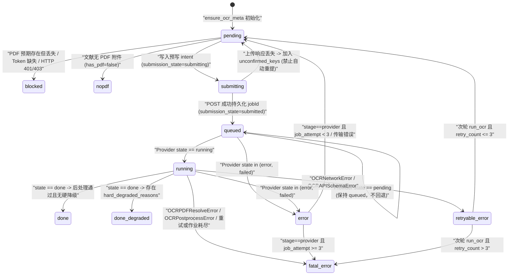

关键状态流转与顺序不变量如下：

1. **状态词汇隔离不变量**：PaddleOCR 返回的 `"pending"` 表示作业已在远程排队（对应本地 `"queued"`）。`run_ocr()` 严禁将远程 `"pending"` 写回本地 `"ocr_status = 'pending'"`，否则会同时击穿轮询等待条件与上传触发条件，导致无限重复上传。
2. **双计数隔离不变量（`job_attempt` vs `retry_count`）**：
   - `retry_count` 仅记录 HTTP 传输与临时轮询重试（`retry_with_meta()` 对 `ConnectionError`、`Timeout`、`429`、`503` 做指数退避，最多 `PAPERFORGE_RETRY_MAX=5` 次），**永不消耗** `job_attempt`。
   - `job_attempt` 仅记录远程作业终态失败（Provider 返回 `error`/`failed`）后的重提次数，上限为 `MAX_OCR_JOB_ATTEMPTS = 3`。当 `stage == "upload"` 且 `retry_count >= 3` 时同样直接 Fail-Closed 为 `fatal_error`。
3. **预写意图与幂等防重提（`submission_state="submitting"`）**：上传 POST 是非幂等操作。`run_ocr()` 在发起 HTTP POST **之前** 先落盘 `submission_state="submitting"` 与 `provider_batch_id`。若在响应返回前进程崩溃或网络超时，该键被标为 `unconfirmed_keys`，并写入 `"Submission unconfirmed"`；后续 `ocr resume --batch <id>` 的 `_collect_batch_unsettled()` 也会跳过 `submission_state == "submitting"` 的论文以防盲目重提产生双倍计费。同时，为了闭合卡滞排障闭环，`paperforge/worker/ocr_maintenance.py` 对 `submission_state == "submitting"` 且缺失 `ocr_job_id`、状态尚未完成的条目主动在维护面板显式暴露可操作恢复行（`display_action="retry_ocr"`、`display_reason_key="submitting_unconfirmed"`、`can_redo=True`、`recommended_action="redo"`，`tests/unit/test_ux_loop_closures.py`）。
4. **单活控制器、批观测降级与延迟 `resultUrl` 可恢复滞留**：写控制器启动即尝试获取 `<paperforge>/ocr/controller.lock`（`O_EXCL`，>30s 视为僵尸锁接管）；只读命令（`ocr status`、`probe`）绝不抢锁。轮询优先使用 `PaddleOCRProvider.get_batch_status(batch_id)` 单次批查询，若批接口不可用或已完成项缺失 `resultUrl`，自动降级到单作业 `_do_poll(job_id)`；若单作业轮询返回 `state="done"` 但 `extract_paddleocr_result_url()` 仍为空或无效（Provider 延迟生成结果 URL），Cycle-1 与 Poll-Loop 均调用 `_mark_ocr_result_unavailable()` 保持 `status="queued"`、`error_stage="result"` 并显式 `write_json()` 落盘（而非落入异常链误标 `fatal_error`），由后续 `run_ocr()`/`ocr resume` 恢复下载（见 `tests/test_ocr_state_machine.py`）。
5. **动态单篇超时与槽位释放**：`_paper_timeout_minutes(meta)` 基准为 `PAPERFORGE_PAPER_TIMEOUT_MINUTES`（默认 `10` 分钟），每多 2 页源 PDF（`source_page_count`）追加 1 分钟（`base + pages // 2`）。超时后仅释放本地并发槽位（`active_submitted.discard(key)`）并保留 `ocr_job_id`，**绝不盲目重提**。
6. **协作式停止（Cooperative Stop）**：轮询休眠按 1 秒切片检查 `stop_check()`（接收 `SIGINT` / `SIGTERM` 或 stdin `PAPERFORGE_STOP`）。触发停止后立即退出本地监听返回码 `130`，远程已提交作业继续运行，stderr 打印 `paperforge ocr status --batch <id>` 与 `paperforge ocr resume --batch <id>`。

#### 4.2 `postprocess_ocr_result()` 与 `rebuild` 双入口序列

首次识别完成（`state == "done"`）调用 `postprocess_ocr_result()`，而本地重建（`ocr rebuild` / `ocr.rebuild_derived`）调用 `_rebuild_one_paper()`。两者**共享同一条产物生成链**：

1. 创建 `index/result-hash.pending`。
2. （仅首次解析）保存 `json/result.json`、`raw/raw_meta.json`、`raw/source_metadata.json`，渲染兼容页图与调用 `build_raw_blocks_for_result_lines()` 生成原始块，接着运行 `backfill_span_metadata_from_pdf()` 与 `backfill_missing_text_from_pdf()`，写入 `canonical/blocks.raw.jsonl`。
3. （重建入口 Phase 1）读取 `canonical/blocks.raw.jsonl`，清理重叠的回填块（`_BACKFILL_OVERLAP_REJECT_THRESHOLD = 0.8`），校验 `span_pdf_fingerprint` 与 `MIN_SPAN_BACKFILL_COVERAGE = 0.90`，若过期或缺失则单次打开源 PDF 补全 `span_metadata` 并提取供图匹配使用的 `page_pdf_lines_by_page`。
4. 进入 V3 结构化 → Pre-Match → 图表配对 → Post-Match → 写回 → 对象裁剪 → 渲染 → 健康报告 → 索引/结构树构建（详见 [Chapter 08](#chapter-08)）。
5. 写入 `meta.json` 的 `raw_version`、`derived_version`、`structured_content_hash`（重建时）；原子发布 `index/result-hash.txt` 并清除 `index/result-hash.pending`；同步工作区可视化资产并清理 `pages/page_*.jpg`（除非设置 `PAPERFORGE_KEEP_PAGE_IMAGES=1`）。

#### 4.3 `ocr redo` 事务与孤儿恢复协议

`_redo_one_paper_transaction()`（`paperforge/worker/ocr.py`）对单篇论文执行严格 4 阶段事务：

1. **Snapshot**：检查 `ocr_status != "nopdf"` 后，将 `<ocr_root>/<key>` 完整拷贝至系统临时目录 `paperforge-redo-<key>-<rand>/ocr`，同时读取笔记原文与工作区 `fulltext.md` 字节备份。
2. **Mutate**：删除旧工作区 `fulltext.md` 与 `<ocr_root>/<key>`，重写笔记前置字段（`do_ocr=True, ocr_status="pending", fulltext_md_path="", ocr_redo=True`），调用 `run_ocr(vault, selected_keys={key})`。
3. **Validate**：通过 `validate_ocr_meta()` 检验 `status == "done"` 且退出码为 `0`（要求 `fulltext.md >= 500` 字节、`json/result.json >= 1000` 字节、`page_count >= 1` 且 `<!-- page N -->` 标记数等于 `page_count`）。
4. **Commit / Rollback**：成功则将笔记设为 `ocr_status="done", ocr_redo=False`，调用 `refresh_index_entry()` 后删除快照；任何失败或异常均回滚 OCR 目录、工作区文件、笔记与索引后再删快照。若进程在阶段 2 崩溃遗留未删快照，下次 `redo` 启动（非 `--dry-run`）时由 `recover_redo_orphans()` 扫描系统临时目录 `paperforge-redo-*-*` 自动还原。

---

### 5. 配置项、环境变量、CLI 入口与错误码

#### 5.1 配置与环境变量字典

| 名称                                                | 来源（优先级：`default < file < env < override`） | 默认值                                                 | 作用与约束                                                                               |
| :-------------------------------------------------- | :------------------------------------------------ | :----------------------------------------------------- | :--------------------------------------------------------------------------------------- |
| `ocr_profile` / `PAPERFORGE_OCR_PROFILE`            | `paperforge.json` / Env                           | `"default"`                                            | 凭据 Profile 命名，须满足 `[a-z][a-z0-9_]{0,63}`（映射 `CredentialKey("ocr", profile)`） |
| `paddleocr_job_url` / `PADDLEOCR_JOB_URL`           | `paperforge.json` / Env                           | `"https://paddleocr.aistudio-app.com/api/v2/ocr/jobs"` | PaddleOCR 异步作业端点，须为无内联认证信息的 `http(s)://` URL                            |
| `paddleocr_model` / `PADDLEOCR_MODEL`               | `paperforge.json` / Env                           | `"PaddleOCR-VL-1.6"`                                   | 提交至 `data["model"]` 的模型名称                                                        |
| `PAPERFORGE_CREDENTIAL_OCR__DEFAULT`                | Env（或 OS Keyring `ocr:default`）                | 无（必填）                                             | OCR API Token 唯一权威来源；不读取 `.env` 或旧环境变量                                   |
| `PADDLEOCR_MAX_ITEMS`                               | Env                                               | `"3"`                                                  | 本地同时提交到远程的活跃并发作业上限（最小 `1`）                                         |
| `PAPERFORGE_POLL_INTERVAL`                          | Env                                               | `"15"`                                                 | 批轮询休眠间隔（秒，内部按 1s 切片响应停止信号）                                         |
| `PAPERFORGE_POLL_MAX_CYCLES`                        | Env                                               | `"60"`                                                 | 单次 `run_ocr()` 最大轮询周期数                                                          |
| `PAPERFORGE_RETRY_MAX` / `PAPERFORGE_RETRY_BACKOFF` | Env                                               | `"5"` / `"2.0"`                                        | `tenacity` 指数退避最大尝试次数与乘数（等待区间 `1s..30s`）                              |
| `PAPERFORGE_PAPER_TIMEOUT_MINUTES`                  | Env                                               | `"10"`                                                 | 单篇作业基础超时分钟数（长论文叠加 `source_page_count // 2`）                            |
| `PAPERFORGE_ZOMBIE_TIMEOUT_MINUTES`                 | Env                                               | `"30"`                                                 | 无 `ocr_job_id` 的僵死 `queued`/`running` 任务自动重置为 `pending` 的阈值（分钟）        |
| `PAPERFORGE_KEEP_PAGE_IMAGES`                       | Env                                               | 未设置（`"0"`）                                        | 设为 `"1"` 时保留 `pages/page_*.jpg` 缓存供调试，否则后处理完毕即清理                    |

#### 5.2 CLI 入口与动作映射

> [!NOTE]
> 所有需要持久化 `PFResult` 输出的自动化调用推荐携带 `--json`；长任务（运行队列、`redo`、`rebuild`）在终端模式下采用 #137 NDJSON 事件流（`start` / `progress` / `item_result` / `result|error|cancelled`）输出到 stdout，人类日志输出到 stderr。

| 命令格式                                                                                                           | 内部处理函数                                          | 关键参数与语义                                                                                                                                       |
| :----------------------------------------------------------------------------------------------------------------- | :---------------------------------------------------- | :--------------------------------------------------------------------------------------------------------------------------------------------------- |
| `paperforge ocr [--key KEY] [--json]`                                                                              | `commands/ocr.py::run()` -> `run_ocr()`               | 运行默认待处理队列（优先匹配 `do_ocr: true`）或精确单篇 `--key`                                                                                      |
| `paperforge ocr --diagnose [--live] [--json]`                                                                      | `commands/ocr.py::_diagnose()` -> `ocr_doctor()`      | 执行 L1（Token）→ L2（URL 连通与 401/5xx 检查）→ L3（API Schema 结构）→ L4（可选 `--live` 使用 `tests/fixtures/blank.pdf` 真跑一轮）                 |
| `paperforge ocr status [--batch ID] [--json]`                                                                      | `commands/ocr.py::_run_ocr_status()`                  | 只读查询活跃/未确认作业（含 `submission_state=submitting`），实时向 Provider 探测远程状态                                                            |
| `paperforge ocr resume --batch ID [--json]`                                                                        | `commands/ocr.py::_run_ocr_resume()`                  | 重新挂接同一 `provider_batch_id` 下所有未结算且非 `submitting` 的论文，拉取已完成结果或继续轮询                                                      |
| `paperforge ocr redo [KEY...] [--dry-run]`                                                                         | `commands/ocr.py::_run_ocr_redo()`                    | 不带参数时扫描 `ocr_redo: true` 笔记；带 `KEY` 时走 per-paper 事务重跑；非 `--dry-run` 自动先行恢复中断孤儿                                          |
| `paperforge ocr list [--json] [--manifest] [--keys KEY...] [--output PATH]`                                        | `commands/ocr.py::_run_ocr_list()`                    | 只读枚举全库维护行（`OCRMaintenanceRow`）或输出 `{key: sha256}` 变更摘要清单                                                                         |
| `paperforge ocr rebuild [KEY...] [--all] [--status STATUS] [--dry-run] [--resume] [--parallel N \| --no-parallel]` | `commands/ocr.py::_run_ocr_rebuild()`                 | 从 `canonical/blocks.raw.jsonl` 本地重建衍生层（CLI 默认串行以便协作停止；`_select_rebuild_keys` 在 `--all` 下结合 `_needs_derived_rebuild()` 过滤） |
| `paperforge ocr pipeline-versions [--json]`                                                                        | `commands/ocr.py::_run_ocr_pipeline_versions()`       | 输出每篇论文的 Raw/Derived 版本细节（#148 明细接口）                                                                                                 |
| `paperforge action run ocr.rebuild_derived --scope papers\|all [--key KEY] [--json]`                               | `actions/registry.py::_ocr_rebuild_derived_handler()` | Action 注册表标准化本地派生重建入口（同样支持 `--keys-file`）                                                                                        |

#### 5.3 错误类层次与 `ErrorCode` 映射

1. **内部异常类（`paperforge/worker/ocr_errors.py`）**：
   - `OCRRecoverableError` -> `classify_ocr_error()` 返回 `status="retryable_error", retryable=True`：包含 `OCRNetworkError`、`OCRAPISchemaError`。
   - `OCRFatalError` -> `classify_ocr_error()` 返回 `status="fatal_error", retryable=False`：包含 `OCRPDFResolveError`、`OCRPostprocessError`、`OCRArtifactIntegrityError`。
   - 下游读模型映射：`normalize_ocr_status_for_reader()` 将 `retryable_error` 与 `fatal_error` 统一归一为 `"error"`，将 `done_degraded` 归一为 `"done"`。
2. **CLI / `PFResult` 错误码（`paperforge/core/errors.py`）**：
   - `OCR_TOKEN_MISSING`（L1 诊断缺失 Token）、`OCR_UPLOAD_FAILED`（L2 端点失败）、`OCR_RESULT_INVALID`（L3 响应结构不符合 `data.jobId`）、`CREDENTIAL_MISSING` / `CREDENTIAL_BACKEND_LOCKED` / `CREDENTIAL_BACKEND_UNAVAILABLE` / `CREDENTIAL_PERMISSION_DENIED`（凭据后端故障）、`ACTION_UNAVAILABLE`（显式 `rebuild` 目标均不可重建）、`INTERNAL_ERROR`。

---

### 6. 边界防护与 Fail-Closed 防呆规则

1. **显式作用域绝不静默回退全库**：`paperforge/commands/ocr.py::run()` 与 `run_ocr()` 在传入 `selected_keys` 或 `--keys-file`（经 `normalize_paper_keys()` 处理 BOM/CRLF/去重）时，只要存在空白键、未知键或空文件，立即打印错误并返回退出码 `2`，绝不提交任何远程作业，也绝不降级处理全库。
2. **附件替换自愈门控（`PROVENANCE_PDF_CHANGED`）**：在 `run_ocr()` 初始化队列前，即使 `meta.json` 状态为 `done`/`done_degraded`，只要 `provenance_state()` 检测到当前规范库主 PDF 的 SHA-256 与 `meta.raw_version.pdf_fingerprint` 不一致，立即将状态重置为 `pending`（清空 `ocr_job_id` 并记录 `recovery_reason="pdf_replaced"`），确保基于新附件重跑。
3. **凭据后端故障绝不伪装成“未配置密钥”**：`_resolve_paddleocr_token()` 与 `ocr_doctor()` 仅在捕获 `CredentialError` 且 `exc.code == MISSING` 时返回空串或 L1 未配置提示；若 Keyring 被锁定或权限拒绝（`BACKEND_LOCKED` / `PERMISSION_DENIED`），异常直接向上抛出并输出明确凭据故障码。
4. **缺失预期 PDF vs 无 PDF 语义隔离**：`has_pdf=False` 合法结算为 `"nopdf"`；但当权威索引声明 `has_pdf=True` 而物理 PDF 解析不到或上传前瞬间消失（TOCTOU `FileNotFoundError`）时，强制写入 `ocr_status="blocked", error_stage="source"`，保留在修复前沿而非静默跳过。
5. **异常膨胀结构文件保护**：`ocr_blocks.py::_write_document_structure_json()` 在写出诊断文件 `structure/document_structure.json` 前校验 UTF-8 字节大小不超过 `DOC_STRUCTURE_MAX_BYTES`（`5 * 1024 * 1024` 字节 = 5 MiB）；超限则跳过落盘并记录告警，防止异常 `block_indices` 打爆磁盘。
6. **PDF 漏字回填双防线（防重复吞文）**：`backfill_missing_text_from_pdf()` 要求块必须同时具备 `TEXT_LIKE_RAW_LABELS` 标签与非空 PDF `span_metadata`，且仅在单词级 `clip` 提取结果与同页已有块 5-gram 重叠度低于 `_BACKFILL_OVERLAP_REJECT_THRESHOLD = 0.8` 时才允许写回，否则标记为 `missing_text_rejected` 并在 `_phase1_span_and_lines()` 再次清洗。

---

### 7. 维修、调试与升级 Checklist

#### 7.1 常用排障与维修 Runbook

- **场景 A：批量运行中途 Ctrl+C 中断或网络超时出现 `unconfirmed_keys` / `queued`**
  1. 先运行 `paperforge ocr status --json`（或指定 `--batch <batch_id>`）只读查询远程真实进度；若存在 `submission_state="submitting"` 的论文，核对 Provider 控制台确认是否已创建作业，切勿直接删 `meta.json` 重提交。
  2. 确认安全后执行 `paperforge ocr resume --batch <batch_id>` 挂接同一批次拉取已完成结果并继续轮询。
- **场景 B：仅升级了 PaperForge 解析/渲染版本（`derived_stale=True`），但 Raw 数据完好**
  1. 执行 `paperforge ocr list --json` 或 `paperforge ocr pipeline-versions --json` 检查 `derived_stale` 与 `raw_upgradable` 标志。
  2. 先用 `paperforge ocr rebuild --all --dry-run` 预览命中列表与原因（如 `version_mismatch`、`content_hash_changed`、`missing:structure-tree.json`），确认无误后执行 `paperforge ocr rebuild --all`（或针对单篇 `paperforge ocr rebuild <KEY>` / `python scripts/dev/ocr_rebuild_paper.py <KEY>`）。
- **场景 C：单篇出现 `done_incomplete`、`fatal_error` 或远程版面识别错误需要重跑**
  1. 若 `meta.json` 提示 L1/L2 错误，先执行 `paperforge ocr --diagnose`（必要时加 `--live`）验证 Token、网络与 API Schema。
  2. 修复 PDF/Token 后，执行 `paperforge ocr redo <KEY>`（先加 `--dry-run` 验证范围）。命令会在隔离快照保护下删旧重跑并在失败时自动回滚。
- **场景 D：记忆层检索跳过某篇已完成的论文**
  1. 检查 `<paperforge>/ocr/<KEY>/index/result-hash.pending` 是否残留（表示上次发布中断且未超过 3600 秒或尚未清理）。
  2. 检查 `index/result-hash.txt` 是否存在且与 `blocks.structured.jsonl` / `structure-tree.json` / `role-index.json` 的实际 SHA-256 一致；若缺失或陈旧，运行 `paperforge action run ocr.rebuild_derived --scope papers --key <KEY> --json` 重新完成原子发布。

#### 7.2 上线与变更自检 Checklist

- [ ] 修改 `paperforge/providers/` 或 `paperforge/worker/ocr.py` 状态流转后，跑通 `tests/test_ocr.py`、`tests/test_ocr_errors.py`、`tests/test_redo_orphan_recovery.py`、`tests/harness/test_d04_ocr_stop.py`、`tests/harness/test_d05_ocr_redo.py`。
- [ ] 修改 `blocks.raw.jsonl`、`ocr_versions.py` 或 `ocr_hash.py` 后，跑通 `tests/test_ocr_blocks.py`、`tests/test_ocr_versions.py`、`tests/test_ocr_hash_contract.py`、`tests/test_ocr_artifacts.py`、`tests/harness/test_d06_rebuild_derived.py`。
- [ ] 修改 `ocr_profiles.py` 或 `ocr_quality.py` / `paperforge/policies/ocr_readiness_v1.yaml` 后，跑通 `tests/test_ocr_profiles.py`。
- [ ] 升级衍生管线格式或渲染逻辑时，同步递增 `paperforge/worker/ocr_versions.py` 中对应 `EXPECTED_*_VERSION` 与 `OCR_PIPELINE_VERSION`，使已有库可被 `ocr rebuild --all` 精确识别并无远程调用原地升级。

---

<a id="chapter-08"></a>

## 第 08 章：V3 OCR 结构化管线、图表归属与渲染契约

> 源文件：`docs/handbook/08-ocr-v3-pipeline-and-objects.md`

本章完整剖析 PaperForge V3 OCR 结构化管线（`OCR_PIPELINE_V3` 默认开启）的不可变阶段顺序、角色候选与结构门控验证、12 阶段图形（Figure）与 5 阶段表格（Table）配对流水线、对象所有权写回（Writeback）、`figure_inner_text` 包围盒合并、事务化对象裁剪与全文 Markdown 渲染、只读版面规划接受门控（`layout/`），以及检索读取端门控（`reader_gate.py`）。上游异步识别与 `canonical/blocks.raw.jsonl` 持久化详见 [Chapter 07](#chapter-07)，渲染后一致性审计与 R/P 晋升详见 [Chapter 09](#chapter-09)。

---

### 1. 职责与非目标边界

#### 1.1 核心职责

1. **V3 延迟角色提交与阶段契约（`AGENTS.md` & `ocr_pre_match_normalize.py` / `ocr_post_match_normalize.py`）**
   - 相比旧版“先硬化角色再匹配图表”导致的图注误吞问题，V3 在 `build_structured_blocks(..., normalize_mode="seed_only")` 后通过 `pre_match_normalize()` 将影子归一结果写入 `role_candidate`，而将公开 `role` 保持在 `seed_role`。
   - 图表匹配层通过 `_match_role()` 按 `role_candidate -> role -> seed_role` 优先级读取候选角色；匹配与冲突仲裁完成后，才由 `post_match_normalize()` 与 `commit_object_roles()` 提交最终 `role` 并写回所有权证据。
2. **对象生命周期单源编排（`docs/OBJECT-LIFECYCLE-CONTRACT.md` & `ocr_object_stage.py`）**
   - 遵循 `Observation -> Candidate -> Association -> Ownership -> Identity -> Reader + Materialization -> Delivery -> Reconciliation` 八阶段契约，通过 `run_association_stage()` 与 `commit_object_roles()` 保证首次解析（`postprocess_ocr_result()`）与本地重建（`_rebuild_one_paper()`）执行完全一致的调用序。
3. **`figure_inner_text` 融合裁剪与事务化对象物化（`ocr_object_writeback.py` & `ocr_objects.py`）**
   - 容器内文本（`tag_figure_contained_text()`）与侧邻文本（`_side_adjacent_evidence()` 得分 `>= 0.9`）统一归属为 `figure_inner_text` 并写入 `_object_owner_id`。`extract_and_write_objects()` 在裁剪图像时将 `crop_bbox` 自动扩张至覆盖全部同页同主 `inner_text`，渲染器绝不在图下方重复列出这些内部文本块。
4. **结构化渲染、读时门控与只读版面规划（`ocr_render.py`、`ocr_structural_gate.py`、`layout/`、`reader_gate.py`）**
   - 渲染全文 Markdown（`render/fulltext.md` + 根目录 `fulltext.md`）、`render/render-map.json`、`index/role-index.json` 与 `index/structure-tree.json`，并以 `index/result-hash.txt` 作为原子发布终点。同时提供 `assess_page()` 版面接受门控与 `filter_readable()` 检索读时血缘门控。

#### 1.2 明确的非目标边界（Non-Goals）

| 能力域                               | 本层坚决不做的事                                                                                                                  | 实际归属模块                                                                                    |
| :----------------------------------- | :-------------------------------------------------------------------------------------------------------------------------------- | :---------------------------------------------------------------------------------------------- |
| **远程 OCR 调用与原始块抓取**        | 不发起网络请求，不修改 `canonical/blocks.raw.jsonl` 的原始文本真值                                                                | [Chapter 07](#chapter-07)（`paperforge/worker/ocr.py`）                    |
| **用 HTML 表格替代缺失裁图**         | 表格（Table）的真实源（`truth_source`）始终为图像；`assistive_text` HTML 仅作无裁图几何时的降级展示与辅助证据                     | `paperforge/worker/ocr_tables.py` & `ocr_objects.py`                                            |
| **静默覆盖或自动修复渲染分裂**       | `layout/` 仅产出只读 `LayoutPlan`，遇低置信度必须 `HOLD`/`REJECT`；渲染与清单分歧仅记录或暴露给审计/Reconcile                     | [Chapter 09](#chapter-09)（`render_audit.py`、`figure_reconciliation.py`） |
| **直接修改用户笔记或向量库**         | 不直接写入 `paperforge.db`；渲染输出只替换受控的 OCR 目录产物                                                                     | [Chapter 10](#chapter-10)                                                     |
| **在图注下方罗列 `inner_text` 文字** | `figure_inner_text` 通过 `crop_bbox` 扩张融入图像自身，渲染器严格跳过（`render_figure_object_markdown()` 只输出图 + `## Legend`） | `AGENTS.md` Design Rule 3                                                                       |

---

### 2. 核心源码与单测映射表

| 模块 / 文件                                                                                                                                                                 | 核心职责与关键符号                                                                                                                                                                                                                                    | 对应验证单测 / 审计测试                                                                                    |
| :-------------------------------------------------------------------------------------------------------------------------------------------------------------------------- | :---------------------------------------------------------------------------------------------------------------------------------------------------------------------------------------------------------------------------------------------------- | :--------------------------------------------------------------------------------------------------------- |
| `paperforge/worker/ocr.py` & `paperforge/worker/ocr_rebuild.py`                                                                                                             | 流水线开关 `_ocr_pipeline_v3_enabled()`（读 `OCR_PIPELINE_V3`）、首次入口 `postprocess_ocr_result()`、重建入口 `_rebuild_one_paper()`                                                                                                                 | `tests/test_ocr_pipeline_v3.py`                                                                            |
| `paperforge/worker/ocr_roles.py`                                                                                                                                            | 种子角色分配：`assign_block_role()`、`RoleAssignment`（分配标题、作者、摘要、正文章节、图/表注及其候选、`table_html`、`media_asset`、参考文献、尾注与噪音等基础角色）                                                                                 | `tests/test_ocr_roles.py`                                                                                  |
| `paperforge/worker/ocr_pre_match_normalize.py`                                                                                                                              | V3 预匹配归一化：`pre_match_normalize()`（写入 `role_candidate`，保留 `role = seed_role`）                                                                                                                                                            | `tests/test_ocr_pipeline_v3.py`                                                                            |
| `paperforge/worker/ocr_post_match_normalize.py`                                                                                                                             | V3 匹配后归一化：`post_match_normalize()`、`_inventory_claimed_roles()`、`_reassert_claimed_roles()`、`_sync_render_index_defaults()`                                                                                                                 | `tests/test_ocr_pipeline_v3.py`                                                                            |
| `paperforge/worker/ocr_object_stage.py`                                                                                                                                     | 统一对象关联编排：`ObjectStageResult`、`run_association_stage()`、`commit_object_roles()`                                                                                                                                                             | `tests/test_ocr_pipeline_v3.py`、`tests/test_ocr_object_writeback.py`                                      |
| `paperforge/worker/ocr_figures.py`                                                                                                                                          | 图表清单入口与命名空间：`build_figure_inventory()`、`_match_role()`、`_extract_figure_marker()`、`_format_figure_id()`、`resolve_media_asset_conflicts()`、`attach_ownership_conflicts()`、`write_back_figure_roles()`、`tag_figure_contained_text()` | `tests/test_ocr_figures.py`、`tests/test_appendix_figure_numbering.py`、`tests/test_figure_association.py` |
| `paperforge/worker/ocr_figure_domain.py`                                                                                                                                    | 图表事实与候选领域模型：`FigureCorpus`、`FigureCandidateIndex`                                                                                                                                                                                        | `tests/test_ocr_figures.py`                                                                                |
| `paperforge/worker/ocr_figure_vnext_passes.py`                                                                                                                              | 核心 Pass：`PrimarySamePagePass`、`CrossPageReservationPass`、`CrossPageSettlementPass`、`ContinuationCaptionPass`                                                                                                                                    | `tests/test_ocr_figures.py`、`tests/test_figure_association.py`                                            |
| `paperforge/worker/ocr_figure_vnext_composite_pass.py` / `ocr_figure_vnext_sidecar_pass.py` / `ocr_figure_vnext_locator_pass.py`                                            | 专项 Pass：`CompositeParentPass`（复合网格）、`SidecarPass`（窄栏并排图文）、`LocatorBridgePass`（跨页前图定位桥）                                                                                                                                    | `tests/test_ocr_figures.py`、`tests/test_figure_association.py`                                            |
| `paperforge/worker/ocr_figure_vnext_bundle_pass.py` / `ocr_figure_vnext_group_seq_pass.py` / `ocr_figure_vnext_classic_seq_pass.py` / `ocr_figure_vnext_accounting_pass.py` | 兜底与核算 Pass：`LegendBundlePass`、`GroupSequentialPass`、`ClassicSequentialPass`、`UnresolvedClusterConsolidation`、`FinalAccountingPass`                                                                                                          | `tests/test_ocr_figures.py`                                                                                |
| `paperforge/worker/ocr_figure_vnext_state.py` & `ocr_figure_vnext_types.py` & `ocr_figure_reader.py`                                                                        | 账本状态重导出（`OwnershipLedger`、`FigurePipelineState`）、提案类型与读者图载荷合成 `synthesize_reader_figures()`                                                                                                                                    | `tests/test_ocr_figures.py`                                                                                |
| `paperforge/worker/ocr_tables.py` & `ocr_table_domain.py` & `ocr_table_passes.py`                                                                                           | 表格领域模型与 5 阶段 Pass：`TableCorpus`、`TableCandidateIndex`、`build_table_inventory()`、`write_back_table_roles()`                                                                                                                               | `tests/test_ocr_tables.py`                                                                                 |
| `paperforge/worker/ocr_tail_settlement.py`                                                                                                                                  | 尾部非参考文献结算：`TailSettlementReport`、`settle_tail_and_backmatter()`、`exclude_tail_nonref_from_body_flow()`、`restore_numbered_body_from_tail_hold()`、`promote_backmatter_heading_candidates()`                                               | `tests/test_ocr_tail_settlement.py`                                                                        |
| `paperforge/worker/ocr_object_writeback.py`                                                                                                                                 | 所有权证据写回核心：`PROTECTED_ROLES`、`ObjectOwnershipClaim`、`_side_adjacent_evidence()`、`apply_object_writebacks()`                                                                                                                               | `tests/test_ocr_object_writeback.py`                                                                       |
| `paperforge/worker/ocr_objects.py`                                                                                                                                          | 事务化对象裁剪与跨页交付终审：`extract_and_write_objects()`、`_build_object_tasks()`、`render_figure_object_markdown()`、`render_table_object_markdown()`、`_finalize_cross_page_delivery()`                                                          | `tests/test_materialization_atomic.py`、`tests/test_ocr_render.py`                                         |
| `paperforge/worker/ocr_render.py`                                                                                                                                           | 全文渲染与写盘：`RenderOutput`、`render_fulltext_markdown()`、`write_render_outputs()`                                                                                                                                                                | `tests/test_ocr_render.py`、`tests/test_ocr_render_v2.py`                                                  |
| `paperforge/worker/ocr_structural_gate.py`                                                                                                                                  | 结构角色验证门控：`VERIFY_REQUIRED`、`_SAFE_PRESERVED_ROLES`、`resolve_verified_role()`、`build_verified_reference_zone_from_artifacts()`、`compute_role_gate_health()`                                                                               | `tests/test_ocr_structural_gate.py`                                                                        |
| `paperforge/worker/layout/model.py` / `regions.py` / `reading.py` / `plan.py` / `conflicts.py` / `acceptance.py` / `evaluate.py`                                            | 只读版面规划与接受门控：`LayoutPlan`（`PLAN_VERSION=2`）、`build_region_tree()`、`build_reading_order()`、`build_layout_plan()`、`detect_conflicts()`、`assess_page()`、`evaluate_plan()`                                                             | `tests/test_layout_acceptance.py`                                                                          |
| `paperforge/reader_gate.py`                                                                                                                                                 | 检索服务时血缘门控：`filter_readable()`                                                                                                                                                                                                               | `tests/test_x14_loop_closure.py`                                                                           |
| `docs/OBJECT-LIFECYCLE-CONTRACT.md` & `docs/ocr/route-audit.md` & `docs/ocr/high-risk-rule-audit.md`                                                                        | 冻结规范与路由/高风险规则审计基线                                                                                                                                                                                                                     | `tests/test_ocr_route_audit.py`、`tests/test_ocr_high_risk_rule_audit.py`                                  |

---

### 3. 磁盘文件、数据库表与协议 JSON 字段字典

#### 3.1 结构化与对象层派生文件布局（`<paperforge>/ocr/<KEY>/`）

| 相对路径                                                                                         | 所属阶段              | 核心内容                                                                                                                                                                                                                      |
| :----------------------------------------------------------------------------------------------- | :-------------------- | :---------------------------------------------------------------------------------------------------------------------------------------------------------------------------------------------------------------------------- |
| `structure/blocks.structured.jsonl`                                                              | Phase 1–2（写入两次） | 首次在 `pre_match_normalize()` 后落盘带 `role_candidate` 的行；`commit_object_roles()` 后再次落盘带最终 `role` 与 `_object_owner_*` 证据的行（写入前经 `strip_decision_logs()` 剥离内存决策日志）                             |
| `structure/document_structure.json`                                                              | Phase 1               | `DocumentStructure` 诊断快照（含 `body_family_anchor`、`reference_family_anchor`、`region_bus`、`abstract_span`、`reference_zone`、`structural_signatures`，受 5 MiB 上限保护）                                               |
| `structure/role_span_profiles.json`                                                              | Phase 1               | `write_role_span_profiles()` 产出的各角色字号/加粗/字体族统计画像                                                                                                                                                             |
| `structure/figure_inventory.json`                                                                | Phase 2（写回后）     | 完整图清单：`matched_figures`、`held_figures`、`unmatched_legends`、`unmatched_assets`、`unresolved_clusters`、`rejected_legends`、`association_reservations`、`ownership_conflicts`、`completeness`、`official_figure_count` |
| `structure/table_inventory.json`                                                                 | Phase 2（写回后）     | 完整表清单：`tables`、`held_tables`、`unmatched_captions`、`unmatched_assets`、`official_table_count`                                                                                                                         |
| `structure/reader_figures.json`                                                                  | Phase 2               | 冲突仲裁后的面向读者图集合（`synthesize_reader_figures()` 生成；若跨页保留降级会重新合成）                                                                                                                                    |
| `metadata/resolved_metadata.json`                                                                | Phase 1               | `resolve_metadata()` 结合 `source_metadata.json` 与正文首页候选解析的最终题录                                                                                                                                                 |
| `assets/figures/<fig_id>.jpg` & `assets/tables/<tbl_id>.jpg` & `assets/orphans/orphan_<NNN>.jpg` | Phase 2               | 事务化裁剪的对象图像；图像含 `inner_text` 扩张区域                                                                                                                                                                            |
| `render/figures/<fig_id>.md` & `render/tables/<tbl_id>.md`                                       | Phase 2               | 单对象 Markdown 卡片；内含相对引用 ``                                                                                                                                                                    |
| `render/materialization.provenance.json`                                                         | Phase 2               | 每个对象裁剪与渲染产物的状态、宽高与 `sha256` 校验记录（见 [Chapter 09](#chapter-09)）                                                                                                                   |
| `render/fulltext.md` & `fulltext.md`                                                             | Phase 3–4             | 展示层全文 Markdown 与规范全文 Markdown（写入时同步生成 `backups/fulltext.pre-rebuild.<stamp>.md` 最多保留 5 份，并触发 `render_audit.audit_paper()` 写 `render/render.consistency.json`）                                    |
| `render/render-map.json`                                                                         | Phase 4               | `{"headings": heading_events, "emitted_blocks": emitted_block_events}`，支撑 `structure-tree.json` 的精确行号与 `emitted_order` 区间映射                                                                                      |
| `index/role-index.json` & `index/structure-tree.json`                                            | Phase 5–6             | 按角色分桶的全文索引（`body`/`captions`/`tables`/`metadata`/`references`/`all_blocks`）与栈式章节树                                                                                                                           |
| `health/ocr_health.json` & `health/decision_log.jsonl`                                           | Phase 4               | 多维度结构健康报告（`structure_status`、`figure_status`、`table_status`、`overall`）与块级角色迁移审计流                                                                                                                      |

#### 3.2 `blocks.structured.jsonl` 与 Writeback 所有权字段字典

`apply_object_writebacks()`（`paperforge/worker/ocr_object_writeback.py`）与前置阶段写入以下关键字段：

| 字段名                                                     | 类型                          | 赋值阶段                                       | 说明                                                                                                                                                                                                   |
| :--------------------------------------------------------- | :---------------------------- | :--------------------------------------------- | :----------------------------------------------------------------------------------------------------------------------------------------------------------------------------------------------------- |
| `seed_role` / `seed_confidence` / `seed_evidence`          | `str` / `float` / `list[str]` | `build_structured_blocks`                      | 初始规则分类结果，后续阶段不可抹除                                                                                                                                                                     |
| `role_candidate` / `zone` / `style_family`                 | `str`                         | `pre_match_normalize`                          | V3 影子归一化生成的候选角色、文档分区（如 `frontmatter_main_zone`、`body_zone`、`tail_nonref_hold_zone`、`reference_zone`）与样式族                                                                    |
| `role` / `render_default` / `index_default`                | `str` / `bool` / `bool`       | `post_match_normalize` + `commit_object_roles` | 最终提交角色与默认渲染/索引开关（`noise`、`page_header`、`page_footer`、`frontmatter_noise`、`non_body_insert`、`structured_insert`、`author_bio_asset`、`ocr_raw_error` 默认 `render_default=False`） |
| `_object_owner_family`                                     | `str`                         | `apply_object_writebacks`                      | `"figure"` 或 `"table"`（生物信息清理也会写 `"author_bio"`）                                                                                                                                           |
| `_object_owner_id`                                         | `str`                         | `apply_object_writebacks`                      | 主对象 ID（如 `"figure_001"`、`"table_001"`）                                                                                                                                                          |
| `_object_owner_role`                                       | `str`                         | `apply_object_writebacks`                      | `"asset"`（图/表主体块）或 `"inner_text"`（图内/侧邻文本块）                                                                                                                                           |
| `_object_association_reason`                               | `str`                         | `apply_object_writebacks`                      | `"matched_asset"`、`"contained"`（`tag_figure_contained_text` 标记 `_figure_contained`）或 `"side_adjacent"`（侧邻评分 `>= 0.9`）                                                                      |
| `_object_writeback_phase`                                  | `str`                         | `apply_object_writebacks`                      | 恒为 `"post_inventory"`，充当写回幂等守卫                                                                                                                                                              |
| `_object_consumed`                                         | `bool`                        | `apply_object_writebacks`                      | 为 `True` 时，`render_fulltext_markdown()` 强制跳过该块                                                                                                                                                |
| `_post_match_role_override` / `_post_match_role_ambiguous` | `dict`（可选）                | `post_match_normalize`                         | 当归一化结果与库存已认领角色冲突、或存在 `duplicate_identity` / `contested_ownership` 时记录审计告警                                                                                                   |

#### 3.3 图编号命名空间与 `figure_id` 格式化规则（`ocr_figures.py`）

`_extract_figure_marker()` 与 `_format_figure_id()` 解析标题并生成全局唯一对象 ID：

| 命名空间 (`figure_namespace`) | 判定条件（按优先级）                                                       | `figure_id` 格式示例         | 说明                                                               |
| :---------------------------- | :------------------------------------------------------------------------- | :--------------------------- | :----------------------------------------------------------------- |
| `extended_data`               | 正文含 `"extended data"` 或 `"extended figure"`                            | `figure_ed001`               | 优先于字母前缀判定（`Extended Data Figure A1` -> `extended_data`） |
| `supplementary`               | 前缀为 `"S"` 或含 `"supplementary"` / `"supporting"` / `"additional file"` | `figure_s001`                | 优先于附录前缀判定（`Supplementary Figure A1` -> `supplementary`） |
| `appendix`                    | 含独立字母前缀（如 `A`、`B`，小写自动大写归一化）且非上述两者              | `figure_a001`、`figure_b002` | 保留字母前缀 `alpha_prefix`，杜绝 `Figure A1` 与 `Figure B1` 碰撞  |
| `main`                        | 普通主文编号（`Figure 1`、`Fig. 2B`、`图 3`）                              | `figure_001`、`figure_002B`  | 若存在多部分子编号（如 `11-1`），格式化为 `figure_011_1`           |

#### 3.4 结构角色门控写盘字段与健康指标（`ocr_structural_gate.py`）

`resolve_verified_role()` 为块构造 `VerifiedRoleDecision`，经 `.as_block_fields()` 生成结构化审计字段；`compute_role_gate_health()` 据此汇总章节与结构门控健康度：

| 字段 / 指标名                                                                      | 类型        | 语义说明                                                                                                                   |
| :--------------------------------------------------------------------------------- | :---------- | :------------------------------------------------------------------------------------------------------------------------- |
| `role_verification_status`                                                         | `str`       | 门控裁决状态：验证通过为 `"ACCEPT"`，缺乏锚点依据或不可确认时 Fail-Closed 为 `"HOLD"`                                      |
| `role_source`                                                                      | `str`       | 角色确立来源（如经过门控校验的结构来源 vs `"non_structural_seed"` 直通来源）                                               |
| `role_evidence`                                                                    | `list[str]` | 支撑该结构裁决的锚点依据描述列表（如前置锚点、摘要岛或参考文献区域匹配证据）                                               |
| `compute_role_gate_health().status`                                                | `str`       | 若 `final_unverified_structural_role_count > 0` 或 `seed_role_passthrough_count > 0` 则返回 `"degraded"`，否则 `"healthy"` |
| `corrected_structural_seed_count`                                                  | `int`       | 种子角色落在 `VERIFY_REQUIRED` 内且最终门控状态非 `"ACCEPT"` 的被拦截/修正块数量                                           |
| `abstract_body_outside_span_count` / `reference_item_outside_reference_zone_count` | `int`       | `seed_role` 为摘要或参考文献条目但最终未能进入合法 `abstract_span` 或 `reference_zone` 的外溢统计                          |

---

### 4. 核心执行链路、状态机与顺序不变量

#### 4.1 V3 端到端阶段顺序契约（不可颠倒）

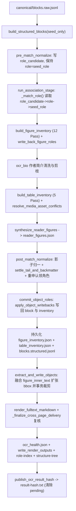

上述链路存在 **4 条绝对工程不变量**（源自 `AGENTS.md` 与源码注释）：

1. **Writeback 必须在写库存 JSON 之前执行**：`apply_object_writebacks()` 不仅在 `structured_blocks` 上盖章 `_object_owner_id` 与 `_object_association_reason`，还会向内存中的 `figure_inventory["matched_figures"]` 原地追加 `associated_text_block_ids` 与 `consumed_block_ids`。若先写 `figure_inventory.json` 再调 writeback，认领记录将从磁盘永久丢失。
2. **匹配读取候选角色，提交推迟到匹配之后**：`ocr_figures.py` 与 `ocr_tables.py` 均通过 `_match_role(block)`（优先级 `role_candidate -> role -> seed_role`）感知候选图注/表注，再由 `post_match_normalize()` 提交最终 `role` 并通过 `_reassert_claimed_roles()` 确保归一化不会推翻已匹配的对象资产/图注归属。
3. **`figure_inner_text` 的物理融合通过 BBox 扩张完成**：无论是 `tag_figure_contained_text()` 识别的图内块（`_object_association_reason="contained"`），还是 `_side_adjacent_evidence()` 认领的旁注（需满足同页、垂直重叠 `>0`、水平间距 `<=40px`、非 `PROTECTED_ROLES`、`raw_label=="text"`、词数 `<=80` 且总分 `>=0.9`；`_object_association_reason="side_adjacent"`），都会被 `_build_object_tasks()` 纳入同主图的 `crop_bbox` 并集，并在 `render_fulltext_markdown()` 中跳过渲染。
4. **跨页图交付二阶段终审（`_finalize_cross_page_delivery()`）**：跨页保留单（`RESERVED` + `RESOLVED`）仅当同时验证通过（a）物理裁剪图、对象 Markdown 及图片引用均存在（`MATERIALIZED`），且（b）`![[render/figures/<fig_id>.md]]` 确实出现在 `fulltext_markdown` 中（`DELIVERED`），才允许保留在 `matched_figures`；否则由 `hold_reservation()` 降级为 `HOLD`（`delivery_status="FAILED"`），触发重合成 `reader_figures.json` 与重渲染 `fulltext.md`，再覆盖写出最终 `figure_inventory.json`。

#### 4.2 图形（Figure）12 Pass 流水线与账本状态

`build_figure_inventory_vnext()` 在构造 `FigureCorpus` 与 `FigureCandidateIndex` 后，通过 `run_pairing_passes()` 顺序执行以下 12 个 Pass，由 `OwnershipLedger` 保证任何 `(page, block_id)` 资产只能被一个所有者认领：

1. `ContinuationCaptionPass`：处理 `(continued)` 续图注的同页与相邻页（`±1` 页）匹配。
2. `PrimarySamePagePass`：同页常规评分匹配，自动对多窄栏并排及多短图注共享聚类的场景按图注 y-band 分区拆分。
3. `CompositeParentPass`：将横向对齐、纵向邻接的 `2x2`/多栏子图组装为复合父图（`composite_parent`）。
4. `SidecarPass`：专门救援窄栏图注与同行右侧图像并排的版式。
5. `LocatorBridgePass`：桥接第 N 页完整图注与关联页视觉组。
6. `CrossPageReservationPass`：为跨页候选项创建 `RESERVED` 预留单并锁定候选视觉组。
7. `LegendBundlePass`：兜底处理无图页出现 `>=3` 个编号图注的集中打包图注页，绑定后续纯图页。
8. `GroupSequentialPass`：按 `distance_cluster`/`single_asset` 组顺序分配剩余未匹配图注与资产。
9. `ClassicSequentialPass`：最后手段的顺序兜底配对。
10. `UnresolvedClusterConsolidation`：将仍未被账本认领的残余资产聚合为 `unresolved_clusters`。
11. `CrossPageSettlementPass`：在同页与顺序匹配完成后，对 `RESERVED` 预留单进行结算，证据不足则转入 `HOLD` 并释放组预留。
12. `FinalAccountingPass`：核验所有 `matched_figures` 均拥有有效且账本一致的资产引用（缺失或越界资产回退 `HOLD`），核算 `completeness`（`total_numbered_legends == matched + unmatched + gap`）与 `invariant_errors`。

#### 4.3 表格（Table）5 Pass 流水线与尾部非参考文献结算

`build_table_inventory()`（`paperforge/worker/ocr_tables.py` + `ocr_table_passes.py`）与 `settle_tail_and_backmatter()`（`paperforge/worker/ocr_tail_settlement.py`）共同消除表注漏配与文末致谢/正文误切问题：

1. **表格 5 Pass 顺序流水线（`ocr_table_passes.py`）**：
   - `TableWeakCaptionRecoveryPass`：对残缺或截断的弱表注执行续接物化（`_materialize_table_caption`）；若首验候选在同页完全无可用资产，直接落为 `held_tables`（`hold_reason="insufficient_caption_evidence"`）。
   - `TableSamePagePass`：同页候选评分排序，最高分 `< 0.4` 不予认领；当第一、二名分差 `< 0.15` 时，对弱显式表注尝试 `_bare_table_tie_break()` 破平，否则转入 `status="ambiguous"`。
   - `TableAdjacentPagePass`：为未在同页匹配的剩余表注跨邻页查找未认领表格资产。
   - `TableNotesAttachmentPass`：将表注下方脚注（如统计缩写说明、P 值脚注）挂载至对应表对象。
   - `TableFinalAccountingPass`：汇总 `tables`、`held_tables`、`unmatched_captions`、`unmatched_assets` 与 `official_table_count`。
2. **尾部非参考文献结算（`settle_tail_and_backmatter()`）**：
   - `exclude_tail_nonref_from_body_flow()`：仅针对位于 `tail_nonref_hold_zone` 且角色为 `body_paragraph` 的短段落，经 `_looks_like_backmatter_body_text()` 命中声明/资助/利益冲突/致谢/伦理/数据可用性信号后，转换为 `backmatter_body` 并在 `health/decision_log.jsonl` 记录 `stage="tail_nonref_exclusion"`。
   - `restore_numbered_body_from_tail_hold()`：当尾区前存在带编号特征（`heading_numbered` / `heading_arabic` / `heading_decimal` / `heading_roman` / `heading_alpha` 或 `heading_like` 样式且不在 `reference_heading`/`backmatter_heading` 之后）的章节标题时，将被误收入留置区的 `backmatter_body` 恢复为 `body_paragraph`，记入 `TailSettlementReport.restored_body_paragraph_ids`。

#### 4.4 `layout/` 只读规划与 `assess_page()` 接受门控

`paperforge/worker/layout/` 独立于输入块列表顺序，基于几何坐标构建 `LayoutPlan`（`PLAN_VERSION = 2`）：

- `collect_block_refs()` 按 `(page, y_top, x_left, block_id, sha1(role|text))` 生成位置无关的 `uid`（`p{page}:{pos:04d}`）和 16 位内容几何指纹 `block_fingerprint(...)`（涵盖 `page`、`block_id`、`bbox`、`role`、`text`、`render_default`、`index_default`、`owner_id`）。
- `build_region_tree()` 将页块划分为互斥的 4 类区域：`full_width`（宽度 `>=75%` 页宽）、`container`（`structured_insert`/`table_html`/`non_body_insert` 及其内部成员）、`column`（按中心 x 间距 `>=3%` 页宽且 x 投影重叠 `<=20%` 切分双栏）、`margin`（位于上下 `8%` 页高内的 `noise`/`footnote`/`frontmatter_noise` 家具块）。
- `assess_page()` 对每页执行三态 Fail-Closed 门控（默认 `DEFAULT_MIN_CONFIDENCE = 0.80`）：
  - **`REJECT`**：`plan.version != 2`、`uid` 集合不匹配、排序非排列、跨区域重复归属、或任意块指纹 `identity_mismatch`（说明规划后块被增删改）。
  - **`HOLD`**：存在阻断冲突（`ambiguous_column`、`missing_geometry`、`overlapping_membership`、`container_leak` 或 `severity == "hold"`）、存在 `hold` 决策、正文 `before` 置信度 `< min_confidence`、或存在未覆盖的正文块。
  - **`ACCEPT`**：仅当所有正文顺序决策均达到阈值且无冲突时允许接管重排。

---

### 5. 配置项、环境变量、CLI 入口与错误码

#### 5.1 管线与门控开关

| 配置/环境变量                        | 默认值                      | 生效位置                                 | 说明                                                                                                                                                                  |
| :----------------------------------- | :-------------------------- | :--------------------------------------- | :-------------------------------------------------------------------------------------------------------------------------------------------------------------------- |
| `OCR_PIPELINE_V3`                    | 未设置（等价于开启 `True`） | `ocr.py::_ocr_pipeline_v3_enabled()`     | 设 `"0"`/`"false"`/`"no"`/`"off"` 回退 legacy 顺序；默认走 `seed_only -> pre_match -> match -> post_match`（经 555 篇全库语料对比验证：547 篇无差异、5 篇 V3 更准确） |
| `PAPERFORGE_KEEP_PAGE_IMAGES`        | 未设置                      | `ocr.py::postprocess_ocr_result()`       | 重建时 `extract_and_write_objects(..., use_disk_page_cache=False)` 使用内存 `PageRenderContext`，不写整页 JPG                                                         |
| `DEFAULT_MIN_CONFIDENCE`（模块常量） | `0.80`                      | `paperforge/worker/layout/acceptance.py` | `assess_page()` 对正文排序 `before` 置信度的最低放行阈值，低于该值强制 `HOLD`                                                                                         |

#### 5.2 相关 CLI 与开发辅助脚本入口

- **生产重建入口**：`paperforge ocr rebuild <KEY>` / `paperforge action run ocr.rebuild_derived --scope papers --key <KEY> --json`
- **开发者快速单篇重建**：`python scripts/dev/ocr_rebuild_paper.py <KEY>`（调试生产论文问题前必须先运行以保证磁盘产物与当前代码一致）
- **对象生命周期指标审计**：`python scripts/dev/object_lifecycle_audit.py`（对照 `tests/fixtures/object_lifecycle_goldens.json` 输出 frozen 回归指标）
- **结构/读取门控错误行为**：
  - `extract_and_write_objects()` 遇到重复 `object_id` 或重复目标路径时抛出 `MaterializationCollisionError`；staged 产物为空或缺失 Markdown 时抛出 `MaterializationError`；目录交换失败自动回滚并抛出 `MaterializationCommitError`。
  - `ocr_structural_gate.py` 无结构化验证依据时不抛异常，而是 Fail-Closed 产出 `HOLD`（`role="unknown_structural", render_default=False`），并将 `compute_role_gate_health()["status"]` 标为 `"degraded"`。
  - `reader_gate.py::filter_readable()` 在 `observe_lineage_papers` / `probe_lineage` 异常时 Fail-Closed 返回 `[]`，绝不服务无法证明血缘兼容的检索命中。

---

### 6. 边界防护与 Fail-Closed 防呆规则

1. **结构化角色白名单门控（`ocr_structural_gate.py`）**：`VERIFY_REQUIRED` 包含 12 类关键角色（`paper_title`、`authors`、`abstract_heading`、`abstract_body`、`keywords`、`section_heading`、`subsection_heading`、`reference_heading`、`reference_item`、`figure_caption`、`table_caption`、`table_html`）。任一此类角色缺乏对应锚点（如 `source_frontmatter_anchor_ids`、唯一 `abstract_span` 岛、`reference_zone`）时强制降级 `HOLD`（`role="unknown_structural"`, `render_default=False`），保留 `role_candidate=seed_role` 供诊断，绝不放行未验证结构角色。
2. **摘要多岛消歧防呆（`_group_abstract_islands`）**：当文档存在多个互不相连的 `abstract_body` 岛且处于 `headingless_ambiguous` 状态时，宁可无摘要节也不误提升正文（`ocr_quality.py::_normalize_abstract_structure()` 标为 `yellow`）。
3. **写回保护角色列表（`PROTECTED_ROLES`）与重复身份守卫**：`ocr_object_writeback.py` 的侧邻文本评分严格排除 `reference_item`、`section_heading`、`paper_title`、`authors`、`footnote`、`table_caption`、`figure_caption` 等 10 类受保护角色与词数 `>80` 的长段；`ocr_post_match_normalize.py::_inventory_claimed_roles()` 遇到同一 `(page, block_id)` 在输入中重复出现（`duplicate_identity`）或同时被图、表认领（`contested_ownership`）时拒绝锁定并记录 `_post_match_role_ambiguous`。
4. **物化舞台事务日志与符号链接防护（`ocr_objects.py`）**：`extract_and_write_objects()` 先在 `.materialization-stage-*` 中生成并校验全部文件非空且完整，再写入 `.materialization-journal.json`（`status="committing"`），逐个将旧目标移至 `.materialization-backup-<token>` 并迁移新目录。在此期间通过 `_preserve_unmanaged()` 保留非托管文件（遇符号链接则抛出 `MaterializationCommitError` 中止），任何异常立即逆序回滚；若上次进程在中途崩溃，下次调用开头由 `_recover_materialization_journal()` 自动还原。
5. **检索读时门控（`reader_gate.py::filter_readable`）**：仅当某篇论文在探针结果中存在且 `retrieval in ("current", "incomplete")`，且当 `require_vector=True` 时 `vector in ("current", "incomplete")` 才允许放行检索结果；未知、缺失或血缘不匹配论文一律静默丢弃，防止过时结构树或错误图注污染 AI 回答。

---

### 7. 维修、调试与升级 Checklist

#### 7.1 常见问题诊断与排查路径

- **问题 1：图内坐标轴文字或旁注仍作为孤立正文出现在 `fulltext.md` 中，或裁剪图未包含旁注**
  1. 用 `python scripts/dev/ocr_rebuild_paper.py <KEY>` 重建确保代码与磁盘同步。
  2. 检查 `structure/blocks.structured.jsonl` 中目标块是否被标为 `role="figure_inner_text"`、`_object_owner_id="figure_..."`、`_object_association_reason`（`"contained"` 或 `"side_adjacent"`）及 `_object_consumed=true`。
  3. 若未写回，检查 `structure/figure_inventory.json` 中对应图的 `associated_text_block_ids` 是否存在（确认 `apply_object_writebacks` 在 `write_figure_inventory` 之前执行），以及 `_side_adjacent_evidence()` 得分是否达到 `0.9`（检查水平间距 `<=40px`、跨栏判定与词数 `<=80`）。
- **问题 2：附录图表（`Figure A1` / `Figure B1`）相互覆盖或缺失**
  1. 检查 `figure_inventory.json` 中 `figure_namespace` 是否正确解析为 `"appendix"` 且 `figure_id` 为 `figure_a001` / `figure_b001`（若含 `"Supplementary"` 关键字则应走 `supplementary` -> `figure_s001`）。
  2. 检查 `figure_inventory["identity_conflicts"]` 与 `ocr_objects.py` 是否抛出 `MaterializationCollisionError`。
- **问题 3：论文尾部致谢/利益冲突或编号正文段落归类错误**
  1. 检查 `structure/blocks.structured.jsonl` 中块的 `zone` 是否为 `tail_nonref_hold_zone` 与 `marker_signature.type`。
  2. 检查 `health/decision_log.jsonl` 中 `tail_nonref_exclusion` 与 `restore_numbered_body_from_tail_hold` 决策轨迹。
- **问题 4：如何验证 V3 与 Legacy 行为差异**
  1. 临时在沙箱对比 `OCR_PIPELINE_V3=0` 与默认 `OCR_PIPELINE_V3=1` 输出；依据 `AGENTS.md` Design Rule 2，若 V3 与 legacy 输出存在差异，以 V3 为准（legacy 会在图匹配前过早硬化角色）。

#### 7.2 提交前双阶段验证 Checklist

- [ ] **Phase A（105+ 核心回归聚焦套件）**：修改 V3 编排、写回、尾部结算、附录编号或渲染逻辑后，必须全部通过：
  - `tests/test_ocr_pipeline_v3.py`
  - `tests/test_ocr_object_writeback.py`
  - `tests/test_ocr_tail_settlement.py`
  - `tests/test_appendix_figure_numbering.py`
  - `tests/test_ocr_render.py`、`tests/test_ocr_render_v2.py`
- [ ] **Phase B（全量图表与门控审计套件）**：若改动图表匹配、表格匹配、角色门控或版面规划，额外跑通：
  - `tests/test_ocr_figures.py`、`tests/test_figure_association.py`、`tests/test_ocr_tables.py`
  - `tests/test_ocr_roles.py`、`tests/test_ocr_structural_gate.py`、`tests/test_layout_acceptance.py`
  - `tests/test_ocr_high_risk_rule_audit.py`、`tests/test_ocr_route_audit.py`
- [ ] **契约一致性校验**：确认 `docs/ocr/route-audit.md` 未新增未标注的孤儿模块，非生产兼容壳（`ocr_orchestrator.py` 等）保持隔离。

---

<a id="chapter-09"></a>

## 第 09 章：Render Audit、R/P 事务晋升与版本快照管理

> 源文件：`docs/handbook/09-render-audit-and-reconcile.md`

本章详述 PaperForge OCR 渲染产物的一致性审计（`render_audit.py`）、图/全文分歧对账（`figure_reconciliation.py`、`fulltext_reconciliation.py`）、冻结的 R（精确修复）与 P（受审提案）双通道事务化晋升边界（`promote_r.py`、`accept_proposal.py`）、ADR-0002 统一物化状态契约（`materialization/ocr.py`、`materialization/retrieval.py`），以及显示全文的滚动快照与只读回退机制（`commands/versions.py`）。上游 V3 管线与渲染写盘详见 [Chapter 08](#chapter-08)，控制面 Probe 与 Reconcile 全局编排详见 [Chapter 04](#chapter-04)。

---

### 1. 职责与非目标边界

#### 1.1 核心职责

1. **只读渲染一致性审计（`paperforge/render_audit.py`）**
   - 比对 `structure/figure_inventory.json`、`structure/table_inventory.json`、`render/figures/*.md`、`render/tables/*.md`、`assets/` 与 `render/materialization.provenance.json`，生成持久化权威报告 `render/render.consistency.json`（供 `probe lineage` 与 R/P 晋升门控直接消费）。
2. **隔离舞台对账：R / P / BLOCKED 三分法（`figure_reconciliation.py` & `fulltext_reconciliation.py`）**
   - `render reconcile` 在系统临时目录隔离舞台（`paperforge-staging/`）中生成 R 修复计划（`r-manifest.json`）、P 候选提案预览（`final-plan.json` + SHA-256 `final_plan_hash`）与全文 `F0`–`F4` 嵌入补丁建议（`F4` 目前为 schema 预留），**永不直接修改生产目录**。
3. **带 Schema-v2 事务日志与 CAS 保护的受控晋升（`promote_r.py` & `accept_proposal.py`）**
   - 仅当人工/显式命令调用 `render promote-r`（精确修复）或 `render accept-proposal --plan-hash <SHA256>`（绑定人类审查过的 `final-plan.json`）时，才在跨进程文件锁、Schema-v2 事务日志（`.paperforge-r-promotion.json` + `.paperforge-r-promotion/<tx_id>/`）、前后双重审计（`audit_0` / `audit_1`）和 CAS 回滚保护下原子落盘生产文件。
4. **ADR-0002 物化状态统一裁决（`paperforge/materialization/`）**
   - 将 `raw -> derived -> published`（`ocr.py`）与 `retrieval`（`retrieval.py`）的质量/完整度/血缘判断收敛至单一模块，消除多探针口径漂移。
5. **显示级版本快照与只读恢复权威（`paperforge/commands/versions.py`）**
   - 管理重建前生成的 `versions/v{N}/` 滚动快照清单（`versions/manifest.json`）及遗留 `backups/fulltext.pre-rebuild.*.md` 备份识别，提供安全隔离的显示恢复（仅写 `render/fulltext.md`，保留规范 `fulltext.md` 与结构/向量层不变）。

#### 1.2 明确的非目标边界（Non-Goals）

| 能力域                            | 本层坚决不做的事                                                                                                           | 实际归属模块                                                        |
| :-------------------------------- | :------------------------------------------------------------------------------------------------------------------------- | :------------------------------------------------------------------ |
| **重新执行图表匹配算法**          | `promote_r.py` 与 `accept_proposal.py` 严格按 staged 清单/已审 `final-plan.json` 搬运，绝不重跑 V3 配对或改写 OCR 原始块   | [Chapter 08](#chapter-08)（`ocr_figures.py`） |
| **`render reconcile` 生产写回**   | 即便传递兼容参数 `--apply-r`，`render reconcile` 仍强制保持 staging-only（`production_write=False`），绝不自动写回生产目录 | `paperforge/commands/render.py` & `figure_reconciliation.py`        |
| **直接修改 `fulltext.md` 嵌入行** | `fulltext_reconciliation.py` 当前为 report-only 5 类补丁规划器，只输出 `F0`–`F4` 审计与补丁描述，不擅自改写正文            | `paperforge/fulltext_reconciliation.py`                             |
| **以版本恢复替代派生重建**        | `versions restore` 仅恢复显示副本 `render/fulltext.md` 用于对照阅读；绝不回滚 `blocks.structured.jsonl`、检索单元或向量    | `paperforge/commands/versions.py`                                   |
| **将老旧政策检索库判为损坏**      | `materialization/retrieval.py` 按 manifest 自身记录的政策版本与算法版本验证哈希，区分 `old-but-intact` 与 `corrupt`        | `paperforge/materialization/retrieval.py`                           |

---

### 2. 核心源码与单测映射表

| 模块 / 文件                                                                                                              | 核心职责与关键符号                                                                                                                                                                                                                      | 对应验证单测 / 集成测试                                                                                              |
| :----------------------------------------------------------------------------------------------------------------------- | :-------------------------------------------------------------------------------------------------------------------------------------------------------------------------------------------------------------------------------------- | :------------------------------------------------------------------------------------------------------------------- |
| `paperforge/render_audit.py`                                                                                             | 渲染层一致性审计：`SCHEMA_VERSION = 1`、`ALGORITHM_VERSION = 4`、`audit_paper()`、`audit_papers()`、`write_audit_failure_report()`、`_snapshot()`、`_inventory_identity_conflicts()`、`_inventory_asset_claim_conflicts()`              | `tests/test_render_audit.py`                                                                                         |
| `paperforge/figure_reconciliation.py`                                                                                    | 只读对账与隔离舞台生成：`build_reconciliation_report()`、`write_reconciliation_report()`、`dry_run_exact_repairs()`、`dry_run_bounded_slot_proposals()`、`stage_reconciliation()`、`reconcile_snapshot_hash()`、`reconcile_plan_hash()` | `tests/test_figure_reconciliation.py`、`tests/harness/test_f02_promote_r.py`                                         |
| `paperforge/fulltext_reconciliation.py`                                                                                  | 全文嵌入 5 类对账规划：`fulltext_reconcile()`（`F0 TARGET_DEGRADED`、`F1 MISSING_EMBED`、`F2 WRONG_EMBED_TARGET`、`F3 EXTRA_OR_DUPLICATE`，预留 `F4 MISPLACED_EMBED`）                                                                  | `tests/test_fulltext_reconciliation.py`                                                                              |
| `paperforge/promote_r.py`                                                                                                | R 精确修复晋升引擎：`promote_r()`、`_validate_plan()`、`_snapshot_files()`、`_recover_pending_transaction()`、`_restore_snapshots()`、`_postcondition_errors()`、`_is_reparse_point()`                                                  | `tests/test_promote_r.py`、`tests/harness/test_f02_promote_r.py`                                                     |
| `paperforge/accept_proposal.py`                                                                                          | P 提案人审晋升引擎：`accept_proposal()`、`_FINAL_P_DECISIONS`、`_validated_member_refs()`、`_rollback_transaction()`                                                                                                                    | `tests/test_accept_proposal.py`、`tests/harness/test_f03_accept_proposal.py`                                         |
| `paperforge/materialization/ocr.py`                                                                                      | ADR-0002 OCR [1]–[5] 层裁决：`meta_lifecycle()`、`provenance_state()`、`raw_state()`、`ocr_artifact_detail()`、`publish_marker_state()`、`top_state()`、`detail()`、`published_identity_hash()`、`identity_state()`                     | `tests/test_materialization_ssot.py`、`tests/test_ocr_hash_contract.py`                                              |
| `paperforge/materialization/retrieval.py`                                                                                | ADR-0002 检索 [6] 层裁决：`snapshot_integrity()`、`policy_currency()`、`lineage_trust()`                                                                                                                                                | `tests/test_materialization_ssot.py`                                                                                 |
| `paperforge/commands/render.py`                                                                                          | `paperforge render` CLI 路由：`audit` / `reconcile` / `promote-r` / `accept-proposal`                                                                                                                                                   | `tests/test_render_audit.py`、`tests/test_promote_r.py`、`tests/test_accept_proposal.py`                             |
| `paperforge/commands/versions.py`                                                                                        | 显示全文版本网关：`read_manifest()`、`list_backups()`、`_safe_artifact_path()`、`_authority_source()`、`_run_restore()`、`_run_reset_live()`                                                                                            | `tests/test_versions_command.py`、`tests/harness/test_d07_version_restore.py`、`tests/unit/test_ux_loop_closures.py` |
| `paperforge/worker/ocr_versions.py` & `paperforge/worker/ocr_fulltext_state.py` & `paperforge/worker/ocr_maintenance.py` | 重建前快照 `backup_render_before_rebuild()`（`PAPERFORGE_MAX_OCR_VERSIONS`）、旧备份解析 `parse_pre_rebuild_backup_name()`、漂移检测 `get_fulltext_drift_state()` 与 `_restore_drift_override()`                                        | `tests/test_restore_drift.py`、`tests/test_ocr_versions.py`                                                          |
| `docs/adr/0002-unified-artifact-materialization-state-contract.md` & `docs/RECONCILE-EXTENSION-CONTRACT.md`              | 统一物化状态合约 ADR 与 R/P 扩展冻结契约                                                                                                                                                                                                | `tests/test_materialization_ssot.py`、`tests/test_materialization_atomic.py`                                         |

---

### 3. 磁盘文件、数据库表与协议 JSON 字段字典

#### 3.1 审计、对账、事务日志与快照磁盘路径

| 文件 / 目录路径                                                          | 所属模块                                                    | 说明                                                                                                                                                                              |
| :----------------------------------------------------------------------- | :---------------------------------------------------------- | :-------------------------------------------------------------------------------------------------------------------------------------------------------------------------------- |
| `<paperforge>/ocr/<KEY>/render/render.consistency.json`                  | `render_audit.py`                                           | 单篇渲染一致性报告（`write_render_outputs()` 与 `paperforge render audit` 写入；`probe lineage` 读取）                                                                            |
| `<paperforge>/ocr/<KEY>/render/reconciliation.proposals.json`            | `figure_reconciliation.py`                                  | 持久化对账提案报告（由 `promote_r()` 成功后刷新；`accept_proposal()` 要求其存在以校验证据时效性）                                                                                 |
| `<paperforge>/ocr/<KEY>/render/materialization.provenance.json`          | `ocr_objects.py` / `promote_r.py` / `accept_proposal.py`    | 对象级物化溯源表：`objects[]` 含 `object_id`、`kind`、`status`、`stage`、`plan_hash`、`output.{image_sha256, width, height, markdown_sha256}`                                     |
| `<paperforge>/ocr/<KEY>/.paperforge-r-promotion.lock`                    | `promote_r.py` / `accept_proposal.py`                       | 共享非阻塞跨进程文件锁（`timeout=0`）                                                                                                                                             |
| `<paperforge>/ocr/<KEY>/.paperforge-r-promotion.json`                    | `promote_r.py` / `accept_proposal.py`                       | Schema-v2 事务日志（记录 `state`、交易目录与每个目标的 `before` / `output` CAS 哈希快照）                                                                                         |
| `<paperforge>/ocr/<KEY>/.paperforge-r-promotion/<tx_id>/<index>.bak`     | `promote_r.py` / `accept_proposal.py`                       | 事务提交前备份的原始文件字节；正常提交后清除，异常中断后供 `_recover_pending_transaction()` 还原                                                                                  |
| `<user_data>/paperforge/reconcile-staging/<run_id>/<KEY>/`               | `reconcile_staging_write_base()` / `stage_reconciliation()` | 持久化外置隔离舞台目录（避免 OS 临时目录被系统清理导致后续 `promote-r`/`accept-proposal` 失效；检索时兼读 `reconcile_staging_search_bases()` 与遗留 `<tmp>/paperforge-staging/`） |
| `<paperforge>/ocr/<KEY>/versions/manifest.json` & `versions/v{N}/`       | `ocr_versions.py` / `versions.py`                           | 重建前自动保留的显示版本清单及 `fulltext.md` / `render-map.json` / `heading-events.json` 副本                                                                                     |
| `<paperforge>/ocr/<KEY>/backups/fulltext.pre-rebuild.<stamp>[.<seq>].md` | `ocr_fulltext_state.py`                                     | 根目录 `fulltext.md` 重写前备份（`stamp` 为 `YYYYMMDDTHHMMSSZ`，默认保留最近 5 份）                                                                                               |

#### 3.2 `render.consistency.json` 与对账核心 JSON 字段字典

1. **`render/render.consistency.json`（`SCHEMA_VERSION=1, ALGORITHM_VERSION=4`）**
   - `state`：`"CLEAN"`（0 个问题）、`"DEGRADED"`（有 `issues`）、`"FAILED"`（目录缺失或审计执行异常）。
   - `evidence_mode`：无问题时 `"exact"`，否则 `"mixed"`。
   - `input_snapshot`：5 项 SHA-256 指纹（`blocks_hash`、`figure_inventory_hash`、`table_inventory_hash`、`render_hash`、`asset_index_hash`）。
   - `issues[]`：每条含 `type`、`severity`（`"P0"`/`"P1"`）、`domain`（经 `_DIAGNOSIS_DOMAIN` 映射为 `"render_layer"`/`"inventory_layer"`/`"asset_layer"`/`"unknown"`）、`diagnosis`、`recommended_action`、`evidence`。核心问题类型字典如下：

| `issues[].type`                                                | 默认级别 | 诊断定位（`domain`） | `recommended_action` 与语义                                                             |
| :------------------------------------------------------------- | :------- | :------------------- | :-------------------------------------------------------------------------------------- |
| `audit_execution_failure`                                      | `P0`     | `unknown`            | `inspect`：OCR 目录缺失或审计执行抛出异常（`state="FAILED"`）                           |
| `render_dangling_asset_reference`                              | `P0`     | `render_layer`       | `rerender`：对象 `.md` 卡片引用了磁盘上不存在的图片路径                                 |
| `inventory_duplicate_entry` / `inventory_asset_claim_conflict` | `P1`     | `inventory_layer`    | `inspect_inventory`：规范清单存在重复身份 ID 或多对象争抢同一原始资产块                 |
| `render_artifact_integrity`                                    | `P1`     | `render_layer`       | `inspect_render` / `rerender`：卡片缺少标题、`legend` 或有资产但缺裁剪图片              |
| `render_caption_mismatch`                                      | `P1`     | `render_layer`       | `rerender` / `inspect_inventory`：卡片 Header 标签与正文 Legend 标签冲突                |
| `caption_without_asset`                                        | `P1`     | `asset_layer`        | `inspect_asset_matching`：存在图注卡片但上游未匹配任何图形资产                          |
| `missing_render_materialization`                               | `P1`     | `render_layer`       | `rerender`：规范清单已有匹配资产但 `render/figures/` 或 `render/tables/` 未生成 `.md`   |
| `materialization_provenance_invalid`                           | `P1`     | `render_layer`       | `inspect_provenance`：`render/materialization.provenance.json` 存在歧义或内容校验不一致 |

2. **`r-manifest.json`（`schema_version=2, kind="R"`）与 `final-plan.json`（`schema_version=1`）**
   - R 清单内 `plans[]` 每项含 `object_id`、`canonical_identity`、`input_snapshot_hash`（`16` 位十六进制指纹）、`ordered_asset_refs`（`[{page, block_id, bbox}]`）、`production_precondition`（`{asset, markdown, provenance}` 的 `{exists, sha256}`）、`plan_hash`、`staged_verification.{status, image, markdown_sha256}`。
   - P 预览内 `final-plan.json` 含 `label`、`proposal_id`（`figure_proposal_<label>`）、`decision`（必须属于 `_FINAL_P_DECISIONS = {"structurally_unique_proposal", "unique_without_pdf_confirmation"}`）、`member_refs`、`caption_text`、`input_snapshot_hash`、`staged_jpg`、`staged_md`；CLI 通过整文件字节的 64 位小写 SHA-256 `final_plan_hash` 精确绑定。
3. **`.paperforge-r-promotion.json`（Schema-v2 事务日志）**
   - `schema_version`: `2`
   - `state`: `"prepared"`（准备写入，尚未提交） | `"committed"`（生产写入与 `audit_1` 全部通过，等待清场）
   - `transaction_dir`: 严格匹配正则 `^\.paperforge-r-promotion/[0-9a-f]{32}$`
   - `snapshots[]`: 每项记录 `destination_relative`、`backup_relative`（`^[0-9]+\.bak$` 或 `null`）、`existed`、`before`（`{"exists": bool, "sha256": str|None}`）与 `output`（预期写入后的目标哈希）。
   - **受控写入路径白名单（`_DESTINATION_RELATIVE_RE`）**：事务日志在恢复与提交校验时仅放行以下 5 类相对路径，绝不触及全文 Markdown、原始块或结构块：
     - `assets/figures/<name>.jpg`
     - `render/figures/<name>.md`
     - `render/materialization.provenance.json`
     - `structure/figure_inventory.json`
     - `render/reconciliation.proposals.json`
4. **`versions/manifest.json`（版本快照清单）**
   - `versions[]`：`{"label": "v1", "created_at": ISO8601, "source": "pre-rebuild", "fulltext_size": int, "structured_content_hash": str, "renderer_version": str}`
   - `current`：`{"label": "vN"}`

---

### 4. 核心执行链路、状态机与顺序不变量

#### 4.1 渲染审计、R/P 隔离对账与双通道晋升流程图

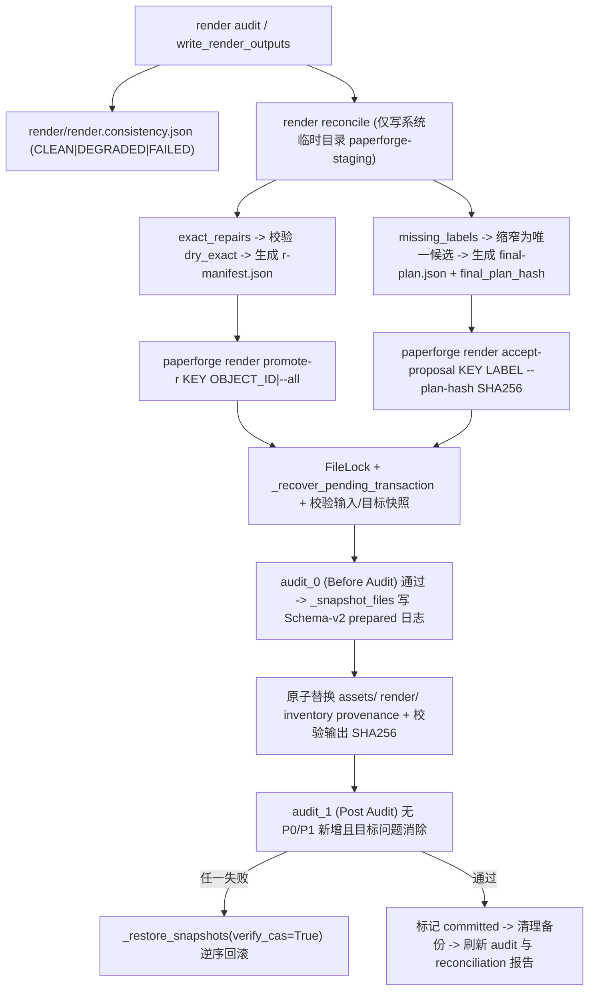

#### 4.2 R 与 P 的本质边界

| 维度               | R 通道（`promote_r.py`）                                                                                                        | P 通道（`accept_proposal.py`）                                                                                                                    |
| :----------------- | :------------------------------------------------------------------------------------------------------------------------------ | :------------------------------------------------------------------------------------------------------------------------------------------------ |
| **语义定位**       | **确定性精确修复**：规范 `figure_inventory.json` 中已有且无冲突的对象，修复其缺失/未验证的渲染图与 `.md` 卡片                   | **受审候选晋升**：规范清单缺失某编号图，经多维证据缩窄至唯一候选集并经人工预览审查后创建新规范图条目                                              |
| **身份域**         | `figure_id` 精确文件名匹配（排除 `reserved` 与重复 ID）                                                                         | 主命名空间 `(main, number)` 形式标签，目标规范 ID 为 `figure_{number:03d}`                                                                        |
| **允许修改的清单** | **绝不修改 `figure_inventory.json`**，只写回 `assets/figures/*.jpg`、`render/figures/*.md` 与 `materialization.provenance.json` | 向 `figure_inventory.json["matched_figures"]` 追加新对象（含 `accepted_from.final_plan_hash`）并从 `reconciliation.proposals.json` 摘除已采纳提案 |
| **授权令牌**       | 显式 `OBJECT_ID...` 或显式 `--all` + 快照/precondition 校验                                                                     | 强制 `--plan-hash <64-hex SHA256>`，与预览目录中 `final-plan.json` 逐字节校验                                                                     |

#### 4.3 `promote_r` / `accept_proposal` 事务恢复状态机

1. **Pre-flight 与锁**：以 `timeout=0` 尝试获取 `.paperforge-r-promotion.lock`；忙碌直接返回 `R_PROMOTION_BUSY` / `ACCEPT_PROPOSAL_BUSY`。
2. **崩溃恢复（`_recover_pending_transaction`）**：在读取或修改任何资产前先检查 `.paperforge-r-promotion.json`：
   - 若不存在：直接进入正常流程。
   - 若 `state == "prepared"`：说明上次事务在写入或 `audit_1` 期间崩溃。逐一检验每个目标当前磁盘指纹 `current == before or current == output`（CAS 校验），全部满足则调用 `_restore_snapshots(..., verify_cas=True)` 还原旧文件或删掉新建文件并删除日志；一旦发现被第三方外部篡改（`current != before and current != output`），立即 Fail-Closed 返回 `promotion_recovery_conflict:<path>`。
   - 若 `state == "committed"`：说明生产提交与 `audit_1` 均已完成、仅清理备份时崩溃；安全清理 `.paperforge-r-promotion/<tx_id>` 与日志即可。
3. **Commit 与 Post-Commit 隔离**：`_mark_transaction_committed()` 一旦落盘，后续清理备份（`cleanup`）、刷新 `render.consistency.json`（`report_refresh`）与刷新 `reconciliation.proposals.json`（`reconciliation_refresh`）即便发生 I/O 报错，也**不会触发回滚**，而是如实上报在返回 JSON 的相应状态字段中。
4. **双阶段质量验证（Pre-flight & Post-Audit）**：写入前由 `_image_facts()` 通过 Pillow 验证舞台 `.jpg` 可解码且尺寸非零，并经 `_IMAGE_RE` 校验 `.md` 卡片内的图片链接确实指向该图片；写入后执行 `audit_1` 比对 `audit_0` 基线，确认无任何新增 `P0`/`P1` 问题且目标对象原有问题完全消除，否则立即执行逆序回滚并保留错误信息。

#### 4.4 ADR-0002 六层统一物化裁决链

依据 `docs/adr/0002-unified-artifact-materialization-state-contract.md`，单篇论文的物化状态按 `raw -> derived -> published -> retrieval -> vector -> serving` 线性推进，`reconcile` 永远只暴露**第一个断裂前沿**：

| 模块与层序                                                     | 核心判定函数                                     | 返回值 / 裁决顺序与工程语义                                                                                                                                                                                                                                                                                                         |
| :------------------------------------------------------------- | :----------------------------------------------- | :---------------------------------------------------------------------------------------------------------------------------------------------------------------------------------------------------------------------------------------------------------------------------------------------------------------------------------- |
| **OCR `[1]`–`[5]` 顶层状态**（`materialization/ocr.py`）       | `top_state(paper_dir, meta)`                     | 严格按 `[1] meta_lifecycle` → `[3] raw_state`（`blocks.raw.jsonl` 异常统一返回 `"missing"`）→ `[5] publish_marker_state`（`result-hash.pending` 超 `PUBLISH_STALE_SECONDS=3600` 秒判 `"incomplete"`，否则 `"unknown"`）→ `[4] ocr_artifact_detail`（判 `"incomplete"`）执行；全链路通过返回 `None` 交由哈希比对判 `current`/`stale` |
| **OCR 细粒度故障原因**（`materialization/ocr.py`）             | `detail(paper_dir, pdf, meta)`                   | 按相同顺序返回单语义故障码（如 `RAW_MISSING`、`PUBLISH_PENDING_STALE`），全部通过后再追查 `[2] provenance_state()`；`is_old_pipeline()` 仅作独立标志，绝不覆盖损坏判定                                                                                                                                                              |
| **OCR 发布身份锁**（`materialization/ocr.py`）                 | `published_identity_hash()` / `identity_state()` | 若存在 `index/result-hash.pending` 或 `index/result-hash.txt` 缺失/畸形，返回 `""` 与 `(None, None)`，阻止读取半成品                                                                                                                                                                                                                |
| **Retrieval `[6]` 完整性**（`materialization/retrieval.py`）   | `snapshot_integrity()`                           | 返回 `"verified"` / `"corrupt"` / `"unknown"` / `"absent"`；按 manifest 自身记录的 `retrieval_policy_version` 核对计数、重复 `unit_id` 与哈希，老旧无 `hash_algo_version` 的 manifest 哈希漂移返回 `"unknown"` 而非误报 `"corrupt"`                                                                                                 |
| **Retrieval 策略时效与血缘**（`materialization/retrieval.py`） | `policy_currency()` / `lineage_trust()`          | 分别正交判定政策是否最新（`"current"` / `"old"` / `"unknown"`）与 `retrieval_identity` 是否吻合当前 OCR 发布身份（`"verified"` / `"unverified"` / `"mismatched"`）                                                                                                                                                                  |

#### 4.5 全文嵌入 5 类对账规划（`fulltext_reconciliation.py`）

`fulltext_reconcile()` 对 `fulltext.md` 中的 `![[render/figures/<id>.md]]`（通用正交匹配 `_EMBED_RE`）与规范图库及 `reconciliation.proposals.json` 进行只读比对（目前表嵌入 `_TABLE_EMBED_RE` 也已预定义正则）：

1. **权威准入检查（`F0` 拦截）**：若 `fulltext.md` 不可读（`F0_FULLTEXT_UNREADABLE`）、规范 `figure_inventory.json` 缺失/解析失败（`F0_CANONICAL_AUTHORITY_UNAVAILABLE`）或存在重复 `figure_id`（`F0_CANONICAL_DUPLICATE`），立即设置 `mutation_blocked=True` 并清空全部 `patches`。
2. **漏嵌与错配目标（`F1` / `F2`）**：规范图存在而全文未出现嵌入时生成 `F1_MISSING_EMBED`；若全文引用了不规范目标且对账报告给出唯一显式映射（非靠数字后缀猜想）时生成 `F2_WRONG_EMBED_TARGET` 替换补丁，多义映射转入 `F2_AMBIGUOUS`。
3. **多余或重复嵌入（`F3` 三分）**：多余嵌入依据来源明确度拆分为可安全清理孤儿（`F3_ORPHAN_EMBED`）、等待 P 提案晋升保留（`F3_PENDING_PROPOSAL`）、多处重复（`F3_DUPLICATE_EMBED`）与未知阻塞（`F3_BLOCKED_UNKNOWN`）；`F4 MISPLACED_EMBED` 位置重排字段当前在 schema 中预留，暂未自动生成移动补丁。

#### 4.6 显示版本滚动快照与只读恢复机制（`versions`）

1. **重建前快照创建与淘汰（`ocr_versions.py::backup_render_before_rebuild()`）**：每次执行派生重建覆盖旧渲染前，若 `render/fulltext.md` 存在，自动递增生成 `v{N}` 标签并将 `render/` 下的 `fulltext.md`、`render-map.json`、`heading-events.json` 复制至 `versions/v{N}/`，同时更新 `versions/manifest.json`（含 `structured_content_hash` 与 `renderer_version`）。当条数超过 `PAPERFORGE_MAX_OCR_VERSIONS`（默认 `5`，最小 `1`）时，FIFO 淘汰最旧条目并删除对应 `versions/v{k}/` 目录。
2. **只读对比路径与恢复边界（`commands/versions.py`）**：
   - **差异查看（Diff）**：`versions paths --key KEY --label LABEL` 校验 `label` 后返回 `source_path`（历史版本或 `backups/fulltext.pre-rebuild.*.md`）与 `current_path`（`render/fulltext.md`），由调用方或前端 UI 执行只读文本 Diff。
   - **显示恢复（Restore）**：`versions restore --key KEY --label LABEL` 仅把 `source_path` 复制到 `render/fulltext.md`，随后通过 `record_restore_provenance()` 记录 `{label, restored_at, version_created_at}`。整个过程绝不改写根目录 `fulltext.md`、`blocks.structured.jsonl` 或检索库。
   - **切回最新规范展示（Reset Live）**：`versions reset-live --key KEY` 将根目录规范 `fulltext.md` 原子复制到 `render/fulltext.md` 并调用 `paperforge.worker.ocr.clear_restore_provenance()` 清除 `meta.json.restore_provenance`，闭合显示回滚后回到 `MATCHED` 状态的 UI/CLI 闭环，同样不改写结构或向量产物。

---

### 5. 配置项、环境变量、CLI 入口与错误码

#### 5.1 环境变量与默认保留策略

| 名称                                | 默认值            | 生效位置                                          | 说明                                                                                                                        |
| :---------------------------------- | :---------------- | :------------------------------------------------ | :-------------------------------------------------------------------------------------------------------------------------- |
| `PAPERFORGE_MAX_OCR_VERSIONS`       | `"5"`（下限 `1`） | `ocr_versions.py::backup_render_before_rebuild()` | 每次派生重建前备份 `render/` 到 `versions/v{N}/`，超出上限自动淘汰最旧 `v{k}` 目录（若需收紧磁盘占用可设为 `"3"` 等正整数） |
| `prune_pre_rebuild_backups(keep=5)` | `5`               | `ocr_render.py::write_render_outputs()`           | 每次写出根目录 `fulltext.md` 前备份至 `backups/fulltext.pre-rebuild.<stamp>.md`，保留最近 5 份                              |
| `PUBLISH_STALE_SECONDS`             | `3600`            | `materialization/ocr.py::publish_marker_state()`  | `index/result-hash.pending` 存在超过 1 小时视为生产者崩溃残留（`PUBLISH_PENDING_STALE`）                                    |

> [!NOTE]
> `versions restore` 采用独立只读展示通道：`render/fulltext.md` 写入旧快照内容，而规范 `fulltext.md` 与 `meta.json.machine_fulltext_hash` 保持当前结构版本不变，同时通过 `meta.json.restore_provenance` 与 `ocr_fulltext_state.py::get_fulltext_drift_state()` 协同标注界面漂移态。

#### 5.2 CLI 入口汇总

| 命令                                                                              | 行为与参数说明                                                                                                                               | 退出码契约                                                            |
| :-------------------------------------------------------------------------------- | :------------------------------------------------------------------------------------------------------------------------------------------- | :-------------------------------------------------------------------- |
| `paperforge render audit [KEY...] [--json]`                                       | 审计指定或全部 OCR 论文，写入 `render/render.consistency.json`                                                                               | 无 `FAILED` 返回 `0`（`DEGRADED` 也返回 `0`），存在 `FAILED` 返回 `1` |
| `paperforge render reconcile [KEY...] [--include-pdf-media] [--apply-r] [--json]` | 只读计算 R/P/Blocked 并在外置用户数据区舞台目录生成预览（`PAPERFORGE_RECONCILE_STAGING_DIR` 可覆盖）；`--apply-r` 仅保留兼容提示，仍不写生产 | 成功返回 `0`                                                          |
| `paperforge render promote-r KEY [OBJECT_ID...] [--all] [--json]`                 | 晋升指定 `OBJECT_ID` 或全部已验证 R 计划（`OBJECT_ID` 与 `--all` 互斥且不可皆空）                                                            | `ok=True` 返回 `0`，否则 `1`                                          |
| `paperforge render accept-proposal KEY LABEL --plan-hash <SHA256> [--json]`       | 按精确 SHA-256 令牌晋升人类已审查的 P 提案                                                                                                   | `ok=True` 返回 `0`，否则 `1`                                          |
| `paperforge versions list [--json]`                                               | 列出所有含 `versions/manifest.json` 的论文、快照列表与总大小                                                                                 | 成功 `0`                                                              |
| `paperforge versions show --key KEY [--json]`                                     | 查看单篇版本清单（无清单合法返回空列表）                                                                                                     | 未知/非法 key 返回 `1`                                                |
| `paperforge versions backups --key KEY [--json]`                                  | 识别 `backups/` 下合法规范的 `fulltext.pre-rebuild.<stamp>[.<seq>].md` 备份                                                                  | 未知/非法 key 返回 `1`                                                |
| `paperforge versions paths --key KEY [--label LABEL] [--json]`                    | 获取某版本与当前 `render/fulltext.md` 的受检路径（供展示层做 Diff）                                                                          | 失败返回 `1`                                                          |
| `paperforge versions restore --key KEY --label LABEL [--json]`                    | **仅恢复显示副本** `render/fulltext.md`，并向 `meta.json` 写入 `restore_provenance`                                                          | 失败返回 `1`                                                          |
| `paperforge versions reset-live --key KEY [--json]`                               | 将规范 `fulltext.md` 原子写回显示副本 `render/fulltext.md` 并清除 `restore_provenance`                                                       | 失败返回 `1`                                                          |

#### 5.3 核心拒绝/错误Reason词汇表

- **`promote_r.py` / `accept_proposal.py` 拒绝码**：`promote_scope_required`、`promote_scope_conflict`、`R_PROMOTION_RECOVERY_REQUIRED` / `ACCEPT_PROPOSAL_RECOVERY_REQUIRED`、`R_PROMOTION_BUSY` / `ACCEPT_PROPOSAL_BUSY`、`STALE_R_MANIFEST`、`STALE_R_PLAN`、`STALE_R_DESTINATION`、`R_GATE_FAILED`、`R_PROMOTION_PREAUDIT_FAILED` / `ACCEPT_PROPOSAL_PREAUDIT_FAILED`、`R_PROMOTION_POSTVERIFY_FAILED` / `ACCEPT_PROPOSAL_POSTVERIFY_FAILED`、`review_plan_hash_missing`、`review_plan_hash_invalid`、`STALE_REVIEWED_PLAN`、`STALE_PROPOSAL`、`proposal_not_current`、`canonical_target_exists`、`canonical_label_exists`、`member_refs_claim_conflict`、`ACCEPT_PROPOSAL_PATH_UNSAFE`。
- **`fulltext_reconciliation.py` 阻断类别**：`F0_FULLTEXT_UNREADABLE`、`F0_CANONICAL_DUPLICATE`、`F0_CANONICAL_AUTHORITY_UNAVAILABLE`、`F2_AMBIGUOUS`、`F3_BLOCKED_UNKNOWN`。

---

### 6. 边界防护与 Fail-Closed 防呆规则

1. **路径穿越与 Windows Junction / Symlink 零容忍**：`promote_r.py` 与 `accept_proposal.py` 在读写任何路径前通过 `_raw_path_has_symlink()` 与 Windows `GetFileAttributesW`（`0x400` 重解析点检查，显式声明 `argtypes`/`restype` 避免缺失路径 `-1` 误判）检查论文根目录、锁文件、舞台路径及全部目标路径；`commands/versions.py` 通过 `_safe_segment()`、`_contained()` 与 `_authority_source()` 保证版本标签必须精确命中 `manifest.json` 或合法备份枚举，绝不将原始字符串拼接进路径。
2. **CAS 恢复冲突保护**：回滚或崩溃恢复调用 `_restore_snapshots(..., verify_cas=True)` 时，若目标文件当前哈希既不同于事务前的 `before`，也不同于预期的 `output`，说明磁盘发生了并发外部修改，系统拒绝覆写并保留事务现场待人工排查。
3. **跨目标并发修改检测（Snapshot Lock-in）**：R 计划与 P 提案均绑定生成时的 `input_snapshot_hash`。若在 `reconcile` 预览之后至 `promote-r`/`accept-proposal` 之前运行过 `ocr rebuild` 或手动修改了任意资产/清单文件，`STALE_R_MANIFEST` / `STALE_R_PLAN` / `STALE_PROPOSAL` 会立即拦截，强制重新运行 `render reconcile` 预览审查。
4. **全文对账安全锁（`mutation_blocked`）**：`fulltext_reconciliation.py` 在 `figure_inventory.json` 非法/缺失、`fulltext.md` 不可读、或规范库存在重复 `figure_id`（`canonical_id_conflicts`）时强制清空所有 `patches`（包括 `SAFE_DELETE` 孤儿清理补丁），防止基于损坏权威误删正文引用。
5. **显示恢复与漂移诚实上报（#129）**：`versions restore` 永远保持 `fulltext.md` 与结构/向量产物不变；当用户将显示副本 `render/fulltext.md` 还原至比当前 `ocr_finished_at` 更早的历史版本时，`ocr_maintenance.py::_restore_drift_override()` 结合 `meta.json.restore_provenance` 将维护行标记为 `fulltext_drift_state="DRIFTED"`，避免误以为显示视图与当前结构真值同步。
6. **引擎冻结与检测开放契约（`docs/RECONCILE-EXTENSION-CONTRACT.md`）**：Reconcile 写入与事务引擎处于冻结状态；任何新增视觉/版面/缺图检测规则只能以只读观察者（Detector）身份读取清单、渲染卡片与源 PDF 页面并输出 R/P/BLOCKED 发现，禁止绕过 `stage_reconciliation()` -> `promote_r()` / `accept_proposal()` 权限边界直接写入生产文件。

---

### 7. 维修、调试与升级 Checklist

#### 7.1 常见问题排查与恢复 Runbook

- **问题 A：执行 `render promote-r` 或 `render accept-proposal` 报 `*_RECOVERY_REQUIRED` 或 `promotion_recovery_conflict`**
  1. 检查 `<paperforge>/ocr/<KEY>/.paperforge-r-promotion.json` 的 `state`、`transaction_dir` 与触发冲突的 `destination_relative`。
  2. 核对 `<paperforge>/ocr/<KEY>/.paperforge-r-promotion/<tx_id>/*.bak` 与线上现有文件差异，确认是否为外部人工/同步工具改写了该图或 `figure_inventory.json`。
  3. 确认生产状态正确后，清理冲突备份与日志并重新运行 `paperforge render audit <KEY> --json` 与 `paperforge render reconcile <KEY> --json`。
- **问题 B：`accept-proposal` 报 `STALE_REVIEWED_PLAN` 或 `STALE_PROPOSAL`**
  1. 说明在审查预览之后论文经过了重建，或 `--plan-hash` 与舞台目录下 `final-plan.json` 字节不匹配。
  2. 重新执行 `paperforge render reconcile <KEY> --json`，向用户展示新的 `p_details[]` 预览与新的 `final_plan_hash` 重新确认授权。
- **问题 C：`probe lineage` 报告 `render_consistency` 为 `DEGRADED` 或 `NOT_RUN`**
  1. 运行 `paperforge render audit <KEY> --json` 刷新 `render/render.consistency.json` 并查看 `issues[].diagnosis`（区分 `render_layer` 缺失、`inventory_layer` 重复 ID 还是 `asset_layer` 无图）。
  2. 若属 R 可修类缺失，运行 `paperforge render reconcile <KEY> --json` 检查 `dry_exact.results`，确认 `ready`/`needs_fresh_provenance` 后通过 `paperforge render promote-r <KEY> <OBJECT_ID> --json` 晋升。
- **问题 D：`versions show --key <KEY>` 找不到某版本或需要对比差异**
  1. 用 `paperforge versions paths --key <KEY> --label <LABEL> --json` 获取权威 `source_path` 与 `current_path`，或用 `paperforge versions backups --key <KEY> --json` 查看重建前的历史 `backups/` 文件。
  2. 若需还原最新渲染视图以对齐规范全文，使用 `paperforge ocr rebuild <KEY>`（会自动将覆盖前的 `render/` 先存入下一个 `v{N+1}` 快照）。

#### 7.2 变更前验证 Checklist

- [ ] 修改 `render_audit.py` 或 `figure_reconciliation.py` 后，跑通 `tests/test_render_audit.py`、`tests/test_figure_reconciliation.py`、`tests/test_fulltext_reconciliation.py`。
- [ ] 修改 `promote_r.py` 或 `accept_proposal.py` 后，跑通 `tests/test_promote_r.py`、`tests/test_accept_proposal.py`、`tests/harness/test_f02_promote_r.py`、`tests/harness/test_f03_accept_proposal.py`。
- [ ] 修改 `paperforge/materialization/` 后，跑通 `tests/test_materialization_atomic.py`、`tests/test_materialization_ssot.py`。
- [ ] 修改 `commands/versions.py` 或 `ocr_versions.py` / `ocr_fulltext_state.py` 后，跑通 `tests/test_versions_command.py`、`tests/harness/test_d07_version_restore.py`、`tests/test_restore_drift.py`。
- [ ] 新增审计或对账规则时，逐条核对 `docs/RECONCILE-EXTENSION-CONTRACT.md` 的读白名单/写黑名单，确保新检测逻辑只读产出 Finding 而不引入生产目录旁路写入。

---

<a id="chapter-10"></a>

## 第 10 章：SQLite Memory DB v7、Embedding 与混合检索

> 源文件：`docs/handbook/10-memory-db-and-retrieval.md`

> 本章涵盖 `paperforge.db`（Schema v7）的持久化结构、跨进程读写锁与影子发布协议、`sqlite-vec`（`vec0`）向量构建流水线，以及基于 FTS5 BM25 与向量相似度的混合检索和结构化查询规划。

### 1. 职责与非目标边界

#### 1.1 核心职责

- **派生关系索引与结构化检索单元托管**：在 Vault 的 `<paperforge>/indexes/paperforge.db` 中集中物化文献元数据（`papers`、`paper_assets`、`paper_aliases`）、V3 结构化正文检索单元（`body_units`、`body_units_fts`）、图表对象单元（`object_units`）、来源溯源清单（`meta` 中的 `manifest:<key>`）以及研究日志/批注/动态记忆卡的 SQLite 只读镜像（`reading_log`、`project_log`、`paper_annotations`、`paper_memory_cards`、`paper_memory_history`、`paper_events`）。
- **血缘追踪与读时门控（Lineage & Reader Gate）**：在 `lineage` 表记录每篇论文向量层的 `sha256` 内容寻址指纹，并通过 `paperforge/reader_gate.py` 在 `retrieve` 与 `content-discovery` 读出时执行 Fail-Closed 校验，防止陈旧、未对齐或未知血缘的派生单元被返回给上层。
- **单库一体化的 `sqlite-vec` 向量引擎**：直接在同一 `paperforge.db` 内通过 `vec0` 虚表（`vec_fulltext`、`vec_body`、`vec_objects`）及 companion meta 表存储嵌入向量，借助 `ShadowBuild`（`.db.build`）与读屏障锁实现无停机窗口的原子发布。
- **多臂混合检索与查询规划**：对外提供元数据全文检索（`search`）、语义/混合检索（`retrieve` / `retrieve --deep`）、Layer 4 网关路由（`paper-lookup`、`content-discovery`、`paper-navigation`、`scoped-fetch`）及前置路由分类器（`query-plan`）。

#### 1.2 非目标边界

- **非永久记录的唯一事实源（SSOT）**：`papers` 派生自 `formal-library.json`；`reading_log`、`project_log`、校正日志源自 `<paperforge>/logs/` 下的 JSONL 文件；`paper_annotations` 与 `paper_memory_cards` / `paper_memory_history` 分别源自工作区的 `annotations.jsonl` 与 `ai/memory-card.json` 侧车文件。删库重建 `paperforge.db` 可无损恢复上述数据，反向写入不得将 SQLite 当作唯一持久化介质。
- **不直接调用远程生成式 LLM**：`paperforge/embedding/` 仅通过 OpenAI 兼容 `/embeddings` 接口（`openai_sdk` 或 `requests` 传输）编码文本向量；查询重写（`paperforge/embedding/query_rewrite.py`）仅采用确定性医学缩写与同义词规则展开，不产生 LLM 推理开销。
- **不再默认使用 ChromaDB 或 LanceDB**：`ChromaBackend` 仅保留作为历史 ChromaDB 向 `vec0` 迁移的一次性只读数据源（`paperforge embed migrate`）；`paperforge/embedding/backends/lance_backend.py` 仅为能力评估接口（evaluation seam），并非默认生产后端。
- **不持有凭据原文与插件私有配置**：`paperforge/embedding/_config.py` 严格只通过 `load_config`（`paperforge.json` + 环境变量）与 `paperforge/credentials.py` 获取模型和 API Key，不读取 `.env` 或 Obsidian 插件 `data.json`。

---

### 2. 核心源码与单测映射表

| 模块 / 文件                                                                                  | 核心职责与关键符号                                                                                                                      | 对应验证单测 / 集成测试                                                                                               |
| :------------------------------------------------------------------------------------------- | :-------------------------------------------------------------------------------------------------------------------------------------- | :-------------------------------------------------------------------------------------------------------------------- |
| `paperforge/memory/schema.py`                                                                | 定义 `CURRENT_SCHEMA_VERSION = 7`、`ALL_TABLES`、`VEC_TABLES`、触发器、索引、`ensure_schema()`、`migrate_schema()`、`drop_all_tables()` | `tests/unit/memory/test_schema.py`、`tests/harness/test_e06_memory_schema_repair.py`                                  |
| `paperforge/memory/db.py`                                                                    | 提供 `get_memory_db_path()`、`WriterLock`、`get_connection()`、`open_live_reader()`、`ensure_vec_extension()`                           | `tests/unit/memory/test_schema.py`、`tests/harness/test_e04_embed_stop.py`                                            |
| `paperforge/memory/_columns.py`                                                              | 定义 `PAPER_COLUMNS`（34 列）与 `build_paper_row()`                                                                                     | `tests/unit/memory/test_builder.py`                                                                                   |
| `paperforge/memory/paper_state.py`                                                           | 实现单篇 `_paper_state_hash()`、`upsert_paper_state()`（`ON CONFLICT DO UPDATE` 保留 `rowid`）                                          | `tests/unit/memory/test_refresh.py`                                                                                   |
| `paperforge/memory/builder.py`                                                               | 实现 `build_for_keys()`、`build_from_index()`、`_full_rebuild()`、`_diff_paper_state()`、`_incremental_units_only()` 及侧车导入         | `tests/unit/memory/test_builder.py`、`tests/unit/test_upgrade_resilience.py`                                          |
| `paperforge/memory/refresh.py`                                                               | 实现单篇增量刷新 `refresh_paper()`（派生生命周期并调用 `upsert_paper_state()`）                                                         | `tests/unit/memory/test_refresh.py`                                                                                   |
| `paperforge/memory/fts.py`                                                                   | 实现 `tokenize_for_fts()` 与 3 级降级元数据检索 `search_papers()`                                                                       | `tests/unit/memory/test_query.py`                                                                                     |
| `paperforge/memory/query.py`                                                                 | 实现 `get_memory_status()`、`lookup_paper()`（多路优先级匹配）、`get_paper_status()`                                                    | `tests/unit/memory/test_query.py`                                                                                     |
| `paperforge/memory/chunker.py`                                                               | 旧版无结构树文档的回退分块器 `chunk_fulltext()`（按 `<!-- page N -->` 与段落组切分）                                                    | `tests/unit/memory/test_vector_db.py`                                                                                 |
| `paperforge/memory/events.py`                                                                | 兼容导出 `export_reading_log()` 与锁保护的 `write_correction_note()`                                                                    | `tests/cli/test_research_records.py`                                                                                  |
| `paperforge/memory/context.py`                                                               | 构建全局统计与层级目录树 `get_agent_context()`、`_build_collection_tree()`                                                              | `tests/test_context.py`、`tests/unit/test_agent_loop_closure.py`                                                      |
| `paperforge/memory/runtime_health.py`                                                        | 5 层只读健康检查 `get_runtime_health()` 与锁忙态区分 `_is_lock_failure()`                                                               | `tests/unit/memory/test_runtime_health.py`、`tests/test_x13_query_read_only.py`                                       |
| `paperforge/memory/record_source.py`                                                         | 研究记录 PDF 物理页与文本锚点哈希绑定 `capture_source()`、`source_provenance()`                                                         | `tests/cli/test_research_records.py`                                                                                  |
| `paperforge/memory/vector_db.py`                                                             | 已弃用（`DeprecationWarning`）兼容重导出壳，代理至 `paperforge.embedding`                                                               | `tests/unit/memory/test_vector_db.py`                                                                                 |
| `paperforge/embedding/_config.py`                                                            | 统一解析 `vector_db_*` 配置及 `CredentialKey("embedding")` 密钥                                                                         | `tests/test_openai_compatible.py`                                                                                     |
| `paperforge/embedding/preflight.py`                                                          | 向量构建前置门控 `_preflight_check()`（传输包、凭据状态、OCR 完成篇数）                                                                 | `tests/harness/test_e03_embed_deep_search.py`                                                                         |
| `paperforge/embedding/dim_detect.py`                                                         | 运行时维度探测 `detect_embedding_dim()`、`inspect_vector_layout()`、`ensure_vec_tables()`                                               | `tests/unit/memory/test_vector_db.py`、`tests/harness/test_e03_embed_deep_search.py`                                  |
| `paperforge/embedding/substrate.py`                                                          | 向量基底一致性评估 `assess_vector_substrate()`、`effective_vector_db()`、`assess_vector_publication()`                                  | `tests/harness/test_e03_embed_deep_search.py`                                                                         |
| `paperforge/embedding/build_state.py`                                                        | 读写 `build_state` 表的构建进度状态 `read_vector_build_state()`、`mark_vector_build_state()`                                            | `tests/harness/test_e04_embed_stop.py`                                                                                |
| `paperforge/embedding/build_target.py`                                                       | 实现 `BuildTarget`、`ShadowBuild` 状态机、`verify_candidate()`、`partial_publish_shadow()`                                              | `tests/harness/test_e04_embed_stop.py`                                                                                |
| `paperforge/embedding/builder.py`                                                            | 载荷装配与写入-边界门控 `_validate_embeddings()`、`write_encoded_payload_to_conn()`                                                     | `tests/unit/memory/test_vector_db.py`                                                                                 |
| `paperforge/embedding/vectors.py`                                                            | `vec0` 向量删除与三步所有权校验 `delete_paper_vectors()`、`delete_paper_vectors_in_conn()`                                              | `tests/unit/memory/test_vector_db.py`                                                                                 |
| `paperforge/embedding/search.py`                                                             | 实现 `retrieve_chunks()`、`merge_retrieve()`、`hybrid_search()`、`_fuse_results()`、`enrich_retrieval_hit()`                            | `tests/unit/test_hybrid_retrieval_union.py`、`tests/harness/test_e03_embed_deep_search.py`                            |
| `paperforge/embedding/status.py`                                                             | 观察有效向量载体状态 `get_embed_status()`、`get_embed_status_for_path()`                                                                | `tests/harness/test_e03_embed_deep_search.py`                                                                         |
| `paperforge/embedding/query_rewrite.py`                                                      | 医学缩写与同义词展开 `expand_query()`                                                                                                   | `tests/unit/test_hybrid_retrieval_union.py`                                                                           |
| `paperforge/embedding/providers/base.py`                                                     | 定义抽象基类 `EmbeddingProvider`（`encode`、`encode_single`）                                                                           | `tests/test_openai_compatible.py`                                                                                     |
| `paperforge/embedding/providers/openai_compatible.py`                                        | 默认 OpenAI SDK 适配 `OpenAICompatibleProvider`（`timeout=30.0`、`max_retries=2`）                                                      | `tests/test_openai_compatible.py`                                                                                     |
| `paperforge/embedding/providers/requests_fallback.py`                                        | `requests` HTTP 回退适配 `OpenAICompatibleProvider`（`timeout=60.0`）                                                                   | `tests/test_openai_compatible.py`                                                                                     |
| `paperforge/embedding/backends/lance_backend.py`                                             | LanceDB 评估接口 `LanceBackend`（非默认生产存储）                                                                                       | `tests/unit/memory/test_vector_db.py`                                                                                 |
| `paperforge/services/embedding.py`                                                           | 嵌入域核心服务 `run_embedding_build()`、`select_embedding_candidates()`、`assess_embedding_preconditions()`                             | `tests/harness/test_e03_embed_deep_search.py`、`tests/harness/test_e04_embed_stop.py`                                 |
| `paperforge/services/memory_card_service.py`                                                 | SQLite 优先底座快照 `get_base_table_snapshot()`（未入库 Key 再回退 `annotations.jsonl`/`ai/memory-card.json`）                          | `tests/unit/test_living_memory_and_state_seq.py`、`tests/unit/test_stat_cache_and_fastpaths.py`                       |
| `paperforge/retrieval/structure_tree.py`                                                     | 栈式章节树构建 `build_structure_tree()`、`summarize_role_index()`                                                                       | `tests/test_layer4_structure_tree.py`                                                                                 |
| `paperforge/retrieval/units.py`                                                              | 正文与对象单元切分 `build_body_units()`（`max_tokens=1000`）、`build_object_units()`                                                    | `tests/test_layer4_units_and_fts.py`                                                                                  |
| `paperforge/retrieval/manifest.py`                                                           | 定义 `RETRIEVAL_POLICY_VERSION = "l4.body.v3"` 与 `build_paper_manifest()`                                                              | `tests/test_layer4_units_and_fts.py`                                                                                  |
| `paperforge/retrieval/gateway.py`                                                            | Layer 4 意图路由器 `route_gateway()`（4 种网关意图分发）                                                                                | `tests/test_layer4_gateway_commands.py`                                                                               |
| `paperforge/query_planning.py`                                                               | 信号分类与路由计划 `classify_signals()`、`build_query_plan()`、`enrich_query_plan_with_runtime()`                                       | `tests/test_query_plan.py`                                                                                            |
| `paperforge/lineage.py` & `paperforge/reader_gate.py`                                        | 内容寻址血缘计算与读时门控 `filter_readable()`                                                                                          | `tests/unit/test_hybrid_retrieval_union.py`、`tests/test_x14_loop_closure.py`                                         |
| `paperforge/commands/search.py` / `retrieve.py` / `query_plan.py` / `embed.py` / `memory.py` | CLI 薄适配层，解析参数并输出 `PFResult`                                                                                                 | `tests/test_layer4_gateway_commands.py`、`tests/test_query_plan.py`、`tests/harness/test_e06_memory_schema_repair.py` |

---

### 3. 磁盘文件、数据库表与协议 JSON 字段字典

#### 3.1 磁盘存储与锁文件布局

`paperforge.db` 位于 `<paperforge>/indexes/paperforge.db`（其中 `<paperforge>` 在现代布局下为 `.paperforge`，旧版布局下为 `System/PaperForge`）。完整伴随文件如下：

| 文件路径（相对 Vault 根）                              | 生命周期与用途                                                                               |
| :----------------------------------------------------- | :------------------------------------------------------------------------------------------- |
| `<paperforge>/indexes/paperforge.db`                   | 主 SQLite 数据库文件；首次创建为 `WAL` 模式，经 `ShadowBuild` 发布后会转为 `DELETE` 日志模式 |
| `<paperforge>/indexes/paperforge.db-wal` / `-shm`      | SQLite WAL 预写日志与共享内存索引；影子发布 `_publish_files()` 期间会被截断并清理            |
| `<paperforge>/indexes/paperforge.db.write.lock`        | `WriterLock` 跨进程写互斥锁文件                                                              |
| `<paperforge>/indexes/paperforge.db.read.lock`         | `open_live_reader()` 与发布屏障 `_reader_barrier()` 共用的读屏障锁文件                       |
| `<paperforge>/indexes/paperforge.db.build`             | `ShadowBuild` 影子构建候选库（连带临时的 `.db.build-wal` / `-shm`）                          |
| `<paperforge>/indexes/paperforge.db.partial`           | `partial_publish_shadow()` 原子覆盖 `live` 时的同目录临时副本                                |
| `<paperforge>/indexes/paperforge.db.backup`            | `paperforge memory restore-backup` 读取的已校验备份文件                                      |
| `<paperforge>/indexes/paperforge.corrupt-<TS>-<NS>.db` | `restore-backup` 执行替换前保留原受损库的时间戳快照                                          |
| `<paperforge>/indexes/paperforge.pre-rebuild-<TS>.db`  | 非影子强制原地重建（`inplace` 回退策略）生成的自动回滚备份                                   |

#### 3.2 `paperforge.db` Schema v7 全量表字典

`paperforge/memory/schema.py` 声明 `CURRENT_SCHEMA_VERSION = 7`。`ALL_TABLES` 包含 **18** 张表/虚表，`ensure_schema()` 还会无条件创建 `lineage` 表；`VEC_TABLES` 包含 **3** 张 `vec0` 向量虚表（共 **22** 个持久化对象）。

##### A. `ALL_TABLES` 核心与检索表（18 张）

1. **`meta`**（键值元信息与每篇清单缓存）：
   - 列：`key TEXT PRIMARY KEY`、`value TEXT NOT NULL`。
   - 约定键：`schema_version`、`paperforge_version`、`created_at`、`last_full_build_at`、`canonical_index_hash`、`canonical_index_generated_at`、`paper_state_hash:<zotero_key>`、`manifest:<zotero_key>`。
2. **`papers`**（34 列，主文献元数据表，对应 `PAPER_COLUMNS`）：
   - 主键：`zotero_key TEXT PRIMARY KEY`。
   - 字段：`citation_key TEXT NOT NULL DEFAULT ''`、`title TEXT NOT NULL`、`year TEXT`、`doi TEXT`、`pmid TEXT`、`journal TEXT`、`first_author TEXT`、`authors_json TEXT`、`abstract TEXT`、`domain TEXT`、`collection_path TEXT`、`collections_json TEXT`、`has_pdf INTEGER NOT NULL DEFAULT 0`、`do_ocr INTEGER`、`analyze INTEGER`、`ocr_status TEXT`、`deep_reading_status TEXT`、`ocr_job_id TEXT`、`impact_factor REAL`、`lifecycle TEXT`、`maturity_level INTEGER`、`maturity_name TEXT`、`next_step TEXT`、`pdf_path TEXT`、`note_path TEXT`、`main_note_path TEXT`、`paper_root TEXT`、`fulltext_path TEXT`、`ocr_md_path TEXT`、`ocr_json_path TEXT`、`ai_path TEXT`、`deep_reading_md_path TEXT`、`updated_at TEXT`。
3. **`paper_assets`**（每篇论文磁盘资产映射）：
   - 列：`paper_id TEXT NOT NULL`、`asset_type TEXT NOT NULL`、`path TEXT NOT NULL`、`exists_on_disk INTEGER NOT NULL DEFAULT 0`。
   - 约束：`PRIMARY KEY (paper_id, asset_type)`，`FOREIGN KEY (paper_id) REFERENCES papers(zotero_key)`。
   - 资产类型枚举（`ASSET_FIELDS`）：`pdf`、`formal_note`、`main_note`、`ocr_fulltext`、`ocr_meta`、`deep_reading`（检测正式笔记是否含 `"## 🔍 精读"`）、`ai_dir`。
4. **`paper_aliases`**（文献多别名映射）：
   - 列：`id INTEGER PRIMARY KEY AUTOINCREMENT`、`paper_id TEXT NOT NULL`、`alias TEXT NOT NULL`、`alias_norm TEXT NOT NULL`、`alias_type TEXT NOT NULL`。
   - 约束：`FOREIGN KEY (paper_id) REFERENCES papers(zotero_key)`；`ALIAS_TYPES` 为 `zotero_key`、`citation_key`、`title`、`doi`。
5. **`paper_fts`**（FTS5 外部内容虚表）：
   - 列：`zotero_key`、`citation_key`、`title`、`first_author`、`authors_json`、`abstract`、`journal`、`domain`、`collection_path`、`collections_json`。
   - 选项：`content='papers', content_rowid='rowid'`。
6. **`paper_events`**（文献事件及校正日志检索表）：
   - 列：`event_id INTEGER PRIMARY KEY AUTOINCREMENT`、`paper_id TEXT NOT NULL`、`event_type TEXT NOT NULL`、`created_at TEXT NOT NULL DEFAULT (datetime('now'))`、`payload_json TEXT`。
   - 约束：`FOREIGN KEY (paper_id) REFERENCES papers(zotero_key)`。
7. **`reading_log`**（永久阅读笔记的 SQLite 投影）：
   - 列：`id TEXT PRIMARY KEY`、`paper_id TEXT NOT NULL`、`project TEXT DEFAULT ''`、`section TEXT NOT NULL`、`excerpt TEXT NOT NULL`、`context TEXT DEFAULT ''`、`usage TEXT NOT NULL`、`note TEXT DEFAULT ''`、`tags_json TEXT DEFAULT '[]'`、`created_at TEXT NOT NULL`、`agent TEXT DEFAULT ''`、`verified INTEGER DEFAULT 0`。
   - 约束：`FOREIGN KEY (paper_id) REFERENCES papers(zotero_key)`。
8. **`project_log`**（项目日志投影）：
   - 列：`id TEXT PRIMARY KEY`、`project TEXT NOT NULL`、`date TEXT NOT NULL`、`type TEXT NOT NULL`、`title TEXT NOT NULL`、`decisions_json TEXT DEFAULT '[]'`、`detours_json TEXT DEFAULT '[]'`、`reusable_json TEXT DEFAULT '[]'`、`todos_json TEXT DEFAULT '[]'`、`related_papers_json TEXT DEFAULT '[]'`、`tags_json TEXT DEFAULT '[]'`、`created_at TEXT NOT NULL`、`agent TEXT DEFAULT ''`。
9. **`body_units`**（V3 结构化正文检索单元，按章节及 1000 token 上限切分）：
   - 列：`unit_id TEXT PRIMARY KEY`、`paper_id TEXT NOT NULL`、`section_path TEXT NOT NULL`、`section_path_json TEXT NOT NULL DEFAULT '[]'`（v4）、`section_level INTEGER NOT NULL DEFAULT 0`（v4）、`section_title TEXT NOT NULL DEFAULT ''`（v4）、`node_id TEXT NOT NULL DEFAULT ''`（v7）、`unit_text TEXT NOT NULL`、`unit_kind TEXT NOT NULL DEFAULT 'body'`、`part_ordinal INTEGER NOT NULL DEFAULT 0`（v4）、`page_span_json TEXT NOT NULL`、`block_span_json TEXT NOT NULL`、`token_estimate INTEGER NOT NULL`、`indexable INTEGER NOT NULL`、`veto_reason TEXT NOT NULL`、`quality_hints_json TEXT NOT NULL`。
10. **`body_units_fts`**（正文单元 FTS5 外部内容虚表）：
    - 列：`unit_id`、`paper_id`、`section_path`、`unit_text`。
    - 选项：`content='body_units', content_rowid='rowid'`；由 `_upsert_body_units()` 仅将 `indexable = 1` 的记录显式写入索引。
11. **`object_units`**（图表/表格检索单元）：
    - 列：`unit_id TEXT PRIMARY KEY`、`paper_id TEXT NOT NULL`、`section_path TEXT NOT NULL`、`node_id TEXT NOT NULL DEFAULT ''`（v7）、`section_path_json TEXT NOT NULL DEFAULT '[]'`（v7）、`object_kind TEXT NOT NULL`、`object_label TEXT NOT NULL`、`caption_text TEXT NOT NULL`、`nearby_body_text TEXT NOT NULL DEFAULT ''`、`page_span_json TEXT NOT NULL`、`block_span_json TEXT NOT NULL`、`token_estimate INTEGER NOT NULL DEFAULT 0`、`indexable INTEGER NOT NULL DEFAULT 1`、`veto_reason TEXT NOT NULL DEFAULT ''`、`quality_hints_json TEXT NOT NULL DEFAULT '[]'`。
12. **`vec_fulltext_meta`**（旧版全文分块向量伴随表）：
    - 列：`rowid INTEGER PRIMARY KEY`、`paper_id TEXT NOT NULL`、`chunk_index INTEGER`、`text TEXT`、`source TEXT`。
13. **`vec_body_meta`**（正文单元向量伴随表）：
    - 列：`rowid INTEGER PRIMARY KEY`、`paper_id TEXT NOT NULL`、`chunk_index INTEGER`、`unit_id TEXT NOT NULL DEFAULT ''`（v7）、`text TEXT`、`body_units_hash TEXT`（v6）、`retrieval_policy_version TEXT`（v6）。
14. **`vec_objects_meta`**（图表对象单元向量伴随表）：
    - 列：`rowid INTEGER PRIMARY KEY`、`paper_id TEXT NOT NULL`、`chunk_index INTEGER`、`unit_id TEXT NOT NULL DEFAULT ''`（v7）、`text TEXT`、`object_units_hash TEXT`（v6）、`retrieval_policy_version TEXT`（v6）。
15. **`build_state`**（向量构建生命周期状态键值表）：
    - 列：`key TEXT PRIMARY KEY`、`value TEXT NOT NULL`、`updated_at TEXT NOT NULL DEFAULT (datetime('now'))`。
16. **`paper_annotations`**（侧车 PDF 批注镜像表）：
    - 列：`ann_id TEXT PRIMARY KEY`、`paper_id TEXT NOT NULL`、`page INTEGER NOT NULL`、`kind TEXT NOT NULL DEFAULT 'highlight'`、`color TEXT NOT NULL DEFAULT 'yellow'`、`intent TEXT NOT NULL DEFAULT 'general'`、`author TEXT NOT NULL DEFAULT 'user'`、`lens TEXT NOT NULL DEFAULT ''`、`grounding_tier TEXT NOT NULL DEFAULT 'manual'`、`exact_text TEXT NOT NULL DEFAULT ''`、`comment TEXT NOT NULL DEFAULT ''`、`section_path TEXT NOT NULL DEFAULT ''`、`block_id TEXT NOT NULL DEFAULT ''`、`figure_id TEXT NOT NULL DEFAULT ''`、`rects_json TEXT NOT NULL DEFAULT '[]'`、`crop_asset_rel TEXT NOT NULL DEFAULT ''`、`embed_wikilink TEXT NOT NULL DEFAULT ''`、`tags_json TEXT NOT NULL DEFAULT '[]'`、`style_json TEXT NOT NULL DEFAULT '{}'`、`pdf_sha256 TEXT NOT NULL DEFAULT ''`、`created_at TEXT NOT NULL`、`updated_at TEXT NOT NULL`。
    - 约束：`FOREIGN KEY (paper_id) REFERENCES papers(zotero_key)`。
17. **`paper_memory_cards`**（动态认知记忆卡片当前态）：
    - 列：`zotero_key TEXT NOT NULL`、`facet TEXT NOT NULL`、`content TEXT NOT NULL DEFAULT ''`、`revision INTEGER NOT NULL DEFAULT 1`、`updated_at TEXT NOT NULL`。
    - 约束：`PRIMARY KEY (zotero_key, facet)`，`FOREIGN KEY (zotero_key) REFERENCES papers(zotero_key)`。
18. **`paper_memory_history`**（动态认知记忆卡片历史快照）：
    - 列：`id INTEGER PRIMARY KEY AUTOINCREMENT`、`zotero_key TEXT NOT NULL`、`facet TEXT NOT NULL`、`content TEXT NOT NULL DEFAULT ''`、`revision INTEGER NOT NULL DEFAULT 1`、`created_at TEXT NOT NULL`。

##### B. 无条件表与 `VEC_TABLES`（4 张）

- **`lineage`**（在 `ensure_schema()` 中无条件创建，未列入 `ALL_TABLES`）：
  - 列：`paper_id TEXT NOT NULL`、`layer TEXT NOT NULL`、`identity TEXT NOT NULL`、`derived_from TEXT`、`embedding_identity TEXT`、`updated_at TEXT NOT NULL`。
  - 约束：`PRIMARY KEY (paper_id, layer)`；目前写入层 `layer = 'vector'`。
- **`VEC_TABLES`**（`sqlite-vec` 虚表，默认维度 `VEC_EMBEDDING_DIM = 1536`，运行时按实际模型维度覆盖）：
  - `vec_fulltext`：`CREATE VIRTUAL TABLE IF NOT EXISTS vec_fulltext USING vec0(embedding float[{dim}]);`
  - `vec_body`：`CREATE VIRTUAL TABLE IF NOT EXISTS vec_body USING vec0(embedding float[{dim}]);`
  - `vec_objects`：`CREATE VIRTUAL TABLE IF NOT EXISTS vec_objects USING vec0(embedding float[{dim}]);`

##### C. 索引与 FTS5 触发器清单

- **`INDEX_SQL`**（8 个）：`idx_papers_doi`、`idx_papers_citation_key`、`idx_papers_domain`、`idx_papers_year`、`idx_papers_ocr_status`、`idx_papers_deep_status`、`idx_papers_lifecycle`、`idx_papers_next_step`。
- **`UNIT_INDEX_SQL`**（6 个）：`idx_body_units_paper_indexable(paper_id, indexable)`、`idx_object_units_paper_indexable(paper_id, indexable)`、`idx_vec_body_meta_paper_unit(paper_id, unit_id)`、`idx_vec_objects_meta_paper_unit(paper_id, unit_id)`、`idx_vec_fulltext_meta_paper(paper_id)`、`idx_aliases_paper(paper_id)`。
- **`EVENT_INDEX_SQL`**（3 个）：`idx_events_paper(paper_id)`、`idx_events_type(event_type)`、`idx_events_time(created_at)`。
- **侧车索引**（2 个）：`idx_paper_annotations_paper(paper_id, page)`、`idx_paper_memory_history_key(zotero_key, facet, id)`。
- **`FTS_TRIGGERS`**（3 个，`papers` → `paper_fts` 自动同步）：`papers_ai`（`AFTER INSERT`）、`papers_ad`（`AFTER DELETE`）、`papers_au`（`AFTER UPDATE`）。

#### 3.3 协议 JSON 字段字典

##### A. `meta` 中的 `manifest:<paper_id>`（由 `build_paper_manifest()` 生成）

```json
{
  "paper_id": "ABCD1234",
  "ocr_result_hash": "sha256:...",
  "structure_tree_hash": "sha256...",
  "retrieval_policy_version": "l4.body.v3",
  "hash_algo_version": "1",
  "body_unit_count": 12,
  "body_units_hash": "sha256...",
  "object_unit_count": 4,
  "object_units_hash": "sha256...",
  "retrieval_identity": "sha256(ocr_result_hash + retrieval_policy_version + structure_tree_hash + body_units_hash + object_units_hash)",
  "built_at": "2026-11-19T06:00:00+00:00",
  "source_paths": {
    "structured_blocks": "...",
    "role_index": "...",
    "fulltext": "..."
  }
}
```

##### B. `build_state` 持久化键字典

| 键名                                              | 类型 / 默认值                                                         | 说明                                                                                                                     |
| :------------------------------------------------ | :-------------------------------------------------------------------- | :----------------------------------------------------------------------------------------------------------------------- |
| `status`                                          | `"idle"` / `"running"` / `"interrupted"` / `"failed"` / `"completed"` | 向量构建状态                                                                                                             |
| `current` / `total`                               | `int`（默认 `0`）                                                     | 已处理论文数 / 候选论文总数；作用域构建完成后 `_scoped_global_progress()` 会回算全局总数，未全覆盖时报告 `"interrupted"` |
| `paper_id`                                        | `str`（默认 `""`）                                                    | 最近处理的 `zotero_key`                                                                                                  |
| `started_at` / `last_update` / `finished_at`      | ISO 8601 UTC 字符串                                                   | 阶段时间戳                                                                                                               |
| `resume_supported`                                | `bool`（默认 `true`）                                                 | 是否支持断点续建                                                                                                         |
| `mode`                                            | `"api"`                                                               | 构建模式                                                                                                                 |
| `model`                                           | `str`（默认 `"text-embedding-3-small"`）                              | 构建所使用的嵌入模型名称                                                                                                 |
| `vector_provider_endpoint`                        | `str`                                                                 | 规范化后的实际 API Base URL（去尾部 `/`）                                                                                |
| `vector_dimension`                                | `int`                                                                 | 实际写入 `vec0` 的向量维度                                                                                               |
| `vector_identity_version`                         | `int`（`VECTOR_IDENTITY_VERSION = 1`）                                | 向量身份协议版本                                                                                                         |
| `vector_expected_fulltext` / `_body` / `_objects` | `int`                                                                 | 全量构建时预期各集合向量条数                                                                                             |
| `message`                                         | `str`                                                                 | 状态描述或错误信息                                                                                                       |
| `pid`                                             | `int`（默认 `0`）                                                     | 构建进程 PID（结束或中止时归零）                                                                                         |

##### C. `query-plan --json` 输出信封（`build_query_plan` + `enrich_query_plan_with_runtime`）

```json
{
  "intent": "content",
  "query": "75 Hz PEMF",
  "scope": "library",
  "paper_key": null,
  "identifier": { "type": null, "value": null, "resolved": false },
  "primary": {
    "command": "retrieve",
    "args": { "query": "75 Hz PEMF", "limit": 30, "deep": true }
  },
  "fallback": {
    "command": "search",
    "mode": "evidence",
    "triggers": ["zero_results", "no_direct_answer"]
  },
  "runtime": {
    "retrieve_available": true,
    "vector_status": {
      "db_exists": true,
      "chunk_count": 0,
      "total_chunks": 42,
      "healthy": true
    },
    "ocr_evidence_available": true
  }
}
```

##### D. `retrieve --json` 标准化命中项（`_normalize_matches()`）

核心字段包括 `zotero_key`、`unit_id`、`source_kind`（`"body"` / `"object"` / `"vector"`）、`retrieval_mode`（`"deep"` 或 `"standard"`）、`title`、`first_author`、`year`、`journal`、`domain`、`score`、`text`、`heading`、`node_id`、`structure_path`（数组）、`structure_version`（来自 `manifest.ocr_result_hash`）、`structure_resolved`、`section_title`、`section_level`、`part_ordinal`；当为图表命中时附加 `object_kind`（`"figure"` / `"table"`）、`object_label`（经 `normalize_object_label()` 从 caption 提取显示标签）、`caption_text`、`page_span`。

---

### 4. 核心执行链路、状态机与顺序不变量

#### 4.1 `memory build` 调度、迁移与侧车恢复链

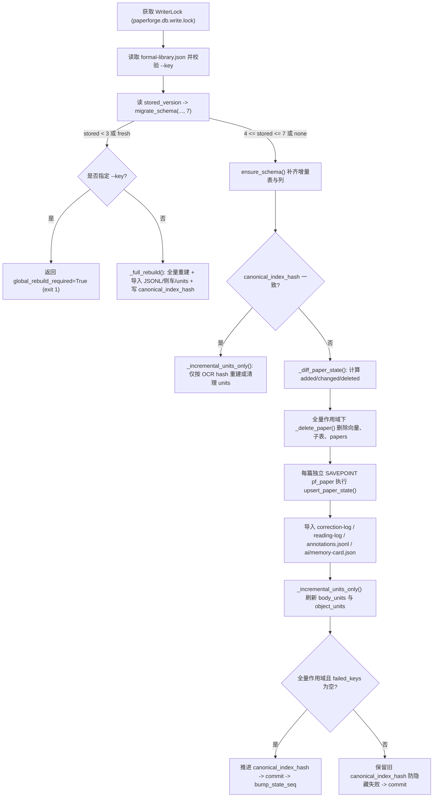

关键顺序与恢复不变量：

1. **表版本升级策略**：`stored_version == 0` 走全量初始化；`1 <= stored_version < 3` 触发破坏性重建（`drop_all_tables` + `ensure_schema` + `_full_rebuild`）；`v4 -> v5 -> v6 -> v7` 均为原地 `ALTER TABLE` 增量迁移；`stored_version > 7` 抛出 `UnsupportedSchemaVersion` 拒绝操作。
2. **侧车历史无损恢复**：`_import_paper_memory_cards()` 在全量或增量构建时遍历论文工作区 `<paper_root>/ai/memory-card.json`，将 `"facets"` 写入 `paper_memory_cards`，同时将 `"history"` 数组按原文顺序恢复至 `paper_memory_history`（若侧车无 `history` 但存在活跃 facet 且数据库尚无历史记录，则以活跃行补种初始历史），确保数据库重建不丢失认知演进轨迹。
3. **删除顺序不变量（`_delete_paper()`）**：`0. 删除向量（同事务）` → `1. 删除所有外键子表（body_units_fts、body_units、object_units、paper_events、reading_log、paper_annotations、paper_memory_cards、paper_aliases、paper_assets）` → `2. 删除 meta 中 manifest:* 与 paper_state_hash:*` → `3. 删除 papers`。在 `_rebuild_paper_units()` 重建单元时亦先删除旧向量，消除检索窗口出现幽灵向量结果的风险。
4. **FTS 触发器与 `rowid` 保留**：`upsert_paper_state()` 使用 `INSERT INTO papers ... ON CONFLICT(zotero_key) DO UPDATE` 以保持现有 `rowid` 不变，依赖 `papers_au` 触发器增量维护 `paper_fts`。在 `_full_rebuild()` 中则先删除 `papers_ai` 触发器，批量 `executemany()` 后一次性全量灌入 `paper_fts` 再重建 `papers_ai`。

#### 4.2 锁协议与 `ShadowBuild` 影子构建状态机

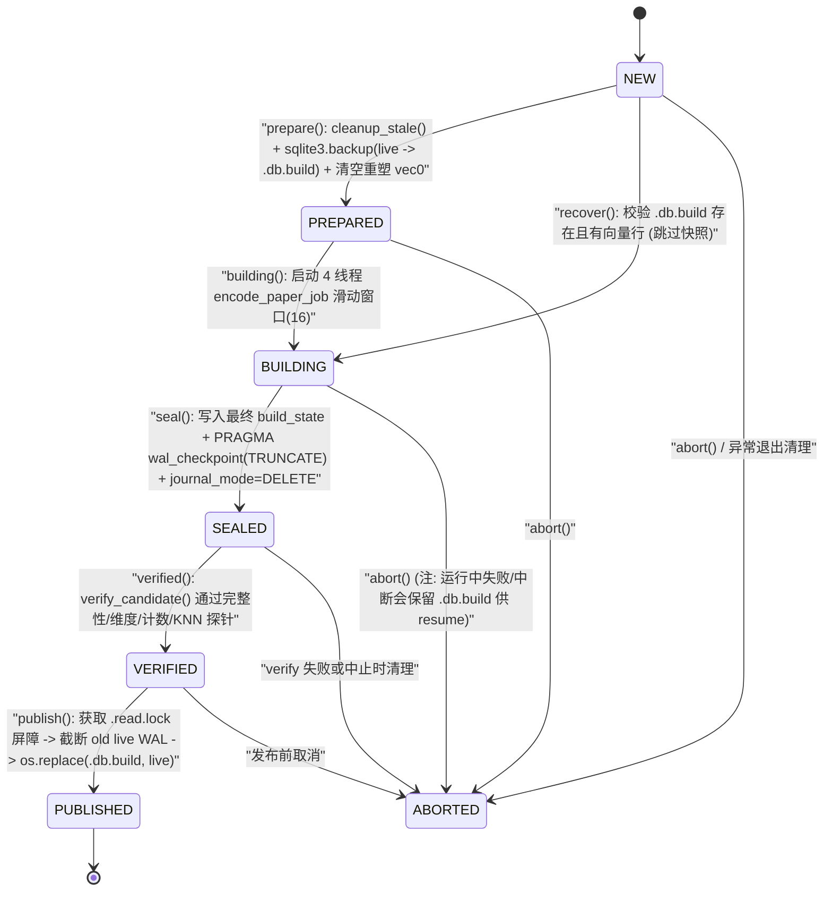

并发与发布不变量：

- **三道重入门（Resume Gates）**：`run_embedding_build(resume=True)` 依次检查 **门零**（`status == "failed"` 且 `.db.build` 有行 → 转 `"interrupted"` 断点恢复）、**门一**（`status == "running"` 且 PID 死亡或运行超 43200 秒 → 若候选库存活则转 `recover()`，否则原地增量补齐缺失篇目）、**门二**（有 `identity_version > 0` 却无任何行且无候选库 → 降级为全量重建；纯粹空白库则允许作用域增量初始化）、**门三**（模型/端点/布局/旧身份版本变更 → 强制路由至影子全量重建）。
- **取消与部分发布（`partial_publish_shadow()`）**：当收到 `PAPERFORGE_STOP\n` 或 `SIGINT`/`SIGTERM` 时，若在影子构建中已编码部分论文，`_settle_cancellation()` 先向候选库写入 `lineage`，再通过 `partial_publish_shadow()` 在读屏障保护下将 `.db.build` 复制覆盖到 `live`（使已嵌入论文立即立即可搜），同时**保留** `.db.build` 供后续 `--resume` 接续，最终以退出码 `130` 结束。
- **读屏障与锁重入**：`WriterLock` 与 `open_live_reader` 均按线程本地的解析后 DB 路径深度计数（`depths[resolved_path]`）实现同线程跨层重入。`get_connection()` 仅在文件新建时设置 `PRAGMA journal_mode=WAL`，防止后续读写连接把影子发布刚切为 `DELETE` 模式的库重新拉回 WAL。

#### 4.3 混合检索（`hybrid_search`）与门控执行链

1. **查询重写（`query_rewrite.py`）**：`expand_query(query)` 先按词边界替换 `ABBREVIATIONS` 中的 21 个医学缩写（如 `ACL`、`TKA`、`PEMF`、`PROMIS`）；若未命中任何缩写，再匹配首个命中的 `MEDICAL_SYNONYMS`（12 组医学同义词）生成展开变体，原始 `query` 始终排在第一位。
2. **锁外向量编码**：`hybrid_search()` 必须在进入 `open_live_reader()` 之前调用 `provider.encode_single(query)` 获取查询向量，避免外部 HTTP 超时拖住 `.read.lock` 超过 10s 导致发布屏障超时。向量编码失败时自动降级为 `query_embedding = None`（纯 BM25 模式）。
3. **双路召回与线性融合（`_fuse_results()`）**：
   - **BM25 路**：遍历所有展开变体查询 `body_units_fts`，以 `bm25_norm = 1.0 - 1.0 / (1.0 + abs(bm25_raw))` 归一化至 `[0, 1)`，按 `(unit_id, paper_id)` 去重。
   - **vec0 路**：使用原始查询向量对 `vec_body` 与 `vec_objects` 执行 KNN 检索（限制 `m.unit_id <> ''`），相似度 `vec_raw = 1.0 - distance`，映射为 `vec_norm = 1.0 - 1.0 / (1.0 + vec_raw)`（当 `vec_raw > 0` 时，否则 `0.0`）。
   - **全并集融合公式**：按 `(canonical_source, unit_id)` 去重合并：双路同时命中时 `score = round(0.3 * bm25_norm + 0.7 * vec_norm, 4)`；仅 BM25 命中时 `score = round(bm25_norm, 4)`；仅向量命中时若 BM25 结果非空则 `score = round(0.7 * vec_norm, 4)`，否则 `round(vec_norm, 4)`。
4. **批量补全与血缘门控**：对纯向量命中批量回表 `papers`、`body_units`、`object_units` 补全标题、作者、章节名与 `StructureTree` 坐标（`enrich_retrieval_hit()`）。随后在 `commands/retrieve.py` 中对 `vec_used`（`vec_score > 0`）按 `require_vector=True` 过滤、`bm25_only` 按 `require_vector=False` 过滤；若双路命中被向量门控拒绝但仍具备 `bm25_score > 0`，则剥离 `vec_score` 降级为纯 BM25 命中返回，绝不泄露陈旧向量。

---

### 5. 配置项、环境变量、CLI 入口与错误码

#### 5.1 规范配置项与环境变量（`paperforge/config.py` & `paperforge/credentials.py`）

| 配置键（`paperforge.json`） | 环境变量                                                       | 默认值 / 校验约束                                                                               |
| :-------------------------- | :------------------------------------------------------------- | :---------------------------------------------------------------------------------------------- |
| `embedding_profile`         | `PAPERFORGE_EMBEDDING_PROFILE`                                 | `"default"`，必须匹配 `[a-z][a-z0-9_]{0,63}`                                                    |
| `vector_db_provider_type`   | `VECTOR_DB_PROVIDER_TYPE`                                      | `"openai_sdk"`，枚举：`"openai_sdk"` 或 `"requests"`                                            |
| `vector_db_api_base`        | `VECTOR_DB_API_BASE`                                           | `""`（有效端点回退至 `"https://api.openai.com/v1"`）；非空时须为无 userinfo 的 `http(s)://` URL |
| `vector_db_api_model`       | `VECTOR_DB_API_MODEL`                                          | `"text-embedding-3-small"`，非空字符串                                                          |
| _(密钥由凭据权威托管)_      | `PAPERFORGE_CREDENTIAL_EMBEDDING__DEFAULT`（或 `__<PROFILE>`） | 优先级：`env_name` → OS keyring（`service="paperforge"`, `username="embedding:<profile>"`）     |

#### 5.2 CLI 入口与参数矩阵

| CLI 命令                               | 关键参数                                                                                                                                                      | 核心行为与退出码                                                                                                                      |
| :------------------------------------- | :------------------------------------------------------------------------------------------------------------------------------------------------------------ | :------------------------------------------------------------------------------------------------------------------------------------ |
| `paperforge memory build`              | `[--key KEY ...]` `[--json]`                                                                                                                                  | 构建或增量刷新 `paperforge.db`；未知 `--key` 返回退出码 `2`（`action.scope_invalid`）；需全量重建时 `--key` 返回退出码 `1`            |
| `paperforge memory status`             | `[--json]`                                                                                                                                                    | 检查 `db_exists`、`schema_ok`、`fresh`、`hash_match`、`count_match`、`locked`、`schema_version`、`fts_ok`                             |
| `paperforge memory restore-backup`     | `[--json]`                                                                                                                                                    | 在 `WriterLock` 下先对 `.backup` 执行 `PRAGMA integrity_check`，再保留当前库为 `.corrupt-*` 并原子替换                                |
| `paperforge embed build`               | `[--force \| --resume]` `[--json]`                                                                                                                            | `--force` 与 `--resume` 互斥；启动前检包与凭据；运行中支持 `PAPERFORGE_STOP\n`（退出码 `130`）                                        |
| `paperforge embed status`              | `[--probe]` `[--json]`                                                                                                                                        | 观察 `effective_vector_db`；`--probe` 额外执行 `vec_body` 的 `k=1` 零向量 KNN 探测                                                    |
| `paperforge embed migrate`             | `[--json]`                                                                                                                                                    | 纯本地将历史 ChromaDB 集合向量拷贝迁入 `vec0` 表                                                                                      |
| `paperforge search <query>`            | `[--limit N]` `[--domain D]` `[--year-from Y]` `[--year-to Y]` `[--ocr ...]` `[--deep ...]` `[--lifecycle ...]` `[--next-step ...]` `[--evidence]` `[--json]` | 元数据 FTS5 检索（3 级安全降级）；`--evidence` 输出 `evidence_status: "metadata_only"`                                                |
| `paperforge retrieve <query>`          | `[--limit N]` `[--deep]` `[--expand \| --no-expand]` `[--paper KEY]` `[--json]`                                                                               | 标准纯向量检索（`merge_retrieve`）或 `--deep` 混合检索（`hybrid_search`）；低置信度（Top5 通用片段 `>= 3` 或最高分 `< 0.62`）追加警告 |
| `paperforge query-plan <query>`        | `--intent {discover,locate,content,known-paper}` `[--json]`                                                                                                   | 信号分类并结合 `get_embed_status` 与 OCR 证据可用性输出检索路由计划                                                                   |
| `paperforge paper-lookup`              | `<query> \| --from-path PATH` `[--limit N]` `[--json]`                                                                                                        | Layer 4 文献识别或 Vault 相对路径反查规范身份                                                                                         |
| `paperforge content-discovery <query>` | `[--limit N]` `[--json]`                                                                                                                                      | 优先检索 `body_units_fts`（经 `filter_readable` 门控），无索引时回退 `paper_fts`                                                      |
| `paperforge paper-navigation <query>`  | `[--json]`                                                                                                                                                    | 返回 `index/structure-tree.json` 节点，缺失时降级返回 `role-index.json` 角色汇总                                                      |
| `paperforge scoped-fetch <query>`      | `[--limit N]` `[--json]`                                                                                                                                      | 支持 `KEY:section_path` 或 `KEY#node_id` 过滤拉取 `body_units` 及 `manifest`                                                          |

#### 5.3 错误码映射表

| 错误码（`ErrorCode`）                                                                   | 典型触发场景                                                                                                                     |
| :-------------------------------------------------------------------------------------- | :------------------------------------------------------------------------------------------------------------------------------- |
| `VALIDATION_ERROR`                                                                      | 嵌入前置检查失败（缺少 `openai` 或缺失 `embedding` 凭据）；`restore-backup` 校验 `.backup` 完整性失败；`paper-lookup` 参数冲突   |
| `PATH_NOT_FOUND`                                                                        | `paperforge.db` 或 `formal-library.json` 不存在；`retrieve --paper` 目标论文未收录；`restore-backup` 未找到 `.backup`            |
| `PRECONDITION_FAILED`                                                                   | 标准 `retrieve`（非 `--deep`）在向量索引 `not_built` / `stale` 时拒绝对空索引执行检索；`embed migrate` 缺少 `legacy-vector` 依赖 |
| `ACTION_UNAVAILABLE`                                                                    | `memory build --key` 遇到需要全量初始化/破坏性重建的库；`embed.build` 作用域请求触发了全量影子重建                               |
| `ACTION_SCOPE_INVALID`                                                                  | `memory build --key` 传入不在 `formal-library.json` 中的未知 `zotero_key`（退出码 `2`）                                          |
| `credential.locked` / `credential.backend_unavailable` / `credential.permission_denied` | OS keyring 被锁定、不可用或拒绝访问；影子构建会保留 `.db.build` 以便修复凭据后 `--resume`                                        |
| `INTERNAL_ERROR`                                                                        | 候选库验证 `verify_candidate()` 失败、SQLite 锁冲突或未预期 I/O 异常                                                             |

---

### 6. 边界防护与 Fail-Closed 防呆规则

1. **读时血缘 Fail-Closed（`reader_gate.filter_readable`）**：当无法观测血缘探针（异常）或论文在探针中缺失、`retrieval` 非 `current`/`incomplete`、或 `require_vector=True` 时 `vector` 非 `current`/`incomplete`，命中条目立即丢弃；仅允许 `incomplete` 向量继续服务已有真实对象向量，决不允许配置切换后的错维/陈旧向量混入检索结果。
2. **写边界向量检验（`_validate_embeddings`）**：在向 `vec0` 插入前强制检验嵌入向量数量与文本数一致、每条均为非空数值列表（排除 `bool`）且全部满足 `math.isfinite()`，在源头拦截 `NaN`/`Inf` 污染索引。
3. **维度变更防原地破坏（`VectorRebuildRequired`）**：`ensure_vec_tables(..., allow_recreate=False)` 在增量路径遇到已存在行或表不可读时直接抛出 `VectorRebuildRequired`，严禁在生产 `live` 库原地 `DROP TABLE`，强制路由至 `.db.build` 影子构建。
4. **O(1) 孤立元数据检测（`inspect_vector_layout`）**：针对 `sqlite-vec` 上 `LEFT JOIN meta ⋈ vec0` 全扫描在万级行数下耗时 48–117 秒导致读锁堆积的缺陷，采用 `SELECT COUNT(*) FROM meta WHERE rowid > COALESCE(MAX(vec0.rowid), 0)` 的 3ms 常数时间检查捕获删表/失配异常。
5. **三步向量所有权验证（`_delete_paper_vectors_locked`）**：删除论文向量前先通过 `meta` 获取 `rowid`，再逐个 `rowid` 反向复核 `paper_id == zotero_key`，最后校验 `vec0` 删除 `cur.rowcount == len(verified)`，任一不一致立即 `rollback()`。
6. **发布前严格自检（`verify_candidate`）**：在 `ShadowBuild.seal()` 将 WAL 合并并切为 `DELETE` 日志模式后，以只读模式检验 `PRAGMA integrity_check == ok`、六张向量/伴随表齐全、三维度相等（以构建阶段探测维度为准，禁止从候选 DDL 自证）、按集合预期计数一致（全量构建时）以及对首个非空 `vec_*` 表执行真实 `k=1` KNN 查询。
7. **锁超时不降级与忙态不误报**：`open_live_reader()`（`timeout=10`）与 `_reader_barrier()`（`timeout=10`）超时时均直接抛出异常而非无锁读取或强行覆盖；`get_memory_status()` 通过 `_is_lock_failure()` 将超时/锁定标记为瞬态 `locked: True`，防止触发误导性的数据库损坏报警。
8. **局部失败不推进全局 Hash**：增量 `memory build` 若某篇论文在 `SAVEPOINT pf_paper` 内失败并回滚，`failed_keys` 非空时绝不更新 `meta.canonical_index_hash`，保证下次构建会继续重试修复。

---

### 7. 维修、调试与升级 Checklist

- [ ] **排查数据库健康与锁定区分**：运行 `paperforge memory status --json` 与 `paperforge runtime-health --json`；若返回 `locked: true`，排查是否有后台 `embed build` 或长期持锁进程，切勿在持锁期间直接删除 `.db` 文件。
- [ ] **恢复缺失或损坏的 `paperforge.db`**：先检查 `<paperforge>/indexes/paperforge.db.backup` 是否存在，优先尝试 `paperforge memory restore-backup --json`；若无有效备份，执行 `paperforge memory build --json` 从 `formal-library.json`、JSONL 永久日志及工作区侧车文件（`annotations.jsonl`、`ai/memory-card.json`）完整重建，随后执行 `paperforge probe memory --json` 确认转为 `ready`。
- [ ] **排查向量构建中断与模型切换**：运行 `paperforge embed status --probe --json`；若切换了 `vector_db_api_model` 或 `vector_db_api_base`，观察到 `vector_state == "stale"` 且 `identity_changed == true` 后，执行 `paperforge embed build --json` 触发全量影子重建；若上次构建被意外终止且磁盘保留了 `<paperforge>/indexes/paperforge.db.build`，执行 `paperforge embed build --resume --json` 从断点恢复而非 `--force` 清空重跑。
- [ ] **确认向量检索未因血缘过期被静默过滤**：若 `retrieve` 返回空结果但 `embed status` 显示有向量块，执行 `paperforge probe lineage --json` 检查目标论文的 `retrieval` 与 `vector` 血缘状态是否为 `current`，必要时按顺序运行 `paperforge memory build` → `paperforge embed build --resume`。
- [ ] **验证旧版 ChromaDB 迁移**：若从历史版本升级且存在旧 `vectors/` 目录，安装 `[vector,legacy-vector]` 依赖后运行 `paperforge embed migrate --json` 迁入 `vec0` 表，再通过 `paperforge embed status --probe --json` 验证 KNN 探针可用。
- [ ] **回归验证测试集**：修改 Schema、构建器、向量生命周期或混合检索后，按需运行 `pytest tests/unit/memory/test_schema.py tests/unit/memory/test_builder.py tests/unit/memory/test_query.py tests/unit/memory/test_refresh.py tests/unit/memory/test_vector_db.py tests/unit/test_hybrid_retrieval_union.py tests/test_layer4_gateway_commands.py tests/test_layer4_structure_tree.py tests/test_layer4_units_and_fts.py tests/test_query_plan.py tests/test_openai_compatible.py` 及 harness 用例 `tests/harness/test_e03_embed_deep_search.py`、`tests/harness/test_e04_embed_stop.py`、`tests/harness/test_e06_memory_schema_repair.py`。

> 相关章节：侧车 PDF 批注与 `ai/memory-card.json` 持久化细节见 [Chapter 11](#chapter-11)；Agent 上下文注入与 `/pf-*` 路由协议见 [Chapter 12](#chapter-12)。

---

<a id="chapter-11"></a>

## 第 11 章：无损 Sidecar PDF 批注、Living Memory Card 与永久日志

> 源文件：`docs/handbook/11-annotations-and-living-memory.md`

> 本章阐述 PaperForge 的三类人机协同研究记忆载体：工作区旁路（Sidecar）无损 PDF 批注与 3 级抗误差空间定位引擎、分面演进的论文动态认知记忆卡片（Living Paper Memory Card），以及 JSONL 永久阅读/项目/校正日志、本地字面阅读（`read`）、笔记标志位权威变更（`note set-flag`）与前端实时刷新信号（`.state-seq.json`）。

### 1. 职责与非目标边界

#### 1.1 核心职责

- **零篡改旁路 PDF 批注（Sidecar Annotations）**：所有用户划线、区域截图、便签、文本框、几何图形、手写墨迹以及 AI 领读批注均仅写入论文工作区 `<workspace>/annotations.jsonl`（及区域裁图 `<workspace>/assets/<KEY>_ann_<id8>.jpg`），并同步投影至 SQLite `paper_annotations` 表，**绝不写入或重保存 Zotero 源 PDF 字节**，确保 `pdf_sha256` 与 OCR 溯源指纹恒定。
- **V3 OCR 结构绑定与 3 级容错定位**：基于 `blocks.structured.jsonl`、`structure-tree.json` 与 `figure_inventory.json` 为任意归一化 PDF 矩形自动绑定 `block_id`、`section_path` 与 `figure_id`；并通过 `paperforge/services/pdf_grounding.py` 将 AI 引用句或图表编号精确还原为 PDF.js 归一化坐标框。
- **Living Paper Memory Card 双写演进**：在 `<workspace>/ai/memory-card.json` 与 SQLite（`paper_memory_cards`、`paper_memory_history`）之间同步维护 5 个标准认知维度（及合规范式自定义维度）的“提炼覆写式”记忆与修订快照，并在不修改 Markdown YAML Frontmatter 的前提下，通过 `memory-card base-snapshot` 向 Obsidian Base 表格视图提供聚合状态计数。
- **JSONL 永久研究记录与来源核验**：以 `<paperforge>/logs/reading-log.jsonl`、`project-log.jsonl`、`correction-log.jsonl` 作为跨会话研究记忆的唯一事实源，配合 `capture_source()` / `source_provenance()` 实现物理页码与文本锚点的 SHA-256 绑定校验。
- **单一语义写入与 UI 实时信号**：通过 `paperforge read` 收口零合成全文/PDF 字面检索，通过 `paperforge note set-flag` 收口 `do_ocr`/`analyze` 布尔标志变更，并通过原子递增 `<paperforge>/indexes/.state-seq.json` 驱动 Obsidian 客户端无轮询刷新。

#### 1.2 非目标边界

- **禁止修改 `fulltext.md` 或源 PDF**：`fulltext.md` 是 OCR 引擎产出的机器只读全文，侧车批注与问答诊断（`annotations fulltext-preview`）均不改写 `fulltext.md`；批注导出至阅读日志通过 `annotations promote` 显式提升完成。
- **不将 Markdown Frontmatter 作为高频变更总线**：批注计数、认知维度数与诊断状态均从 `get_base_table_snapshot()` 动态投影；`note set-flag` 白名单严格限定为 `("do_ocr", "analyze")`，拒绝任意 Frontmatter 键注入。
- **不做隐式正则或语义改写式定位**：`local_read.py` 仅做大小写不敏感字面子串匹配；`pdf_grounding.py` 要求传入原文逐字句段或规范图表 ID，不猜测或捏造坐标。

---

### 2. 核心源码与单测映射表

| 模块 / 文件                                                         | 核心职责与关键符号                                                                                                                                                                                                                                          | 对应验证单测                                                                                                                               |
| :------------------------------------------------------------------ | :---------------------------------------------------------------------------------------------------------------------------------------------------------------------------------------------------------------------------------------------------------- | :----------------------------------------------------------------------------------------------------------------------------------------- |
| `paperforge/services/annotations_service.py`                        | 侧车批注 CRUD、`VALID_KINDS`/`VALID_COLORS`/`VALID_INTENTS`、OCR 结构绑定 `_bind_ocr_structure()`、日志压缩 `_maybe_compact_jsonl_locked()`、`promote_to_reading_log()`、`agent_mark_annotation()`、`adopt_agent_annotation()`、`clear_agent_annotations()` | `tests/unit/test_annotations_service.py`、`tests/unit/test_pdf_grounding_and_agent_mark.py`、`tests/unit/test_stat_cache_and_fastpaths.py` |
| `paperforge/services/pdf_grounding.py`                              | 3 级抗误差 PDF 定位 `ground_target_in_pdf()`、字符折叠 `_fold_text()`、图表定位 `_resolve_object_target()`                                                                                                                                                  | `tests/unit/test_pdf_grounding_and_agent_mark.py`                                                                                          |
| `paperforge/commands/annotations.py`                                | CLI 子命令 `paperforge annotations` 适配器（10 个动词分发与 `PFResult` 封装）                                                                                                                                                                               | `tests/unit/test_annotations_service.py`                                                                                                   |
| `paperforge/services/memory_card_service.py`                        | `FACET_LABELS`、分面规范化 `normalize_facet_slug()`、`refine_memory_facet()`、`get_memory_card()`、`get_memory_history()`、`clear_memory_facet()`、`get_base_table_snapshot()`（SQLite 优先，仅未入库 Key 回退工作区侧车）                                  | `tests/unit/test_living_memory_and_state_seq.py`、`tests/unit/test_upgrade_resilience.py`、`tests/unit/test_stat_cache_and_fastpaths.py`   |
| `paperforge/commands/memory_card.py`                                | CLI 子命令 `paperforge memory-card`（`get`、`refine`、`history`、`clear`、`base-snapshot`）                                                                                                                                                                 | `tests/unit/test_living_memory_and_state_seq.py`                                                                                           |
| `paperforge/services/state_signal.py`                               | 跨进程 `FileLock` 保护的原子状态序号递增器 `bump_state_seq()`、`bump_state_seq_in_dir()`、`read_state_seq()`                                                                                                                                                | `tests/unit/test_living_memory_and_state_seq.py`                                                                                           |
| `paperforge/memory/permanent.py`                                    | JSONL 永久日志 `append_reading_note()`、`append_project_entry()`、`append_correction()`、`load_record_authority()`、`search_reading_records()`                                                                                                              | `tests/cli/test_research_records.py`                                                                                                       |
| `paperforge/memory/record_source.py`                                | PDF 来源物理页与 NFC 文本唯一性绑定 `capture_source()`、`source_provenance()`                                                                                                                                                                               | `tests/cli/test_research_records.py`                                                                                                       |
| `paperforge/commands/reading_log.py`                                | CLI `paperforge reading-log`（写入、字面检索、校正、来源核验、Markdown 验证/导入/渲染）                                                                                                                                                                     | `tests/cli/test_research_records.py`                                                                                                       |
| `paperforge/commands/project_log.py`                                | CLI `paperforge project-log`（写入、列表、渲染 `project-log.md`）                                                                                                                                                                                           | `tests/cli/test_research_records.py`                                                                                                       |
| `paperforge/services/local_read.py` & `paperforge/commands/read.py` | 零合成字面局部阅读 `read_paper_local()` 与 `paperforge read` 入口                                                                                                                                                                                           | `tests/test_local_read.py`                                                                                                                 |
| `paperforge/commands/note.py`                                       | 权威工作流标志位变更 `paperforge note set-flag`（保换行符写回 + 索引联动回滚）                                                                                                                                                                              | `tests/test_note_set_flag.py`、`tests/unit/test_living_memory_and_state_seq.py`                                                            |

---

### 3. 磁盘文件、数据库表与协议 JSON 字段字典

#### 3.1 磁盘文件布局

| 载体路径                                              | 编码 / 格式                           | 权威性说明                                                                                                                            |
| :---------------------------------------------------- | :------------------------------------ | :------------------------------------------------------------------------------------------------------------------------------------ |
| `<workspace>/annotations.jsonl`                       | UTF-8 JSONL（追加事件日志）           | 单篇论文 PDF 批注的唯一事实源，配合同目录 `annotations.jsonl.lock`                                                                    |
| `<workspace>/assets/<KEY>_ann_<id8>.jpg`              | JPEG 图像（200 DPI）                  | `kind == "area"` 区域截图产物（由 `f"{paper_key}_{ann_id[:12]}.jpg"` 命名，因 `ann_id` 形如 `ann_<12hex>`，前 12 字符即 `ann_<id8>`） |
| `<workspace>/ai/memory-card.json`                     | UTF-8 JSON（原子 temp+fsync+replace） | Living Memory Card 工作区侧车镜像，内含 `"facets"` 与 `"history"`，支持数据库重建无损恢复                                             |
| `<paperforge>/logs/reading-log.jsonl`                 | UTF-8 JSONL（追加）                   | 永久阅读摘录与证据绑定记录的唯一事实源                                                                                                |
| `<paperforge>/logs/project-log.jsonl`                 | UTF-8 JSONL（追加）                   | 项目阶段决策、弯路与待办日志的唯一事实源                                                                                              |
| `<paperforge>/logs/correction-log.jsonl`              | UTF-8 JSONL（追加）                   | 阅读笔记历史校正记录（不修改原记录，通过 `original_id` 关联）                                                                         |
| `<resources>/Projects/<project>/reading-log.index.md` | Markdown（派生渲染）                  | `reading-log --render --project <P>` 输出（刻意使用 `.index.md` 以免覆盖手写 `reading-log.md`）                                       |
| `<resources>/Projects/<project>/project-log.md`       | Markdown（派生渲染）                  | `project-log --render --project <P>` 自动生成产物                                                                                     |
| `<paperforge>/indexes/.state-seq.json`                | UTF-8 JSON（原子替换）                | 全局单调递增状态序号，Obsidian 插件监听该文件触发视图刷新                                                                             |

#### 3.2 `<workspace>/annotations.jsonl` 事件模型与字段字典

`annotations.jsonl` 采用只追加事件模式（`_replay_jsonl_events()` 按行重放组装活跃状态 dict）：

- **创建事件（`op: "add"`）**：`{"op": "add", "ann_id": "ann_...", "record": { ... }}`
- **更新事件（`op: "update"`）**：`{"op": "update", "ann_id": "ann_...", "patch": { ... }, "updated_at": "<ISO-8601>"}`
- **删除事件（`op: "delete"`）**：`{"op": "delete", "ann_id": "ann_...", "updated_at": "<ISO-8601>"}`

单条完整批注 `record`（同步镜像至 SQLite `paper_annotations` 表，完整建表 DDL 见 [Chapter 10](#chapter-10)）：

| 字段名                                    | 类型 / 枚举约束                                                                                                          | 说明                                                                                                                                                                                                                                |
| :---------------------------------------- | :----------------------------------------------------------------------------------------------------------------------- | :---------------------------------------------------------------------------------------------------------------------------------------------------------------------------------------------------------------------------------- |
| `ann_id`                                  | `str`（`ann_<12位十六进制>`）                                                                                            | `f"ann_{secrets.token_hex(6)}"`                                                                                                                                                                                                     |
| `paper_id`                                | `str`                                                                                                                    | 规范 `zotero_key`                                                                                                                                                                                                                   |
| `page`                                    | `int`（`>= 1`，`<= len(doc)`）                                                                                           | 1-based PDF 物理页码                                                                                                                                                                                                                |
| `kind`                                    | `"highlight"` / `"underline"` / `"strikethrough"` / `"area"` / `"note"` / `"textbox"` / `"shape"` / `"ink"` / `"margin"` | `VALID_KINDS` 9 种批注类型                                                                                                                                                                                                          |
| `color`                                   | `"yellow"` / `"green"` / `"blue"` / `"pink"` / `"red"` / `"purple"` / `"ink"` / `"gray"` / `"transparent"`               | `VALID_COLORS` 9 种标准色                                                                                                                                                                                                           |
| `intent`                                  | `"evidence"` / `"question"` / `"method"` / `"quote"` / `"general"`                                                       | `VALID_INTENTS` 5 种认知意图                                                                                                                                                                                                        |
| `author`                                  | `"user"` / `"agent"`                                                                                                     | `VALID_AUTHORS`；区分用户批注与 AI 领读批注层                                                                                                                                                                                       |
| `lens`                                    | `str`（如 `"skeleton"` / `"methods"` / `"critique"` / `"custom"` / `""`）                                                | AI 审阅视角标签                                                                                                                                                                                                                     |
| `grounding_tier`                          | `"manual"` / `"exact_sentence"` / `"exact_cross_column"` / `"exact_object"` / `"margin_fallback"`                        | 坐标定位精度分级                                                                                                                                                                                                                    |
| `rects`                                   | `list[[x0, y0, x1, y1]]`                                                                                                 | PDF.js 归一化坐标，`[0.0, 1.0]` 区间，`annotations_service` 保留 5 位小数（`pdf_grounding` 为 4 位）；数据库列为 `rects_json`                                                                                                       |
| `style`                                   | `dict`（数据库列为 `style_json`）                                                                                        | 受 `_normalize_style()` 校验：`shape_type`（`rect`/`ellipse`/`arrow`/`line`）、`stroke_color`、`fill_color`、`stroke_width`（`0.5..16.0`）、`font_size`（`8..48`）、`opacity`（`0.05..1.0`）、`points`（`[x, y]` 归一化轨迹点列表） |
| `exact_text` / `comment`                  | `str`                                                                                                                    | 原文摘录与批注评论                                                                                                                                                                                                                  |
| `section_path` / `block_id` / `figure_id` | `str`                                                                                                                    | `_bind_ocr_structure()` 关联的 V3 OCR 结构坐标                                                                                                                                                                                      |
| `crop_asset_rel` / `embed_wikilink`       | `str`                                                                                                                    | 仅 `area` 类型生成：Vault 相对路径与 `![[<KEY>_ann_<id8>.jpg]]`                                                                                                                                                                     |
| `tags`                                    | `list[str]`（数据库列为 `tags_json`）                                                                                    | 标签数组                                                                                                                                                                                                                            |
| `pdf_sha256`                              | `str`                                                                                                                    | 创建时对源 PDF 计算的 SHA-256；读出时由 `_attach_live_provenance()` 实时对比并注入运行时字段 `provenance_status`（`"verified"` / `"changed"` / `"unknown"`）                                                                        |
| `created_at` / `updated_at`               | ISO 8601 UTC 字符串                                                                                                      | 创建与最后更新时间                                                                                                                                                                                                                  |

#### 3.3 Living Memory Card 维度与 `memory-card.json` 结构

`FACET_LABELS`（`OrderedDict`）定义 5 个规范维度，同时允许满足 `CUSTOM_FACET_RE = ^[a-z0-9_]{2,32}$` 的自定义维度（输入先经 `strip().lower().replace("-", "_")` 规范化）；单维度内容长度上限 `MAX_FACET_CHARS = 4000` 字符，侧车历史最多保留 `MAX_HISTORY_ENTRIES = 100` 条：

| `facet` Slug      | 显示标签（`FACET_LABELS`） | 认知定位                            |
| :---------------- | :------------------------- | :---------------------------------- |
| `idea_logic`      | `研究思路与逻辑链`         | 核心假说、实验推导主线与逻辑跃迁    |
| `methods_params`  | `实验技术与关键参数`       | 模型、样本量、剂量/刺激窗与对照设置 |
| `research_craft`  | `研究技巧与巧思`           | 实验设计巧思、内部校准与呈图技巧    |
| `critique_limits` | `硬伤、边界与存疑`         | 统计边界、混杂因素与结论外推风险    |
| `my_connection`   | `课题迁移与灵感`           | 与当前研究课题及方案设计的启发关联  |

`<workspace>/ai/memory-card.json` 文件格式：

```json
{
  "paper_id": "MEM00001",
  "updated_at": "2026-11-19T06:00:00+00:00",
  "facets": {
    "idea_logic": {
      "facet": "idea_logic",
      "label": "研究思路与逻辑链",
      "content": "...",
      "revision": 2,
      "updated_at": "2026-11-19T06:00:00+00:00"
    }
  },
  "history": [
    {
      "facet": "idea_logic",
      "label": "研究思路与逻辑链",
      "content": "...",
      "revision": 1,
      "created_at": "2026-11-19T05:50:00+00:00"
    }
  ]
}
```

#### 3.4 `memory-card base-snapshot` 与 `.state-seq.json` 字段

- `get_base_table_snapshot(vault)` 优先读取 SQLite `papers` / `paper_annotations` / `paper_memory_cards`（仅对尚未入库的新增文献按需回退读取工作区 `annotations.jsonl` 与 `ai/memory-card.json`，避免全库扫描开销），返回 `{"seq": int, "updated_at": str, "rows": {zotero_key: {...}}}`，其中每条 `rows[key]` 在基础文献字段之上附加：
  - `user_ann_count`（`author != 'agent'` 的批注数）
  - `agent_ann_count`（`author == 'agent'` 的批注数）
  - `memory_facet_count`（活跃认知维度数，优先 SQLite，未入库时回退读取工作区 `ai/memory-card.json`）
  - `memory_updated_at`（最新维度更新时间）
  - `needs_diagnostic`（布尔值：`ocr_status in ("failed", "done_incomplete", "unknown")` 或 `ocr_status == "done"` 但 `health.ocr_health` 非空且非 `"healthy"`）
- `<paperforge>/indexes/.state-seq.json` 字段：`{"seq": 42, "updated_at": "<ISO-8601>", "reason": "memory_card.refine", "changed_keys": ["MEM00001"]}`（`changed_keys` 去重且最多截取前 50 个）。

#### 3.5 永久日志（JSONL）记录格式

1. **`reading-log.jsonl`**（`id`: `rln_YYYYMMDD_<hex8>`）：包含 `id`、`created_at`、`paper_id`、`section`、`excerpt`、`usage`、`context`、`note`、`project`、`tags`、`agent`、`verified`（默认 `false`）及可选的 `source`（由 `capture_source()` 生成 `{paper_id, path, physical_page, printed_page, basis, anchor, sha256, binding, verification}`）。
2. **`project-log.jsonl`**（`id`: `plog_YYYYMMDD_<hex8>`）：包含 `id`、`created_at`、`project`、`date`、`type`、`title`、`decisions`、`detours`、`reusable`、`todos`、`related_papers`、`tags`、`agent`。
3. **`correction-log.jsonl`**（`id`: `corr_YYYYMMDD_<hex8>`）：包含 `id`、`event_type: "correction"`、`created_at`、`paper_id`、`original_id`、`correction`、`reason`、`agent`。

---

### 4. 核心执行链路、状态机与顺序不变量

#### 4.1 3 级抗误差 PDF 定位引擎（`pdf_grounding.py`）

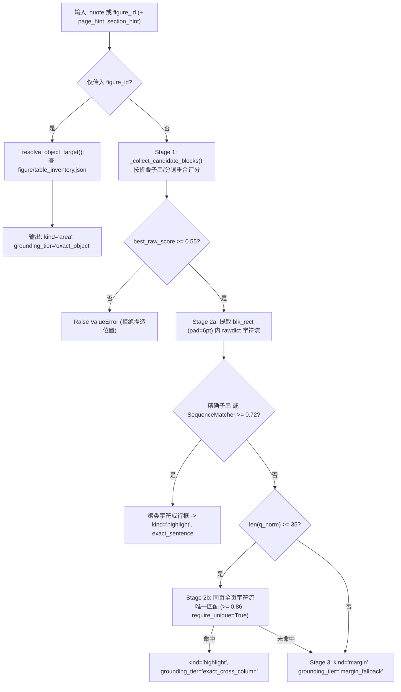

定位关键细节与不变量：

1. **字符折叠归一化（`_fold_text`）**：剥离软连字符 `\u00ad`、零宽字符 `\u200b` / `\ufeff` 与 `$...$` LaTeX 定界符，执行 NFKC 规范化、希腊字母 `μ`/`µ` → `u`、长短破折号统一为 `-`，仅保留字母与数字，天然免疫跨行连字符断词与符号编码漂移。
2. **Stage 1 页码与章节权重**：完全折叠包含时 `raw_score = 1.0`，否则取 `(q_tokens & b_tokens) / len(q_tokens)`（中文采用 2-gram 滑窗分词）；命中 `page_hint` 加权 `+0.12`，命中 `section_hint` 加权 `+0.06`。
3. **Stage 2a/2b 行级聚框（`_cluster_chars_to_rects`）**：按相邻字符中心纵坐标差 `<= max(4.0, height * 0.6)` 自动合并为单行矩形，支持跨多行引用自动输出多个归一化 `[x0, y0, x1, y1]` 框。
4. **Stage 3 诚实降级**：纯扫描件或公式块无 PDF 字符层时，绝不跨页或扩大矩形瞎画，只在 `best_blk` 左侧生成窄竖条（`x0 = max(0.01, bx0 - 0.018)`、`x1 = max(x0 + 0.008, bx0 - 0.006)`），标定 `kind="margin"` 与 `grounding_tier="margin_fallback"`。

#### 4.2 侧车批注写入、OCR 绑定与提升链

1. **添加、更新与日志压缩（`add_annotation()` / `_maybe_compact_jsonl_locked()`）**：校验 `page`、`kind`、`intent`、`color`、`author` 与归一化 `rects`/`style` → 解析论文工作区与 PDF → 计算 `pdf_sha256`（通过 `stat_cache.cached_sha256_hex()` 跳过未变 PDF 重复流式哈希；若 `kind == "area"` 则按 200 DPI 裁剪第 0 个矩形保存至 `<workspace>/assets/<KEY>_ann_<id8>.jpg`） → 调用 `_bind_ocr_structure()` 匹配 V3 OCR block（权重 `frac_a * 2.0 + iou`）与图库（`cluster_bbox` 或 `associated_text_block_ids` / `caption_block_id`） → 在 `annotations.jsonl.lock` 下追加事件；当日志总行数达到 `>= _COMPACT_MIN_LINES (100)` 且超过活跃批注数两倍时自动执行锁内原子压缩（仅保留活跃 `"add"` 快照并 `os.replace` 替换） → 尽力同步 `paper_annotations`（`_sync_sqlite_annotation`，持 `WriterLock`）→ `bump_state_seq(reason="annotations.add")`。
2. **人机协同流转**：`agent_mark_annotation()` 将 `lens` 映射为默认 `intent`（`skeleton→evidence`、`methods→method`、`critique→question`、`custom→evidence`）后创建 `author="agent"` 批注；用户采纳时 `adopt_agent_annotation()` 追加一条 `{"op": "update", "patch": {"author": "user"}}` 事件；`clear_agent_annotations()` 仅删除 `author == "agent"`（可按 `lens` 过滤）的条目，绝对保留用户批注。
3. **批注提升至阅读日志（`promote_to_reading_log()`）**：将批注的 `exact_text`（无原文则取 `comment` 或区域占位描述）、`section_path` 与物理页码打包为 `source={"path": ..., "physical_page": page, "basis": "recorded"}`，经 `append_reading_note(..., agent="pdf-annotator")` 自动计算当前 PDF SHA-256 与绑定哈希写入 `reading-log.jsonl`。

#### 4.3 Living Memory Card 双写与跨库重建恢复链

1. **写入顺序（`refine_memory_facet()`）**：先校验非空及 `<= 4000` 字符 → 读取现有面（优先工作区 `ai/memory-card.json`，不存在工作区时回退读取 SQLite）计算 `revision = prev.revision + 1` → 原子写入 `ai/memory-card.json`（保留最多 100 条 `history`） → 若 `paperforge.db` 存在且该 `zotero_key` 在 `papers` 中，持 `WriterLock` 同步更新 `paper_memory_cards` 并向 `paper_memory_history` 插入一条不可变快照 → 调用 `bump_state_seq(reason="memory_card.refine")`。
2. **删库恢复保证**：无论在 `paperforge.db` 删除后尚未重建（`get_memory_card()` 与 `get_memory_history()` 自动回退读取 `ai/memory-card.json`）还是执行 `memory build` 重建之后（`_import_paper_memory_cards()` 导入 `facets` 与完整 `history` 数组），认知维度与版本修订历史均可无损还原。

#### 4.4 `note set-flag` 原子更新与回滚机制

`paperforge/commands/note.py` 按严格顺序执行：校验 `field in ("do_ocr", "analyze")` → 在 `formal-library.json` 定位条目的 `main_note_path` / `note_path` → 以 `newline=""` 字节保真读取 Markdown（保留原文件 CRLF/LF 行尾） → 验证 `split_frontmatter_block()` 非空 → 若值变化则写入 `set_frontmatter_flag()` 结果 → 调用 `_sync_index_flag()` 同步更新 `formal-library.json` → **若索引更新失败，立即用原始字节 `text` 回滚笔记文件**；成功则 `bump_state_seq(reason=f"note.{field}")`。

---

### 5. 配置项、环境变量、CLI 入口与错误码

#### 5.1 关键阈值与常量（非外部配置开关）

| 模块常量                                   | 取值                        | 作用                                          |
| :----------------------------------------- | :-------------------------- | :-------------------------------------------- |
| `CUSTOM_FACET_RE`                          | `^[a-z0-9_]{2,32}$`         | `memory_card_service.py` 自定义分面校验正则   |
| `MAX_FACET_CHARS` / `MAX_HISTORY_ENTRIES`  | `4000` / `100`              | 单分面字符上限 / 侧车历史最大条数             |
| `LOCK_TIMEOUT`（`annotations.jsonl.lock`） | `10` 秒                     | 侧车批注文件锁超时                            |
| `fulltext-preview` 字符上限                | 默认 `80000`（下限 `1000`） | `read_ocr_diagnostic_fulltext()` 诊断截断保护 |
| `search_reading_records` `limit`           | 默认 `20`（允许 `1..100`）  | 阅读日志字面检索分页范围                      |

#### 5.2 CLI 命令参数矩阵

| CLI 入口                                        | 子命令 / 参数                                                                                                                                                                                                                                                                                                                                               | 返回核心字段与说明                                                                                                         |
| :---------------------------------------------- | :---------------------------------------------------------------------------------------------------------------------------------------------------------------------------------------------------------------------------------------------------------------------------------------------------------------------------------------------------------- | :------------------------------------------------------------------------------------------------------------------------- |
| `paperforge annotations pdf-info <KEY>`         | `[--json]`                                                                                                                                                                                                                                                                                                                                                  | 返回 `pdf_abs_path`、`pdf_vault_rel`、`pdf_sha256`、`page_count`、`workspace_rel`、`annotations`（含 `provenance_status`） |
| `paperforge annotations list <KEY>`             | `[--json]`                                                                                                                                                                                                                                                                                                                                                  | 按页码与纵向坐标排序返回活跃批注列表                                                                                       |
| `paperforge annotations add <KEY>`              | `--page N --rects-json JSON` `[--kind ...]` `[--color ...]` `[--intent ...]` `[--exact-text ...]` `[--comment ...]` `[--tags-json ...]` `[--style-json ...]` `[--json]`                                                                                                                                                                                     | 创建用户侧车批注并绑定 OCR 结构                                                                                            |
| `paperforge annotations update <KEY> <ANN_ID>`  | `[--color ...]` `[--intent ...]` `[--comment ...]` `[--tags-json ...]` `[--style-json ...]` `[--rects-json ...]` `[--json]`                                                                                                                                                                                                                                 | 追加 `update` 事件并同步 SQLite（合并 `style` 字典）                                                                       |
| `paperforge annotations delete <KEY> <ANN_ID>`  | `[--json]`                                                                                                                                                                                                                                                                                                                                                  | 追加 `delete` 事件并从 `paper_annotations` 删除                                                                            |
| `paperforge annotations promote <KEY> <ANN_ID>` | `[--usage U]` `[--project P]` `[--json]`                                                                                                                                                                                                                                                                                                                    | 提升批注为绑定来源哈希的 `reading-log.jsonl` 记录                                                                          |
| `paperforge annotations fulltext-preview <KEY>` | `[--max-chars 80000]` `[--json]`                                                                                                                                                                                                                                                                                                                            | 只读诊断预览内部 OCR `fulltext.md`                                                                                         |
| `paperforge annotations agent-mark <KEY>`       | `[--quote TEXT]` `[--figure-id ID]` `[--page-hint N]` `[--section-hint S]` `[--comment C]` `[--color purple]` `[--lens skeleton]` `[--tags-json ...]` `[--json]`                                                                                                                                                                                            | 执行 3 级 PDF 定位并写入 `author="agent"` 批注                                                                             |
| `paperforge annotations adopt <KEY> <ANN_ID>`   | `[--json]`                                                                                                                                                                                                                                                                                                                                                  | 将 AI 批注转为 `author="user"`                                                                                             |
| `paperforge annotations clear-agent <KEY>`      | `[--lens L]` `[--json]`                                                                                                                                                                                                                                                                                                                                     | 清理指定视角或全部 AI 批注，保留用户高亮                                                                                   |
| `paperforge memory-card get <KEY>`              | `[--json]`                                                                                                                                                                                                                                                                                                                                                  | 返回按标准 5 维度优先排序的活跃卡片                                                                                        |
| `paperforge memory-card refine <KEY>`           | `--facet F --content C` `[--json]`                                                                                                                                                                                                                                                                                                                          | 覆写并递增 `revision`，记录历史与刷新信号                                                                                  |
| `paperforge memory-card history <KEY>`          | `[--facet F]` `[--json]`                                                                                                                                                                                                                                                                                                                                    | 按最新倒序返回最多 50 条历史修订快照                                                                                       |
| `paperforge memory-card clear <KEY>`            | `[--facet F]` `[--json]`                                                                                                                                                                                                                                                                                                                                    | 清空单分面或全部分面（保留 `history`）                                                                                     |
| `paperforge memory-card base-snapshot`          | `[--json]`                                                                                                                                                                                                                                                                                                                                                  | 返回 `{seq, updated_at, rows}` 供 Obsidian Base 视图渲染                                                                   |
| `paperforge reading-log`                        | `--write KEY --excerpt E [--section S --usage U --note N --context C --project P --tags T --source-json JSON]` / `--search Q [--paper KEY --limit N --include-history]` / `--correct ID --correction C [--reason R --paper KEY]` / `--source-check ID [--paper KEY]` / `--lookup KEY` / `--render [--project P]` / `--validate F` / `--import F` `[--json]` | 永久阅读记录全生命周期管理；默认导出 `--since` / `--limit 50`                                                              |
| `paperforge project-log`                        | `--write --project P --payload JSON` / `--list --project P` / `--render --project P`                                                                                                                                                                                                                                                                        | 项目级决策、弯路与任务日志管理                                                                                             |
| `paperforge read <KEY>`                         | `--find TERM` `[--source {auto,fulltext,pdf}]` `[--json]`                                                                                                                                                                                                                                                                                                   | 本地只读字面子串检索（`matched` / `no_match` / `no_readable_source`）                                                      |
| `paperforge note set-flag`                      | `--key KEY --field {do_ocr,analyze} --value {true,false}` `[--json]`                                                                                                                                                                                                                                                                                        | 权威修改正式笔记 YAML 布尔标记并同步 `formal-library.json`                                                                 |

#### 5.3 错误码映射表

| 错误码                 | 触发场景                                                                                                                                                                                                                                                                                                                                        |
| :--------------------- | :---------------------------------------------------------------------------------------------------------------------------------------------------------------------------------------------------------------------------------------------------------------------------------------------------------------------------------------------- |
| `VALIDATION_ERROR`     | `annotations` 传入非法 `kind`/`intent`/`color`/`page`/`rects`/`style` 或未找到 `ann_id`；`pdf_grounding` 找不到引用文本（`score < 0.55`）或对象 ID；`memory-card refine` 空内容、超 4000 字或非法 `facet`；`reading-log` 格式校验失败、空搜索词、`limit` 越界、跨论文校正、来源哈希/锚点失效；`note set-flag` 非法 `field` 或无有效 Frontmatter |
| `PATH_NOT_FOUND`       | `paperforge read` 无法唯一解析论文或既无可读 `fulltext.md` 又无合法 PDF（`no_readable_source`）                                                                                                                                                                                                                                                 |
| `ACTION_SCOPE_INVALID` | `paperforge read` 传入非法 `--source` 参数（退出码 `2`）                                                                                                                                                                                                                                                                                        |
| `INTERNAL_ERROR`       | `reading-log` 写入出现 `OSError`（`error_kind == "io"`）；`note set-flag` 同步索引或回滚失败                                                                                                                                                                                                                                                    |

---

### 6. 边界防护与 Fail-Closed 防呆规则

1. **路径逃逸与外部 PDF 边界锁定（`record_source.py` & `annotations_service.py`）**：`_relative_pdf()` 与 `_resolve_pdf_from_item()` 显式拒绝 `..` 段、`://` 协议、URL `#/?` 片段及跨平台驱动器盘符路径，强制校验解析后的 PDF 物理路径必须落于 Vault 根或已配置的 `zotero_data_dir` 内且后缀为 `.pdf`；`_paper_pdf()` 进一步要求其与规范索引中该 `zotero_key` 的当前 `pdf_path` 完全一致。
2. **唯一物理页文本锚点验证（`source_provenance`）**：当 `basis == "exact_text"` 时，`anchor` 经 NFC 与 Unicode 空白折叠后必须与 `excerpt` 全等，且在整份 PDF 中**全局仅出现 1 次并恰好位于指定的 `physical_page`**（使用 `(?={re.escape(needle)})` 捕获重叠出现次数）；多于 1 次返回 `status="ambiguous"`，0 次或跨页返回 `status="mismatch"`，`--source-check` 直接报错拒绝打开。
3. **严格 JSONL 权威读取（`_read_records_strict`）**：检索、查找、校正或核验前若 `reading-log.jsonl` / `correction-log.jsonl` 中存在损坏 JSON 行、缺失必填字段、非法时间格式或重复 `id`，以及校正记录指向跨论文或不存在的 `original_id`，立即抛出 `ValueError` 中止，绝不伪造“干净空结果”。
4. **校正历史不覆盖原引文（`search_reading_records`）**：已被 `correction-log.jsonl` 标记校正的原记录默认被隐藏（`record_status == "corrected"`），仅在显式传入 `--include-history` 时连同 `corrections` 数组一并返回；校正文本自身不会冒充原文献引文参与字面检索命中。
5. **同页防漂移定位边界（`pdf_grounding.py`）**：Stage 2b 跨栏救援严格限制在 Stage 1 锁定的**同一页**且要求 `len(q_norm) >= 35` 与 `require_unique=True`，避免短词在不同栏位错配；无法精确定位文本坐标时进入 Stage 3 `margin_fallback` 而非扩大框覆盖无关段落。
6. **`PyMuPDF` 标准输出静默防污染（`local_read.py`）**：显式优先 `import pymupdf as fitz`，规避旧版 `import fitz` 向 `stdout` 打印弃用警告导致 `--json` 机器信封解析崩溃。
7. **`.state-seq.json` 目录卫兵与跨进程互斥锁（`state_signal.py`）**：`bump_state_seq_in_dir()` 检查 `indexes_dir.name == "indexes"`，并在 `FileLock(".state-seq.json.lock", timeout=10.0)` 内执行读-递增-`mkstemp` + `fsync` + `os.replace`，确保多子进程并发下既不丢增 `seq` 也不被插件读到半截 JSON（`tests/unit/test_living_memory_and_state_seq.py`）。

---

### 7. 维修、调试与升级 Checklist

- [ ] **核对 PDF 批注失效或偏移**：运行 `paperforge annotations pdf-info <KEY> --json`，检查返回中每条批注的 `provenance_status`；若为 `changed`，说明 Zotero 中源 PDF 文件内容发生变更，需人工复核批注页码与位置后更新 `annotations.jsonl`。
- [ ] **诊断 AI 批注定位降级原因**：运行 `paperforge annotations list <KEY> --json` 观察 `grounding_tier` 分布；若大量条目落入 `margin_fallback`，通过 `paperforge annotations fulltext-preview <KEY>` 核对传给 `agent-mark --quote` 的句子是否与 PDF 底层文本存在大段缺失（如纯扫描 PDF 属正常行为），对满意的 AI 批注引导用户采纳（`annotations adopt`）或重标。
- [ ] **验证 Living Memory Card 与数据库一致性**：运行 `paperforge memory-card get <KEY> --json` 与 `paperforge memory-card history <KEY> --json`，对比工作区 `<workspace>/ai/memory-card.json`；若发现 SQLite 与侧车不一致，运行 `paperforge memory build --key <KEY> --json` 重新同步。
- [ ] **排查 Obsidian Base 表未刷新或计数陈旧**：检查 `<paperforge>/indexes/.state-seq.json` 的 `seq` 与 `reason`，并运行 `paperforge memory-card base-snapshot --json` 验证 `user_ann_count`、`agent_ann_count`、`memory_facet_count` 是否与底层一致。
- [ ] **校验与修正阅读笔记来源绑定**：对存在存疑出处的记录执行 `paperforge reading-log --source-check <RECORD_ID> --paper <KEY> --json`；若记录已被推翻，使用 `paperforge reading-log --correct <RECORD_ID> --paper <KEY> --correction "..." --reason "..." --json` 追加不可变校正链而非手改 `reading-log.jsonl`。
- [ ] **回归验证测试集**：修改批注、定位、记忆卡或永久记录逻辑后，执行 `pytest tests/unit/test_annotations_service.py tests/unit/test_pdf_grounding_and_agent_mark.py tests/unit/test_living_memory_and_state_seq.py tests/unit/test_upgrade_resilience.py tests/cli/test_research_records.py tests/test_local_read.py tests/test_note_set_flag.py`。

> 相关章节：SQLite `paper_annotations` / `paper_memory_cards` / `paper_memory_history` 表结构及从侧车恢复机制见 [Chapter 10](#chapter-10)；Agent 上下文读取 `living_memory` / `user_annotations` 及 `/pf-deep` 写回闭环见 [Chapter 12](#chapter-12)。

---

<a id="chapter-12"></a>

## 第 12 章：Agent Skills 分发、斜杠工作流与 AI 上下文命令

> 源文件：`docs/handbook/12-agent-skills-and-workflows.md`

> 本章涵盖 PaperForge Agent Skill 的打包源管理与 Vault 部署协议、`/pf-*` 斜杠命令契约、基于 `SKILL.md` + `molecules/` + `atoms/` 的意图路由与检索执行协议、`deep-reading` → AI 写作 → `deep-finalize` 精读闭环，以及面向上下文注入与诊断的全部只读 CLI 命令。

### 1. 职责与非目标边界

#### 1.1 核心职责

- **跨平台 Skill 唯一打包源与防篡改部署**：以包内 `paperforge/skills/paperforge/` 作为 Agent Skill 的唯一权威源，通过 `paperforge skill deploy` 将完整技能树部署到 Vault 内的 `.agents/skills/paperforge/`（或自定义 `--to <dir>`），基于整个文件树的 SHA-256 摘要识别一致跳过、冲突拦截与强制覆盖，且永不覆写用户自定义的 `AGENTS.md`。
- **零依赖启动探测与运行时指针绑定**：`pf_bootstrap.py` 可在任意宿主 Python 下运行，读取用户主目录 `.paperforge` 子目录下的 `runtime/pointer.json` 并以隔离模式（`-I`）验证 `paperforge` 运行时版本与能力探针，确保 Agent 后续调用全部绑定到已验证的 Python 解释器。
- **化合物（Compound）意图路由与检索协议**：通过 `SKILL.md` 定义机械命令、研究别名、7 类研究意图及澄清回退规则，通过 `atoms/retrieval-routing.md` 强制执行 `query-plan` 前置规划与“最多一次 fallback”协议。
- **精读脚手架、验证与讨论归档闭环**：串联只读队列检查（`deep-reading`）、三阶段脚手架与质检工具（`pf_deep.py`）、原子终结命令（`deep-finalize`）、动态认知记忆同步（`memory-card refine`）与问答会话归档（`paperforge.worker.discussion`）。
- **AI 上下文聚合与只读诊断面板**：通过 `agent-context`、`paper-context`、`context`、`paper-status`、`inspect`、`read` 及 4 条 Layer 4 网关命令（`paper-lookup`、`content-discovery`、`paper-navigation`、`scoped-fetch`）向上下文窗口投喂零路径猜测的结构化论文证据。

#### 1.2 非目标边界

- **禁止由仓库内工作区替代打包源**：产品源码中唯一的 Skill 权威目录是 `paperforge/skills/paperforge/`；部署到具体 Vault 的技能目录由 `skill deploy` 管理，Agent 不得绕过打包源直接把某次试验的本地 `.agents/` 当作源头反向回写。
- **不将斜杠命令文档视为可执行代码**：`paperforge/command_files/` 下的 `/pf-*` Markdown 文件是 Agent 与用户的契约规范，实际数据状态变更必须经由 Python CLI（如 `paperforge sync`、`paperforge ocr`、`paperforge deep-finalize`）完成。
- **只读上下文与诊断命令绝不写盘**：`agent-context`、`paper-context`、`paper-status`、`inspect`、`deep-reading`、`read`、`context` 等查询面严格遵守只读契约（见 `tests/test_x13_query_read_only.py`），不得创建目录、修改 `.base` 视图或改动 Frontmatter。

---

### 2. 核心源码与单测映射表

| 模块 / 文件                                                                                         | 核心职责与关键符号                                                                                                                                                | 对应验证单测 / 集成测试                                                            |
| :-------------------------------------------------------------------------------------------------- | :---------------------------------------------------------------------------------------------------------------------------------------------------------------- | :--------------------------------------------------------------------------------- |
| `paperforge/services/skill_deploy.py`                                                               | Skill 部署服务 `deploy_skills()`、树摘要 `_skill_tree_digest()`、路径边界 `_validate_target()`、`AGENTS.md` 不覆盖策略                                            | `tests/cli/test_skill_deploy_cli.py`                                               |
| `paperforge/skills/paperforge/SKILL.md`                                                             | Compound 启动注入清单、`skill_version` / `skill_api_version: 2`、4 段式意图路由与阅读日志安全红线                                                                 | `tests/test_skill_graph_contracts.py`、`tests/test_skill_graph_layout.py`          |
| `paperforge/skills/paperforge/atoms/retrieval-routing.md`                                           | 单一权威检索路由协议（`query-plan` 白名单、Exactly-One-Fallback、Object Context Resolution Protocol）                                                             | `tests/test_skill_graph_contracts.py`                                              |
| `paperforge/skills/paperforge/atoms/update-paper-memory.md`                                         | Living Memory Card 读写规则（Read-Before-Speak、Refine-Don't-Append）                                                                                             | `tests/unit/test_agent_loop_closure.py`                                            |
| `paperforge/skills/paperforge/molecules/deep-analyze-paper.md`                                      | Keshav 三阶段精读编排（`paper-context --structure` → `pf_deep.py` → `deep-finalize` → `memory-card refine`）                                                      | `tests/unit/test_agent_loop_closure.py`                                            |
| `paperforge/skills/paperforge/molecules/annotate-paper-pdf.md`                                      | 人机协同 PDF 领读工作流（`annotations agent-mark` 4 种 `--lens` 与 3 级定位说明）                                                                                 | `tests/unit/test_pdf_grounding_and_agent_mark.py`                                  |
| `paperforge/skills/paperforge/scripts/pf_bootstrap.py`                                              | 零依赖启动自举 `main()`、指针校验 `_read_runtime_pointer()`、能力探测 `capabilities`                                                                              | `tests/test_pf_bootstrap_capabilities.py`、`tests/unit/test_agent_loop_closure.py` |
| `paperforge/skills/paperforge/scripts/pf_deep.py`                                                   | 精读辅助脚本（`queue`、`prepare`、`figure-index`、`figure-map`、`chart-type-scan`、`ensure-scaffold`、`postprocess-pass2`、`validate-selected`、`validate-note`） | `tests/unit/test_agent_loop_closure.py`                                            |
| `paperforge/command_files/pf-status.md` / `pf-sync.md` / `pf-ocr.md` / `pf-deep.md` / `pf-paper.md` | 5 个标准 `/pf-*` 命令契约文档                                                                                                                                     | `tests/test_command_docs.py`                                                       |
| `paperforge/worker/deep_reading.py` & `paperforge/commands/deep.py`                                 | 只读精读队列扫描 `run_deep_reading()` 与 `paperforge deep-reading [--json]`                                                                                       | `tests/test_x13_query_read_only.py`                                                |
| `paperforge/commands/finalize.py`                                                                   | 精读校验与终结 `paperforge deep-finalize <key>`（写 `deep_reading_status: "done"` 并刷新索引）                                                                    | `tests/test_finalize_command.py`                                                   |
| `paperforge/worker/discussion.py`                                                                   | AI 讨论会话原子追加归档 `record_session()`（写 `ai/discussion.md`）                                                                                               | `tests/test_discussion.py`                                                         |
| `paperforge/commands/agent_context.py`                                                              | 会话启动上下文注入 `COMMANDS`、`RULES` 与图书馆统计                                                                                                               | `tests/test_context.py`、`tests/unit/test_agent_loop_closure.py`                   |
| `paperforge/commands/paper_context.py`                                                              | 单篇论文全上下文打包 `_build_paper_context()`、`_build_compact_tree()`、`_load_living_memory()`、`_load_user_annotations()`                                       | `tests/test_paper_context_evidence.py`、`tests/unit/test_agent_loop_closure.py`    |
| `paperforge/commands/context.py`                                                                    | 基于 `formal-library.json` 投影 AI 就绪包 `_format_context_entry()`                                                                                               | `tests/test_context.py`                                                            |
| `paperforge/commands/paper_lookup.py`                                                               | Layer 4 文献查询与 `--from-path` 路径反查规范身份 `resolve_paper_context()`                                                                                       | `tests/test_paper_lookup_from_path.py`、`tests/test_layer4_gateway_commands.py`    |
| `paperforge/commands/content_discovery.py` / `paper_navigation.py` / `scoped_fetch.py`              | Layer 4 网关薄适配器，统一经 `gateway.route_gateway()` 分发                                                                                                       | `tests/test_layer4_gateway_commands.py`                                            |
| `paperforge/commands/inspect_paper.py`                                                              | 6 阶段端到端只读瓶颈诊断 `inspect_paper()`                                                                                                                        | `tests/test_x13_query_read_only.py`                                                |
| `paperforge/commands/paper_status.py` & `read.py`                                                   | 单篇状态查询与本地只读字面搜索                                                                                                                                    | `tests/test_local_read.py`、`tests/test_x13_query_read_only.py`                    |
| 闭环集成验证                                                                                        | 只读零写盘验证与探针-动作全闭环验证                                                                                                                               | `tests/test_x13_query_read_only.py`、`tests/test_x14_loop_closure.py`              |

---

### 3. 磁盘文件、数据库表与协议 JSON 字段字典

#### 3.1 `paperforge/skills/paperforge/` 目录拓扑

```text
paperforge/skills/paperforge/
├── SKILL.md                             # Compound 主路由与启动清单 (skill_api_version: 2)
├── molecules/                           # 7 个顶层研究意图完整执行编排
│   ├── read-known-paper.md
│   ├── annotate-paper-pdf.md
│   ├── discover-papers.md
│   ├── find-supporting-evidence.md
│   ├── deep-analyze-paper.md
│   ├── synthesize-evidence-matrix.md
│   └── capture-project-knowledge.md
├── atoms/                               # 可复用协议原子与 20 份图表读图指南
│   ├── clarify-user-intent.md
│   ├── retrieval-routing.md
│   ├── update-paper-memory.md
│   ├── write-reading-log-jsonl.md
│   ├── write-project-reading-log.md
│   ├── write-project-log.md
│   ├── extract-methodology-card.md
│   ├── method-card-template.md
│   └── chart-reading/INDEX.md           # 含 20 类专科生物医学图表审查指南
├── scripts/
│   ├── pf_bootstrap.py
│   └── pf_deep.py
└── workflows/
    └── project-engineering.md
```

#### 3.2 `pf_bootstrap.py` 输出 JSON 字段字典

```json
{
  "ok": true,
  "vault_root": "/Users/researcher/Vault",
  "skill_dir": "/Users/researcher/Vault/.agents/skills/paperforge",
  "runtime_pointer": {
    "path": "<USER_HOME>/.paperforge -> runtime/pointer.json",
    "status": "valid"
  },
  "paths": {
    "literature_dir": "...",
    "paperforge_dir": "...",
    "index_path": "...",
    "ocr_dir": "...",
    "exports_dir": "..."
  },
  "domains": ["Ortho"],
  "index_summary": { "Ortho": 120 },
  "python_candidate": "<RUNTIME_ENV_ROOT>/bin/python",
  "python_verified": true,
  "runtime_version": "2.2.0",
  "memory_layer": {
    "available": true,
    "paper_count": 120,
    "fts_search": true,
    "vector_search": true
  },
  "methodology_index": [
    { "id": "parameter-window-audit", "title": "...", "description": "..." }
  ],
  "capabilities": {
    "rg": true,
    "metadata_search": true,
    "paper_context": true,
    "semantic_enabled": true,
    "semantic_ready": true
  },
  "plugin_version": "2.2.0",
  "skill_version": "2026-07-27.1",
  "skill_api_version": 2
}
```

#### 3.3 `paper-context --structure --json` 数据契约

`paperforge/commands/paper_context.py` 返回的 `PFResult.data` 包含以下顶层字段：

| 字段名             | 类型           | 说明                                                                                                                                                                                                                                           |
| :----------------- | :------------- | :--------------------------------------------------------------------------------------------------------------------------------------------------------------------------------------------------------------------------------------------- |
| `warning`          | `str`          | 固定提示 `"Prior reading notes are not verified facts. Re-check source before reuse."`                                                                                                                                                         |
| `paper`            | `dict`         | 包含 19 个核心数据库列，加上动态注入的 `ocr_evidence`（来自 `role-index.json`）、`body_units_count`、`fulltext_available`                                                                                                                      |
| `living_memory`    | `dict`         | `{paper_id, updated_at, facet_count, facets}`（优先工作区 `ai/memory-card.json`，无文件时回退 SQLite `paper_memory_cards`）                                                                                                                    |
| `prior_notes`      | `list[dict]`   | 从 `reading-log.jsonl` 加载并经 `project_record()` 实时计算 `provenance` 后的历史阅读记录                                                                                                                                                      |
| `corrections`      | `list[dict]`   | 关联的校正历史记录（含 `previous_note_id`），按时间倒序排列                                                                                                                                                                                    |
| `recheck_targets`  | `list[str]`    | `provenance.status` 非 `"matched"`/`"confirmed"` 的待回原文复核片段摘要                                                                                                                                                                        |
| `user_annotations` | `dict`         | `{total, questions, highlights}`，其中 `questions` 过滤 `intent == "question"`，条目经 `_project_annotation()` 裁剪为紧凑字段                                                                                                                  |
| `structure`        | `dict \| None` | 仅在传入 `--structure` 时出现；包含 `version`（`manifest.ocr_result_hash`）和 DFS 扁平化的 `nodes`（`node_id`, `parent_id`, `title`, `path`, `depth`, `own_block_count`, `subtree_block_count`, `child_count`, `page_span`, `document_order`） |

#### 3.4 5 大核心 `/pf-*` 斜杠命令契约对照表

| 斜杠命令     | 文档路径                                | 类型       | 底层等效 / 核心动作                                                                          | 前置条件                                                           |
| :----------- | :-------------------------------------- | :--------- | :------------------------------------------------------------------------------------------- | :----------------------------------------------------------------- |
| `/pf-status` | `paperforge/command_files/pf-status.md` | 机械诊断   | `paperforge status --json` 或 `runtime-health --json`                                        | 无强制前置（配置残缺时仍尽力诊断）                                 |
| `/pf-sync`   | `paperforge/command_files/pf-sync.md`   | 机械同步   | `paperforge sync [--dry-run] [--domain D]`                                                   | Better BibTeX 导出 JSON 与 `paperforge.json` 就绪                  |
| `/pf-ocr`    | `paperforge/command_files/pf-ocr.md`    | 机械提取   | `paperforge ocr [--diagnose [--live]] [--key KEY]`                                           | 正式笔记 `do_ocr: true`、`has_pdf: true`、OCR 凭据就绪             |
| `/pf-deep`   | `paperforge/command_files/pf-deep.md`   | 研究精读   | `paperforge deep-reading` + `pf_deep.py` + AI 写 Pass 1-3 + `paperforge deep-finalize <KEY>` | 正式笔记 `analyze: true` 且 `ocr_status: done`、`fulltext.md` 非空 |
| `/pf-paper`  | `paperforge/command_files/pf-paper.md`  | 单篇工作台 | `paper-context` + 加载 `fulltext.md` Q&A（无 OCR 时降级元数据） + `discussion record` 归档   | 正式笔记/索引存在（不强制要求 OCR 完成）                           |

---

### 4. 核心执行链路、状态机与顺序不变量

#### 4.1 Skill 部署与 `AGENTS.md` 保护链路

1. **目标路径解析与越界拦截（`_validate_target`）**：`deploy_skills()` 默认使用 `AGENT_SHARED_SKILL_DIR = ".agents/skills"`；若传入自定义 `--to <dir>`，强制要求相对路径、不能指向 Vault 根目录自身且 `resolved` 必须严格落在 `vault.resolve() + os.sep` 下。
2. **全树内容摘要比对（`_skill_tree_digest`）**：当 `<vault>/<target_dir>/paperforge` 已存在时，对源树和目标树递归遍历所有文件，按 POSIX 相对路径排序后将 `\r\n` 统一归一化为 `\n` 计算 SHA-256。摘要完全一致时直接返回 `noop: True, skill_deployed: True`；摘要不一致且未传 `--overwrite` 时返回 `already_exists: True, skill_deployed: False`（退出码 `1`）绝不静默合并；仅在 `--overwrite` 时先 `rmtree` 再 `copytree`。
3. **用户规则非覆写不变量**：仅当 `<vault>/AGENTS.md` 不存在时才从包旁路复制模板；只要 `AGENTS.md` 已存在，任何部署与升级操作都绝不改写其内容。

#### 4.2 Agent Compound 启动、意图路由与检索闭环

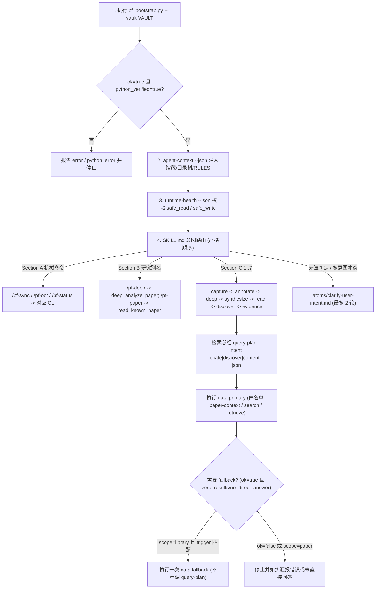

核心路由约束（`SKILL.md` & `atoms/retrieval-routing.md`）：

- **Reading-Log Safety Rule**：`prior_notes` 只能决定优先复核目标，**绝不允许仅凭 reading-log 回答事实性问题**；须回原文/图表复核，推翻则写入校正记录。
- **Paper Context 优先门禁**：进入 `read-known-paper` 或 `deep-analyze-paper` 前必须先执行 `paper-context`，且优先排查 `user_annotations.questions` 并参考 `living_memory.facets`。
- **Object Context Resolution Protocol**：当 `retrieve` 返回 `source_kind: "object"` 且 `structure_resolved: false` 时属正常现象；仅当 caption 不足以回答问题时，在同一 `--paper <KEY>` 作用域下最多执行 1 次 contextual `retrieve` 补查正文引用（每次对话同对象最多 1 次，单问题最多 2 个对象）。

#### 4.3 Deep-Reading 三阶段精读与终结闭环

```mermaid
sequenceDiagram
    participant Agent
    participant DeepScript as "pf_deep.py"
    participant Note as "Formal Note (KEY.md)"
    participant CLI as "paperforge CLI"

    Agent->>CLI: "paper-context {KEY} --structure --json"
    Note over Agent: "核对 ocr_status=done 且 analyze=true, 读取 living_memory 与 user_annotations"
    Agent->>DeepScript: "prepare --key {KEY} --vault $VAULT"
    DeepScript-->>Agent: "返回 figures, tables, figure_map, chart_type_map 并插入骨架"
    Agent->>Note: "写入 Pass 1 (概览/5 Cs/Figure导读) 并保存"
    Agent->>Note: "按图逐张写入 Pass 2 (精读还原 + 图表审查)"
    Agent->>DeepScript: "postprocess-pass2 {note_path} --figures N"
    Note over Agent,DeepScript: "校验不过最多修正 3 轮"
    Agent->>Note: "写入 Pass 3 (深度理解/遗留问题回应 user_annotations.questions)"
    Agent->>DeepScript: "validate-note {note_path} --fulltext {fulltext_path}"
    Note over Agent,DeepScript: "全量结构校验不过最多修正 3 轮"
    Agent->>CLI: "paperforge deep-finalize {KEY} --json"
    CLI->>Note: "校验 has_deep_reading_content -> 设置 deep_reading_status: done"
    CLI->>CLI: "refresh_index_entry(vault, KEY) 更新 formal-library.json"
    Agent->>CLI: "paperforge memory-card refine {KEY} --facet ... --content ..."
```

---

### 5. 配置项、环境变量、CLI 入口与错误码

#### 5.1 平台枚举与路径配置（`paperforge/config.py`）

- **`AGENT_SHARED_SKILL_DIR`**：`".agents/skills"`（CLI `paperforge skill deploy` 默认 `--to` 目标，兼容 Claude Code、Codex、OpenCode、Cursor、Gemini CLI、Kilo、Crush、Kimi-cli、Pi/Oh My Pi）。
- **`AGENT_PLATFORM_IDS`**（15 项合法 `agent_platform` 枚举）：`"opencode"`, `"claude"`, `"codex"`, `"cursor"`, `"gemini"`, `"kilo"`, `"pi"`, `"omp"`, `"crush"`, `"kimi"`, `"github_copilot"`, `"cline"`, `"windsurf"`, `"augment"`, `"trae"`。对应配置键为 `agent_platform`（环境变量 `PAPERFORGE_AGENT_PLATFORM`），Skill 目录键为 `skill_dir`（环境变量 `PAPERFORGE_SKILL_DIR`，默认 `".agents/skills"`），命令目录键为 `command_dir`（环境变量 `PAPERFORGE_COMMAND_DIR`，默认 `".opencode/command"`）。

#### 5.2 CLI 入口与参数矩阵

| CLI 命令                                              | 参数                                                        | 行为与说明                                                                                                         |
| :---------------------------------------------------- | :---------------------------------------------------------- | :----------------------------------------------------------------------------------------------------------------- |
| `paperforge skill deploy`                             | `[--to DIR]` `[--overwrite]` `[--json]`                     | 部署打包的 `paperforge` 技能树至 `<vault>/<DIR>/paperforge`                                                        |
| `paperforge deep-reading`                             | `[--json]`                                                  | 只读扫描精读队列，返回 `{queue, summary: {total, ready, blocked}}`                                                 |
| `paperforge deep-finalize <zotero_key>`               | `[--json]`                                                  | 校验正式笔记 `## 🔍 精读` 完整度后更新 `deep_reading_status: "done"` 并刷新规范索引                                |
| `python -m paperforge.worker.discussion record <KEY>` | `--vault PATH --agent NAME --model MODEL [--qa-pairs JSON]` | 原子带锁追加结构化 Q&A 会话至 `<ai_path>/discussion.md`                                                            |
| `paperforge agent-context`                            | `[--json]`                                                  | 输出全库统计、`_build_collection_tree()` 目录树、`COMMANDS`（10 项）与 `RULES`（15 条）                            |
| `paperforge paper-context <key>`                      | `[--structure]` `[--json]`                                  | 返回单篇全上下文包（含 `living_memory`、`user_annotations`、`prior_notes`、`ocr_evidence` 及可选紧凑 `structure`） |
| `paperforge context`                                  | `<key> \| --domain D \| --collection P \| --all`            | 从 `formal-library.json` 导出带 `_provenance` 与 `_ai_readiness` 的原始上下文包                                    |
| `paperforge paper-status <query>`                     | `[--json]`                                                  | 多路查找文献状态、健康度及 `recommended_action`                                                                    |
| `paperforge inspect <query>`                          | `[--json]`                                                  | 零锁只读 6 阶段管道诊断（`source` → `lineage` → `ocr` → `objects_and_render` → `memory` → `vectors`）              |
| `paperforge read <key>`                               | `--find TERM [--source {auto,fulltext,pdf}] [--json]`       | 本地字面子串检索（永不触发语义推理或写盘）                                                                         |
| `paperforge paper-lookup`                             | `<query> \| --from-path PATH [--limit N] [--json]`          | Layer 4 定位文献；`--from-path` 按 5 级优先顺序反查规范身份                                                        |
| `paperforge content-discovery <query>`                | `[--limit N] [--json]`                                      | 优先正文 FTS5（经血缘门控），无则降级元数据 FTS + 可选向量辅臂                                                     |
| `paperforge paper-navigation <query>`                 | `[--json]`                                                  | 输出 `structure-tree.json` 或降级输出 `role-index.json` 汇总                                                       |
| `paperforge scoped-fetch <query>`                     | `[--limit N] [--json]`                                      | 按 `KEY:section_path` 或 `KEY#node_id` 提取 `body_units` 与 `manifest`                                             |

#### 5.3 错误码映射表

| 错误码 / 状态             | 触发场景                                                                                                                                                                                            |
| :------------------------ | :-------------------------------------------------------------------------------------------------------------------------------------------------------------------------------------------------- |
| `VALIDATION_ERROR`        | `deep-finalize` 缺少 `zotero_key`、笔记无有效 Frontmatter、key 不匹配或 `has_deep_reading_content` 未通过；`paper-lookup` 同时传入或同时缺省 `query` 与 `--from-path`；`paper-context` 参数读取异常 |
| `PATH_NOT_FOUND`          | `agent-context` 未找到 `paperforge.db`；`paper-context` / `paper-status` / `inspect` 未找到目标文献；`read` 返回 `no_readable_source`                                                               |
| `ACTION_SCOPE_INVALID`    | `read` 传入非法 `--source` 参数（退出码 `2`）                                                                                                                                                       |
| `INTERNAL_ERROR`          | `inspect` / `paper-status` / `read` 执行期意外异常；`paper-lookup --from-path` 无法解析 Vault                                                                                                       |
| `skill deploy` 退出码 `1` | 存在差异文件且未指定 `--overwrite`（`already_exists: true`），或 `--to` 试图逃逸 Vault 根目录                                                                                                       |

---

### 6. 边界防护与 Fail-Closed 防呆规则

1. **运行时指针 Fail-Closed（`pf_bootstrap.py`）**：当用户主目录 `.paperforge` 下的 `runtime/pointer.json` 存在但损坏/schema 不等于 `1`/路径非绝对时，`pointer_status == "invalid"`，直接返回 `python_verified: false` 并终止，**严禁回退到 Vault `.venv` 或系统全局 Python**。
2. **后台能力真值对齐（`pf_bootstrap.py`）**：`capabilities.semantic_ready` 强制由真实调用 `embed status --json` 且 `vector_state == "ready" and valid_total_chunks > 0` 决定，不被插件 `data.json` 中可能过期的开关状态欺骗。
3. **`paper-lookup --from-path` 严格互斥与反伪造（`paper_lookup.py`）**：位置参数 `query` 与 `--from-path` 必须二选一；经由目录名提取 8 位 key（如 `<KEY> - Title/`）时，**必须能在 `formal-library.json` 中查到对应条目**，找不到则 Fail-Closed 返回 `{"kind": "unknown"}`，防止孤立文件夹伪造规范身份。
4. **`deep-finalize` 校验前置与零强写（`finalize.py`）**：必须在 `has_deep_reading_content(text)` 检验通过后才可将 `deep_reading_status` 置为 `"done"`，未完成骨架或仅有 `（待补充）` 占位符的笔记直接拒绝修改并保持原文件字节零改动。
5. **`paperforge inspect` 无锁零副作用（`inspect_paper.py`）**：严格以 `?mode=ro` 直连 SQLite，不获取 `WriterLock` 或 `.read.lock`，不向磁盘写入任何诊断文件，确保在并发构建或权限受限场景下也能安全观测全部 6 个阶段瓶颈。
6. **只读命令全量零持久化（`tests/test_x13_query_read_only.py`）**：所有只读与报告命令（含 `agent-context`、`paper-status`、`search`、`deep-reading`、`runtime-health`、`probe` 等）执行前后整库所有非 SQLite 临时锁/SHM 文件的字节哈希与 mtime 必须保持一致。
7. **探针与动作全闭环（`tests/test_x14_loop_closure.py`）**：`probe` 与 `reconcile` 发布的每个 `action_id` 必须能在动作注册表中合法派发或携带显式无动作契约，消除死链引导。

---

### 7. 维修、调试与升级 Checklist

- [ ] **部署或升级 Vault 内 Skill**：运行 `paperforge skill deploy --json` 检查是否 `noop: true`；若版本升级后返回 `already_exists: true`，先备份自定义修改（如有）再执行 `paperforge skill deploy --overwrite --json`，并确认 `<vault>/AGENTS.md` 仍保留用户原有内容。若使用独立目录客户端（如 `.omp/skills`），追加 `--to <dir>`。
- [ ] **排查 Agent 启动失败或 Python 绑定异常**：在 Vault 根目录运行已部署的 `pf_bootstrap.py`（即 `<skill_dir>` 内的 `paperforge/skills/paperforge/scripts/pf_bootstrap.py` 副本，`--vault .`），核对 `runtime_pointer.status`、`python_verified` 与 `skill_api_version`；若指针失效或版本不匹配，运行 `paperforge runtime repair --json` 或 `paperforge runtime update --json`。
- [ ] **单篇流水线全链路排障**：对卡住的论文运行 `paperforge inspect <KEY> --json`，直接定位首个 `bottleneck_stage`（`source` / `lineage` / `ocr` / `objects_and_render` / `memory` / `vectors`）并按 `diagnosis.recommended_commands` 执行修复。
- [ ] **恢复失败的 `deep-finalize`**：若精读已完成写回但 `deep-finalize <KEY>` 报错 `deep-reading content is incomplete`，先运行已部署的 `pf_deep.py`（源码位于 `paperforge/skills/paperforge/scripts/pf_deep.py`）执行 `validate-note "<note_path>" --fulltext "<fulltext_path>"` 逐条排查缺失的必需小节或 figure 嵌入，补齐后重试 `deep-finalize`。
- [ ] **验证检索规划与上下文注入**：对复杂混合查询先执行 `paperforge query-plan "<query>" --intent content --json` 观察 `primary` 与 `runtime.retrieve_available`；执行 `paperforge paper-context <KEY> --structure --json` 确认 `living_memory`、`user_annotations` 与 `structure.nodes` 正常投喂。
- [ ] **回归验证测试集**：修改 Skill 分发、工作流脚本、`/pf-*` 契约或上下文命令后，执行 `pytest tests/cli/test_skill_deploy_cli.py tests/test_command_docs.py tests/test_skill_graph_contracts.py tests/test_skill_graph_layout.py tests/test_pf_bootstrap_capabilities.py tests/test_finalize_command.py tests/test_discussion.py tests/test_paper_context_evidence.py tests/test_paper_lookup_from_path.py tests/test_context.py tests/test_x13_query_read_only.py tests/test_x14_loop_closure.py tests/unit/test_agent_loop_closure.py`。

> 相关章节：`paperforge.db` 底层表结构、`vec0` 索引与混合检索打分细节见 [Chapter 10](#chapter-10)；PDF 侧车批注定位引擎与 Living Memory Card 持久化见 [Chapter 11](#chapter-11)。

---

<a id="chapter-13"></a>

## 第 13 章：Obsidian Thin-Client 插件、IPC 传输与五大视图交互

> 源文件：`docs/handbook/13-obsidian-plugin-and-views.md`

> **章节定位**：本文档剖析 PaperForge 的 Obsidian 前端插件架构（`paperforge/plugin/`），聚焦 Thin-Client 物理隔离约束、`NodeProcessTransport` 与 `PaperForgeClient` 的单通道长任务/短命令协议、Managed Runtime 引导与旧密钥一次性迁移机制，以及五大核心界面表面（`PaperForgeBasesView`、`PaperForgeStatusView`、`PaperForgePdfView`、`PaperForgeSettingTab`、`OcrWorkspaceView`）的状态机与生命周期保障。构建/测试门禁见 [第 14 章](#chapter-14)。

---

### 1. 职责与非目标边界

PaperForge Obsidian 插件被严格定义为 **Thin-Client（纯展示与意图编排壳层）**。按照 [docs/design-thin-client-boundaries.md](design-thin-client-boundaries.md) 与自动化架构门禁 [paperforge/plugin/tests/client/architecture-boundaries.test.ts](../paperforge/plugin/tests/client/architecture-boundaries.test.ts) 的契约，插件端与 Python 核心后端之间实行单一事实源（Single Source of Truth）分工。

| 维度               | 插件端职责（允许执行）                                                                                                                                                      | 非目标边界（明确禁止，违者测试 FAIL）                                                                                                                                                                          |
| :----------------- | :-------------------------------------------------------------------------------------------------------------------------------------------------------------------------- | :------------------------------------------------------------------------------------------------------------------------------------------------------------------------------------------------------------- |
| **进程与环境边界** | 仅通过 `NodeProcessTransport` 启动受控 Python 子进程（`execute` / `stream` / `launchRuntimeInstaller`）                                                                     | 任何视图、设置页、`main.ts` 或服务层代码均禁止直接调用 `child_process`（`spawn` / `execFile` / `execFileSync`），且 `PaperForgeClient` 与 `NodeProcessTransport` 仅可在 `paperforge/plugin/src/main.ts` 实例化 |
| **配置与存储读写** | 调用 `configList` / `configSet` / `configValidate` / `configMigrate` 读写后端权威配置，并在 `data.json` 中仅保留只读展示镜像（Display Mirror）与插件 UI 偏好                | **禁止**直接读写/解析 Vault 内 `paperforge.json`、`formal-library.json`、`manifest.json`、SQLite `.db` 文件，也禁止自行调用 `processFrontMatter(`、`getFileCache(` 或访问 `.pre-rebuild` 等中间产物            |
| **凭据与密钥管理** | 通过 `authSetSecret` 经由 `stdin` 将用户输入的 OCR / Embedding API Key 写入 Python Keyring；提供 `migrateLegacySecret` 完成旧版 Obsidian `SecretStorage` 的一次性迁移与擦除 | 运行期**永不**从 Obsidian `SecretStorage` 读取密钥，**永不**将密钥写入命令行 `argv`、日志或进程环境变量（`stripCredentialEnv` 主动剔除敏感 env 前缀）                                                          |
| **路径与身份判定** | 调用 `client.resolvePaperContext(filePath)` 向后端查询当前活动文档属于 `paper` / `domain` / 全局；通过 `runtime-paths.ts` 消费 `config list` 返回的绝对目录映射             | **禁止**基于 Obsidian Active File 文件名正则猜测 `zotero_key`，禁止自行拼接外部 `resources_dir` / `indexes` 业务路径去直接写数据                                                                               |
| **业务逻辑与写回** | 分发标准化的 Action/CLI 命令并展示 `ProbeEnvelope` / `NdjsonEvent` / DTO 结果；PDF 批注与阅读记录通过 CLI JSON 子命令落库                                                   | **禁止**在 TypeScript 中重新实现文献索引同步、OCR 状态机推断、Living Memory Facet 生成或文件版本快照写盘逻辑                                                                                                   |

> [!IMPORTANT]
> **为什么旧服务文件保持永久删除（Tombstone）？**
> [paperforge/plugin/tests/client/architecture-boundaries.test.ts](../paperforge/plugin/tests/client/architecture-boundaries.test.ts) 对已退役模块建立了墓碑检查：一旦重新引入 `services/long-task-client.ts`、`services/action-client.ts`、`services/config-client.ts`、`services/version-history.ts` 或 `utils/zotero-path.ts` 等越权直连服务，CI 将立即拦截，防止"双权威状态漂移"。

---

### 2. 核心源码与单测映射表

#### 2.1 客户端、传输与后端契约层 (`paperforge/plugin/src/client/`)

| 源码路径                                            | 核心导出符号 / 类                                                                                                                                          | 职责摘要                                                                                                                                                                                                                                                                                         | 对应单测文件                                                                                                                                                                                                                                             |
| :-------------------------------------------------- | :--------------------------------------------------------------------------------------------------------------------------------------------------------- | :----------------------------------------------------------------------------------------------------------------------------------------------------------------------------------------------------------------------------------------------------------------------------------------------- | :------------------------------------------------------------------------------------------------------------------------------------------------------------------------------------------------------------------------------------------------------- |
| `paperforge/plugin/src/client/index.ts`             | 统一重导出桶                                                                                                                                               | 汇总导出 `action-contract`、`transport`、`paperforge-client`、`node-transport`                                                                                                                                                                                                                   | `paperforge/plugin/tests/client/architecture-boundaries.test.ts`                                                                                                                                                                                         |
| `paperforge/plugin/src/client/transport.ts`         | `Transport`、`NdjsonEvent`、`LongTaskOutcome`、`StreamDiagnostics`、`AsyncEventQueue`                                                                      | 定义后端传输抽象接口、流式事件队列（支持异步迭代与句柄取消）与超时/信号诊断结构                                                                                                                                                                                                                  | `paperforge/plugin/tests/client/node-transport.test.ts`                                                                                                                                                                                                  |
| `paperforge/plugin/src/client/node-transport.ts`    | `NodeProcessTransport`、`NdjsonStreamParser`、`ExecuteChildRegistry`、`runLongTask`、`paperforgeEnrichedEnv`                                               | 唯一 `child_process` 权威；实现 Python 发现、暖 `daemon --stdio` 复用（`cwd: os.tmpdir()` 防锁 Vault 目录、支持旧版本一次性降级回退，且 `shutdownDaemon()` 在强杀进程前清理超时器并拒绝所有在途并发 RPC 以便下次调用平滑重拉）、`PAPERFORGE_STOP\n` 协同取消、跨平台子进程树收割与 NDJSON 行解析 | `paperforge/plugin/tests/client/execute-child-reaping.test.ts`、`paperforge/plugin/tests/client/protocol-conformance.test.ts`、`paperforge/plugin/tests/client/daemon-transport.test.ts`                                                                 |
| `paperforge/plugin/src/client/paperforge-client.ts` | `PaperForgeClient`、DTO 接口（`PdfAnnotationDto`、`PaperMemoryCardDto`、`MemoryHistoryEntryDto`、`VersionsResetLiveResultDTO`、`BaseTableSnapshotDto` 等） | 统一对外 RPC 客户端；持有 `OperationLock`（`_activeOperation`）互斥锁、`generation`/`epoch` 防复活读缓存、`invalidatePaperScope` 局部缓存失效及版本切回/记忆读写强类型方法                                                                                                                       | `paperforge/plugin/tests/client/paperforge-client.test.ts`、`paperforge/plugin/tests/client/x03-concurrency-isolation.test.ts`、`paperforge/plugin/tests/client/runtime-status-retry.test.ts`、`paperforge/plugin/tests/living-memory-and-reset.test.ts` |
| `paperforge/plugin/src/client/action-contract.ts`   | `ActionScope`、`ActionRequest`、`ActionRunResult`、`buildActionArgv`                                                                                       | 将前端动作（`all`/`paper`/`papers`/`collection`）序列化为标准 CLI 参数数组，禁止自由拼接 shell                                                                                                                                                                                                   | `paperforge/plugin/tests/client/probe-action-dispatch.test.ts`                                                                                                                                                                                           |
| `paperforge/plugin/src/client/probe-types.ts`       | `ProbeEnvelope`、`ProbeAllEnvelope`、`CapabilityState`、`UserState`、`Severity`、`ActionPrimary`                                                           | 对应后端 `schema_version=2` 的能力探测信封契约，驱动设置页 Control Center 徽章与按钮动作                                                                                                                                                                                                         | `paperforge/plugin/tests/capability-state.test.ts`                                                                                                                                                                                                       |
| `paperforge/plugin/src/client/trace.ts`             | `traceRecord`、`dumpTrace`、`traceConsoleError`、`rejectionCode`、`rejectionData`                                                                          | 200 条有界元数据环形缓冲区（`MAX_RECORDS = 200`）；仅记录命令身份/耗时/错误码，严禁输出敏感参数与密钥                                                                                                                                                                                            | `paperforge/plugin/tests/client/trace.test.ts`                                                                                                                                                                                                           |

#### 2.2 基础设施与编排服务层 (`paperforge/plugin/src/services/` & `src/`)

| 源码路径                                                                                 | 核心导出符号                                                                                                        | 职责摘要                                                                                                                                             | 对应单测 / 契约                                                                                                                                                           |
| :--------------------------------------------------------------------------------------- | :------------------------------------------------------------------------------------------------------------------ | :--------------------------------------------------------------------------------------------------------------------------------------------------- | :------------------------------------------------------------------------------------------------------------------------------------------------------------------------ |
| `paperforge/plugin/src/main.ts`                                                          | `PaperForgePlugin`、`ReleaseNotesModal`、`ConfirmMigrationModal`                                                    | 插件入口；注册视图与命令、维护 `.state-seq.json` 监听、运行收敛定时器（默认 120s）、管理 `openPaperPdf` / `openPaperSplitReading` 及 `onunload` 清理 | `paperforge/plugin/tests/commands.test.ts`、`paperforge/plugin/tests/client/main-autosync-cutover.test.ts`、`paperforge/plugin/tests/client/main-ocr-run-cutover.test.ts` |
| `paperforge/plugin/src/services/managed-runtime.ts`                                      | `readRuntimePointer`、`resolveRuntimeCommand`、`PointerInfo`                                                        | 只读解析 `pointer.json`（位于用户主目录 `.paperforge` 运行时子目录，强制校验 `schema_version === 1` 与绝对路径）                                     | `paperforge/plugin/tests/managed-runtime.test.ts`、`paperforge/plugin/tests/managed-runtime-real-kill.test.ts`                                                            |
| `paperforge/plugin/src/services/runtime-installer-launcher.ts`                           | `normalizePep440Version`、`bootstrapPythonSource`、`windowsInstallerScript`、`posixInstallerScript`、`installerRun` | 构造无控制台外部安装脚本（含 PEP 668 `--break-system-packages` 兼容及 TUNA 镜像回退）与 SemVer 转 PEP 440 归一化                                     | `paperforge/plugin/tests/runtime-installer-launch.test.ts`                                                                                                                |
| `paperforge/plugin/src/services/secret-storage.ts`                                       | `stripCredentialEnv`、`legacyEmbeddingSecretIds`、`migrateLegacySecret`                                             | 环境变量凭据清洗；以及从旧版 `paddleocr-api-key` / SHA-256 哈希化的 `vector-db-api-key-v2-*` 密钥向 Python `auth set --stdin` 的一次性显式迁移       | `paperforge/plugin/tests/secret-storage.test.ts`                                                                                                                          |
| `paperforge/plugin/src/services/runtime-paths.ts`                                        | `applyPathConfigFromList`、`readPathConfig`、`resolveVaultPaths`、`isConfigHydrated`                                | 从 `config list` 同步展示镜像与 Vault 相对路径解析；`isConfigHydrated()` 作为 `.state-seq.json` 监听前置守卫                                         | `paperforge/plugin/tests/client/foundation-maintenance-cutover.test.ts`                                                                                                   |
| `paperforge/plugin/src/services/next-actions-orchestrator.ts` & `next-actions-bridge.ts` | `orchestrateFromSync`、`orchestrateNextActions`                                                                     | `sync` 完成后编排后续推荐动作，内置 `_inFlight` 集合与深度防环守卫（`depth > 0` 抑制重入）                                                           | `paperforge/plugin/tests/next-actions-orchestrator.test.ts`                                                                                                               |
| `paperforge/plugin/src/services/progress-parser.ts` & `python-bridge.ts`                 | `parseProgressLine`、`classifyError`、`classifySetupFailure`                                                        | 纯函数进度行解析与安装/环境错误分类                                                                                                                  | `paperforge/plugin/tests/progress-parser.test.ts`、`paperforge/plugin/tests/errors.test.ts`                                                                               |
| `paperforge/plugin/src/constants.ts`、`primitives.ts`、`i18n.ts`                         | `VIEW_TYPE_*`、`ACTIONS`、`CAPABILITY_MODULES`、`PaperForgeSettings`、`t()`                                         | 视图 ID 常量、全局工具命令表、设置结构与中英双语 i18n                                                                                                | `paperforge/plugin/tests/state-showcase.test.ts`                                                                                                                          |

#### 2.3 五大核心视图与弹窗交互层 (`paperforge/plugin/src/views/` & `settings.ts`)

| 源码路径                                                                                        | 核心类与注册 ID                                                                                                                                                        | 职责摘要                                                                                                                                                                             | 对应单测文件                                                                                                                                                                                                                             |
| :---------------------------------------------------------------------------------------------- | :--------------------------------------------------------------------------------------------------------------------------------------------------------------------- | :----------------------------------------------------------------------------------------------------------------------------------------------------------------------------------- | :--------------------------------------------------------------------------------------------------------------------------------------------------------------------------------------------------------------------------------------- |
| `paperforge/plugin/src/views/paperforge-base-view.ts`                                           | `PaperForgeBasesView` (`type = "paperforge-table"`)                                                                                                                    | Obsidian Bases 文献工作台视图；内嵌单行快速操作、Shift 连选、多选上下文顶栏（`.pf-base-selection-bar`）与实时解析进度条                                                              | `paperforge/plugin/tests/paperforge-base-view.test.ts`                                                                                                                                                                                   |
| `paperforge/plugin/src/views/dashboard.ts`                                                      | `PaperForgeStatusView` (`type = "paperforge-status"`)、`MemoryFacetHistoryModal`                                                                                       | 右侧伴读 Companion 面板；支持 `global`/`collection`/`paper` 三态自动切换、128 槽有界 LRU 缓存、Scoped `Ctrl+Enter`、`M`/`@` 双模检索、可交互 Living Paper Memory Card 与历史回溯弹窗 | `paperforge/plugin/tests/dashboard-runtime.test.ts`、`paperforge/plugin/tests/W18-resilience-evidence.test.ts`、`paperforge/plugin/tests/living-memory-and-reset.test.ts`                                                                |
| `paperforge/plugin/src/views/pdf-annotator.ts`                                                  | `PaperForgePdfView` (`type = "paperforge-pdf-view"`)                                                                                                                   | 内置 PDF.js + TextLayer + SVG/HTML Sidecar 批注阅读器；macOS Preview 风格批注工具条、Human vs Agent 双层过滤、溯源校验（`provenance_status`）、笔记双向跳页                          | `paperforge/plugin/tests/pdf-annotator.test.ts`                                                                                                                                                                                          |
| `paperforge/plugin/src/settings.ts` & `paperforge/plugin/src/views/modals.ts`                   | `PaperForgeSettingTab`、`PaperForgeSetupWizardModal`、`PaperForgeOrphanModal`、`PaperForgeIssueDraftModal`                                                             | 4-Stage 引导向导、01-05 Control Center 总览与 6 能力模块详情页（`.pf-settings-shell.pf-settings-scope`）、`.pf-cc-quick-filter` 快速检索、孤儿/问题脱敏报告弹窗                      | `paperforge/plugin/tests/modals.test.ts`、`paperforge/plugin/tests/installation-navigation.test.ts`、`paperforge/plugin/tests/module-detail-navigation.test.ts`、`paperforge/plugin/tests/maintenance-inbox.test.ts`                     |
| `paperforge/plugin/src/views/ocr-workspace.ts` & `research-record.ts` & `paper-interactions.ts` | `OcrWorkspaceView` (`type = "paperforge-ocr-workspace"`)、`DiagnosticFulltextPreviewModal`、`VersionRestoreModal`、`ResearchRecordCaptureModal`、`ResearchRecordModal` | 每页 100 条（`PAGE_SIZE = 100`）分页的 OCR 批次与单篇排错工作台、全文隐私脱敏预览、版本回滚与“切回最新规范全文”、阅读记录采集与统一右键/Hover 预览菜单                               | `paperforge/plugin/tests/ocr-workspace-runtime.test.ts`、`paperforge/plugin/tests/ocr-workspace-pagination.test.ts`、`paperforge/plugin/tests/ocr-diagnostic-privacy.test.ts`、`paperforge/plugin/tests/living-memory-and-reset.test.ts` |

> [!NOTE]
> 除 Vitest 单元测试外，真实 Obsidian 宿主集成测试位于 `paperforge/plugin/test/specs/paperforge.e2e.ts`，配合测试 Vault 构造脚本 `paperforge/plugin/test/fixtures/build_e2e_vault.py` 与密钥环夹具 `paperforge/plugin/test/fixtures/e2e_keyring.py` 运行（由 `npm --prefix paperforge/plugin run test:e2e` 驱动）。

---

### 3. 磁盘文件、数据库表与协议 JSON 字段字典

#### 3.1 插件侧关心的磁盘文件与索引信号

插件不直接操作 SQLite，也不自行解析业务配置，仅观察两类轻量级本地状态指针文件与 Obsidian 自身的插件配置目录：

| 文件路径（相对约定目录）                                        | 拥有方 / 读写权限                                                          | 关键字段与用途                                                                                                                                                       |
| :-------------------------------------------------------------- | :------------------------------------------------------------------------- | :------------------------------------------------------------------------------------------------------------------------------------------------------------------- |
| 宿主主目录 `.paperforge` 下 `runtime` 子目录中的 `pointer.json` | Python `runtime_installer` 原子发布；插件 **只读**（`readRuntimePointer`） | `schema_version` (必须为 `1`)、`python_path` (绝对路径)、`environment_root` (绝对路径)、`paperforge_version`                                                         |
| `pointer_dir()` 内的 `installer.log` 与临时安装脚本             | 安装器脚本写入；插件 **只读**尾部诊断                                      | 含终端完成标记 `[PaperForge] Installer finished.` 与失败标记 `[PaperForge] Installer step failed.`，用于 3s 轮询即时感知进程结果                                     |
| `<indexesDir>/.state-seq.json`                                  | Python 后端完成状态变更时原子替换；插件通过 `fs.watch` **只读**监听        | `seq` (单调递增整数)、`changed_keys` (字符串数组，指示受影响 `zotero_key`)；150ms 防抖后触发 `invalidateCache()` 与 `refreshBaseSnapshot()`                          |
| Vault 内 `.obsidian` 插件目录下的 `data.json`                   | Obsidian 插件持久化存储（`loadData`/`saveData`）                           | 仅保存 UI 偏好（`ui_theme_mode`、`autoSyncEnabled`、`autoSyncIntervalSeconds`、`debug_trace`、`_setup_complete`）、能力探针缓存 `capabilityState` 与后端配置展示镜像 |

#### 3.2 IPC 协议：NDJSON 长任务 10 类事件模型 (`node-transport.ts`)

流式命令（如 `sync`、`ocr`、`embed build`、`action run`）采用每行一条 JSON（`NdjsonStreamParser` 按 `\n` 切分，保留末尾不完整缓冲直到流关闭或下一行到来）的格式输出到 `stdout`。`KNOWN_EVENTS` 白名单严格限定以下 10 种事件；`TERMINAL_EVENTS` 为 `result`、`error`、`cancelled`，其余未知事件或非 JSON 行会被丢弃并计入诊断计数，不阻塞流消费。

| `event` 类型    | 所属类别           | 核心字段字典                                     | 前端处理行为                                                  |
| :-------------- | :----------------- | :----------------------------------------------- | :------------------------------------------------------------ |
| `start`         | 生命周期开始       | `op`, `total`?, `ts`?                            | 初始化流阶段状态                                              |
| `preflight`     | 预检结果           | `ok`, `blocking`?, `warnings`?                   | 展示前置条件提示或阻止继续                                    |
| `phase`         | 阶段切换           | `phase`, `label`?, `paper_key`?                  | 更新当前运行步骤文案（如阶段转换）                            |
| `progress`      | 数值进度           | `current`, `total`, `paper_key`?, `item_status`? | 更新 `OcrWorkspaceView` 与 `PaperForgeBasesView` 进度条       |
| `paper_settled` | 单篇落盘           | `key`/`paper_key`, `status`, `reason`?           | 触发对应论文卡片/行状态即时刷新                               |
| `heartbeat`     | 活跃保活           | `ts`?, `active_key`?                             | 维持前端运行态指示，防止误判假死                              |
| `item_result`   | 单项结果           | `key`, `ok`, `detail`?                           | 收集批处理逐篇执行摘要                                        |
| `result`        | **终态（成功）**   | `ok: true`, `data`, `command`?                   | 解析 `LongTaskOutcome.kind = "result"` 并释放 `OperationLock` |
| `error`         | **终态（失败）**   | `ok: false`, `code`, `message`, `data`?          | 构造带 `code`/`data` 的结构化 Error 并释放 `OperationLock`    |
| `cancelled`     | **终态（已取消）** | `reason`?, `settled`?                            | 标记 `LongTaskOutcome.kind = "cancelled"`，保留已完成单篇成果 |

#### 3.3 核心后端读模型 DTO 字段摘要 (`paperforge-client.ts`)

1. **`ProbeEnvelope` (`probe-types.ts`, `SCHEMA_VERSION = 2`)**
   - `schema_version`: `2`
   - `module`: `CapabilityModule`（`"installation" | "library" | "ocr" | "memory" | "maintenance" | "help"`）
   - `capability_state` / `activity_state` / `severity` / `user_state`（如 `"checking" | "ready" | "not_enabled" | "setup_required" | "detection_failed"`）
   - `reason`: `{ code, summary, detail? }`
   - `action_primary`: `{ action_id, label, safety_class, confirmation_required }` — 当 `safety_class !== "safe"` 且 `confirmation_required === true` 时前端必须弹出确认框。
   - `updated_at`: ISO 时间戳，用于检测初始占位信封或 `.stale` 过期状态。
2. **`PdfAnnotationDto` (`paperforge-client.ts`)**
   - 标识与定位：`ann_id`, `paper_id`, `page`, `rects` (`number[][]` 归一化页坐标), `section_path`, `block_id`, `figure_id`。
   - 分类与内容：`kind` (`"highlight" | "underline" | "strikethrough" | "area" | "note" | "textbox" | "shape" | "ink" | "margin"`), `color` (`"yellow" | "green" | "blue" | "pink" | "red" | "purple" | "ink" | "gray" | "transparent"`), `intent` (`"evidence" | "question" | "method" | "quote" | "general"`), `exact_text`, `comment`, `tags`。
   - 人机分层与样式：`author` (`"user" | "agent"`), `lens`, `grounding_tier`, `style` (`AnnotationStyleDto`: `shape_type`, `stroke_color`, `fill_color`, `stroke_width`, `font_size`, `points`, `opacity`)。
   - 溯源与引用资产：`pdf_sha256`, `provenance_status` (`"verified" | "changed" | "unknown"`), `crop_asset_rel`, `embed_wikilink`, `created_at`, `updated_at`。
3. **`PaperMemoryCardDto` & `MemoryFacetDto` (`paperforge-client.ts`)**
   - `paper_id`, `updated_at`, `facet_count`, `facets[]`。
   - 每个 `MemoryFacetDto` 含 `facet`（对应后端 5 个认知维度：`idea_logic`、`methods_params`、`research_craft`、`critique_limits`、`my_connection`）、`label`、`content`、`revision`、`updated_at`。
4. **`BaseTableSnapshotDto` & `BasePaperRowDto` (`paperforge-client.ts`)**
   - 顶层快照含 `seq`（对齐 `.state-seq.json`）、`updated_at` 与 `rows: Record<string, BasePaperRowDto>`。
   - 每行 `BasePaperRowDto` 携带 `zotero_key`、`title`、`first_author`、`year`、`journal`、`impact_factor`、`domain`、`has_pdf`、`do_ocr`、`analyze`、`ocr_status`、`deep_reading_status`、`main_note_path`、`user_ann_count`、`agent_ann_count`、`memory_facet_count`、`memory_updated_at`、`needs_diagnostic`。

---

### 4. 核心执行链路、状态机与顺序不变量

#### 4.1 `PaperForgeClient` 单通道锁与防复活读缓存

所有前端调用统一收敛在 `PaperForgeClient` 实例上，内部维持两套强时序机制：

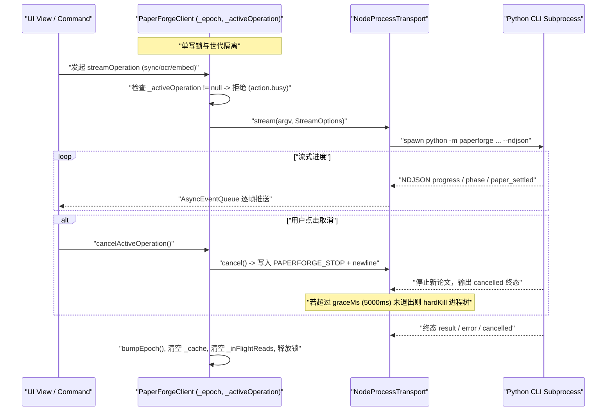

1. **单一 `OperationLock`（`_activeOperation`）**：任意时刻整个插件至多存在一个流式写/重任务在运行；并发触发第二项流式任务时在客户端直接 fail-closed 返回或抛出冲突（`action.busy`），避免多条子进程争抢 SQLite 与 Vault Markdown。
2. **读缓存 Anti-Resurrection 门卫（`_epoch` + `_cachedRead`）**：
   - 读请求（如 `probeAll` 默认 60s TTL、`runtimeStatus` 30s TTL、`reconcile` 10s TTL）复用 `_inFlightReads` 进行并发去重并缓存到 `_cache`。
   - 请求发出前捕获局部常量 `startEpoch = this._epoch`；全局写操作或 `invalidateCache()`（如 `.state-seq.json` 触发）执行 `this._epoch++` 并清空 `_cache` 与 `_inFlightReads`；单篇文献批注或记忆分面变更则调用 `invalidatePaperScope(paperKey)`，仅精准淘汰目标文献的 `paper-status:<key>` / `paper-context:<key>` / `:<key>:` 缓存条目而不清空全局 `probe:*` 探针缓存。
   - 当旧请求滞后返回时，若 `startEpoch !== this._epoch`，**严禁将过时结果回填 `_cache`**，彻底杜绝"写后读到旧快照复活"。
3. **`runtimeStatus` 瞬态重试策略**：`runtimeStatus(expectedVersion)` 设置 `30000ms` 超时，在遇到进程启动瞬态失败时仅允许最多一次 `500ms` 延迟重试；外部设置面板另设 `20000ms` Watchdog 防止界面无限悬挂在检查状态。

#### 4.2 `.state-seq.json` 状态同步、自动收敛与 `onunload` 收割闭环

1. **写入即时感知（`.state-seq.json` Watcher）**：
   - `main.ts` 在 `isConfigHydrated()` 成立后调用 `_startStateSeqWatcher(vaultBase)` 对 `<indexesDir>` 建立 `fs.watch`。
   - 仅当触发文件名空缺或为 `.state-seq.json` 时进入 `150ms` 防抖定时器；读取 `seq` 并与 `this._lastStateSeq` 去重对比。
   - 若序列号推进，依次执行：`this.getClient().invalidateCache()` → `this.refreshBaseSnapshot(changedKeys)` → `workspace.trigger("paperforge:state-changed", { snapshot, changedKeys })`。随后 `PaperForgeBasesView`、`PaperForgeStatusView`（含 Living Memory Card 与时间线）同步重绘。
2. **后台收敛轮询（`_startConvergenceTimer`）**：
   - 当 `autoSyncEnabled !== false` 时启动周期收敛器，最小周期下限钳制为 **30 秒**，默认 **120 秒**（`autoSyncIntervalSeconds: 120`），调用 `reconcile` 对齐前端展示与 Vault 状态。
3. **无泄漏卸载与子进程树收割（`onunload` + `reapAllExecuteChildren`）**：
   - `main.ts` 的 `onunload()` 依次移除 `body` 主题类、清理 `_pollTimer` 与 `_stateSeqTimer`、关闭 `_stateSeqWatcher`、分离 `VIEW_TYPE_PAPERFORGE` 与 `VIEW_TYPE_PAPERFORGE_PDF` 叶片、调用 `this._client?.cancelActiveOperation()` 中止流式任务，并调用 `NodeProcessTransport.reapAllExecuteChildren()` 清扫仍在运行的普通 `execute` 子进程。
   - `hardKill(pid)` 在 Windows 上执行 `taskkill /T /F /PID <pid>` 强制杀灭整棵进程树（Node + Python + 潜在衍生子进程），在 POSIX 上向 `-pid` 进程组发送 `SIGKILL` 并在必要时回退单 PID `kill -9`。

#### 4.3 五大核心视图交互与状态机明细

##### 视图一：Bases 文献工作台（`PaperForgeBasesView`, `paperforge-table`）

- 通过 Obsidian Bases `registerBasesView("paperforge-table", ...)` 注册；数据源来自 `BaseTableSnapshotDto` 与 Bases 查询条目合并渲染。
- **列与状态徽章**：对 `year`、`impact_factor`、`annotations` 应用等宽数字对齐类（`.pf-tnum.is-num`）；`ocr_status` 渲染 `.pf-badge-outline` 状态胶囊（`done` / `done_incomplete` / `failed` / `processing` / `nopdf` / 未解析），其中失败与部分解析徽章可直接点击跳转 `openOcrDiagnostic`。
- **行内交互与批量栏**：标题列附带快速打开 PDF 按钮及右键/Hover 预览绑定（`openUnifiedPaperContextMenu` + `bindObsidianHoverPreview`）；支持复选框与 Shift 连选多篇文献，一旦 `selectedKeys.length >= 1`，顶部滑出上下文操作栏 `.pf-base-selection-bar` 提供取消选择、单篇打开 PDF、故障诊断跳转及库同步。

##### 视图二：伴读右侧面板（`PaperForgeStatusView`, `paperforge-status`）

- **Obsidian 原生 `.nav-header` 顶栏**：使用 `.paperforge-header.nav-header` + `.nav-buttons-container.paperforge-nav-actions` 承载右侧边栏工具栏按钮与三态上下文标题，外观与原生标签页一致。
- **三态（`global` / `collection` / `paper`）上下文切换状态机**：
  - 首先加载 `dashboardStats()` 与 `items`，随后执行 `_resolveWorkspaceContext(activeLeaf)`。
  - **上下文粘滞与防抖保护**：当用户点击 `PaperForgeStatusView` 或 `OcrWorkspaceView` 面板自身时，`_resolveWorkspaceContext` 若检测到 `this._currentMode` 已存在则直接返回 `"keep"`，防止伴读面板聚焦自身时意外丢失当前正在伴读的文献！`active-leaf-change` 监听带有 **60ms 防抖** 过滤快速切换抖动；若活动叶片为 `VIEW_TYPE_PAPERFORGE_PDF`，直接提取其 `getState().paperKey` 锁定 `paper` 模式。
- **内存与视觉连续性保障**：
  - `_resolvedFileCache`、`_overviewTextCache`、`_memoryCardCache` 三大 `Map` 均通过 `_setBoundedCache` 限定上限 **128 条（FIFO/LRU 淘汰）**，并在 `onClose()` 时显式清空。
  - `_scrollOffsets` 按模式/键保留与恢复滚动位置，减少文献切换闪烁。
- **Scoped 快捷键与搜索状态机**：
  - `/` 聚焦搜索框监听器绑定在 `this.containerEl` 上（**不污染全局键盘映射**），且明确避开 `input`、`textarea`、`select` 及 `.cm-editor, [contenteditable='true']`。
  - `Ctrl+Enter` 仅在搜索框聚焦时动态 push 独立的 `obsidian.Scope`（`_ctrlEnterScope`）注册 `["Ctrl"], "Enter"` 执行一次性强制深度检索，失焦或关闭视图时立即 `popScope`，绝不劫持编辑器 `editor:open-link-in-new-leaf`。
  - 双模切换：输入或按钮切换 **`M`（Memory / 语义混合检索）** 与 **`@`（文献实体/全库检索）**；支持触发 `ResearchRecordCaptureModal` 与 `ResearchRecordModal` 新增/修正阅读记录。
- **Living Paper Memory Card（可交互研究认知记忆卡片）**：
  - `_renderLivingMemoryCard` / `_renderLivingMemoryBody`（`.pf-living-memory-card`）展示 5 个规范认知维度并支持直接交互：`编辑` 打开内联多行编辑器调用 `refineMemoryCard()`、`清空` 调用 `clearMemoryFacet()`、`历史` 打开 `MemoryFacetHistoryModal` 查看既往修订并一键恢复；空白或未填满维度通过底部 `+ <维度名>` 芯片直接补全，同时继续响应后端 `.state-seq.json` 的外部更新刷新。

##### 视图三：内置 PDF 批注与人机分层阅读器（`PaperForgePdfView`, `paperforge-pdf-view`）

- 通过 Obsidian 原生 `loadPdfJs()` 加载 PDF 字节流（优先使用 Vault 资源路径，库外 Zotero 路径通过 `Platform.resourcePathPrefix` 拼接绝对本地 URL），逐页挂载 **Canvas 渲染层 + PDF.js TextLayer + Sidecar 批注叠加层（HTML/SVG）**。
- **工具组与标注种类**：顶栏 `.pf-pdf-toolbar`（页码跳转、缩放/适应宽度、侧栏开关、目录 TOC/缩略图/批注列表切换、全文页内搜索）与类 macOS Preview 标记条 `.pf-pdf-markup-bar`（选择划词高亮 `highlight` / 下划线 `underline` / 删除线 `strikethrough`、区域截框 `area`、自由墨迹 `ink`、几何图形 `shape` 含矩形/椭圆/箭头/直线、文本框 `textbox`、便签 `note`）。
- **Human vs Agent 双层协作与溯源**：
  - 工具栏支持 `all` / `user` / `agent` 图层过滤；Agent 自动生成的高亮带有独特视觉标记 `.pf-pdf-hl-agent` 与认知透镜 `lens` / `grounding_tier` 标签。
  - 支持对 Agent 批注执行 **Adopt（采纳转正 `adoptAnnotation`）**、**Promote（晋升写入论文笔记 / 记忆 `promoteAnnotation`）** 或 **Clear Agent Annotations（清空当前文献 Agent 批注层）**。
  - 若 `PdfAnnotationDto.provenance_status === "changed"`，顶栏展示显眼警报徽章（`Source PDF modified`），提示底层 PDF 哈希与批注采集时不一致。
  - **双向阅读同步**：支持 `openPaperSplitReading(paperKey, notePath)` 垂直分栏同时打开 PDF 与正式笔记；从笔记反跳 PDF 页码/批注 ID 时高亮聚焦 `.pf-pdf-split-highlight`。

##### 视图四：6 模块 Control Center 设置页与 4 阶段 Onboarding 向导（`PaperForgeSettingTab` + `modals.ts`）

- 所有设置页内容被限定在 `.pf-settings-shell.pf-settings-scope` 容器内（避免样式溢出 Obsidian 全局设置面板），双色主题通过切换 `document.body` 的 `pf-theme-asterlab`（暖中性默认）或 `pf-theme-obsidian`（桥接用户当前 Obsidian 主题变量）实现。
- **顶栏导航与总览 Control Center**：包含 Overview、Contextual `module-detail` 及 Help 子页，附带 `.pf-cc-quick-filter` 快速检索输入框；总览页以 `01`–`05` 编号卡片呈现五大操作视角（Foundation、`installation` / Library / OCR / Smart Retrieval `memory` / Agent Integration），而底层 `CAPABILITY_MODULES` 对接后端 6 大探测域（`installation`, `library`, `ocr`, `memory`, `maintenance`, `help`）。其中旧版冗余的 Maintenance Tab 已被移除（保留后端残余检查与一键清理入口 `PaperForgeOrphanModal` 以及错误报告脱敏弹窗 `PaperForgeIssueDraftModal`）。
- **4-Stage Setup Journey (`_setupStage` 1→4)**：既可内嵌在设置页顶部横幅，也可由 `PaperForgeSetupWizardModal` 打开：
  1. `Stage 1 Foundation`（`_renderSetupStageFoundation`）：检测运行指针文件 `pointer.json`（位于用户主目录 `.paperforge` 的 `runtime` 子目录）与 `runtimeStatus`，缺失或版本不匹配时调用 `launchRuntimeInstaller` 启动独立无窗口安装脚本并每 3s 轮询 `pointer.json` 与 `installer.log`（最长 25 分钟）。
  2. `Stage 2 Library`（`_renderSetupStageLibrary`）：配置 Vault、Zotero 与文献目录，先经 `configSet` + `configValidate`，通过后强制立即执行一次 `client.sync()` 构建规范文献索引（防止仅写配置而索引未建导致 `library` 探针误判）。
  3. `Stage 3 Optionals`（`_renderSetupStageOptionals`）：按需启用 PaddleOCR（Key 经 `stdin` 写入 Keyring）、Vector Embedding（支持 OpenAI SDK 兼容端点）及 Agent Integration 技能/平台部署。
  4. `Stage 4 Review`（`_renderSetupStageReview`）：汇总 `probeAll` 结果并触发最终就绪确认。

##### 视图五：OCR 批量排错工作台与弹窗家族（`OcrWorkspaceView` & `modals.ts`）

- `OcrWorkspaceView` 按每页 **100 条**（`PAGE_SIZE = 100`）分页加载 `queryOcrPapers`，支持按全部/未处理/需复核/已解析及 OCR 引擎版本筛选，展示实时解析进度及历史遗留活动提示。
- 双击或点击诊断按钮可打开 `DiagnosticFulltextPreviewModal`（在前端强制做隐私与敏感信息脱敏处理）及 `VersionRestoreModal`（通过后端 `versionsList` / `versionsPaths` / `versionsRestore` 从历史快照恢复展示全文，或通过 `切回最新规范全文` -> `versionsResetLive` 一键恢复最新规范全文并清除 `restore_provenance`）。
- 其他共用弹窗集中在 `paperforge/plugin/src/views/modals.ts`：`PaperForgeOrphanModal`（孤儿文件安全清理确认）、`PaperForgeConfirmModal`（破坏性或非 `safe` Action 二次确认）、`PaperForgeIssueDraftModal`（自动采集堆栈并执行规则脱敏生成可粘贴排查工单）。

---

### 5. 配置项、环境变量、CLI 入口与错误码

#### 5.1 插件注册的 Obsidian 命令表 (`paperforge/plugin/src/main.ts`)

| Command ID                        | 命令用途                                    | 执行路由机制                                        |
| :-------------------------------- | :------------------------------------------ | :-------------------------------------------------- |
| `paperforge-status-panel`         | 打开 PaperForge Companion 面板              | `PaperForgeStatusView.open`                         |
| `paperforge-open-literature-base` | 打开 `Literature Hub.base` 或回退 Companion | `openLiteratureBase()`                              |
| `paperforge-ocr-workspace`        | 打开 OCR 批量排错工作台                     | `OcrWorkspaceView.open`                             |
| `focus-companion-search`          | 聚焦 Companion 搜索框                       | 打开面板后 `view._searchInput?.focus()`             |
| `open-paper-split-reading`        | 当前 PDF 或笔记一键垂直分栏精读             | `resolvePaperContext` -> `openPaperSplitReading`    |
| `paperforge-sync`                 | 同步 Zotero 文献库与生成规范笔记            | `client.sync()`（Stream / Action 队列）             |
| `paperforge-ocr`                  | 批量执行全文 OCR 解析                       | `requestOcrRun()` -> `client.streamAction`          |
| `paperforge-doctor`               | 运行环境、配置与路径全项体检                | `client.doctor()`                                   |
| `paperforge-repair`               | 修复三方状态分歧与路径断链并重建索引        | `client.repair()`                                   |
| `paperforge-migrate-config`       | 执行旧版 Vault 配置迁移向导                 | `ConfirmMigrationModal` -> `client.configMigrate()` |

> [!NOTE]
> `constants.ts` 中定义的 `paperforge-ocr-redo` 在 `main.ts` 命令注册循环中被刻意跳过（属于内部调度入口，不暴露给普通用户命令面板）。

#### 5.2 子进程环境变量注入与清理规则 (`paperforgeEnrichedEnv` & `stripCredentialEnv`)

1. **隔离宿主 Python 污染**：`paperforgeEnrichedEnv` 在构建子进程 `env` 前显式 `delete env.PYTHONPATH` 与 `delete env.PYTHONHOME`，保证系统或用户全局虚拟环境变量不会干扰受管 Runtime（`pointer.json` 指向的 Python）。
2. **凭据零泄漏**：调用 `stripCredentialEnv` 剥离所有以 `PAPERFORGE_CREDENTIAL_`、`PADDLEOCR_`、`VECTOR_DB_`、`OPENAI_` 开头的环境变量，密钥统一走 Python 侧操作系统 Keyring 读取与 `auth set --stdin` 写入。
3. **PATH 补全与 UTF-8 强制**：在 macOS / Linux 下为 Electron GUI 进程常见缺失的路径补充 Homebrew（`/opt/homebrew/bin`）、`/usr/local/bin`、`~/.local/bin` 与当前 `python` 所在目录；强制注入 `PYTHONIOENCODING=utf-8` 防止 Windows 中文路径在管道通信中触发编码异常。
4. **Windows Store 别名屏蔽**：`discoverBasePython` 会跳过包含 `\microsoft\windowsapps\` 片段的伪 `python.exe` 桩文件，避免弹出 Microsoft Store 商店页阻塞无人值守安装。

#### 5.3 核心前端/协议错误码与恢复语义 (`trace.ts` & `node-transport.ts`)

| 错误码 / 状态码                                    | 归类           | 触发条件与客户端行为                                                                                   |
| :------------------------------------------------- | :------------- | :----------------------------------------------------------------------------------------------------- |
| `NO_PYTHON`                                        | 可预期环境缺失 | `resolvePython` 既未找到有效 `pointer.json` 也未发现基础 Python 3.11+；引导进入 Setup Stage 1 安装     |
| `action.busy`                                      | 可预期互斥冲突 | `_activeOperation` 非空时发起第二个流式任务；保留当前运行任务不中断                                    |
| `cancelled` / `action.cancelled`                   | 用户主动取消   | 收到 `PAPERFORGE_STOP\n` 后后端收敛退出，或前端达到 `graceMs` 后强制结束                               |
| `credential.missing` / `credential.input_required` | 凭据未配置     | Keyring 中尚未配置对应 Provider 密钥，前端不报错刷屏（纳入 `EXPECTED_STATE_CODES` 静默处理），引导输入 |
| `config.not_found` / `migration_required`          | 配置就绪门禁   | `dashboardStats` 或启动期 `configValidate` 检测到缺失或旧版配置结构，显示一键设置或迁移横幅            |

---

### 6. 边界防护与 Fail-Closed 防呆规则

| 防护门 / 不变量编号              | 实施位置                                                                                             | 机制说明                                                                                                                                                                                                                                                                           |
| :------------------------------- | :--------------------------------------------------------------------------------------------------- | :--------------------------------------------------------------------------------------------------------------------------------------------------------------------------------------------------------------------------------------------------------------------------------- |
| **Thin-Client Gate A–E**         | `paperforge/plugin/tests/client/architecture-boundaries.test.ts`                                     | AST/文本静态扫盘：锁定 `child_process` 仅在 `node-transport.ts` 出现；锁定 `PaperForgeClient`/`NodeProcessTransport` 仅在 `main.ts` 构造；禁止 `client/` 纯逻辑文件导入 `obsidian`；严禁业务视图访问 `formal-library.json`、`manifest.json`、`fulltext.pre-rebuild` 等后端私有细节 |
| **Action 安全二次确认**          | `paperforge/plugin/src/settings.ts` & `PaperForgeConfirmModal`                                       | 当 `ProbeEnvelope.action_primary` 声明 `safety_class !== "safe"` 且 `confirmation_required === true` 时，点击按钮强制拦截并弹出模态框，用户显式确认后才调用 `runAction` / `streamAction`                                                                                           |
| **上下文识别 Fail-Closed**       | `paperforge/plugin/src/views/dashboard.ts` (`_resolveModeForFile`)                                   | 当 `client.resolvePaperContext(path)` 失败或返回未知类型时，一律回退 `mode = "global"`，绝不根据文件名/文件夹结构做启发式猜测                                                                                                                                                      |
| **安装器无控制台超时兜底**       | `paperforge/plugin/src/services/runtime-installer-launcher.ts` & `settings.ts`                       | 脚本无黑框运行避免无桌面宿主挂死；前端 3s 轮询同时检查 `pointer.json` 与 `installer.log` 失败标记；一旦出现 `[PaperForge] Installer step failed.` 立即中止等待并高亮日志尾巴                                                                                                       |
| **版本规范化一致性**             | `normalizePep440Version`                                                                             | 将插件侧 SemVer 字符串（如 `v2.0.0-rc.6` 或 `2.0.0rc6`）无损归一化为 PEP 440 版本标识（`2.0.0rc6`），与 Python `pip` 和 `runtime_installer` 对齐，防止预发布版本号匹配失败触发死循环升级                                                                                           |
| **面板级键盘与视图生命周期防护** | `OcrWorkspaceView._closed`、`PaperForgeStatusView._ctrlEnterScope`、`PaperForgePdfView._loadVersion` | 视图关闭或重新打开时立即递增 `_loadGeneration` / `_loadVersion` 并置位 `_closed`，丢弃一切在途异步回填与陈旧 DOM 渲染；同时无条件弹出焦点作用域键盘监听，防止快捷键泄漏                                                                                                            |

---

### 7. 维修、调试与升级 Checklist

#### 7.1 开启前端 Client Trace 与诊断导出

1. 在 Obsidian 设置 → PaperForge 设置底部开启 **`debug_trace`**，或排查故障时直接打开开发者控制台（`Ctrl+Shift+I`）。
2. 在控制台通过已加载插件实例查看脱敏诊断日志环：所有记录均不含 API Key 与路径隐私值，仅含 `op`（命令与子命令名）、`ok`、`ms`（耗时）、`epoch`、`code` 与流终态类型。
3. 若出现 `[PF] failed op=... stage=... code=... exit=...`（非 `EXPECTED_STATE_CODES` 类错误），结合 `client.lastStreamDiagnostics` 判断属于超时（`timedOut`）、信号终止、或 Python 非零退出码。

#### 7.2 插件前端构建与热部署验证 Checklist

1. 修改 `paperforge/plugin/src/` 或 `paperforge/plugin/styles.css` 后，必须重新打包产物以保持受跟踪的 `paperforge/plugin/main.js` 同步（CI 的 `plugin-tests` Job 会校验源码与提交产物完全一致）：
   ```bash
   npm --prefix paperforge/plugin run typecheck
   npm --prefix paperforge/plugin run test
   npm --prefix paperforge/plugin run build
   ```
2. **主题变量回归核查**：若改动视觉样式，分别在 `ui_theme_mode: "asterlab"` 与 `"obsidian"` 以及亮/暗色模式下检查设置面板（`.pf-settings-scope`）是否误伤宿主 Vault 其他区域样式。
3. **跨视图交互核查**：修改 `PaperForgeStatusView`、`PaperForgeBasesView` 或 `PaperForgePdfView` 时，重点验证以下三条闭环链路：
   - 切换活动叶片或点击 Companion 内部卡片时，面板不会因为自我聚焦丢失 `paper` 模式上下文；
   - 在 Companion 搜索框按下 `Ctrl+Enter` 能且仅能触发一次 CLI 强制深度搜索，聚焦 Markdown 编辑器时原 `Ctrl+Enter`（新标签打开链接）不受影响；
   - `onunload` 卸载插件后，操作系统进程管理器中无残留 `python -m paperforge` 子进程。

#### 7.3 常见故障快速排障表

| 症状表现                                                                          | 优先怀疑根因                                                                                                           | 立即核查与恢复动作                                                                                                                                                      |
| :-------------------------------------------------------------------------------- | :--------------------------------------------------------------------------------------------------------------------- | :---------------------------------------------------------------------------------------------------------------------------------------------------------------------- |
| 插件报错 `NO_PYTHON` 或长期卡在"正在检查运行时"                                   | `pointer.json` 损坏、含相对路径、`schema_version != 1`，或 Windows 上仅命中了 `WindowsApps` 假 `python.exe` 桩         | 删去用户主目录 `.paperforge` 运行时子目录下的坏掉 `pointer.json` 并查看同目录 `installer.log` 末行错误；确认本机已安装 Python >= 3.11 并从 Setup Stage 1 重新执行安装器 |
| 点击同步/OCR 提示 `action.busy` 且迟迟不恢复                                      | 上一条流式子进程卡死在网络/下游 API，`OperationLock` 未释放                                                            | 触发主动取消（写入 `PAPERFORGE_STOP\n`），等待 5s 宽限期自动收割进程树；若进程仍僵尸驻留，在系统任务管理器结束对应 PID 或重载 Obsidian 插件                             |
| Obsidian 中触发论文笔记/批注修改后 Companion 卡片与 Base 表格未刷新               | `<indexesDir>/.state-seq.json` 未发生序列号推进，或 `isConfigHydrated()` 为 false 导致未挂载 `fs.watch`                | 先检查配置是否已通过 `configList` 水合；手动执行 `paperforge status --json` 与 `paperforge sync` 观察 `.state-seq.json` 中的 `seq` 是否递增                             |
| PDF 阅读器中批注未显示或提示 `Source PDF modified`                                | 本地 PDF 文件被替换/重新导出导致 `pdf_sha256` 变更，或 Zotero 库外 PDF 路径未被 `Platform.resourcePathPrefix` 正确映射 | 在 PDF 侧栏核对变动批注的页码锚点；确保外部 PDF 权限可读且通过 `paperforge annotations pdf-info <KEY> --json` 检查返回路径                                              |
| 修改了 TS 代码但 CI `plugin-tests` 在 `Committed bundle matches the sources` 失败 | 本地改完代码忘记执行 `npm --prefix paperforge/plugin run build` 并提交更新后的 `paperforge/plugin/main.js`             | 在本地运行构建命令并检查 `git diff paperforge/plugin/main.js` 后补充提交                                                                                                |

---

<a id="chapter-14"></a>

## 第 14 章：测试金字塔、静态契约门禁与维修升级手册

> 源文件：`docs/handbook/14-testing-gates-and-maintenance.md`

> **章节定位**：本文档全面梳理 PaperForge 的工程质量保障与运维体系，涵盖本地 `.husky/pre-commit` 提交钩子、`pyproject.toml` 与 Vitest 测试金字塔、5 大静态架构/安全门禁脚本、GitHub Actions 9 节点阻断流水线、OCR V3 "Rebuild Before Debug" 排障方法论、安全发版（`scripts/bump.py`）与插件打包、SQLite V7 Schema 演进规范、12 场景 UI 截图回归以及故障 Triage 手册。Obsidian 前端内部架构与 IPC 契约见 [第 13 章](#chapter-13)。

---

### 1. 职责与非目标边界

PaperForge 将**毫秒级静态契约门禁**、**确定性本地/CI 分片单测**与**重型集成/UI 验收**划分为职责清晰的多层防线：

| 门禁 / 流程层级                                   | 核心职责（强制覆盖）                                                                                                                                                                  | 非目标边界（明确不做，防门禁失焦）                                                                                                                                                                                                                                    |
| :------------------------------------------------ | :------------------------------------------------------------------------------------------------------------------------------------------------------------------------------------ | :-------------------------------------------------------------------------------------------------------------------------------------------------------------------------------------------------------------------------------------------------------------------- |
| **本地提交前钩子 (`.husky/pre-commit`)**          | 在 `git commit` 瞬间阻断"破坏性删除事故模式"、运行 `lint-staged` Prettier 自动格式化、TypeScript 静态检查与 `vitest run` 插件单测                                                     | 不在每次本地 commit 时跑完 3,800+ 条 Python 全量单测或连接外部 PaddleOCR / OpenAI 网络端点                                                                                                                                                                            |
| **静态架构与安全门禁 (`scripts/`)**               | 基于 Python AST 与文本正则守卫模块依赖环（R1）、跨包私有导入/成员访问（R2/R2b）、层级逆向依赖（R3）、顶层重依赖（R4）、6 处版本声明对齐、开发机真实路径零泄漏与研究语料零入库         | 静态图检查只分析语法层（无法解析 `importlib` 动态字符串导入或运行时注入），动态边界仍由 L1/L2 与 Harness 用例保障                                                                                                                                                     |
| **Python 分层测试金字塔 (`pyproject.toml`)**      | 通过 `--strict-markers` 强制归类 `unit`、`cli`、`e2e`、`journey`、`chaos`、`audit`、`integration`、`harness`、`e2e_fast`、`slow`、`snapshot` 共 11 类标记，并与 CI 分片及覆盖契约对齐 | [docs/INSTALL-AND-UPDATE-ARCHITECTURE.md](INSTALL-AND-UPDATE-ARCHITECTURE.md) 规划的 Phase 2/3（`uv`、独立 `minEngineVersion` / `depsLockHash` 解耦）尚处于 **设计蓝图 / 待评审定稿** 状态，现行门禁仅验证已投产 Phase 1（1:1 版本对齐与 `pointer.json` 原子切换） |
| **发版准入裁判 (`scripts/release_readiness.py`)** | 纯只读审计候选产物指纹（`source_sha` / `wheel_sha256` / `bundle_sha256`）、能力矩阵与结构化验证流水账，输出零豁免发版资格结论                                                         | **永不**自行执行测试或篡改记录归档；禁止以 CLI-only 验收记录顶替 Obsidian 真机/UI（H/V 层）必测项                                                                                                                                                                     |

---

### 2. 核心源码与单测映射表

#### 2.1 构建配置、钩子与静态门禁脚本

| 仓库路径                                                                | 门禁 / 工具名称              | 核心职责摘要                                                                                                                                                                     | 对应守护测试或契约文件                                                 |
| :---------------------------------------------------------------------- | :--------------------------- | :------------------------------------------------------------------------------------------------------------------------------------------------------------------------------- | :--------------------------------------------------------------------- |
| `.husky/pre-commit`                                                     | Git Pre-Commit 钩子          | 依次运行安全删除检查、`lint-staged`（配置于 `paperforge/plugin/.lintstagedrc`）、TS 类型检查与 Vitest 单测                                                                       | 提交阶段本地硬拦截                                                     |
| `pyproject.toml`                                                        | Python 工程与门禁配置        | 约束 `requires-python >= 3.11` 与 `pymupdf>=1.23.0,<2`（规避 PyMuPDF 2.0 导入即加载 `onnxruntime` 导致启动/OCR 卡顿）、定义 11 类 Pytest Marker 与 `[tool.ruff]` 规则            | `scripts/ci_local.py` & `static` Job                                   |
| `paperforge/plugin/package.json` & `paperforge/plugin/vitest.config.ts` | 插件构建与测试脚本           | 定义 `dev` / `build` / `test` / `typecheck` / `test:e2e` / `pretest:e2e`（Node `>=22`）；`vitest.config.ts` 使用 `jsdom` 环境与 `obsidian-test-mocks/obsidian` 别名              | CI `plugin-tests` & `obsidian-e2e`                                     |
| `scripts/check_module_graph.py`                                         | AST 模块依赖与棘轮门禁       | 校验 R1（依赖环）、R2/R2b（跨包私有导入/属性）、R3（`worker` 禁导 `commands`/`plugin`）、R4（顶层重依赖），提供 `--check`、`--write-ratchet`、`--reach --entry`                  | `tests/test_module_graph.py`、`tests/architecture_import_ratchet.json` |
| `scripts/check_version_sync.py`                                         | 6 处版本声明一致性检查       | 比对 `paperforge/__init__.py`、`paperforge/plugin/manifest.json`、`manifest.json`、`paperforge/plugin/versions.json`、`pyproject.toml` 与 `paperforge/plugin/main.js` 回退版本号 | CI `static` Job                                                        |
| `scripts/check_machine_paths.py`                                        | 开发机绝对路径扫描           | 扫描当前工作区已跟踪文件与指定 `--rev` 历史，拦截 Windows/POSIX 个人真实用户名与项目盘符路径泄漏                                                                                 | CI `static` Job                                                        |
| `scripts/check_no_evidence_tracking.py`                                 | 禁止研究实证语料入库         | 校验当前 Git Index 及 `--base REV` 以来提交历史，严防私有研究论文图片与本机实验语料进入版本库                                                                                    | CI `static` Job                                                        |
| `scripts/check_no_destructive_delete.py`                                | 2026-08-14 删库防呆扫描      | 扫描 `paperforge/` 运行时源码（排除 `trash.py`），禁止 `shutil.rmtree(..., ignore_errors=True)` 与空路径/当前路径 `rmtree(Path())`                                               | `.husky/pre-commit` 第一步                                             |
| `scripts/consistency_audit.py`                                          | 文档与命令一致性审计         | 强制 4 项检查：禁用已废弃旧命令名（Check 1）、禁止旧包名残留（Check 2）、Markdown 内部相对链接无死链（Check 3）、命令模板结构完整（Check 4）                                     | `tests/test_command_docs.py`                                           |
| `scripts/build_technical_reference.py`                                  | 技术参考手册编译器           | 将 `docs/handbook/` 第 01–14 章确定性汇编为单文件 `docs/PAPERFORGE-TECHNICAL-REFERENCE.md`，提供 `--check` 字节一致性校验                                                        | `tests/test_technical_docs_sync.py`                                    |
| `scripts/ci_shard.py` & `scripts/ci_local.py`                           | 分片映射生成器 & CI 本地复现 | 按 `tests/ci-shards.json` 将全量 Python 单测均分 2 片；`ci_local.py` 直接解析 `.github/workflows/ci.yml` 与 `.github/workflows/ci-chaos.yml` 在本地跑通可移植步骤                | `tests/test_ci_shard_map.py`、`tests/test_ci_coverage_contract.py`     |
| `scripts/bump.py` & `scripts/release_readiness.py`                      | 发版改号工具 & 准入裁判      | `bump.py` 从 `paperforge/__init__.py` 统一改号、写 `versions.json` 并提交打 tag；`release_readiness.py` 输出只读准入报告                                                         | `tests/test_release_readiness.py`                                      |

#### 2.2 专项审计测试、OCR 聚焦集与 Dev 排障工具 (`tests/` & `scripts/dev/`)

| 仓库路径                                                                                                                                                                                                                          | 层级 / 角色               | 覆盖范围与执行时机                                                                                                                                                                                                                                                                                                                                                                                                                                                                                                                                                                |
| :-------------------------------------------------------------------------------------------------------------------------------------------------------------------------------------------------------------------------------- | :------------------------ | :-------------------------------------------------------------------------------------------------------------------------------------------------------------------------------------------------------------------------------------------------------------------------------------------------------------------------------------------------------------------------------------------------------------------------------------------------------------------------------------------------------------------------------------------------------------------------------- |
| `tests/test_ocr_high_risk_rule_audit.py`                                                                                                                                                                                          | OCR 高危规则文档审计      | 校验 `docs/ocr/high-risk-rule-audit.md` 7 个章节与 4 项基线计数指标（`direct_role_mutation_count` 等）完整存在                                                                                                                                                                                                                                                                                                                                                                                                                                                                    |
| `tests/test_ocr_route_audit.py`                                                                                                                                                                                                   | OCR 生产路由审计          | 校验 `docs/ocr/route-audit.md` 覆盖 10 阶段链路产物，并确认实验模块 `ocr_orchestrator.py` / `ocr_layout.py` / `ocr_attach.py` / `ocr_emit.py` 已删除或显式隔离标记                                                                                                                                                                                                                                                                                                                                                                                                                |
| `tests/test_technical_docs_sync.py`                                                                                                                                                                                               | 手册与代码真值漂移门禁    | 自动核对 `docs/handbook/` 14 章节结构、全部引用仓库路径均受 `git ls-files` 追踪且实存、CLI/Config/Probe/Action/SQLite 符号全量覆盖及 compiled reference `--check`                                                                                                                                                                                                                                                                                                                                                                                                                 |
| `tests/unit/test_path_authority_and_staging.py`、`tests/unit/test_stat_cache_and_fastpaths.py`、`tests/unit/test_daemon_and_stream_flag.py`、`tests/unit/test_ux_loop_closures.py`、`tests/unit/test_storage_migration_safety.py` | v2 核心闭环与安全回归集   | 覆盖 `resolve_paperforge_dir` 路径唯一权威与外置 R/P 舞台、`stat_cache` 2s Racy-Git 防护与 JSONL 压缩、`daemon --stdio`（含 `timing.reset()`）与 `--stream`、`versions reset-live` 与 `submitting_unconfirmed` OCR 恢复，以及 `migrate-storage` 事务回滚与工作区全文无损护栏                                                                                                                                                                                                                                                                                                      |
| `tests/test_ci_coverage_contract.py` & `tests/test_tracked_files_present.py`                                                                                                                                                      | CI 覆盖契约与追踪文件校验 | 确保每个有效测试目录均纳入 `.github/workflows/ci.yml` 收集边界，且核心受跟踪资产存在于磁盘                                                                                                                                                                                                                                                                                                                                                                                                                                                                                        |
| `tests/test_ocr_pipeline_v3.py`、`tests/test_ocr_object_writeback.py`、`tests/test_ocr_tail_settlement.py`、`tests/test_appendix_figure_numbering.py`、`tests/test_ocr_rendering.py`                                              | **OCR V3 聚焦核心套件**   | 改动 OCR 管线前必须全绿（当前共 112 条用例，历史资料常称 105 用例集；附加 `tests/test_ocr_render.py`、`tests/test_ocr_render_v2.py`、`tests/test_ocr_render_stabilization.py` 后共计 152 条）                                                                                                                                                                                                                                                                                                                                                                                     |
| `tests/test_ocr_figures.py`、`tests/test_ocr_figure_vnext_passes.py`、`tests/test_figure_identity.py`、`tests/unit/worker/test_figure_containment.py`                                                                             | Figure 匹配与包容完整套件 | 修改图表配对、`figure_inner_text` 侧边包容打分或 `apply_object_writebacks` 时必跑                                                                                                                                                                                                                                                                                                                                                                                                                                                                                                 |
| `tests/harness/`（CLI 真实宿主验收 `P` 层）                                                                                                                                                                                       | 夹具与底座                | 包含 20 个 CLI 子进程验收剧本及 `tests/harness/canonical.py`、`tests/harness/stub.py`、`tests/harness/stub_embed.py`、`tests/harness/harness_keyring.py`、`tests/harness/recorder.py`、`tests/harness/evidence.py` 隔离夹具                                                                                                                                                                                                                                                                                                                                                       |
| `tests/harness/` 配置与同步群组                                                                                                                                                                                                   | 基础契约组                | `tests/harness/test_a03_config_authority.py`、`tests/harness/test_a04_config_migration.py`、`tests/harness/test_a05_credential_authority.py`、`tests/harness/test_a06_provider_authority.py`、`tests/harness/test_b01_initial_sync.py`、`tests/harness/test_b02_changed_export.py`、`tests/harness/test_b07_workflow_flag.py`                                                                                                                                                                                                                                                     |
| `tests/harness/` OCR、向量、写回与晋升群组                                                                                                                                                                                        | 核心流水线组              | `tests/harness/test_d04_ocr_stop.py`、`tests/harness/test_d05_ocr_redo.py`、`tests/harness/test_d06_rebuild_derived.py`、`tests/harness/test_d07_version_restore.py`、`tests/harness/test_e01_client_action.py`、`tests/harness/test_e02_memory_restore.py`、`tests/harness/test_e03_embed_deep_search.py`、`tests/harness/test_e04_embed_stop.py`、`tests/harness/test_e05_chroma_migration.py`、`tests/harness/test_e06_memory_schema_repair.py`、`tests/harness/test_f02_promote_r.py`、`tests/harness/test_f03_accept_proposal.py`、`tests/harness/test_j02_partial_batch.py` |
| `tests/e2e/`（端到端脚本，`L4`）                                                                                                                                                                                                  | 全链路端到端              | 覆盖 `tests/e2e/test_legacy_ocr_backfill_smoke.py`、`tests/e2e/test_multi_domain_sync.py`、`tests/e2e/test_ocr_e2e.py`、`tests/e2e/test_status_doctor_repair.py`、`tests/e2e/test_sync_pipeline.py` 共 5 个脚本                                                                                                                                                                                                                                                                                                                                                                   |
| `scripts/dev/ocr_rebuild_paper.py`                                                                                                                                                                                                | V3 重建与诊断工具         | 落实 `AGENTS.md` **"Rebuild Before Debug"**：按现行代码从 `raw` 重建文献输出，并支持 `--trace` 输出 `block_trace.csv` 及 `--dump-stages` 导出 `stages_summary.json`                                                                                                                                                                                                                                                                                                                                                                                                               |
| `scripts/dev/corpus_v3_diff_full.py` & `scripts/dev/compare_figure_inventory_corpus.py`                                                                                                                                           | 大规模语料库 Diff 回归    | 在多篇论文语料库上全量对比 V3 vs Legacy 与 Figure Inventory 变更差异                                                                                                                                                                                                                                                                                                                                                                                                                                                                                                              |
| `scripts/dev/render_obsidian_ui_docs.py`                                                                                                                                                                                          | UI 多态截图渲染器         | 借助 `scripts/dev/_obsidian_browser_shim.ts` 与 `scripts/dev/_obsidian_ui_showcase.ts` 在 Playwright 无头浏览器中渲染 12 套状态快照至 `docs/images/ui-states/`                                                                                                                                                                                                                                                                                                                                                                                                                    |

---

### 3. 磁盘文件、数据库表与协议 JSON 字段字典

#### 3.1 架构依赖棘轮快照 (`tests/architecture_import_ratchet.json`)

由 `python scripts/check_module_graph.py --write-ratchet` 维护，遵循 **"只减不增"** 约束：

| JSON 键名                          | 对应规则                      | 语义说明                                                                                                                                                                                                                  |
| :--------------------------------- | :---------------------------- | :------------------------------------------------------------------------------------------------------------------------------------------------------------------------------------------------------------------------ |
| `version`                          | 元信息                        | 快照格式版本（当前为 `1`）                                                                                                                                                                                                |
| `rings` & `r1_no_new_rings`        | **R1（循环依赖禁令）**        | 当前 `r1_no_new_rings: false`、`rings: []`（模块环必须严格为 `0`；仅当历史环数达到 `CYCLE_DOWNGRADE_THRESHOLD = 10` 时才退化为"禁新增环"）                                                                                |
| `private_imports`                  | **R2（跨包私有导入）**        | 记录 `"调用模块": ["行号:目标模块[:_成员]"]` 的历史存量白名单；禁止新增任何跨越子包边界对 `_` 前缀符号的直接导入                                                                                                          |
| `private_member_access_exceptions` | **R2b（跨模块私有属性访问）** | 按 `"目标模块:_成员"` 白名单豁免历史私有属性访问（忽略行号变化，防止无关代码移动触发假红）                                                                                                                                |
| `layer_violations`                 | **R3（单向分层依赖）**        | 限制 `paperforge.worker` 子树反向导入 `paperforge.commands` 或 `paperforge.plugin`，当前为空 `{}` 零容忍                                                                                                                  |
| `heavy_imports`                    | **R4（模块顶层重依赖隔离）**  | 限制在模块顶层（函数体与 `TYPE_CHECKING` 之外）导入 `torch`、`chromadb`、`fitz`、`pymupdf`、`pdfplumber`、`PIL`，避免拖慢 CLI `--json` 与探针冷启动（目前仅保留历史 `paperforge.embedding.backends.chroma_backend` 一例） |

#### 3.2 GitHub Actions CI 流水线矩阵 (`.github/workflows/ci.yml` & `ci-chaos.yml`)

`ci.yml` 由 9 个独立阻断 Job 汇总到 **`alls-green` (`All Checks Passed`)**；另外每周日定期与手动触发 `.github/workflows/ci-chaos.yml` 执行破坏性 `L6` Chaos 测试：

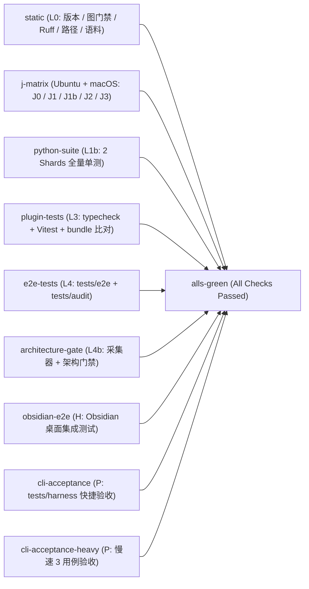

各 Job 关键校验分解如下：

- **`static` (L0)**：先后执行 `check_version_sync.py`、`check_module_graph.py --check`、`ruff check .`、`check_machine_paths.py`、`check_no_evidence_tracking.py`（含 `--base` 提交区间审查）。
- **`j-matrix` (Ubuntu + macOS)**：按阶梯依次验证 `J0`（`tests/unit/`）、`J1`（`tests/test_probe.py`、`tests/test_read_model_cutover.py`、`tests/test_lineage.py`、`tests/test_credentials.py`、`tests/test_action_registry.py`、`tests/cli/test_json_contracts.py`、`tests/cli/test_text_contracts.py`、`tests/cli/test_ocr_progress_contracts.py`）、`J1b`（`tests/test_ci_coverage_contract.py`、`tests/test_architecture_boundaries.py`、`tests/test_note_set_flag.py`）、`J2`（`tests/journey/test_headless_sync_preservation.py`）、`J3`（`tests/test_ocr_state_machine.py`），并强制检验 Python `sqlite3.enable_load_extension` 可用性。
- **`python-suite` (L1b)**：通过 `scripts/ci_shard.py --shard <0|1> --of 2` 读取 `tests/ci-shards.json` 并行执行主测试集。
- **`plugin-tests` (L3)**：校验 TS `typecheck`、`vitest run`、协议一致性测试及 `Committed bundle matches the sources`（重编译并校验 `paperforge/plugin/main.js` 无未提交 Diff）。
- **`architecture-gate` (L4b)**：先运行 `python docs/architecture-audit-2026-08-06/build_audit.py --check`，再运行 `paperforge.architecture_audit.collectors.orchestrator` 消费 `docs/architecture-audit-2026-08-06/contract.json`，最后用 `paperforge.architecture_audit.report.gate --strict --json` 严格评估 `publication.uses_protocol`、`canonical.no_ui_writer`、`coverage.required_complete`、`collectors.deterministic`、`restore.display_only` 规则。
- **`cli-acceptance` & `cli-acceptance-heavy` (P)**：在 `windows-latest` 上安装 `.[test,vector,legacy-vector]` 依赖；其中 `test_e04_embed_stop.py`、`test_d05_ocr_redo.py`、`test_d04_ocr_stop.py` 三个长耗时用例拆出到 `cli-acceptance-heavy` 并行加速。

#### 3.3 SQLite Memory Layer 表结构与 Schema V7 (`paperforge/memory/schema.py`)

`paperforge/memory/schema.py` 当前版本号为 **`CURRENT_SCHEMA_VERSION = 7`**（保存在 `meta` 表 `key = 'schema_version'`），由 `ALL_TABLES`（18 张表）+ 无条件创建的 `lineage` 表（合计 19 张关系与 FTS5 表）+ `VEC_TABLES`（3 张 `vec0` 向量虚表）共同构成完整 22 张表（逐字段定义详见 [第 10 章](#chapter-10)）：

| 表分组                           | 表名                                                                                                     | 职责与容灾特性                                                                                                                                                                                                          |
| :------------------------------- | :------------------------------------------------------------------------------------------------------- | :---------------------------------------------------------------------------------------------------------------------------------------------------------------------------------------------------------------------- |
| **元数据与调度状态**             | `meta`、`lineage`、`build_state`                                                                         | 记录 `schema_version`、血缘链路投影状态与增量向量构建水位线                                                                                                                                                             |
| **核心文献实体与全文**           | `papers`、`paper_assets`、`paper_aliases`、`paper_events`、`paper_fts`                                   | 主文献索引、PDF/OCR 衍生路径与哈希、历史 Key 别名、事件审计流水及 `papers` 触发器联动的 FTS5 索引                                                                                                                       |
| **用户认知资产（不可轻易丢弃）** | `reading_log`、`project_log`、`paper_annotations`、`paper_memory_cards`、`paper_memory_history`          | 保存人类/Agent PDF 批注、阅读摘录与 5 维度活认知记忆（支持版本历史追溯）                                                                                                                                                |
| **结构检索与向量伴生表**         | `body_units`、`body_units_fts`、`object_units`、`vec_fulltext_meta`、`vec_body_meta`、`vec_objects_meta` | 配合 `vec_fulltext`、`vec_body`、`vec_objects` 三张可选 `sqlite-vec` 虚表（若系统缺失 `vec0` 扩展则优雅捕获 `OperationalError` 跳过虚表建设而不阻断建库）；V7 在此组新增 `node_id`、`section_path_json` 与 `unit_id` 列 |

#### 3.4 Ruff 静态规则与 Pytest Marker 契约 (`pyproject.toml`)

1. **Pytest 分层标记（`--strict-markers` 强制校对，共 11 个合法标记）**：
   - 速度与隔离分级：`unit`（Level 1 快速隔离单测）、`cli`（Level 2 子进程 CLI 契约）、`integration`（多组件集成）、`e2e`（Level 4 临时 Vault 端到端）、`e2e_fast`（快速端到端）、`journey`（Level 5 全工作流旅程）、`chaos`（Level 6 破坏性场景）。
   - 专项契约与性能标记：`audit`（核对 L1 Mock 与 L4 真实产出一致性）、`harness`（真实 CLI 子进程对照一次性 Vault 验收）、`slow`（超过 30 秒的重型用例，日常开发可跳过）、`snapshot`（快照对比校验）。
2. **Ruff 静态规则与基线豁免表 (`[tool.ruff.lint]`)**：
   - 全局配置：`target-version = "py310"`、`line-length = 120`、`select = ["E", "F", "I", "UP", "B", "SIM"]`、`ignore = ["B904"]`（允许 Worker 错误包装中主动 `raise`）、`exclude = ["paperforge/skills"]`。
   - 受控历史豁免（`per-file-ignores`）：
     - `paperforge/worker/sync.py`：仅保留 `B007`、`E501` 风格豁免（已清零死代码并移除 `F821` 豁免，全库强制通过 `ruff check paperforge --select F821,F822,F823`）；
     - `paperforge/worker/ocr.py`、`paperforge/worker/repair.py`、`paperforge/ocr_diagnostics.py`、`paperforge/worker/status.py`：豁免预设 `SIM102`/`E501`/`B905`/`SIM105`/`F401` 风格历史遗留；
     - `scripts/consistency_audit.py`、`scripts/welcome.py`、`scripts/validate_setup.py`、`paperforge/architecture_audit/report/render_html.py`：分别豁免长 HTML 模板行与历史脚本格式项（新提交不得扩大豁免面）。

---

### 4. 核心执行链路、状态机与顺序不变量

#### 4.1 四大强制工程顺序链

1. **OCR 排障 "Rebuild Before Debug" 链路 (`AGENTS.md` + `scripts/dev/ocr_rebuild_paper.py`)**：
   - 磁盘 Vault 中的 `fulltext.md` 与 `render/` 可能滞后于最新代码实现，**严禁直接拿旧输出推理 Bug**。
   - 标准动作：先运行 `python scripts/dev/ocr_rebuild_paper.py <KEY> --trace --dump-stages` 按 V3 流水线重算结果；随后审查生成的 `block_trace.csv`（每块 `role`、`role_confidence`、`seed_role`、`zone`）与 `stages_summary.json`（每阶段状态字段变迁）；修复完毕后必须先过 **OCR V3 聚焦套件**（若改动图文绑定再过 Figure 套件）。
2. **发版改号与插件打包链路 (`scripts/bump.py`)**：
   - 唯一允许改动版本的起点是 `paperforge/__init__.py` 或通过 `scripts/bump.py` 自动联动修改，严禁手动散改 `manifest.json`。
   - 标准动作：`npm --prefix paperforge/plugin run build`（编译生成最新 `paperforge/plugin/main.js`）→ `python scripts/bump.py <ver>`（依次替换 `paperforge/__init__.py`、`paperforge/plugin/manifest.json`、`manifest.json`，向 `paperforge/plugin/versions.json` 写入版本映射，提交并校验 `HEAD:paperforge/__init__.py` 后打 Git Tag）→ 运行 `python scripts/check_version_sync.py`。
3. **CI 测试地图与代码覆盖同步链路**：
   - 凡是在 `tests/` 下新增、拆解或重命名测试文件（非 `e2e`/`audit`/`chaos`/`harness` 目录），必须立刻运行 `python scripts/ci_shard.py --write` 更新 `tests/ci-shards.json`，否则 `tests/test_ci_shard_map.py` 与 `tests/test_ci_coverage_contract.py` 将在 L1b / J1b 阶段失败。
4. **SQLite Schema 迁移状态机 (`migrate_schema`)**：

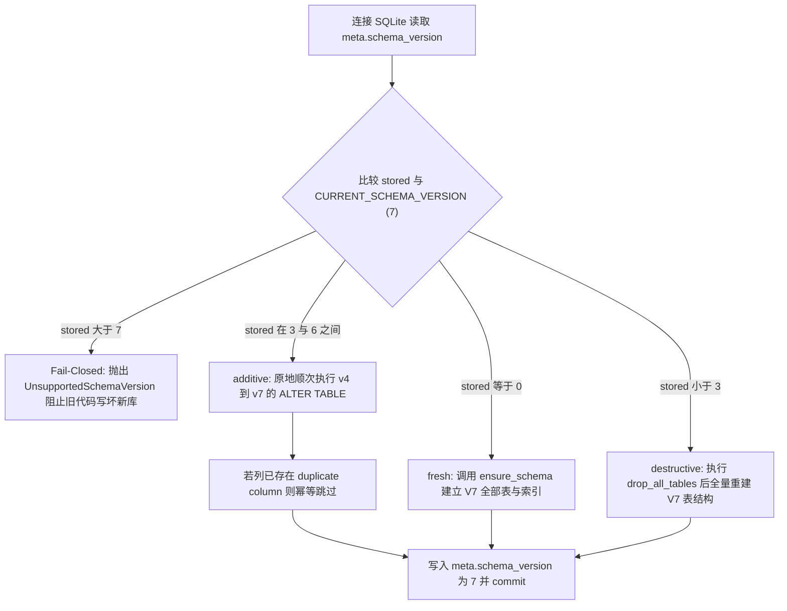

#### 4.2 安装与协同升级蓝图边界状态说明

维护者在评审升级机制改动时，必须严格区分 [docs/INSTALL-AND-UPDATE-ARCHITECTURE.md](INSTALL-AND-UPDATE-ARCHITECTURE.md) 中的两阶段状态：

- **已上线（Phase 1 实装契约）**：`paperforge/runtime_installer.py` 的 `_normalize_release_version` 与前端 `runtime-installer-launcher.ts` 的 `normalizePep440Version` 已统一 SemVer 预发布标记（如 `2.0.0-rc.6` 对齐 PEP 440 `2.0.0rc6`）；候选环境验证完成后由 `paperforge/runtime_pointer.py` 的 `publish_pointer` 原子写入用户主目录 `.paperforge` 下 `runtime` 子目录中的 `pointer.json`，保留上一份可用环境供快速回滚。
- **规划蓝图（Phase 2/3，状态仍为"设计蓝图 / 待评审定稿"）**：`uv` + `python-build-standalone` 零前置托管 Python、全局 Wheel 硬链接极速热修、四维版本字段（`minEngineVersion` / `depsLockHash` / `skillTreeDigest`）解耦机制尚未上线；在此之前，前后端版本仍保持 1:1 对齐校验。

#### 4.3 本地预演 (`ci_local.py`) 与 OCR 诊断字段语义

1. **`scripts/ci_local.py` 与真实 Runner 的边界差异**：`ci_local.py` 通过解析 `.github/workflows/ci.yml` 中各 Job 的 `run` 脚本实现与 CI 同源的执行命令，但会主动跳过 `uses:` 动作、`if:` 条件分支、包含 GitHub 上下文表达式的步骤以及未携带 `--include-install` 时的包安装步骤；因此跨平台 OS 矩阵（macOS Homebrew `sqlite3` / Windows NTFS 锁）最终仍需由远端 Runner 兜底裁决。
2. **`scripts/dev/ocr_rebuild_paper.py` 诊断产物字段**：
   - `block_trace.csv` 导出每块 `page`、`block_id`、`raw_label`、`content_preview`、`bbox`、`role`、`role_confidence`、`evidence`、`seed_role`、`seed_confidence`、`zone`、`style_family`、`marker_type`、`render_default`、`index_default`；
   - `stages_summary.json` 记录各流水线阶段间 `role`、`role_candidate`、`_object_owner_id`、`_object_association_reason` 四个核心控制字段的精确跃迁；
   - 按 `AGENTS.md` 交易原则：默认启用 V3（仅 `OCR_PIPELINE_V3=0` 回退 Legacy），555 篇全库影对比中 547 篇无差异、其余 5 篇差异均为 V3 更准确（多召回 3 幅图与修正 2 处块边界），排查歧义时以 V3 输出与 `apply_object_writebacks` 所有权归属证据为准。

---

### 5. 配置项、环境变量、CLI 入口与错误码

#### 5.1 本地全套验证与维护命令速查

| 目的场景                              | 精确命令行                                                                                                                                                                      | 关键参数与检查重点                                                                                                                        |
| :------------------------------------ | :------------------------------------------------------------------------------------------------------------------------------------------------------------------------------ | :---------------------------------------------------------------------------------------------------------------------------------------- |
| **OCR V3 聚焦套件（提交前 Phase A）** | `pytest tests/test_ocr_pipeline_v3.py tests/test_ocr_object_writeback.py tests/test_ocr_tail_settlement.py tests/test_appendix_figure_numbering.py tests/test_ocr_rendering.py` | V3 流水线、对象写回、`figure_inner_text` 归属与尾注结算核心护栏                                                                           |
| **Figure 全量套件（提交前 Phase B）** | `pytest tests/test_ocr_figures.py tests/test_ocr_figure_vnext_passes.py tests/test_figure_identity.py tests/unit/worker/test_figure_containment.py`                             | 涉及图文配对、`ocr_figures` 或 `apply_object_writebacks` 改动时必跑                                                                       |
| **本地 CI 零漂移预演**                | `python scripts/ci_local.py --job static` / `python scripts/ci_local.py --keep-going`                                                                                           | 直接从 `.github/workflows/ci.yml` 读取命令行执行（加 `--include-install` 可覆盖依赖安装步骤）                                             |
| **静态代码质量与架构门禁**            | `ruff check .` & `python scripts/check_module_graph.py --check`                                                                                                                 | 核对 `[tool.ruff]` 规则（`line-length = 120`, 规则 `E/F/I/UP/B/SIM`）与 R1–R4 依赖棘轮                                                    |
| **清理历史依赖债并收紧棘轮**          | `python scripts/check_module_graph.py --write-ratchet`                                                                                                                          | 当重构消除了某条 `private_imports` 或 `private_member_access_exceptions` 时执行更新 `tests/architecture_import_ratchet.json`              |
| **四大基础合规门禁**                  | `python scripts/check_version_sync.py && python scripts/check_machine_paths.py && python scripts/check_no_evidence_tracking.py && python scripts/consistency_audit.py`          | 推送前一键排查版本号、本机路径、实证语料历史、旧命令与文档死链                                                                            |
| **OCR 单篇重建与分步追踪**            | `python scripts/dev/ocr_rebuild_paper.py <KEY> --trace --dump-stages`                                                                                                           | 常用开关：`--ocr-dir <PATH>`、`--dump-dir <PATH>`、`--trace-only`、`--dump-stages-only`                                                   |
| **多篇语料库全量影对比**              | `python scripts/dev/corpus_v3_diff_full.py` & `python scripts/dev/compare_figure_inventory_corpus.py`                                                                           | 验证算法调优前后全库零误伤回归                                                                                                            |
| **插件 TypeCheck、单测与构建**        | `npm --prefix paperforge/plugin run typecheck && npm --prefix paperforge/plugin run test && npm --prefix paperforge/plugin run build`                                           | 重新生成与源码严格一致的 `paperforge/plugin/main.js`                                                                                      |
| **Obsidian 真机 E2E 测试**            | `npm --prefix paperforge/plugin run test:e2e`                                                                                                                                   | 自动触发 `pretest:e2e` 编译插件并调用 `paperforge/plugin/test/fixtures/build_e2e_vault.py` 搭建隔离 Vault                                 |
| **12 场景 UI 状态截图生成**           | `python scripts/dev/render_obsidian_ui_docs.py`                                                                                                                                 | 启动 Playwright Chrome/Edge 将 live TS 组件 + `paperforge/plugin/styles.css` 渲染到 `docs/images/ui-states/`                              |
| **发版准入核查**                      | `python scripts/release_readiness.py`                                                                                                                                           | 读取候选清单与矩阵记录并输出 `VERIFIED` / `UNTESTED` / `NOT_APPLICABLE` / `UNDEFINED` 裁判报告（退出码 `0` 通过、`1` 拦截、`2` 用法错误） |

---

### 6. 边界防护与 Fail-Closed 防呆规则

| 防呆规则                              | 强制执行点                                                 | Fail-Closed 拦截逻辑                                                                                                                                                      |
| :------------------------------------ | :--------------------------------------------------------- | :------------------------------------------------------------------------------------------------------------------------------------------------------------------------ |
| **PyMuPDF `<2` 版本天花板**           | `pyproject.toml` (`"pymupdf>=1.23.0,<2"`)                  | 锁定 1.x 系列，阻止 pip 升级到 PyMuPDF 2.0 引起 `pymupdf.layout` / `onnxruntime` 在 import 时被激活从而拖慢或卡死 OCR CLI                                                 |
| **历史追加式研究语料拦截**            | `scripts/check_no_evidence_tracking.py --base <REV>`       | 利用 `git log --diff-filter=A` 追溯区间内曾被提交哪怕后续又删除的研究实证语料文件，杜绝私有论文数据进入提交历史                                                           |
| **高危删库模式提交阻断**              | `scripts/check_no_destructive_delete.py`                   | 在 `.husky/pre-commit` 最前端阻断任何含 `shutil.rmtree(..., ignore_errors=True)` 或空/当前路径 `rmtree` 的提交，迫使统一迁移至可恢复删除模块 `paperforge/worker/trash.py` |
| **数据库新版本降级保护**              | `paperforge/memory/schema.py` (`UnsupportedSchemaVersion`) | 当旧版 CLI 试图打开高于 `CURRENT_SCHEMA_VERSION`（`7`）的 SQLite 库时直接异常退出，防止旧逻辑破坏新版表字段                                                               |
| **棘轮不可逆收紧与禁止 R3**           | `scripts/check_module_graph.py`                            | `R3`（`worker -> commands/plugin`）存量为零且不允许加入白名单；消减存量私有导入时旧条目不报错，新增任何越界依赖立即判红                                                   |
| **Ruff 与 `--strict-markers` 零遗漏** | `pyproject.toml`                                           | `--strict-markers` 拒绝任何未在清单登记的临时 `@pytest.mark.*` 拼写错误；并通过 `addopts` 中的 `--ignore` 沙盒路径屏蔽指令隔离本地临时试验 Vault                          |
| **E2E 跳过即失败准入策略**            | `scripts/release_readiness.py`                             | 对 `skipped`、`timeout`、`PASS_WITH_WARNINGS`、`harness_cli` 冒充 `H/V` 层等情况一律按未验证（`UNTESTED`）判阻，拒绝降级放行                                              |

---

### 7. 维修、调试与升级 Checklist

#### 7.1 SQLite Schema 升级演进 Checklist（以 V7 -> V8 为例）

1. **优先 Additive 增量列/表**：更新 `paperforge/memory/schema.py` 中的 `CURRENT_SCHEMA_VERSION`，并在 `migrate_schema()` 内追加 `if current_version < 8:` 分支，每条 `ALTER TABLE` 均须带合理 `DEFAULT` 值且捕获 `"duplicate column"` 异常保证重试幂等性。
2. **严格区分派生层与用户资产表**：`body_units`、`object_units`、`body_units_fts`、`vec_*` 可由 Vault 侧车文件安全重建；而 `paper_annotations`、`reading_log`、`paper_memory_cards` 含用户交互心血，绝不可因列调整误调用 `drop_all_tables`。
3. **强制回归验证**：运行 `pytest tests/harness/test_e06_memory_schema_repair.py tests/test_layer4_units_and_fts.py` 验证升级与损坏自愈能力。

#### 7.2 UI 样式与组件改动回归 Checklist

1. 编辑 `paperforge/plugin/src/views/`、`paperforge/plugin/src/settings.ts` 或 `paperforge/plugin/styles.css` 后，依次跑通：`typecheck` → `test` → `build`（确认重新生成与源码严格一致的 `paperforge/plugin/main.js`）。
2. 执行 `python scripts/dev/render_obsidian_ui_docs.py` 生成以下全部 12 组 UI 状态截面图至 `docs/images/ui-states/`，并对照亮/暗双模式及 `asterlab` / `obsidian` 主题核查无文字截断或层次溢出：
   - Base 工作台：`01-base-workbench-all-states`、`02-base-empty-and-filtered-states`
   - 伴读 Companion：`03-dashboard-global-modes`、`04-dashboard-collection-mode`、`05-dashboard-paper-mode-living-memory`、`06-dashboard-search-and-recovery-states`
   - PDF 批注器：`07-pdf-annotator-human-and-ai-layers`、`08-pdf-annotator-provenance-and-empty-states`
   - Control Center 与向导：`09-settings-control-center-six-states`、`10-settings-setup-wizard-four-stages`、`11-settings-ocr-and-memory-details`
   - OCR 工作台与弹窗：`12-ocr-workspace-and-modals`
3. 对照 [docs/OBSIDIAN-UI-AND-BASE-DESIGN.md](OBSIDIAN-UI-AND-BASE-DESIGN.md) 与 [第 13 章](#chapter-13) 更新视图或 CSS 变量契约。
4. 若涉及跨模块架构调整或文档发布，同步核查 `docs/maintainer-guide.md` 维护指南是否需要补充约束条目。

#### 7.3 常见门禁报警快速 Triage 手册

| 报错现象 / CI 失败节点                                               | 高概率直接原因                                                                               | 立即核查与标准处置方案                                                                                                                                         |
| :------------------------------------------------------------------- | :------------------------------------------------------------------------------------------- | :------------------------------------------------------------------------------------------------------------------------------------------------------------- |
| `tests/test_ci_shard_map.py` 报错未登记文件                          | 在 `tests/` 下增删改了 `.py` 测试文件却没有同步分片表                                        | 运行 `python scripts/ci_shard.py --write` 重新生成 `tests/ci-shards.json` 并随代码提交                                                                         |
| `scripts/check_module_graph.py --check` 报 `R2` / `R2b` / `R3`       | 新代码跨包导入 `_helper`、读取他模块私有属性，或由 `worker` 反向导入 `commands`              | 将被复用的内部函数提升为模块公开接口（移除前导 `_`）或下沉至无环底层工具；严禁把 `R3` 违规写进棘轮白名单                                                       |
| `plugin-tests` 在 `Committed bundle matches the sources` 失败        | 修改了 TypeScript 源码后忘记重新打包 `paperforge/plugin/main.js`                             | 本地执行 `npm --prefix paperforge/plugin run build`，确认产物差异后追加提交                                                                                    |
| `scripts/check_version_sync.py` 报错版本号冲突                       | 手动只改了某个 `manifest.json` 或 `paperforge/__init__.py`，漏改 `versions.json` / `main.js` | 先用 `npm --prefix paperforge/plugin run build` 重编包，再通过 `python scripts/bump.py <ver> --no-git` 统一对齐全部 6 个位置                                   |
| `scripts/consistency_audit.py` Check 1 / Check 3 报红                | 文档/代码注释提及已移除旧命令，或 Markdown 存在失效相对路径与悬空页内锚点                    | 按 [docs/COMMANDS.md](COMMANDS.md) 替换为现行稳定命令，修正失效链接路径后再复测                                                                             |
| `tests/test_command_docs.py` 或 `tests/test_ocr_route_audit.py` 失败 | 修改了暴露命令参数、新增测试文档或移动了 OCR 模块但审计文档未同步                            | 核对 [docs/COMMANDS.md](COMMANDS.md)、[docs/ocr/route-audit.md](ocr/route-audit.md) 及 [docs/maintainer-guide.md](maintainer-guide.md) 后补全同步更新 |
| 某篇生产文献 OCR 渲染错段或丢图，但代码逻辑目测正常                  | Vault 内 `render/fulltext.md` 是旧引擎留下的陈旧缓存                                         | 先运行 `python scripts/dev/ocr_rebuild_paper.py <KEY> --trace --dump-stages` 按现行代码重演流水线，再基于新输出追查阶段边界                                    |

#### 7.4 历史依赖债清理与发版前终审 Checklist

1. **消除存量私有导入并收紧棘轮**：
   - 使用 `python scripts/check_module_graph.py --reach --entry paperforge.worker.ocr_figures:build_figure_inventory` 确认遗留函数是否已失去生产可达调用方；
   - 重构把跨包私有函数转为公开接口或内联清理后，运行 `python scripts/check_module_graph.py --write-ratchet` 刷新 `tests/architecture_import_ratchet.json`（只减不增），再用 `python scripts/check_module_graph.py --check` 验证零回归。
2. **发版与打 Tag 前五项核验**：
   - 先执行 `npm --prefix paperforge/plugin run typecheck && npm --prefix paperforge/plugin run test && npm --prefix paperforge/plugin run build` 锁定 `paperforge/plugin/main.js`；
   - 运行 `python scripts/check_machine_paths.py --rev HEAD` 与 `python scripts/check_no_evidence_tracking.py --base origin/master`（按当前目标主干分支名核验）；
   - 通过 `python scripts/bump.py <ver> --dry-run` 预检全部版本文件清单，无误后正式改号提交；
   - 对照 `docs/COMMANDS.md` 与 Release Notes 检查面向用户的 CLI 行为变更均已记录；
   - 运行 `python scripts/release_readiness.py` 确认全部适用测试层结果均处于 `VERIFIED`（无 `UNTESTED` / `UNDEFINED`）状态。

<!-- prettier-ignore-end -->
