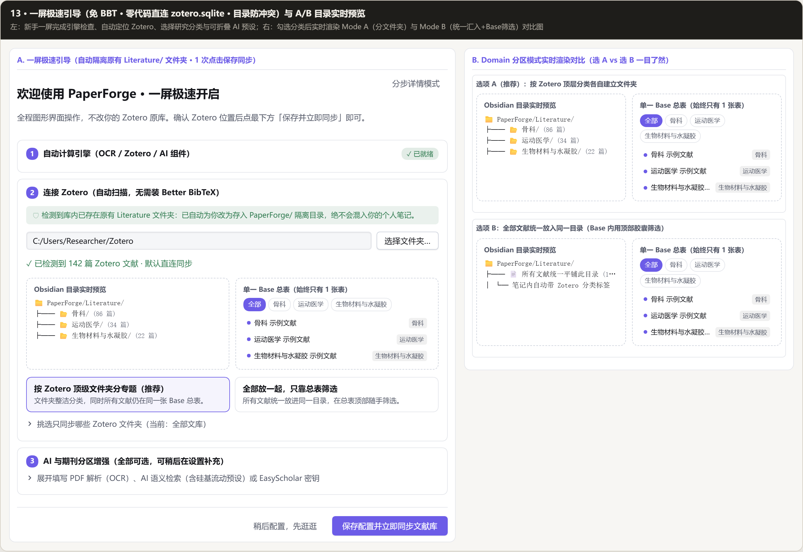
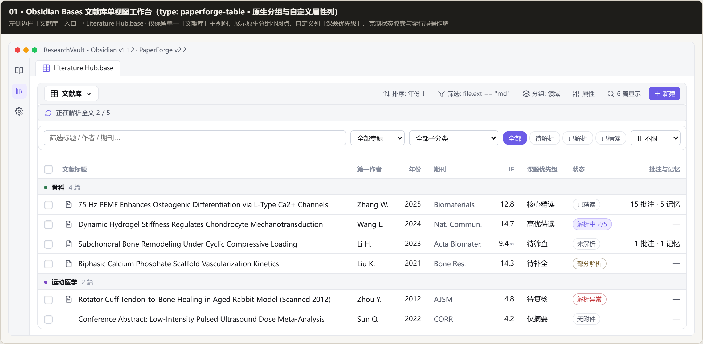

# PaperForge 使用教程

> 面向终端用户。如果你刚安装完 PaperForge，从这里开始。

---

## 1. 一屏极速安装与连接 Zotero（当前 `v2.0.0`，无需 Better BibTeX）

> [!NOTE]
> 新手科研用户全程无需打开终端、无需提前安装 Python，也**不再强制安装 Better BibTeX 插件**：内置 Rust 侧车会自动拉取完全隔离的托管运行时（`.paperforge/runtime/`），并以只读方式直连 Zotero 的 `zotero.sqlite` 数据库读取文献、PDF 路径与分类树。

1. 在 Obsidian 社区插件市场安装并启用 **PaperForge** 后，打开设置面板即进入 **「一屏极速开启」**：
   - **第 1 步（自动计算引擎）**：点一下「一键启用引擎」，后台静默部署运行环境（期间可继续往下选 Zotero，无需干等）。
   - **第 2 步（直连 Zotero 与目录隔离）**：插件自动定位 `Zotero/zotero.sqlite` 与文献分类。如果你的 Obsidian 库根目录下**已经存在非空个人 `Literature` / `Resources` / `Bases` 文件夹**，PaperForge 会自动识别并将自身目录隔离到 `PaperForge/Literature` 等路径，绝不与原有个人笔记混杂。
   - **实时选择 Domain 组织模式**：点击卡片即可在右侧实时预览 **选项 A（按 Zotero 顶级分类各自建子文件夹，推荐）** 或 **选项 B（全部文献平铺同目录，靠顶部胶囊在单一 Base 总表中筛选）**。
   - **第 3 步（可选 AI / 期刊分区增强）**：OCR 与 AI 语义检索（含硅基流动、百炼、智谱、OpenAI、Ollama 一键预设与实时测通按钮）全部收在折叠区，留空也可先用基础文献管理与 PDF 批注；影响因子内置 3 层兜底（Zotero Extra → 本地 `zoterostyle.json` / `journal-tags-cache.json` → 内置 385 本顶刊 OpenAlex CC0 离线种子与在线查询，表格中以 `≈` 区分 2 年平均被引）。
2. 点击页面底部唯一主按钮 **「保存配置并立即同步文献库」**，首次同步完成即自动标记初始化完成！



> [!TIP]
> 隐藏引擎缓存、OCR 中间文件与内部 `fulltext.md` 默认收归 `.paperforge/`，避免拖慢 Obsidian 索引。若仍习惯使用传统 **Better BibTeX JSON** 工作流，可在引导右上角切至「分步详情模式」按原有 `.paperforge/exports/` 导出路径使用。

---

## 2. 在单一 `.base` 工作台高效筛选与同步

> 安装完成后，正式文献笔记保存在你的文献根目录（默认为 `Literature/<专题>/`；检测到同名用户目录时自动隔离为 `PaperForge/Literature/<专题>/`）。



打开任意 `.base` 视图（默认仅保留一张 **「文献库」总表**），表头固定提供**防丢失的持久化多维筛选条**（`标题/作者/期刊` 即时过滤 → `专题` → `二级子分类` 级联下拉 → `全部 / 待解析 / 已解析 / 已精读` 状态胶囊 → `IF 阈值` 下拉）。日常新增文献后只需点 **Sync Library**（或终端执行 `paperforge sync`）即可秒级增量更新。

---

## 4. 触发 OCR

在正式笔记的 frontmatter 里把 `do_ocr` 改为 `true`，然后运行：

```bash
paperforge ocr
```

OCR 结果保存在隐藏引擎目录 `.paperforge/ocr/<key>/`（或旧版 `System/PaperForge/ocr/<key>/`）下，包括供检索与 Agent 使用的全文文本，并将裁切好的独立命名图表 `assets/<key>_figure_*.jpg` 同步到正式笔记工作区；`fulltext.md` 不再冗余复制到可见文献文件夹。

---

## 5. 阅读原版 PDF 并无损批注（Obsidian 内置阅读器）

在 Dashboard 或单篇文献面板点击 **打开 PDF**，即可直接在 Obsidian 标签页中使用内置 **PaperForge PDF Annotator**（基于原生 `loadPdfJs()`）：

- **划线高亮与科研意图标注**：支持选区高亮并标注为 `evidence`（💡 核心证据）、`question`（❓ 存疑待查）、`method`（🧪 方法细节）、`quote`（✍️ 可引述）
- **框选截图**：框选图表面板或公式区域自动生成独立截图 `assets/<key>_ann_<id>.jpg` 并绑定 OCR 章节与图表上下文
- **随文献永存、原 PDF 零改动**：全部批注保存在文献工作区 `<workspace>/annotations.jsonl`，严格不修改原始 PDF 字节，支持一键晋升为可检索的 `reading-log` 证据卡，并在执行 `/pf-deep` 时自动喂给 AI Agent 优先解答你标记的疑问

---

## 6. 深度精读

OCR 完成后，把 formal note 的 `analyze` 改为 `true`。

确认就绪：

```bash
paperforge deep-reading
```

在 Agent 中输入 `/pf-deep <zotero_key>`，Agent 会执行 Keshav 三阶段精读，结果直接写入 formal note 的 `## 精读` 区域。

---

## 7. 文献问答

不强制 OCR。直接输入 `/pf-paper <zotero_key>` 进入交互式问答。

---

## 8. 日常路径

```
添加文献到 Zotero（直接只读解析 zotero.sqlite，免 BBT 插件）
  -> 点 Sync
  -> 在单一 Base 总表利用顶部持久化筛选条定位文献
  -> Obsidian 内置 PDF 阅读器划线/框选批注 (annotations.jsonl)
  -> 标记 do_ocr: true
  -> 运行 OCR
  -> 标记 analyze: true
  -> /pf-deep <key>
  -> /pf-paper <key>
```

---

## 9. 相关文档

- [命令参考](COMMANDS.md) — 所有 CLI 和 Agent 命令速查
- [故障排除](troubleshooting.md) — 常见问题
- [更新指南](update-upgrade.md) — 如何升级 PaperForge
