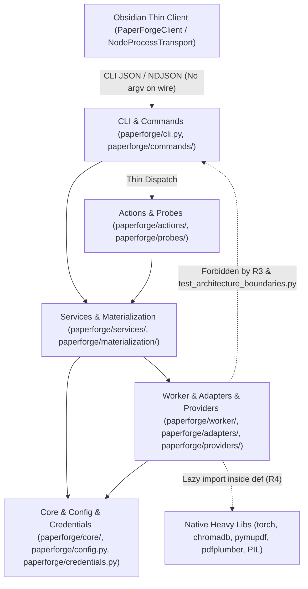

# 第 01 章：系统架构、分层约束与磁盘存储契约

> 本文档面向 PaperForge 核心维护者与系统审计人员，完整定义 v2.0+ 系统的控制面/数据面边界、模块静态依赖门禁、Vault 磁盘目录契约，以及从 v1 可见存储向 `.paperforge/` 隐藏引擎布局与可恢复回收站机制演进的工程约束。相关章节参见 [第 02 章：配置系统、凭据鉴权与运行时安装器](02-config-auth-and-runtime.md)、[第 03 章：CLI 路由、PFResult 协议与流式取消机制](03-protocol-pfresult-and-stream.md) 及 [ARCHITECTURE.md](../ARCHITECTURE.md)。

---

## 1. 职责与非目标边界

PaperForge 采用 **Python Core Single Authority（Python 核心单一权威）+ Thin-Client（薄客户端）** 架构，将系统的运行职责严格切分为四个正交平面：

1. **控制面（Control Plane）**：由 `paperforge/config.py`、`paperforge/credentials.py`、`paperforge/runtime_installer.py`、`paperforge/actions/` 及 `paperforge/probes/` 组成，独占配置解析/写入、凭据存储、隔离运行时发布、声明式动作策略与只读能力探测。Obsidian 插件侧的 `PaperForgeClient`（`paperforge/plugin/src/client/paperforge-client.ts`）与 `NodeProcessTransport`（`paperforge/plugin/src/client/node-transport.ts`）仅充当强类型传输与子进程生命周期控制器。
2. **数据面（Data Plane）**：由 `paperforge/adapters/`、`paperforge/providers/`、`paperforge/worker/`、`paperforge/services/`、`paperforge/render_audit.py` 与 `paperforge/figure_reconciliation.py` 组成，负责将 Zotero Better BibTeX（BBT）导出转为规范笔记、工作区目录、标准化 OCR 原始块（`blocks.raw.jsonl`）、V3 结构化块、裁剪图元及一致性审计报告。
3. **检索面（Retrieval & Embedding Plane）**：由 `paperforge/memory/`、`paperforge/retrieval/` 与 `paperforge/embedding/` 组成，基于 `.paperforge/indexes/paperforge.db` 维护 SQLite FTS5 全文检索、结构单元与 `sqlite-vec`（`vec0`）向量表。
4. **智能体层（Agent Layer）**：位于 `paperforge/skills/paperforge/`，以只读与 CLI 合同调用（`query-plan`、`paper-context`、`search`、`retrieve`、`inspect`）为主，仅在正式笔记的 `## 精读` 章节或通过受控 CLI 命令写入认知分析，绝不绕过 Worker/Service 层直接修改 SQLite 或 OCR 原始存储。

### 非目标边界（Non-Goals）

- **客户端不做语义推断**：插件前端与 Agent 不得直接解析 `paperforge.json`、`formal-library.json`、`paperforge.db` 或 OCR `meta.json` 来推导系统能力状态、论文主键或下一步动作策略；唯一例外是引导适配器只读 `~/.paperforge/runtime/pointer.json` 以定位 Python 解释器。
- **仅限受控 stdio JSON-RPC 复用（无网络服务守护进程）**：长任务与流式命令仍按独立子进程执行（受 `NodeProcessTransport` 与取消令牌约束）；短 RPC 读/写可通过无网络端口的 `paperforge daemon --stdio` 按 Vault 会话复用同一进程并受 `idle_timeout` 与 stdin EOF 自动退出制约，跨端刷新继续经由 `.state-seq.json` 状态序号通知。
- **不做无审计物理删目录**：用户数据或孤儿论文的清理必须经由 `paperforge/worker/trash.py` 移入 `.paperforge/trash/` 并生成清单，禁止业务层直接调用裸 `shutil.rmtree()` 删除库目录。
- **Worker 层禁止反向依赖上层入口**：`paperforge/worker/` 是确定性执行层，禁止导入 `paperforge.commands` 或 `paperforge.plugin`。

---

## 2. 核心源码与单测映射表

### 2.1 核心源码模块

| 模块路径                                            | 核心职责                        | 关键对外入口 / 不变量                                                                                                                                    |
| --------------------------------------------------- | ------------------------------- | -------------------------------------------------------------------------------------------------------------------------------------------------------- |
| `paperforge/__init__.py`                            | 包版本定义                      | 定义源码基准版本 `__version__`（当前 `"2.0.0rc6"`）                                                                                                      |
| `paperforge/config.py`                              | 配置解析与 Vault 路径单一权威   | `load_config()`、`resolve_paths()`、`paperforge_paths()`、`resolve_paperforge_dir()`、`fallback_paperforge_dir()`、`resolve_vault()`、`LEGACY_PATH_KEYS` |
| `paperforge/core/stat_cache.py`                     | 库外 STAT 指纹 SHA-256 缓存     | `cached_sha256_hex()`、`cached_concat_sha256_hex()`（SQLite WAL 于 OS 用户缓存目录，含 2s Racy-Git 保护，恪守 X13 零写 Vault）                           |
| `paperforge/services/storage_migration.py`          | v1→v2 隐藏存储引擎事务迁移服务  | `migrate_vault_storage()`（precheck + `.migration-journal.json` 回滚）、`rewrite_visual_embeds_for_key()`                                                |
| `paperforge/commands/migrate_storage.py`            | `migrate-storage` CLI 适配器    | `run()`，输出 `PFResult` 或人类可读摘要                                                                                                                  |
| `paperforge/worker/asset_index.py`                  | 规范索引与论文工作区物化        | `build_index()`、`refresh_index_entry()`、`sync_workspace_visual_assets()`、`cleanup_or_preserve_workspace_fulltext()`、`_build_entry()`                 |
| `paperforge/worker/paper_meta.py`                   | 单论文工作区元数据读写          | `write_paper_meta()`、`read_paper_meta()`（`SCHEMA_VERSION = 1`）                                                                                        |
| `paperforge/worker/base_views.py`                   | Obsidian `.base` 视图生成与清洗 | `ensure_base_views()`、`build_base_views()`、`merge_base_views()`、`RETIRED_PF_VIEWS`                                                                    |
| `paperforge/worker/ocr_artifacts.py`                | 单论文 OCR 存储路径与缓存清理   | `artifact_paths_for_root()`、`OCRArtifactPaths`、`cleanup_ocr_artifact_cache()`                                                                          |
| `paperforge/worker/trash.py`                        | Fail-Closed 回收站隔离删除层    | `validate_target()`、`trash_remove()`、`list_trash()`、`restore_trash()`、`purge_trash()`                                                                |
| `paperforge/worker/prune.py`                        | 孤儿论文清理调度                | `prune_orphan_papers()`，受 `WriterLock` 保护后调用 `trash_remove()`                                                                                     |
| `paperforge/lineage.py`                             | 跨载体残留检测与工作区定位      | `_detect_residuals()`、`_workspace_dir_for_key()`                                                                                                        |
| `paperforge/services/skill_deploy.py`               | Agent Skill 安全部署服务        | `deploy_skills()`、`_validate_target()`、`_skill_tree_digest()`                                                                                          |
| `scripts/check_module_graph.py`                     | P0 AST 静态依赖门禁（R1-R4）    | `build_snapshot()`、`check()`、`reach()`、`HEAVY_TOP_LEVELS`、`FORBIDDEN_WORKER_TARGETS`                                                                 |
| `tests/architecture_import_ratchet.json`            | R1/R2/R2b/R3/R4 冻结棘轮快照    | 仅允许收缩、禁止新增跨模块私有导入与顶层重导入                                                                                                           |
| `paperforge/architecture_audit/__init__.py`         | 跨层架构审计门面                | 导出 `ArchitectureContract`、`ArchitectureSurvey`、`reconcile`、`compose`                                                                                |
| `paperforge/architecture_audit/layers.py`           | 五层不可变审计模型定义          | 严格分离人工声明 Contract、静态/运行时 Survey、审计结论、Agent Review 与视图                                                                             |
| `paperforge/plugin/src/client/paperforge-client.ts` | 插件侧强类型客户端              | `PaperForgeClient`（封装探针、动作、配置与读模型调用）                                                                                                   |
| `paperforge/plugin/src/client/node-transport.ts`    | 插件侧唯一子进程通道            | `NodeProcessTransport`、`runLongTask()`、`NdjsonStreamParser`                                                                                            |

### 2.2 配套单元测试与门禁测试

| 测试文件路径                                    | 验证目标与断言重点                                                                                                                                           |
| ----------------------------------------------- | ------------------------------------------------------------------------------------------------------------------------------------------------------------ |
| `tests/test_module_graph.py`                    | 验证 `scripts/check_module_graph.py` 的导入解析、Tarjan 环检测（R1）、跨包私有导入（R2）、跨模块私有成员访问（R2b）、层级违规（R3）及顶层重库拦截（R4）逻辑  |
| `tests/test_architecture_boundaries.py`         | 扫描 `paperforge/actions/`、`paperforge/services/`、`paperforge/materialization/`，断言 `KNOWN_EXEMPTIONS` 为空，杜绝后台层反向导入 `paperforge.commands.*`  |
| `tests/test_import_weight.py`                   | 在干净子进程中导入 `paperforge.worker.ocr`，断言 `sys.modules` 中不含 `torch`、`chromadb`、`pdfplumber`、`fitz`、`pymupdf`、`PIL`                            |
| `tests/unit/test_dot_paperforge_and_scale.py`   | 验证 `resolve_paths()` 对 `.paperforge` 的叶子折叠、单论文前缀图像物化、工作区隐藏 `fulltext.md` 清理、`SyncService` 快路径与 `migrate-storage` 端到端行为   |
| `tests/unit/test_storage_migration_safety.py`   | 验证 `migrate-storage` 事务回滚（坏 `paperforge.json` 事前拦截、`set_config` 失败逆向恢复目录与笔记）、幂等复跑及工作区用户编辑过 `fulltext.md` 无损入回收站 |
| `tests/unit/test_path_authority_and_staging.py` | 验证自定义 `system_dir` / `.paperforge` 路径权威解析无旁路、及外置 OS 用户数据目录 R/P 舞台写入与遗留 `<tmp>` 回退检索                                       |
| `tests/unit/test_stat_cache_and_fastpaths.py`   | 验证 `stat_cache` 2s Racy-Git 失效窗口、`read_index` `(size, mtime_ns)` 缓存与 `annotations.jsonl` 压缩前后端一致性                                          |
| `tests/unit/test_upgrade_resilience.py`         | 验证外置 `zotero_data_dir` 修复、标题命名旧笔记重命名迁移、以及 `paperforge.db` 销毁重建后由 `ai/memory-card.json` 无损恢复记忆历史                          |
| `tests/unit/worker/test_trash.py`               | 钉住 2026-08-14 事故回归：断言空路径/`.`/`..`/`allowed_root` 本身及越界路径触发 `DangerousPathError`，`trash_remove` 仅移动到 `.paperforge/trash/` 且可恢复  |

---

## 3. 磁盘文件、数据库表与协议 JSON 字段字典

### 3.1 `resolve_paths()` 返回的路径字典（共 16 个键）

所有业务模块均须通过 `paperforge/config.py` 中的 `resolve_paths(vault, snapshot)`（或其兼容薄包装 `paperforge_paths()`）获取规范路径。设 Vault 根目录经过 `Path(vault).expanduser().resolve()` 规范化后为 `{vault}`：

| 键名              | 推导公式                                                                   | 典型解析示例（`.paperforge` 布局）                                                | 典型解析示例（v1 传统 `System` 布局）                               | 说明                                                                                                     |
| ----------------- | -------------------------------------------------------------------------- | --------------------------------------------------------------------------------- | ------------------------------------------------------------------- | -------------------------------------------------------------------------------------------------------- |
| `vault`           | `Path(vault).expanduser().resolve()`                                       | `D:/ResearchVault`                                                                | `D:/ResearchVault`                                                  | 规范化 Vault 根目录                                                                                      |
| `system`          | `vault / sys_rel`                                                          | `D:/ResearchVault/.paperforge`                                                    | `D:/ResearchVault/System`                                           | `sys_rel` 来自配置项 `system_dir`                                                                        |
| `paperforge`      | `system if Path(sys_rel).name == ".paperforge" else system / "PaperForge"` | `D:/ResearchVault/.paperforge`                                                    | `D:/ResearchVault/System/PaperForge`                                | 引擎根目录：末端为 `.paperforge` 时折叠，不再嵌套 `PaperForge/`                                          |
| `exports`         | `paperforge / "exports"`                                                   | `D:/ResearchVault/.paperforge/exports`                                            | `D:/ResearchVault/System/PaperForge/exports`                        | Zotero Better BibTeX 自动导出 JSON 目录                                                                  |
| `ocr`             | `paperforge / "ocr"`                                                       | `D:/ResearchVault/.paperforge/ocr`                                                | `D:/ResearchVault/System/PaperForge/ocr`                            | 按 `zotero_key` 分目录存储的 OCR 全生命周期产物                                                          |
| `zotero_dir`      | 见右侧说明                                                                 | `D:/ResearchVault/.paperforge/Zotero` 或外置目录                                  | `D:/ResearchVault/System/Zotero` 或外置目录                         | 若 `zotero_data_dir` 非空且为相对路径则拼在 `vault` 下，绝对路径直接使用；为空时回退 `system / "Zotero"` |
| `resources`       | `vault / resources_dir`                                                    | `D:/ResearchVault/Resources`                                                      | `D:/ResearchVault/Resources`                                        | 用户笔记与资产根目录（受 Obsidian 索引）                                                                 |
| `literature`      | `resources / literature_dir`                                               | `D:/ResearchVault/Resources/Literature`                                           | `D:/ResearchVault/Resources/Literature`                             | 按领域划分的文献笔记与单论文工作区根目录                                                                 |
| `control`         | `resources / control_dir`                                                  | `D:/ResearchVault/Resources/LiteratureControl`                                    | `D:/ResearchVault/Resources/LiteratureControl`                      | v2.1+ 已退役控制目录（保留键位兼容）                                                                     |
| `library_records` | `control / "library-records"`                                              | `D:/ResearchVault/Resources/LiteratureControl/library-records`                    | `D:/ResearchVault/Resources/LiteratureControl/library-records`      | Phase 37 起停止写入的旧记录目录                                                                          |
| `bases`           | `vault / base_dir`                                                         | `D:/ResearchVault/Bases`                                                          | `D:/ResearchVault/Bases`                                            | Obsidian `.base` 数据库视图输出目录                                                                      |
| `worker_script`   | `Path(__file__).parent / "worker" / "__init__.py"`                         | `<pkg>/paperforge/worker/__init__.py`                                             | `<pkg>/paperforge/worker/__init__.py`                               | 包内 Worker 入口锚点                                                                                     |
| `skill_dir`       | `vault / skill_dir_val`                                                    | `D:/ResearchVault/.agents/skills`                                                 | `D:/ResearchVault/.agents/skills`                                   | 配置项 `skill_dir` 对应的 Vault 内路径                                                                   |
| `pf_deep_script`  | 优先取 `<skill_dir>/paperforge/` 内的 `pf_deep.py`，不存在则回退包内路径   | `<vault>/.agents/skills/paperforge/` 下的 `pf_deep.py`（位于其 `scripts` 子目录） | 缺失时回退至 `paperforge/skills/paperforge/scripts/pf_deep.py`      | 精读辅助脚本定位路径                                                                                     |
| `config`          | `paperforge / "config" / "domain-collections.json"`                        | `D:/ResearchVault/.paperforge/config/domain-collections.json`                     | `D:/ResearchVault/System/PaperForge/config/domain-collections.json` | 领域与 Zotero 集合映射配置                                                                               |
| `index`           | `paperforge / "indexes" / "formal-library.json"`                           | `D:/ResearchVault/.paperforge/indexes/formal-library.json`                        | `D:/ResearchVault/System/PaperForge/indexes/formal-library.json`    | v2 信封格式规范文献资产索引                                                                              |

### 3.2 完整 Vault 磁盘目录树

以推荐的 `.paperforge` 引擎布局（`D:/ResearchVault` 或 `/Users/researcher/Vault`）为例，完整磁盘布局如下：

```text
{vault_root}/
|-- paperforge.json                             # Schema v2 唯一规范配置文件
|-- .env                                        # 仅用于非密钥本地覆盖或一次性 auth migrate 来源
|-- AGENTS.md                                   # Vault 级 Agent 操作指引（已存在则 setup 保留不覆盖）
|-- .agents/skills/paperforge/                  # 默认跨客户端 Skill 部署目录 (SKILL.md, atoms/, molecules/, scripts/, workflows/)
|-- .opencode/command/                          # 默认 command_dir 配置指向目录
|-- Bases/                                      # Obsidian Base 视图目录 (<base_dir>)
|   |-- Literature Hub.base                     # 全库视图 (type: paperforge-table, 视图名 "文献库")
|   |-- <domain_slug>.base                      # 按领域切分的 Base 文件
|-- Resources/                                  # Obsidian 可见数据区 (<resources_dir>)
|   |-- Literature/                             # 文献库根目录 (<literature_dir>)
|   |   |-- <domain>/
|   |       |-- <KEY> - <Title_Slug>/           # 单论文工作区 (Workspace)
|   |           |-- <KEY>.md                    # 规范正式笔记 (含 frontmatter 与 "## 🔍 精读")
|   |           |-- paper-meta.json             # 内部管线状态旁路 JSON (ocr_job_id/health/maturity)
|   |           |-- annotations.jsonl           # 非破坏性 PDF 侧车批注日志
|   |           |-- assets/                     # 从 .paperforge/ocr/<KEY>/assets/ 同步而来
|   |               |-- <KEY>_figure_001.jpg    # 带 KEY 前缀的图表裁剪，避免 Vault 内同名冲突
|   |               |-- <KEY>_table_001.jpg     # 带 KEY 前缀的表格裁剪
|   |               |-- <KEY>_ann_xxx.jpg       # PDF 阅读器区域截图裁剪
|   |           |-- ai/
|   |               |-- memory-card.json        # Living Memory 5 维认知卡片及修订历史旁路备份
|   |-- LiteratureControl/                      # 历史 control_dir (Phase 37 后不再新建 library-records/)
|-- .paperforge/                                # 隐藏引擎根目录 (对 Obsidian 索引器不可见；v1 为 <system_dir>/PaperForge/)
|   |-- exports/
|   |   |-- <domain>.json                       # Better BibTeX 自动导出的文献元数据 JSON
|   |-- indexes/
|   |   |-- formal-library.json                 # v2 文献资产规范索引 (含 paper_count, export_hash, items)
|   |   |-- formal-library.json.lock            # FileLock 跨进程锁文件 (10s 超时)
|   |   |-- paperforge.db                       # SQLite 主库 (papers, paper_fts, body_units, object_units, vec_*, paper_annotations, paper_memory_*)
|   |   |-- .state-seq.json                     # 无守护进程 UI 实时刷新单调序号文件
|   |   |-- .sync-fastpath.json                 # SyncService O(1) 短路缓存状态
|   |-- config/
|   |   |-- domain-collections.json             # 领域-Zotero 集合映射表
|   |-- ocr/
|   |   |-- <KEY>/                              # 按 zotero_key 隔离的单论文 OCR 存储
|   |       |-- meta.json                       # OCR 状态机、版本指纹与结果路径事实源
|   |       |-- fulltext.md                     # 内部兼容全文投影 (不暴露到隐藏布局的工作区)
|   |       |-- json/result.json                # 供应商原始响应 JSON
|   |       |-- raw/                            # source_metadata.json, raw_meta.json
|   |       |-- canonical/blocks.raw.jsonl      # 经 OCRProvider 边界标准化后的原始块真值
|   |       |-- structure/                    # blocks.structured.jsonl, figure_inventory.json, table_inventory.json, reader_figures.json
|   |       |-- render/                         # fulltext.md, render-map.json, render.consistency.json, materialization.provenance.json
|   |       |-- assets/                         # figures/*.jpg, tables/*.jpg 源裁剪图
|   |       |-- health/ocr_health.json          # OCR 结构与角色门禁健康度报告
|   |       |-- index/                          # structure-tree.json, role-index.json, result-hash.txt (发布门禁)
|   |       |-- versions/                       # 重建前显示文本快照 (受 PAPERFORGE_MAX_OCR_VERSIONS 限制)
|   |       |-- pages/                          # 可再生页面渲染缓存 (可被 cleanup_ocr_artifact_cache 清理)
|   |-- trash/
|       |-- <YYYYMMDDTHHMMSSZ>/<12-hex-uuid>/
|           |-- manifest.json                   # 隔离删除审计清单
|           |-- <trashed_dir_or_file>           # 移入回收站的原始工作区或 OCR 目录
```

> **重要结构细节**：在 `paperforge/worker/asset_index.py` 的 `_build_entry()` 中，工作区内的规范正式笔记文件名是 `<KEY>.md`（位于 `<KEY> - <Title_Slug>/<KEY>.md`）。若磁盘上残留旧版 `{KEY} - {Title}.md`，同步过程会自动将其重命名为 `{KEY}.md` 并在 YAML frontmatter 注入 `aliases` 字段。当引擎目录末端为 `.paperforge` 时，`hidden_engine = True` 生效：工作区内任何遗留的 `fulltext.md` 副本都会被主动删除，仅将裁剪图片以 `<KEY>_figure_NNN.jpg` / `<KEY>_table_NNN.jpg` 形式物化到 `<workspace>/assets/`，避免 Obsidian 搜索被机器 OCR 文本污染。

### 3.3 关键存储元数据 JSON 字段字典

#### 3.3.1 `paper-meta.json`（`paperforge/worker/paper_meta.py`）

将高频变化的管线状态从正式笔记 YAML frontmatter 中剥离，保持笔记精简：

| 字段                                                          | 类型          | 说明                                                         |
| ------------------------------------------------------------- | ------------- | ------------------------------------------------------------ |
| `schema_version`                                              | `int`         | 固定为 `1`                                                   |
| `paperforge_version`                                          | `str`         | 写入该元数据的 PaperForge 版本                               |
| `zotero_key`                                                  | `str`         | 论文 8 位 Zotero 主键                                        |
| `created_at` / `updated_at`                                   | `str`         | ISO-8601 时间戳（固定 `+08:00` 时区）；`created_at` 幂等保留 |
| `ocr_job_id` / `ocr_md_path` / `ocr_json_path` / `ocr_status` | `str`         | OCR 作业与输出索引投影                                       |
| `lifecycle` / `next_step`                                     | `str`         | 派生生命周期阶段与建议下一步                                 |
| `health` / `maturity`                                         | `dict`        | 四维健康度与成熟度拆解对象                                   |
| `fulltext_path` / `ai_path`                                   | `str`         | 内部全文相对路径及工作区 `ai/` 相对路径                      |
| `migrated_from`                                               | `dict` (可选) | 从旧版 `library-records/` 迁移时的不可变历史标记             |

#### 3.3.2 回收站 `manifest.json`（`paperforge/worker/trash.py`）

| 字段            | 类型  | 说明                                                              |
| --------------- | ----- | ----------------------------------------------------------------- |
| `trash_id`      | `str` | 12 位小写十六进制 UUID 前缀（`uuid.uuid4().hex[:12]`）            |
| `operation`     | `str` | 触发隔离删除的操作标识（如 `"library.prune"`）                    |
| `paper_key`     | `str` | 关联的 `zotero_key`，全局操作可为空字符串                         |
| `original_path` | `str` | 移动前经 `.resolve()` 解析的绝对路径（用于 `restore_trash` 还原） |
| `trash_path`    | `str` | 移动到 `.paperforge/trash/<timestamp>/<trash_id>/` 后的绝对路径   |
| `timestamp`     | `str` | UTC 批次目录时间戳，格式 `%Y%m%dT%H%M%SZ`                         |
| `trashed_at`    | `str` | 实际完成移动记录时的 UTC 时间戳                                   |

#### 3.3.3 跨层架构审计模型（`paperforge/architecture_audit/layers.py`）

`architecture_audit` 将架构验证建模为五个严格单向、不可变的数据层（使用 `@dataclass(frozen=True)` 与 `MappingProxyType` 冻结）：

| 层模型类                 | `SCHEMA_VERSION` | 认识论定位                          | 关键字段与不变量                                                                                                    |
| ------------------------ | ---------------- | ----------------------------------- | ------------------------------------------------------------------------------------------------------------------- |
| `ArchitectureContract`   | `1`              | 人工声明的权威意图                  | `asset_groups`、`publication_units`、`operations`、`rules`、`exceptions`、`interfaces`、`traces`                    |
| `ArchitectureSurvey`     | `1`              | 静态/运行时确定性事实采集           | 含 `CoverageEntry`、`EffectFact`、`SignalFact`、`UnitAuthorityFact`、`RoleAuthorityFact`、`OperationBindingFact` 等 |
| `DeterministicAudit`     | `1`              | Contract 与 Survey 的纯函数对账结果 | 按 `RuleKind` 生成 `Finding`，不可被 Review 篡改                                                                    |
| `ArchitectureReview`     | `1`              | Agent/人工覆盖层                    | 通过摘要绑定（digest-bound）作用于审计结论，仅作咨询建议（advisory）                                                |
| `ArchitectureReportView` | `1`              | 只读展示投影                        | 经 `compose()` 生成最终人类与 CI 可读报告                                                                           |

---

## 4. 核心执行链路、状态机与顺序不变量

### 4.1 模块依赖分层与静态门禁体系



CI 门禁 `scripts/check_module_graph.py --check` 对 `paperforge/` 下所有 `.py` 文件执行纯 AST 扫描（结合 `tests/architecture_import_ratchet.json` 冻结棘轮，遵循“只减不增”原则）：

- **R1（导入环检测）**：通过 Tarjan 强连通分量算法检测模块级（含类体与 `try`/`if` 守卫分支，跳过 `if TYPE_CHECKING:` 与函数体内部导入）循环依赖和自引用（`from P import M` 位于 `P/M.py` 内）。当冻结环数 `len(frozen_rings) < CYCLE_DOWNGRADE_THRESHOLD`（当前阈值 `10`，当前基线 `rings: []`）时，任何环都将导致门禁失败。
- **R2 与 R2b（跨包私有成员隔离）**：扫描所有导入点（含函数内部导入），禁止跨一级子包导入 `_` 开头（非双下划线 `__dunder__`）的私有模块或符号（R2）；同时追踪模块导入别名（含局部遮蔽），拦截 `module._private` 形式的属性访问（R2b），历史豁免锁定在 `private_member_access_exceptions`。
- **R3（Worker 向下隔离）**：`paperforge.worker` 及其子模块在任何作用域均禁止导入 `FORBIDDEN_WORKER_TARGETS = ("paperforge.commands", "paperforge.plugin")`，当前 `layer_violations` 基线为 `{}`。此外 `tests/test_architecture_boundaries.py` 额外强制 `actions/`、`services/`、`materialization/` 不得导入 `paperforge.commands.*`（`KNOWN_EXEMPTIONS = {}`），彻底阻断 Action→CLI→stdout→JSON 解析的回环链。
- **R4（顶层重库零导入）**：`HEAVY_TOP_LEVELS = ("torch", "chromadb", "fitz", "pymupdf", "pdfplumber", "PIL")` 禁止出现在模块顶层执行流中，确保 Windows `multiprocessing` spawn 子进程和轻量 CLI 命令启动不被重型原生库拖垮或崩溃（仅历史 `paperforge.embedding.backends.chroma_backend` 的第 6 行 `chromadb` 留于棘轮白名单）。

### 4.2 v1 → `.paperforge` 隐藏存储迁移执行链路（`migrate-storage`）

`migrate_vault_storage(vault, dry_run=False)` 必须严格遵循以下 Fail-Closed 与事务回滚顺序不变量，以保证迁移可幂等重试、不损坏配置且不静默丢弃用户编辑：

1. **配置预检与解析源/目标路径**：若已有 `paperforge.json` 却损坏/无法解析，非 `--dry-run` 模式在移动任何目录前直接 Fail-Closed 抛出 `ConfigError`；若无配置文件则按传统默认路径 `System/PaperForge` 与 `Resources/Literature` 回退，目标引擎目录固定为 `vault / ".paperforge"`。同时检测若 `old_sys.resolve() == target_pf.resolve()`，仅补齐残余资产/重写并幂等返回。
2. **日志落盘与迁移引擎子树（`.migration-journal.json`）**：写入 `target_pf / ".migration-journal.json"`（记录 `status="in_progress"`、`moved_pairs` 与 `rewritten_notes`），调用 `_move_tree_entries(old_pf, target_pf)` 递归移动条目——目标不存在时直接 `shutil.move`，同名目录则递归合并且绝不覆盖已存在文件（计入 `entries_skipped_existing`），搬空后清理空源目录；若 `old_sys / "Zotero"` 存在、非符号链接且目标 `.paperforge/Zotero` 不存在则一并迁移。
3. **物化单论文裁剪资产**：遍历 `<literature>/<domain>/<KEY> - <Title>/` 工作区，非 `dry_run` 模式下调用 `sync_workspace_visual_assets(paper_ocr_dir, ws_dir, key)`，将 `.paperforge/ocr/<KEY>/assets/{figures,tables}/*.jpg` 以 size + mtime 守卫增量拷贝为 `<workspace>/assets/<KEY>_*.jpg`（绝不覆盖 `<KEY>_ann_*.jpg` 截图）。
4. **重写嵌入链接与哈希护栏清理工作区全文**：对工作区内的 `{key}.md`、`{ws_dir.name}.md` 与领域目录下 `{key}.md`（去重后）在首次修改前记录原字节备份于日志事务上下文，将 `![[.../figure_001.md|别名]]` 或 `.jpg` 统一重写为 `![[<KEY>_figure_001.jpg|别名]]` 并以 `write_text_atomic()` 落盘；随后调用 `cleanup_or_preserve_workspace_fulltext()` 检查工作区 `fulltext.md`——**仅当原字节或 LF 归一化 SHA-256 与 `.paperforge/ocr/<KEY>/fulltext.md` 或 `.pre-rebuild` 一致时才物理 `unlink()`**，若包含用户手工修改或缺失权威 OCR 副本，则通过 `trash_remove(..., operation="workspace_fulltext_preserve")` 无损移入 `.paperforge/trash/`。
5. **原子更新配置、失败回滚与清理残余**：调用 `set_config(vault_root, "system_dir", ".paperforge")` 写入 Schema v2 配置；若此步抛出异常，事务层逆向复原所有被重写笔记的原字节、按 `moved_pairs` 逆序归位已迁移文件，并将 `.migration-journal.json` 置为 `"rolled_back"` 后向上抛出异常。成功后再将日志置为 `"completed"` 并移除已清空且不等于 `.paperforge` 的旧目录。

---

## 5. 配置项、环境变量、CLI 入口与错误码

### 5.1 路径相关配置项与环境变量

存储布局相关的全部字段由 `paperforge/config.py` 的 `FIELD_SPECS` 定义（均支持在 `paperforge.json` 的 `vault_config` 块或通过对应环境变量覆写，详细字段规格见 [第 02 章](02-config-auth-and-runtime.md)）：

| 配置键            | 环境变量                    | `FIELD_SPECS` 默认值                                  | 特殊路径语义说明                                                 |
| ----------------- | --------------------------- | ----------------------------------------------------- | ---------------------------------------------------------------- |
| `system_dir`      | `PAPERFORGE_SYSTEM_DIR`     | `"System"`（`cli.py` 新建初始化设为 `".paperforge"`） | 末端为 `.paperforge` 时 `resolve_paths()` 不再拼接 `/PaperForge` |
| `resources_dir`   | `PAPERFORGE_RESOURCES_DIR`  | `"Resources"`                                         | 必须为 Vault 相对路径                                            |
| `literature_dir`  | `PAPERFORGE_LITERATURE_DIR` | `"Literature"`                                        | 相对于 `resources_dir` 解析                                      |
| `control_dir`     | `PAPERFORGE_CONTROL_DIR`    | `"LiteratureControl"`                                 | 相对于 `resources_dir` 解析（v2.1+ 已退役写入）                  |
| `base_dir`        | `PAPERFORGE_BASE_DIR`       | `"Bases"`                                             | 相对于 Vault 根目录解析                                          |
| `skill_dir`       | `PAPERFORGE_SKILL_DIR`      | `".agents/skills"`                                    | 相对于 Vault 根目录解析                                          |
| `command_dir`     | `PAPERFORGE_COMMAND_DIR`    | `".opencode/command"`                                 | 相对于 Vault 根目录解析                                          |
| `zotero_data_dir` | `ZOTERO_DATA_DIR`           | `""`                                                  | 允许绝对路径；为空时回退至 `system / "Zotero"`                   |
| —                 | `PAPERFORGE_VAULT`          | —                                                     | `resolve_vault()` 第二优先级定位 Vault 根目录                    |

### 5.2 架构与存储运维 CLI / 脚本入口

| 命令 / 脚本                                                 | 核心参数                                                 | 退出码与输出语义                                                                                                                                       |
| ----------------------------------------------------------- | -------------------------------------------------------- | ------------------------------------------------------------------------------------------------------------------------------------------------------ |
| `paperforge paths [--json]`                                 | `--json`                                                 | `0` 成功；`--json` 仅输出 D-Path 合约精简键（`vault`、`worker_script`、`pf_deep_script`、`ld_deep_script`），文本模式打印 `resolve_paths()` 全量 16 键 |
| `paperforge migrate-storage [--dry-run] [--json]`           | `--dry-run`, `--json`                                    | `0` 成功（返回 `PFResult` 包含移动/物化/重写计数），异常返回 `1`（`ErrorCode.INTERNAL_ERROR`）                                                         |
| `paperforge trash list`                                     | —                                                        | `0`，按时间倒序打印 `trash_id`、`operation`、`paper_key`、`trashed_at`、`original_path`                                                                |
| `paperforge trash restore <trash_id>`                       | `trash_id`                                               | `0` 恢复成功；`2` 空 ID 或找不到 `trash_id`；`1` 回收站副本缺失或原路径已被占用                                                                        |
| `paperforge trash purge [--older-than DAYS]`                | `--older-than`                                           | `0`，仅物理清理严格位于 `.paperforge/trash/` 下的过期批次目录                                                                                          |
| `paperforge skill deploy [--to DIR] [--overwrite] [--json]` | `--to`（默认 `.agents/skills`）、`--overwrite`、`--json` | `0` 部署成功或全树一致 no-op；`1` 路径越界、已有不同版本未传 `--overwrite` 或源缺失；`2` 未知子动作                                                    |
| `paperforge base-refresh [--force]`                         | `--force` / `-f`                                         | `0`，重建或增量清洗 `<base_dir>/*.base` 视图                                                                                                           |
| `python scripts/check_module_graph.py --check`              | `--check`, `--write-ratchet`, `--reach --entry MOD:func` | `0` 通过；`1` 出现新增 R1-R4/R2b 违规；`2` 参数错误或缺失棘轮文件                                                                                      |

---

## 6. 边界防护与 Fail-Closed 防呆规则

1. **回收站能力边界防呆（`paperforge/worker/trash.py`）**：
   - `validate_target(target, allowed_root=...)` 在执行任何移动前强制执行能力校验：拒绝 `None`、空字符串、`"."`、`".."`、不存在路径；对目标与 `allowed_root` 均先调用 `.resolve()` 穿透符号链接与 Windows Junction，随后拒绝 `resolved` 等于 `root`、`root.parent` 或根目录锚点 `Path(root.anchor)`，再通过 `resolved.relative_to(root)` 确认严格嵌套在允许目录内，否则抛出 `DangerousPathError`。
   - `trash_remove()` 禁用 `ignore_errors`，使用 `shutil.move` 而非拷贝+删除，移动失败时原始数据保持原地不动。
   - `purge_trash()` 是全系统唯一的真实物理删除函数，再次对每个待删时间戳目录执行 `.resolve()`，确认 `resolved != root_resolved and root_resolved in resolved.parents` 后才允许调用 `shutil.rmtree()`。
   - **代码现状注意**：`trash_root(vault)` 固定指向 `Path(vault) / ".paperforge" / "trash"`（即使 Vault 仍配置为传统 `System` 布局）；同样地，`paperforge/commands/ocr.py` 中的 `_collect_batch_unsettled()` 也存在一处硬编码 `vault / "System" / "PaperForge" / "ocr"` 的历史路径，向 `.paperforge` 迁移后或非默认目录 Vault 中若依赖批次续传需先排查该点。
2. **Skill 部署防逃逸与防覆盖（`paperforge/services/skill_deploy.py`）**：
   - `_validate_target(vault, target_dir)` 禁止绝对路径、`..` 逃逸出 Vault 根目录或直接将目标设为 Vault 根目录本身。
   - 使用 `_skill_tree_digest()` 对包内技能树与已部署目录进行全文件相对路径+CRLF 归一化字节哈希比对：一致时跳过（`noop=True`），不一致且未传 `--overwrite` 时报错 `already_exists` 并拒绝静默合并。
   - `AGENTS.md` 若在 Vault 根目录已存在，则 `deploy_skills()` 与 `AgentInstaller.deploy_agent_config()` 均保留用户定制版本不覆盖。
3. **只读索引构建与隐藏引擎隔离（`paperforge/worker/asset_index.py`）**：
   - 遵循 SSOT 边界：OCR 子系统是 `meta.json` 的唯一写入者；`_build_entry()` 读取到损坏的 `meta.json` 时标记 `_meta_unreadable=True` 并导出 `ocr_status="unknown"`，绝不自动覆盖修复 `meta.json`。
   - 当检测到 `Path(str(paths["paperforge"])).name == ".paperforge"` 时，`_build_entry()` 与 `_sync_workspace_fulltexts()` 均调用 `cleanup_or_preserve_workspace_fulltext()` 清理工作区内冗余 `fulltext.md`：仅当原始或 LF 归一化 SHA-256 与 OCR 输出一致时才直接 `unlink()`，若存在用户手工修改或缺失比对源则移入 `.paperforge/trash/`。
4. **棘轮只缩不扩不变量（`scripts/check_module_graph.py`）**：
   - 静态分析的局限性（如动态 `importlib`、`__import__`、`getattr` 及运行期 monkeypatch）由运行时测试 `tests/test_import_weight.py` 补位覆盖，不允许用动态导入绕过 R1–R4 约束。

---

## 7. 维修、调试与升级 Checklist

- [ ] **变更模块导入前跑通静态门禁**：执行 `python scripts/check_module_graph.py --check` 与 `pytest tests/test_module_graph.py tests/test_architecture_boundaries.py tests/test_import_weight.py`，确认 R1 环数为 0、R3 层级违规为 `{}`、Worker 导入重量无退化。
- [ ] **消减历史棘轮债务后收敛快照**：若重构移除了 `tests/architecture_import_ratchet.json` 中的旧私有导入，运行 `python scripts/check_module_graph.py --write-ratchet` 并检查 `git diff tests/architecture_import_ratchet.json` 确认仅有条目减少、无新增债务。
- [ ] **追踪调用链与遗留迁移影响面**：优先使用 `python scripts/check_module_graph.py --reach --entry paperforge.worker.<mod>:<func>` 确定最小可达函数闭包。
- [ ] **排查 Vault 路径解析异常**：运行 `paperforge --vault <VAULT> config paths --json` 与 `paperforge --vault <VAULT> paths` 核对 16 个解析路径，确认 `system_dir == ".paperforge"` 时 `paperforge` 键是否已正确折叠。
- [ ] **执行 v1→v2 隐藏存储迁移**：先运行 `paperforge --vault <VAULT> migrate-storage --dry-run --json` 预演并检查 `entries_moved`、`notes_rewritten` 与 `workspace_fulltexts_removed`；确认无误后再去掉 `--dry-run` 执行，随后运行 `paperforge --vault <VAULT> sync` 重刷 `.base` 视图与资产索引。
- [ ] **误删数据从回收站抢救**：执行 `paperforge --vault <VAULT> trash list` 定位对应 `paper_key` 的 `trash_id`，确认原路径已腾空后运行 `paperforge --vault <VAULT> trash restore <trash_id>` 无损恢复。
- [ ] **跨层合约修改后同步审计**：若改动命令入口、权限控制或文件发布权威，需同步通过 `paperforge/architecture_audit/` 验证声明合约与代码观测事实一致。
