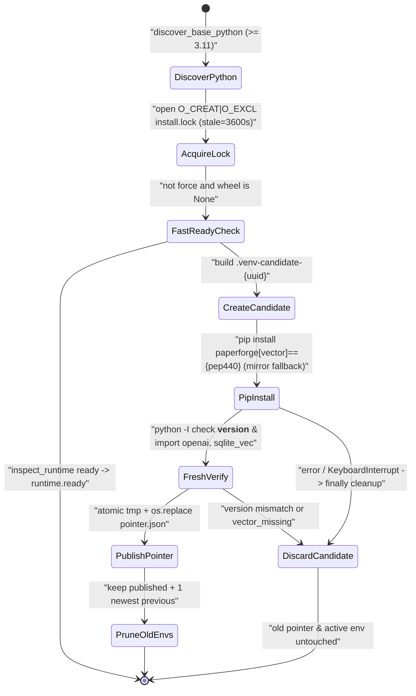

# 第 02 章：配置系统、凭据鉴权与运行时安装器

> 本文档完整记录 PaperForge 的三项基础设施单一权威：Schema v2 配置文件（`paperforge/config.py`）、系统级密钥环凭据管理（`paperforge/credentials.py`）与独立受管 Python 运行时安装器（`paperforge/runtime_pointer.py` + `paperforge/runtime_installer.py`），并涵盖 `setup` 编排与 `doctor`/`runtime-health` 诊断协议。关联章节参见 [第 01 章：系统架构、分层约束与磁盘存储契约](01-architecture-and-storage.md) 与 [第 03 章：CLI 路由、PFResult 协议与流式取消机制](03-protocol-pfresult-and-stream.md)。

---

## 1. 职责与非目标边界

- **配置权威（`paperforge/config.py`）**：Python 是 `paperforge.json`（`SCHEMA_VERSION = 2`）的唯一解析器、校验器、优先级合并器与原子写入器。业务命令不得绕过 `load_config()` 自行拼接默认路径或容忍损坏/遗留配置。
- **凭据权威（`paperforge/credentials.py`）**：采用“进程环境变量 → 操作系统 Keyring → 缺失”的三级解析顺序。Keyring 是唯一的持久化存储后端；禁止落盘明文、禁止进程全局内存密钥缓存、禁止在运行时回退读取 `.env`、Windows HKCU 注册表、旧版环境变量名或插件设置。
- **运行时指针权威（`paperforge/runtime_pointer.py` & `paperforge/runtime_installer.py`）**：通过 `paperforge runtime install|update|repair|status` 在用户主目录 `~/.paperforge/runtime/` 下独立构建并验证隔离虚拟环境，仅在版本与向量依赖验证全部通过后原子发布 `pointer.json`。Obsidian 插件与 Vault 级 `paperforge setup` 对此指针仅有只读权限，绝不原地修改已激活的虚拟环境。
- **引导与诊断分离（`paperforge/setup/` & `paperforge/doctor/`）**：`SetupPlan` 负责单个 Vault 的目录、配置与 Skill 初始化；`run_doctor()` 与 `validate_entry_fields()` / `get_runtime_health()` 负责只读状态校验，不得在无指针或无配置时臆测替代路径。

### 非目标边界（Non-Goals）

- `paperforge.json` 与 `.env` 不承担任何 API 密钥的运行时存储职责；任何包含敏感词片段的键都会被配置层 Fail-Closed 拦截。
- `paperforge setup` 不负责安装 Python 包或发布 `pointer.json`（由 `paperforge runtime` 独立完成）。
- `paperforge auth` 命令族永远不提供读取或导出明文密钥的子命令，也不接受通过命令行 `argv` 传入明文密钥。

---

## 2. 核心源码与单测映射表

### 2.1 核心源码模块

| 模块路径                                | 核心职责                                        | 关键符号                                                                                                                                                                            |
| --------------------------------------- | ----------------------------------------------- | ----------------------------------------------------------------------------------------------------------------------------------------------------------------------------------- |
| `paperforge/config.py`                  | Schema v2 配置权威与路径解析                    | `SCHEMA_VERSION`、`FIELD_SPECS`、`AGENT_PLATFORM_IDS`、`ConfigError`、`load_config()`、`set_config()`、`unset_config()`、`bootstrap_config()`、`migrate_config()`、`_transaction()` |
| `paperforge/commands/config.py`         | `paperforge config` 8 动词 CLI 适配器           | `run()`（处理 `list/get/set/unset/validate/paths/init/migrate` 并包装 `PFResult`）                                                                                                  |
| `paperforge/credentials.py`             | 密钥环与规范环境变量凭据权威                    | `CredentialKey`、`CredentialStatus`、`CredentialError`、`resolve()`、`store()`、`delete()`、`status()`                                                                              |
| `paperforge/commands/auth.py`           | `paperforge auth` CLI 适配器                    | `run_status()`、`run_set()`、`run_delete()`、`run_migrate()`、`LEGACY_NAMES`                                                                                                        |
| `paperforge/core/versioning.py`         | 四维版本兼容区间、ABI 校验与依赖指纹契约        | `MIN_ENGINE_VERSION`、`normalize_release_version()`、`is_version_compatible()`、`compute_deps_lock_hash()`、`runtime_abi_tag()`、`installed_deps_satisfy_declarations()`            |
| `paperforge/runtime_pointer.py`         | `~/.paperforge/runtime/pointer.json` 读写边界   | `POINTER_SCHEMA_VERSION`、`pointer_dir()`、`pointer_path()`、`read_pointer()`、`publish_pointer()`                                                                                  |
| `paperforge/runtime_uv.py`              | 便携 `uv`（`0.13.9` SHA-256 校验）与托管 Python | `UV_VERSION`、`UV_ASSET_SHA256`、`verify_uv_archive_sha256()`、`discover_uv()`、`ensure_uv()`、`bootstrap_uv_python()`、`uv_create_venv()`、`uv_pip_install()`                      |
| `paperforge/runtime_installer.py`       | 独立受管运行时构建、微调校验与剪枝              | `install_runtime()`、`inspect_runtime()`、`install_lock()`、`RuntimeInstallError`（支持 ABI+依赖校验后的 `deps_lock_hash` `--no-deps` 快修与 `uv` 自动兜底）                        |
| `paperforge/commands/runtime_health.py` | `runtime-health` CLI 适配器                     | `run()`，输出 `PFResult` 或分层终端摘要                                                                                                                                             |
| `paperforge/memory/runtime_health.py`   | 记忆层 5 维度健康检查                           | `get_runtime_health()`、`_runtime_identity()`                                                                                                                                       |
| `paperforge/worker/status.py`           | Vault 全量诊断 `doctor` 与基础 `status`         | `run_doctor()`、`_query_resolved_version()`、`_query_resolved_package()`                                                                                                            |
| `paperforge/doctor/field_validator.py`  | 笔记 Frontmatter 字段注册表校验器               | `validate_entry_fields()`、`validate_collection()`、`validate_frontmatter_from_file()`                                                                                              |
| `paperforge/schema/__init__.py`         | 字段注册表加载器                                | `load_field_registry()`、`get_owner_fields()`                                                                                                                                       |
| `paperforge/schema/field_registry.yaml` | Frontmatter 等结构的规范字段 Schema             | 定义各字段 `type`、`required`、`public`、`owner`                                                                                                                                    |
| `paperforge/setup/__init__.py`          | 模块化引导步骤结果数据模型                      | `SetupStepResult`                                                                                                                                                                   |
| `paperforge/setup/checker.py`           | 引导前置条件校验器                              | `SetupChecker`（检查 Python `>= 3.11`、`pip`、Vault、Zotero、BBT 导出）                                                                                                             |
| `paperforge/setup/config_writer.py`     | 引导配置写入薄门面                              | `ConfigWriter`（仅委托给 `bootstrap_config()` 与 `set_config()`）                                                                                                                   |
| `paperforge/setup/plan.py`              | 模块化 5 步引导编排器                           | `SetupPlan`（支持 `--json` 触发 `#137` NDJSON 流与协作取消）                                                                                                                        |
| `paperforge/setup/runtime.py`           | 向量运行时依赖校验与子进程探针                  | `VECTOR_CAPABILITY_IMPORTS`、`check_runtime_dependencies()`、`verify_runtime_in_child()`                                                                                            |
| `paperforge/setup/vault.py`             | Vault 目录树与 Zotero Junction 创建             | `VaultInitializer`                                                                                                                                                                  |
| `paperforge/setup/agent.py`             | Vault 级 Skill 与 `AGENTS.md` 部署              | `AgentInstaller`                                                                                                                                                                    |
| `paperforge/setup_wizard.py`            | 兼容壳与环境探测工具集                          | `EnvChecker`、`headless_setup()`（已弃用，转发至 `SetupPlan`）                                                                                                                      |

### 2.2 配套单元测试与契约测试

| 测试文件路径                                      | 验证目标与断言重点                                                                                                                  |
| ------------------------------------------------- | ----------------------------------------------------------------------------------------------------------------------------------- |
| `tests/test_config.py`                            | 验证 17 项 `FIELD_SPECS` 完整覆盖、4 级优先级覆盖、缺失/损坏/未来/遗留/含密钥配置 Fail-Closed 分类、事务锁与原子写                  |
| `tests/test_credentials.py`                       | 使用注入的内存 `FakeKeyring` 隔离测试环境变量覆盖优先级、冲突拒绝、`--stdin` 写入、回读失败回滚、`--yes` 删除门控及 `.env`/环境迁移 |
| `tests/harness/test_a03_config_authority.py`      | 端到端 CLI 验证 `config set` 落盘、`config paths` 解析、`../escape` 拒绝后文件字节零变化及跨进程持久化                              |
| `tests/harness/test_a04_config_migration.py`      | 验证 v1 顶层路径键与 `agent_key` 无损迁移至 Schema v2、未知字段保留、派生字段删除及二次迁移字节幂等性                               |
| `tests/harness/test_a05_credential_authority.py`  | 验证 `auth set --stdin` 仅入 Keyring，绝不出现在进程 `argv` 或 Vault 任何文件中                                                     |
| `tests/unit/core/test_versioning.py`              | 验证 SemVer/PEP 440 归一、`minEngineVersion` 兼容区间判定及确定性 `depsLockHash` 依赖哈希计算                                       |
| `tests/unit/test_runtime_uv.py`                   | 验证 `uv` 平台包选择、防路径穿越解压、环境缓存目录与 `python install` / `uv pip install` 国内镜像兜底                               |
| `tests/test_runtime_installer.py`                 | 验证候选环境创建与验证先于指针发布、失败自动丢弃候选并保留旧指针、安装并发锁、同 `depsLockHash` 快修与 `uv` 兜底及旧环境剪枝        |
| `tests/test_runtime_pointer.py`                   | 验证 `pointer.json` 原子发布无残留 `.tmp`、四字段全校验与绝对路径要求                                                               |
| `tests/test_runtime_pointer_version_authority.py` | 回归 `#267`：在 CWD 存在伪造源码包的子进程中，验证 `publish_pointer()` 以环境安装的 `dist-info` 元数据版本为准                      |
| `tests/test_doctor.py`                            | 验证无指针时不触发目标解释器探针、缺失/版本不一致/依赖缺失诊断分支及 JSON 输出契约                                                  |
| `tests/test_setup_plan_v2.py`                     | 验证 `ConfigWriter` 嵌套 `vault_config` 写入、无顶层路径键残留、v1 文件 Fail-Closed 及 `SetupPlan` 配置透传                         |
| `tests/test_setup_wizard.py`                      | 验证 `AGENT_PLATFORM_IDS`（15 项）、`AGENT_SHARED_SKILL_DIR == ".agents/skills"` 及 `EnvChecker` 各环境探针                         |
| `tests/unit/doctor/test_field_validator.py`       | 验证 `MISSING_REQUIRED`、`MISSING_OPTIONAL`、`DRIFT` 与 `NO_FRONTMATTER` 诊断分类                                                   |

---

## 3. 磁盘文件、数据库表与协议 JSON 字段字典

### 3.1 `FIELD_SPECS` 全量配置字段字典（共 17 个字段）

下表逐项核对自 `paperforge/config.py` 第 94–129 行的 `FIELD_SPECS` 元组（`writable` 默认值均为 `True`）：

| `key`                     | `storage_path`                       | `value_type` | `default`                                              | `env`                            | `choices`                    | `allow_empty` | `vault_relative` |
| ------------------------- | ------------------------------------ | ------------ | ------------------------------------------------------ | -------------------------------- | ---------------------------- | ------------- | ---------------- |
| `system_dir`              | `("vault_config", "system_dir")`     | `"path"`     | `"System"`                                             | `"PAPERFORGE_SYSTEM_DIR"`        | `()`                         | `False`       | `True`           |
| `resources_dir`           | `("vault_config", "resources_dir")`  | `"path"`     | `"Resources"`                                          | `"PAPERFORGE_RESOURCES_DIR"`     | `()`                         | `False`       | `True`           |
| `literature_dir`          | `("vault_config", "literature_dir")` | `"path"`     | `"Literature"`                                         | `"PAPERFORGE_LITERATURE_DIR"`    | `()`                         | `False`       | `True`           |
| `control_dir`             | `("vault_config", "control_dir")`    | `"path"`     | `"LiteratureControl"`                                  | `"PAPERFORGE_CONTROL_DIR"`       | `()`                         | `False`       | `True`           |
| `base_dir`                | `("vault_config", "base_dir")`       | `"path"`     | `"Bases"`                                              | `"PAPERFORGE_BASE_DIR"`          | `()`                         | `False`       | `True`           |
| `skill_dir`               | `("vault_config", "skill_dir")`      | `"path"`     | `".agents/skills"`                                     | `"PAPERFORGE_SKILL_DIR"`         | `()`                         | `False`       | `True`           |
| `command_dir`             | `("vault_config", "command_dir")`    | `"path"`     | `".opencode/command"`                                  | `"PAPERFORGE_COMMAND_DIR"`       | `()`                         | `False`       | `True`           |
| `zotero_data_dir`         | `("zotero_data_dir",)`               | `"path"`     | `""`                                                   | `"ZOTERO_DATA_DIR"`              | `()`                         | `True`        | `False`          |
| `agent_platform`          | `("agent_platform",)`                | `"enum"`     | `"opencode"`                                           | `"PAPERFORGE_AGENT_PLATFORM"`    | `AGENT_PLATFORM_IDS` (15 项) | `False`       | `False`          |
| `auto_analyze_after_ocr`  | `("auto_analyze_after_ocr",)`        | `"boolean"`  | `False`                                                | `None`                           | `()`                         | `False`       | `False`          |
| `ocr_profile`             | `("ocr_profile",)`                   | `"string"`   | `"default"`                                            | `"PAPERFORGE_OCR_PROFILE"`       | `()`                         | `False`       | `False`          |
| `paddleocr_job_url`       | `("paddleocr_job_url",)`             | `"string"`   | `"https://paddleocr.aistudio-app.com/api/v2/ocr/jobs"` | `"PADDLEOCR_JOB_URL"`            | `()`                         | `False`       | `False`          |
| `paddleocr_model`         | `("paddleocr_model",)`               | `"string"`   | `"PaddleOCR-VL-1.6"`                                   | `"PADDLEOCR_MODEL"`              | `()`                         | `False`       | `False`          |
| `embedding_profile`       | `("embedding_profile",)`             | `"string"`   | `"default"`                                            | `"PAPERFORGE_EMBEDDING_PROFILE"` | `()`                         | `False`       | `False`          |
| `vector_db_provider_type` | `("vector_db_provider_type",)`       | `"enum"`     | `"openai_sdk"`                                         | `"VECTOR_DB_PROVIDER_TYPE"`      | `("openai_sdk", "requests")` | `False`       | `False`          |
| `vector_db_api_base`      | `("vector_db_api_base",)`            | `"string"`   | `""`                                                   | `"VECTOR_DB_API_BASE"`           | `()`                         | `True`        | `False`          |
| `vector_db_api_model`     | `("vector_db_api_model",)`           | `"string"`   | `"text-embedding-3-small"`                             | `"VECTOR_DB_API_MODEL"`          | `()`                         | `False`       | `False`          |

> **注意**：`FIELD_SPECS` 中 `system_dir` 的结构体默认值为 `"System"`，但在通过 CLI 运行 `paperforge setup` 初始化全新 Vault（`paperforge.json` 与 `System/PaperForge` 均不存在且未显式传 `--system-dir`）时，`paperforge/cli.py` 会显式注入 `system_dir = ".paperforge"`。

### 3.2 `AGENT_PLATFORM_IDS` 全量平台 ID（共 15 项）

定义于 `paperforge/config.py` 第 58–63 行（用于 `agent_platform` 枚举与 CLI `setup --agent` 选择约束）：

| 序号 | 平台 ID          | 说明与 Skill 部署位置关系                                   |
| ---- | ---------------- | ----------------------------------------------------------- |
| 1    | `opencode`       | 默认平台；`setup_wizard.py:AGENT_NAMES` 展示名 `"OpenCode"` |
| 2    | `claude`         | Claude Code；`AGENT_NAMES` 展示名 `"Claude Code"`           |
| 3    | `codex`          | Codex；`AGENT_NAMES` 展示名 `"Codex"`                       |
| 4    | `cursor`         | Cursor；`AGENT_NAMES` 展示名 `"Cursor"`                     |
| 5    | `gemini`         | Gemini CLI；`AGENT_NAMES` 展示名 `"Gemini CLI"`             |
| 6    | `kilo`           | Kilo                                                        |
| 7    | `pi`             | Pi                                                          |
| 8    | `omp`            | Oh My Pi                                                    |
| 9    | `crush`          | Crush                                                       |
| 10   | `kimi`           | Kimi CLI                                                    |
| 11   | `github_copilot` | GitHub Copilot；`AGENT_NAMES` 展示名 `"GitHub Copilot"`     |
| 12   | `cline`          | Cline；`AGENT_NAMES` 展示名 `"Cline"`                       |
| 13   | `windsurf`       | Windsurf；`AGENT_NAMES` 展示名 `"Windsurf"`                 |
| 14   | `augment`        | Augment；`AGENT_NAMES` 展示名 `"Augment"`                   |
| 15   | `trae`           | Trae；`AGENT_NAMES` 展示名 `"Trae"`                         |

**架构约定**：`AgentInstaller`（`paperforge/setup/agent.py`）不再按平台 ID 路由不同路径，统一部署到跨客户端共享目录 `AGENT_SHARED_SKILL_DIR = ".agents/skills"`；有专属目录需求的 Harness（如 `.omp/skills`）通过 `paperforge skill deploy --to <dir>` 自行部署。

### 3.3 `paperforge.json` 与 `pointer.json` 结构字典

#### 3.3.1 `paperforge.json`（`SCHEMA_VERSION = 2`）

- **合法结构**：顶层必须含 `"schema_version": 2`（加载时兼容字符串 `"2"`，写入时一律规范化为整数 `2`）；7 个路径字段（`LEGACY_PATH_KEYS`）嵌套于 `"vault_config"` 对象内，其余 10 个标量字段位于顶层。
- **遗留触发条件**（满足任一即判为 `migration_required`）：缺失整型/字符串 `"2"` 的 `schema_version`、`schema_version < 2`、顶层存在任意 `LEGACY_PATH_KEYS`、存在 `"agent_key"` 或派生遗留键 `_DERIVED_LEGACY_FIELDS = ("paperforge_path", "zotero_link")`。
- **未知字段处理**：非敏感的未知键记录于 `ConfigSnapshot.unknown_keys` 并产生 `config.unknown_key` 告警，在变更事务中原样保留不丢失，但绝不被业务逻辑解释或上行传递。

#### 3.3.2 `~/.paperforge/runtime/pointer.json`（`POINTER_SCHEMA_VERSION = 1`）

| 字段                 | 类型  | 校验约束（`read_pointer()`）                                                                                                                        |
| -------------------- | ----- | --------------------------------------------------------------------------------------------------------------------------------------------------- |
| `schema_version`     | `int` | 必须严格等于 `1`                                                                                                                                    |
| `python_path`        | `str` | 非空字符串，且 `Path(python_path).is_absolute()` 必须为 `True`                                                                                      |
| `environment_root`   | `str` | 非空字符串，且 `Path(environment_root).is_absolute()` 必须为 `True`                                                                                 |
| `paperforge_version` | `str` | 非空字符串；由 `publish_pointer()` 优先取运行环境 `importlib.metadata.version("paperforge")`，仅在无安装发行版元数据时回退 `paperforge.__version__` |

#### 3.3.3 `CredentialKey` 与 `CredentialStatus`（`paperforge/credentials.py`）

- `CredentialKey(kind, profile="default")`：`kind` 仅允许 `"ocr"` 或 `"embedding"`；`profile` 必须匹配正则 `[a-z][a-z0-9_]{0,63}`。
  - `env_name`：`PAPERFORGE_CREDENTIAL_<KIND>__<PROFILE>`（如 `PAPERFORGE_CREDENTIAL_OCR__DEFAULT`）。
  - `keyring_username`：`<kind>:<profile>`（服务名固定 `SERVICE = "paperforge"`）。
- `CredentialStatus`：包含 `key`、`state`（`"available" | "missing" | "backend_unavailable" | "backend_locked" | "permission_denied" | "backend_error"`）、`source`（`"environment" | "keyring" | None`）、`backend` 与 `remediation_code`；永不携带密钥明文。

---

## 4. 核心执行链路、状态机与顺序不变量

### 4.1 配置加载与单写入事务链（`paperforge/config.py`）

```text
优先级合并（后覆盖前）:
  SOURCE_DEFAULT (FIELD_SPECS) < SOURCE_FILE (paperforge.json) < SOURCE_ENVIRONMENT (os.environ) < SOURCE_OVERRIDE (invocation)

_transaction(vault, mutator):
  acquire FileLock(vault / "paperforge.json.lock", timeout=5.0)
    -> _read_document(path)
    -> _classify_document() [拦截 corrupt / future_schema / migration_required / invalid / secret_field]
    -> mutator(data) + 规范化 schema_version = 2
    -> 对候选文档再次执行 _classify_document() 全量校验
    -> 若 changed: _write_document_atomic() [mkstemp -> write -> flush -> os.fsync -> copymode -> os.replace -> POSIX parent dir fsync]
    -> _read_document(path) 回读校验（失败则尝试还原 prior 字节并抛 config.write_failed）
    -> 返回 MutationResult(changed, snapshot, warnings)
```

### 4.2 受管运行时分阶段安装状态机（`paperforge/runtime_installer.py`）



**核心顺序不变量**：

1. **SemVer → PEP 440 归一化**：`_normalize_release_version()` 将诸如 `2.0.0-rc.6` 或 `v2.0.0-beta.1` 的发行tag 统一归一化为 `2.0.0rc6`、`2.0.0b1`，确保 pip 安装规格与 `importlib.metadata` 回读版本比对一致。
2. **国内镜像条件回退**：`_pip_install()` 在主源失败、且未设置 `PIP_INDEX_URL`/`PIP_FIND_LINKS`、且安装目标非本地 `.whl` 文件时，自动使用 `--default-timeout=60` 回退至 `https://pypi.tuna.tsinghua.edu.cn/simple`（`--trusted-host pypi.tuna.tsinghua.edu.cn`）。
3. **仅限自建环境剪枝**：`ENV_DIR_PREFIXES = (".venv-candidate-",)`，`_prune_environments()` 仅删除带该前缀、严格位于 `runtime_dir` 子树内且排除当前发布环境与最新 1 个上一版本的旧目录，绝不误删用户手动环境。
4. **CWD 遮蔽防护（#267）**：`publish_pointer()` 优先读取运行环境中已安装发行版的 `dist-info` 元数据版本号，防止工作目录恰好位于源码仓根目录时，将尚未安装进受管 venv 的源码版本号误写进 `pointer.json`。

### 4.3 凭据存储与一次性迁移流（`paperforge/credentials.py` & `paperforge/commands/auth.py`）

- **`store(key, secret, replace=False)`**：拒绝空字符串（`credential.input_required`）；读取 Keyring 现有值，若存在不同非空值且未传 `replace=True` 则抛出 `credential.conflict`；写入后立即执行 `kr.get_password()` 回读比对，任何异常或校验不一致都会触发 `_restore_prior()` 回滚至旧值（或删除部分写入）。
- **`auth migrate --from dotenv|environment|windows-registry`**：读取遗留源（`LEGACY_OCR_NAMES` + `LEGACY_EMBEDDING_NAMES`）→ 若非 `--dry-run` 且不冲突则写入 Keyring 并回读验证 → 仅 `.env` 来源在验证通过后通过 `_scrub_dotenv_key()` 原地删除该密钥行（保留 URL 等非敏感行）；进程环境变量与 Windows HKCU 注册表只会在 `manual_cleanup` 中列出待手动删除键名，绝不静默篡改用户外部环境。

### 4.4 `SetupPlan` 引导编排链（`paperforge/setup/plan.py`）

`SetupPlan.execute()` 按不可逆顺序推进，任一步骤失败（`_step_outcome`）或收到协作取消信号（`rc=130`）即在下一步写入前熔断：

1. `checker`（`SetupChecker`，传 `--skip-checks` 跳过）→ 2. `config_writer`（仅写入显式传入的 CLI 键，不把未传参数覆盖为默认值）→ 3. `resolve_paths()` + `vault_initializer`（创建 5 个核心目录）+ `vault_initializer.zotero_junction`（若 `system.name == ".paperforge"` 则自动跳过 Junction 创建，直接使用 `zotero_data_dir`）→ 4. `runtime_dependencies`（只读校验 `openai` 与 `sqlite_vec` 可导入，缺漏时提示在 Obsidian 外运行 `paperforge runtime repair`）→ 5. `agent_installer`（按小步迭代 `deploy_skills`、`deploy_agent_config`，步间检查停止标记）。

---

## 5. 配置项、环境变量、CLI 入口与错误码

### 5.1 环境变量全集

| 环境变量                                                                                       | 消费模块                          | 作用                                                                      |
| ---------------------------------------------------------------------------------------------- | --------------------------------- | ------------------------------------------------------------------------- |
| `PAPERFORGE_VAULT`                                                                             | `paperforge/config.py`            | 未传 `--vault` 时指定 Vault 路径                                          |
| 14 个 `FIELD_SPECS.env`                                                                        | `paperforge/config.py`            | 见 3.1 节（`PAPERFORGE_SYSTEM_DIR` 等 14 项）                             |
| `PAPERFORGE_CREDENTIAL_OCR__<PROFILE>` / `PAPERFORGE_CREDENTIAL_EMBEDDING__<PROFILE>`          | `paperforge/credentials.py`       | 显式进程级凭据覆盖，优先于 Keyring                                        |
| `PAPERFORGE_KEYRING_BACKEND`                                                                   | `paperforge/credentials.py`       | 覆盖底层 `PYTHON_KEYRING_BACKEND`（测试/无头部署控制）                    |
| `PIP_INDEX_URL` / `PIP_FIND_LINKS`                                                             | `paperforge/runtime_installer.py` | 存在任一变量时禁用默认清华镜像回退                                        |
| `PAPERFORGE_SETUP_TEST_HOLD_SECONDS`                                                           | `paperforge/setup/plan.py`        | NDJSON 模式下测试取消竞态窗口的延迟注入                                   |
| `PADDLEOCR_API_TOKEN`, `PADDLEOCR_API_KEY`, `OCR_TOKEN`, `VECTOR_DB_API_KEY`, `OPENAI_API_KEY` | `paperforge/commands/auth.py`     | **仅限** `auth migrate --from ...` 发现并迁移遗留凭据，运行时永不回退读取 |

### 5.2 CLI 控制命令入口

- **配置管理**：`paperforge config {list|get <key>|set <key> <value>|unset <key>|validate|paths|init|migrate [--dry-run]} [--json]`（退出码：`0` 成功，`1` 运行失败，`2` 用法/未知键/只读键/敏感键）。
- **凭据管理**：
  - `paperforge auth status [ocr|embedding] [--profile P] [--json]`
  - `paperforge auth set <ocr|embedding> [--profile P] [--stdin] [--replace] [--json]`
  - `paperforge auth delete <ocr|embedding> [--profile P] --yes [--json]`（缺 `--yes` 返回退出码 `2`）
  - `paperforge auth migrate --from {dotenv|environment|windows-registry} [--dry-run] [--replace] [--kind ...] [--profile P] [--json]`
- **受管运行时**：`paperforge runtime {install|update|repair|status} [--expected-version V] [--base-python P] [--wheel W] [--json]`（`runtime` 分支在 `cli.py` 中直接路由，不解析 Vault 也不加载管线模块）。
- **初始化与健康检查**：`paperforge setup [--modular|--headless] [--agent ...] [--system-dir ...] [--zotero-data ...] [--skip-checks] [--json]`、`paperforge doctor [--json]`、`paperforge runtime-health [--json]`。

### 5.3 错误码字典

#### 5.3.1 `ConfigError` 错误码（`paperforge/config.py`）

| 错误码                       | 触发场景                                                                                                   |
| ---------------------------- | ---------------------------------------------------------------------------------------------------------- |
| `config.not_found`           | `paperforge.json` 不存在，或 `bootstrap_config()` 时 Vault 目录不存在                                      |
| `config.corrupt`             | 文件无法读取、UTF-8/JSON 解码失败或根节点非 JSON Object                                                    |
| `config.migration_required`  | 缺失/`< 2` 的 `schema_version`、非整型版本，或存在 `LEGACY_PATH_KEYS`/`agent_key`/`_DERIVED_LEGACY_FIELDS` |
| `config.future_schema`       | `schema_version > 2`                                                                                       |
| `config.invalid`             | `vault_config` 非对象、字段类型/枚举/URL/Vault 相对路径校验失败                                            |
| `config.invalid_environment` | 环境变量中的配置覆盖值未通过 `validate_field_value()`                                                      |
| `config.secret_field`        | 顶层或 `vault_config` 内出现匹配 `_SECRET_KEY_PARTS` 的敏感键名                                            |
| `config.unknown_key`         | `set`/`unset`/`get` 传入未注册在 `FIELD_BY_KEY` 的键                                                       |
| `config.read_only_key`       | 尝试写入或删除 `writable=False` 的字段                                                                     |
| `config.write_failed`        | 原子写文件抛 `OSError` 或写入后回读校验失败                                                                |
| `config.locked`              | `FileLock` 在 `LOCK_TIMEOUT_SECONDS = 5.0` 秒内超时                                                        |

#### 5.3.2 凭据、运行时与字段验证错误码

- **凭据错误码**（`credentials.py` → `ErrorCode`）：`credential.missing`、`credential.backend_unavailable`、`credential.backend_locked`、`credential.permission_denied`、`credential.backend_error`、`credential.input_required`、`credential.conflict`、`credential.invalid_profile`、`credential.confirm_required`。
- **运行时安装错误码**（`RuntimeInstallError`）：`runtime.ready`（正常就绪状态码）、`runtime.install_in_progress`、`runtime.install_locked`、`runtime.directory_failed`、`runtime.wheel_invalid`、`runtime.no_python`、`runtime.python_too_old`、`runtime.venv_failed`、`runtime.pip_failed`、`runtime.verify_failed`、`runtime.vector_missing`、`runtime.install_failed`。
- **字段注册表验证码**（`field_validator.py`）：`MISSING_REQUIRED`（error）、`MISSING_OPTIONAL`（info）、`DRIFT`（warning，未在 `field_registry.yaml` 中注册的未知字段）、`READ_ERROR`（error）、`NO_FRONTMATTER`（warning）。

---

## 6. 边界防护与 Fail-Closed 防呆规则

1. **敏感键名全量拦截（`_SECRET_KEY_PARTS`）**：
   `paperforge/config.py` 定义 `_SECRET_KEY_PARTS = ("api_key", "api_token", "token", "password", "secret")`。无论在 `load_config()`、`validate_config()`、`set_config()`、`unset_config()` 还是 `migrate_config(--dry-run)` 中，只要顶层或 `vault_config.*` 下任一键名小写包含上述子串，立刻拒绝并抛出 `config.secret_field`。
2. **输入校验边界（`validate_field_value`）**：
   - `vault_relative=True` 的 7 个路径键强制禁止空白、`/`/`\` 开头、Windows 盘符前缀（如 `C:`）、NUL 字节 `\x00` 以及任何 `..` 路径段。
   - `paddleocr_job_url` 与 `vector_db_api_base` 强制要求 `http://` 或 `https://`，显式包含主机段且禁止嵌入 `user:pass@host`（`userinfo` 凭据）。
   - `ocr_profile` 与 `embedding_profile` 强制匹配 `[a-z][a-z0-9_]{0,63}`。
3. **无静默回退与绝不泄漏密钥（`credentials.py` & `auth.py`）**：
   - `auth set` 仅允许 TTY `getpass` 或 `--stdin` 管道读入（自动剥离末尾 `\r\n`），绝不在 `cli.py` 注册明文 `--value` 参数；任何错误消息、异常堆栈、`PFResult` 与日志均不回显密钥值。
   - 当 Keyring 后端锁定或不可用时，`ocr_doctor()` 与 `auth status` 必须明确报告 `credential.backend_locked` / `credential.backend_unavailable`，绝不伪装成 `credential.missing`。
4. **插件执行解释器单一来源（`run_doctor()`）**：
   `run_doctor()` 严格以 `read_pointer()` 发布的 `python_path` 作为插件执行目标进行版本与依赖探测；缺失、版本与当前进程不一致或可执行文件不存在时跳过目标探测并 Fail，绝不偷偷回退探测系统 `PATH` 上的 `python` 来制造虚假通过。
5. **已知遗留差异提示（`memory/runtime_health.py`）**：
   `paperforge/memory/runtime_health.py` 的 `_check_bootstrap()` 当前以 `vault / system_dir / "PaperForge"` 检查目录存在性，尚未适配 `.paperforge` 叶子折叠（见 [第 01 章](01-architecture-and-storage.md) 第 3.1 节）。在 `.paperforge` 布局下若 `runtime-health` 的 `bootstrap` 层报 `degraded`，需参考 `config paths` 与 `probe installation` 的权威结果。

---

## 7. 维修、调试与升级 Checklist

- [ ] **校验并修复配置状态**：运行 `paperforge --vault <VAULT> config validate --json`，若 `state == "migration_required"`，先运行 `paperforge config migrate --dry-run --json` 审查冲突警告再执行 `paperforge config migrate`。
- [ ] **核对当前有效配置来源**：运行 `paperforge --vault <VAULT> config list --json`，检查每个字段的 `source`（`default` / `file` / `environment` / `override`），排查是否存在误设的环境变量覆盖。
- [ ] **排查 Keyring 与凭据来源**：运行 `paperforge auth status --json` 确认 `ocr:default` 与 `embedding:default` 状态；无图形会话环境或测试环境可显式注入 `PAPERFORGE_CREDENTIAL_OCR__DEFAULT`，或通过 `echo <SECRET> | paperforge auth set ocr --stdin --replace` 写入。
- [ ] **清理旧版 `.env` 或环境变量中的遗留密钥**：运行 `paperforge --vault <VAULT> auth migrate --from dotenv --dry-run` 发现旧密钥后执行正式迁移，并根据 `manual_cleanup` 输出手动移除 OS 环境变量或 Windows 注册表项。
- [ ] **重建或升级受管运行时**：在 Obsidian 外部终端运行 `paperforge runtime status --json`；若版本不匹配或向量依赖异常，运行 `paperforge runtime update --json`（或强制重建 `paperforge runtime repair --json`）。
- [ ] **跨组件联动全量体检**：执行 `paperforge --vault <VAULT> doctor --json` 与 `paperforge --vault <VAULT> probe all --json`，核对指针版本、BBT 导出、Zotero 位置与笔记 Frontmatter 注册表一致性。
