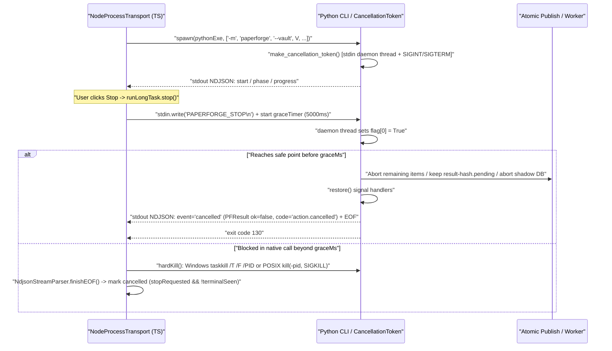

# 第 03 章：CLI 路由、PFResult 协议与流式取消机制

> 本文档完整梳理 `paperforge/cli.py` 的全部命令行路由树、`paperforge/core/` 定义的 `PFResult` / `ErrorCode` / `NextAction` / `settlement` / `state` / `io` / `keys` / `timing` 基础契约，以及 `#137` NDJSON 结构化流与 `PAPERFORGE_STOP\n` 协作式取消协议。关联章节参见 [第 01 章：系统架构、分层约束与磁盘存储契约](01-architecture-and-storage.md)、[第 02 章：配置系统、凭据鉴权与运行时安装器](02-config-auth-and-runtime.md) 及 [ARCHITECTURE.md](../ARCHITECTURE.md)。

---

## 1. 职责与非目标边界

- **CLI 路由器（`paperforge/cli.py`）**：负责解析全局参数、按需延迟加载 `pipeline`/Worker 模块、通过 `resolve_vault()` 定位 Vault、执行 Fail-Closed 配置门禁、初始化 stderr 日志与阶段计时，并将命令分派至 `paperforge/commands/` 或特定处理器。
- **双模式机读协议（`paperforge/core/result.py` & `paperforge/core/ndjson.py`）**：
  - **单结果模式（Single-Result Mode）**：在 `stdout` 输出单个 `PFResult` JSON 文档（或部分传统详情命令的结构化 JSON）。
  - **结构化流模式（Structured-Stream Mode, `#137`）**：在 `stdout` 按行输出 `schema_version: 1` 的 NDJSON 事件，并以有且仅有一个的终态事件（`result` | `error` | `cancelled`）结尾后立即到达 EOF；所有人工可读日志、诊断与性能计时均严格隔离到 `stderr`。
- **协作式取消（`paperforge/core/cancellation.py`）**：单进程内建立唯一取消标志，统一汇入两路信号——控制器通过管道写入 `PAPERFORGE_STOP\n` 至子进程 `stdin`，以及终端用户触发 `SIGINT`/`SIGTERM`。
- **底层共享原语（`paperforge/core/`）**：提供标准错误码（`errors.py`）、带校验的后续动作意图（`next_actions.py`）、单论文结算投影（`settlement.py`）、生命周期状态迁移校验（`state.py`）、原子文件写入（`io.py`）、跨平台键列表归一化（`keys.py`）与性能打点（`timing.py`）。

### 非目标边界（Non-Goals）

- **不接受向客户端传递命令字符串或 `argv`**：`PFResult.next_actions` 与 `ActionSpec` 仅传递已注册 `action_id` 与结构化 `scope`，由插件客户端允许列表自行构造执行参数。
- **不支持已退役的冒号 Token 与跨进程停止控制面**：旧版 `EMBED_START`、`OCR_REBUILD_*`、`OCR_REDO_*`、`DONE`、`NOTICE` 文本标记流解析与 `embed` 独立停止子命令已永久退役，不得恢复双重解析。
- **不维护双向交互式 `stdin` 命令通道**：`stdin` 仅单向识别固定令牌 `PAPERFORGE_STOP\n`（以及 `auth set --stdin` 的单次密钥读取），不是通用 RPC 通道。

---

## 2. 核心源码与单测映射表

### 2.1 核心源码模块

| 模块路径                                         | 核心职责                                   | 关键符号                                                                                                                                                                 |
| ------------------------------------------------ | ------------------------------------------ | ------------------------------------------------------------------------------------------------------------------------------------------------------------------------ | ------------ | -------------------------------------------------------------- | ---------------------------------------------------------------------------------------- |
| `paperforge/cli.py`                              | 顶层 `argparse` 树与全局门禁分派           | `build_parser()`、`main()`、`_run_cli()`、`_run_runtime_command()`、`_run_skill()`、`_cmd_paths()`                                                                       |
| `paperforge/commands/__init__.py`                | 动态命令模块注册表                         | `_COMMAND_REGISTRY`、`get_command_module()`                                                                                                                              |
| `paperforge/logging_config.py`                   | `paperforge` 根日志初始化（仅写 `stderr`） | `configure_logging()`、`get_paperforge_logger()`                                                                                                                         |
| `paperforge/core/result.py`                      | 统一结果信封与错误对象                     | `PFResult`、`PFError`（`to_dict()`、`to_json()`、`from_dict()`、`successful_keys`）                                                                                      |
| `paperforge/core/errors.py`                      | 集中式枚举错误码                           | `ErrorCode`（共 44 个成员 + `_missing_` 前向兼容映射）                                                                                                                   |
| `paperforge/core/ndjson.py`                      | `#137` NDJSON 流发射原语                   | `emit()`、`emit_start()`、`emit_phase()`、`emit_progress()`、`emit_preflight()`、`emit_paper_settled()`、`emit_heartbeat()`、`emit_item_result()`、`emit_terminal()`     |
| `paperforge/core/cancellation.py`                | 进程内协作式取消令牌                       | `STOP_TOKEN`（`"PAPERFORGE_STOP\n"`）、`make_cancellation_token()`                                                                                                       |
| `paperforge/core/next_actions.py`                | 类型化后续动作意图合约                     | `NextAction`、`NextActionScope`、`ACTION_REGISTRY`、`build_next_action()`、`validate_next_actions()`                                                                     |
| `paperforge/core/settlement.py`                  | 论文级操作标准化结算                       | `SettlementOutcome`、`settlement_payload()`、`successful_keys()`                                                                                                         |
| `paperforge/core/state.py`                       | 生命周期枚举与合法转移表                   | `OcrStatus`、`PdfStatus`、`Lifecycle`、`ALLOWED_TRANSITIONS`                                                                                                             |
| `paperforge/core/io.py`                          | 基础 JSON/JSONL/文本原子写入               | `read_json()`、`write_json_atomic()`、`write_text_atomic()`、`write_json()`、`read_jsonl()`                                                                              |
| `paperforge/core/keys.py`                        | 跨平台 Zotero Key 列表规范化               | `normalize_paper_keys()`（容忍 UTF-8 BOM、CRLF、逗号/空白并去重校验）                                                                                                    |
| `paperforge/core/timing.py`                      | `stderr` 独占的阶段耗时统计                | `phase()`、`reset()`、`set_command()`、`summary()`、`total_ms()`、`emit_total()`                                                                                         |
| `paperforge/core/date_utils.py`                  | 年份正则抽取辅助                           | `extract_year()`                                                                                                                                                         |
| `paperforge/actions/types.py`                    | 动作描述符与请求类型模型                   | `ActionSpec`、`ActionRequest`、`ActionScope`、`ActionExecutionHooks`                                                                                                     |
| `paperforge/actions/registry.py`                 | 冻结动作注册表与非注册动作表               | `ACTION_REGISTRY`（9 个注册动作）、`NON_REGISTRY_ACTIONS`                                                                                                                |
| `paperforge/actions/runner.py`                   | 动作管道执行器                             | `run_action()`、`ActionError`、`cancelled_result()`                                                                                                                      |
| `paperforge/commands/action.py`                  | `action list                               | describe                                                                                                                                                                 | preflight    | run` CLI                                                       | `run_dispatch()`、`EXIT_INVALID_REQUEST`、`EXIT_CONFIRMATION_REQUIRED`、`EXIT_CANCELLED` |
| `paperforge/commands/ocr.py`                     | `ocr` 族分派、诊断与流包装                 | `_run_ocr_dispatch()`、`_run_ocr_redo()`、`_run_ocr_rebuild()`、`_diagnose()`（支持 `--stream`）                                                                         |
| `paperforge/commands/embed.py`                   | `embed build                               | status                                                                                                                                                                   | migrate` CLI | `run()`（`--stream` 或无 `--json` 时发 `#137` 流错误终止事件） |
| `paperforge/commands/daemon.py`                  | 持久 stdio JSON-RPC 复用通道               | `serve_stdio()`、`_execute_request()`（每次 RPC 前 `timing.reset()` 防串味、重定向 logging `StreamHandler`，透传 `stdin` 凭据并隔离 `SystemExit`）                       |
| `paperforge/plugin/src/client/node-transport.ts` | TS 端唯一子进程与协议 Fail-Closed 解析器   | `NdjsonStreamParser`、`runLongTask()`、`hardKill()`、`paperforgeEnrichedEnv()`、暖 daemon 复用（`shutdownDaemon()` 先拒绝在途并发 RPC 并清定时器再杀进程）与一次性冷回退 |

### 2.2 配套单元测试与契约测试

| 测试文件路径                                | 验证目标与断言重点                                                                                                             |
| ------------------------------------------- | ------------------------------------------------------------------------------------------------------------------------------ |
| `tests/cli/test_json_contracts.py`          | 校验 `paths --json`、`status --json`、`context`、`search --json`、`retrieve --json` 的信封键集与字段类型语义                   |
| `tests/cli/test_error_codes.py`             | 校验未知命令退出码、`--help`/`--version`、无 Vault 时禁止泄漏 Python Traceback 及确定性错误输出                                |
| `tests/cli/test_contract_helpers.py`        | 提供 `normalize_snapshot()`、`assert_valid_json()`、`assert_json_shape()` 契约测试助手                                         |
| `tests/test_cli_paths.py`                   | 断言 `paths --json` 与文本输出不含 `<system_dir>`/`<resources_dir>` 未解析占位符                                               |
| `tests/unit/test_daemon_and_stream_flag.py` | 验证 `paperforge daemon --stdio` 复用、`auth set --stdin` 秘钥透传、错误/嵌套隔离及各命令 `--stream` 参数解析                  |
| `tests/test_cli_worker_dispatch.py`         | 验证 `status`、`sync`、兼容别名及 `ocr` 向对应命令/服务模块的正确分派                                                          |
| `tests/test_x04_kill_terminal.py`           | 启动 `setup --json` 并注入硬杀（`SIGKILL`/`TerminateProcess`），断言退出码非零且绝不伪造 `result` 终态事件                     |
| `tests/test_x05_atomicity_hardening.py`     | 模拟临时文件写入后、`os.replace` 前崩溃，断言旧 `pointer.json` 完好且截断 JSON 被 Fail-Soft 拒绝                               |
| `tests/unit/core/test_errors.py`            | 校验 `ErrorCode` 枚举值、字符串转换及未知字符串向 `ErrorCode.UNKNOWN` 的前向容错                                               |
| `tests/unit/core/test_io.py`                | 校验 `write_json_atomic()` 自动创建父目录、原子替换且不残留 `.json.tmp`                                                        |
| `tests/unit/core/test_result.py`            | 校验 `PFResult` / `PFError` 布尔语义、序列化空字段省略规则（`warnings`/`next_actions`）及 `to_json()`/`from_dict()` 往返一致性 |
| `tests/unit/core/test_state.py`             | 校验 `OcrStatus` 9 态、`from_legacy()` 映射、`PdfStatus`、`Lifecycle` 及 `ALLOWED_TRANSITIONS` 非法迁移拦截                    |
| `tests/test_settlement.py`                  | 校验 `successful_keys` 与 `summary` 严格由 `per_key` 派生且透传 `reason_code`、`execution_id`                                  |
| `tests/test_core_keys.py`                   | 校验 `normalize_paper_keys()` 对 CRLF、BOM、逗号空格混排、空行、重复键及 `known_keys` 过滤                                     |
| `tests/test_timing.py`                      | 校验 `PAPERFORGE_TIMING=1/0/unset` 三种策略及“计时器永不写入 `stdout`”红线                                                     |

---

## 3. 磁盘文件、数据库表与协议 JSON 字段字典

### 3.1 `PFResult` 与 `PFError` 信封协议（`paperforge/core/result.py`）

| 字段路径          | 类型                | 序列化规则（`to_dict()`）       | 说明                                                                                                                          |
| ----------------- | ------------------- | ------------------------------- | ----------------------------------------------------------------------------------------------------------------------------- |
| `ok`              | `bool`              | 必填                            | 成功为 `True`，任何错误或取消均为 `False`                                                                                     |
| `command`         | `str`               | 必填                            | 命令或操作名称（如 `"sync"`、`"config.set"`、`"action run"`）                                                                 |
| `version`         | `str`               | 必填                            | `paperforge.__version__`                                                                                                      |
| `data`            | `Any \| None`       | 始终序列化（无数据时为 `null`） | 成功载荷或诊断上下文                                                                                                          |
| `error`           | `dict \| None`      | 始终序列化（无错时为 `null`）   | 包含 `code`（`ErrorCode.value`）、`message`（`str`）、`details`（`dict`）；仅当 `suggestions` 非空时才输出 `suggestions` 列表 |
| `warnings`        | `list[str]`         | **非空时才输出**                | 面向机器调用方的警告列表（不写往 `stdout` 散文）                                                                              |
| `next_actions`    | `list[dict]`        | **非空时才输出**                | 序列化后的 `NextAction` 列表                                                                                                  |
| `successful_keys` | `list[str] \| None` | **永不序列化上行**              | `#167` 进程内元数据，供 `--follow auto` 链传递精确成功键作用域                                                                |

### 3.2 `#137` NDJSON 流事件词汇表（`paperforge/core/ndjson.py`）

每行均为单行 UTF-8 JSON，公共必填字段：`schema_version: 1`、`event: str`、`operation: str`。

| `event`         | 发射函数                          | 附加载荷字段                                                            | 类别与语义                                         |
| --------------- | --------------------------------- | ----------------------------------------------------------------------- | -------------------------------------------------- |
| `start`         | `emit_start()`                    | `total: int \| None`, `scope: Any`                                      | 非终态：操作启动                                   |
| `preflight`     | `emit_preflight()`                | `availability: str`, `summary: {needed, noop, blocked, not_applicable}` | 非终态：执行前可用性与适用性摘要                   |
| `phase`         | `emit_phase()`                    | `phase: str`                                                            | 非终态：全局或长步骤阶段切换（如 `setup` 步骤 ID） |
| `progress`      | `emit_progress()`                 | `current: int`, `total: int \| None`, `item_id: str \| None`            | 非终态：条目级进度推进                             |
| `item_result`   | `emit_item_result()`              | `item_id: str`, `status: str`                                           | 非终态：单条目的中间状态（如 `ocr.rebuild`）       |
| `paper_settled` | `emit_paper_settled()`            | `key: str`, `outcome: str`, `reason_code?: str`                         | 非终态：单篇论文进入结算状态                       |
| `heartbeat`     | `emit_heartbeat()`                | `active: int`, `pending: int`                                           | 非终态：远端轮询存活心跳                           |
| `result`        | `emit_terminal("result", ...)`    | `result: dict`（完整 `PFResult`）                                       | **终态**：操作成功结束（紧接 EOF）                 |
| `error`         | `emit_terminal("error", ...)`     | `result: dict`（完整 `PFResult`，`ok=false`）                           | **终态**：操作失败结束（紧接 EOF）                 |
| `cancelled`     | `emit_terminal("cancelled", ...)` | `result: dict`（完整 `PFResult`，`code="action.cancelled"`）            | **终态**：协作取消结束（紧接 EOF，退出码 `130`）   |

### 3.3 `NextAction` 与 `settlement_payload` 字段字典

- **`NextAction`**（`paperforge/core/next_actions.py`，`NEXT_ACTIONS_SCHEMA_VERSION = 1`）：
  - 字段：`schema_version`、`action_id`、`scope`（`{"kind": "all"}` 或 `{"kind": "papers", "keys": [...]}`）、`automatic`（`bool`）、`cost`（`"local" | "remote_possible"`）、`impact`（`"read_only" | "mutating" | "destructive"`）、`confirmation`（`"none" | "required"`）、`reason`、`dedupe_key`（非空时输出）。
  - 当前 `ACTION_REGISTRY` 注册条目仅两项：`memory.build`（`cost="local"`, `impact="destructive"`, `automatic=False`）与 `embed.resume`（`cost="remote_possible"`, `impact="mutating"`, `automatic=False`）。
- **`settlement_payload`**（`paperforge/core/settlement.py`）：
  - `SettlementOutcome` 6 种标准状态：`succeeded`、`noop`、`pending`、`blocked`、`failed`、`cancelled`。
  - 输出结构：`{"summary": {各状态计数}, "per_key": {key: {"outcome": ..., "reason_code"?: ..., "execution_id"?: ...}}, "successful_keys": sorted(outcome == "succeeded")}`。

### 3.4 状态机枚举字典（`paperforge/core/state.py`）

- **`OcrStatus`**（9 态）：`none`、`pending`、`queued`、`processing`、`done`、`done_incomplete`、`failed`、`blocked`、`nopdf`。`from_legacy()` 映射旧值 `"running"` → `processing`、`"error"` → `failed`，未知字符串默认映射至 `pending`。
- **`PdfStatus`**（3 态）：`healthy`、`broken`、`missing`。
- **`Lifecycle`**（5 态）：`pdf_ready`、`ocr_ready`、`analyze_ready`、`deep_read_done`、`error_state`。

---

## 4. 核心执行链路、状态机与顺序不变量

### 4.1 CLI 启动、门禁与分派流程

1. `main()` 重置阶段计时器（`timing.reset()`）并在 `finally` 中调用 `timing.emit_total()` 向 `stderr` 汇总耗时。
2. `_run_cli()` 解析参数后调用 `timing.set_command(args.command)`：
   - 若为 `runtime`：直接配置日志并进入 `_run_runtime_command()`，**不解析 Vault、不导入管线模块**。
   - 若在 `lightweight_commands` 集合（36 个命令）：调用 `_resolve_pipeline()`；若在 `worker_import_commands`（`status`、`deep-reading`、`ocr`、`selection-sync`、`index-refresh`、`base-refresh`）：通过 `_import_worker_functions()` 绑定未被打桩的 Worker Stub。
   - 调用 `resolve_vault(cli_vault=args.vault)`。
   - **Fail-Closed 配置加载**：除 `config_tolerant_commands = frozenset({"config", "setup", "probe", "auth", "action", "skill"})` 外，其余所有命令在调度前必须通过 `load_config(vault)` 与 `resolve_paths(vault, snapshot)`。若配置缺失/损坏/需迁移/含密钥且传入 `--json`，则向 `stdout` 打印构造好的 `PFResult(error.code=VALIDATION_ERROR)` 后退出码 `1`。
   - 调用 `configure_logging(verbose)` 初始化 `stderr` 日志后路由至对应命令模块。

### 4.2 双输出模式选择真值（无全局 `--stream` 标志）

`paperforge/cli.py` **不存在全局 `--stream` CLI 参数**。结构化流由特定命令或注册表 `execution_mode` 自动决定：

| 入口命令                                                               | 非 `--json` 行为                                                    | `--json` 行为                                                                                                                                                                                       |
| ---------------------------------------------------------------------- | ------------------------------------------------------------------- | --------------------------------------------------------------------------------------------------------------------------------------------------------------------------------------------------- |
| `action run <id>`                                                      | 人类可读文本摘要                                                    | 若 `ACTION_REGISTRY[id].execution_mode == "stream"`（如 `foundation.update`、`embed.resume`、`embed.build`、`ocr.run`、`ocr.rebuild_derived`），发射 `#137` NDJSON 流；否则输出单条 `PFResult` JSON |
| `setup`                                                                | 人类可读步骤进度与总结                                              | `SetupPlan.execute(ndjson=True)` 发射 `#137` NDJSON 流（`operation="foundation.setup"`）                                                                                                            |
| `ocr` / 兼容子命令 `run`                                               | `_stream = True`，发射 `ocr.run` NDJSON 流（`diagnose` 除外）       | 关闭 NDJSON 流，结束后输出单条 `PFResult` JSON                                                                                                                                                      |
| `ocr rebuild`（非 `--dry-run`）                                        | 始终发射 `ocr.rebuild` NDJSON 流（无 `--json` 参数）                | —                                                                                                                                                                                                   |
| `ocr redo <KEYS...>`（非 `--dry-run`）                                 | 显式传入 `keys` 时始终发射 `ocr.redo` NDJSON 流（无 `--json` 参数） | —                                                                                                                                                                                                   |
| `embed build`                                                          | `emit_events=True`，发射 `embed.build` NDJSON 流                    | 关闭 NDJSON 流，由构建服务输出单条 `PFResult` JSON                                                                                                                                                  |
| 常规查询/修改命令（`sync`、`config`、`auth`、`probe`、`reconcile` 等） | 人类可读文本                                                        | 单条 `PFResult` 或域内 JSON                                                                                                                                                                         |

### 4.3 协作式取消与强杀升级交互序列

### 4.4 `OcrStatus` 状态迁移矩阵（`ALLOWED_TRANSITIONS`）

- `none` → `pending`, `queued`, `nopdf`
- `pending` → `queued`, `processing`, `nopdf`, `blocked`
- `queued` → `processing`, `failed`
- `processing` → `done`, `done_incomplete`, `failed`
- `done` / `done_incomplete` / `failed` / `blocked` / `nopdf` → `pending`（显式重跑或修复后重入队）
- `DEEP_READING_STATUS`：`pending` ↔ `done`（通过 `--force` 重置）。
- `Lifecycle`：`pdf_ready` → `ocr_ready` → `analyze_ready` → `deep_read_done` ↔ `pdf_ready`，任何阶段均可转入 `error_state` 并经 `error_state` → `pdf_ready` 恢复。

---

## 5. 配置项、环境变量、CLI 入口与错误码

### 5.1 全局参数与环境变量

- **全局参数**（必须位于子命令之前）：`--version`、`--vault VAULT`、`--verbose` / `-v`（强制日志级别为 `DEBUG`）、`--no-progress`（关闭进度条）。
- **协议级环境变量**：
  - `PAPERFORGE_VAULT`：Vault 根路径后备定位变量。
  - `PAPERFORGE_LOG_LEVEL`：日志级别（`DEBUG`/`INFO`/`WARNING`/`ERROR`），未配置时默认 `INFO`，非法值静默回退至 `WARNING`。
  - `PAPERFORGE_TIMING`：`1` 打印所有阶段耗时到 `stderr`；`0` 完全静默；未设置仅打印超过 `SLOW_MS = 1000.0` ms 的慢阶段。

### 5.2 全部 47 个顶层 CLI 子命令全集（核对自 `build_parser()`）

#### 5.2.1 控制面、配置与安装运维（10 个）

| 顶层子命令       | 子动作 / 关键选项                                                                                                                                                 | 说明                                                     |
| ---------------- | ----------------------------------------------------------------------------------------------------------------------------------------------------------------- | -------------------------------------------------------- |
| `config`         | `list\|get\|set\|unset\|validate\|paths\|init\|migrate` (`--dry-run`, `--json`)                                                                                   | Schema v2 唯一配置入口                                   |
| `auth`           | `status\|set\|delete\|migrate` (`--stdin`, `--replace`, `--yes`, `--from`, `--json`)                                                                              | 凭据管理权威入口                                         |
| `runtime`        | `install\|update\|repair\|status` (`--expected-version`, `--base-python`, `--wheel`, `--json`)                                                                    | 独立受管运行时（无需 Vault）                             |
| `daemon`         | `--stdio`（默认启用）, `--idle-timeout SEC`（默认 `300`，`0` 禁用）, `--parent-pid PID`                                                                             | 轻内存全局控制引擎（stdio 双工 RPC + 子进程任务监管 + 消息推送） |
| `setup`          | `--modular`, `--headless`, `--agent`, `--system-dir`, `--resources-dir`, `--literature-dir`, `--base-dir`, `--zotero-data`, `--skip-checks`, `--stream`, `--json` | Vault 初始化编排（`--stream` / `--json` 输出 NDJSON 流） |
| `probe`          | `installation\|help\|library\|ocr\|memory\|maintenance\|lineage\|all` (`--json`, `--expected-version`, `--last-operation-exit-code`)                              | 只读能力探测包络                                         |
| `action`         | `list\|describe\|preflight\|run` (`--scope`, `--key`, `--keys-file`, `--confirm`, `--follow`, `--stream`, `--json`)                                               | 声明式动作策略管道（`--stream` 强制 `#137` 流）          |
| `reconcile`      | `--scope`, `--key`, `--json`                                                                                                                                      | 纯派生缺陷读模型与 `next_actions` 生成器                 |
| `doctor`         | `--json`                                                                                                                                                          | Vault 全链路诊断与字段注册表检查                         |
| `runtime-health` | `--json`                                                                                                                                                          | Memory/Vector 5 维健康检查                               |

#### 5.2.2 文献库同步、工作区与路径（7 个）

| 顶层子命令        | 子动作 / 关键选项                                                                                          | 说明                                         |
| ----------------- | ---------------------------------------------------------------------------------------------------------- | -------------------------------------------- |
| `paths`           | `--json`                                                                                                   | 打印解析后的 Vault 路径字典                  |
| `status`          | `--json`                                                                                                   | 报告库统计、OCR 队列与索引摘要               |
| `sync`            | `--dry-run`, `--domain`, `--selection`, `--index`, `--rebuild-index`, `--prune`, `--prune-force`, `--json` | Zotero 选择同步、资产索引重建与收敛触发      |
| `migrate-storage` | `--dry-run`, `--json`                                                                                      | 迁移引擎存储至 `.paperforge/`                |
| `upgrade`         | `--plan`, `--dry-run`, `--apply`, `--fast-cutover`, `--heal`, `--priority-key`, `--limit`, `--rollback`, `--backfill-ocr`, `--quarantine-residuals`, `--quarantine-ids`, `--no-rebuild-db`, `--json` | 跨版本 Vault 普查、双速无损切流、渐进自愈与一键回滚 |
| `engine`          | `status\|sync-registry\|rebuild-db` (`--json`)                                                             | 统一 VaultEngine SQLite SSOT 与清单管理      |
| `base-refresh`    | `--force` / `-f`                                                                                           | 刷新 `.base` 视图文件                        |
| `prune`           | `--force`, `--json`, `keys...`                                                                             | 清理孤儿论文（默认 dry-run，实删移入回收站） |
| `trash`           | `list\|restore <trash_id>\|purge [--older-than DAYS]`                                                      | 回收站列表、恢复与物理清除                   |

#### 5.2.3 OCR、渲染审计与显示版本（5 个）

| 顶层子命令 | 子动作 / 关键选项                                                                                                                                            | 说明                                                         |
| ---------- | ------------------------------------------------------------------------------------------------------------------------------------------------------------ | ------------------------------------------------------------ |
| `ocr`      | 顶层 `--diagnose`, `--stream`, `--json`, `--key`；子命令 `pipeline-versions`, `status`, `resume`, `redo`, `list`, `rebuild`, 以及兼容子命令 `run` / `doctor` | OCR 队列执行、断点续传、派生重建与诊断（支持 `--stream`）    |
| `render`   | `audit\|reconcile\|promote-r\|accept-proposal` (`--include-pdf-media`, `--apply-r`, `--all`, `--plan-hash`, `--json`)                                        | 渲染一致性审计与 R/P 级联修复晋升                            |
| `versions` | `list\|show\|backups\|paths\|restore\|reset-live` (`--key`, `--label`, `--json`)                                                                             | 显示全文历史版本、安全恢复与切回最新规范全文                 |
| `repair`   | `--fix`, `--fix-paths`, `--json`                                                                                                                             | 修复笔记与 OCR 元数据分歧或失联 PDF 路径                     |
| `note`     | `set-flag` (`--key`, `--field`, `--value true\|false`, `--json`)                                                                                             | Python 权威改写笔记 Frontmatter 开关（`do_ocr` / `analyze`） |

#### 5.2.4 记忆底座、向量检索、阅读记录与智能体（19 个）

| 顶层子命令      | 子动作 / 关键选项                                                                                                                   | 说明                                                   |
| --------------- | ----------------------------------------------------------------------------------------------------------------------------------- | ------------------------------------------------------ |
| `memory`        | `build [--key ...] [--json]\|status [--json]\|restore-backup [--json]`                                                              | SQLite `paperforge.db` 底座构建与备份恢复              |
| `embed`         | `build [--force\|--resume] [--stream] [--json]\|status [--probe] [--json]\|migrate [--json]`                                        | 向量索引构建（支持显式 `--stream` 流模式）、探针与迁移 |
| `search`        | `query`, `--json`, `--limit`, `--domain`, `--year-from`, `--year-to`, `--ocr`, `--deep`, `--lifecycle`, `--next-step`, `--evidence` | FTS5 元数据检索                                        |
| `retrieve`      | `query`, `--json`, `--limit`, `--deep`, `--expand\|--no-expand`, `--paper`                                                          | 正文与图表语义混合检索（BM25 ∪ vec0）                  |
| `query-plan`    | `query`, `--intent discover\|locate\|content\|known-paper`, `--json`                                                                | 检索意图唯一路由器                                     |
| `inspect`       | `query`, `--json`                                                                                                                   | 单论文 6 阶段端到端瓶颈诊断（只读 `?mode=ro`）         |
| `paper-status`  | `query`, `--json`                                                                                                                   | 查询单篇论文状态                                       |
| `paper-context` | `key`, `--json`, `--structure`                                                                                                      | 获取论文元信息、章节结构树及批注                       |
| `read`          | `key`, `--find` (必选), `--source auto\|fulltext\|pdf`, `--json`                                                                    | 受控本地原文/PDF 字面量检索                            |
| `context`       | `key`, `--domain`, `--collection`, `--all`                                                                                          | 生成可溯源 AI 上下文包                                 |
| `dashboard`     | `--json`                                                                                                                            | 聚合仪表盘统计与权限投影                               |
| `annotations`   | `pdf-info\|list\|add\|update\|delete\|promote\|fulltext-preview\|agent-mark\|adopt\|clear-agent`                                    | 非破坏性侧车 PDF 批注与 Agent 句子锚定                 |
| `memory-card`   | `get\|refine\|history\|clear\|base-snapshot`                                                                                        | 5 维动态论文记忆卡片及 Base 快照                       |
| `reading-log`   | `--write`, `--render`, `--correct`, `--search`, `--lookup`, `--validate`, `--import`, `--json` 等                                   | 科研精读摘录记录与纠错账本                             |
| `project-log`   | `--write`, `--payload`, `--project`, `--list`, `--render`                                                                           | 项目级研究工作日志                                     |
| `deep-reading`  | `--json`                                                                                                                            | 查询待精读论文队列                                     |
| `deep-finalize` | `zotero_key`, `--json`                                                                                                              | 标记精读完成并刷新状态                                 |
| `agent-context` | `--json`                                                                                                                            | 生成智能体启动上下文包                                 |
| `skill`         | `deploy` (`--to`, `--overwrite`, `--json`)                                                                                          | 部署内嵌 `paperforge` 技能包                           |

#### 5.2.5 向后兼容历史子命令（6 个，文档已弃用）

| 顶层子命令 token    | 当前等价路由 / 说明                                             |
| ------------------- | --------------------------------------------------------------- |
| `selection-sync`    | 转发至 `sync`（强制 `selection=True, index=False`）             |
| `index-refresh`     | 转发至 `sync`（强制 `selection=False, index=True`）             |
| `paper-lookup`      | v1.5 前 Layer 4 网关遗留命令（支持 `--from-path` 与 `query`）   |
| `content-discovery` | v1.5 前 Layer 4 网关遗留命令（现由 `search` / `retrieve` 替代） |
| `paper-navigation`  | v1.5 前 Layer 4 网关遗留命令（现由 `paper-context` 替代）       |
| `scoped-fetch`      | v1.5 前 Layer 4 网关遗留命令（现由 `retrieve --paper` 替代）    |

### 5.3 全部 44 个 `ErrorCode` 枚举码与统一退出码

#### 5.3.1 `ErrorCode` 完整清单（`paperforge/core/errors.py`）

| 子系统                          | 枚举成员名称及字符串 `.value`                                                                                                                                                                                                                                                                                                                                                                                                                                                                                                                                 |
| ------------------------------- | ------------------------------------------------------------------------------------------------------------------------------------------------------------------------------------------------------------------------------------------------------------------------------------------------------------------------------------------------------------------------------------------------------------------------------------------------------------------------------------------------------------------------------------------------------------- |
| **Runtime (4)**                 | `PYTHON_NOT_FOUND`, `PYTHON_VERSION_TOO_OLD`, `PAPERFORGE_NOT_INSTALLED`, `VERSION_MISMATCH`                                                                                                                                                                                                                                                                                                                                                                                                                                                                  |
| **Config / Vault (4)**          | `VAULT_NOT_FOUND`, `CONFIG_NOT_FOUND`, `CONFIG_INVALID`, `PATH_NOT_FOUND`                                                                                                                                                                                                                                                                                                                                                                                                                                                                                     |
| **BBT / Zotero (5)**            | `BBT_EXPORT_NOT_FOUND`, `BBT_EXPORT_INVALID`, `BBT_CITATION_KEY_MISSING`, `ZOTERO_DATA_NOT_FOUND`, `PDF_PATH_UNRESOLVED`                                                                                                                                                                                                                                                                                                                                                                                                                                      |
| **Credentials (9)**             | `CREDENTIAL_MISSING` (`"credential.missing"`), `CREDENTIAL_BACKEND_UNAVAILABLE` (`"credential.backend_unavailable"`), `CREDENTIAL_BACKEND_LOCKED` (`"credential.backend_locked"`), `CREDENTIAL_PERMISSION_DENIED` (`"credential.permission_denied"`), `CREDENTIAL_BACKEND_ERROR` (`"credential.backend_error"`), `CREDENTIAL_INPUT_REQUIRED` (`"credential.input_required"`), `CREDENTIAL_CONFLICT` (`"credential.conflict"`), `CREDENTIAL_INVALID_PROFILE` (`"credential.invalid_profile"`), `CREDENTIAL_CONFIRM_REQUIRED` (`"credential.confirm_required"`) |
| **Actions / Preconditions (9)** | `ACTION_UNKNOWN` (`"action.unknown"`), `ACTION_INVALID_REQUEST` (`"action.invalid_request"`), `ACTION_SCOPE_INVALID` (`"action.scope_invalid"`), `ACTION_UNAVAILABLE` (`"action.unavailable"`), `ACTION_BUSY` (`"action.busy"`), `ACTION_CONFIRMATION_REQUIRED` (`"action.confirmation_required"`), `ACTION_CANCELLED` (`"action.cancelled"`), `PARTIAL_FAILURE`, `PRECONDITION_FAILED`                                                                                                                                                                       |
| **OCR (4)**                     | `OCR_TOKEN_MISSING`, `OCR_UPLOAD_FAILED`, `OCR_POLL_TIMEOUT`, `OCR_RESULT_INVALID`                                                                                                                                                                                                                                                                                                                                                                                                                                                                            |
| **Sync (3)**                    | `SYNC_FAILED`, `CANDIDATE_BUILD_FAILED`, `NOTE_WRITE_FAILED`                                                                                                                                                                                                                                                                                                                                                                                                                                                                                                  |
| **Schema (3)**                  | `FIELD_MISSING`, `FIELD_TYPE_INVALID`, `INDEX_SCHEMA_INVALID`                                                                                                                                                                                                                                                                                                                                                                                                                                                                                                 |
| **Generic (3)**                 | `VALIDATION_ERROR`, `INTERNAL_ERROR`, `UNKNOWN`（未知代码经 `_missing_()` 降级至此）                                                                                                                                                                                                                                                                                                                                                                                                                                                                          |

#### 5.3.2 统一退出码规范

| 退出码 | 语义与触发场景                                                                                                                                                            |
| ------ | ------------------------------------------------------------------------------------------------------------------------------------------------------------------------- |
| `0`    | 操作完成 / `PFResult.ok=true` / 终态事件 `result`                                                                                                                         |
| `1`    | 操作级失败 / 配置未通过 / Pre-flight 不可用或忙碌 / `error` 终态事件                                                                                                      |
| `2`    | `argparse` 用法错误 / `action` pre-dispatch 非法请求（未知 `action_id`、非法 `scope`、空 `keys`、`--confirm` 不匹配）/ `config` 未知键或敏感键 / `auth delete` 缺 `--yes` |
| `3`    | `action run` pre-dispatch 缺 `--confirm <exact_action_id>`（同时输出携带确认摘要的描述符）                                                                                |
| `130`  | 协作式取消生效（`PAPERFORGE_STOP\n` / `SIGINT` / `SIGTERM`），对应 `cancelled` 终态事件，绝不折叠为 `1`                                                                   |

---

## 6. 边界防护与 Fail-Closed 防呆规则

1. **NDJSON 解析器 Fail-Closed（`NdjsonStreamParser`）**：
   客户端遇到以下任一状况立刻终止解析并判定 `protocolFailure`，绝不猜测或容忍脏数据：
   - `stdout` 出现任何非 JSON 行（如误用 `print()` 输出调试文本）。
   - `schema_version !== 1` 或 `event` 不在 `KNOWN_EVENTS`（10 个已知事件名）之内。
   - 收到终态事件（`result` | `error` | `cancelled`）后流未结束又收到后续事件或第二个终态事件。
   - 进程到达 EOF 却未观测到任何终态事件（补充附上 `exit <code>` / `signal <sig>` 以区分崩溃强杀与静默丢帧）。
   - **唯一向后兼容豁免**：同一主版本内已知事件中的未知增量字段会被忽略。
2. **管道阻塞与 `stdout` 洁癖红线**：
   - `timing.py` 与 `logging_config.py` 强制只向 `sys.stderr` 输出；`NodeProcessTransport` 持续消费并仅保留最近 `STDERR_TAIL = 8000` 字符的 `stderr`，防止 Windows 默认约 4KB 管道缓冲写满后反向卡死 Python 子进程。
   - `cli.py` 在 `--json` 模式下捕获 `ConfigError` 时强制走 `stdout` 输出完整 `PFResult`，避免错误原因因落到 `stderr` 而丢失。
3. **`NextAction` 不变量门禁（`validate_next_action`）**：
   - 凡 `cost == "remote_possible"` 或 `impact == "destructive"`，强制 `automatic == False` 且 `confirmation == "required"`。
   - `scope.kind == "papers"` 时绝对禁止空 `keys`（防止空列表被误解释为“全库论文”）；`scope.kind == "all"` 时禁止携带非空 `keys`；批内 `dedupe_key` 重复或未知 `action_id` 一律拒绝。
4. **Action 返回契约与按键清单净化**：
   - `runner.py:_validate_handler_result()` 校验处理器返回必须是 `PFResult` 且 `data` 为 `Mapping` 或 `None`，否则转为 `INTERNAL_ERROR`。
   - `core/keys.py:normalize_paper_keys()` 统一剥离 `\ufeff`（UTF-8 BOM）、`\r`（Windows CRLF）与空白/逗号分隔并保序去重，且 `action` 与 `ocr` 在接收 `--keys-file` 或空白键时会显式返回退出码 `2`，防止半截碎片或回车符导致键静默漏匹配。
5. **原始文件写入原子化（`core/io.py`）**：
   `write_json_atomic()` 与 `write_text_atomic()` 先在同级目录写 `.tmp` 文件再执行 `Path.replace()`，保证崩溃不会产生零字节或半截目标文件（需强持久化的 `config.py` 与 `asset_index.py` 在此基础上额外叠加 `FileLock` 与 `os.fsync()`）。

---

## 7. 维修、调试与升级 Checklist

- [ ] **定位慢命令瓶颈**：设置环境变量 `PAPERFORGE_TIMING=1` 并复跑慢命令，在 `stderr` 查看每段 `[PF:time] <phase> <ms>` 及总墙钟耗时（不影响 `stdout` 机器解析）。
- [ ] **打开全量调试日志**：传递全局标志 `--verbose`（须放在子命令前，如 `paperforge --vault <VAULT> -v sync --json`）或设置 `PAPERFORGE_LOG_LEVEL=DEBUG`，在 `stderr` 观察详细堆栈与状态转换。
- [ ] **排查插件报 `EOF without terminal event` 或 `non-JSON stdout line`**：在独立终端复跑完全相同的命令并重定向 `stdout` 与 `stderr` 分离检查，核实是否存在未走 `stderr` 的裸 `print()` 污染 `stdout`，或进程中途 OOM/强杀导致未发射终态事件。
- [ ] **排查 `action run` 返回退出码 2 或 3**：退出码 `2` 检查 `action_id` 拼写、`--scope papers` 是否漏传 `--key`/`--keys-file`（以及键文件是否存在无效空键）；退出码 `3` 表示需要交互确认，读取返回值中的 `preservation_facts` / `replacement_facts` 后附带 `--confirm <exact_action_id>` 重试。
- [ ] **验证批量键文件兼容性**：对从 Windows 粘贴或脚本生成的 `--keys-file`，确认其可通过 `paperforge.core.keys.normalize_paper_keys()` 正常剥离 BOM 与 `\r\n`。
- [ ] **回归核心协议单测矩阵**：修改 `cli.py`、`core/`、`actions/` 后，至少运行 `pytest tests/cli/ tests/unit/core/ tests/test_cli_paths.py tests/test_cli_worker_dispatch.py tests/test_x04_kill_terminal.py tests/test_x05_atomicity_hardening.py tests/test_settlement.py tests/test_core_keys.py tests/test_timing.py`。
