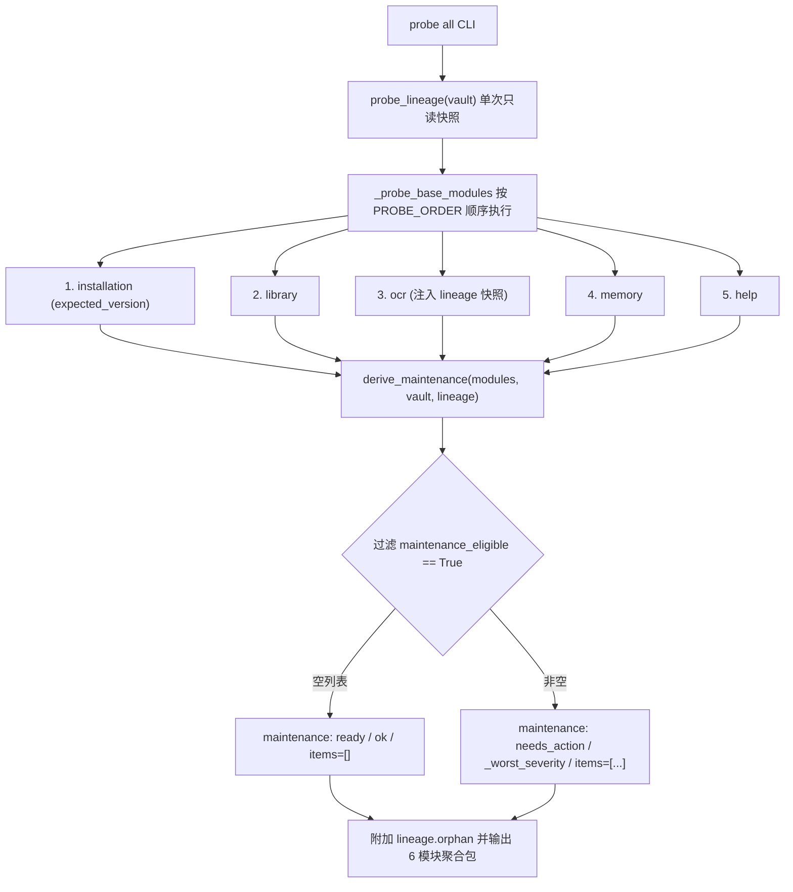
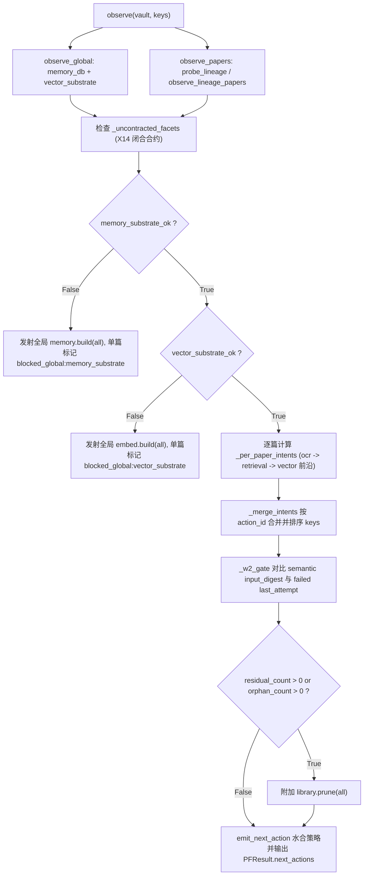

# 第 04 章：控制面状态探针与 Reconcile 缺口推导

本章系统剖析 PaperForge 控制面的只读观测层（Capability Probes）与缺口推导引擎（Reconcile）。两者共同构成了“先观测事实、再推导最小修复前沿、最后交由注册表与执行器落地”的闭环控制面，是前端插件（Control Center）与 CLI 自动化编排获取真实系统状态的唯一权威（Single Source of Truth, SSOT）。相关 Action 注册表、Preflight 投影与执行安全边界详见 [Chapter 05](05-action-registry-and-safety.md)，Zotero/BBT 同步与谱系底层状态采集详见 [Chapter 06](06-zotero-sync-and-lineage.md)。

---

## 1. 职责与非目标边界

### 1.1 控制面双引擎的职责划分

1. **Capability Probes（能力探针，`paperforge/probes/`）**
   - 负责将底层离散磁盘状态（Python 运行时指针、`paperforge.json` 配置、BBT 导出与索引、OCR 维护行与谱系、SQLite/vec0 向量状态、内置 Skill 源文件）归一化为 **Schema-v2 能力信封（Capability Envelope）**。
   - **纯只读观测**：在任何场景下不得修改 `paperforge.json`、`meta.json`、`paperforge.db` 或重新生成衍生文件；所有异常必须降级为结构化 `unknown` / `detection_failed` 信封，严禁抛栈中断聚合输出。
   - **Action 元数据投影**：通过 `build_action_primary()` 仅声明“为何展示该入口（`reason` / `label` / `verb`）”，`safety_class`、`confirmation_required`、`interruptible` 与 `execution_mode` 强制从 `ACTION_REGISTRY` 实时投影，杜绝探针私自覆盖安全策略。

2. **Reconcile（缺口推导引擎，`paperforge/reconcile.py`）**
   - 负责三层状态观测（全局期望配置 → 全局基底 `memory`/`vector` 兼容度 → 单篇论文 `ocr → retrieval → vector` 谱系），计算**全局优先、局部最小修复前沿（Minimal Repair Frontier）**，并将同构动作按 `action_id` 合并作用域后，通过单一的 `PFResult.next_actions` 通道输出。
   - **纯推导、零副作用**：`reconcile()` 本身只读不写（W2 门控仅读取 `reconcile-last-attempts.json`，写入责任归属于动作结算侧 `settle_attempt()`）。

3. **Render Consistency & Reconciliation 冻结契约（`docs/RECONCILE-EXTENSION-CONTRACT.md`）**
   - 针对单篇论文渲染产物（`render/render.consistency.json` 与 `render/reconciliation.proposals.json`），将检测（Audit）与变更（Promotion）彻底分离：检测器只读并输出 `R` / `P` / `BLOCKED` 分类，生产环境写回仅允许通过冻结的 `promote_r.py` 与 `accept_proposal.py` 边界完成。

### 1.2 明确的非目标边界（Non-Goals）

| 能力域                        | 探针与 Reconcile 坚决不做的事                                                                                                               | 实际归属模块                                                                            |
| :---------------------------- | :------------------------------------------------------------------------------------------------------------------------------------------ | :-------------------------------------------------------------------------------------- |
| **动作执行与确认门控**        | 不执行任何修复工作流，不直接消费 `--confirm`，不携带 CLI `command` / `argv` 字符串                                                          | [Chapter 05](05-action-registry-and-safety.md)（`paperforge/actions/runner.py`）        |
| **凭据可用性判断干扰基底**    | 探针中的 API 密钥缺失只作为 `ocr` 末尾门控或 `memory` 提示；`reconcile` 永不因缺少密钥而将 `vector_substrate_ok` 判为失败，也不阻塞本地修复 | `paperforge/actions/registry.py`（Preflight）与 `paperforge/credentials.py`             |
| **旧版静态快照文件读写**      | 绝不读取或写入已废弃的 `memory-runtime-state.json`、`vector-runtime-state.json`、`runtime-health.json`                                      | 仅在 `paperforge/commands/sync.py` 做最佳努力清理（`tests/test_read_model_cutover.py`） |
| **盲目重试调度（Retry DAG）** | `reconcile` 不是工作流 DAG 或历史重试队列，不保存多版本执行历史                                                                             | W2 仅保存按 `(action, scope)` 覆写的最后一次尝试摘要                                    |
| **单篇明细内联进探针信封**    | `probe ocr` 仅汇总 `pipeline_version_summary`，不内联逐篇版本明细；单篇详单归专属命令                                                       | `paperforge ocr pipeline-versions --json`                                               |

---

## 2. 核心源码与单测映射表

| 层级                     | 文件路径                                                                                                                                                                        | 核心职责与关键导出符号                                                                                                                                   |
| :----------------------- | :------------------------------------------------------------------------------------------------------------------------------------------------------------------------------ | :------------------------------------------------------------------------------------------------------------------------------------------------------- |
| **探针门面与常量**       | `paperforge/probes/__init__.py`                                                                                                                                                 | 统一导出 6 大模块探针、Envelope 常量、`build_action_primary`、`derive_maintenance`                                                                       |
| **信封契约与构造器**     | `paperforge/probes/envelope.py`                                                                                                                                                 | `SCHEMA_VERSION`、`SUPPORTED_MODULES`、`TTL_*`、`VALID_USER_STATES`、`VALID_SAFETY_CLASSES`、`build_envelope`、`build_action_primary`、`_load_pf_config` |
| **运行时安装探针**       | `paperforge/probes/installation.py`                                                                                                                                             | `probe_installation`、`normalize_release_version`（SemVer 与 PEP 440 版本规范化）                                                                        |
| **文献库探针**           | `paperforge/probes/library.py`                                                                                                                                                  | `probe_library`（配置、Zotero 目录、失败回传、`formal-library.json` 与 `export_hash`、DB 哈希交叉提示）                                                  |
| **OCR 探针**             | `paperforge/probes/ocr.py`                                                                                                                                                      | `probe_ocr`、`ocr_pipeline_version_summary`、`paper_pipeline_versions`                                                                                   |
| **Memory/Vector 探针**   | `paperforge/probes/memory.py`                                                                                                                                                   | `probe_memory`、`_probe_memory_impl`、`_memory_panel_details`、`_resume_feasible`                                                                        |
| **帮助文档探针**         | `paperforge/probes/help.py`                                                                                                                                                     | `probe_help`（校验内置 `paperforge/skills/paperforge/SKILL.md` 存在性）                                                                                  |
| **维护投影与聚合**       | `paperforge/probes/maintenance.py`                                                                                                                                              | `PROBE_ORDER`、`_probe_base_modules`、`derive_maintenance`、`probe_maintenance`、`_worst_severity`                                                       |
| **探针 CLI 分发**        | `paperforge/commands/probe.py`                                                                                                                                                  | `run`、`_run_probe_all`（单次 `probe_lineage` 快照复用与 6 模块聚合）                                                                                    |
| **缺口推导引擎**         | `paperforge/reconcile.py`                                                                                                                                                       | `RECONCILE_ACTIONS`、`FACET_STATES`、`FACET_REPAIR_ACTIONS`、`FACET_NO_ACTION`、`observe`、`reconcile`、`settle_attempt`、`record_last_attempt`          |
| **Reconcile CLI**        | `paperforge/commands/reconcile.py`                                                                                                                                              | `run`（输出 `PFResult` JSON 或人类可读摘要）                                                                                                             |
| **上游谱系与物化读模型** | `paperforge/lineage.py`、`paperforge/materialization/ocr.py`、`paperforge/materialization/retrieval.py`、`paperforge/embedding/substrate.py`                                    | `probe_lineage`、`observe_lineage_papers`、`_detect_residuals`、`detect_orphans`、`assess_vector_substrate`、`assess_vector_publication`                 |
| **渲染审计与扩展契约**   | `docs/RECONCILE-EXTENSION-CONTRACT.md`、`paperforge/render_audit.py`、`paperforge/figure_reconciliation.py`、`paperforge/promote_r.py`、`paperforge/accept_proposal.py`         | 冻结的 Reconcile 扩展规则（`R` / `P` / `BLOCKED`、`ALGORITHM_VERSION`、`SCHEMA_VERSION`）                                                                |
| **宿主与探针单测**       | `tests/test_probe.py`、`tests/test_host_probe_fields.py`、`tests/test_probe_all_lineage_reuse.py`、`tests/test_read_model_cutover.py`、`tests/integration/test_health_probe.py` | 验证 Schema-v2 信封、动作词汇表对齐、单次谱系观测复用、快照废除与 `vec0` 探针                                                                            |
| **Reconcile 单测**       | `tests/test_reconcile.py`、`tests/test_x14_loop_closure.py`                                                                                                                     | 验证全局优先、最小前沿、作用域合并、X14 状态闭环合约与 W2 防盲目重试门控                                                                                 |

---

## 3. 磁盘文件、数据库表与协议 JSON 字段字典

### 3.1 核心常量与枚举词汇表（`paperforge/probes/envelope.py`）

1. **模块与 TTL 常量**
   - `SCHEMA_VERSION = 2`
   - `SUPPORTED_MODULES = frozenset({"installation", "library", "ocr", "memory", "help", "maintenance"})`
   - `MAINTENANCE_CONSTITUENT_MODULES = ("installation", "library", "ocr", "memory", "help")`（与 `paperforge/probes/maintenance.py` 中的 `PROBE_ORDER` 完全一致）
   - `MIN_PYTHON = (3, 11)`
   - `LEGACY_PATH_KEYS = frozenset({"system_dir", "resources_dir", "literature_dir", "base_dir", "control_dir", "skill_dir", "command_dir"})`
   - `TTL_INSTALLATION = 3600`（秒）
   - `TTL_HELP = 3600`（秒）
   - `TTL_LIBRARY = 300`（秒）
   - `TTL_MEMORY = 300`（秒）
   - `TTL_OCR = 60`（秒）
   - `TTL_MAINTENANCE = 60`（秒）

2. **用户态、能力级别与安全分类常量**
   - `VALID_USER_STATES = frozenset({"checking", "ready", "not_enabled", "setup_required", "action_required", "detection_failed"})`
     - `USER_STATE_CHECKING = "checking"`
     - `USER_STATE_READY = "ready"`
     - `USER_STATE_NOT_ENABLED = "not_enabled"`
     - `USER_STATE_SETUP_REQUIRED = "setup_required"`
     - `USER_STATE_ACTION_REQUIRED = "action_required"`
     - `USER_STATE_DETECTION_FAILED = "detection_failed"`
   - `CAPABILITY_REQUIRED = "required"`、`CAPABILITY_OPTIONAL = "optional"`
   - `VALID_SAFETY_CLASSES = frozenset({"safe", "destructive", "irreversible"})`
     - `SAFETY_SAFE = "safe"`、`SAFETY_DESTRUCTIVE = "destructive"`、`SAFETY_IRREVERSIBLE = "irreversible"`
   - 运行时内部状态值域（`capability_state` 与 `severity`）：
     - `capability_state`: `"ready"` | `"needs_action"` | `"limited"` | `"missing_input"` | `"unavailable"` | `"unknown"`
     - `severity`: `"ok"` | `"unknown"` | `"warning"` | `"error"`（`_worst_severity` 序关系：`ok=0 < unknown=1 < warning=2 < error=3`）

### 3.2 Schema-v2 Capability Envelope 精确字段字典

`build_envelope()` 生成的权威字段如下（注意：后端**不存在** `metrics` 或裸 `capability` 字段，量化事实分别承载于 `details`、`activity_progress`、`pipeline_version_summary` 与 `items` 中）：

| 字段路径               | 类型           | 必填 | 说明与取值来源                                                                                          |
| :--------------------- | :------------- | :--- | :------------------------------------------------------------------------------------------------------ |
| `schema_version`       | `int`          | 是   | 固定为整数 `2`（`SCHEMA_VERSION`），非布尔或字符串                                                      |
| `module`               | `str`          | 是   | `SUPPORTED_MODULES` 之一；`probe all` 外层聚合包为 `"all"`                                              |
| `capability_state`     | `str`          | 是   | `ready` \| `needs_action` \| `limited` \| `missing_input` \| `unavailable` \| `unknown`                 |
| `activity_state`       | `str`          | 是   | `"idle"` \| `"running"`（仅 `memory` 在确认存活 PID 运行中时置 `"running"`）                            |
| `activity_label`       | `str \| null`  | 是   | 活动描述文本（如 `"Building vector index (690/811)"`）或 `null`                                         |
| `activity_progress`    | `dict \| null` | 是   | `{"current": int, "total": int}` 或 `null`                                                              |
| `severity`             | `str`          | 是   | `ok` \| `unknown` \| `warning` \| `error`                                                               |
| `reason`               | `dict`         | 是   | `{"code": str, "text": str}`，`code` 为 `<module>.<snake_case>`                                         |
| `action`               | `dict`         | 是   | `{"primary": dict \| null}`；`ready` 且无需动作时 `primary` 必须为 `null`                               |
| `notices`              | `list[dict]`   | 是   | 附加提示数组，如 `{"level": "warning" \| "info", "message": str}` 或 `{"kind": "warning", "text": str}` |
| `user_state`           | `str`          | 是   | `VALID_USER_STATES` 六态之一，直接驱动控制中心 UI 状态标签                                              |
| `capability_kind`      | `str`          | 是   | `"required"`（`installation`/`library`/`maintenance`）或 `"optional"`（`ocr`/`memory`/`help`）          |
| `maintenance_eligible` | `bool`         | 是   | 后端权威维护准入标记；`derive_maintenance()` 严格且仅凭此字段过滤                                       |
| `user_visible_failure` | `bool`         | 是   | 是否存在策略定义的“用户可见不可用结果”                                                                  |
| `user_impact`          | `str \| null`  | 是   | 面向用户的通俗影响说明，独立于技术性的 `reason.text`                                                    |
| `updated_at`           | `str`          | 是   | UTC ISO-8601 `Z` 结尾时间戳（`%Y-%m-%dT%H:%M:%SZ`）                                                     |
| `ttl_seconds`          | `int`          | 是   | 建议缓存有效期（秒），取自 `TTL_*` 常量（`memory.db_busy` 特例为 `60`）                                 |
| `pipeline_version`     | `str \| null`  | 是   | 仅 `ocr` 注入 `OCR_PIPELINE_VERSION`（当前 `"2.0.0"`），其余默认为 `null`                               |

#### 模块特有附加字段（Additive Envelope Fields）

- **`library`**：在 `library.index_stale` 与 `library.ready` 路径附加 `details: {"paper_count": int}`。
- **`ocr`**：所有含维护行的路径附加 `pipeline_version_summary: {"total": int, "on_current": int, "stale": int}`；当存在未结算历史状态（`running`/`processing`/`queued`）时附加 `historical_activity: {"current": int, "total": int, "unsettled": int}`（不将历史持久化状态伪造为活跃进程 `activity_state="running"`）。
- **`memory`**：`probe_memory()` 对**每条路径**均附加 `details`：
  - `api_key_configured` (`bool`)：来自 `credential_status(CredentialKey("embedding")).state == "available"`
  - `paper_count_db` (`int`)、`paper_count_index` (`int`)：来自 `get_memory_status(vault)`
  - `build_state` (`dict`)：`{"status": str, "current": int, "total": int}`（来自 `read_vector_build_state(vault)`，异常兜底 `status: "unknown"`）
- **`maintenance`**：附加 `items`（数组，每项含 `module`, `capability_state`, `severity`, `activity_state`, `activity_label`, `activity_progress`, `reason_code`, `reason_text`, `action`, `user_state`, `user_impact`, `maintenance_eligible`）以及 `orphan`（`{"count": int, "keys": list[str], "orphans": list[dict]}`；异常降级 `{"count": 0, "keys": []}`）。
- **`all` 聚合顶层结构（`_run_probe_all`）**：`{"schema_version": 2, "module": "all", "updated_at": str, "modules": {installation, library, ocr, memory, help, maintenance}}`。

#### `action.primary` 对象字段字典（`build_action_primary`）

`action.primary` **永久删除了旧版 `command` 字段**（`T8 / #169`），固定包含以下 13 个键：
`action_id`、`verb`、`label`、`availability`（默认 `"available"`）、`safety_class`（registered 动作按 `spec.impact == "destructive" or spec.confirmation == "required"` 投影为 `"destructive"`，否则 `"safe"`）、`preservation_facts`、`replacement_facts`、`interruptible`、`confirmation_required`、`confirmation_prompt`、`scope`（默认 `"module"`）、`scope_count`（默认 `1`）、`execution_mode`（registered 取 `spec.execution_mode`，non-registry 取 `"stream" if verb == "setup" else "result"`）。

### 3.3 磁盘状态文件与数据库依赖表

| 存储载体             | 路径 / 表名                                                                   | 角色与关键字段                                                                                                                                                                         |
| :------------------- | :---------------------------------------------------------------------------- | :------------------------------------------------------------------------------------------------------------------------------------------------------------------------------------- |
| **运行时指针**       | `~/.paperforge/runtime/pointer.json`                                          | `schema_version` (`1`), `python_path`, `environment_root`, `paperforge_version`                                                                                                        |
| **Vault 主配置**     | `<vault>/paperforge.json`                                                     | `schema_version` (`2`), `vault_config.*`, `zotero_data_dir`, `paddleocr_*`, `vector_db_*`                                                                                              |
| **规范文献索引**     | `<paperforge>/indexes/formal-library.json`                                    | `schema_version`, `paper_count`, `export_hash`, `items[]`                                                                                                                              |
| **主索引与向量库**   | `<paperforge>/indexes/paperforge.db`                                          | `meta`（`schema_version=7`, `canonical_index_hash`, `manifest:<key>`）、`lineage`、`build_state`、`papers`、`body_units`、`object_units`、`vec_*`                                      |
| **Shadow 候选库**    | `<paperforge>/indexes/paperforge.db.build`                                    | 向量重建候选库；`effective_vector_db()` 在其存在且有向量行时优先观测                                                                                                                   |
| **W2 上次尝试记录**  | `<paperforge>/state/reconcile-last-attempts.json`                             | 按 `_canonical_key`（`<action_id>:all` 或 `<action_id>:papers:<sorted_keys>`）覆写存储：`action_id`, `scope_kind`, `scope_keys`, `input_digest`, `outcome`, `error_code`, `updated_at` |
| **同步确认缺失缓存** | `<paperforge>/indexes/sync-orphan-state.json`                                 | `orphans[]`, `count`；仅当实时 BBT 导出不可读时作为 `_detect_residuals()` 兜底白名单                                                                                                   |
| **渲染审计与提案**   | `<ocr>/<key>/render/render.consistency.json`、`reconciliation.proposals.json` | `state` (`NOT_RUN` \| `CLEAN` \| `REPAIRED` \| `DEGRADED` \| `FAILED` \| `UNKNOWN`)、`audit_algorithm_version`、`render_consistency_schema_version`、`summary`                         |

### 3.4 `reconcile` 输出 `PFResult` 结构与 `next_actions` 协议

`paperforge reconcile --json` 返回标准 `PFResult`（`ok=True`, `command="reconcile"`）：

- `data`:
  - `schema_version`: `1`
  - `vault`: Vault 路径字符串
  - `scope`: `{"kind": "all"}` 或 `{"kind": "papers", "keys": [...]}`
  - `global`: `{"memory_substrate_ok": bool, "vector_substrate_ok": bool, "reasons": [...]}`
  - `facet_summary`: `{"current": int, "stale": int, "missing": int, "unknown": int, ...}`（**先于全局阻断从 `obs.papers` 统计**）
  - `per_paper`: `{key: {"ocr": str, "retrieval": str, "vector": str, "reasons": [...]}}`
  - `diagnostics`: 字符串列表，如 `"w2.suppressed:<action_id>:<canonical_key>"`、`"reconcile.facet_uncontracted:<key>:<layer>:<state>"`、`"reconcile.action_unregistered:<action_id>"`
- `next_actions`: 由 `emit_next_action(intent)` 从 `ACTION_REGISTRY` 权威水合的列表（严禁使用独立 `data.intents` 旁路字段），每项包含 `schema_version` (`1`), `action_id`, `scope`, `automatic`, `cost`, `impact`, `confirmation`, `reason`（不输出 `dedupe_key`）。

---

## 4. 核心执行链路、状态机与顺序不变量

### 4.1 `probe all` 单次谱系复用与 `maintenance` 纯投影



**顺序不变量**：

1. `_run_probe_all()` 与 `probe_maintenance()` 先调用一次 `probe_lineage(vault)` 并将快照注入 `ocr` 与 `derive_maintenance()`（由 `tests/test_probe_all_lineage_reuse.py` 锁定调用次数为 `1`）。
2. `derive_maintenance()` **绝对不重新调用任何基础探针或外部数据源**，只消费 `PROBE_ORDER = ("installation", "library", "ocr", "memory", "help")` 产出的五个信封（由 `tests/test_read_model_cutover.py` 锁定零重探）。
3. 任意单个基础探针在 `_probe_base_modules()` 内抛出未捕获异常时，当场捕获并降级为合法的 `detection_failed` 信封（`action_id="<mod>.probe"`、`ttl_seconds=60`），聚合流程绝不中止。

### 4.2 各域探针内部优先级决策树

1. **`installation`（仅探测 Python Core，不受 Vault 配置缺失或损坏影响）**：
   - `sys.version_info[:2] < (3, 11)` → `installation.python_version_unsupported`（`limited`, `action_required`, `foundation.update_python`）
   - `expected_version` 与 `PAPERFORGE_VERSION` 经 `normalize_release_version()`（将 `2.0.0-rc.2` 统一为 `2.0.0rc2`）及可选 `--min-engine-version` 兼容区间（`paperforge/core/versioning.py` 的 `is_version_compatible()`）判定不兼容 → `installation.version_mismatch`（`needs_action`, `foundation.update`）
   - `read_pointer()` 为 `None` → `installation.runtime_pointer_missing`（`needs_action`, `foundation.setup`）
   - 指针 `paperforge_version` 与当前包版本经规范化后不等 → `installation.runtime_pointer_stale`（`needs_action`, `foundation.update`, `SAFETY_DESTRUCTIVE`, `confirmation_required=True`）
   - `Path(pointer["python_path"]).is_file()` 为假 → `installation.runtime_executable_missing`（`needs_action`, `foundation.update`）
   - 否则 → `installation.ready`（`ready`）

2. **`library`**：
   - `_load_pf_config(vault)`：`err == "corrupt"` → `library.config_corrupt`（`unavailable`, `setup_required`, `maintenance_eligible=True`, `library.setup`）；`missing` 或 `migration_required` → `library.config_missing`（`missing_input`, `setup_required`, `library.configure`）
   - `zotero_data_dir` 为空 → `library.zotero_missing`；目录不存在 → `library.zotero_not_found`（`maintenance_eligible=True`）
   - `last_operation_exit_code` 非零 → `library.sync_failed`（`needs_action`, `error`, `maintenance_eligible=True`, `library.sync`）
   - `formal-library.json` 缺失时扫描 `exports/*.json`（调用 `detect_bbt_export_problem()` 拦截 CSL JSON 或损坏 JSON）与 `exports/*.bib`（报告 `library.bbt_invalid_format`）；均无则 `library.index_missing`
   - 索引存在时：老旧裸列表格式 → `library.index_legacy`（`maintenance_eligible=True`）；`stored_hash != compute_export_hash(paths)` → `library.index_stale`；若 DB `meta.canonical_index_hash` 与 `compute_hash(items)` 不一致仅附加 `notices` 警告而不阻断 `library.ready`。

3. **`ocr`（本地物化缺陷优先于远端凭据就绪，#161）**：
   - 缺失/损坏配置：`corrupt` → `ocr.config_corrupt`（`unavailable`, `maintenance_eligible=True`）；`missing` → `ocr.config_missing`（`not_enabled`, `ocr.enable`）
   - `ocr_doctor(live=False)` 仅记录 `notices` 并保存 `provider_reachable`，**不在顶部短路**
   - `collect_maintenance_rows(vault)` 异常 → `ocr.probe_failed`（`detection_failed`, `ocr.probe`）；空行 → `ocr.artifacts_missing`（`ocr.run`）
   - 基于 `probe_lineage(vault)` 聚合计数按严格优先级判定：
     1. `_n_failed > 0` → `ocr.failed`（`maintenance_eligible=True`, `user_visible_failure=True`, `ocr.run`）
     2. `_n_incomplete > 0` → `ocr.incomplete`（`maintenance_eligible=True`, `ocr.rebuild_derived`）
     3. `_n_blocks > 0`（`blocks_missing + blocks_empty + blocks_invalid`）→ `ocr.blocks_missing`（`maintenance_eligible=True`, `ocr.run`）
     4. `_n_pending > 0`（`not_started + raw_missing`）→ **`ready` + `ocr.pending` + info notice**（未运行 OCR 是正常待办工作，不是故障）
     5. `_n_nopdf > 0` → `ocr.no_pdf`（`needs_action`, 无 `action_primary`）
   - 维护行质量兜底优先级：`has_failed`（`ocr.quality_failures`, `action_primary=None`）>`has_redo`（`ocr.redo_needed`, `action_primary=None`，**严禁对外暴露 `ocr.redo`**）>`pending_rows`（`ready` / `ocr.pending`）>`has_degraded`（`ocr.artifacts_stale`, `ocr.rebuild_derived`）>`has_unexpected`（`ocr.unexpected_action`, `ocr.diagnose`）>`has_dead_end`（`ocr.quality_unacceptable`, `ocr.report_issue`）
   - 最后才检查 `credential_status(CredentialKey("ocr")).state != "available"` → `ocr.api_key_missing`（`not_enabled`, `ocr.configure`）及 `not provider_reachable` → `ocr.api_unreachable`（`limited`, `ocr.diagnose`）；全通过则 `ocr.ready`。

4. **`memory`**：
   - Gate 0：`load_config(vault)` 失败 → `memory.config_missing`（`foundation.setup`）
   - Gate 1-4：`get_memory_status(vault)`：`not db_exists` → `memory.db_missing`（`memory.build`）；`locked` → `memory.db_busy`（`unknown`, `ttl_seconds=60`）；`not schema_ok` 时若 `paper_count_db > 0` → `memory.migration_needed`（`memory.rebuild`），否则检查 `paperforge.db.backup` 是否存在以路由 `memory.restore_backup`（`SAFETY_DESTRUCTIVE`, `confirmation_required=True`）或 `memory.rebuild`；`not fresh` → **`ready` + `memory.index_stale` + info notice**（搜索仍可用）。
   - Gate 5（向量状态 `read_vector_build_state(vault)`）：
     - `completed`：先调 `assess_vector_publication(vault)` 检查 `publish_pending`（只看 `.db.build` 是否有行且完成，不被 live 库旧向量遮蔽）→ `memory.vector_publish_pending`（`embed.resume`）；再调 `assess_vector_substrate(vault, db_path=live)` 检查 `identity_changed or layout_incompatible` → `memory.vector_identity_changed`（`embed.build`）；再导入检查 `openai` 与 `sqlite_vec` → `memory.dependencies_missing`（`memory.install_vector_deps`）；最后检查 embedding 密钥缺失仅附加 warning `notices` 并返回 `memory.ready`。
     - `running`：检查 `is_pid_alive(pid)`；存活则 `memory.ready` + `activity_state="running"`；死进程（僵尸运行态）与 `interrupted`、`failed` 均调用 `_resume_feasible(vault)`（存在非 live 候选库或 live 基底兼容时选 `embed.resume`，否则 `embed.build`）。
     - `idle`/缺失：查询 `vec_body_meta` 是否有行，有则 `memory.ready`，无则 `memory.index_stale`（`embed.build`）。

### 4.3 `reconcile` 三层推导与最小修复前沿



**核心推导规则与 X14 闭环合约**：

1. **单篇依赖边（`ocr → retrieval → vector`）**：
   - `ocr` 为根层，无前置条件，按 `paper.ocr` 与 `details["ocr"]` 精细分流：
     - `missing` + `queued` / `no_pdf` / `blocked` / `raw_not_file` / `raw_permission` → 不发射动作（运行中或环境权限缺陷）。
     - `missing` + `raw_*` → `ocr.run`（`lineage.ocr_raw_defect`）；`missing` + `blocks_*` → `ocr.rebuild_derived`（`lineage.ocr_blocks_defect`）；其他 `missing` → `ocr.run`（`lineage.ocr_missing`）。
     - `failed` → `ocr.run`（保留 `lineage.ocr_<detail>` 原因码）。
     - `stale` + `provenance_key_mismatch | provenance_pdf_changed | provenance_raw_mismatch` → `ocr.run`（源头不可信需重跑 OCR）；其他 `stale` → `ocr.rebuild_derived`（本地衍生刷新）。
     - `incomplete` + `*_not_file | *_permission` → 不发射动作；其他 `incomplete`（`tree_*`, `role_index_*`, `publish_pending_stale`）→ `ocr.rebuild_derived`。
   - `retrieval` 仅当 `paper.ocr == "current"` 且 `paper.retrieval in ("stale", "missing")` 时发射 `memory.build`。
   - `vector` 仅当 `paper.retrieval == "current"` 且 `paper.vector in ("stale", "missing")` 且 `details["vector"] != "vector_no_content"`（纯图无文本 PDF 属于合法终态，防止无限循环）时发射 `embed.resume`。
2. **X14 状态闭合合约（`FACET_STATES` / `FACET_REPAIR_ACTIONS` / `FACET_NO_ACTION`）**：
   - `FACET_STATES` 枚举了 `ocr`（6 态：`current`, `stale`, `missing`, `incomplete`, `failed`, `unknown`）、`retrieval`（5 态：`current`, `stale`, `missing`, `incomplete`, `unknown`）、`vector`（6 态：上述 5 态 + `not_required`）。
   - 每个 `(layer, state)` 要么在 `FACET_REPAIR_ACTIONS` 映射至 `RECONCILE_ACTIONS`（`memory.build`, `embed.build`, `embed.resume`, `ocr.run`, `ocr.rebuild_derived`, `library.prune`），要么在 `FACET_NO_ACTION` 给出书面无动作合约（`unknown` 永远按 Fail-Closed 不发射重建）。任何合约外状态将在 `diagnostics` 输出 `reconcile.facet_uncontracted:<key>:<layer>:<state>`。
3. **W2 防盲目重试门控（Not-a-Retry）**：
   - `_intent_input_digest()` 对 `papers` 作用域采集每个 key 的三层状态与 `identities`（`ocr`, `retrieval`, `vector`）及 `RETRIEVAL_POLICY_VERSION`；对 `all` 作用域采集 `_library_digest`、`_facet_summary` 与 `GlobalObservation`。
   - 当 `_w2_gate()` 发现 `<action_id>:<scope>` 的上次记录 `outcome == "failed"` 且当前 `input_digest` 与记录值一致时，抑制此次发射并在 `diagnostics` 记录 `w2.suppressed:...`。一旦任何论文变更或政策版本变更导致摘要改变，立即重新允许发射。

### 4.4 冻结的 Render Reconciliation 扩展契约（`docs/RECONCILE-EXTENSION-CONTRACT.md`）

为防止渲染层排版启发式逻辑侵入变更引擎，核心引擎被永久冻结为只读检测（`render_audit.py` 当前 `ALGORITHM_VERSION = 4`, `SCHEMA_VERSION = 1`）与受控升格两阶段：

- **检测器读白名单 / 写黑名单**：仅可读 `structure/figure_inventory.json`、`structure/table_inventory.json`、`structure/blocks.structured.jsonl`、`render/figures/*.md`、`render/tables/*.md`、`assets/figures/*.jpg`、`assets/tables/*.jpg`、`render/materialization.provenance.json`、源 PDF 页、只读 `render/render.consistency.json`；**禁止写入任何生产产物**，暂存写入由 `paperforge/figure_reconciliation.py` 独占。
- **三态分类规则**：
  - `R`（Exact Repair）：目标已存在于规范 Inventory、资产块引用无歧义、无跨对象 `(page, block_id, bbox)` 冲突、仅属物化输出缺损（缺失 JPG / 断链 / 标题漂移）。通过 `paperforge/promote_r.py`（`paperforge render promote-r`）推广。
  - `P`（Proposal）：目标不在规范 Inventory 中，但存在未匹配的视觉簇与未匹配图注且边界有效，生成带 SHA-256 `final_plan_hash` 的暂存 `final-plan.json`。必须由人工传入精确 `--plan-hash` 经 `paperforge/accept_proposal.py`（`paperforge render accept-proposal`）批准。
  - `BLOCKED`：证据不完整、跨页割裂或冲突时默认 Fail-Closed 标记为 `BLOCKED`，严禁猜测性局部物化；当存在重复规范 ID 或缺失 Inventory 权威时设置 `mutation_blocked = True`。

---

## 5. 配置项、环境变量、CLI 入口与错误码

### 5.1 CLI 入口与参数表

| 命令形式                                                                  | 参数与选项                                                                                                                                                                    | 行为与退出码语义                                                                                                                 |
| :------------------------------------------------------------------------ | :---------------------------------------------------------------------------------------------------------------------------------------------------------------------------- | :------------------------------------------------------------------------------------------------------------------------------- | --------------------------------------------------------- |
| `paperforge probe <module>`                                               | `module` 可选：`installation`, `help`, `library`, `ocr`, `memory`, `maintenance`, `lineage`, `all`；`--json`；`--expected-version VERSION`；`--last-operation-exit-code CODE` | `0` 成功输出信封或 `[mod] state: text`；`1` 运行时不支持模块；`2` argparse 非法参数。`all` 聚合 6 模块并复用单次 `probe_lineage` |
| `paperforge reconcile`                                                    | `--scope {all,papers}`（默认 `all`）；`--key KEY`（可重复）；`--json`                                                                                                         | 永远只读，返回 `0` 并输出 `PFResult`（含 `data` 与 `next_actions`）或人类可读摘要                                                |
| `paperforge ocr pipeline-versions --json`                                 | `--json`                                                                                                                                                                      | 逐篇 OCR 管线版本明细接口，将逐篇列表与 `probe ocr` 信封解耦                                                                     |
| `paperforge render audit` / `reconcile` / `promote-r` / `accept-proposal` | `promote-r <KEY> [OBJECT_ID ...                                                                                                                                               | --all]`；`accept-proposal <KEY> <LABEL> --plan-hash HASH`                                                                        | 遵循冻结的 Reconcile 扩展契约执行渲染一致性审计与受控升格 |

### 5.2 关键环境变量与配置键

| 名称                                                                              | 类型              | 默认值                        | 影响范围                                                                                                         |
| :-------------------------------------------------------------------------------- | :---------------- | :---------------------------- | :--------------------------------------------------------------------------------------------------------------- |
| `PAPERFORGE_VAULT`                                                                | 环境变量          | 当前工作目录/向上查找         | CLI 未显式传入 `--vault` 时的 Vault 根解析（`paperforge/config.py`）                                             |
| `PAPERFORGE_ZOMBIE_TIMEOUT_MINUTES`                                               | 环境变量          | `30`                          | `materialization/ocr.py` `queued_is_zombie()` 判断 `queued`/`running`/`processing` 超时转为 `queued_interrupted` |
| `PAPERFORGE_CREDENTIAL_OCR__DEFAULT` / `PAPERFORGE_CREDENTIAL_EMBEDDING__DEFAULT` | 环境变量          | 未设置                        | `credentials.py` 凭据状态检查；影响 `probe ocr` 末尾门控与 `probe memory` `details.api_key_configured`           |
| `zotero_data_dir`                                                                 | `paperforge.json` | `<system_dir>/Zotero`         | `probe_library` 校验 Zotero 数据目录存在性                                                                       |
| `vector_db_api_model` / `vector_db_api_base`                                      | `paperforge.json` | `text-embedding-3-small` / 空 | 参与计算向量期望身份，驱动 `probe_memory` 与 `reconcile` 判定 `vector_substrate_ok`                              |

### 5.3 核心错误码 / 诊断码速查

| 码值                                                                   | 产生位置             | 含义与处置建议                                                                                          |
| :--------------------------------------------------------------------- | :------------------- | :------------------------------------------------------------------------------------------------------ |
| `installation.version_mismatch` / `installation.runtime_pointer_stale` | `probe_installation` | 插件期望版本或已发布指针版本与当前包不匹配；运行 `foundation.update` 或外部 `paperforge runtime update` |
| `library.config_corrupt` / `library.bbt_invalid_format`                | `probe_library`      | 配置文件语法/结构损坏，或导出目录存在 CSL JSON / `.bib` 而非 Better BibTeX JSON                         |
| `ocr.failed` / `ocr.incomplete` / `ocr.blocks_missing`                 | `probe_ocr`          | 由 `probe_lineage` 判定的失败/结构不完整/正文块缺失；对应触发 `ocr.run` 或 `ocr.rebuild_derived`        |
| `memory.db_busy`                                                       | `probe_memory`       | 读取互斥锁超时属于瞬态争用而非坏库，`ttl_seconds=60` 引导重试 `memory.probe`                            |
| `memory.vector_publish_pending`                                        | `probe_memory`       | `.db.build` 候选库已 `completed` 且含数据但尚未原子切换至 `paperforge.db`；引导 `embed.resume` 完成发布 |
| `reconcile.facet_uncontracted:...`                                     | `reconcile`          | 谱系读模型返回了未在 `FACET_STATES` 合约中登记的状态组合                                                |
| `reconcile.action_unregistered:...`                                    | `reconcile`          | 推导出的 `ActionIntent` 未在 `ACTION_REGISTRY` 注册，Fail-Closed 阻断发射                               |
| `w2.suppressed:...`                                                    | `reconcile`          | 该 `(action_id, scope)` 上次尝试失败且语义输入摘要未变化，W2 抑制重复发射                               |

---

## 6. 边界防护与 Fail-Closed 防呆规则

1. **配置失效绝不猜测路径**：`_load_pf_config(vault)` 与 `probe_memory` 的 Gate 0 通过 `paperforge/config.py` 严格分类配置状态。`missing` 与 `migration_required` 均归入配置未就绪（引导显式迁移或初始化），`invalid` / `future_schema` / JSON 解析异常归入 `corrupt`，绝不回退默认猜测目录。
2. **Unknown 永不解释为 Stale**：`lineage.py`、`materialization/ocr.py` 与 `reconcile.py` 严格遵循“无法证明则判 `unknown`，绝不发起批量重建”。例如缺少 `raw_blocks_hash` / `pdf_fingerprint` 或无法读取规范 PDF 时返回 `PROVENANCE_UNKNOWN`（`unknown`），`FACET_NO_ACTION` 明确拒绝为 `unknown` 发射重建意图。
3. **死按钮拦截（Probe-Registry 词汇表闭环）**：`build_action_primary()` 内部强制调用 `classify_action_id(action_id)`。任何既不在 `ACTION_REGISTRY` 又不在 `NON_REGISTRY_ACTIONS` 的 ID 会在构造阶段直接抛出 `UnknownActionId`（并由 `tests/test_action_registry.py` 对 `paperforge/probes/` 做 AST 静态全扫校验）。
4. **并发读写争用与坏库隔离**：`probe_memory` 将 `status.get("locked")` 严格映射为 `memory.db_busy`（`detection_failed` + 60s TTL），绝不将并发锁争用误报为 `memory.db_corrupt` 而诱导用户覆盖数据库。
5. **候选库与线上库职责隔离（P0-D）**：`assess_vector_publication()` 只依据候选库 `.db.build` 判定 `publish_pending`，防止线上库保留旧向量时掩盖“已完成构建但未发布”的悬空状态；而 `memory.ready` 中的模型一致性判定则通过 `assess_vector_substrate(vault, db_path=live)` 针对实际提供检索服务的线上库核验。
6. **单篇作用域不越界**：`observe_papers(vault, keys)` 使用 `observe_lineage_papers(vault, keys)`，不执行全库目录扫描，`orphan_count` 与 `residual_count` 严格保持 `None`；`vector_no_content` 明确在 `_per_paper_intents` 中屏蔽 `embed.resume`，防止纯图文献死循环。
7. **历史状态非活跃进程保护**：`probe_ocr` 在 `meta.json` 仍残留 `queued`/`running` 时，仅记入 `historical_activity.unsettled` 字段而保持 `activity_state="idle"`，避免在无本地守护进程时欺骗前端永久转圈。
8. **扩展检测器禁止越权写入**：任何新扩展的 Render 审计规则必须维持 `RECONCILE-EXTENSION-CONTRACT` 的单向数据流，未确认的渲染不一致只能进入暂存或标记 `BLOCKED`，`render_audit` 崩溃必须原子覆盖报告为 `state="FAILED"`，严禁残留旧的 `CLEAN` 假绿灯。

---

## 7. 维修、调试与升级 Checklist

### 7.1 线上问题排查与只读诊断命令

- [ ] **全局控制面快照检查**：运行 `paperforge --vault <VAULT> probe all --json`，确认 6 个模块的 `capability_state`、`user_state`、`reason.code` 与 `maintenance.items`；若涉及插件版本，追加 `--expected-version <PLUGIN_SEMVER>` 验证 `normalize_release_version` 对比结果。
- [ ] **单篇谱系与细节定位**：运行 `paperforge --vault <VAULT> probe lineage --json` 检查 `papers[KEY]` 的 `ocr`/`retrieval`/`vector` 三维状态、`details`（如 `raw_missing`、`blocks_invalid`、`provenance_pdf_changed`、`vector_no_content`）及 `integrity` 事实。
- [ ] **查看 Reconcile 推导结果与 W2 抑制**：运行 `paperforge --vault <VAULT> reconcile --json` 检查 `data.global`、`data.diagnostics`（是否出现 `w2.suppressed:...` 或 `reconcile.facet_uncontracted:...`）以及 `next_actions`。
- [ ] **若怀疑 W2 误抑制或需观测真实文件变更**：检查 `<paperforge>/state/reconcile-last-attempts.json` 中对应 `<action_id>:<scope>` 的 `outcome` 与 `input_digest`；修正环境问题（如补全凭据、修复文件权限）后，通过 `paperforge action run <action_id> ...` 显式执行，完成后 `settle_attempt()` 会自动覆写记录为 `succeeded`。
- [ ] **检查 Render 一致性**：对异常论文运行 `paperforge --vault <VAULT> render audit <KEY> --json` 与 `paperforge --vault <VAULT> render reconcile <KEY> --json`（只读/隔离暂存），不要手工篡改 `render.consistency.json`。

### 7.2 回归验证与升级检查清单

- [ ] **核心探针与聚合单测**：
  ```bash
  pytest tests/test_probe.py tests/test_probe_all_lineage_reuse.py tests/test_read_model_cutover.py
  ```
- [ ] **Reconcile 与 X14 闭环单测**：
  ```bash
  pytest tests/test_reconcile.py tests/test_x14_loop_closure.py
  ```
- [ ] **宿主环境与 `vec0` 健康探针集成测试**：
  ```bash
  pytest tests/test_host_probe_fields.py tests/integration/test_health_probe.py
  ```
- [ ] **升级前契约核对**：
  - 若新增探针 `action_id`，必须同步在 `paperforge/actions/registry.py`（`ACTION_REGISTRY` 或 `NON_REGISTRY_ACTIONS`）登记，并确认 `validate_action_vocabulary()` 返回空列表。
  - 若新增 `lineage` 层或细粒度状态枚举，必须同步更新 `paperforge/reconcile.py` 的 `FACET_STATES` 与 `FACET_REPAIR_ACTIONS` / `FACET_NO_ACTION`，确保 `validate_facet_contract()` 零告警。
  - 若在 `paperforge/render_audit.py` 新增渲染缺陷检查项，必须递增 `ALGORITHM_VERSION` 并保持 `docs/RECONCILE-EXTENSION-CONTRACT.md` 读白名单与 `R`/`P`/`BLOCKED` 门槛不变。
