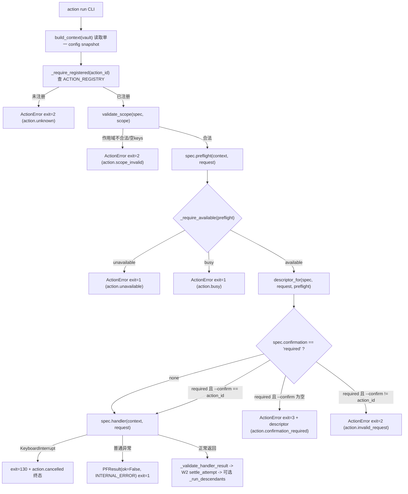
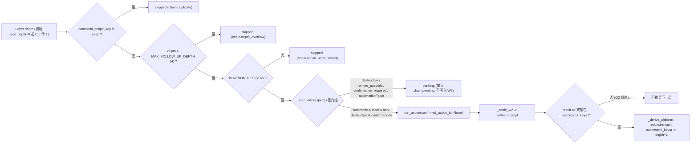

# 第 05 章：Action 注册表、双阶段 Preflight 与安全分级

本章深入解析 PaperForge 控制面的动作声明、双维度准入校验、确认门控与后置链式编排体系。所有变更操作统一收口至 `paperforge/actions/`：探针与 `reconcile` 只表达意图（见 [Chapter 04](04-probes-and-reconcile.md)），真正决定副作用级别、是否需要人工确认、流式/一次性传输契约以及作用域合法性的唯一权威是 `ACTION_REGISTRY`。

---

## 1. 职责与非目标边界

### 1.1 控制面执行内核职责

1. **单一动作权威表（`paperforge/actions/registry.py`）**
   - 声明式冻结注册表 `ACTION_REGISTRY`（当前 9 个可执行后端动作）与显式非注册路由表 `NON_REGISTRY_ACTIONS`（当前 19 个由插件或独立引导流消费的动作 ID），通过 `validate_registry()` 与 `validate_action_vocabulary()` 在模块导入期 Fail-Closed 校验所有策略不变量。
2. **双维度正交 Preflight（`runner.py` + `preflight_projection.py`）**
   - **Availability（系统可用性）**：回答“当前系统/凭据/基底/锁状态是否允许运行该动作”（`available | unavailable | busy`）。
   - **Applicability（单篇适用性）**：回答“针对指定 `PapersScope` 中每篇论文的当前谱系状态，该动作是否应该运行”（`needed | noop | blocked | not_applicable`），直接投影自 `reconcile._per_paper_intents()`，绝不另起第二套物化判定逻辑。
3. **受控执行管线与安全门控（`paperforge/actions/runner.py` & `commands/action.py`）**
   - 强制按 `注册校验 → 作用域校验 → Preflight → 描述符生成 → 确认门控 → Handler 执行 → 结果校验 → W2 结算 → 可选后置链` 顺序推进，并强制执行无 `command`/`argv` 下发契约。
4. **自动本地后置链编排（`paperforge/actions/chain.py`）**
   - 在 `--follow auto` 或终端模式 `sync` 下，仅对前一层的 `successful_keys` 调用 `reconcile()` 推导下一层，且只内联执行同时满足 `local` + 非 `destructive` + `confirmation="none"` + `automatic=True` 的后代动作，其余全部保留在 `pending` 队列等待显式授权。

### 1.2 明确的非目标边界（Non-Goals）

| 边界主题                   | 本子系统坚决不做的事                                                                                                                   | 替代机制 / 责任归属                                                                                        |
| :------------------------- | :------------------------------------------------------------------------------------------------------------------------------------- | :--------------------------------------------------------------------------------------------------------- |
| **CLI 字符串或 Argv 透传** | 任何 `ActionSpec`、描述符（`descriptor_for`）或 `next_actions` 线缆载荷均严禁包含 `command`、`cmd`、`argv`、`shell`、`executable` 字段 | 前端通过 `paperforge/plugin/src/client/action-contract.ts` `buildActionArgv()` 构造固定 CLI 参数           |
| **插件侧导航与配置向导**   | `ACTION_REGISTRY` 不直接承接向导跳转、外置 Python 升级指引或单纯的重探动作                                                             | 统一登记于 `NON_REGISTRY_ACTIONS` 由前端按 `verb` 分流，`action run` 拒绝执行                              |
| **跨进程独立停止指令**     | 不提供旧版 `embed stop` 旁路控制文件或跨进程状态指令                                                                                   | 统一通过 stdin `PAPERFORGE_STOP\n` 与 `SIGINT`/`SIGTERM` 协作取消令牌（`paperforge/core/cancellation.py`） |
| **凭据读写与密钥存储**     | `ActionPreflight` 只检查 `credentials.status(CredentialKey(...)).state`，绝不读取明文密钥或写入密钥环                                  | `paperforge auth`（`paperforge/credentials.py`）                                                           |
| **非动作链的 Render 授权** | `render promote-r` 与 `render accept-proposal --plan-hash` 不走 `ACTION_REGISTRY`                                                      | 独立渲染权威通道（见 [Chapter 04](04-probes-and-reconcile.md) 与 `docs/RECONCILE-EXTENSION-CONTRACT.md`）  |

---

## 2. 核心源码与单测映射表

| 模块分类                       | 文件路径                                                                                                                                                                                                                | 核心职责与关键导出符号                                                                                                                                                                      |
| :----------------------------- | :---------------------------------------------------------------------------------------------------------------------------------------------------------------------------------------------------------------------- | :------------------------------------------------------------------------------------------------------------------------------------------------------------------------------------------ |
| **核心类型契约**               | `paperforge/actions/types.py`                                                                                                                                                                                           | `ACTION_ID_RE`、`AllScope`、`PapersScope`、`ActionRequest`、`ActionExecutionHooks`、`ActionContext`、`PaperPreflight`、`PreflightResult`、`ActionIntent`、`ActionSpec`、`require_action_id` |
| **注册表与非注册词汇表**       | `paperforge/actions/registry.py`                                                                                                                                                                                        | `ACTION_REGISTRY`（9 项）、`NON_REGISTRY_ACTIONS`（19 项）、`validate_registry`、`validate_action_vocabulary`、`classify_action_id`、`emit_next_action`                                     |
| **单篇适用性投影**             | `paperforge/actions/preflight_projection.py`                                                                                                                                                                            | `project_applicability`、`_canonical_intent`、`_rule`（将 `observe_lineage_papers` 映射为四态 `Applicability`）                                                                             |
| **通用执行器**                 | `paperforge/actions/runner.py`                                                                                                                                                                                          | `ActionError`、`build_context`、`descriptor_for`、`validate_scope`、`run_action`、`_require_confirmation`、`_validate_handler_result`、`hydrate_from_registry`、`cancelled_result`          |
| **后置链执行器**               | `paperforge/actions/chain.py`                                                                                                                                                                                           | `MAX_FOLLOW_UP_DEPTH` (`4`)、`ChainStep`、`ChainResult`、`canonical_scope_key`、`_auto_inline`、`_settle_w2`、`_successful_keys`、`run_chain`                                               |
| **CLI 命令适配器**             | `paperforge/commands/action.py`                                                                                                                                                                                         | `run_list`、`run_describe`、`run_preflight`、`run_dispatch`、`_run_descendants`、`EXIT_INVALID_REQUEST` (`2`)、`EXIT_CONFIRMATION_REQUIRED` (`3`)、`EXIT_CANCELLED` (`130`)                 |
| **流式 / 结算 / 取消基础设施** | `paperforge/core/ndjson.py`、`paperforge/core/settlement.py`、`paperforge/core/cancellation.py`、`paperforge/core/next_actions.py`、`paperforge/core/errors.py`、`paperforge/core/result.py`、`paperforge/core/keys.py` | `#137` NDJSON 事件发射、`settlement_payload`、`STOP_TOKEN`、`NextAction` 线缆契约、`ErrorCode`、`PFResult`、`normalize_paper_keys`                                                          |
| **前端动作契约**               | `paperforge/plugin/src/client/action-contract.ts`                                                                                                                                                                       | `ActionRequest`、`ActionScope`、`buildActionArgv`                                                                                                                                           |
| **注册表与运行器单测**         | `tests/test_action_registry.py`                                                                                                                                                                                         | 验证 9 个注册动作、19+ 探针词汇覆盖、AST 静态扫描、线缆无 `command/argv`、退出码 `0/1/2/3/130` 与 NDJSON 流顺序                                                                             |
| **链式执行与线缆单测**         | `tests/test_chain.py`、`tests/test_next_actions.py`、`tests/test_t7_journey.py`、`tests/test_sync_next_actions.py`、`tests/test_x14_loop_closure.py`                                                                    | 验证深度上限、规范化作用域去重、`successful_keys` 传播、O2/O3 阻断、W2 结算闭环与同步后置链                                                                                                 |
| **端到端 Harness 用例**        | `tests/harness/test_e01_client_action.py`、`tests/harness/test_a06_provider_authority.py`                                                                                                                               | 验证客户端 `describe → preflight → run` 闭环及 `paperforge.json` 配置权威                                                                                                                   |

---

## 3. 磁盘文件、数据库表与协议 JSON 字段字典

### 3.1 `ACTION_REGISTRY` 全量注册动作字典（共 9 项，`paperforge/actions/registry.py`）

下表列出当前代码中注册的**全部 9 个** `ActionSpec`，包含安全分类投影（`envelope.py` 中 `build_action_primary()` 按 `spec.impact == "destructive" or spec.confirmation == "required"` 映射 `safety_class`）：

| `action_id`           | `scope_kinds`       | `cost`            | `impact`      | `confirmation` | `automatic` | `interruptible` | `execution_mode` | 探针 `safety_class` | Preflight 前置条件与 Handler 语义                                                                                                                                                                                                                                                                 |
| :-------------------- | :------------------ | :---------------- | :------------ | :------------- | :---------- | :-------------- | :--------------- | :------------------ | :------------------------------------------------------------------------------------------------------------------------------------------------------------------------------------------------------------------------------------------------------------------------------------------------ |
| `foundation.update`   | `("all",)`          | `remote_possible` | `mutating`    | `required`     | `False`     | `True`          | `stream`         | `destructive`       | **Preflight**: `read_pointer()` 非 `None`（否则 `pointer.missing`）。**Handler**: 调用 `worker.update.perform_update()` 刷新运行时分发版。                                                                                                                                                        |
| `foundation.repair`   | `("all",)`          | `remote_possible` | `mutating`    | `required`     | `False`     | `True`          | `result`         | `destructive`       | **Preflight**: `read_pointer()` 非 `None`（否则 `pointer.missing`）。**Handler**: 调用 `worker.runtime_repair.perform_runtime_repair()` 修复依赖并重新发布指针。                                                                                                                                  |
| `memory.build`        | `("all", "papers")` | `local`           | `destructive` | `required`     | `False`     | `True`          | `result`         | `destructive`       | **Preflight**: 需 `ctx.config` 与 `formal-library.json`；`papers` 作用域校验全部 key 存在于索引（未知 key 抛 `ActionError` exit `2`）并附带 `per_key` 适用性投影。**Handler**: `memory.builder.build_for_keys()`；若返回 `global_rebuild_required` 则局部请求报错 `action.unavailable`。          |
| `memory.rebuild`      | `("all",)`          | `local`           | `destructive` | `required`     | `False`     | `True`          | `result`         | `destructive`       | **Preflight / Handler**: 复用 `_memory_build_preflight` 与 `_memory_build_handler`，仅限 `all` 作用域，执行全库 `papers`/FTS 重建并显式提示向量失效风险。                                                                                                                                         |
| `library.prune`       | `("all", "papers")` | `local`           | `mutating`    | `required`     | `False`     | `True`          | `result`         | `destructive`       | **Preflight**: 需 `ctx.config`，且 `_detect_residuals(vault)` 在请求作用域内至少命中 1 篇残余论文（否则 `library.no_orphans` / `library.no_selected_orphans`）。**Handler**: `prune_orphan_papers(..., dry_run=False)` 移入 `.paperforge/trash/` 并清理 DB/向量行。                               |
| `embed.resume`        | `("all", "papers")` | `remote_possible` | `mutating`    | `required`     | `False`     | `True`          | `stream`         | `destructive`       | **Preflight**: `embedding` 凭据 `available`；`build_state.status != "running"`（否则 `availability="busy"`, `vector.build_in_progress`）；`papers` 作用域若 `substrate` 不兼容且库存在则报错 `vector.substrate_incompatible`。**Handler**: `run_embedding_build(..., force=False, resume=True)`。 |
| `embed.build`         | `("all",)`          | `remote_possible` | `mutating`    | `required`     | `False`     | `True`          | `stream`         | `destructive`       | **Preflight**: 校验 `embedding` 凭据 `available`。**Handler**: `run_embedding_build(..., keys=None, force=True, resume=False)` 执行全局 Shadow 向量全量重建。                                                                                                                                     |
| `ocr.run`             | `("all", "papers")` | `remote_possible` | `mutating`    | `required`     | `False`     | `True`          | `stream`         | `destructive`       | **Preflight**: `papers` 作用域校索引存在性（未知 key exit `2`）；校验 `ocr` 凭据 `available`；投影 `per_key`。**Handler**: `worker.ocr.run_ocr()` 并经 `settlement_payload` 规范化结算、细分 `unconfirmed`/`result_unavailable`/`rate_limited`/`blocked`/`failed`/`pending` 终态。                |
| `ocr.rebuild_derived` | `("all", "papers")` | `local`           | `mutating`    | `none`         | `True`      | `True`          | `stream`         | `safe`              | **Preflight**: 需 `ctx.config`；`papers` 作用域投影 `per_key`；无远端费用故唯一允许 `automatic=True` 与 `confirmation="none"`。**Handler**: `all` 作用域取 `collect_maintenance_rows()` 中 `r.can_rebuild` 的 key，调用 `run_derived_rebuild_for_keys()` 本地重建衍生结构与渲染。                 |

### 3.2 `NON_REGISTRY_ACTIONS` 声明表（共 19 项，`paperforge/actions/registry.py`）

此类 ID 可合法出现在探针信封 `action.primary` 中，由插件按 `verb` 分流或路由到专有 CLI 流程，但 `paperforge action run <id>` 必须始终拒绝执行：

| `action_id`                  | 声明的归属路由与 `verb` 说明                                                    |
| :--------------------------- | :------------------------------------------------------------------------------ |
| `foundation.setup`           | `setup journey (verb 'setup')`                                                  |
| `foundation.update_python`   | `manual Python-install guidance (verb 'update')`                                |
| `installation.probe`         | `installation re-probe after detection failure (verb 'probe')`                  |
| `help.probe`                 | `help re-probe after detection failure (verb 'probe')`                          |
| `help.restore`               | `help/skill redeploy flow (verb 'setup')`                                       |
| `library.setup`              | `setup journey from the Library module (verb 'setup')`                          |
| `library.configure`          | `setup guide at the module config step (verb 'set_config')`                     |
| `library.probe`              | `re-probe (verb 'probe')`                                                       |
| `library.sync`               | `client.sync() (verb 'sync'), not a pipeline action`                            |
| `memory.probe`               | `re-probe (verb 'probe')`                                                       |
| `memory.restore_backup`      | `client.memoryRestoreBackup (verb 'restore_backup')`                            |
| `memory.upgrade_backend`     | `client.embedMigrate (verb 'rebuild_index')`                                    |
| `memory.install_vector_deps` | `external runtime repair guidance (verb 'install') — paperforge runtime repair` |
| `ocr.probe`                  | `re-probe (verb 'probe')`                                                       |
| `ocr.enable`                 | `setup guide at the module config step (verb 'set_config')`                     |
| `ocr.configure`              | `setup guide at the module config step (verb 'set_config')`                     |
| `ocr.diagnose`               | `diagnostics report (verb 'investigate')`                                       |
| `ocr.report_issue`           | `issue-draft flow (verb 'investigate')`                                         |
| `ocr.setup`                  | `setup journey (verb 'setup')`                                                  |

> 注：`paperforge/core/next_actions.py` 保留了早期 `#127` 线缆校验模块及内部 `ACTION_REGISTRY` 子集（`memory.build`, `embed.resume`），而运行时与控制面权威全集位于 `paperforge/actions/registry.py`。

### 3.3 线缆协议数据结构（Descriptor / Preflight / Chain / NDJSON / Settlement）

1. **Action Descriptor（`descriptor_for()`，`action describe` 与 `exit_code=3` 时返回）**
   - `schema_version` (`1`), `action_id`, `label_code`, `description_code`, `scope` (`{"kind": "all"}` 或 `{"kind": "papers", "keys": [...]}`), `availability`, `availability_reason_code`, `availability_reason`, `cost`, `impact`, `confirmation`, `automatic`, `interruptible`, `execution_mode`, `preservation_facts` (`list[str]`), `replacement_facts` (`list[str]`)。
2. **Action Preflight 响应（`run_preflight`，`--json`）**
   - `schema_version` (`1`), `action_id`, `scope`, `availability`, `availability_reason_code`, `availability_reason`, `summary` (`{"needed": int, "noop": int, "blocked": int, "not_applicable": int}`), `per_key` (`{key: {"applicability", "reason_code", "reason", "recommended_action_id"}}`)。
3. **Follow-up Chain Wire（`ChainResult.to_wire()`，挂载在 `PFResult.data["chain"]`）**
   - `schema_version` (`1`), `module` (`"chain"`), `steps`（每步含 `depth`, `action_id`, `scope`, `status` [`executed` \| `pending` \| `skipped` \| `failed`], `reason_code`, `reason`, `result`）, `pending`（保持原样 `next_actions` 线缆对象列表，同步覆写 `PFResult.next_actions`）。
4. **`#137` NDJSON 流式事件字典（`paperforge/core/ndjson.py`）**
   - 每行均为 UTF-8 JSON 对象，必含 `schema_version: 1`、`event`、`operation`：
     - `start`: `total`, `scope`
     - `preflight`: `availability`, `summary` (`needed`, `noop`, `blocked`, `not_applicable`)
     - `phase`: `phase`（如 `"ocr"`, `"render"`, `"embedding"`, `"preparing"`）
     - `progress`: `current`, `total`, `item_id`
     - `item_result`: `item_id`, `status`
     - `paper_settled`: `key`, `outcome`, `reason_code`（可选）
     - `heartbeat`: `active`, `pending`
     - 唯一终态事件 `result` | `error` | `cancelled`: `result`（完整的 `PFResult.to_dict()`）
5. **标准化单篇结算载荷（`paperforge/core/settlement.py`）**
   - `SettlementOutcome` 固定 6 态：`succeeded` | `noop` | `pending` | `blocked` | `failed` | `cancelled`。
   - `settlement_payload()` 输出 `{"summary": {6 态计数}, "per_key": {key: {"outcome", ...}}, "successful_keys": sorted([k for k, v in per_key if v == "succeeded"])}`。

---

## 4. 核心执行链路、状态机与顺序不变量

### 4.1 `run_action()` 与确认门控流水线



**关键确认与校验机制说明**：

- **精确动作 ID 确认机制（无独立随机 `confirmation_token`）**：`paperforge/actions/runner.py` 的 `_require_confirmation()` 并不签发独立的随机令牌字符串，而是采用**实时描述符 + 精确动作 ID 显式回传**模型：
  1. 初次未传 `--confirm` 调用需确认动作时，Runner 在 **Preflight 通过后**（确认失败不会跳过可用性检查）抛出 `exit_code=3`，并在 `data` 中返回当前实时计算的 `descriptor`（含 `preservation_facts`、`replacement_facts`、`cost`、`impact`）。
  2. 调用方（用户或插件确认弹窗）在审阅当前影响后，重新发起请求并携带 `--confirm <exact_action_id>`；Runner 校验 `confirmed_action_id == spec.action_id` 后放行。
  3. 注意区分渲染层提案命令：`paperforge render accept-proposal` 使用的是基于 `final-plan.json` 内容的 SHA-256 `--plan-hash` 校验，该命令不属于 `ACTION_REGISTRY`。

### 4.2 双维度 Preflight 正交模型与 `project_applicability`

`PaperPreflight` 与 `PreflightResult` 严格分离两件事：

1. **全局可执行性（`PreflightResult.availability`）** 先在各动作的 `preflight` 函数中判断（例如无配置、无指数、无 API 密钥、后台运行中、基底不兼容）。
2. **单篇适用性（`PaperPreflight.applicability`）** 在 `request.scope.kind == "papers"` 时由 `project_applicability(vault, action_id, keys)` 调用 `observe_lineage_papers(vault, keys)` 计算，规则如下：
   - 论文不在规范索引中 → `not_applicable` (`paper.not_found`)。
   - 若 `reconcile._per_paper_intents(paper)` 中存在与 `action_id` 匹配的当前修复前沿意图 → **`needed`**（直接复用 `intent.trigger_reason_code` 与 `trigger_reason`）。
   - 若不处于第一前沿，`_rule()` 严格映射非前沿状态：
     - `ocr.run`: `no_pdf/nopdf` → `not_applicable`；`blocked/raw_not_file/raw_permission/queued` → `blocked`；`current` → `noop`；`incomplete/stale` → `not_applicable` 并附 `recommended_action_id="ocr.rebuild_derived"`。
     - `ocr.rebuild_derived`: `current` → `noop`；`blocked/*_not_file/*_permission` → `blocked`；`missing/failed/provenance_*` → `not_applicable` 并附 `recommended_action_id="ocr.run"`。
     - `memory.build`: `retrieval == "current"` → `noop`；`ocr != "current"` → `blocked` (`lineage.ocr_prereq`)；其余无法观测态 → `blocked` (`lineage.retrieval_unobservable`)。
     - `embed.resume`: `vector == "current"` → `noop`；`vector_no_content` → `not_applicable` (`vector.no_content`)；`retrieval != "current"` → `blocked` (`lineage.retrieval_prereq`)；其余 → `blocked` (`lineage.vector_unobservable`)。
     - `embed.build`: `vector_no_content` → `not_applicable`；`vector in ("stale", "missing")` → `needed`；`vector == "current"` → `noop`。

### 4.3 `chain.py` 后置链状态机与编排规则



**链式执行核心不变量**：

1. **严格作用域解析（#167 P1-2）**：`scope_from_dict()` 遇到未知 `scope.kind` 时在 `_execute()` 记录 `skipped`（`chain.scope_invalid`），绝不降级放宽为 `AllScope`。
2. **父确认绝不继承给子动作**：`_execute()` 永远以 `confirmed_action_id=None` 调用 `run_action()`，且 `_auto_inline()` 拦截顺序固定为：`impact == "destructive"` (`chain.destructive`) → `cost == "remote_possible"` (`chain.remote_spend`) → `confirmation == "required"` (`chain.confirmation_required`) → `not automatic` (`chain.not_automatic`)。
3. **Successful-Scope 接力缝（#167 P0-5）**：批处理允许部分成功（25 篇中 24 篇成功、1 篇失败时，`PFResult.successful_keys` 仅包含成功的 24 篇）；`_derive_children()` 仅对这 24 篇调用 `reconcile(vault, successful_keys)` 推进下一层，避免单篇失败拖垮整批。若全军覆没（O2 规则），绝不推导任何子动作。
4. **W2 结算一致性（X14）**：`_settle_w2()` 与 `commands/action.py` 中的直接 `action run`（针对 `RECONCILE_ACTIONS`）共享同一写入入口 `reconcile.settle_attempt()`。仅**真正进入调度执行**的动作会覆写 `reconcile-last-attempts.json`；`pending`（如等待确认）与 `skipped` 永远不写入失败尝试记录。
5. **CLI `--follow auto` 边界**：`run_dispatch()` 先按 T2 管线执行根动作（根动作仍受确认门控）；根动作成功后 `_run_descendants()` 调用 `run_chain(..., root_depth=1)`（因为第 `0` 层已由根执行消费），并将 `chain.to_wire()` 挂载至 `root_result.data["chain"]`，未自动执行的挂起项覆盖至 `root_result.next_actions`。

---

## 5. 配置项、环境变量、CLI 入口与错误码

### 5.1 CLI 命令与参数（`paperforge/cli.py` + `paperforge/commands/action.py`）

| 命令                                      | 必选 / 可选参数                                                                                                  | 输出形态与退出码                                                                                                |
| :---------------------------------------- | :--------------------------------------------------------------------------------------------------------------- | :-------------------------------------------------------------------------------------------------------------- |
| `paperforge action list`                  | `--json`                                                                                                         | 列出 `ACTION_REGISTRY` 全量动作策略；退出码 `0`                                                                 |
| `paperforge action describe <action_id>`  | `action_id`, `--json`                                                                                            | 输出单个动作当前 `Preflight` + 策略描述符；未知 ID 退出码 `2` (`action.unknown`)，正常 `0`                      |
| `paperforge action preflight <action_id>` | `--scope {all,papers}`, `--key KEY` (可重复), `--keys-file PATH`, `--json`                                       | 只读观测全局 `availability` 与单篇 `applicability` 汇总；正常 `0`，未知动作 `2`                                 |
| `paperforge action run <action_id>`       | `--scope {all,papers}`, `--key KEY`, `--keys-file PATH`, `--confirm ACTION_ID`, `--follow {none,auto}`, `--json` | `--json` 下按 `spec.execution_mode` 自动决定输出单行 `PFResult` JSON（`result`）或 `#137` NDJSON 流（`stream`） |

### 5.2 环境变量与参数预处理

- **Key 列表规范化（`paperforge/core/keys.py` `normalize_paper_keys`）**：`--key` 与 `--keys-file` 统一剥离 UTF-8 BOM（`\ufeff`）与 Windows `\r`，支持空格/逗号/换行分隔并保序去重，防止 `\r` 污染 key 引发 `unknown paper keys`。
- **凭据环境变量**：`ocr.run` 依赖 `PAPERFORGE_CREDENTIAL_OCR__DEFAULT`（或系统 keyring）；`embed.build` / `embed.resume` 依赖 `PAPERFORGE_CREDENTIAL_EMBEDDING__DEFAULT`。

### 5.3 Action 相关错误码与进程退出码映射表（`paperforge/core/errors.py` & `commands/action.py`）

| `ErrorCode` 常量                                                | 线缆字符串值                   | CLI 退出码 | 触发场景与契约意义                                                                                        |
| :-------------------------------------------------------------- | :----------------------------- | :--------- | :-------------------------------------------------------------------------------------------------------- |
| `ACTION_UNKNOWN`                                                | `action.unknown`               | `2`        | `action_id` 不在 `ACTION_REGISTRY`（包括属于 `NON_REGISTRY_ACTIONS` 的 ID）                               |
| `ACTION_INVALID_REQUEST`                                        | `action.invalid_request`       | `2`        | `--confirm` 指定的动作 ID 与目标 `action_id` 不一致，或不支持的 `action` 子命令                           |
| `ACTION_SCOPE_INVALID`                                          | `action.scope_invalid`         | `2`        | 传入不支持的 `scope_kind`（如对 `embed.build` 传 `papers`）、空 `keys` 列表、或 `keys` 中含索引未知的 key |
| `ACTION_UNAVAILABLE`                                            | `action.unavailable`           | `1`        | Preflight 判定 `availability="unavailable"`（缺配置/缺索引/缺凭据/无指针/无残余/基底不兼容等）            |
| `ACTION_BUSY`                                                   | `action.busy`                  | `1`        | Preflight 判定 `availability="busy"`（如 `vector.build_in_progress`）                                     |
| `ACTION_CONFIRMATION_REQUIRED`                                  | `action.confirmation_required` | `3`        | `confirmation="required"` 且未提供 `--confirm`；`data` 携带最新 `descriptor` 供前端弹窗展示               |
| `ACTION_CANCELLED`                                              | `action.cancelled`             | `130`      | 收到 `PAPERFORGE_STOP\n`、`SIGINT`、`SIGTERM` 或返回 `rc=130`，发射 `cancelled` 终态                      |
| `PARTIAL_FAILURE`                                               | `PARTIAL_FAILURE`              | `1`        | 如 `library.prune` 部分载体清理失败（`counts["failed"] > 0`）                                             |
| `OCR_UPLOAD_FAILED` / `OCR_RESULT_INVALID` / `OCR_POLL_TIMEOUT` | 同常量名                       | `1`        | `ocr.run` 终态细分：未确认提交/缺凭据源文件阻断、结果不可取/限流失败、或远端仍有任务待轮询                |
| `INTERNAL_ERROR`                                                | `INTERNAL_ERROR`               | `1`        | Handler 未捕获异常或返回非 `PFResult` / 非 `Mapping` 的 `data`                                            |

---

## 6. 边界防护与 Fail-Closed 防呆规则

1. **导入期注册表自检（`RegistryError`）**：`_build_registry(_SPECS)` 在模块加载时逐项检查重复 ID、命名正则 `^[a-z][a-z0-9_]*(\.[a-z][a-z0-9_]*)+$`、Handler/Preflight 可调用性、以及核心安全铁律——**凡 `cost == "remote_possible"` 或 `impact == "destructive"` 的动作，强制要求 `confirmation == "required"` 且 `automatic == False`**；`ACTION_REGISTRY` 与 `NON_REGISTRY_ACTIONS` 严禁存在交集。任何违规直接在 import 阶段崩溃阻断上线。
2. **确认绝不绕过可用性检查**：`run_action()` 的执行顺序不可颠倒：`_require_available(preflight)` 严密位于 `_require_confirmation()` 之前。即使传入正确 `--confirm`，只要处于 `unavailable` / `busy` 仍立即返回退出码 `1`，绝不会把一个不可运行的任务放行给用户确认。
3. **单快照冻结上下文（C0 Seam）**：`build_context(vault)` 从同一次 `load_config(vault)` 快照同时派生 `config` 与 `paths`；若配置缺失或损坏，返回空字典 Fail-Closed 上下文，交由各 Preflight 明确返回 `action.config_missing`。
4. **作用域子集保真与残余二次核验**：
   - `memory.build` 与 `ocr.run` 在 Preflight 阶段即核验 `PapersScope.keys` 均在 `formal-library.json` 中，任一未知 key 整批拒绝（`exit_code=2`），绝不静默丢弃或降级为全库执行。
   - `library.prune` 在 Handler 阶段重新读取当前实时 `_detect_residuals(vault)` 并与请求作用域求交集，若某篇论文在探针与执行间隙恢复了 Zotero 引用，绝不误删。
5. **流式线缆与单结果线缆严格对齐（Wire Parity）**：`run_dispatch` 仅根据 `spec.execution_mode == "stream"` 在 `--json` 模式下开启 `#137` NDJSON 流并挂载 `ActionExecutionHooks`（同时通过 `set_stream_diagnostics(True)` 把人类日志导向 `stderr`），保证 `stdout` 每一行都是合法 JSON 且以唯一终态事件封口，绝不混入遗留冒号进度文本或尾部重复 `PFResult`。
6. **Handler 返回值运行时护栏**：`_validate_handler_result()` 强制校验 Handler 返回必须是 `PFResult` 实例且 `result.data` 为 `Mapping` 或 `None`；同时捕获普通异常转为结构化 `PFResult`，但显式放行 `KeyboardInterrupt` 使其直达 `rc=130` 取消分支。
7. **取消安全点边界**：`make_cancellation_token()` 只在任务间隙、阶段前或远端调用前响应停止信号；如 `tests/test_action_registry.py` 验证的 `embed.build` 预检查阶段，若停止令牌已置位则在加锁与执行不可中断 `prepare` 步骤前立即以 `rc=130` 结算退出，不进入半初始化状态。

---

## 7. 维修、调试与升级 Checklist

### 7.1 动作调试与故障排查流程

- [ ] **核对动作元数据与可用性**：运行 `paperforge --vault <VAULT> action list --json` 与 `paperforge --vault <VAULT> action describe <ACTION_ID> --json`，确认动作是否注册、`execution_mode` 是 `result` 还是 `stream`，以及当前 `availability_reason_code`。
- [ ] **单篇作用域适用性诊断**：运行 `paperforge --vault <VAULT> action preflight <ACTION_ID> --scope papers --key <KEY> --json`，排查单篇为何被判定为 `blocked`（上游未就绪或权限缺陷）、`not_applicable`（如 `vector_no_content` 或需走 `recommended_action_id`）还是 `needed`。
- [ ] **验证两步确认流程**：对 `confirmation == "required"` 动作，先不带 `--confirm` 执行观察 `rc=3` 返回的实时 `descriptor`；确认 `preservation_facts` 与 `replacement_facts` 后再附带 `--confirm <ACTION_ID>` 执行。
- [ ] **排查 `--follow auto` 停滞或未继续往下走**：检查返回 `PFResult.data["chain"]["steps"]` 与 `PFResult.next_actions`：
  - 若某步骤 `status == "pending"` 且 `reason_code` 为 `chain.remote_spend` / `chain.destructive` / `chain.confirmation_required`，属于安全策略刻意挂起，需显式单独授权触发。
  - 若 `status == "skipped"` 且 `reason_code == "chain.depth_overflow"`，检查是否存在动作成功后未能使 `reconcile` 观测到的状态收敛的循环缺口。
  - 若出现 `exit_code=130` 或 `action.cancelled`，检查调用方是否关闭 stdin 或发送了 `PAPERFORGE_STOP\n` / `SIGINT` / `SIGTERM`。

### 7.2 测试验证与新增动作升级 Checklist

- [ ] **运行注册表、执行器、线缆与链式编排全套测试**：
  ```bash
  pytest tests/test_action_registry.py tests/test_chain.py tests/test_next_actions.py tests/test_t7_journey.py tests/test_sync_next_actions.py tests/test_x14_loop_closure.py
  ```
- [ ] **运行客户端动作与配置权威 Harness 验证**：
  ```bash
  pytest tests/harness/test_e01_client_action.py tests/harness/test_a06_provider_authority.py
  ```
- [ ] **新增或修改 `ACTION_REGISTRY` 动作时的必检项**：
  - `action_id` 必须符合 `ACTION_ID_RE`（小写字母数字下划线点分两段以上），且不能与 `NON_REGISTRY_ACTIONS` 冲突。
  - 若动作可能产生外部网络费用（`cost="remote_possible"`）或破坏性状态覆盖（`impact="destructive"`），**必须**配置 `confirmation="required"` 与 `automatic=False`。
  - 必须在 Handler 中合理接入 `ctx.execution_hooks`（若为 `execution_mode="stream"`）并在 `PFResult` 中准确填充 `successful_keys`（若支持部分成功的 `papers` 作用域）。
  - 在 `paperforge/plugin/src/client/action-contract.ts` 与前端分发逻辑核对客户端对新 `action_id` 或新 `NON_REGISTRY_ACTIONS` `verb` 的支持情况。
