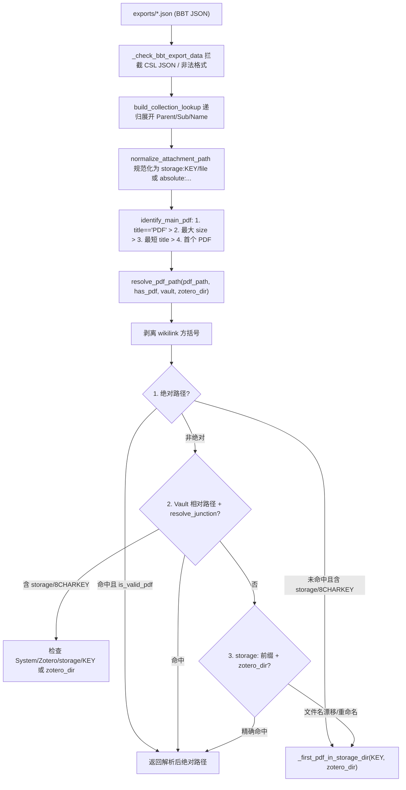

# 第 06 章：Zotero/BBT 同步、PDF 解析、谱系与 Obsidian Base 生成

本章全面拆解 PaperForge 从上游数据源（Zotero + Better BibTeX JSON 导出）到本地规范工作区、资产索引（`formal-library.json`）、Obsidian 文献笔记与 `.base` 视图、内容寻址谱系（Digest Lineage）、轻量级实时信号（`.state-seq.json`），再到一致性修复与可恢复回收站清理（`trash` / `prune`）的完整数据链路。与控制面探测/推导的衔接详见 [Chapter 04](04-probes-and-reconcile.md) 与 [Chapter 05](05-action-registry-and-safety.md)。

---

## 1. 职责与非目标边界

### 1.1 核心职责

1. **上游摄入与路径规范化（`paperforge/adapters/` + `paperforge/pdf_resolver.py`）**
   - 解析 Zotero Better BibTeX（BBT）JSON 导出，重建完整集合树路径，按统一三段优先级挑选主 PDF 与增补附件，并将各类本地/软链接/存储前缀路径解析为可读物理 PDF 与 Obsidian `[[wikilink]]`。
2. **规范工作区与索引物化（`asset_index.py` + `asset_state.py` + `sync_service.py`）**
   - 在 `<literature>/<domain>/<KEY> - <title_slug>/` 下维护单篇工作区（主笔记 `<KEY>.md`、`ai/`、`assets/`、`paper-meta.json`），将全局索引以原子锁写入 `<paperforge>/indexes/formal-library.json`，并衍生计算 `lifecycle` / `health` / `maturity` / `next_step`。
3. **Obsidian Base 视图维护与实时响应（`base_views.py` + `state_signal.py`）**
   - 为每个领域与总库生成单视图 `paperforge-table`（`"文献库"`）`.base` 文件，增量清理已退役视图同时无损保留用户自定义视图；所有状态突变原子递增 `.state-seq.json` 供插件监听刷新。
4. **内容寻址谱系与可恢复清理（`lineage.py` + `repair.py` + `prune.py` + `trash.py`）**
   - 通过哈希链追踪 `OCR → Retrieval → Vector` 血缘与跨载体残余（Residuals）；对状态三方漂移和 `path_error` 执行修复；对已从 Zotero 移除的残余文献在 `WriterLock` 保护下移入可恢复回收站 `.paperforge/trash/`。

### 1.2 明确的非目标边界（Non-Goals）

| 领域                                          | 本子系统坚决不做的事                                                                                                                      | 责任归属 / 边界说明                                                      |
| :-------------------------------------------- | :---------------------------------------------------------------------------------------------------------------------------------------- | :----------------------------------------------------------------------- |
| **直接读写 Zotero SQLite（`zotero.sqlite`）** | 不直接打开 Zotero 桌面端数据库，以 BBT 自动导出的 `exports/*.json` 作为文献目录唯一权威                                                   | 写回 Zotero 通过外部原生桥接队列（`writeback_command_for_candidate`）    |
| **WebDAV 远端协议抓取 PDF**                   | `pdf_resolver.py` 只解析本地文件系统、Windows Junction/Symlink 与本地同步后的 `storage/<KEY>/` 目录，不发起 WebDAV HTTP 下载              | 由 Zotero 客户端完成附件本地同步                                         |
| **反向篡改 OCR `meta.json`**                  | `sync` 与 `asset_index` 严格作为 OCR 状态的**只读消费者**，绝不在索引刷新时覆盖修复损坏的 `meta.json`（仅 `repair --fix` 可显式重置状态） | OCR 产物唯一写入权归属 OCR Worker                                        |
| **向隐藏 `.paperforge/` 外泄内部全文**        | 当引擎位于 `.paperforge/` 时，绝不向文献工作区复制 `fulltext.md`（且清理历史遗留副本），仅通过 `assets/<KEY>_*.jpg` 暴露渲染所需的裁切图  | 插件与 AI 通过命令网关读取内部全文                                       |
| **非可恢复的物理 `rmtree`**                   | `prune` 绝不直接对用户目录执行物理递归删除；一切文件系统删除必须经过 `trash_remove()` 移入 `.paperforge/trash/`                           | 仅显式调用 `paperforge trash purge` 才执行限定在回收站根目录内的物理删除 |

---

## 2. 核心源码与单测映射表

| 模块分组                      | 源码路径                                                                                                                                                                                                          | 核心导出与职责                                                                                                                                                  |
| :---------------------------- | :---------------------------------------------------------------------------------------------------------------------------------------------------------------------------------------------------------------- | :-------------------------------------------------------------------------------------------------------------------------------------------------------------- |
| **适配器层**                  | `paperforge/adapters/__init__.py`、`paperforge/adapters/bbt.py`、`paperforge/adapters/collections.py`、`paperforge/adapters/zotero_paths.py`、`paperforge/adapters/obsidian_frontmatter.py`                       | BBT JSON 校验与行加载、`identify_main_pdf`、Zotero 集合树递归展开、Obsidian `[[wikilink]]` 构造、YAML Frontmatter 安全读写与 `## 🔍 精读` 保护                  |
| **PDF 路径解析**              | `paperforge/pdf_resolver.py`                                                                                                                                                                                      | `resolve_pdf_path`、`resolve_source_pdf`、`resolve_junction`、`is_valid_pdf`、`_first_pdf_in_storage_dir`                                                       |
| **同步编排层**                | `paperforge/commands/sync.py`、`paperforge/services/sync_service.py`、`paperforge/worker/sync.py`                                                                                                                 | CLI 调度、`.sync-fastpath.json` O(1) 缓存、工作区迁移、清理、OCR 版本扫描与 T6 `reconcile` 链收口                                                               |
| **索引与衍生状态**            | `paperforge/worker/asset_index.py`、`paperforge/worker/asset_state.py`、`paperforge/worker/paper_meta.py`、`paperforge/worker/_domain.py`、`paperforge/worker/_utils.py`                                          | `formal-library.json` 原子锁读写、`build_index`、`refresh_index_entry`、`compute_lifecycle/health/maturity/next_step`、`write_paper_meta`、`load_domain_config` |
| **Obsidian Base 与信号**      | `paperforge/worker/base_views.py`、`paperforge/services/state_signal.py`                                                                                                                                          | `build_base_views`、`RETIRED_PF_VIEWS`、`_sanitize_base_file`、`ensure_base_views`、`bump_state_seq`、`read_state_seq`                                          |
| **谱系与物化状态**            | `paperforge/lineage.py`、`paperforge/materialization/ocr.py`、`paperforge/materialization/retrieval.py`                                                                                                           | 哈希血缘计算、`_probe_lineage`、`observe_lineage_papers`、`_detect_residuals`、`detect_orphans`、OCR 溯源与检索快照完整性验证                                   |
| **状态修复**                  | `paperforge/worker/repair.py`、`paperforge/commands/repair.py`                                                                                                                                                    | `run_repair`（三方 `ocr_status` 漂移检测与修复）、`repair_pdf_paths`                                                                                            |
| **可恢复清理与回收站**        | `paperforge/worker/prune.py`、`paperforge/worker/trash.py`、`paperforge/commands/prune.py`、`paperforge/commands/trash.py`                                                                                        | `prune_orphan_papers`、`validate_target`、`trash_remove`、`list_trash`、`restore_trash`、`purge_trash`                                                          |
| **同步/索引/适配器单测**      | `tests/test_sync.py`、`tests/test_asset_index.py`、`tests/test_asset_state.py`、`tests/unit/adapters/test_bbt.py`、`tests/unit/adapters/test_zotero_paths.py`、`tests/unit/adapters/test_obsidian_frontmatter.py` | BBT 格式与主 PDF 规则、原子索引锁、纯状态衍生、Wikilink 与 Frontmatter 保护                                                                                     |
| **Base/PDF/修复/谱系单测**    | `tests/test_base_views.py`、`tests/test_base_preservation.py`、`tests/test_pdf_resolver.py`、`tests/test_repair.py`、`tests/test_lineage.py`                                                                      | Base 单视图与自定义视图保留、Junction/Storage 解析、三方漂移修复、哈希谱系                                                                                      |
| **清理/回收站/信号/升级单测** | `tests/unit/services/test_sync_service_prune.py`、`tests/unit/worker/test_prune.py`、`tests/unit/worker/test_trash.py`、`tests/unit/test_upgrade_resilience.py`、`tests/unit/test_living_memory_and_state_seq.py` | Zotero 权威裁剪、四载体删除、`.paperforge/trash/` 防越界恢复、`.state-seq.json` 与升迁韧性                                                                      |

---

## 3. 磁盘文件、数据库表与协议 JSON 字段字典

### 3.1 规范资产索引 `formal-library.json` Schema

位于 `<paperforge>/indexes/formal-library.json`（文件锁 `<paperforge>/indexes/formal-library.json.lock`，`LOCK_TIMEOUT = 10` 秒）：

**外层信封字段（`build_envelope()`）**：

- `schema_version`: 字符串 `"2"`（`CURRENT_SCHEMA_VERSION`；旧版裸 `list` 自动备份为 `formal-library.json.bak` 并升级）
- `generated_at`: UTC+8（`timezone(timedelta(hours=8))`）ISO-8601 时间戳
- `paper_count`: `int`（等于 `len(items)`）
- `paperforge_version`: 当前包版本号
- `export_hash`: 所有 `exports/*.json` 按文件名排序拼接字节流的 SHA-256 十六进制摘要
- `items`: 单篇索引条目数组

**单篇条目核心字段（`_build_entry()`，共 36 键）**：

| 类别               | 字段名                                                                                                                                    | 说明与来源                                                                                                                                                                                   |
| :----------------- | :---------------------------------------------------------------------------------------------------------------------------------------- | :------------------------------------------------------------------------------------------------------------------------------------------------------------------------------------------- |
| **文献身份**       | `zotero_key`, `citation_key`, `domain`, `title`, `authors`, `first_author`, `abstract`, `journal`, `impact_factor`, `year`, `doi`, `pmid` | 源自 BBT 导出；`impact_factor` 优先查 `zoterostyle.json` 否则回退 `extra` 中的 `影响因子[:：]`                                                                                               |
| **集合层次**       | `collection_path`, `collections`, `collection_tags`, `collection_group`                                                                   | `collection_path` 为 `" \| "` 拼接字符串；`collections` 为按深度/字典序排序的路径数组；`collection_tags` 为去重路径分段；`collection_group` 为最深主路径单元素列表                           |
| **工作流与 PDF**   | `has_pdf`, `do_ocr`, `analyze`, `pdf_path`, `ocr_redo`, `ocr_time`                                                                        | `do_ocr` / `analyze` 优先读正式笔记布尔 Frontmatter，回退旧 `library_records` 与 `meta.json`；`pdf_path` 经 `obsidian_wikilink_for_pdf` 转成 `[[...]]`                                       |
| **OCR 与精读路径** | `ocr_status`, `ocr_job_id`, `ocr_md_path`, `ocr_json_path`, `deep_reading_status`, `deep_reading_md_path`                                 | `ocr_status` 经 `validate_ocr_meta()` 实盘校验（`meta.json` 不可读置 `"unknown"`，缺失置 `"pending"`）；`deep_reading_status` 判定 `## 🔍 精读` 有效内容（Clarity + Figure 导读 + 遗留问题） |
| **工作区相对路径** | `note_path`, `paper_root`, `main_note_path`, `fulltext_path`, `deep_reading_path`, `ai_path`                                              | 统一使用 `/` 分隔的 Vault 相对路径；`fulltext_path` 仅在 `ocr/<key>/fulltext.md` 存在时非空；`deep_reading_path` 固定 `""`（已合并入主笔记）                                                 |
| **衍生状态投影**   | `lifecycle`, `health`, `maturity`, `next_step`                                                                                            | 由 `asset_state.py` 纯函数实时算出（`health` 含 `pdf_health`/`ocr_health`/`note_health`/`asset_health`；`maturity` 含 `level` `1..4` 与 `blocking`）                                         |

### 3.2 其他核心磁盘文件与数据库表

| 路径 / 表名                                              | 关键字段与用途                                                                                                                                                                                                                 |
| :------------------------------------------------------- | :----------------------------------------------------------------------------------------------------------------------------------------------------------------------------------------------------------------------------- |
| `<paperforge>/config/domain-collections.json`            | `{"domains": [{"domain": str, "export_file": str, "allowed_collections": list[str]}]}`；由 `load_domain_config()` 每次全量比对 `exports/*.json` 重建                                                                           |
| `<paperforge>/indexes/.sync-fastpath.json`               | `{"digest": sha256, "data": PFResult.data}`；基于 `paperforge.json`、`exports/*.json`、`ocr/*/meta.json` 与 `literature/*/*.md` 的 `st_size` + `st_mtime_ns` 实现 O(1) 无变更跳过                                              |
| `<paperforge>/indexes/.state-seq.json`                   | `{"seq": int, "updated_at": str, "reason": str, "changed_keys": list[str]}`（最多保留最近 50 个去重 key）；注意文件名带前导点                                                                                                  |
| `<paperforge>/indexes/sync-orphan-state.json`            | `{"orphans": [...], "count": int}`；由 `commands/sync.py` `_write_orphan_state()` 维护，无孤立项时自动删除                                                                                                                     |
| `<paper_root>/paper-meta.json`                           | `schema_version` (`1`), `paperforge_version`, `zotero_key`, `created_at`, `updated_at`, `ocr_job_id`, `ocr_md_path`, `ocr_json_path`, `ocr_status`, `lifecycle`, `next_step`, `health`, `maturity`, `fulltext_path`, `ai_path` |
| `<bases>/<domain>.base` & `Literature Hub.base`          | Obsidian Base YAML 文件，内含 `filters`、`properties` 与 `views`（标准视图以 `# PAPERFORGE_VIEW: 文献库` 前缀标记，`type: paperforge-table`）                                                                                  |
| `<vault>/.paperforge/trash/<STAMP>/<UUID>/manifest.json` | `trash_id` (12位 hex), `operation`, `paper_key`, `original_path`, `trash_path`, `timestamp`, `trashed_at`                                                                                                                      |
| SQLite `lineage` 表（`paperforge/lineage.py`）           | `(paper_id, layer)` 主键，`identity`, `derived_from`, `embedding_identity`, `updated_at`                                                                                                                                       |

---

## 4. 核心执行链路、状态机与顺序不变量

### 4.1 Better BibTeX 解析与 PDF 定位解析链



**关键实现细节**：

- **`zotero_dir` 权威解析（`paperforge/config.py` `resolve_paths`）**：读取 `paperforge.json` 的 `zotero_data_dir`（若为空回退 `<system_dir>/Zotero`；若为相对路径则相对 `vault` 解析），**不再**硬编码 `System/Zotero`。`resolve_source_pdf()` 同时通过 `pymupdf.open()` 校验 PDF 文件真实可读性。
- **Windows Junction 解析（`resolve_junction()`）**：首选 `os.path.realpath()`；在 Windows 目录挂载点未解开时，回退至 `ctypes.windll.kernel32` 的 `CreateFileW` + `GetFinalPathNameByHandleW`（剥离 `\\?\` 前缀）穿透目录联接。
- **Obsidian Wikilink 映射（`obsidian_wikilink_for_pdf()`）**：若目标在 Vault 外但位于 `resolve_junction(zotero_dir)` 内部，优先改写为经 Vault 内 Zotero 联接的相对 `[[...]]` 路径，确保 Obsidian 跨设备可读。

### 4.2 `SyncService.run()` 与单篇索引构造顺序

1. **Fastpath 预判**：在普通全量同步（非 `--selection`/`--index`/`--rebuild-index`/`--prune`/`--prune-force`）下，计算 O(1) Stat 摘要；命中 `.sync-fastpath.json` 且 `formal-library.json` 存在则直接短路返回。
2. **Phase 1 Select（`run_selection_sync`）**：扫描导出行解析主 PDF、验证 OCR `meta.json`（只读）。
3. **Phase 2 Index（`migrate_to_workspace` → `asset_index.build_index`）**：
   - 先运行 `ensure_base_views()` 与 `migrate_to_workspace()`（将旧版平铺 `<domain>/<key> - <title>.md` 迁移至 `<domain>/<key> - <slug>/<key>.md`，合并旧 `library-records` 控制旗标，清理工作区旧 `fulltext.md`）。
   - `build_index()` 计算 `export_hash`；若 `export_hash`、`schema_version="2"` 及字段均未变（且非 `--rebuild-index`），仅调用 `_sync_workspace_fulltexts()` 同步图像资产后快速返回。否则逐篇运行 `_build_entry()`：
     - **Slug 冻结与跨领域迁移**：若 `<domain>/<key> - *` 已存在，沿用原目录名；若不存在且其他域存在唯一 `<other_domain>/<key> - *` 目录（且该 key 不在旧域当前导出激活集合中），用 `shutil.move` 迁入新域。
     - **旧主笔记自愈重命名**：若工作区内仅有 `<key> - <title>.md`，重命名为 `<key>.md` 并补入 `aliases`。
     - **无损增量 Frontmatter 更新 & No-Op 护栏**：保留 `## 🔍 精读`、用户自定义 `tags`、`ocr_redo` 及非 `_KNOWN_FRONTMATTER_KEYS` 的自定义 YAML 键；仅当文本确实变化时才调用 `write_text_atomic()`（`tests/unit/test_living_memory_and_state_seq.py` 锁定不变不改写 mtime）。
     - **视觉资产同步**：`sync_workspace_visual_assets()` 仅按 `size + mtime_ns` 复制 OCR 裁切的图/表 `.jpg` 至 `<workspace>/assets/<KEY>_*.jpg`，绝不覆盖用户的 `<KEY>_ann_*.jpg`。
   - 最后通过 `atomic_write_index()` 加文件锁写入并触发 `bump_state_seq_in_dir(..., reason="index.write")`。
4. **Phase 3–5 Clean / Prune Preview / OCR Version Scan**：清理孤立无 PDF 重复平铺笔记、以实时 Zotero 导出 key 集 `_zotero_keys` 做 `prune(dry_run=True)`（或 `--prune-force` 实删）、扫描各篇 OCR 版本与隐式 legacy 回填。
5. **T6 收口（`paperforge/commands/sync.py`）**：写 `sync-orphan-state.json` → 清理 3 个退役快照文件 → 调用 `_reconcile_and_attach()`（`--json` 模式仅挂载 `next_actions`；终端模式调用 `run_chain()` 自动内联本地非破坏性后续动作）。

### 4.3 `base_views.py` 增量保真与 Retired 清理机制

- **单一标准视图**：`build_base_views()` 现只定义 1 个视图：`"文献库"`（`type: "paperforge-table"`，列序 `["title", "first_author", "year", "journal", "impact_factor", "domain", "ocr_status"]`，`filter: None`），彻底移除 `do_ocr` / `analyze` 队列列。
- **9 个退役视图（`RETIRED_PF_VIEWS`）**：`"控制面板"`, `"待 OCR"`, `"待深度阅读"`, `"重做OCR"`, `"推荐分析"`, `"OCR 完成"`, `"深度阅读完成"`, `"正式卡片"`, `"全记录"`。
- **双模式刷新（`ensure_base_views`）**：
  - `force=False`（默认）：调用 `_sanitize_base_file()` 解析现有 `.base` 块，移除 `RETIRED_PF_VIEWS`、将裸 `!zotero_key.isEmpty()` 加双引号防止 YAML 标签误解析、清除旧 `ocr_redo` 属性定义、更新 `file.inFolder(...)` 为配置路径、缺失标准视图时用 `# PAPERFORGE_VIEW: 文献库` 补齐，**对其余用户自定义视图及标准视图内用户微调内容原样保留**；若全文无变化则跳过写盘。
  - `force=True`：调用 `_build_base_yaml()` 全量覆写。另 `merge_base_views()` 支持按 `# PAPERFORGE_VIEW:` 替换 PF 块时提取并回注用户调整的列宽 `widths:`。

### 4.4 Digest Lineage 血缘链、Re-Key 防护与统一残余探测

```mermaid
flowchart LR
    PDF["Zotero 规范主 PDF (bytes)"] -- "sha256 == meta.raw_version.pdf_fingerprint" --> RAW["canonical/blocks.raw.jsonl"]
    RAW -- "sha256 == meta.raw_version.raw_blocks_hash & zotero_key == dir.name" --> OCR["OCR Identity = result-hash.txt"]
    OCR -- "+ policy_version + structure_tree + body_units + object_units" --> RET["Retrieval Identity = manifest.retrieval_identity"]
    RET -- "+ embedding_identity(provider, endpoint, model, vec0 DDL dim)" --> VEC["Vector Identity (lineage table)"]
```



1. **防错位 / 防 Re-Key 溯源（`paperforge/materialization/ocr.py` `provenance_state()`）**：
   - 强制核验 `meta["zotero_key"] == paper_dir.name`（防止重命名/跨 key 拷贝目录引发 `provenance_key_mismatch`）；
   - 核验规范库主 PDF 字节 SHA-256 等于 `meta.raw_version.pdf_fingerprint`（路径只是定位器，字节才是身份）；
   - 核验 `canonical/blocks.raw.jsonl` 字节 SHA-256 等于 `meta.raw_version.raw_blocks_hash`。任何证据缺失均 Fail-Closed 判为 `PROVENANCE_UNKNOWN`（`unknown`）。
2. **统一四载体残余探测（`paperforge/lineage.py` `_detect_residuals()`）**：
   - 分别收集 4 个载体的 key 集合：工作区目录（`_workspace_paper_keys`）、DB `papers` 表（`_db_paper_keys`）、向量元表 `vec_*_meta`（`_vec_paper_keys`）、OCR 目录（`_ocr_paper_keys`），求并集 `carrier_union`。
   - 权威基线来自实时 BBT 导出（`_zotero_keys_from_exports`），**绝不以可能滞后的 `formal-library.json` 为基线**；若导出文件不可读，则 Fail-Closed 仅检查 `sync-orphan-state.json` 中已确认缺失的 key（无权威基线时返回空列表，宁可漏删绝不误删）。

### 4.5 三方状态修复（`repair.py`）与安全回收站清理（`trash.py` + `prune.py`）

1. **`run_repair` 三方比对与 `--fix-paths`**：
   - 扫描文献工作区主笔记，比对**笔记 Frontmatter `ocr_status`**、**索引 `formal-library.json` `ocr_status`** 与 **实盘校验后的 `validate_ocr_meta()` 状态**。出现 `done_incomplete`、笔记标 `done` 但 `meta` 为 `pending/processing/None`、索引标 `done` 但 `meta` 无效等漂移时，开启 `--fix` 将笔记与 `meta.json` 重置为 `pending`、设 `do_ocr: true` 并调 `refresh_index_entry()`。
   - `--fix-paths` 调 `repair_pdf_paths()` 对带 `path_error` 的笔记重新读取所属域 BBT 导出与 `resolve_pdf_path()`，成功后清空 `path_error` 并更新索引；最后触发 `build_index()` 全量同步衍生字段。
2. **`.paperforge/trash/` 与 `prune` 安全事务**：
   - `prune_orphan_papers(..., dry_run=False)` 全程持有 `WriterLock(vault)`，防止与后台向量构建并发踩踏：
     1. OCR 目录 → `trash_remove(..., allowed_root=ocr_root)`
     2. 工作区目录 → `trash_remove(..., allowed_root=lit_root)`
     3. 向量行 → `_delete_paper_vectors_locked(vault, key)`
     4. SQLite 记录 → 先对 `indexable = 1` 的 `body_units` 手动插入 `body_units_fts('delete', rowid, unit_id)` 同步外部内容表，再删 `body_units`、`object_units`、`lineage`、`paper_aliases`、`paper_assets`、`paper_events` 与 `papers`（触发 `papers_ad` 清理 `paper_fts`）。

---

## 5. 配置项、环境变量、CLI 入口与错误码

### 5.1 CLI 入口一览（`paperforge/cli.py`）

| 命令与参数                                                                                                 | 行为与退出码                                                                                                                                            |
| :--------------------------------------------------------------------------------------------------------- | :------------------------------------------------------------------------------------------------------------------------------------------------------ |
| `paperforge sync [--dry-run] [--selection] [--index] [--rebuild-index] [--prune] [--prune-force] [--json]` | 默认执行 Select + Index + Clean + Prune Preview + OCR Scan + Reconcile；`--json` 返回 `PFResult`（含 `timing` 阶段耗时与 `next_actions`），失败返回 `1` |
| `paperforge repair [--fix] [--fix-paths] [--json]`                                                         | 默认只读扫描三方漂移与 `path_error`；发现问题退出码 `1`，无问题 `0`；带 `--fix`/`--fix-paths` 修复后自动重编索引                                        |
| `paperforge prune [--force] [--json] [KEY ...]`                                                            | 默认预览 `_detect_residuals(vault)`；交互模式需确认，`--json --force` 直接将目标移入回收站并清理 DB/向量                                                |
| `paperforge trash list` / `restore <trash_id>` / `purge [--older-than DAYS]`                               | 列出回收站记录、按 `trash_id` 还原至原路径（冲突返回 `1`、无效 ID 返回 `2`）、或物理清理超过指定天数的回收站目录                                        |
| `paperforge base-refresh [--force]`                                                                        | 增量清洗/补全所有域 `.base` 与 `Literature Hub.base`（`--force` 全量覆盖）                                                                              |
| 兼容别名                                                                                                   | 旧版 `selection-sync` 与 `index-refresh` 子命令代币保留在 parser 中以兼容历史脚本，实际全部路由至 `commands/sync.py`                                    |

### 5.2 相关配置与环境变量

| 键名 / 变量                            | 默认值                                          | 作用说明                                                                                             |
| :------------------------------------- | :---------------------------------------------- | :--------------------------------------------------------------------------------------------------- |
| `zotero_data_dir` (`ZOTERO_DATA_DIR`)  | `<system_dir>/Zotero`                           | Zotero 根目录（`storage/` 所在父目录），`pdf_resolver` 与 `obsidian_wikilink_for_pdf` 的核心定位基准 |
| `system_dir` (`PAPERFORGE_SYSTEM_DIR`) | `System`（新初始化默认 `.paperforge`）          | 决定引擎数据目录名；当末尾段为 `.paperforge` 时启用 `hidden_engine` 模式禁止工作区暴露 `fulltext.md` |
| `base_dir` (`PAPERFORGE_BASE_DIR`)     | `Bases`                                         | `.base` 视图存放目录                                                                                 |
| `PAPERFORGE_CHECK_GIT_DIRTY`           | 未开启（设 `"1"` 开启）                         | `SyncService.run()` 仅在显式置 `"1"` 时检查 OCR 运行时源码是否有未提交变更                           |
| `LIT_PIPELINE_USER_AGENT`              | `ResearchLiteraturePipeline/1.0 (+local-vault)` | 外部搜索适配器请求头                                                                                 |

### 5.3 核心错误码（`paperforge/core/errors.py` & 异常类型）

- `BBT_EXPORT_NOT_FOUND` / `BBT_EXPORT_INVALID`：导出目录空或非有效 BBT JSON（如 CSL JSON）。
- `PDF_PATH_UNRESOLVED` / `ZOTERO_DATA_NOT_FOUND`：PDF 或 Zotero 数据目录解析失败。
- `SYNC_FAILED`：同步编排阶段发生未恢复异常（带 `details.phase`）。
- `VALIDATION_ERROR`：`repair` 检测到未修复的三方分歧或 `path_error` 时在 `PFResult.error` 中返回。
- `DangerousPathError`（`paperforge/worker/trash.py`）：目标路径触发防呆拦截时抛出（如空路径、`Path()`、允许根自身或软链接逃逸）。

---

## 6. 边界防护与 Fail-Closed 防呆规则

1. **2026-08-14 事故防护铁律（`validate_target` + `trash_remove`）**：
   - `validate_target()` 在任何移动/删除前先拒绝 `None`、`""`、`" "`、`"."`、`".."`，随后调用 `.resolve()` 穿透软链接/联接点，强制确认目标严格位于 `allowed_root` 之下且不等于 `allowed_root`、`allowed_root.parent` 或盘符根；`trash_remove()` 禁用 `ignore_errors`，移动失败时保持源数据原封不动。
   - `purge_trash()` 二次校验 `root_resolved in resolved.parents`，绝不允许清理 `.paperforge/trash` 之外的任何目录。
2. **绝不以滞后索引判定孤立论文**：`_detect_residuals()` 与 `SyncService` 阶段 4 均直接以**实时 `exports/*.json` 的 key 集**为 Zotero 权威；若导出文件损坏或暂不可读，仅允许依据 `sync-orphan-state.json` 中已确认缺失的条目处理，无基线则直接返回 0 条，杜绝刚加入 Zotero 但尚未入索引的论文被误删。
3. **跨进程锁与原子替换**：`formal-library.json` 的所有读写改（`atomic_write_index`、`mutate_index`）均持有 `filelock.FileLock(..., timeout=10)` 并经同目录临时文件 `fsync` + `os.replace` 替换；`.state-seq.json` 同理采用 `mkstemp` + `fsync` + `os.replace`，且严格限制只写入名为 `indexes` 的目录。
4. **Frontmatter 布尔值不加引号防呆**：`set_frontmatter_flag()` 仅在 `split_frontmatter_block()` 确认起止围栏完整闭合后才就地写入裸 `true`/`false`，防止被引号包裹成字符串导致索引构建回退旧值。
5. **FTS5 外部内容表防损坏**：`prune.py` 删除数据库记录时，先对 `indexable = 1` 的行手动执行 `body_units_fts('delete', rowid, unit_id)` 再删 `body_units`，防止因对未建索引行执行 FTS 删除触发 `SQLITE_CORRUPT_VTAB`。
6. **主 PDF 选取一致性（#135）**：`run_selection_sync()` 与 `asset_index._build_entry()` 统一调用 `identify_main_pdf()`，彻底消除多 PDF 附件论文在选定主附件时的口径分裂。

---

## 7. 维修、调试与升级 Checklist

### 7.1 日常运维与故障排查步骤

- [ ] **BBT 导出与配置快速核查**：确认 `exports/*.json` 为 Better BibTeX JSON 格式（顶层含 `items` 数组，非 CSL JSON 数组或 `.bib`）；检查 `paperforge.json` 中 `zotero_data_dir` 指向正确的本地 Zotero 根目录。
- [ ] **增量同步失效或疑被 Fastpath 跳过**：若手工修改了导出文件但怀疑未刷新，运行 `paperforge --vault <VAULT> sync --rebuild-index --json` 强制跳过 `.sync-fastpath.json` 并全量重算 `formal-library.json`。
- [ ] **排查 PDF 断链（`path_error`）**：先运行只读 `paperforge --vault <VAULT> repair --json` 查看 `path_errors.by_type` 与 `divergent`；确认 Zotero 存储附件已同步到本地后，执行 `paperforge --vault <VAULT> repair --fix-paths --fix` 自动重解析并刷新索引。
- [ ] **误删恢复（`.paperforge/trash/`）**：
  1. 运行 `paperforge --vault <VAULT> trash list` 查找目标 `paper_key` 对应的 `trash_id`；
  2. 确认原路径未被占用后运行 `paperforge --vault <VAULT> trash restore <TRASH_ID>`；
  3. 恢复后运行 `paperforge --vault <VAULT> sync` 与 `paperforge --vault <VAULT> action run memory.build --scope papers --key <KEY> --confirm memory.build` 重建数据库行。
- [ ] **定期清理过期回收站**：确认无需保留后，使用带天数门槛的 `paperforge --vault <VAULT> trash purge --older-than 30` 安全清除。
- [ ] **Obsidian Base 视图异常或需重置列配置**：先用默认安全模式 `paperforge --vault <VAULT> base-refresh` 清洗冗余视图；仅在确定放弃手工自定义视图时才附加 `--force`。

### 7.2 完整回归测试 Checklist

- [ ] **同步、索引与衍生状态核心单测**：
  ```bash
  pytest tests/test_sync.py tests/test_asset_index.py tests/test_asset_state.py
  ```
- [ ] **适配器与 PDF 路径解析单测**：
  ```bash
  pytest tests/unit/adapters/test_bbt.py tests/unit/adapters/test_zotero_paths.py tests/unit/adapters/test_obsidian_frontmatter.py tests/test_pdf_resolver.py
  ```
- [ ] **Base 视图生成、保留与 State-Seq 实时信号单测**：
  ```bash
  pytest tests/test_base_views.py tests/test_base_preservation.py tests/unit/test_living_memory_and_state_seq.py
  ```
- [ ] **谱系、修复、裁剪、回收站与升级韧性单测**：
  ```bash
  pytest tests/test_lineage.py tests/test_repair.py tests/unit/services/test_sync_service_prune.py tests/unit/worker/test_prune.py tests/unit/worker/test_trash.py tests/unit/test_upgrade_resilience.py
  ```
