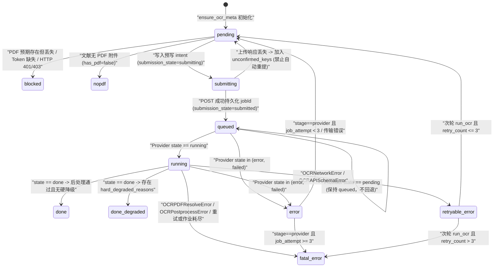

# 第 07 章：OCR Provider、异步作业与 Canonical 持久化

本章系统阐述 PaperForge OCR 子系统的远程作业控制面、容错重试与诊断分层、单篇论文落盘目录结构（含 `canonical/` 原始事实层）、双层版本/哈希契约（`raw_version` / `derived_version` 与 `result-hash.txt` 发布门控），以及 `paperforge ocr` CLI 入口与 `redo` 事务恢复机制。下游 V3 结构化管线、图表对象归属与 Markdown 渲染详见 [Chapter 08](08-ocr-v3-pipeline-and-objects.md)，渲染一致性审计、R/P 晋升与快照版本管理详见 [Chapter 09](09-render-audit-and-reconcile.md)，整体谱系与 Reconcile 控制面详见 [Chapter 04](04-probes-and-reconcile.md)。

---

## 1. 职责与非目标边界

### 1.1 核心职责

1. **Provider 协议抽象与异步作业执行（`paperforge/providers/` & `paperforge/worker/ocr.py`）**
   - 通过 `OCRProvider` 协议（`ProviderStatus` 五态：`queued` / `running` / `done` / `failed` / `unknown`）隔离第三方 OCR 服务细节，控制面与下游 V3 管线仅消费归一化状态与 `ocr_raw` 块列表。
   - `PaddleOCRProvider` 与 `run_ocr()` 负责将本地主 PDF 上传至 PaddleOCR AI Studio v2 异步作业 API（同一逻辑运行共享唯一 `batchId`），通过批查询（`get_batch_status`）与单作业轮询（`get_job_status`）跟踪作业生命周期，并拉取结果 JSONL。
2. **Canonical 原始真值持久化与 PDF 证据回填（`canonical/` + `raw/` + `ocr_pdf_spans.py`）**
   - 远程识别返回的每页 `layoutParsingResults` 经 `parse_paddleocr_raw_blocks()` 规范化后，结合 PyMuPDF（`pymupdf`）提取的 `span_metadata`（字符级字号、字体、粗斜体标志、颜色、书写方向）与空文本回填（`backfill_missing_text_from_pdf()`），持久落盘到 `canonical/blocks.raw.jsonl`，同时在 `json/result.json`、`raw/raw_meta.json`、`raw/source_metadata.json` 保存可审计的原始载荷与指纹。
3. **版本分离与本地重建支持（`paperforge/worker/ocr_versions.py` & `ocr_rebuild.py`）**
   - 严格区分 **Raw 版本**（`expected_raw_payload()`：提供商、模型、原始 schema、`pdf_fingerprint`、`result_json_hash`、`raw_blocks_hash`）与 **Derived 版本**（`expected_derived_payload()`：管线、结构化、元数据解析、资产提取、渲染器、诊断版本）。当仅派生算法升级（`derived_stale=True` 且 `raw_upgradable=False`）时，通过本地 `ocr.rebuild_derived` / `paperforge ocr rebuild` 重算衍生层，**零远程 API 流量**。
4. **原子发布哈希与崩毁安全事务（`ocr_hash.py` & `run_ocr()` / `_redo_one_paper_transaction()`）**
   - 通过 `index/result-hash.pending` 发布标记与 `index/result-hash.txt`（SHA-256 覆盖三项规范产物）阻止下游记忆层/检索层读取半成品；通过 `controller.lock`、`ocr_queue.lock`、`submission_state="submitting"` 预写日志、以及 `redo` 临时快照目录保障并发与中断安全。

### 1.2 明确的非目标边界（Non-Goals）

| 能力域                              | 本层坚决不做的事                                                                                                         | 实际归属模块                                                                                                |
| :---------------------------------- | :----------------------------------------------------------------------------------------------------------------------- | :---------------------------------------------------------------------------------------------------------- |
| **文档角色归一化与图表配对**        | 不在 `canonical/blocks.raw.jsonl` 中分配 `section_heading`、`figure_caption` 等语义角色，不执行图注/表注配对             | [Chapter 08](08-ocr-v3-pipeline-and-objects.md)（`paperforge/worker/ocr_blocks.py`、`ocr_object_stage.py`） |
| **凭据持久化与多渠道回退**          | 不自行读取 `.env`、Windows 注册表（HKCU）或插件配置作为 OCR Token；仅消费 `CredentialKey("ocr")` 权威入口                | `paperforge/credentials.py`（`resolve()` / `paperforge auth`）                                              |
| **前端界面状态展示与动作调度**      | 不主动计算 UI 分组展示，不私自决定全库/单篇重跑策略；仅通过 `OCRMaintenanceRow` 与 `meta.json` 暴露客观状态              | `paperforge/worker/ocr_maintenance.py` & [Chapter 04](04-probes-and-reconcile.md)                           |
| **旧版历史快照（`versions/`）回滚** | `postprocess_ocr_result()` 不操作 `versions/v{N}` 显示快照；显示版本备份与只读恢复属于版本网关与重建前钩子               | [Chapter 09](09-render-audit-and-reconcile.md)（`paperforge/commands/versions.py`）                         |
| **SQLite 记忆库与向量写入**         | OCR 落盘与 `refresh_index_entry()` 仅维护文件系统产物与 `formal-library.json`；不直接写入 `paperforge.db` 检索单元与向量 | [Chapter 10](10-memory-db-and-retrieval.md)                                                                 |

---

## 2. 核心源码与单测映射表

| 模块 / 文件                             | 核心职责与关键符号                                                                                                                                                                                                                                               | 对应验证单测 / 集成测试                                                                                                                                                  |
| :-------------------------------------- | :--------------------------------------------------------------------------------------------------------------------------------------------------------------------------------------------------------------------------------------------------------------- | :----------------------------------------------------------------------------------------------------------------------------------------------------------------------- |
| `paperforge/providers/base.py`          | 定义 `ProviderStatus` 枚举与 `@runtime_checkable` `OCRProvider` 协议（7 个标准方法）                                                                                                                                                                             | `tests/test_ocr.py`                                                                                                                                                      |
| `paperforge/providers/paddleocr.py`     | 实现 `PaddleOCRProvider`、`DEFAULT_JOB_URL`、`normalize_provider_state()`、`extract_paddleocr_result_url()`、`iter_paddleocr_page_results()`、`parse_paddleocr_page_blocks()`、`parse_paddleocr_raw_blocks()`                                                    | `tests/test_ocr.py`、`tests/harness/test_d05_ocr_redo.py`                                                                                                                |
| `paperforge/worker/ocr.py`              | OCR 控制器主干：`run_ocr()`、`postprocess_ocr_result()`、`_mark_ocr_result_unavailable()`、队列同步 `sync_ocr_queue()`、互斥锁 `_acquire_controller_lock()` / `_ocr_queue_lock()`、Redo 事务 `_redo_one_paper_transaction()` 与孤儿恢复 `recover_redo_orphans()` | `tests/test_ocr.py`、`tests/test_ocr_state_machine.py`、`tests/test_redo_orphan_recovery.py`、`tests/harness/test_d04_ocr_stop.py`、`tests/harness/test_d05_ocr_redo.py` |
| `paperforge/worker/ocr_orchestrator.py` | 历史兼容壳：`BlockAnnotated`、`reorder_blocks_layered()`（非生产路径，仅保留接口兼容）                                                                                                                                                                           | `tests/test_ocr_route_audit.py`                                                                                                                                          |
| `paperforge/worker/ocr_blocks.py`       | 原始块与结构块桥接：`build_raw_blocks_for_result_lines()`、`write_raw_blocks_jsonl()`、`build_structured_blocks()`、`write_structured_blocks_jsonl()`、`DOC_STRUCTURE_MAX_BYTES`                                                                                 | `tests/test_ocr_blocks.py`、`tests/test_ocr_artifacts.py`                                                                                                                |
| `paperforge/worker/ocr_pdf_spans.py`    | 基于 PyMuPDF 提取源 PDF `span_metadata`（`backfill_span_metadata_from_pdf()`）并回填 OCR 漏字（`backfill_missing_text_from_pdf()`）                                                                                                                              | `tests/test_ocr_blocks.py`                                                                                                                                               |
| `paperforge/worker/ocr_versions.py`     | 双层版本常量与检测：`OCR_PIPELINE_VERSION`、`expected_raw_payload()`、`expected_derived_payload()`、`classify_legacy_ocr_state()`、`classify_version_state()`、`compute_structured_hash()`、`backup_render_before_rebuild()`                                     | `tests/test_ocr_versions.py`、`tests/test_ocr_artifacts.py`                                                                                                              |
| `paperforge/worker/ocr_hash.py`         | 原子发布哈希契约：`OCR_RESULT_HASH_ARTIFACTS`、`PENDING_MARKER`、`HASH_FILE`、`compute_ocr_result_hash()`、`create_result_hash_pending()`、`publish_ocr_result_hash()`、`clear_result_hash_pending()`                                                            | `tests/test_ocr_hash_contract.py`                                                                                                                                        |
| `paperforge/worker/ocr_errors.py`       | OCR 异常分级：`OCRRecoverableError`（`OCRNetworkError`、`OCRAPISchemaError`）、`OCRFatalError`（`OCRPDFResolveError`、`OCRPostprocessError`、`OCRArtifactIntegrityError`）、`classify_ocr_error()`、`normalize_ocr_status_for_reader()`                          | `tests/test_ocr_errors.py`                                                                                                                                               |
| `paperforge/worker/ocr_quality.py`      | 6 维质量归一化与可用性评估：`build_quality_indicators()`、`load_readiness_policy()`、`evaluate_readiness()`、`compute_use_cases()`（读取 `paperforge/policies/ocr_readiness_v1.yaml`）                                                                           | `tests/test_ocr_profiles.py`                                                                                                                                             |
| `paperforge/worker/ocr_artifacts.py`    | 单篇路径定义与缓存清理：`OCRArtifactPaths`、`artifact_paths_for_root()`、`artifact_paths_for_key()`、`build_version_payload()`、`compute_pdf_fingerprint()`、`compute_json_hash()`、`cleanup_ocr_artifact_cache()`                                               | `tests/test_ocr_artifacts.py`                                                                                                                                            |
| `paperforge/worker/ocr_profiles.py`     | 字体跨度样式画像：`extract_block_span_profile()`、`build_role_span_profiles()`、`build_family_profiles()`、`cross_validate_with_span()`、`write_role_span_profiles()`                                                                                            | `tests/test_ocr_profiles.py`                                                                                                                                             |
| `paperforge/worker/ocr_health.py`       | 结构健康审计：`build_ocr_health()`、`build_ocr_raw_integrity_health()`、`audit_rendered_text_coverage()`、`write_ocr_health()`、`collect_ocr_health_summary()`                                                                                                   | `tests/test_ocr_artifacts.py`                                                                                                                                            |
| `paperforge/ocr_diagnostics.py`         | L1–L4 诊断探针与错因映射：`ocr_doctor()`、`classify_error()`                                                                                                                                                                                                     | `tests/test_ocr.py`                                                                                                                                                      |
| `paperforge/commands/ocr.py`            | CLI 分发层：`run()`、`_diagnose()`、`_run_ocr_status()`、`_run_ocr_resume()`、`_run_ocr_redo()`、`_run_ocr_list()`、`_run_ocr_rebuild()`、`_needs_derived_rebuild()`、`_run_ocr_pipeline_versions()`                                                             | `tests/harness/test_d04_ocr_stop.py`、`tests/harness/test_d05_ocr_redo.py`、`tests/harness/test_d06_rebuild_derived.py`                                                  |
| `paperforge/worker/_retry.py`           | 指数退避重试器：`configure_retry()`、`retry_with_meta()`（仅重试网络超时、`ConnectionError` 与 HTTP `429`/`503`）                                                                                                                                                | `tests/test_ocr_errors.py`                                                                                                                                               |
| `paperforge/worker/ocr_maintenance.py`  | 维护行单源模型：`OCRMaintenanceRow`、`_can_rebuild()`、`_can_redo()`、`collect_maintenance_rows()`、`compute_maintenance_manifest()`                                                                                                                             | `tests/harness/test_d06_rebuild_derived.py`                                                                                                                              |

---

## 3. 磁盘文件、数据库表与协议 JSON 字段字典

### 3.1 OCR 目录布局与 Canonical / Cache 边界

所有单篇 OCR 产物均位于 `<paperforge>/ocr/<KEY>/`（其中 `<paperforge>` 由 `paperforge.json` 的 `system_dir` 解析，现代布局通常为 `<vault>/.paperforge`，兼容布局为 `<vault>/System/PaperForge`）。全队列文件位于 `<paperforge>/ocr/` 根下：

| 相对路径                                                             | 所属层级           | 生成/维护者                                               | 说明与保留策略                                                                                                                             |
| :------------------------------------------------------------------- | :----------------- | :-------------------------------------------------------- | :----------------------------------------------------------------------------------------------------------------------------------------- |
| `ocr-queue.json` / `ocr_queue.lock`                                  | 队列控制面         | `sync_ocr_queue()` / `write_ocr_queue()`                  | 未结算作业队列列表（已结算状态从队列移除）；`ocr_queue.lock` 为排他锁                                                                      |
| `controller.lock`                                                    | 队列控制面         | `_acquire_controller_lock()`                              | 全局单活 OCR 控制器锁（`O_EXCL`，30 秒陈旧恢复）                                                                                           |
| `meta.json`                                                          | 生命周期权威       | `ensure_ocr_meta()` / `run_ocr()`                         | 单篇 OCR 状态、作业 ID、Batch ID、版本负载、失败原因与哈希基准                                                                             |
| `json/result.json`                                                   | Raw 原始层         | `postprocess_ocr_result()`                                | PaddleOCR 返回的原始逐页 JSON 列表（支持旧版重新回填 `backfill_from_result()`）                                                            |
| `raw/raw_meta.json`                                                  | Raw 原始层         | `postprocess_ocr_result()`                                | 记录 `pdf_fingerprint`、`result_hash` 与原始元数据时间戳                                                                                   |
| `raw/source_metadata.json`                                           | Raw 原始层         | `postprocess_ocr_result()`                                | 来自 Zotero/BBT 的题录锚点（`title`、`authors`、`year`、`journal`、`doi`、`bbt_citekey`）                                                  |
| `raw/api_error_payload.json`                                         | 故障证据           | `run_ocr()`                                               | 轮询 JSON 解码或 `data.state` 解析失败时截留前 5000 字符响应体                                                                             |
| `canonical/blocks.raw.jsonl`                                         | Canonical 原始真值 | `write_raw_blocks_jsonl()`                                | **权威原始块序列**（含 PDF `span_metadata` 与 PDF 漏字回填标注），`rebuild-derived` 的唯一块输入                                           |
| `pages/page_<NNN>.png\|jpg`                                          | 可再生缓存         | `render_pdf_page_cached()` / `ensure_page_image_cached()` | 页面图像缓存；`postprocess_ocr_result()` 末尾默认删除（除非 `PAPERFORGE_KEEP_PAGE_IMAGES=1`），`cleanup_ocr_artifact_cache()` 仅清理此目录 |
| `images/blocks/...`                                                  | 兼容图像产物       | `render_page_blocks()`                                    | 兼容渲染切图目录（`meta.path_map.legacy_compat`）                                                                                          |
| `structure/`、`metadata/`、`assets/`、`render/`、`health/`、`index/` | Derived 派生层     | `ocr_rebuild.py` / `postprocess_ocr_result()`             | 结构块、元数据解析、图表裁剪、全文 Markdown、健康报告与原子发布哈希（详见 [Chapter 08](08-ocr-v3-pipeline-and-objects.md)）                |

> [!IMPORTANT]
> `cleanup_ocr_artifact_cache()`（`paperforge/worker/ocr_artifacts.py`）仅清理 `pages/` 目录下的 `.jpg` / `.png` / `.webp` 页面缓存；`canonical/`、`structure/`、`metadata/`、`assets/`、`render/`、`health/`、`index/`、`raw/`、`meta.json` 与根目录 `fulltext.md` 均属于不可自动清除的规范资产。

### 3.2 `canonical/blocks.raw.jsonl` 行级字段字典

由 `parse_paddleocr_page_blocks()`（`paperforge/providers/paddleocr.py`）生成基础结构，随后由 `backfill_span_metadata_from_pdf()` 与 `backfill_missing_text_from_pdf()`（`paperforge/worker/ocr_pdf_spans.py`）补充 PDF 证据字段：

| 字段名                       | 类型                 | 来源                             | 说明                                                                                                                                                                                                      |
| :--------------------------- | :------------------- | :------------------------------- | :-------------------------------------------------------------------------------------------------------------------------------------------------------------------------------------------------------- |
| `paper_id`                   | `str`                | `parse_paddleocr_page_blocks`    | Zotero 文献键（如 `"ABCD1234"`）                                                                                                                                                                          |
| `page`                       | `int`                | `iter_paddleocr_page_results`    | 1-indexed 物理页码                                                                                                                                                                                        |
| `block_id`                   | `str \| int`         | PaddleOCR `block_id`             | 块 ID（缺省回退 `"p{page}_b{i}"`；跨页可能重复）                                                                                                                                                          |
| `raw_label`                  | `str`                | PaddleOCR `block_label`          | 原始布局标签（如 `text`、`paragraph_title`、`doc_title`、`abstract`、`table`、`image`、`chart`、`figure_title`、`reference_content`、`vision_footnote`、`display_formula`）                               |
| `raw_order`                  | `int`                | PaddleOCR `block_order`          | 原始阅读顺序索引（缺省回退页内枚举序号 `i`）                                                                                                                                                              |
| `bbox`                       | `list[int \| float]` | PaddleOCR `block_bbox`           | `[x1, y1, x2, y2]` OCR 像素坐标（缺省 `[0, 0, 0, 0]`）                                                                                                                                                    |
| `text`                       | `str`                | PaddleOCR `block_content`        | 识别文本内容（空文本可能由 PDF 文本层回填）                                                                                                                                                               |
| `page_width` / `page_height` | `int \| float`       | `prunedResult.width/height`      | OCR 图像坐标系页面宽高                                                                                                                                                                                    |
| `source`                     | `str`                | 固定常量                         | 恒为 `"ocr_raw"`                                                                                                                                                                                          |
| `span_metadata`              | `list[dict] \| None` | `ocr_pdf_spans.py`               | 每段字符样式：`{"size": float, "font": str, "flags": int, "color": int, "dir": tuple, "wmode": int}`                                                                                                      |
| `_text_source`               | `str`（可选）        | `backfill_missing_text_from_pdf` | 仅空文本回填时出现：`pdf_text_layer_fallback` 或被重叠检测拒绝的 `pdf_text_layer_fallback_rejected`                                                                                                       |
| `_ocr_raw_status`            | `str`（可选）        | `backfill_missing_text_from_pdf` | `missing_text_recovered` / `missing_text_unrecovered` / `missing_text_rejected`                                                                                                                           |
| `_ocr_raw_error_type`        | `str`（可选）        | `backfill_missing_text_from_pdf` | `empty_text_with_pdf_evidence` / `no_pdf_text_layer` / `backfill_overlaps_existing_text_block` / `invalid_page_index` / `missing_bbox` / `missing_page_dimensions` / `bbox_mapping_failed` / `empty_rect` |

### 3.3 `meta.json` 核心字段与双层版本字典

`meta.json` 是单篇 OCR 生命周期与版本状态的权威载体，由 `ensure_ocr_meta()` 初始化、`run_ocr()` 更新作业状态、`postprocess_ocr_result()` 与 `_rebuild_one_paper()` 写入版本负载：

| 字段路径                                                                                                                               | 类型                                  | 说明与取值语义                                                                                                                                                                                                                                                             |
| :------------------------------------------------------------------------------------------------------------------------------------- | :------------------------------------ | :------------------------------------------------------------------------------------------------------------------------------------------------------------------------------------------------------------------------------------------------------------------------- |
| `zotero_key` / `source_pdf`                                                                                                            | `str`                                 | 文献主键与规范 PDF 定位符（由 `formal-library.json` 与 `resolve_pdf_path` 解析，支持 `storage:KEY/...`、相对路径与绝对路径）                                                                                                                                               |
| `ocr_status`                                                                                                                           | `str`                                 | 生命周期状态：队列态 `pending` / `queued` / `running`；已结算态 `done` / `done_degraded` / `fatal_error` / `blocked` / `nopdf` / `error`；可恢复重试态 `retryable_error`；校验不完整态 `done_incomplete`                                                                   |
| `submission_state`                                                                                                                     | `str`（可选）                         | 预写提交保护窗：上传 POST 前置 `"submitting"`，成功取得 `jobId` 后置 `"submitted"`                                                                                                                                                                                         |
| `provider_batch_id` / `ocr_job_id`                                                                                                     | `str`                                 | 逻辑运行批次号（格式 `pf-YYYYMMDD-HHMMSS-<hex6>`）与当前远程作业 ID                                                                                                                                                                                                        |
| `job_attempt` / `provider_jobs`                                                                                                        | `int` / `list[dict]`                  | 远程作业失败重提次数（上限 `MAX_OCR_JOB_ATTEMPTS = 3`）及最近最多 3 条 `{"attempt": N, "job_id": "..."}` 映射                                                                                                                                                              |
| `retry_count` / `last_error` / `last_attempt_at`                                                                                       | `int` / `str \| None` / `str \| None` | 传输层重试计数（超过 3 次触发 `fatal_error`）与最近错误时间戳（`retry_with_meta()` 持久化）                                                                                                                                                                                |
| `error` / `error_type` / `error_stage` / `retryable`                                                                                   | `str` / `str` / `str` / `bool`        | 由 `classify_ocr_error()` 或控制分支写入；`error_stage` 可为 `source`、`auth`、`upload`、`poll`、`result`、`provider`、`postprocess`                                                                                                                                       |
| `source_page_count` / `page_count`                                                                                                     | `int`                                 | `source_page_count` 为上传前从源 PDF 读取的页数（用于计算动态超时）；`page_count` 为后处理实际产出页数                                                                                                                                                                     |
| `ocr_pipeline_version` / `normalize_mode`                                                                                              | `str`                                 | 当前 `"2.0.0"`；`normalize_mode` 为 `"seed_only"`（V3）或 `"legacy"`                                                                                                                                                                                                       |
| `raw_version`                                                                                                                          | `dict`                                | 包含 `ocr_provider`（`"PaddleOCR"`）、`ocr_model`、`ocr_raw_schema_version`（`expected_raw_payload()` 中为 `"2.0.0"`，注：`raw/raw_meta.json` 内记录 `"1.0.0"`）、`pdf_fingerprint`（`sha256:...`）、`result_json_hash`（`sha256:...`）、`raw_blocks_hash`（`sha256:...`） |
| `derived_version`                                                                                                                      | `dict`                                | 由 `expected_derived_payload()` 生成：`ocr_pipeline_version="2.0.0"`、`canonical_block_version="2.0.0"`、`structure_version="2.0.0"`、`metadata_resolver_version="2.0.0"`、`asset_extractor_version="2.0.0"`、`renderer_version="2.1.0"`、`doctor_version="2.0.0"`         |
| `raw_upgradable` / `derived_stale`                                                                                                     | `bool`                                | 由 `classify_version_state()` 计算：前者标识 Raw 模型/schema 变化需重新调用 API；后者标识仅 Derived 版本落后，可本地 `rebuild`                                                                                                                                             |
| `structured_content_hash` / `structured_mtime` / `structured_size`                                                                     | `str` / `float` / `int`               | `compute_structured_hash()` 计算的 `structure/blocks.structured.jsonl` 的 `xxh64` 十六进制摘要及两级 stat 快速检测凭据                                                                                                                                                     |
| `span_backfill_version` / `span_visual_container_version` / `span_pdf_fingerprint` / `span_backfill_coverage` / `span_backfill_status` | 混合                                  | `ocr_rebuild.py` 记录的 PDF Span 回填幂等门控（当前版本 `"2026-07-01.1"` 与 `"2026-06-26.6"`，覆盖率阈值 `MIN_SPAN_BACKFILL_COVERAGE = 0.90`）                                                                                                                             |
| `machine_fulltext_hash` / `degraded_reason`                                                                                            | `str`                                 | 根目录 `fulltext.md` 最近一次机器写入的 `sha256:...`（用于漂移检测）；`done_degraded` 时记录硬降级原因                                                                                                                                                                     |

### 3.4 原子发布哈希契约（`paperforge/worker/ocr_hash.py`）

为防止记忆层（`paperforge/memory/builder.py`）或检索读取侧消费到写了一半的衍生文件，所有成功路径（首次 `postprocess_ocr_result`、派生重建 `_rebuild_one_paper`、历史回填 `backfill_from_result`）必须通过以下三步协议发布：

1. **固定输入顺序（`OCR_RESULT_HASH_ARTIFACTS`）**：依次读取以下 3 个文件原始字节计算单条 SHA-256（底层委托 `paperforge/core/stat_cache.py::cached_concat_sha256_hex()` 利用 `(size, mtime_ns, ctime_ns)` 缓存与 2s Racy-Git 防护跳过未变大文件重算，与 `paperforge/materialization/ocr.py` 共用缓存而不污染 Vault）：
   - `structure/blocks.structured.jsonl`
   - `index/structure-tree.json`
   - `index/role-index.json`
     任一文件缺失时，`compute_ocr_result_hash()` 严格返回 `None`（绝不生成部分哈希）。
2. **预写标记（`PENDING_MARKER = "index/result-hash.pending"`）**：通过 `create_result_hash_pending()` 在**任何衍生层修改之前**写入该标记文件。标记存在期间，`paperforge/materialization/ocr.py` 的 `published_identity_hash()` 返回 `""`、`identity_state()` 返回 `(None, None)`，读取侧与记忆构建侧必须忽略该论文。
3. **原子提交与清除（`HASH_FILE = "index/result-hash.txt"`）**：仅在全部衍生阶段验证通过后，调用 `publish_ocr_result_hash()` 通过同目录 `tempfile.mkstemp()` + `os.replace()` 原子替换 `index/result-hash.txt`；若返回非 `None`，最后调用 `clear_result_hash_pending()` 删除标记。中途失败会保留 `pending` 标记直至修复或重建成功。

---

## 4. 核心执行链路、状态机与顺序不变量

### 4.1 异步提交、批轮询与结算状态机

`run_ocr()`（`paperforge/worker/ocr.py`）以单活控制器模式执行上传与轮询主循环（并发槽位由 `PADDLEOCR_MAX_ITEMS` 控制，默认 `3`；轮询间隔 `PAPERFORGE_POLL_INTERVAL` 默认 `15` 秒；最大周期 `PAPERFORGE_POLL_MAX_CYCLES` 默认 `60` 次）。

关键状态流转与顺序不变量如下：

1. **状态词汇隔离不变量**：PaddleOCR 返回的 `"pending"` 表示作业已在远程排队（对应本地 `"queued"`）。`run_ocr()` 严禁将远程 `"pending"` 写回本地 `"ocr_status = 'pending'"`，否则会同时击穿轮询等待条件与上传触发条件，导致无限重复上传。
2. **双计数隔离不变量（`job_attempt` vs `retry_count`）**：
   - `retry_count` 仅记录 HTTP 传输与临时轮询重试（`retry_with_meta()` 对 `ConnectionError`、`Timeout`、`429`、`503` 做指数退避，最多 `PAPERFORGE_RETRY_MAX=5` 次），**永不消耗** `job_attempt`。
   - `job_attempt` 仅记录远程作业终态失败（Provider 返回 `error`/`failed`）后的重提次数，上限为 `MAX_OCR_JOB_ATTEMPTS = 3`。当 `stage == "upload"` 且 `retry_count >= 3` 时同样直接 Fail-Closed 为 `fatal_error`。
3. **预写意图与幂等防重提（`submission_state="submitting"`）**：上传 POST 是非幂等操作。`run_ocr()` 在发起 HTTP POST **之前** 先落盘 `submission_state="submitting"` 与 `provider_batch_id`。若在响应返回前进程崩溃或网络超时，该键被标为 `unconfirmed_keys`，并写入 `"Submission unconfirmed"`；后续 `ocr resume --batch <id>` 的 `_collect_batch_unsettled()` 也会跳过 `submission_state == "submitting"` 的论文以防盲目重提产生双倍计费。同时，为了闭合卡滞排障闭环，`paperforge/worker/ocr_maintenance.py` 对 `submission_state == "submitting"` 且缺失 `ocr_job_id`、状态尚未完成的条目主动在维护面板显式暴露可操作恢复行（`display_action="retry_ocr"`、`display_reason_key="submitting_unconfirmed"`、`can_redo=True`、`recommended_action="redo"`，`tests/unit/test_ux_loop_closures.py`）。
4. **单活控制器、批观测降级与延迟 `resultUrl` 可恢复滞留**：写控制器启动即尝试获取 `<paperforge>/ocr/controller.lock`（`O_EXCL`，>30s 视为僵尸锁接管）；只读命令（`ocr status`、`probe`）绝不抢锁。轮询优先使用 `PaddleOCRProvider.get_batch_status(batch_id)` 单次批查询，若批接口不可用或已完成项缺失 `resultUrl`，自动降级到单作业 `_do_poll(job_id)`；若单作业轮询返回 `state="done"` 但 `extract_paddleocr_result_url()` 仍为空或无效（Provider 延迟生成结果 URL），Cycle-1 与 Poll-Loop 均调用 `_mark_ocr_result_unavailable()` 保持 `status="queued"`、`error_stage="result"` 并显式 `write_json()` 落盘（而非落入异常链误标 `fatal_error`），由后续 `run_ocr()`/`ocr resume` 恢复下载（见 `tests/test_ocr_state_machine.py`）。
5. **动态单篇超时与槽位释放**：`_paper_timeout_minutes(meta)` 基准为 `PAPERFORGE_PAPER_TIMEOUT_MINUTES`（默认 `10` 分钟），每多 2 页源 PDF（`source_page_count`）追加 1 分钟（`base + pages // 2`）。超时后仅释放本地并发槽位（`active_submitted.discard(key)`）并保留 `ocr_job_id`，**绝不盲目重提**。
6. **协作式停止（Cooperative Stop）**：轮询休眠按 1 秒切片检查 `stop_check()`（接收 `SIGINT` / `SIGTERM` 或 stdin `PAPERFORGE_STOP`）。触发停止后立即退出本地监听返回码 `130`，远程已提交作业继续运行，stderr 打印 `paperforge ocr status --batch <id>` 与 `paperforge ocr resume --batch <id>`。

### 4.2 `postprocess_ocr_result()` 与 `rebuild` 双入口序列

首次识别完成（`state == "done"`）调用 `postprocess_ocr_result()`，而本地重建（`ocr rebuild` / `ocr.rebuild_derived`）调用 `_rebuild_one_paper()`。两者**共享同一条产物生成链**：

1. 创建 `index/result-hash.pending`。
2. （仅首次解析）保存 `json/result.json`、`raw/raw_meta.json`、`raw/source_metadata.json`，渲染兼容页图与调用 `build_raw_blocks_for_result_lines()` 生成原始块，接着运行 `backfill_span_metadata_from_pdf()` 与 `backfill_missing_text_from_pdf()`，写入 `canonical/blocks.raw.jsonl`。
3. （重建入口 Phase 1）读取 `canonical/blocks.raw.jsonl`，清理重叠的回填块（`_BACKFILL_OVERLAP_REJECT_THRESHOLD = 0.8`），校验 `span_pdf_fingerprint` 与 `MIN_SPAN_BACKFILL_COVERAGE = 0.90`，若过期或缺失则单次打开源 PDF 补全 `span_metadata` 并提取供图匹配使用的 `page_pdf_lines_by_page`。
4. 进入 V3 结构化 → Pre-Match → 图表配对 → Post-Match → 写回 → 对象裁剪 → 渲染 → 健康报告 → 索引/结构树构建（详见 [Chapter 08](08-ocr-v3-pipeline-and-objects.md)）。
5. 写入 `meta.json` 的 `raw_version`、`derived_version`、`structured_content_hash`（重建时）；原子发布 `index/result-hash.txt` 并清除 `index/result-hash.pending`；同步工作区可视化资产并清理 `pages/page_*.jpg`（除非设置 `PAPERFORGE_KEEP_PAGE_IMAGES=1`）。

### 4.3 `ocr redo` 事务与孤儿恢复协议

`_redo_one_paper_transaction()`（`paperforge/worker/ocr.py`）对单篇论文执行严格 4 阶段事务：

1. **Snapshot**：检查 `ocr_status != "nopdf"` 后，将 `<ocr_root>/<key>` 完整拷贝至系统临时目录 `paperforge-redo-<key>-<rand>/ocr`，同时读取笔记原文与工作区 `fulltext.md` 字节备份。
2. **Mutate**：删除旧工作区 `fulltext.md` 与 `<ocr_root>/<key>`，重写笔记前置字段（`do_ocr=True, ocr_status="pending", fulltext_md_path="", ocr_redo=True`），调用 `run_ocr(vault, selected_keys={key})`。
3. **Validate**：通过 `validate_ocr_meta()` 检验 `status == "done"` 且退出码为 `0`（要求 `fulltext.md >= 500` 字节、`json/result.json >= 1000` 字节、`page_count >= 1` 且 `<!-- page N -->` 标记数等于 `page_count`）。
4. **Commit / Rollback**：成功则将笔记设为 `ocr_status="done", ocr_redo=False`，调用 `refresh_index_entry()` 后删除快照；任何失败或异常均回滚 OCR 目录、工作区文件、笔记与索引后再删快照。若进程在阶段 2 崩溃遗留未删快照，下次 `redo` 启动（非 `--dry-run`）时由 `recover_redo_orphans()` 扫描系统临时目录 `paperforge-redo-*-*` 自动还原。

---

## 5. 配置项、环境变量、CLI 入口与错误码

### 5.1 配置与环境变量字典

| 名称                                                | 来源（优先级：`default < file < env < override`） | 默认值                                                 | 作用与约束                                                                               |
| :-------------------------------------------------- | :------------------------------------------------ | :----------------------------------------------------- | :--------------------------------------------------------------------------------------- |
| `ocr_profile` / `PAPERFORGE_OCR_PROFILE`            | `paperforge.json` / Env                           | `"default"`                                            | 凭据 Profile 命名，须满足 `[a-z][a-z0-9_]{0,63}`（映射 `CredentialKey("ocr", profile)`） |
| `paddleocr_job_url` / `PADDLEOCR_JOB_URL`           | `paperforge.json` / Env                           | `"https://paddleocr.aistudio-app.com/api/v2/ocr/jobs"` | PaddleOCR 异步作业端点，须为无内联认证信息的 `http(s)://` URL                            |
| `paddleocr_model` / `PADDLEOCR_MODEL`               | `paperforge.json` / Env                           | `"PaddleOCR-VL-1.6"`                                   | 提交至 `data["model"]` 的模型名称                                                        |
| `PAPERFORGE_CREDENTIAL_OCR__DEFAULT`                | Env（或 OS Keyring `ocr:default`）                | 无（必填）                                             | OCR API Token 唯一权威来源；不读取 `.env` 或旧环境变量                                   |
| `PADDLEOCR_MAX_ITEMS`                               | Env                                               | `"3"`                                                  | 本地同时提交到远程的活跃并发作业上限（最小 `1`）                                         |
| `PAPERFORGE_POLL_INTERVAL`                          | Env                                               | `"15"`                                                 | 批轮询休眠间隔（秒，内部按 1s 切片响应停止信号）                                         |
| `PAPERFORGE_POLL_MAX_CYCLES`                        | Env                                               | `"60"`                                                 | 单次 `run_ocr()` 最大轮询周期数                                                          |
| `PAPERFORGE_RETRY_MAX` / `PAPERFORGE_RETRY_BACKOFF` | Env                                               | `"5"` / `"2.0"`                                        | `tenacity` 指数退避最大尝试次数与乘数（等待区间 `1s..30s`）                              |
| `PAPERFORGE_PAPER_TIMEOUT_MINUTES`                  | Env                                               | `"10"`                                                 | 单篇作业基础超时分钟数（长论文叠加 `source_page_count // 2`）                            |
| `PAPERFORGE_ZOMBIE_TIMEOUT_MINUTES`                 | Env                                               | `"30"`                                                 | 无 `ocr_job_id` 的僵死 `queued`/`running` 任务自动重置为 `pending` 的阈值（分钟）        |
| `PAPERFORGE_KEEP_PAGE_IMAGES`                       | Env                                               | 未设置（`"0"`）                                        | 设为 `"1"` 时保留 `pages/page_*.jpg` 缓存供调试，否则后处理完毕即清理                    |

### 5.2 CLI 入口与动作映射

> [!NOTE]
> 所有需要持久化 `PFResult` 输出的自动化调用推荐携带 `--json`；长任务（运行队列、`redo`、`rebuild`）在终端模式下采用 #137 NDJSON 事件流（`start` / `progress` / `item_result` / `result|error|cancelled`）输出到 stdout，人类日志输出到 stderr。

| 命令格式                                                                                                           | 内部处理函数                                          | 关键参数与语义                                                                                                                                       |
| :----------------------------------------------------------------------------------------------------------------- | :---------------------------------------------------- | :--------------------------------------------------------------------------------------------------------------------------------------------------- |
| `paperforge ocr [--key KEY] [--json]`                                                                              | `commands/ocr.py::run()` -> `run_ocr()`               | 运行默认待处理队列（优先匹配 `do_ocr: true`）或精确单篇 `--key`                                                                                      |
| `paperforge ocr --diagnose [--live] [--json]`                                                                      | `commands/ocr.py::_diagnose()` -> `ocr_doctor()`      | 执行 L1（Token）→ L2（URL 连通与 401/5xx 检查）→ L3（API Schema 结构）→ L4（可选 `--live` 使用 `tests/fixtures/blank.pdf` 真跑一轮）                 |
| `paperforge ocr status [--batch ID] [--json]`                                                                      | `commands/ocr.py::_run_ocr_status()`                  | 只读查询活跃/未确认作业（含 `submission_state=submitting`），实时向 Provider 探测远程状态                                                            |
| `paperforge ocr resume --batch ID [--json]`                                                                        | `commands/ocr.py::_run_ocr_resume()`                  | 重新挂接同一 `provider_batch_id` 下所有未结算且非 `submitting` 的论文，拉取已完成结果或继续轮询                                                      |
| `paperforge ocr redo [KEY...] [--dry-run]`                                                                         | `commands/ocr.py::_run_ocr_redo()`                    | 不带参数时扫描 `ocr_redo: true` 笔记；带 `KEY` 时走 per-paper 事务重跑；非 `--dry-run` 自动先行恢复中断孤儿                                          |
| `paperforge ocr list [--json] [--manifest] [--keys KEY...] [--output PATH]`                                        | `commands/ocr.py::_run_ocr_list()`                    | 只读枚举全库维护行（`OCRMaintenanceRow`）或输出 `{key: sha256}` 变更摘要清单                                                                         |
| `paperforge ocr rebuild [KEY...] [--all] [--status STATUS] [--dry-run] [--resume] [--parallel N \| --no-parallel]` | `commands/ocr.py::_run_ocr_rebuild()`                 | 从 `canonical/blocks.raw.jsonl` 本地重建衍生层（CLI 默认串行以便协作停止；`_select_rebuild_keys` 在 `--all` 下结合 `_needs_derived_rebuild()` 过滤） |
| `paperforge ocr pipeline-versions [--json]`                                                                        | `commands/ocr.py::_run_ocr_pipeline_versions()`       | 输出每篇论文的 Raw/Derived 版本细节（#148 明细接口）                                                                                                 |
| `paperforge action run ocr.rebuild_derived --scope papers\|all [--key KEY] [--json]`                               | `actions/registry.py::_ocr_rebuild_derived_handler()` | Action 注册表标准化本地派生重建入口（同样支持 `--keys-file`）                                                                                        |

### 5.3 错误类层次与 `ErrorCode` 映射

1. **内部异常类（`paperforge/worker/ocr_errors.py`）**：
   - `OCRRecoverableError` -> `classify_ocr_error()` 返回 `status="retryable_error", retryable=True`：包含 `OCRNetworkError`、`OCRAPISchemaError`。
   - `OCRFatalError` -> `classify_ocr_error()` 返回 `status="fatal_error", retryable=False`：包含 `OCRPDFResolveError`、`OCRPostprocessError`、`OCRArtifactIntegrityError`。
   - 下游读模型映射：`normalize_ocr_status_for_reader()` 将 `retryable_error` 与 `fatal_error` 统一归一为 `"error"`，将 `done_degraded` 归一为 `"done"`。
2. **CLI / `PFResult` 错误码（`paperforge/core/errors.py`）**：
   - `OCR_TOKEN_MISSING`（L1 诊断缺失 Token）、`OCR_UPLOAD_FAILED`（L2 端点失败）、`OCR_RESULT_INVALID`（L3 响应结构不符合 `data.jobId`）、`CREDENTIAL_MISSING` / `CREDENTIAL_BACKEND_LOCKED` / `CREDENTIAL_BACKEND_UNAVAILABLE` / `CREDENTIAL_PERMISSION_DENIED`（凭据后端故障）、`ACTION_UNAVAILABLE`（显式 `rebuild` 目标均不可重建）、`INTERNAL_ERROR`。

---

## 6. 边界防护与 Fail-Closed 防呆规则

1. **显式作用域绝不静默回退全库**：`paperforge/commands/ocr.py::run()` 与 `run_ocr()` 在传入 `selected_keys` 或 `--keys-file`（经 `normalize_paper_keys()` 处理 BOM/CRLF/去重）时，只要存在空白键、未知键或空文件，立即打印错误并返回退出码 `2`，绝不提交任何远程作业，也绝不降级处理全库。
2. **附件替换自愈门控（`PROVENANCE_PDF_CHANGED`）**：在 `run_ocr()` 初始化队列前，即使 `meta.json` 状态为 `done`/`done_degraded`，只要 `provenance_state()` 检测到当前规范库主 PDF 的 SHA-256 与 `meta.raw_version.pdf_fingerprint` 不一致，立即将状态重置为 `pending`（清空 `ocr_job_id` 并记录 `recovery_reason="pdf_replaced"`），确保基于新附件重跑。
3. **凭据后端故障绝不伪装成“未配置密钥”**：`_resolve_paddleocr_token()` 与 `ocr_doctor()` 仅在捕获 `CredentialError` 且 `exc.code == MISSING` 时返回空串或 L1 未配置提示；若 Keyring 被锁定或权限拒绝（`BACKEND_LOCKED` / `PERMISSION_DENIED`），异常直接向上抛出并输出明确凭据故障码。
4. **缺失预期 PDF vs 无 PDF 语义隔离**：`has_pdf=False` 合法结算为 `"nopdf"`；但当权威索引声明 `has_pdf=True` 而物理 PDF 解析不到或上传前瞬间消失（TOCTOU `FileNotFoundError`）时，强制写入 `ocr_status="blocked", error_stage="source"`，保留在修复前沿而非静默跳过。
5. **异常膨胀结构文件保护**：`ocr_blocks.py::_write_document_structure_json()` 在写出诊断文件 `structure/document_structure.json` 前校验 UTF-8 字节大小不超过 `DOC_STRUCTURE_MAX_BYTES`（`5 * 1024 * 1024` 字节 = 5 MiB）；超限则跳过落盘并记录告警，防止异常 `block_indices` 打爆磁盘。
6. **PDF 漏字回填双防线（防重复吞文）**：`backfill_missing_text_from_pdf()` 要求块必须同时具备 `TEXT_LIKE_RAW_LABELS` 标签与非空 PDF `span_metadata`，且仅在单词级 `clip` 提取结果与同页已有块 5-gram 重叠度低于 `_BACKFILL_OVERLAP_REJECT_THRESHOLD = 0.8` 时才允许写回，否则标记为 `missing_text_rejected` 并在 `_phase1_span_and_lines()` 再次清洗。

---

## 7. 维修、调试与升级 Checklist

### 7.1 常用排障与维修 Runbook

- **场景 A：批量运行中途 Ctrl+C 中断或网络超时出现 `unconfirmed_keys` / `queued`**
  1. 先运行 `paperforge ocr status --json`（或指定 `--batch <batch_id>`）只读查询远程真实进度；若存在 `submission_state="submitting"` 的论文，核对 Provider 控制台确认是否已创建作业，切勿直接删 `meta.json` 重提交。
  2. 确认安全后执行 `paperforge ocr resume --batch <batch_id>` 挂接同一批次拉取已完成结果并继续轮询。
- **场景 B：仅升级了 PaperForge 解析/渲染版本（`derived_stale=True`），但 Raw 数据完好**
  1. 执行 `paperforge ocr list --json` 或 `paperforge ocr pipeline-versions --json` 检查 `derived_stale` 与 `raw_upgradable` 标志。
  2. 先用 `paperforge ocr rebuild --all --dry-run` 预览命中列表与原因（如 `version_mismatch`、`content_hash_changed`、`missing:structure-tree.json`），确认无误后执行 `paperforge ocr rebuild --all`（或针对单篇 `paperforge ocr rebuild <KEY>` / `python scripts/dev/ocr_rebuild_paper.py <KEY>`）。
- **场景 C：单篇出现 `done_incomplete`、`fatal_error` 或远程版面识别错误需要重跑**
  1. 若 `meta.json` 提示 L1/L2 错误，先执行 `paperforge ocr --diagnose`（必要时加 `--live`）验证 Token、网络与 API Schema。
  2. 修复 PDF/Token 后，执行 `paperforge ocr redo <KEY>`（先加 `--dry-run` 验证范围）。命令会在隔离快照保护下删旧重跑并在失败时自动回滚。
- **场景 D：记忆层检索跳过某篇已完成的论文**
  1. 检查 `<paperforge>/ocr/<KEY>/index/result-hash.pending` 是否残留（表示上次发布中断且未超过 3600 秒或尚未清理）。
  2. 检查 `index/result-hash.txt` 是否存在且与 `blocks.structured.jsonl` / `structure-tree.json` / `role-index.json` 的实际 SHA-256 一致；若缺失或陈旧，运行 `paperforge action run ocr.rebuild_derived --scope papers --key <KEY> --json` 重新完成原子发布。

### 7.2 上线与变更自检 Checklist

- [ ] 修改 `paperforge/providers/` 或 `paperforge/worker/ocr.py` 状态流转后，跑通 `tests/test_ocr.py`、`tests/test_ocr_errors.py`、`tests/test_redo_orphan_recovery.py`、`tests/harness/test_d04_ocr_stop.py`、`tests/harness/test_d05_ocr_redo.py`。
- [ ] 修改 `blocks.raw.jsonl`、`ocr_versions.py` 或 `ocr_hash.py` 后，跑通 `tests/test_ocr_blocks.py`、`tests/test_ocr_versions.py`、`tests/test_ocr_hash_contract.py`、`tests/test_ocr_artifacts.py`、`tests/harness/test_d06_rebuild_derived.py`。
- [ ] 修改 `ocr_profiles.py` 或 `ocr_quality.py` / `paperforge/policies/ocr_readiness_v1.yaml` 后，跑通 `tests/test_ocr_profiles.py`。
- [ ] 升级衍生管线格式或渲染逻辑时，同步递增 `paperforge/worker/ocr_versions.py` 中对应 `EXPECTED_*_VERSION` 与 `OCR_PIPELINE_VERSION`，使已有库可被 `ocr rebuild --all` 精确识别并无远程调用原地升级。
