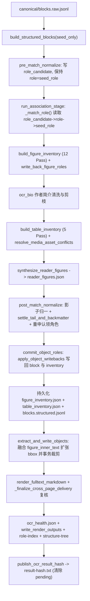

# 第 08 章：V3 OCR 结构化管线、图表归属与渲染契约

本章完整剖析 PaperForge V3 OCR 结构化管线（`OCR_PIPELINE_V3` 默认开启）的不可变阶段顺序、角色候选与结构门控验证、12 阶段图形（Figure）与 5 阶段表格（Table）配对流水线、对象所有权写回（Writeback）、`figure_inner_text` 包围盒合并、事务化对象裁剪与全文 Markdown 渲染、只读版面规划接受门控（`layout/`），以及检索读取端门控（`reader_gate.py`）。上游异步识别与 `canonical/blocks.raw.jsonl` 持久化详见 [Chapter 07](07-ocr-provider-and-canonical.md)，渲染后一致性审计与 R/P 晋升详见 [Chapter 09](09-render-audit-and-reconcile.md)。

---

## 1. 职责与非目标边界

### 1.1 核心职责

1. **V3 延迟角色提交与阶段契约（`AGENTS.md` & `ocr_pre_match_normalize.py` / `ocr_post_match_normalize.py`）**
   - 相比旧版“先硬化角色再匹配图表”导致的图注误吞问题，V3 在 `build_structured_blocks(..., normalize_mode="seed_only")` 后通过 `pre_match_normalize()` 将影子归一结果写入 `role_candidate`，而将公开 `role` 保持在 `seed_role`。
   - 图表匹配层通过 `_match_role()` 按 `role_candidate -> role -> seed_role` 优先级读取候选角色；匹配与冲突仲裁完成后，才由 `post_match_normalize()` 与 `commit_object_roles()` 提交最终 `role` 并写回所有权证据。
2. **对象生命周期单源编排（`docs/OBJECT-LIFECYCLE-CONTRACT.md` & `ocr_object_stage.py`）**
   - 遵循 `Observation -> Candidate -> Association -> Ownership -> Identity -> Reader + Materialization -> Delivery -> Reconciliation` 八阶段契约，通过 `run_association_stage()` 与 `commit_object_roles()` 保证首次解析（`postprocess_ocr_result()`）与本地重建（`_rebuild_one_paper()`）执行完全一致的调用序。
3. **`figure_inner_text` 融合裁剪与事务化对象物化（`ocr_object_writeback.py` & `ocr_objects.py`）**
   - 容器内文本（`tag_figure_contained_text()`）与侧邻文本（`_side_adjacent_evidence()` 得分 `>= 0.9`）统一归属为 `figure_inner_text` 并写入 `_object_owner_id`。`extract_and_write_objects()` 在裁剪图像时将 `crop_bbox` 自动扩张至覆盖全部同页同主 `inner_text`，渲染器绝不在图下方重复列出这些内部文本块。
4. **结构化渲染、读时门控与只读版面规划（`ocr_render.py`、`ocr_structural_gate.py`、`layout/`、`reader_gate.py`）**
   - 渲染全文 Markdown（`render/fulltext.md` + 根目录 `fulltext.md`）、`render/render-map.json`、`index/role-index.json` 与 `index/structure-tree.json`，并以 `index/result-hash.txt` 作为原子发布终点。同时提供 `assess_page()` 版面接受门控与 `filter_readable()` 检索读时血缘门控。

### 1.2 明确的非目标边界（Non-Goals）

| 能力域                               | 本层坚决不做的事                                                                                                                  | 实际归属模块                                                                                    |
| :----------------------------------- | :-------------------------------------------------------------------------------------------------------------------------------- | :---------------------------------------------------------------------------------------------- |
| **远程 OCR 调用与原始块抓取**        | 不发起网络请求，不修改 `canonical/blocks.raw.jsonl` 的原始文本真值                                                                | [Chapter 07](07-ocr-provider-and-canonical.md)（`paperforge/worker/ocr.py`）                    |
| **用 HTML 表格替代缺失裁图**         | 表格（Table）的真实源（`truth_source`）始终为图像；`assistive_text` HTML 仅作无裁图几何时的降级展示与辅助证据                     | `paperforge/worker/ocr_tables.py` & `ocr_objects.py`                                            |
| **静默覆盖或自动修复渲染分裂**       | `layout/` 仅产出只读 `LayoutPlan`，遇低置信度必须 `HOLD`/`REJECT`；渲染与清单分歧仅记录或暴露给审计/Reconcile                     | [Chapter 09](09-render-audit-and-reconcile.md)（`render_audit.py`、`figure_reconciliation.py`） |
| **直接修改用户笔记或向量库**         | 不直接写入 `paperforge.db`；渲染输出只替换受控的 OCR 目录产物                                                                     | [Chapter 10](10-memory-db-and-retrieval.md)                                                     |
| **在图注下方罗列 `inner_text` 文字** | `figure_inner_text` 通过 `crop_bbox` 扩张融入图像自身，渲染器严格跳过（`render_figure_object_markdown()` 只输出图 + `## Legend`） | `AGENTS.md` Design Rule 3                                                                       |

---

## 2. 核心源码与单测映射表

| 模块 / 文件                                                                                                                                                                 | 核心职责与关键符号                                                                                                                                                                                                                                    | 对应验证单测 / 审计测试                                                                                    |
| :-------------------------------------------------------------------------------------------------------------------------------------------------------------------------- | :---------------------------------------------------------------------------------------------------------------------------------------------------------------------------------------------------------------------------------------------------- | :--------------------------------------------------------------------------------------------------------- |
| `paperforge/worker/ocr.py` & `paperforge/worker/ocr_rebuild.py`                                                                                                             | 流水线开关 `_ocr_pipeline_v3_enabled()`（读 `OCR_PIPELINE_V3`）、首次入口 `postprocess_ocr_result()`、重建入口 `_rebuild_one_paper()`                                                                                                                 | `tests/test_ocr_pipeline_v3.py`                                                                            |
| `paperforge/worker/ocr_roles.py`                                                                                                                                            | 种子角色分配：`assign_block_role()`、`RoleAssignment`（分配标题、作者、摘要、正文章节、图/表注及其候选、`table_html`、`media_asset`、参考文献、尾注与噪音等基础角色）                                                                                 | `tests/test_ocr_roles.py`                                                                                  |
| `paperforge/worker/ocr_pre_match_normalize.py`                                                                                                                              | V3 预匹配归一化：`pre_match_normalize()`（写入 `role_candidate`，保留 `role = seed_role`）                                                                                                                                                            | `tests/test_ocr_pipeline_v3.py`                                                                            |
| `paperforge/worker/ocr_post_match_normalize.py`                                                                                                                             | V3 匹配后归一化：`post_match_normalize()`、`_inventory_claimed_roles()`、`_reassert_claimed_roles()`、`_sync_render_index_defaults()`                                                                                                                 | `tests/test_ocr_pipeline_v3.py`                                                                            |
| `paperforge/worker/ocr_object_stage.py`                                                                                                                                     | 统一对象关联编排：`ObjectStageResult`、`run_association_stage()`、`commit_object_roles()`                                                                                                                                                             | `tests/test_ocr_pipeline_v3.py`、`tests/test_ocr_object_writeback.py`                                      |
| `paperforge/worker/ocr_figures.py`                                                                                                                                          | 图表清单入口与命名空间：`build_figure_inventory()`、`_match_role()`、`_extract_figure_marker()`、`_format_figure_id()`、`resolve_media_asset_conflicts()`、`attach_ownership_conflicts()`、`write_back_figure_roles()`、`tag_figure_contained_text()` | `tests/test_ocr_figures.py`、`tests/test_appendix_figure_numbering.py`、`tests/test_figure_association.py` |
| `paperforge/worker/ocr_figure_domain.py`                                                                                                                                    | 图表事实与候选领域模型：`FigureCorpus`、`FigureCandidateIndex`                                                                                                                                                                                        | `tests/test_ocr_figures.py`                                                                                |
| `paperforge/worker/ocr_figure_vnext_passes.py`                                                                                                                              | 核心 Pass：`PrimarySamePagePass`、`CrossPageReservationPass`、`CrossPageSettlementPass`、`ContinuationCaptionPass`                                                                                                                                    | `tests/test_ocr_figures.py`、`tests/test_figure_association.py`                                            |
| `paperforge/worker/ocr_figure_vnext_composite_pass.py` / `ocr_figure_vnext_sidecar_pass.py` / `ocr_figure_vnext_locator_pass.py`                                            | 专项 Pass：`CompositeParentPass`（复合网格）、`SidecarPass`（窄栏并排图文）、`LocatorBridgePass`（跨页前图定位桥）                                                                                                                                    | `tests/test_ocr_figures.py`、`tests/test_figure_association.py`                                            |
| `paperforge/worker/ocr_figure_vnext_bundle_pass.py` / `ocr_figure_vnext_group_seq_pass.py` / `ocr_figure_vnext_classic_seq_pass.py` / `ocr_figure_vnext_accounting_pass.py` | 兜底与核算 Pass：`LegendBundlePass`、`GroupSequentialPass`、`ClassicSequentialPass`、`UnresolvedClusterConsolidation`、`FinalAccountingPass`                                                                                                          | `tests/test_ocr_figures.py`                                                                                |
| `paperforge/worker/ocr_figure_vnext_state.py` & `ocr_figure_vnext_types.py` & `ocr_figure_reader.py`                                                                        | 账本状态重导出（`OwnershipLedger`、`FigurePipelineState`）、提案类型与读者图载荷合成 `synthesize_reader_figures()`                                                                                                                                    | `tests/test_ocr_figures.py`                                                                                |
| `paperforge/worker/ocr_tables.py` & `ocr_table_domain.py` & `ocr_table_passes.py`                                                                                           | 表格领域模型与 5 阶段 Pass：`TableCorpus`、`TableCandidateIndex`、`build_table_inventory()`、`write_back_table_roles()`                                                                                                                               | `tests/test_ocr_tables.py`                                                                                 |
| `paperforge/worker/ocr_tail_settlement.py`                                                                                                                                  | 尾部非参考文献结算：`TailSettlementReport`、`settle_tail_and_backmatter()`、`exclude_tail_nonref_from_body_flow()`、`restore_numbered_body_from_tail_hold()`、`promote_backmatter_heading_candidates()`                                               | `tests/test_ocr_tail_settlement.py`                                                                        |
| `paperforge/worker/ocr_object_writeback.py`                                                                                                                                 | 所有权证据写回核心：`PROTECTED_ROLES`、`ObjectOwnershipClaim`、`_side_adjacent_evidence()`、`apply_object_writebacks()`                                                                                                                               | `tests/test_ocr_object_writeback.py`                                                                       |
| `paperforge/worker/ocr_objects.py`                                                                                                                                          | 事务化对象裁剪与跨页交付终审：`extract_and_write_objects()`、`_build_object_tasks()`、`render_figure_object_markdown()`、`render_table_object_markdown()`、`_finalize_cross_page_delivery()`                                                          | `tests/test_materialization_atomic.py`、`tests/test_ocr_render.py`                                         |
| `paperforge/worker/ocr_render.py`                                                                                                                                           | 全文渲染与写盘：`RenderOutput`、`render_fulltext_markdown()`、`write_render_outputs()`                                                                                                                                                                | `tests/test_ocr_render.py`、`tests/test_ocr_render_v2.py`                                                  |
| `paperforge/worker/ocr_structural_gate.py`                                                                                                                                  | 结构角色验证门控：`VERIFY_REQUIRED`、`_SAFE_PRESERVED_ROLES`、`resolve_verified_role()`、`build_verified_reference_zone_from_artifacts()`、`compute_role_gate_health()`                                                                               | `tests/test_ocr_structural_gate.py`                                                                        |
| `paperforge/worker/layout/model.py` / `regions.py` / `reading.py` / `plan.py` / `conflicts.py` / `acceptance.py` / `evaluate.py`                                            | 只读版面规划与接受门控：`LayoutPlan`（`PLAN_VERSION=2`）、`build_region_tree()`、`build_reading_order()`、`build_layout_plan()`、`detect_conflicts()`、`assess_page()`、`evaluate_plan()`                                                             | `tests/test_layout_acceptance.py`                                                                          |
| `paperforge/reader_gate.py`                                                                                                                                                 | 检索服务时血缘门控：`filter_readable()`                                                                                                                                                                                                               | `tests/test_x14_loop_closure.py`                                                                           |
| `docs/OBJECT-LIFECYCLE-CONTRACT.md` & `docs/ocr/route-audit.md` & `docs/ocr/high-risk-rule-audit.md`                                                                        | 冻结规范与路由/高风险规则审计基线                                                                                                                                                                                                                     | `tests/test_ocr_route_audit.py`、`tests/test_ocr_high_risk_rule_audit.py`                                  |

---

## 3. 磁盘文件、数据库表与协议 JSON 字段字典

### 3.1 结构化与对象层派生文件布局（`<paperforge>/ocr/<KEY>/`）

| 相对路径                                                                                         | 所属阶段              | 核心内容                                                                                                                                                                                                                      |
| :----------------------------------------------------------------------------------------------- | :-------------------- | :---------------------------------------------------------------------------------------------------------------------------------------------------------------------------------------------------------------------------- |
| `structure/blocks.structured.jsonl`                                                              | Phase 1–2（写入两次） | 首次在 `pre_match_normalize()` 后落盘带 `role_candidate` 的行；`commit_object_roles()` 后再次落盘带最终 `role` 与 `_object_owner_*` 证据的行（写入前经 `strip_decision_logs()` 剥离内存决策日志）                             |
| `structure/document_structure.json`                                                              | Phase 1               | `DocumentStructure` 诊断快照（含 `body_family_anchor`、`reference_family_anchor`、`region_bus`、`abstract_span`、`reference_zone`、`structural_signatures`，受 5 MiB 上限保护）                                               |
| `structure/role_span_profiles.json`                                                              | Phase 1               | `write_role_span_profiles()` 产出的各角色字号/加粗/字体族统计画像                                                                                                                                                             |
| `structure/figure_inventory.json`                                                                | Phase 2（写回后）     | 完整图清单：`matched_figures`、`held_figures`、`unmatched_legends`、`unmatched_assets`、`unresolved_clusters`、`rejected_legends`、`association_reservations`、`ownership_conflicts`、`completeness`、`official_figure_count` |
| `structure/table_inventory.json`                                                                 | Phase 2（写回后）     | 完整表清单：`tables`、`held_tables`、`unmatched_captions`、`unmatched_assets`、`official_table_count`                                                                                                                         |
| `structure/reader_figures.json`                                                                  | Phase 2               | 冲突仲裁后的面向读者图集合（`synthesize_reader_figures()` 生成；若跨页保留降级会重新合成）                                                                                                                                    |
| `metadata/resolved_metadata.json`                                                                | Phase 1               | `resolve_metadata()` 结合 `source_metadata.json` 与正文首页候选解析的最终题录                                                                                                                                                 |
| `assets/figures/<fig_id>.jpg` & `assets/tables/<tbl_id>.jpg` & `assets/orphans/orphan_<NNN>.jpg` | Phase 2               | 事务化裁剪的对象图像；图像含 `inner_text` 扩张区域                                                                                                                                                                            |
| `render/figures/<fig_id>.md` & `render/tables/<tbl_id>.md`                                       | Phase 2               | 单对象 Markdown 卡片；内含相对引用 ``                                                                                                                                                                    |
| `render/materialization.provenance.json`                                                         | Phase 2               | 每个对象裁剪与渲染产物的状态、宽高与 `sha256` 校验记录（见 [Chapter 09](09-render-audit-and-reconcile.md)）                                                                                                                   |
| `render/fulltext.md` & `fulltext.md`                                                             | Phase 3–4             | 展示层全文 Markdown 与规范全文 Markdown（写入时同步生成 `backups/fulltext.pre-rebuild.<stamp>.md` 最多保留 5 份，并触发 `render_audit.audit_paper()` 写 `render/render.consistency.json`）                                    |
| `render/render-map.json`                                                                         | Phase 4               | `{"headings": heading_events, "emitted_blocks": emitted_block_events}`，支撑 `structure-tree.json` 的精确行号与 `emitted_order` 区间映射                                                                                      |
| `index/role-index.json` & `index/structure-tree.json`                                            | Phase 5–6             | 按角色分桶的全文索引（`body`/`captions`/`tables`/`metadata`/`references`/`all_blocks`）与栈式章节树                                                                                                                           |
| `health/ocr_health.json` & `health/decision_log.jsonl`                                           | Phase 4               | 多维度结构健康报告（`structure_status`、`figure_status`、`table_status`、`overall`）与块级角色迁移审计流                                                                                                                      |

### 3.2 `blocks.structured.jsonl` 与 Writeback 所有权字段字典

`apply_object_writebacks()`（`paperforge/worker/ocr_object_writeback.py`）与前置阶段写入以下关键字段：

| 字段名                                                     | 类型                          | 赋值阶段                                       | 说明                                                                                                                                                                                                   |
| :--------------------------------------------------------- | :---------------------------- | :--------------------------------------------- | :----------------------------------------------------------------------------------------------------------------------------------------------------------------------------------------------------- |
| `seed_role` / `seed_confidence` / `seed_evidence`          | `str` / `float` / `list[str]` | `build_structured_blocks`                      | 初始规则分类结果，后续阶段不可抹除                                                                                                                                                                     |
| `role_candidate` / `zone` / `style_family`                 | `str`                         | `pre_match_normalize`                          | V3 影子归一化生成的候选角色、文档分区（如 `frontmatter_main_zone`、`body_zone`、`tail_nonref_hold_zone`、`reference_zone`）与样式族                                                                    |
| `role` / `render_default` / `index_default`                | `str` / `bool` / `bool`       | `post_match_normalize` + `commit_object_roles` | 最终提交角色与默认渲染/索引开关（`noise`、`page_header`、`page_footer`、`frontmatter_noise`、`non_body_insert`、`structured_insert`、`author_bio_asset`、`ocr_raw_error` 默认 `render_default=False`） |
| `_object_owner_family`                                     | `str`                         | `apply_object_writebacks`                      | `"figure"` 或 `"table"`（生物信息清理也会写 `"author_bio"`）                                                                                                                                           |
| `_object_owner_id`                                         | `str`                         | `apply_object_writebacks`                      | 主对象 ID（如 `"figure_001"`、`"table_001"`）                                                                                                                                                          |
| `_object_owner_role`                                       | `str`                         | `apply_object_writebacks`                      | `"asset"`（图/表主体块）或 `"inner_text"`（图内/侧邻文本块）                                                                                                                                           |
| `_object_association_reason`                               | `str`                         | `apply_object_writebacks`                      | `"matched_asset"`、`"contained"`（`tag_figure_contained_text` 标记 `_figure_contained`）或 `"side_adjacent"`（侧邻评分 `>= 0.9`）                                                                      |
| `_object_writeback_phase`                                  | `str`                         | `apply_object_writebacks`                      | 恒为 `"post_inventory"`，充当写回幂等守卫                                                                                                                                                              |
| `_object_consumed`                                         | `bool`                        | `apply_object_writebacks`                      | 为 `True` 时，`render_fulltext_markdown()` 强制跳过该块                                                                                                                                                |
| `_post_match_role_override` / `_post_match_role_ambiguous` | `dict`（可选）                | `post_match_normalize`                         | 当归一化结果与库存已认领角色冲突、或存在 `duplicate_identity` / `contested_ownership` 时记录审计告警                                                                                                   |

### 3.3 图编号命名空间与 `figure_id` 格式化规则（`ocr_figures.py`）

`_extract_figure_marker()` 与 `_format_figure_id()` 解析标题并生成全局唯一对象 ID：

| 命名空间 (`figure_namespace`) | 判定条件（按优先级）                                                       | `figure_id` 格式示例         | 说明                                                               |
| :---------------------------- | :------------------------------------------------------------------------- | :--------------------------- | :----------------------------------------------------------------- |
| `extended_data`               | 正文含 `"extended data"` 或 `"extended figure"`                            | `figure_ed001`               | 优先于字母前缀判定（`Extended Data Figure A1` -> `extended_data`） |
| `supplementary`               | 前缀为 `"S"` 或含 `"supplementary"` / `"supporting"` / `"additional file"` | `figure_s001`                | 优先于附录前缀判定（`Supplementary Figure A1` -> `supplementary`） |
| `appendix`                    | 含独立字母前缀（如 `A`、`B`，小写自动大写归一化）且非上述两者              | `figure_a001`、`figure_b002` | 保留字母前缀 `alpha_prefix`，杜绝 `Figure A1` 与 `Figure B1` 碰撞  |
| `main`                        | 普通主文编号（`Figure 1`、`Fig. 2B`、`图 3`）                              | `figure_001`、`figure_002B`  | 若存在多部分子编号（如 `11-1`），格式化为 `figure_011_1`           |

### 3.4 结构角色门控写盘字段与健康指标（`ocr_structural_gate.py`）

`resolve_verified_role()` 为块构造 `VerifiedRoleDecision`，经 `.as_block_fields()` 生成结构化审计字段；`compute_role_gate_health()` 据此汇总章节与结构门控健康度：

| 字段 / 指标名                                                                      | 类型        | 语义说明                                                                                                                   |
| :--------------------------------------------------------------------------------- | :---------- | :------------------------------------------------------------------------------------------------------------------------- |
| `role_verification_status`                                                         | `str`       | 门控裁决状态：验证通过为 `"ACCEPT"`，缺乏锚点依据或不可确认时 Fail-Closed 为 `"HOLD"`                                      |
| `role_source`                                                                      | `str`       | 角色确立来源（如经过门控校验的结构来源 vs `"non_structural_seed"` 直通来源）                                               |
| `role_evidence`                                                                    | `list[str]` | 支撑该结构裁决的锚点依据描述列表（如前置锚点、摘要岛或参考文献区域匹配证据）                                               |
| `compute_role_gate_health().status`                                                | `str`       | 若 `final_unverified_structural_role_count > 0` 或 `seed_role_passthrough_count > 0` 则返回 `"degraded"`，否则 `"healthy"` |
| `corrected_structural_seed_count`                                                  | `int`       | 种子角色落在 `VERIFY_REQUIRED` 内且最终门控状态非 `"ACCEPT"` 的被拦截/修正块数量                                           |
| `abstract_body_outside_span_count` / `reference_item_outside_reference_zone_count` | `int`       | `seed_role` 为摘要或参考文献条目但最终未能进入合法 `abstract_span` 或 `reference_zone` 的外溢统计                          |

---

## 4. 核心执行链路、状态机与顺序不变量

### 4.1 V3 端到端阶段顺序契约（不可颠倒）

上述链路存在 **4 条绝对工程不变量**（源自 `AGENTS.md` 与源码注释）：

1. **Writeback 必须在写库存 JSON 之前执行**：`apply_object_writebacks()` 不仅在 `structured_blocks` 上盖章 `_object_owner_id` 与 `_object_association_reason`，还会向内存中的 `figure_inventory["matched_figures"]` 原地追加 `associated_text_block_ids` 与 `consumed_block_ids`。若先写 `figure_inventory.json` 再调 writeback，认领记录将从磁盘永久丢失。
2. **匹配读取候选角色，提交推迟到匹配之后**：`ocr_figures.py` 与 `ocr_tables.py` 均通过 `_match_role(block)`（优先级 `role_candidate -> role -> seed_role`）感知候选图注/表注，再由 `post_match_normalize()` 提交最终 `role` 并通过 `_reassert_claimed_roles()` 确保归一化不会推翻已匹配的对象资产/图注归属。
3. **`figure_inner_text` 的物理融合通过 BBox 扩张完成**：无论是 `tag_figure_contained_text()` 识别的图内块（`_object_association_reason="contained"`），还是 `_side_adjacent_evidence()` 认领的旁注（需满足同页、垂直重叠 `>0`、水平间距 `<=40px`、非 `PROTECTED_ROLES`、`raw_label=="text"`、词数 `<=80` 且总分 `>=0.9`；`_object_association_reason="side_adjacent"`），都会被 `_build_object_tasks()` 纳入同主图的 `crop_bbox` 并集，并在 `render_fulltext_markdown()` 中跳过渲染。
4. **跨页图交付二阶段终审（`_finalize_cross_page_delivery()`）**：跨页保留单（`RESERVED` + `RESOLVED`）仅当同时验证通过（a）物理裁剪图、对象 Markdown 及图片引用均存在（`MATERIALIZED`），且（b）`![[render/figures/<fig_id>.md]]` 确实出现在 `fulltext_markdown` 中（`DELIVERED`），才允许保留在 `matched_figures`；否则由 `hold_reservation()` 降级为 `HOLD`（`delivery_status="FAILED"`），触发重合成 `reader_figures.json` 与重渲染 `fulltext.md`，再覆盖写出最终 `figure_inventory.json`。

### 4.2 图形（Figure）12 Pass 流水线与账本状态

`build_figure_inventory_vnext()` 在构造 `FigureCorpus` 与 `FigureCandidateIndex` 后，通过 `run_pairing_passes()` 顺序执行以下 12 个 Pass，由 `OwnershipLedger` 保证任何 `(page, block_id)` 资产只能被一个所有者认领：

1. `ContinuationCaptionPass`：处理 `(continued)` 续图注的同页与相邻页（`±1` 页）匹配。
2. `PrimarySamePagePass`：同页常规评分匹配，自动对多窄栏并排及多短图注共享聚类的场景按图注 y-band 分区拆分。
3. `CompositeParentPass`：将横向对齐、纵向邻接的 `2x2`/多栏子图组装为复合父图（`composite_parent`）。
4. `SidecarPass`：专门救援窄栏图注与同行右侧图像并排的版式。
5. `LocatorBridgePass`：桥接第 N 页完整图注与关联页视觉组。
6. `CrossPageReservationPass`：为跨页候选项创建 `RESERVED` 预留单并锁定候选视觉组。
7. `LegendBundlePass`：兜底处理无图页出现 `>=3` 个编号图注的集中打包图注页，绑定后续纯图页。
8. `GroupSequentialPass`：按 `distance_cluster`/`single_asset` 组顺序分配剩余未匹配图注与资产。
9. `ClassicSequentialPass`：最后手段的顺序兜底配对。
10. `UnresolvedClusterConsolidation`：将仍未被账本认领的残余资产聚合为 `unresolved_clusters`。
11. `CrossPageSettlementPass`：在同页与顺序匹配完成后，对 `RESERVED` 预留单进行结算，证据不足则转入 `HOLD` 并释放组预留。
12. `FinalAccountingPass`：核验所有 `matched_figures` 均拥有有效且账本一致的资产引用（缺失或越界资产回退 `HOLD`），核算 `completeness`（`total_numbered_legends == matched + unmatched + gap`）与 `invariant_errors`。

### 4.3 表格（Table）5 Pass 流水线与尾部非参考文献结算

`build_table_inventory()`（`paperforge/worker/ocr_tables.py` + `ocr_table_passes.py`）与 `settle_tail_and_backmatter()`（`paperforge/worker/ocr_tail_settlement.py`）共同消除表注漏配与文末致谢/正文误切问题：

1. **表格 5 Pass 顺序流水线（`ocr_table_passes.py`）**：
   - `TableWeakCaptionRecoveryPass`：对残缺或截断的弱表注执行续接物化（`_materialize_table_caption`）；若首验候选在同页完全无可用资产，直接落为 `held_tables`（`hold_reason="insufficient_caption_evidence"`）。
   - `TableSamePagePass`：同页候选评分排序，最高分 `< 0.4` 不予认领；当第一、二名分差 `< 0.15` 时，对弱显式表注尝试 `_bare_table_tie_break()` 破平，否则转入 `status="ambiguous"`。
   - `TableAdjacentPagePass`：为未在同页匹配的剩余表注跨邻页查找未认领表格资产。
   - `TableNotesAttachmentPass`：将表注下方脚注（如统计缩写说明、P 值脚注）挂载至对应表对象。
   - `TableFinalAccountingPass`：汇总 `tables`、`held_tables`、`unmatched_captions`、`unmatched_assets` 与 `official_table_count`。
2. **尾部非参考文献结算（`settle_tail_and_backmatter()`）**：
   - `exclude_tail_nonref_from_body_flow()`：仅针对位于 `tail_nonref_hold_zone` 且角色为 `body_paragraph` 的短段落，经 `_looks_like_backmatter_body_text()` 命中声明/资助/利益冲突/致谢/伦理/数据可用性信号后，转换为 `backmatter_body` 并在 `health/decision_log.jsonl` 记录 `stage="tail_nonref_exclusion"`。
   - `restore_numbered_body_from_tail_hold()`：当尾区前存在带编号特征（`heading_numbered` / `heading_arabic` / `heading_decimal` / `heading_roman` / `heading_alpha` 或 `heading_like` 样式且不在 `reference_heading`/`backmatter_heading` 之后）的章节标题时，将被误收入留置区的 `backmatter_body` 恢复为 `body_paragraph`，记入 `TailSettlementReport.restored_body_paragraph_ids`。

### 4.4 `layout/` 只读规划与 `assess_page()` 接受门控

`paperforge/worker/layout/` 独立于输入块列表顺序，基于几何坐标构建 `LayoutPlan`（`PLAN_VERSION = 2`）：

- `collect_block_refs()` 按 `(page, y_top, x_left, block_id, sha1(role|text))` 生成位置无关的 `uid`（`p{page}:{pos:04d}`）和 16 位内容几何指纹 `block_fingerprint(...)`（涵盖 `page`、`block_id`、`bbox`、`role`、`text`、`render_default`、`index_default`、`owner_id`）。
- `build_region_tree()` 将页块划分为互斥的 4 类区域：`full_width`（宽度 `>=75%` 页宽）、`container`（`structured_insert`/`table_html`/`non_body_insert` 及其内部成员）、`column`（按中心 x 间距 `>=3%` 页宽且 x 投影重叠 `<=20%` 切分双栏）、`margin`（位于上下 `8%` 页高内的 `noise`/`footnote`/`frontmatter_noise` 家具块）。
- `assess_page()` 对每页执行三态 Fail-Closed 门控（默认 `DEFAULT_MIN_CONFIDENCE = 0.80`）：
  - **`REJECT`**：`plan.version != 2`、`uid` 集合不匹配、排序非排列、跨区域重复归属、或任意块指纹 `identity_mismatch`（说明规划后块被增删改）。
  - **`HOLD`**：存在阻断冲突（`ambiguous_column`、`missing_geometry`、`overlapping_membership`、`container_leak` 或 `severity == "hold"`）、存在 `hold` 决策、正文 `before` 置信度 `< min_confidence`、或存在未覆盖的正文块。
  - **`ACCEPT`**：仅当所有正文顺序决策均达到阈值且无冲突时允许接管重排。

---

## 5. 配置项、环境变量、CLI 入口与错误码

### 5.1 管线与门控开关

| 配置/环境变量                        | 默认值                      | 生效位置                                 | 说明                                                                                                                                                                  |
| :----------------------------------- | :-------------------------- | :--------------------------------------- | :-------------------------------------------------------------------------------------------------------------------------------------------------------------------- |
| `OCR_PIPELINE_V3`                    | 未设置（等价于开启 `True`） | `ocr.py::_ocr_pipeline_v3_enabled()`     | 设 `"0"`/`"false"`/`"no"`/`"off"` 回退 legacy 顺序；默认走 `seed_only -> pre_match -> match -> post_match`（经 555 篇全库语料对比验证：547 篇无差异、5 篇 V3 更准确） |
| `PAPERFORGE_KEEP_PAGE_IMAGES`        | 未设置                      | `ocr.py::postprocess_ocr_result()`       | 重建时 `extract_and_write_objects(..., use_disk_page_cache=False)` 使用内存 `PageRenderContext`，不写整页 JPG                                                         |
| `DEFAULT_MIN_CONFIDENCE`（模块常量） | `0.80`                      | `paperforge/worker/layout/acceptance.py` | `assess_page()` 对正文排序 `before` 置信度的最低放行阈值，低于该值强制 `HOLD`                                                                                         |

### 5.2 相关 CLI 与开发辅助脚本入口

- **生产重建入口**：`paperforge ocr rebuild <KEY>` / `paperforge action run ocr.rebuild_derived --scope papers --key <KEY> --json`
- **开发者快速单篇重建**：`python scripts/dev/ocr_rebuild_paper.py <KEY>`（调试生产论文问题前必须先运行以保证磁盘产物与当前代码一致）
- **对象生命周期指标审计**：`python scripts/dev/object_lifecycle_audit.py`（对照 `tests/fixtures/object_lifecycle_goldens.json` 输出 frozen 回归指标）
- **结构/读取门控错误行为**：
  - `extract_and_write_objects()` 遇到重复 `object_id` 或重复目标路径时抛出 `MaterializationCollisionError`；staged 产物为空或缺失 Markdown 时抛出 `MaterializationError`；目录交换失败自动回滚并抛出 `MaterializationCommitError`。
  - `ocr_structural_gate.py` 无结构化验证依据时不抛异常，而是 Fail-Closed 产出 `HOLD`（`role="unknown_structural", render_default=False`），并将 `compute_role_gate_health()["status"]` 标为 `"degraded"`。
  - `reader_gate.py::filter_readable()` 在 `observe_lineage_papers` / `probe_lineage` 异常时 Fail-Closed 返回 `[]`，绝不服务无法证明血缘兼容的检索命中。

---

## 6. 边界防护与 Fail-Closed 防呆规则

1. **结构化角色白名单门控（`ocr_structural_gate.py`）**：`VERIFY_REQUIRED` 包含 12 类关键角色（`paper_title`、`authors`、`abstract_heading`、`abstract_body`、`keywords`、`section_heading`、`subsection_heading`、`reference_heading`、`reference_item`、`figure_caption`、`table_caption`、`table_html`）。任一此类角色缺乏对应锚点（如 `source_frontmatter_anchor_ids`、唯一 `abstract_span` 岛、`reference_zone`）时强制降级 `HOLD`（`role="unknown_structural"`, `render_default=False`），保留 `role_candidate=seed_role` 供诊断，绝不放行未验证结构角色。
2. **摘要多岛消歧防呆（`_group_abstract_islands`）**：当文档存在多个互不相连的 `abstract_body` 岛且处于 `headingless_ambiguous` 状态时，宁可无摘要节也不误提升正文（`ocr_quality.py::_normalize_abstract_structure()` 标为 `yellow`）。
3. **写回保护角色列表（`PROTECTED_ROLES`）与重复身份守卫**：`ocr_object_writeback.py` 的侧邻文本评分严格排除 `reference_item`、`section_heading`、`paper_title`、`authors`、`footnote`、`table_caption`、`figure_caption` 等 10 类受保护角色与词数 `>80` 的长段；`ocr_post_match_normalize.py::_inventory_claimed_roles()` 遇到同一 `(page, block_id)` 在输入中重复出现（`duplicate_identity`）或同时被图、表认领（`contested_ownership`）时拒绝锁定并记录 `_post_match_role_ambiguous`。
4. **物化舞台事务日志与符号链接防护（`ocr_objects.py`）**：`extract_and_write_objects()` 先在 `.materialization-stage-*` 中生成并校验全部文件非空且完整，再写入 `.materialization-journal.json`（`status="committing"`），逐个将旧目标移至 `.materialization-backup-<token>` 并迁移新目录。在此期间通过 `_preserve_unmanaged()` 保留非托管文件（遇符号链接则抛出 `MaterializationCommitError` 中止），任何异常立即逆序回滚；若上次进程在中途崩溃，下次调用开头由 `_recover_materialization_journal()` 自动还原。
5. **检索读时门控（`reader_gate.py::filter_readable`）**：仅当某篇论文在探针结果中存在且 `retrieval in ("current", "incomplete")`，且当 `require_vector=True` 时 `vector in ("current", "incomplete")` 才允许放行检索结果；未知、缺失或血缘不匹配论文一律静默丢弃，防止过时结构树或错误图注污染 AI 回答。

---

## 7. 维修、调试与升级 Checklist

### 7.1 常见问题诊断与排查路径

- **问题 1：图内坐标轴文字或旁注仍作为孤立正文出现在 `fulltext.md` 中，或裁剪图未包含旁注**
  1. 用 `python scripts/dev/ocr_rebuild_paper.py <KEY>` 重建确保代码与磁盘同步。
  2. 检查 `structure/blocks.structured.jsonl` 中目标块是否被标为 `role="figure_inner_text"`、`_object_owner_id="figure_..."`、`_object_association_reason`（`"contained"` 或 `"side_adjacent"`）及 `_object_consumed=true`。
  3. 若未写回，检查 `structure/figure_inventory.json` 中对应图的 `associated_text_block_ids` 是否存在（确认 `apply_object_writebacks` 在 `write_figure_inventory` 之前执行），以及 `_side_adjacent_evidence()` 得分是否达到 `0.9`（检查水平间距 `<=40px`、跨栏判定与词数 `<=80`）。
- **问题 2：附录图表（`Figure A1` / `Figure B1`）相互覆盖或缺失**
  1. 检查 `figure_inventory.json` 中 `figure_namespace` 是否正确解析为 `"appendix"` 且 `figure_id` 为 `figure_a001` / `figure_b001`（若含 `"Supplementary"` 关键字则应走 `supplementary` -> `figure_s001`）。
  2. 检查 `figure_inventory["identity_conflicts"]` 与 `ocr_objects.py` 是否抛出 `MaterializationCollisionError`。
- **问题 3：论文尾部致谢/利益冲突或编号正文段落归类错误**
  1. 检查 `structure/blocks.structured.jsonl` 中块的 `zone` 是否为 `tail_nonref_hold_zone` 与 `marker_signature.type`。
  2. 检查 `health/decision_log.jsonl` 中 `tail_nonref_exclusion` 与 `restore_numbered_body_from_tail_hold` 决策轨迹。
- **问题 4：如何验证 V3 与 Legacy 行为差异**
  1. 临时在沙箱对比 `OCR_PIPELINE_V3=0` 与默认 `OCR_PIPELINE_V3=1` 输出；依据 `AGENTS.md` Design Rule 2，若 V3 与 legacy 输出存在差异，以 V3 为准（legacy 会在图匹配前过早硬化角色）。

### 7.2 提交前双阶段验证 Checklist

- [ ] **Phase A（105+ 核心回归聚焦套件）**：修改 V3 编排、写回、尾部结算、附录编号或渲染逻辑后，必须全部通过：
  - `tests/test_ocr_pipeline_v3.py`
  - `tests/test_ocr_object_writeback.py`
  - `tests/test_ocr_tail_settlement.py`
  - `tests/test_appendix_figure_numbering.py`
  - `tests/test_ocr_render.py`、`tests/test_ocr_render_v2.py`
- [ ] **Phase B（全量图表与门控审计套件）**：若改动图表匹配、表格匹配、角色门控或版面规划，额外跑通：
  - `tests/test_ocr_figures.py`、`tests/test_figure_association.py`、`tests/test_ocr_tables.py`
  - `tests/test_ocr_roles.py`、`tests/test_ocr_structural_gate.py`、`tests/test_layout_acceptance.py`
  - `tests/test_ocr_high_risk_rule_audit.py`、`tests/test_ocr_route_audit.py`
- [ ] **契约一致性校验**：确认 `docs/ocr/route-audit.md` 未新增未标注的孤儿模块，非生产兼容壳（`ocr_orchestrator.py` 等）保持隔离。
