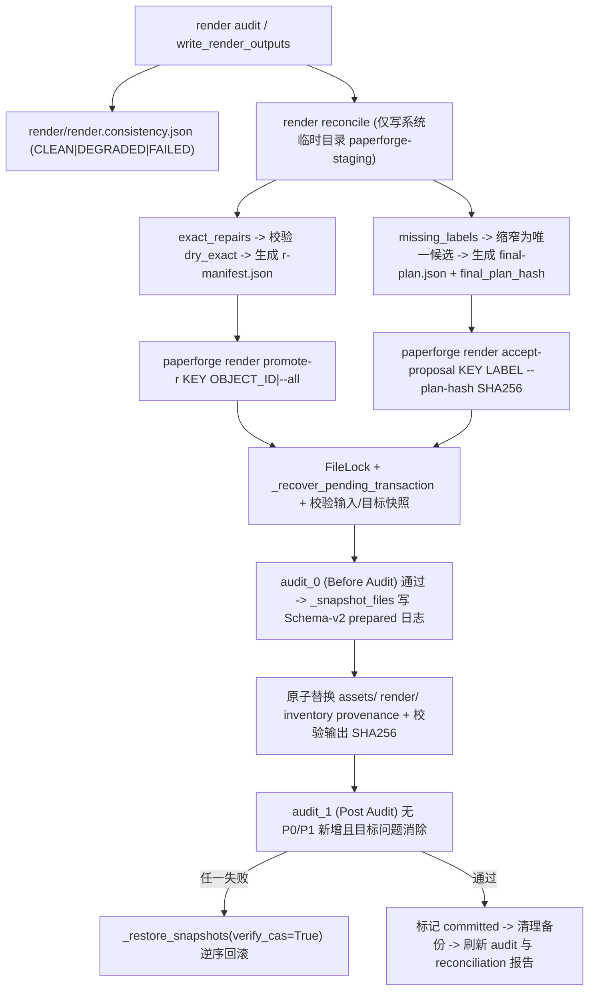

# 第 09 章：Render Audit、R/P 事务晋升与版本快照管理

本章详述 PaperForge OCR 渲染产物的一致性审计（`render_audit.py`）、图/全文分歧对账（`figure_reconciliation.py`、`fulltext_reconciliation.py`）、冻结的 R（精确修复）与 P（受审提案）双通道事务化晋升边界（`promote_r.py`、`accept_proposal.py`）、ADR-0002 统一物化状态契约（`materialization/ocr.py`、`materialization/retrieval.py`），以及显示全文的滚动快照与只读回退机制（`commands/versions.py`）。上游 V3 管线与渲染写盘详见 [Chapter 08](08-ocr-v3-pipeline-and-objects.md)，控制面 Probe 与 Reconcile 全局编排详见 [Chapter 04](04-probes-and-reconcile.md)。

---

## 1. 职责与非目标边界

### 1.1 核心职责

1. **只读渲染一致性审计（`paperforge/render_audit.py`）**
   - 比对 `structure/figure_inventory.json`、`structure/table_inventory.json`、`render/figures/*.md`、`render/tables/*.md`、`assets/` 与 `render/materialization.provenance.json`，生成持久化权威报告 `render/render.consistency.json`（供 `probe lineage` 与 R/P 晋升门控直接消费）。
2. **隔离舞台对账：R / P / BLOCKED 三分法（`figure_reconciliation.py` & `fulltext_reconciliation.py`）**
   - `render reconcile` 在系统临时目录隔离舞台（`paperforge-staging/`）中生成 R 修复计划（`r-manifest.json`）、P 候选提案预览（`final-plan.json` + SHA-256 `final_plan_hash`）与全文 `F0`–`F4` 嵌入补丁建议（`F4` 目前为 schema 预留），**永不直接修改生产目录**。
3. **带 Schema-v2 事务日志与 CAS 保护的受控晋升（`promote_r.py` & `accept_proposal.py`）**
   - 仅当人工/显式命令调用 `render promote-r`（精确修复）或 `render accept-proposal --plan-hash <SHA256>`（绑定人类审查过的 `final-plan.json`）时，才在跨进程文件锁、Schema-v2 事务日志（`.paperforge-r-promotion.json` + `.paperforge-r-promotion/<tx_id>/`）、前后双重审计（`audit_0` / `audit_1`）和 CAS 回滚保护下原子落盘生产文件。
4. **ADR-0002 物化状态统一裁决（`paperforge/materialization/`）**
   - 将 `raw -> derived -> published`（`ocr.py`）与 `retrieval`（`retrieval.py`）的质量/完整度/血缘判断收敛至单一模块，消除多探针口径漂移。
5. **显示级版本快照与只读恢复权威（`paperforge/commands/versions.py`）**
   - 管理重建前生成的 `versions/v{N}/` 滚动快照清单（`versions/manifest.json`）及遗留 `backups/fulltext.pre-rebuild.*.md` 备份识别，提供安全隔离的显示恢复（仅写 `render/fulltext.md`，保留规范 `fulltext.md` 与结构/向量层不变）。

### 1.2 明确的非目标边界（Non-Goals）

| 能力域                            | 本层坚决不做的事                                                                                                           | 实际归属模块                                                        |
| :-------------------------------- | :------------------------------------------------------------------------------------------------------------------------- | :------------------------------------------------------------------ |
| **重新执行图表匹配算法**          | `promote_r.py` 与 `accept_proposal.py` 严格按 staged 清单/已审 `final-plan.json` 搬运，绝不重跑 V3 配对或改写 OCR 原始块   | [Chapter 08](08-ocr-v3-pipeline-and-objects.md)（`ocr_figures.py`） |
| **`render reconcile` 生产写回**   | 即便传递兼容参数 `--apply-r`，`render reconcile` 仍强制保持 staging-only（`production_write=False`），绝不自动写回生产目录 | `paperforge/commands/render.py` & `figure_reconciliation.py`        |
| **直接修改 `fulltext.md` 嵌入行** | `fulltext_reconciliation.py` 当前为 report-only 5 类补丁规划器，只输出 `F0`–`F4` 审计与补丁描述，不擅自改写正文            | `paperforge/fulltext_reconciliation.py`                             |
| **以版本恢复替代派生重建**        | `versions restore` 仅恢复显示副本 `render/fulltext.md` 用于对照阅读；绝不回滚 `blocks.structured.jsonl`、检索单元或向量    | `paperforge/commands/versions.py`                                   |
| **将老旧政策检索库判为损坏**      | `materialization/retrieval.py` 按 manifest 自身记录的政策版本与算法版本验证哈希，区分 `old-but-intact` 与 `corrupt`        | `paperforge/materialization/retrieval.py`                           |

---

## 2. 核心源码与单测映射表

| 模块 / 文件                                                                                                              | 核心职责与关键符号                                                                                                                                                                                                                      | 对应验证单测 / 集成测试                                                                  |
| :----------------------------------------------------------------------------------------------------------------------- | :-------------------------------------------------------------------------------------------------------------------------------------------------------------------------------------------------------------------------------------- | :--------------------------------------------------------------------------------------- |
| `paperforge/render_audit.py`                                                                                             | 渲染层一致性审计：`SCHEMA_VERSION = 1`、`ALGORITHM_VERSION = 4`、`audit_paper()`、`audit_papers()`、`write_audit_failure_report()`、`_snapshot()`、`_inventory_identity_conflicts()`、`_inventory_asset_claim_conflicts()`              | `tests/test_render_audit.py`                                                             |
| `paperforge/figure_reconciliation.py`                                                                                    | 只读对账与隔离舞台生成：`build_reconciliation_report()`、`write_reconciliation_report()`、`dry_run_exact_repairs()`、`dry_run_bounded_slot_proposals()`、`stage_reconciliation()`、`reconcile_snapshot_hash()`、`reconcile_plan_hash()` | `tests/test_figure_reconciliation.py`、`tests/harness/test_f02_promote_r.py`             |
| `paperforge/fulltext_reconciliation.py`                                                                                  | 全文嵌入 5 类对账规划：`fulltext_reconcile()`（`F0 TARGET_DEGRADED`、`F1 MISSING_EMBED`、`F2 WRONG_EMBED_TARGET`、`F3 EXTRA_OR_DUPLICATE`，预留 `F4 MISPLACED_EMBED`）                                                                  | `tests/test_fulltext_reconciliation.py`                                                  |
| `paperforge/promote_r.py`                                                                                                | R 精确修复晋升引擎：`promote_r()`、`_validate_plan()`、`_snapshot_files()`、`_recover_pending_transaction()`、`_restore_snapshots()`、`_postcondition_errors()`、`_is_reparse_point()`                                                  | `tests/test_promote_r.py`、`tests/harness/test_f02_promote_r.py`                         |
| `paperforge/accept_proposal.py`                                                                                          | P 提案人审晋升引擎：`accept_proposal()`、`_FINAL_P_DECISIONS`、`_validated_member_refs()`、`_rollback_transaction()`                                                                                                                    | `tests/test_accept_proposal.py`、`tests/harness/test_f03_accept_proposal.py`             |
| `paperforge/materialization/ocr.py`                                                                                      | ADR-0002 OCR [1]–[5] 层裁决：`meta_lifecycle()`、`provenance_state()`、`raw_state()`、`ocr_artifact_detail()`、`publish_marker_state()`、`top_state()`、`detail()`、`published_identity_hash()`、`identity_state()`                     | `tests/test_materialization_ssot.py`、`tests/test_ocr_hash_contract.py`                  |
| `paperforge/materialization/retrieval.py`                                                                                | ADR-0002 检索 [6] 层裁决：`snapshot_integrity()`、`policy_currency()`、`lineage_trust()`                                                                                                                                                | `tests/test_materialization_ssot.py`                                                     |
| `paperforge/commands/render.py`                                                                                          | `paperforge render` CLI 路由：`audit` / `reconcile` / `promote-r` / `accept-proposal`                                                                                                                                                   | `tests/test_render_audit.py`、`tests/test_promote_r.py`、`tests/test_accept_proposal.py` |
| `paperforge/commands/versions.py`                                                                                        | 显示全文版本网关：`read_manifest()`、`list_backups()`、`_safe_artifact_path()`、`_authority_source()`、`_run_restore()`                                                                                                                 | `tests/test_versions_command.py`、`tests/harness/test_d07_version_restore.py`            |
| `paperforge/worker/ocr_versions.py` & `paperforge/worker/ocr_fulltext_state.py` & `paperforge/worker/ocr_maintenance.py` | 重建前快照 `backup_render_before_rebuild()`（`PAPERFORGE_MAX_OCR_VERSIONS`）、旧备份解析 `parse_pre_rebuild_backup_name()`、漂移检测 `get_fulltext_drift_state()` 与 `_restore_drift_override()`                                        | `tests/test_restore_drift.py`、`tests/test_ocr_versions.py`                              |
| `docs/adr/0002-unified-artifact-materialization-state-contract.md` & `docs/RECONCILE-EXTENSION-CONTRACT.md`              | 统一物化状态合约 ADR 与 R/P 扩展冻结契约                                                                                                                                                                                                | `tests/test_materialization_ssot.py`、`tests/test_materialization_atomic.py`             |

---

## 3. 磁盘文件、数据库表与协议 JSON 字段字典

### 3.1 审计、对账、事务日志与快照磁盘路径

| 文件 / 目录路径                                                          | 所属模块                                                 | 说明                                                                                                                                          |
| :----------------------------------------------------------------------- | :------------------------------------------------------- | :-------------------------------------------------------------------------------------------------------------------------------------------- |
| `<paperforge>/ocr/<KEY>/render/render.consistency.json`                  | `render_audit.py`                                        | 单篇渲染一致性报告（`write_render_outputs()` 与 `paperforge render audit` 写入；`probe lineage` 读取）                                        |
| `<paperforge>/ocr/<KEY>/render/reconciliation.proposals.json`            | `figure_reconciliation.py`                               | 持久化对账提案报告（由 `promote_r()` 成功后刷新；`accept_proposal()` 要求其存在以校验证据时效性）                                             |
| `<paperforge>/ocr/<KEY>/render/materialization.provenance.json`          | `ocr_objects.py` / `promote_r.py` / `accept_proposal.py` | 对象级物化溯源表：`objects[]` 含 `object_id`、`kind`、`status`、`stage`、`plan_hash`、`output.{image_sha256, width, height, markdown_sha256}` |
| `<paperforge>/ocr/<KEY>/.paperforge-r-promotion.lock`                    | `promote_r.py` / `accept_proposal.py`                    | 共享非阻塞跨进程文件锁（`timeout=0`）                                                                                                         |
| `<paperforge>/ocr/<KEY>/.paperforge-r-promotion.json`                    | `promote_r.py` / `accept_proposal.py`                    | Schema-v2 事务日志（记录 `state`、交易目录与每个目标的 `before` / `output` CAS 哈希快照）                                                     |
| `<paperforge>/ocr/<KEY>/.paperforge-r-promotion/<tx_id>/<index>.bak`     | `promote_r.py` / `accept_proposal.py`                    | 事务提交前备份的原始文件字节；正常提交后清除，异常中断后供 `_recover_pending_transaction()` 还原                                              |
| `<tmp>/paperforge-staging/<run_id>/<KEY>/`                               | `stage_reconciliation()`                                 | 隔离舞台目录：包含 R 清单 `r-manifest.json` 与 P 预览目录 `previews/figure_<label>/final-plan.json`                                           |
| `<paperforge>/ocr/<KEY>/versions/manifest.json` & `versions/v{N}/`       | `ocr_versions.py` / `versions.py`                        | 重建前自动保留的显示版本清单及 `fulltext.md` / `render-map.json` / `heading-events.json` 副本                                                 |
| `<paperforge>/ocr/<KEY>/backups/fulltext.pre-rebuild.<stamp>[.<seq>].md` | `ocr_fulltext_state.py`                                  | 根目录 `fulltext.md` 重写前备份（`stamp` 为 `YYYYMMDDTHHMMSSZ`，默认保留最近 5 份）                                                           |

### 3.2 `render.consistency.json` 与对账核心 JSON 字段字典

1. **`render/render.consistency.json`（`SCHEMA_VERSION=1, ALGORITHM_VERSION=4`）**
   - `state`：`"CLEAN"`（0 个问题）、`"DEGRADED"`（有 `issues`）、`"FAILED"`（目录缺失或审计执行异常）。
   - `evidence_mode`：无问题时 `"exact"`，否则 `"mixed"`。
   - `input_snapshot`：5 项 SHA-256 指纹（`blocks_hash`、`figure_inventory_hash`、`table_inventory_hash`、`render_hash`、`asset_index_hash`）。
   - `issues[]`：每条含 `type`、`severity`（`"P0"`/`"P1"`）、`domain`（经 `_DIAGNOSIS_DOMAIN` 映射为 `"render_layer"`/`"inventory_layer"`/`"asset_layer"`/`"unknown"`）、`diagnosis`、`recommended_action`、`evidence`。核心问题类型字典如下：

| `issues[].type`                                                | 默认级别 | 诊断定位（`domain`） | `recommended_action` 与语义                                                             |
| :------------------------------------------------------------- | :------- | :------------------- | :-------------------------------------------------------------------------------------- |
| `audit_execution_failure`                                      | `P0`     | `unknown`            | `inspect`：OCR 目录缺失或审计执行抛出异常（`state="FAILED"`）                           |
| `render_dangling_asset_reference`                              | `P0`     | `render_layer`       | `rerender`：对象 `.md` 卡片引用了磁盘上不存在的图片路径                                 |
| `inventory_duplicate_entry` / `inventory_asset_claim_conflict` | `P1`     | `inventory_layer`    | `inspect_inventory`：规范清单存在重复身份 ID 或多对象争抢同一原始资产块                 |
| `render_artifact_integrity`                                    | `P1`     | `render_layer`       | `inspect_render` / `rerender`：卡片缺少标题、`legend` 或有资产但缺裁剪图片              |
| `render_caption_mismatch`                                      | `P1`     | `render_layer`       | `rerender` / `inspect_inventory`：卡片 Header 标签与正文 Legend 标签冲突                |
| `caption_without_asset`                                        | `P1`     | `asset_layer`        | `inspect_asset_matching`：存在图注卡片但上游未匹配任何图形资产                          |
| `missing_render_materialization`                               | `P1`     | `render_layer`       | `rerender`：规范清单已有匹配资产但 `render/figures/` 或 `render/tables/` 未生成 `.md`   |
| `materialization_provenance_invalid`                           | `P1`     | `render_layer`       | `inspect_provenance`：`render/materialization.provenance.json` 存在歧义或内容校验不一致 |

2. **`r-manifest.json`（`schema_version=2, kind="R"`）与 `final-plan.json`（`schema_version=1`）**
   - R 清单内 `plans[]` 每项含 `object_id`、`canonical_identity`、`input_snapshot_hash`（`16` 位十六进制指纹）、`ordered_asset_refs`（`[{page, block_id, bbox}]`）、`production_precondition`（`{asset, markdown, provenance}` 的 `{exists, sha256}`）、`plan_hash`、`staged_verification.{status, image, markdown_sha256}`。
   - P 预览内 `final-plan.json` 含 `label`、`proposal_id`（`figure_proposal_<label>`）、`decision`（必须属于 `_FINAL_P_DECISIONS = {"structurally_unique_proposal", "unique_without_pdf_confirmation"}`）、`member_refs`、`caption_text`、`input_snapshot_hash`、`staged_jpg`、`staged_md`；CLI 通过整文件字节的 64 位小写 SHA-256 `final_plan_hash` 精确绑定。
3. **`.paperforge-r-promotion.json`（Schema-v2 事务日志）**
   - `schema_version`: `2`
   - `state`: `"prepared"`（准备写入，尚未提交） | `"committed"`（生产写入与 `audit_1` 全部通过，等待清场）
   - `transaction_dir`: 严格匹配正则 `^\.paperforge-r-promotion/[0-9a-f]{32}$`
   - `snapshots[]`: 每项记录 `destination_relative`、`backup_relative`（`^[0-9]+\.bak$` 或 `null`）、`existed`、`before`（`{"exists": bool, "sha256": str|None}`）与 `output`（预期写入后的目标哈希）。
   - **受控写入路径白名单（`_DESTINATION_RELATIVE_RE`）**：事务日志在恢复与提交校验时仅放行以下 5 类相对路径，绝不触及全文 Markdown、原始块或结构块：
     - `assets/figures/<name>.jpg`
     - `render/figures/<name>.md`
     - `render/materialization.provenance.json`
     - `structure/figure_inventory.json`
     - `render/reconciliation.proposals.json`
4. **`versions/manifest.json`（版本快照清单）**
   - `versions[]`：`{"label": "v1", "created_at": ISO8601, "source": "pre-rebuild", "fulltext_size": int, "structured_content_hash": str, "renderer_version": str}`
   - `current`：`{"label": "vN"}`

---

## 4. 核心执行链路、状态机与顺序不变量

### 4.1 渲染审计、R/P 隔离对账与双通道晋升流程图

### 4.2 R 与 P 的本质边界

| 维度               | R 通道（`promote_r.py`）                                                                                                        | P 通道（`accept_proposal.py`）                                                                                                                    |
| :----------------- | :------------------------------------------------------------------------------------------------------------------------------ | :------------------------------------------------------------------------------------------------------------------------------------------------ |
| **语义定位**       | **确定性精确修复**：规范 `figure_inventory.json` 中已有且无冲突的对象，修复其缺失/未验证的渲染图与 `.md` 卡片                   | **受审候选晋升**：规范清单缺失某编号图，经多维证据缩窄至唯一候选集并经人工预览审查后创建新规范图条目                                              |
| **身份域**         | `figure_id` 精确文件名匹配（排除 `reserved` 与重复 ID）                                                                         | 主命名空间 `(main, number)` 形式标签，目标规范 ID 为 `figure_{number:03d}`                                                                        |
| **允许修改的清单** | **绝不修改 `figure_inventory.json`**，只写回 `assets/figures/*.jpg`、`render/figures/*.md` 与 `materialization.provenance.json` | 向 `figure_inventory.json["matched_figures"]` 追加新对象（含 `accepted_from.final_plan_hash`）并从 `reconciliation.proposals.json` 摘除已采纳提案 |
| **授权令牌**       | 显式 `OBJECT_ID...` 或显式 `--all` + 快照/precondition 校验                                                                     | 强制 `--plan-hash <64-hex SHA256>`，与预览目录中 `final-plan.json` 逐字节校验                                                                     |

### 4.3 `promote_r` / `accept_proposal` 事务恢复状态机

1. **Pre-flight 与锁**：以 `timeout=0` 尝试获取 `.paperforge-r-promotion.lock`；忙碌直接返回 `R_PROMOTION_BUSY` / `ACCEPT_PROPOSAL_BUSY`。
2. **崩溃恢复（`_recover_pending_transaction`）**：在读取或修改任何资产前先检查 `.paperforge-r-promotion.json`：
   - 若不存在：直接进入正常流程。
   - 若 `state == "prepared"`：说明上次事务在写入或 `audit_1` 期间崩溃。逐一检验每个目标当前磁盘指纹 `current == before or current == output`（CAS 校验），全部满足则调用 `_restore_snapshots(..., verify_cas=True)` 还原旧文件或删掉新建文件并删除日志；一旦发现被第三方外部篡改（`current != before and current != output`），立即 Fail-Closed 返回 `promotion_recovery_conflict:<path>`。
   - 若 `state == "committed"`：说明生产提交与 `audit_1` 均已完成、仅清理备份时崩溃；安全清理 `.paperforge-r-promotion/<tx_id>` 与日志即可。
3. **Commit 与 Post-Commit 隔离**：`_mark_transaction_committed()` 一旦落盘，后续清理备份（`cleanup`）、刷新 `render.consistency.json`（`report_refresh`）与刷新 `reconciliation.proposals.json`（`reconciliation_refresh`）即便发生 I/O 报错，也**不会触发回滚**，而是如实上报在返回 JSON 的相应状态字段中。
4. **双阶段质量验证（Pre-flight & Post-Audit）**：写入前由 `_image_facts()` 通过 Pillow 验证舞台 `.jpg` 可解码且尺寸非零，并经 `_IMAGE_RE` 校验 `.md` 卡片内的图片链接确实指向该图片；写入后执行 `audit_1` 比对 `audit_0` 基线，确认无任何新增 `P0`/`P1` 问题且目标对象原有问题完全消除，否则立即执行逆序回滚并保留错误信息。

### 4.4 ADR-0002 六层统一物化裁决链

依据 `docs/adr/0002-unified-artifact-materialization-state-contract.md`，单篇论文的物化状态按 `raw -> derived -> published -> retrieval -> vector -> serving` 线性推进，`reconcile` 永远只暴露**第一个断裂前沿**：

| 模块与层序                                                     | 核心判定函数                                     | 返回值 / 裁决顺序与工程语义                                                                                                                                                                                                                                                                                                         |
| :------------------------------------------------------------- | :----------------------------------------------- | :---------------------------------------------------------------------------------------------------------------------------------------------------------------------------------------------------------------------------------------------------------------------------------------------------------------------------------- |
| **OCR `[1]`–`[5]` 顶层状态**（`materialization/ocr.py`）       | `top_state(paper_dir, meta)`                     | 严格按 `[1] meta_lifecycle` → `[3] raw_state`（`blocks.raw.jsonl` 异常统一返回 `"missing"`）→ `[5] publish_marker_state`（`result-hash.pending` 超 `PUBLISH_STALE_SECONDS=3600` 秒判 `"incomplete"`，否则 `"unknown"`）→ `[4] ocr_artifact_detail`（判 `"incomplete"`）执行；全链路通过返回 `None` 交由哈希比对判 `current`/`stale` |
| **OCR 细粒度故障原因**（`materialization/ocr.py`）             | `detail(paper_dir, pdf, meta)`                   | 按相同顺序返回单语义故障码（如 `RAW_MISSING`、`PUBLISH_PENDING_STALE`），全部通过后再追查 `[2] provenance_state()`；`is_old_pipeline()` 仅作独立标志，绝不覆盖损坏判定                                                                                                                                                              |
| **OCR 发布身份锁**（`materialization/ocr.py`）                 | `published_identity_hash()` / `identity_state()` | 若存在 `index/result-hash.pending` 或 `index/result-hash.txt` 缺失/畸形，返回 `""` 与 `(None, None)`，阻止读取半成品                                                                                                                                                                                                                |
| **Retrieval `[6]` 完整性**（`materialization/retrieval.py`）   | `snapshot_integrity()`                           | 返回 `"verified"` / `"corrupt"` / `"unknown"` / `"absent"`；按 manifest 自身记录的 `retrieval_policy_version` 核对计数、重复 `unit_id` 与哈希，老旧无 `hash_algo_version` 的 manifest 哈希漂移返回 `"unknown"` 而非误报 `"corrupt"`                                                                                                 |
| **Retrieval 策略时效与血缘**（`materialization/retrieval.py`） | `policy_currency()` / `lineage_trust()`          | 分别正交判定政策是否最新（`"current"` / `"old"` / `"unknown"`）与 `retrieval_identity` 是否吻合当前 OCR 发布身份（`"verified"` / `"unverified"` / `"mismatched"`）                                                                                                                                                                  |

### 4.5 全文嵌入 5 类对账规划（`fulltext_reconciliation.py`）

`fulltext_reconcile()` 对 `fulltext.md` 中的 `![[render/figures/<id>.md]]`（通用正交匹配 `_EMBED_RE`）与规范图库及 `reconciliation.proposals.json` 进行只读比对（目前表嵌入 `_TABLE_EMBED_RE` 也已预定义正则）：

1. **权威准入检查（`F0` 拦截）**：若 `fulltext.md` 不可读（`F0_FULLTEXT_UNREADABLE`）、规范 `figure_inventory.json` 缺失/解析失败（`F0_CANONICAL_AUTHORITY_UNAVAILABLE`）或存在重复 `figure_id`（`F0_CANONICAL_DUPLICATE`），立即设置 `mutation_blocked=True` 并清空全部 `patches`。
2. **漏嵌与错配目标（`F1` / `F2`）**：规范图存在而全文未出现嵌入时生成 `F1_MISSING_EMBED`；若全文引用了不规范目标且对账报告给出唯一显式映射（非靠数字后缀猜想）时生成 `F2_WRONG_EMBED_TARGET` 替换补丁，多义映射转入 `F2_AMBIGUOUS`。
3. **多余或重复嵌入（`F3` 三分）**：多余嵌入依据来源明确度拆分为可安全清理孤儿（`F3_ORPHAN_EMBED`）、等待 P 提案晋升保留（`F3_PENDING_PROPOSAL`）、多处重复（`F3_DUPLICATE_EMBED`）与未知阻塞（`F3_BLOCKED_UNKNOWN`）；`F4 MISPLACED_EMBED` 位置重排字段当前在 schema 中预留，暂未自动生成移动补丁。

### 4.6 显示版本滚动快照与只读恢复机制（`versions`）

1. **重建前快照创建与淘汰（`ocr_versions.py::backup_render_before_rebuild()`）**：每次执行派生重建覆盖旧渲染前，若 `render/fulltext.md` 存在，自动递增生成 `v{N}` 标签并将 `render/` 下的 `fulltext.md`、`render-map.json`、`heading-events.json` 复制至 `versions/v{N}/`，同时更新 `versions/manifest.json`（含 `structured_content_hash` 与 `renderer_version`）。当条数超过 `PAPERFORGE_MAX_OCR_VERSIONS`（默认 `5`，最小 `1`）时，FIFO 淘汰最旧条目并删除对应 `versions/v{k}/` 目录。
2. **只读对比路径与恢复边界（`commands/versions.py`）**：
   - **差异查看（Diff）**：`versions paths --key KEY --label LABEL` 校验 `label` 后返回 `source_path`（历史版本或 `backups/fulltext.pre-rebuild.*.md`）与 `current_path`（`render/fulltext.md`），由调用方或前端 UI 执行只读文本 Diff。
   - **显示恢复（Restore）**：`versions restore --key KEY --label LABEL` 仅把 `source_path` 复制到 `render/fulltext.md`，随后通过 `record_restore_provenance()` 记录 `{label, restored_at, version_created_at}`。整个过程绝不改写根目录 `fulltext.md`、`blocks.structured.jsonl` 或检索库。

---

## 5. 配置项、环境变量、CLI 入口与错误码

### 5.1 环境变量与默认保留策略

| 名称                                | 默认值            | 生效位置                                          | 说明                                                                                                                        |
| :---------------------------------- | :---------------- | :------------------------------------------------ | :-------------------------------------------------------------------------------------------------------------------------- |
| `PAPERFORGE_MAX_OCR_VERSIONS`       | `"5"`（下限 `1`） | `ocr_versions.py::backup_render_before_rebuild()` | 每次派生重建前备份 `render/` 到 `versions/v{N}/`，超出上限自动淘汰最旧 `v{k}` 目录（若需收紧磁盘占用可设为 `"3"` 等正整数） |
| `prune_pre_rebuild_backups(keep=5)` | `5`               | `ocr_render.py::write_render_outputs()`           | 每次写出根目录 `fulltext.md` 前备份至 `backups/fulltext.pre-rebuild.<stamp>.md`，保留最近 5 份                              |
| `PUBLISH_STALE_SECONDS`             | `3600`            | `materialization/ocr.py::publish_marker_state()`  | `index/result-hash.pending` 存在超过 1 小时视为生产者崩溃残留（`PUBLISH_PENDING_STALE`）                                    |

> [!NOTE]
> `versions restore` 采用独立只读展示通道：`render/fulltext.md` 写入旧快照内容，而规范 `fulltext.md` 与 `meta.json.machine_fulltext_hash` 保持当前结构版本不变，同时通过 `meta.json.restore_provenance` 与 `ocr_fulltext_state.py::get_fulltext_drift_state()` 协同标注界面漂移态。

### 5.2 CLI 入口汇总

| 命令                                                                              | 行为与参数说明                                                                                             | 退出码契约                                                            |
| :-------------------------------------------------------------------------------- | :--------------------------------------------------------------------------------------------------------- | :-------------------------------------------------------------------- |
| `paperforge render audit [KEY...] [--json]`                                       | 审计指定或全部 OCR 论文，写入 `render/render.consistency.json`                                             | 无 `FAILED` 返回 `0`（`DEGRADED` 也返回 `0`），存在 `FAILED` 返回 `1` |
| `paperforge render reconcile [KEY...] [--include-pdf-media] [--apply-r] [--json]` | 只读计算 R/P/Blocked 并在 `<tmp>/paperforge-staging/` 生成舞台预览；`--apply-r` 仅保留兼容提示，仍不写生产 | 成功返回 `0`                                                          |
| `paperforge render promote-r KEY [OBJECT_ID...] [--all] [--json]`                 | 晋升指定 `OBJECT_ID` 或全部已验证 R 计划（`OBJECT_ID` 与 `--all` 互斥且不可皆空）                          | `ok=True` 返回 `0`，否则 `1`                                          |
| `paperforge render accept-proposal KEY LABEL --plan-hash <SHA256> [--json]`       | 按精确 SHA-256 令牌晋升人类已审查的 P 提案                                                                 | `ok=True` 返回 `0`，否则 `1`                                          |
| `paperforge versions list [--json]`                                               | 列出所有含 `versions/manifest.json` 的论文、快照列表与总大小                                               | 成功 `0`                                                              |
| `paperforge versions show --key KEY [--json]`                                     | 查看单篇版本清单（无清单合法返回空列表）                                                                   | 未知/非法 key 返回 `1`                                                |
| `paperforge versions backups --key KEY [--json]`                                  | 识别 `backups/` 下合法规范的 `fulltext.pre-rebuild.<stamp>[.<seq>].md` 备份                                | 未知/非法 key 返回 `1`                                                |
| `paperforge versions paths --key KEY [--label LABEL] [--json]`                    | 获取某版本与当前 `render/fulltext.md` 的受检路径（供展示层做 Diff）                                        | 失败返回 `1`                                                          |
| `paperforge versions restore --key KEY --label LABEL [--json]`                    | **仅恢复显示副本** `render/fulltext.md`，并向 `meta.json` 写入 `restore_provenance`                        | 失败返回 `1`                                                          |

### 5.3 核心拒绝/错误Reason词汇表

- **`promote_r.py` / `accept_proposal.py` 拒绝码**：`promote_scope_required`、`promote_scope_conflict`、`R_PROMOTION_RECOVERY_REQUIRED` / `ACCEPT_PROPOSAL_RECOVERY_REQUIRED`、`R_PROMOTION_BUSY` / `ACCEPT_PROPOSAL_BUSY`、`STALE_R_MANIFEST`、`STALE_R_PLAN`、`STALE_R_DESTINATION`、`R_GATE_FAILED`、`R_PROMOTION_PREAUDIT_FAILED` / `ACCEPT_PROPOSAL_PREAUDIT_FAILED`、`R_PROMOTION_POSTVERIFY_FAILED` / `ACCEPT_PROPOSAL_POSTVERIFY_FAILED`、`review_plan_hash_missing`、`review_plan_hash_invalid`、`STALE_REVIEWED_PLAN`、`STALE_PROPOSAL`、`proposal_not_current`、`canonical_target_exists`、`canonical_label_exists`、`member_refs_claim_conflict`、`ACCEPT_PROPOSAL_PATH_UNSAFE`。
- **`fulltext_reconciliation.py` 阻断类别**：`F0_FULLTEXT_UNREADABLE`、`F0_CANONICAL_DUPLICATE`、`F0_CANONICAL_AUTHORITY_UNAVAILABLE`、`F2_AMBIGUOUS`、`F3_BLOCKED_UNKNOWN`。

---

## 6. 边界防护与 Fail-Closed 防呆规则

1. **路径穿越与 Windows Junction / Symlink 零容忍**：`promote_r.py` 与 `accept_proposal.py` 在读写任何路径前通过 `_raw_path_has_symlink()` 与 Windows `GetFileAttributesW`（`0x400` 重解析点检查，显式声明 `argtypes`/`restype` 避免缺失路径 `-1` 误判）检查论文根目录、锁文件、舞台路径及全部目标路径；`commands/versions.py` 通过 `_safe_segment()`、`_contained()` 与 `_authority_source()` 保证版本标签必须精确命中 `manifest.json` 或合法备份枚举，绝不将原始字符串拼接进路径。
2. **CAS 恢复冲突保护**：回滚或崩溃恢复调用 `_restore_snapshots(..., verify_cas=True)` 时，若目标文件当前哈希既不同于事务前的 `before`，也不同于预期的 `output`，说明磁盘发生了并发外部修改，系统拒绝覆写并保留事务现场待人工排查。
3. **跨目标并发修改检测（Snapshot Lock-in）**：R 计划与 P 提案均绑定生成时的 `input_snapshot_hash`。若在 `reconcile` 预览之后至 `promote-r`/`accept-proposal` 之前运行过 `ocr rebuild` 或手动修改了任意资产/清单文件，`STALE_R_MANIFEST` / `STALE_R_PLAN` / `STALE_PROPOSAL` 会立即拦截，强制重新运行 `render reconcile` 预览审查。
4. **全文对账安全锁（`mutation_blocked`）**：`fulltext_reconciliation.py` 在 `figure_inventory.json` 非法/缺失、`fulltext.md` 不可读、或规范库存在重复 `figure_id`（`canonical_id_conflicts`）时强制清空所有 `patches`（包括 `SAFE_DELETE` 孤儿清理补丁），防止基于损坏权威误删正文引用。
5. **显示恢复与漂移诚实上报（#129）**：`versions restore` 永远保持 `fulltext.md` 与结构/向量产物不变；当用户将显示副本 `render/fulltext.md` 还原至比当前 `ocr_finished_at` 更早的历史版本时，`ocr_maintenance.py::_restore_drift_override()` 结合 `meta.json.restore_provenance` 将维护行标记为 `fulltext_drift_state="DRIFTED"`，避免误以为显示视图与当前结构真值同步。
6. **引擎冻结与检测开放契约（`docs/RECONCILE-EXTENSION-CONTRACT.md`）**：Reconcile 写入与事务引擎处于冻结状态；任何新增视觉/版面/缺图检测规则只能以只读观察者（Detector）身份读取清单、渲染卡片与源 PDF 页面并输出 R/P/BLOCKED 发现，禁止绕过 `stage_reconciliation()` -> `promote_r()` / `accept_proposal()` 权限边界直接写入生产文件。

---

## 7. 维修、调试与升级 Checklist

### 7.1 常见问题排查与恢复 Runbook

- **问题 A：执行 `render promote-r` 或 `render accept-proposal` 报 `*_RECOVERY_REQUIRED` 或 `promotion_recovery_conflict`**
  1. 检查 `<paperforge>/ocr/<KEY>/.paperforge-r-promotion.json` 的 `state`、`transaction_dir` 与触发冲突的 `destination_relative`。
  2. 核对 `<paperforge>/ocr/<KEY>/.paperforge-r-promotion/<tx_id>/*.bak` 与线上现有文件差异，确认是否为外部人工/同步工具改写了该图或 `figure_inventory.json`。
  3. 确认生产状态正确后，清理冲突备份与日志并重新运行 `paperforge render audit <KEY> --json` 与 `paperforge render reconcile <KEY> --json`。
- **问题 B：`accept-proposal` 报 `STALE_REVIEWED_PLAN` 或 `STALE_PROPOSAL`**
  1. 说明在审查预览之后论文经过了重建，或 `--plan-hash` 与舞台目录下 `final-plan.json` 字节不匹配。
  2. 重新执行 `paperforge render reconcile <KEY> --json`，向用户展示新的 `p_details[]` 预览与新的 `final_plan_hash` 重新确认授权。
- **问题 C：`probe lineage` 报告 `render_consistency` 为 `DEGRADED` 或 `NOT_RUN`**
  1. 运行 `paperforge render audit <KEY> --json` 刷新 `render/render.consistency.json` 并查看 `issues[].diagnosis`（区分 `render_layer` 缺失、`inventory_layer` 重复 ID 还是 `asset_layer` 无图）。
  2. 若属 R 可修类缺失，运行 `paperforge render reconcile <KEY> --json` 检查 `dry_exact.results`，确认 `ready`/`needs_fresh_provenance` 后通过 `paperforge render promote-r <KEY> <OBJECT_ID> --json` 晋升。
- **问题 D：`versions show --key <KEY>` 找不到某版本或需要对比差异**
  1. 用 `paperforge versions paths --key <KEY> --label <LABEL> --json` 获取权威 `source_path` 与 `current_path`，或用 `paperforge versions backups --key <KEY> --json` 查看重建前的历史 `backups/` 文件。
  2. 若需还原最新渲染视图以对齐规范全文，使用 `paperforge ocr rebuild <KEY>`（会自动将覆盖前的 `render/` 先存入下一个 `v{N+1}` 快照）。

### 7.2 变更前验证 Checklist

- [ ] 修改 `render_audit.py` 或 `figure_reconciliation.py` 后，跑通 `tests/test_render_audit.py`、`tests/test_figure_reconciliation.py`、`tests/test_fulltext_reconciliation.py`。
- [ ] 修改 `promote_r.py` 或 `accept_proposal.py` 后，跑通 `tests/test_promote_r.py`、`tests/test_accept_proposal.py`、`tests/harness/test_f02_promote_r.py`、`tests/harness/test_f03_accept_proposal.py`。
- [ ] 修改 `paperforge/materialization/` 后，跑通 `tests/test_materialization_atomic.py`、`tests/test_materialization_ssot.py`。
- [ ] 修改 `commands/versions.py` 或 `ocr_versions.py` / `ocr_fulltext_state.py` 后，跑通 `tests/test_versions_command.py`、`tests/harness/test_d07_version_restore.py`、`tests/test_restore_drift.py`。
- [ ] 新增审计或对账规则时，逐条核对 `docs/RECONCILE-EXTENSION-CONTRACT.md` 的读白名单/写黑名单，确保新检测逻辑只读产出 Finding 而不引入生产目录旁路写入。
