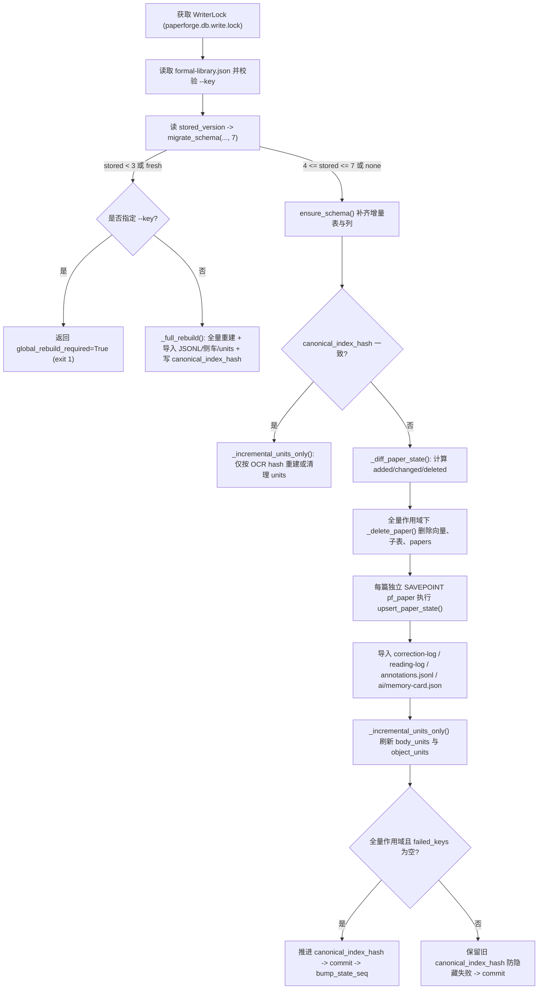
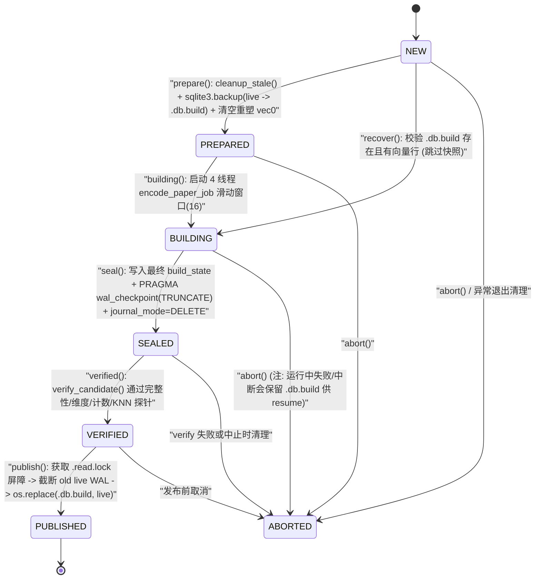

# 第 10 章：SQLite Memory DB v7、Embedding 与混合检索

> 本章涵盖 `paperforge.db`（Schema v7）的持久化结构、跨进程读写锁与影子发布协议、`sqlite-vec`（`vec0`）向量构建流水线，以及基于 FTS5 BM25 与向量相似度的混合检索和结构化查询规划。

## 1. 职责与非目标边界

### 1.1 核心职责

- **派生关系索引与结构化检索单元托管**：在 Vault 的 `<paperforge>/indexes/paperforge.db` 中集中物化文献元数据（`papers`、`paper_assets`、`paper_aliases`）、V3 结构化正文检索单元（`body_units`、`body_units_fts`）、图表对象单元（`object_units`）、来源溯源清单（`meta` 中的 `manifest:<key>`）以及研究日志/批注/动态记忆卡的 SQLite 只读镜像（`reading_log`、`project_log`、`paper_annotations`、`paper_memory_cards`、`paper_memory_history`、`paper_events`）。
- **血缘追踪与读时门控（Lineage & Reader Gate）**：在 `lineage` 表记录每篇论文向量层的 `sha256` 内容寻址指纹，并通过 `paperforge/reader_gate.py` 在 `retrieve` 与 `content-discovery` 读出时执行 Fail-Closed 校验，防止陈旧、未对齐或未知血缘的派生单元被返回给上层。
- **单库一体化的 `sqlite-vec` 向量引擎**：直接在同一 `paperforge.db` 内通过 `vec0` 虚表（`vec_fulltext`、`vec_body`、`vec_objects`）及 companion meta 表存储嵌入向量，借助 `ShadowBuild`（`.db.build`）与读屏障锁实现无停机窗口的原子发布。
- **多臂混合检索与查询规划**：对外提供元数据全文检索（`search`）、语义/混合检索（`retrieve` / `retrieve --deep`）、Layer 4 网关路由（`paper-lookup`、`content-discovery`、`paper-navigation`、`scoped-fetch`）及前置路由分类器（`query-plan`）。

### 1.2 非目标边界

- **非永久记录的唯一事实源（SSOT）**：`papers` 派生自 `formal-library.json`；`reading_log`、`project_log`、校正日志源自 `<paperforge>/logs/` 下的 JSONL 文件；`paper_annotations` 与 `paper_memory_cards` / `paper_memory_history` 分别源自工作区的 `annotations.jsonl` 与 `ai/memory-card.json` 侧车文件。删库重建 `paperforge.db` 可无损恢复上述数据，反向写入不得将 SQLite 当作唯一持久化介质。
- **不直接调用远程生成式 LLM**：`paperforge/embedding/` 仅通过 OpenAI 兼容 `/embeddings` 接口（`openai_sdk` 或 `requests` 传输）编码文本向量；查询重写（`paperforge/embedding/query_rewrite.py`）仅采用确定性医学缩写与同义词规则展开，不产生 LLM 推理开销。
- **不再默认使用 ChromaDB 或 LanceDB**：`ChromaBackend` 仅保留作为历史 ChromaDB 向 `vec0` 迁移的一次性只读数据源（`paperforge embed migrate`）；`paperforge/embedding/backends/lance_backend.py` 仅为能力评估接口（evaluation seam），并非默认生产后端。
- **不持有凭据原文与插件私有配置**：`paperforge/embedding/_config.py` 严格只通过 `load_config`（`paperforge.json` + 环境变量）与 `paperforge/credentials.py` 获取模型和 API Key，不读取 `.env` 或 Obsidian 插件 `data.json`。

---

## 2. 核心源码与单测映射表

| 模块 / 文件                                                                                  | 核心职责与关键符号                                                                                                                      | 对应验证单测 / 集成测试                                                                                               |
| :------------------------------------------------------------------------------------------- | :-------------------------------------------------------------------------------------------------------------------------------------- | :-------------------------------------------------------------------------------------------------------------------- |
| `paperforge/memory/schema.py`                                                                | 定义 `CURRENT_SCHEMA_VERSION = 7`、`ALL_TABLES`、`VEC_TABLES`、触发器、索引、`ensure_schema()`、`migrate_schema()`、`drop_all_tables()` | `tests/unit/memory/test_schema.py`、`tests/harness/test_e06_memory_schema_repair.py`                                  |
| `paperforge/memory/db.py`                                                                    | 提供 `get_memory_db_path()`、`WriterLock`、`get_connection()`、`open_live_reader()`、`ensure_vec_extension()`                           | `tests/unit/memory/test_schema.py`、`tests/harness/test_e04_embed_stop.py`                                            |
| `paperforge/memory/_columns.py`                                                              | 定义 `PAPER_COLUMNS`（34 列）与 `build_paper_row()`                                                                                     | `tests/unit/memory/test_builder.py`                                                                                   |
| `paperforge/memory/paper_state.py`                                                           | 实现单篇 `_paper_state_hash()`、`upsert_paper_state()`（`ON CONFLICT DO UPDATE` 保留 `rowid`）                                          | `tests/unit/memory/test_refresh.py`                                                                                   |
| `paperforge/memory/builder.py`                                                               | 实现 `build_for_keys()`、`build_from_index()`、`_full_rebuild()`、`_diff_paper_state()`、`_incremental_units_only()` 及侧车导入         | `tests/unit/memory/test_builder.py`、`tests/unit/test_upgrade_resilience.py`                                          |
| `paperforge/memory/refresh.py`                                                               | 实现单篇增量刷新 `refresh_paper()`（派生生命周期并调用 `upsert_paper_state()`）                                                         | `tests/unit/memory/test_refresh.py`                                                                                   |
| `paperforge/memory/fts.py`                                                                   | 实现 `tokenize_for_fts()` 与 3 级降级元数据检索 `search_papers()`                                                                       | `tests/unit/memory/test_query.py`                                                                                     |
| `paperforge/memory/query.py`                                                                 | 实现 `get_memory_status()`、`lookup_paper()`（多路优先级匹配）、`get_paper_status()`                                                    | `tests/unit/memory/test_query.py`                                                                                     |
| `paperforge/memory/chunker.py`                                                               | 旧版无结构树文档的回退分块器 `chunk_fulltext()`（按 `<!-- page N -->` 与段落组切分）                                                    | `tests/unit/memory/test_vector_db.py`                                                                                 |
| `paperforge/memory/events.py`                                                                | 兼容导出 `export_reading_log()` 与锁保护的 `write_correction_note()`                                                                    | `tests/cli/test_research_records.py`                                                                                  |
| `paperforge/memory/context.py`                                                               | 构建全局统计与层级目录树 `get_agent_context()`、`_build_collection_tree()`                                                              | `tests/test_context.py`、`tests/unit/test_agent_loop_closure.py`                                                      |
| `paperforge/memory/runtime_health.py`                                                        | 5 层只读健康检查 `get_runtime_health()` 与锁忙态区分 `_is_lock_failure()`                                                               | `tests/unit/memory/test_runtime_health.py`、`tests/test_x13_query_read_only.py`                                       |
| `paperforge/memory/record_source.py`                                                         | 研究记录 PDF 物理页与文本锚点哈希绑定 `capture_source()`、`source_provenance()`                                                         | `tests/cli/test_research_records.py`                                                                                  |
| `paperforge/memory/vector_db.py`                                                             | 已弃用（`DeprecationWarning`）兼容重导出壳，代理至 `paperforge.embedding`                                                               | `tests/unit/memory/test_vector_db.py`                                                                                 |
| `paperforge/embedding/_config.py`                                                            | 统一解析 `vector_db_*` 配置及 `CredentialKey("embedding")` 密钥                                                                         | `tests/test_openai_compatible.py`                                                                                     |
| `paperforge/embedding/preflight.py`                                                          | 向量构建前置门控 `_preflight_check()`（传输包、凭据状态、OCR 完成篇数）                                                                 | `tests/harness/test_e03_embed_deep_search.py`                                                                         |
| `paperforge/embedding/dim_detect.py`                                                         | 运行时维度探测 `detect_embedding_dim()`、`inspect_vector_layout()`、`ensure_vec_tables()`                                               | `tests/unit/memory/test_vector_db.py`、`tests/harness/test_e03_embed_deep_search.py`                                  |
| `paperforge/embedding/substrate.py`                                                          | 向量基底一致性评估 `assess_vector_substrate()`、`effective_vector_db()`、`assess_vector_publication()`                                  | `tests/harness/test_e03_embed_deep_search.py`                                                                         |
| `paperforge/embedding/build_state.py`                                                        | 读写 `build_state` 表的构建进度状态 `read_vector_build_state()`、`mark_vector_build_state()`                                            | `tests/harness/test_e04_embed_stop.py`                                                                                |
| `paperforge/embedding/build_target.py`                                                       | 实现 `BuildTarget`、`ShadowBuild` 状态机、`verify_candidate()`、`partial_publish_shadow()`                                              | `tests/harness/test_e04_embed_stop.py`                                                                                |
| `paperforge/embedding/builder.py`                                                            | 载荷装配与写入-边界门控 `_validate_embeddings()`、`write_encoded_payload_to_conn()`                                                     | `tests/unit/memory/test_vector_db.py`                                                                                 |
| `paperforge/embedding/vectors.py`                                                            | `vec0` 向量删除与三步所有权校验 `delete_paper_vectors()`、`delete_paper_vectors_in_conn()`                                              | `tests/unit/memory/test_vector_db.py`                                                                                 |
| `paperforge/embedding/search.py`                                                             | 实现 `retrieve_chunks()`、`merge_retrieve()`、`hybrid_search()`、`_fuse_results()`、`enrich_retrieval_hit()`                            | `tests/unit/test_hybrid_retrieval_union.py`、`tests/harness/test_e03_embed_deep_search.py`                            |
| `paperforge/embedding/status.py`                                                             | 观察有效向量载体状态 `get_embed_status()`、`get_embed_status_for_path()`                                                                | `tests/harness/test_e03_embed_deep_search.py`                                                                         |
| `paperforge/embedding/query_rewrite.py`                                                      | 医学缩写与同义词展开 `expand_query()`                                                                                                   | `tests/unit/test_hybrid_retrieval_union.py`                                                                           |
| `paperforge/embedding/providers/base.py`                                                     | 定义抽象基类 `EmbeddingProvider`（`encode`、`encode_single`）                                                                           | `tests/test_openai_compatible.py`                                                                                     |
| `paperforge/embedding/providers/openai_compatible.py`                                        | 默认 OpenAI SDK 适配 `OpenAICompatibleProvider`（`timeout=30.0`、`max_retries=2`）                                                      | `tests/test_openai_compatible.py`                                                                                     |
| `paperforge/embedding/providers/requests_fallback.py`                                        | `requests` HTTP 回退适配 `OpenAICompatibleProvider`（`timeout=60.0`）                                                                   | `tests/test_openai_compatible.py`                                                                                     |
| `paperforge/embedding/backends/lance_backend.py`                                             | LanceDB 评估接口 `LanceBackend`（非默认生产存储）                                                                                       | `tests/unit/memory/test_vector_db.py`                                                                                 |
| `paperforge/services/embedding.py`                                                           | 嵌入域核心服务 `run_embedding_build()`、`select_embedding_candidates()`、`assess_embedding_preconditions()`                             | `tests/harness/test_e03_embed_deep_search.py`、`tests/harness/test_e04_embed_stop.py`                                 |
| `paperforge/services/memory_card_service.py`                                                 | SQLite 优先底座快照 `get_base_table_snapshot()`（未入库 Key 再回退 `annotations.jsonl`/`ai/memory-card.json`）                          | `tests/unit/test_living_memory_and_state_seq.py`、`tests/unit/test_stat_cache_and_fastpaths.py`                       |
| `paperforge/retrieval/structure_tree.py`                                                     | 栈式章节树构建 `build_structure_tree()`、`summarize_role_index()`                                                                       | `tests/test_layer4_structure_tree.py`                                                                                 |
| `paperforge/retrieval/units.py`                                                              | 正文与对象单元切分 `build_body_units()`（`max_tokens=1000`）、`build_object_units()`                                                    | `tests/test_layer4_units_and_fts.py`                                                                                  |
| `paperforge/retrieval/manifest.py`                                                           | 定义 `RETRIEVAL_POLICY_VERSION = "l4.body.v3"` 与 `build_paper_manifest()`                                                              | `tests/test_layer4_units_and_fts.py`                                                                                  |
| `paperforge/retrieval/gateway.py`                                                            | Layer 4 意图路由器 `route_gateway()`（4 种网关意图分发）                                                                                | `tests/test_layer4_gateway_commands.py`                                                                               |
| `paperforge/query_planning.py`                                                               | 信号分类与路由计划 `classify_signals()`、`build_query_plan()`、`enrich_query_plan_with_runtime()`                                       | `tests/test_query_plan.py`                                                                                            |
| `paperforge/lineage.py` & `paperforge/reader_gate.py`                                        | 内容寻址血缘计算与读时门控 `filter_readable()`                                                                                          | `tests/unit/test_hybrid_retrieval_union.py`、`tests/test_x14_loop_closure.py`                                         |
| `paperforge/commands/search.py` / `retrieve.py` / `query_plan.py` / `embed.py` / `memory.py` | CLI 薄适配层，解析参数并输出 `PFResult`                                                                                                 | `tests/test_layer4_gateway_commands.py`、`tests/test_query_plan.py`、`tests/harness/test_e06_memory_schema_repair.py` |

---

## 3. 磁盘文件、数据库表与协议 JSON 字段字典

### 3.1 磁盘存储与锁文件布局

`paperforge.db` 位于 `<paperforge>/indexes/paperforge.db`（其中 `<paperforge>` 在现代布局下为 `.paperforge`，旧版布局下为 `System/PaperForge`）。完整伴随文件如下：

| 文件路径（相对 Vault 根）                              | 生命周期与用途                                                                               |
| :----------------------------------------------------- | :------------------------------------------------------------------------------------------- |
| `<paperforge>/indexes/paperforge.db`                   | 主 SQLite 数据库文件；首次创建为 `WAL` 模式，经 `ShadowBuild` 发布后会转为 `DELETE` 日志模式 |
| `<paperforge>/indexes/paperforge.db-wal` / `-shm`      | SQLite WAL 预写日志与共享内存索引；影子发布 `_publish_files()` 期间会被截断并清理            |
| `<paperforge>/indexes/paperforge.db.write.lock`        | `WriterLock` 跨进程写互斥锁文件                                                              |
| `<paperforge>/indexes/paperforge.db.read.lock`         | `open_live_reader()` 与发布屏障 `_reader_barrier()` 共用的读屏障锁文件                       |
| `<paperforge>/indexes/paperforge.db.build`             | `ShadowBuild` 影子构建候选库（连带临时的 `.db.build-wal` / `-shm`）                          |
| `<paperforge>/indexes/paperforge.db.partial`           | `partial_publish_shadow()` 原子覆盖 `live` 时的同目录临时副本                                |
| `<paperforge>/indexes/paperforge.db.backup`            | `paperforge memory restore-backup` 读取的已校验备份文件                                      |
| `<paperforge>/indexes/paperforge.corrupt-<TS>-<NS>.db` | `restore-backup` 执行替换前保留原受损库的时间戳快照                                          |
| `<paperforge>/indexes/paperforge.pre-rebuild-<TS>.db`  | 非影子强制原地重建（`inplace` 回退策略）生成的自动回滚备份                                   |

### 3.2 `paperforge.db` Schema v7 全量表字典

`paperforge/memory/schema.py` 声明 `CURRENT_SCHEMA_VERSION = 7`。`ALL_TABLES` 包含 **18** 张表/虚表，`ensure_schema()` 还会无条件创建 `lineage` 表；`VEC_TABLES` 包含 **3** 张 `vec0` 向量虚表（共 **22** 个持久化对象）。

#### A. `ALL_TABLES` 核心与检索表（18 张）

1. **`meta`**（键值元信息与每篇清单缓存）：
   - 列：`key TEXT PRIMARY KEY`、`value TEXT NOT NULL`。
   - 约定键：`schema_version`、`paperforge_version`、`created_at`、`last_full_build_at`、`canonical_index_hash`、`canonical_index_generated_at`、`paper_state_hash:<zotero_key>`、`manifest:<zotero_key>`。
2. **`papers`**（34 列，主文献元数据表，对应 `PAPER_COLUMNS`）：
   - 主键：`zotero_key TEXT PRIMARY KEY`。
   - 字段：`citation_key TEXT NOT NULL DEFAULT ''`、`title TEXT NOT NULL`、`year TEXT`、`doi TEXT`、`pmid TEXT`、`journal TEXT`、`first_author TEXT`、`authors_json TEXT`、`abstract TEXT`、`domain TEXT`、`collection_path TEXT`、`collections_json TEXT`、`has_pdf INTEGER NOT NULL DEFAULT 0`、`do_ocr INTEGER`、`analyze INTEGER`、`ocr_status TEXT`、`deep_reading_status TEXT`、`ocr_job_id TEXT`、`impact_factor REAL`、`lifecycle TEXT`、`maturity_level INTEGER`、`maturity_name TEXT`、`next_step TEXT`、`pdf_path TEXT`、`note_path TEXT`、`main_note_path TEXT`、`paper_root TEXT`、`fulltext_path TEXT`、`ocr_md_path TEXT`、`ocr_json_path TEXT`、`ai_path TEXT`、`deep_reading_md_path TEXT`、`updated_at TEXT`。
3. **`paper_assets`**（每篇论文磁盘资产映射）：
   - 列：`paper_id TEXT NOT NULL`、`asset_type TEXT NOT NULL`、`path TEXT NOT NULL`、`exists_on_disk INTEGER NOT NULL DEFAULT 0`。
   - 约束：`PRIMARY KEY (paper_id, asset_type)`，`FOREIGN KEY (paper_id) REFERENCES papers(zotero_key)`。
   - 资产类型枚举（`ASSET_FIELDS`）：`pdf`、`formal_note`、`main_note`、`ocr_fulltext`、`ocr_meta`、`deep_reading`（检测正式笔记是否含 `"## 🔍 精读"`）、`ai_dir`。
4. **`paper_aliases`**（文献多别名映射）：
   - 列：`id INTEGER PRIMARY KEY AUTOINCREMENT`、`paper_id TEXT NOT NULL`、`alias TEXT NOT NULL`、`alias_norm TEXT NOT NULL`、`alias_type TEXT NOT NULL`。
   - 约束：`FOREIGN KEY (paper_id) REFERENCES papers(zotero_key)`；`ALIAS_TYPES` 为 `zotero_key`、`citation_key`、`title`、`doi`。
5. **`paper_fts`**（FTS5 外部内容虚表）：
   - 列：`zotero_key`、`citation_key`、`title`、`first_author`、`authors_json`、`abstract`、`journal`、`domain`、`collection_path`、`collections_json`。
   - 选项：`content='papers', content_rowid='rowid'`。
6. **`paper_events`**（文献事件及校正日志检索表）：
   - 列：`event_id INTEGER PRIMARY KEY AUTOINCREMENT`、`paper_id TEXT NOT NULL`、`event_type TEXT NOT NULL`、`created_at TEXT NOT NULL DEFAULT (datetime('now'))`、`payload_json TEXT`。
   - 约束：`FOREIGN KEY (paper_id) REFERENCES papers(zotero_key)`。
7. **`reading_log`**（永久阅读笔记的 SQLite 投影）：
   - 列：`id TEXT PRIMARY KEY`、`paper_id TEXT NOT NULL`、`project TEXT DEFAULT ''`、`section TEXT NOT NULL`、`excerpt TEXT NOT NULL`、`context TEXT DEFAULT ''`、`usage TEXT NOT NULL`、`note TEXT DEFAULT ''`、`tags_json TEXT DEFAULT '[]'`、`created_at TEXT NOT NULL`、`agent TEXT DEFAULT ''`、`verified INTEGER DEFAULT 0`。
   - 约束：`FOREIGN KEY (paper_id) REFERENCES papers(zotero_key)`。
8. **`project_log`**（项目日志投影）：
   - 列：`id TEXT PRIMARY KEY`、`project TEXT NOT NULL`、`date TEXT NOT NULL`、`type TEXT NOT NULL`、`title TEXT NOT NULL`、`decisions_json TEXT DEFAULT '[]'`、`detours_json TEXT DEFAULT '[]'`、`reusable_json TEXT DEFAULT '[]'`、`todos_json TEXT DEFAULT '[]'`、`related_papers_json TEXT DEFAULT '[]'`、`tags_json TEXT DEFAULT '[]'`、`created_at TEXT NOT NULL`、`agent TEXT DEFAULT ''`。
9. **`body_units`**（V3 结构化正文检索单元，按章节及 1000 token 上限切分）：
   - 列：`unit_id TEXT PRIMARY KEY`、`paper_id TEXT NOT NULL`、`section_path TEXT NOT NULL`、`section_path_json TEXT NOT NULL DEFAULT '[]'`（v4）、`section_level INTEGER NOT NULL DEFAULT 0`（v4）、`section_title TEXT NOT NULL DEFAULT ''`（v4）、`node_id TEXT NOT NULL DEFAULT ''`（v7）、`unit_text TEXT NOT NULL`、`unit_kind TEXT NOT NULL DEFAULT 'body'`、`part_ordinal INTEGER NOT NULL DEFAULT 0`（v4）、`page_span_json TEXT NOT NULL`、`block_span_json TEXT NOT NULL`、`token_estimate INTEGER NOT NULL`、`indexable INTEGER NOT NULL`、`veto_reason TEXT NOT NULL`、`quality_hints_json TEXT NOT NULL`。
10. **`body_units_fts`**（正文单元 FTS5 外部内容虚表）：
    - 列：`unit_id`、`paper_id`、`section_path`、`unit_text`。
    - 选项：`content='body_units', content_rowid='rowid'`；由 `_upsert_body_units()` 仅将 `indexable = 1` 的记录显式写入索引。
11. **`object_units`**（图表/表格检索单元）：
    - 列：`unit_id TEXT PRIMARY KEY`、`paper_id TEXT NOT NULL`、`section_path TEXT NOT NULL`、`node_id TEXT NOT NULL DEFAULT ''`（v7）、`section_path_json TEXT NOT NULL DEFAULT '[]'`（v7）、`object_kind TEXT NOT NULL`、`object_label TEXT NOT NULL`、`caption_text TEXT NOT NULL`、`nearby_body_text TEXT NOT NULL DEFAULT ''`、`page_span_json TEXT NOT NULL`、`block_span_json TEXT NOT NULL`、`token_estimate INTEGER NOT NULL DEFAULT 0`、`indexable INTEGER NOT NULL DEFAULT 1`、`veto_reason TEXT NOT NULL DEFAULT ''`、`quality_hints_json TEXT NOT NULL DEFAULT '[]'`。
12. **`vec_fulltext_meta`**（旧版全文分块向量伴随表）：
    - 列：`rowid INTEGER PRIMARY KEY`、`paper_id TEXT NOT NULL`、`chunk_index INTEGER`、`text TEXT`、`source TEXT`。
13. **`vec_body_meta`**（正文单元向量伴随表）：
    - 列：`rowid INTEGER PRIMARY KEY`、`paper_id TEXT NOT NULL`、`chunk_index INTEGER`、`unit_id TEXT NOT NULL DEFAULT ''`（v7）、`text TEXT`、`body_units_hash TEXT`（v6）、`retrieval_policy_version TEXT`（v6）。
14. **`vec_objects_meta`**（图表对象单元向量伴随表）：
    - 列：`rowid INTEGER PRIMARY KEY`、`paper_id TEXT NOT NULL`、`chunk_index INTEGER`、`unit_id TEXT NOT NULL DEFAULT ''`（v7）、`text TEXT`、`object_units_hash TEXT`（v6）、`retrieval_policy_version TEXT`（v6）。
15. **`build_state`**（向量构建生命周期状态键值表）：
    - 列：`key TEXT PRIMARY KEY`、`value TEXT NOT NULL`、`updated_at TEXT NOT NULL DEFAULT (datetime('now'))`。
16. **`paper_annotations`**（侧车 PDF 批注镜像表）：
    - 列：`ann_id TEXT PRIMARY KEY`、`paper_id TEXT NOT NULL`、`page INTEGER NOT NULL`、`kind TEXT NOT NULL DEFAULT 'highlight'`、`color TEXT NOT NULL DEFAULT 'yellow'`、`intent TEXT NOT NULL DEFAULT 'general'`、`author TEXT NOT NULL DEFAULT 'user'`、`lens TEXT NOT NULL DEFAULT ''`、`grounding_tier TEXT NOT NULL DEFAULT 'manual'`、`exact_text TEXT NOT NULL DEFAULT ''`、`comment TEXT NOT NULL DEFAULT ''`、`section_path TEXT NOT NULL DEFAULT ''`、`block_id TEXT NOT NULL DEFAULT ''`、`figure_id TEXT NOT NULL DEFAULT ''`、`rects_json TEXT NOT NULL DEFAULT '[]'`、`crop_asset_rel TEXT NOT NULL DEFAULT ''`、`embed_wikilink TEXT NOT NULL DEFAULT ''`、`tags_json TEXT NOT NULL DEFAULT '[]'`、`style_json TEXT NOT NULL DEFAULT '{}'`、`pdf_sha256 TEXT NOT NULL DEFAULT ''`、`created_at TEXT NOT NULL`、`updated_at TEXT NOT NULL`。
    - 约束：`FOREIGN KEY (paper_id) REFERENCES papers(zotero_key)`。
17. **`paper_memory_cards`**（动态认知记忆卡片当前态）：
    - 列：`zotero_key TEXT NOT NULL`、`facet TEXT NOT NULL`、`content TEXT NOT NULL DEFAULT ''`、`revision INTEGER NOT NULL DEFAULT 1`、`updated_at TEXT NOT NULL`。
    - 约束：`PRIMARY KEY (zotero_key, facet)`，`FOREIGN KEY (zotero_key) REFERENCES papers(zotero_key)`。
18. **`paper_memory_history`**（动态认知记忆卡片历史快照）：
    - 列：`id INTEGER PRIMARY KEY AUTOINCREMENT`、`zotero_key TEXT NOT NULL`、`facet TEXT NOT NULL`、`content TEXT NOT NULL DEFAULT ''`、`revision INTEGER NOT NULL DEFAULT 1`、`created_at TEXT NOT NULL`。
19. **`workspace_registry`**（ADR-018 身份锚定工作区映射，替代 `rglob` 与目录名解析）：
    - 列：`zotero_key TEXT PRIMARY KEY`、`domain TEXT NOT NULL DEFAULT ''`、`workspace_relpath TEXT NOT NULL`、`main_note_relpath TEXT NOT NULL DEFAULT ''`、`dir_mtime_ns INTEGER NOT NULL DEFAULT 0`、`identity_source TEXT NOT NULL DEFAULT ''`、`status TEXT NOT NULL DEFAULT 'active'`、`verified_at TEXT NOT NULL`。
20. **`ocr_catalog`**（ADR-018 单篇 OCR 原子盘点与 Tier-0 抢救投影）：
    - 列：`zotero_key TEXT PRIMARY KEY`、`ocr_status TEXT NOT NULL DEFAULT ''`、`tier0_truth_intact INTEGER NOT NULL DEFAULT 0`、`result_json_sha256 TEXT NOT NULL DEFAULT ''`、`has_blocks_raw INTEGER NOT NULL DEFAULT 0`、`has_blocks_structured INTEGER NOT NULL DEFAULT 0`、`has_fulltext INTEGER NOT NULL DEFAULT 0`、`pipeline_version TEXT NOT NULL DEFAULT ''`、`salvage_action TEXT NOT NULL DEFAULT ''`、`derived_defects_json TEXT NOT NULL DEFAULT '[]'`、`updated_at TEXT NOT NULL`。
21. **`vault_kv`**（ADR-018 统一引擎键值状态表，收拢零散 JSON 状态）：
    - 列：`key TEXT PRIMARY KEY`、`value_json TEXT NOT NULL`、`updated_at TEXT NOT NULL`。
22. **`engine_jobs`**（ADR-018 后台任务与断点恢复队列）：
    - 列：`job_id TEXT PRIMARY KEY`、`job_type TEXT NOT NULL`、`target_key TEXT NOT NULL DEFAULT ''`、`status TEXT NOT NULL DEFAULT 'pending'`、`payload_json TEXT NOT NULL DEFAULT '{}'`、`attempts INTEGER NOT NULL DEFAULT 0`、`last_error TEXT NOT NULL DEFAULT ''`、`updated_at TEXT NOT NULL`。

#### B. 无条件表与 `VEC_TABLES`（4 张）

- **`lineage`**（在 `ensure_schema()` 中无条件创建，未列入 `ALL_TABLES`）：
  - 列：`paper_id TEXT NOT NULL`、`layer TEXT NOT NULL`、`identity TEXT NOT NULL`、`derived_from TEXT`、`embedding_identity TEXT`、`updated_at TEXT NOT NULL`。
  - 约束：`PRIMARY KEY (paper_id, layer)`；目前写入层 `layer = 'vector'`。
- **`VEC_TABLES`**（`sqlite-vec` 虚表，默认维度 `VEC_EMBEDDING_DIM = 1536`，运行时按实际模型维度覆盖）：
  - `vec_fulltext`：`CREATE VIRTUAL TABLE IF NOT EXISTS vec_fulltext USING vec0(embedding float[{dim}]);`
  - `vec_body`：`CREATE VIRTUAL TABLE IF NOT EXISTS vec_body USING vec0(embedding float[{dim}]);`
  - `vec_objects`：`CREATE VIRTUAL TABLE IF NOT EXISTS vec_objects USING vec0(embedding float[{dim}]);`

#### C. 索引与 FTS5 触发器清单

- **`INDEX_SQL`**（8 个）：`idx_papers_doi`、`idx_papers_citation_key`、`idx_papers_domain`、`idx_papers_year`、`idx_papers_ocr_status`、`idx_papers_deep_status`、`idx_papers_lifecycle`、`idx_papers_next_step`。
- **`UNIT_INDEX_SQL`**（6 个）：`idx_body_units_paper_indexable(paper_id, indexable)`、`idx_object_units_paper_indexable(paper_id, indexable)`、`idx_vec_body_meta_paper_unit(paper_id, unit_id)`、`idx_vec_objects_meta_paper_unit(paper_id, unit_id)`、`idx_vec_fulltext_meta_paper(paper_id)`、`idx_aliases_paper(paper_id)`。
- **`EVENT_INDEX_SQL`**（3 个）：`idx_events_paper(paper_id)`、`idx_events_type(event_type)`、`idx_events_time(created_at)`。
- **侧车索引**（2 个）：`idx_paper_annotations_paper(paper_id, page)`、`idx_paper_memory_history_key(zotero_key, facet, id)`。
- **`FTS_TRIGGERS`**（3 个，`papers` → `paper_fts` 自动同步）：`papers_ai`（`AFTER INSERT`）、`papers_ad`（`AFTER DELETE`）、`papers_au`（`AFTER UPDATE`）。

### 3.3 协议 JSON 字段字典

#### A. `meta` 中的 `manifest:<paper_id>`（由 `build_paper_manifest()` 生成）

```json
{
  "paper_id": "ABCD1234",
  "ocr_result_hash": "sha256:...",
  "structure_tree_hash": "sha256...",
  "retrieval_policy_version": "l4.body.v3",
  "hash_algo_version": "1",
  "body_unit_count": 12,
  "body_units_hash": "sha256...",
  "object_unit_count": 4,
  "object_units_hash": "sha256...",
  "retrieval_identity": "sha256(ocr_result_hash + retrieval_policy_version + structure_tree_hash + body_units_hash + object_units_hash)",
  "built_at": "2026-11-19T06:00:00+00:00",
  "source_paths": {
    "structured_blocks": "...",
    "role_index": "...",
    "fulltext": "..."
  }
}
```

#### B. `build_state` 持久化键字典

| 键名                                              | 类型 / 默认值                                                         | 说明                                                                                                                     |
| :------------------------------------------------ | :-------------------------------------------------------------------- | :----------------------------------------------------------------------------------------------------------------------- |
| `status`                                          | `"idle"` / `"running"` / `"interrupted"` / `"failed"` / `"completed"` | 向量构建状态                                                                                                             |
| `current` / `total`                               | `int`（默认 `0`）                                                     | 已处理论文数 / 候选论文总数；作用域构建完成后 `_scoped_global_progress()` 会回算全局总数，未全覆盖时报告 `"interrupted"` |
| `paper_id`                                        | `str`（默认 `""`）                                                    | 最近处理的 `zotero_key`                                                                                                  |
| `started_at` / `last_update` / `finished_at`      | ISO 8601 UTC 字符串                                                   | 阶段时间戳                                                                                                               |
| `resume_supported`                                | `bool`（默认 `true`）                                                 | 是否支持断点续建                                                                                                         |
| `mode`                                            | `"api"`                                                               | 构建模式                                                                                                                 |
| `model`                                           | `str`（默认 `"text-embedding-3-small"`）                              | 构建所使用的嵌入模型名称                                                                                                 |
| `vector_provider_endpoint`                        | `str`                                                                 | 规范化后的实际 API Base URL（去尾部 `/`）                                                                                |
| `vector_dimension`                                | `int`                                                                 | 实际写入 `vec0` 的向量维度                                                                                               |
| `vector_identity_version`                         | `int`（`VECTOR_IDENTITY_VERSION = 1`）                                | 向量身份协议版本                                                                                                         |
| `vector_expected_fulltext` / `_body` / `_objects` | `int`                                                                 | 全量构建时预期各集合向量条数                                                                                             |
| `message`                                         | `str`                                                                 | 状态描述或错误信息                                                                                                       |
| `pid`                                             | `int`（默认 `0`）                                                     | 构建进程 PID（结束或中止时归零）                                                                                         |

#### C. `query-plan --json` 输出信封（`build_query_plan` + `enrich_query_plan_with_runtime`）

```json
{
  "intent": "content",
  "query": "75 Hz PEMF",
  "scope": "library",
  "paper_key": null,
  "identifier": { "type": null, "value": null, "resolved": false },
  "primary": {
    "command": "retrieve",
    "args": { "query": "75 Hz PEMF", "limit": 30, "deep": true }
  },
  "fallback": {
    "command": "search",
    "mode": "evidence",
    "triggers": ["zero_results", "no_direct_answer"]
  },
  "runtime": {
    "retrieve_available": true,
    "vector_status": {
      "db_exists": true,
      "chunk_count": 0,
      "total_chunks": 42,
      "healthy": true
    },
    "ocr_evidence_available": true
  }
}
```

#### D. `retrieve --json` 标准化命中项（`_normalize_matches()`）

核心字段包括 `zotero_key`、`unit_id`、`source_kind`（`"body"` / `"object"` / `"vector"`）、`retrieval_mode`（`"deep"` 或 `"standard"`）、`title`、`first_author`、`year`、`journal`、`domain`、`score`、`text`、`heading`、`node_id`、`structure_path`（数组）、`structure_version`（来自 `manifest.ocr_result_hash`）、`structure_resolved`、`section_title`、`section_level`、`part_ordinal`；当为图表命中时附加 `object_kind`（`"figure"` / `"table"`）、`object_label`（经 `normalize_object_label()` 从 caption 提取显示标签）、`caption_text`、`page_span`。

---

## 4. 核心执行链路、状态机与顺序不变量

### 4.1 `memory build` 调度、迁移与侧车恢复链



关键顺序与恢复不变量：

1. **表版本升级策略**：`stored_version == 0` 走全量初始化；`1 <= stored_version < 3` 触发破坏性重建（`drop_all_tables` + `ensure_schema` + `_full_rebuild`）；`v4 -> v5 -> v6 -> v7` 均为原地 `ALTER TABLE` 增量迁移；`stored_version > 7` 抛出 `UnsupportedSchemaVersion` 拒绝操作。
2. **侧车历史无损恢复**：`_import_paper_memory_cards()` 在全量或增量构建时遍历论文工作区 `<paper_root>/ai/memory-card.json`，将 `"facets"` 写入 `paper_memory_cards`，同时将 `"history"` 数组按原文顺序恢复至 `paper_memory_history`（若侧车无 `history` 但存在活跃 facet 且数据库尚无历史记录，则以活跃行补种初始历史），确保数据库重建不丢失认知演进轨迹。
3. **删除顺序不变量（`_delete_paper()`）**：`0. 删除向量（同事务）` → `1. 删除所有外键子表（body_units_fts、body_units、object_units、paper_events、reading_log、paper_annotations、paper_memory_cards、paper_aliases、paper_assets）` → `2. 删除 meta 中 manifest:* 与 paper_state_hash:*` → `3. 删除 papers`。在 `_rebuild_paper_units()` 重建单元时亦先删除旧向量，消除检索窗口出现幽灵向量结果的风险。
4. **FTS 触发器与 `rowid` 保留**：`upsert_paper_state()` 使用 `INSERT INTO papers ... ON CONFLICT(zotero_key) DO UPDATE` 以保持现有 `rowid` 不变，依赖 `papers_au` 触发器增量维护 `paper_fts`。在 `_full_rebuild()` 中则先删除 `papers_ai` 触发器，批量 `executemany()` 后一次性全量灌入 `paper_fts` 再重建 `papers_ai`。

### 4.2 锁协议与 `ShadowBuild` 影子构建状态机



并发与发布不变量：

- **三道重入门（Resume Gates）**：`run_embedding_build(resume=True)` 依次检查 **门零**（`status == "failed"` 且 `.db.build` 有行 → 转 `"interrupted"` 断点恢复）、**门一**（`status == "running"` 且 PID 死亡或运行超 43200 秒 → 若候选库存活则转 `recover()`，否则原地增量补齐缺失篇目）、**门二**（有 `identity_version > 0` 却无任何行且无候选库 → 降级为全量重建；纯粹空白库则允许作用域增量初始化）、**门三**（模型/端点/布局/旧身份版本变更 → 强制路由至影子全量重建）。
- **取消与部分发布（`partial_publish_shadow()`）**：当收到 `PAPERFORGE_STOP\n` 或 `SIGINT`/`SIGTERM` 时，若在影子构建中已编码部分论文，`_settle_cancellation()` 先向候选库写入 `lineage`，再通过 `partial_publish_shadow()` 在读屏障保护下将 `.db.build` 复制覆盖到 `live`（使已嵌入论文立即立即可搜），同时**保留** `.db.build` 供后续 `--resume` 接续，最终以退出码 `130` 结束。
- **读屏障与锁重入**：`WriterLock` 与 `open_live_reader` 均按线程本地的解析后 DB 路径深度计数（`depths[resolved_path]`）实现同线程跨层重入。`get_connection()` 仅在文件新建时设置 `PRAGMA journal_mode=WAL`，防止后续读写连接把影子发布刚切为 `DELETE` 模式的库重新拉回 WAL。

### 4.3 混合检索（`hybrid_search`）与门控执行链

1. **查询重写（`query_rewrite.py`）**：`expand_query(query)` 先按词边界替换 `ABBREVIATIONS` 中的 21 个医学缩写（如 `ACL`、`TKA`、`PEMF`、`PROMIS`）；若未命中任何缩写，再匹配首个命中的 `MEDICAL_SYNONYMS`（12 组医学同义词）生成展开变体，原始 `query` 始终排在第一位。
2. **锁外向量编码**：`hybrid_search()` 必须在进入 `open_live_reader()` 之前调用 `provider.encode_single(query)` 获取查询向量，避免外部 HTTP 超时拖住 `.read.lock` 超过 10s 导致发布屏障超时。向量编码失败时自动降级为 `query_embedding = None`（纯 BM25 模式）。
3. **双路召回与线性融合（`_fuse_results()`）**：
   - **BM25 路**：遍历所有展开变体查询 `body_units_fts`，以 `bm25_norm = 1.0 - 1.0 / (1.0 + abs(bm25_raw))` 归一化至 `[0, 1)`，按 `(unit_id, paper_id)` 去重。
   - **vec0 路**：使用原始查询向量对 `vec_body` 与 `vec_objects` 执行 KNN 检索（限制 `m.unit_id <> ''`），相似度 `vec_raw = 1.0 - distance`，映射为 `vec_norm = 1.0 - 1.0 / (1.0 + vec_raw)`（当 `vec_raw > 0` 时，否则 `0.0`）。
   - **全并集融合公式**：按 `(canonical_source, unit_id)` 去重合并：双路同时命中时 `score = round(0.3 * bm25_norm + 0.7 * vec_norm, 4)`；仅 BM25 命中时 `score = round(bm25_norm, 4)`；仅向量命中时若 BM25 结果非空则 `score = round(0.7 * vec_norm, 4)`，否则 `round(vec_norm, 4)`。
4. **批量补全与血缘门控**：对纯向量命中批量回表 `papers`、`body_units`、`object_units` 补全标题、作者、章节名与 `StructureTree` 坐标（`enrich_retrieval_hit()`）。随后在 `commands/retrieve.py` 中对 `vec_used`（`vec_score > 0`）按 `require_vector=True` 过滤、`bm25_only` 按 `require_vector=False` 过滤；若双路命中被向量门控拒绝但仍具备 `bm25_score > 0`，则剥离 `vec_score` 降级为纯 BM25 命中返回，绝不泄露陈旧向量。

---

## 5. 配置项、环境变量、CLI 入口与错误码

### 5.1 规范配置项与环境变量（`paperforge/config.py` & `paperforge/credentials.py`）

| 配置键（`paperforge.json`） | 环境变量                                                       | 默认值 / 校验约束                                                                               |
| :-------------------------- | :------------------------------------------------------------- | :---------------------------------------------------------------------------------------------- |
| `embedding_profile`         | `PAPERFORGE_EMBEDDING_PROFILE`                                 | `"default"`，必须匹配 `[a-z][a-z0-9_]{0,63}`                                                    |
| `vector_db_provider_type`   | `VECTOR_DB_PROVIDER_TYPE`                                      | `"openai_sdk"`，枚举：`"openai_sdk"` 或 `"requests"`                                            |
| `vector_db_api_base`        | `VECTOR_DB_API_BASE`                                           | `""`（有效端点回退至 `"https://api.openai.com/v1"`）；非空时须为无 userinfo 的 `http(s)://` URL |
| `vector_db_api_model`       | `VECTOR_DB_API_MODEL`                                          | `"text-embedding-3-small"`，非空字符串                                                          |
| _(密钥由凭据权威托管)_      | `PAPERFORGE_CREDENTIAL_EMBEDDING__DEFAULT`（或 `__<PROFILE>`） | 优先级：`env_name` → OS keyring（`service="paperforge"`, `username="embedding:<profile>"`）     |

### 5.2 CLI 入口与参数矩阵

| CLI 命令                               | 关键参数                                                                                                                                                      | 核心行为与退出码                                                                                                                      |
| :------------------------------------- | :------------------------------------------------------------------------------------------------------------------------------------------------------------ | :------------------------------------------------------------------------------------------------------------------------------------ |
| `paperforge memory build`              | `[--key KEY ...]` `[--json]`                                                                                                                                  | 构建或增量刷新 `paperforge.db`；未知 `--key` 返回退出码 `2`（`action.scope_invalid`）；需全量重建时 `--key` 返回退出码 `1`            |
| `paperforge memory status`             | `[--json]`                                                                                                                                                    | 检查 `db_exists`、`schema_ok`、`fresh`、`hash_match`、`count_match`、`locked`、`schema_version`、`fts_ok`                             |
| `paperforge memory restore-backup`     | `[--json]`                                                                                                                                                    | 在 `WriterLock` 下先对 `.backup` 执行 `PRAGMA integrity_check`，再保留当前库为 `.corrupt-*` 并原子替换                                |
| `paperforge embed build`               | `[--force \| --resume]` `[--json]`                                                                                                                            | `--force` 与 `--resume` 互斥；启动前检包与凭据；运行中支持 `PAPERFORGE_STOP\n`（退出码 `130`）                                        |
| `paperforge embed status`              | `[--probe]` `[--json]`                                                                                                                                        | 观察 `effective_vector_db`；`--probe` 额外执行 `vec_body` 的 `k=1` 零向量 KNN 探测                                                    |
| `paperforge embed migrate`             | `[--json]`                                                                                                                                                    | 纯本地将历史 ChromaDB 集合向量拷贝迁入 `vec0` 表                                                                                      |
| `paperforge search <query>`            | `[--limit N]` `[--domain D]` `[--year-from Y]` `[--year-to Y]` `[--ocr ...]` `[--deep ...]` `[--lifecycle ...]` `[--next-step ...]` `[--evidence]` `[--json]` | 元数据 FTS5 检索（3 级安全降级）；`--evidence` 输出 `evidence_status: "metadata_only"`                                                |
| `paperforge retrieve <query>`          | `[--limit N]` `[--deep]` `[--expand \| --no-expand]` `[--paper KEY]` `[--json]`                                                                               | 标准纯向量检索（`merge_retrieve`）或 `--deep` 混合检索（`hybrid_search`）；低置信度（Top5 通用片段 `>= 3` 或最高分 `< 0.62`）追加警告 |
| `paperforge query-plan <query>`        | `--intent {discover,locate,content,known-paper}` `[--json]`                                                                                                   | 信号分类并结合 `get_embed_status` 与 OCR 证据可用性输出检索路由计划                                                                   |
| `paperforge paper-lookup`              | `<query> \| --from-path PATH` `[--limit N]` `[--json]`                                                                                                        | Layer 4 文献识别或 Vault 相对路径反查规范身份                                                                                         |
| `paperforge content-discovery <query>` | `[--limit N]` `[--json]`                                                                                                                                      | 优先检索 `body_units_fts`（经 `filter_readable` 门控），无索引时回退 `paper_fts`                                                      |
| `paperforge paper-navigation <query>`  | `[--json]`                                                                                                                                                    | 返回 `index/structure-tree.json` 节点，缺失时降级返回 `role-index.json` 角色汇总                                                      |
| `paperforge scoped-fetch <query>`      | `[--limit N]` `[--json]`                                                                                                                                      | 支持 `KEY:section_path` 或 `KEY#node_id` 过滤拉取 `body_units` 及 `manifest`                                                          |

### 5.3 错误码映射表

| 错误码（`ErrorCode`）                                                                   | 典型触发场景                                                                                                                     |
| :-------------------------------------------------------------------------------------- | :------------------------------------------------------------------------------------------------------------------------------- |
| `VALIDATION_ERROR`                                                                      | 嵌入前置检查失败（缺少 `openai` 或缺失 `embedding` 凭据）；`restore-backup` 校验 `.backup` 完整性失败；`paper-lookup` 参数冲突   |
| `PATH_NOT_FOUND`                                                                        | `paperforge.db` 或 `formal-library.json` 不存在；`retrieve --paper` 目标论文未收录；`restore-backup` 未找到 `.backup`            |
| `PRECONDITION_FAILED`                                                                   | 标准 `retrieve`（非 `--deep`）在向量索引 `not_built` / `stale` 时拒绝对空索引执行检索；`embed migrate` 缺少 `legacy-vector` 依赖 |
| `ACTION_UNAVAILABLE`                                                                    | `memory build --key` 遇到需要全量初始化/破坏性重建的库；`embed.build` 作用域请求触发了全量影子重建                               |
| `ACTION_SCOPE_INVALID`                                                                  | `memory build --key` 传入不在 `formal-library.json` 中的未知 `zotero_key`（退出码 `2`）                                          |
| `credential.locked` / `credential.backend_unavailable` / `credential.permission_denied` | OS keyring 被锁定、不可用或拒绝访问；影子构建会保留 `.db.build` 以便修复凭据后 `--resume`                                        |
| `INTERNAL_ERROR`                                                                        | 候选库验证 `verify_candidate()` 失败、SQLite 锁冲突或未预期 I/O 异常                                                             |

---

## 6. 边界防护与 Fail-Closed 防呆规则

1. **读时血缘 Fail-Closed（`reader_gate.filter_readable`）**：当无法观测血缘探针（异常）或论文在探针中缺失、`retrieval` 非 `current`/`incomplete`、或 `require_vector=True` 时 `vector` 非 `current`/`incomplete`，命中条目立即丢弃；仅允许 `incomplete` 向量继续服务已有真实对象向量，决不允许配置切换后的错维/陈旧向量混入检索结果。
2. **写边界向量检验（`_validate_embeddings`）**：在向 `vec0` 插入前强制检验嵌入向量数量与文本数一致、每条均为非空数值列表（排除 `bool`）且全部满足 `math.isfinite()`，在源头拦截 `NaN`/`Inf` 污染索引。
3. **维度变更防原地破坏（`VectorRebuildRequired`）**：`ensure_vec_tables(..., allow_recreate=False)` 在增量路径遇到已存在行或表不可读时直接抛出 `VectorRebuildRequired`，严禁在生产 `live` 库原地 `DROP TABLE`，强制路由至 `.db.build` 影子构建。
4. **O(1) 孤立元数据检测（`inspect_vector_layout`）**：针对 `sqlite-vec` 上 `LEFT JOIN meta ⋈ vec0` 全扫描在万级行数下耗时 48–117 秒导致读锁堆积的缺陷，采用 `SELECT COUNT(*) FROM meta WHERE rowid > COALESCE(MAX(vec0.rowid), 0)` 的 3ms 常数时间检查捕获删表/失配异常。
5. **三步向量所有权验证（`_delete_paper_vectors_locked`）**：删除论文向量前先通过 `meta` 获取 `rowid`，再逐个 `rowid` 反向复核 `paper_id == zotero_key`，最后校验 `vec0` 删除 `cur.rowcount == len(verified)`，任一不一致立即 `rollback()`。
6. **发布前严格自检（`verify_candidate`）**：在 `ShadowBuild.seal()` 将 WAL 合并并切为 `DELETE` 日志模式后，以只读模式检验 `PRAGMA integrity_check == ok`、六张向量/伴随表齐全、三维度相等（以构建阶段探测维度为准，禁止从候选 DDL 自证）、按集合预期计数一致（全量构建时）以及对首个非空 `vec_*` 表执行真实 `k=1` KNN 查询。
7. **锁超时不降级与忙态不误报**：`open_live_reader()`（`timeout=10`）与 `_reader_barrier()`（`timeout=10`）超时时均直接抛出异常而非无锁读取或强行覆盖；`get_memory_status()` 通过 `_is_lock_failure()` 将超时/锁定标记为瞬态 `locked: True`，防止触发误导性的数据库损坏报警。
8. **局部失败不推进全局 Hash**：增量 `memory build` 若某篇论文在 `SAVEPOINT pf_paper` 内失败并回滚，`failed_keys` 非空时绝不更新 `meta.canonical_index_hash`，保证下次构建会继续重试修复。

---

## 7. 维修、调试与升级 Checklist

- [ ] **排查数据库健康与锁定区分**：运行 `paperforge memory status --json` 与 `paperforge runtime-health --json`；若返回 `locked: true`，排查是否有后台 `embed build` 或长期持锁进程，切勿在持锁期间直接删除 `.db` 文件。
- [ ] **恢复缺失或损坏的 `paperforge.db`**：先检查 `<paperforge>/indexes/paperforge.db.backup` 是否存在，优先尝试 `paperforge memory restore-backup --json`；若无有效备份，执行 `paperforge memory build --json` 从 `formal-library.json`、JSONL 永久日志及工作区侧车文件（`annotations.jsonl`、`ai/memory-card.json`）完整重建，随后执行 `paperforge probe memory --json` 确认转为 `ready`。
- [ ] **排查向量构建中断与模型切换**：运行 `paperforge embed status --probe --json`；若切换了 `vector_db_api_model` 或 `vector_db_api_base`，观察到 `vector_state == "stale"` 且 `identity_changed == true` 后，执行 `paperforge embed build --json` 触发全量影子重建；若上次构建被意外终止且磁盘保留了 `<paperforge>/indexes/paperforge.db.build`，执行 `paperforge embed build --resume --json` 从断点恢复而非 `--force` 清空重跑。
- [ ] **确认向量检索未因血缘过期被静默过滤**：若 `retrieve` 返回空结果但 `embed status` 显示有向量块，执行 `paperforge probe lineage --json` 检查目标论文的 `retrieval` 与 `vector` 血缘状态是否为 `current`，必要时按顺序运行 `paperforge memory build` → `paperforge embed build --resume`。
- [ ] **验证旧版 ChromaDB 迁移**：若从历史版本升级且存在旧 `vectors/` 目录，安装 `[vector,legacy-vector]` 依赖后运行 `paperforge embed migrate --json` 迁入 `vec0` 表，再通过 `paperforge embed status --probe --json` 验证 KNN 探针可用。
- [ ] **回归验证测试集**：修改 Schema、构建器、向量生命周期或混合检索后，按需运行 `pytest tests/unit/memory/test_schema.py tests/unit/memory/test_builder.py tests/unit/memory/test_query.py tests/unit/memory/test_refresh.py tests/unit/memory/test_vector_db.py tests/unit/test_hybrid_retrieval_union.py tests/test_layer4_gateway_commands.py tests/test_layer4_structure_tree.py tests/test_layer4_units_and_fts.py tests/test_query_plan.py tests/test_openai_compatible.py` 及 harness 用例 `tests/harness/test_e03_embed_deep_search.py`、`tests/harness/test_e04_embed_stop.py`、`tests/harness/test_e06_memory_schema_repair.py`。

> 相关章节：侧车 PDF 批注与 `ai/memory-card.json` 持久化细节见 [Chapter 11](11-annotations-and-living-memory.md)；Agent 上下文注入与 `/pf-*` 路由协议见 [Chapter 12](12-agent-skills-and-workflows.md)。
