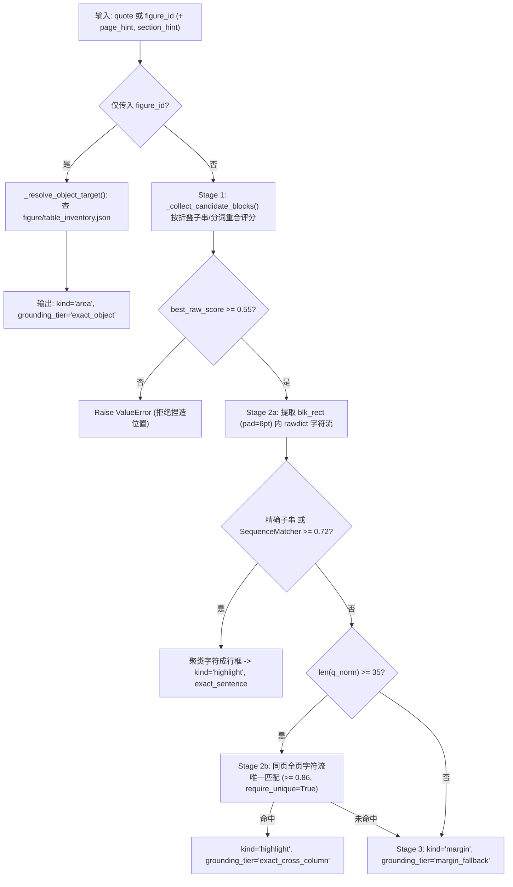

# 第 11 章：无损 Sidecar PDF 批注、Living Memory Card 与永久日志

> 本章阐述 PaperForge 的三类人机协同研究记忆载体：工作区旁路（Sidecar）无损 PDF 批注与 3 级抗误差空间定位引擎、分面演进的论文动态认知记忆卡片（Living Paper Memory Card），以及 JSONL 永久阅读/项目/校正日志、本地字面阅读（`read`）、笔记标志位权威变更（`note set-flag`）与前端实时刷新信号（`.state-seq.json`）。

## 1. 职责与非目标边界

### 1.1 核心职责

- **零篡改旁路 PDF 批注（Sidecar Annotations）**：所有用户划线、区域截图、便签、文本框、几何图形、手写墨迹以及 AI 领读批注均仅写入论文工作区 `<workspace>/annotations.jsonl`（及区域裁图 `<workspace>/assets/<KEY>_ann_<id8>.jpg`），并同步投影至 SQLite `paper_annotations` 表，**绝不写入或重保存 Zotero 源 PDF 字节**，确保 `pdf_sha256` 与 OCR 溯源指纹恒定。
- **V3 OCR 结构绑定与 3 级容错定位**：基于 `blocks.structured.jsonl`、`structure-tree.json` 与 `figure_inventory.json` 为任意归一化 PDF 矩形自动绑定 `block_id`、`section_path` 与 `figure_id`；并通过 `paperforge/services/pdf_grounding.py` 将 AI 引用句或图表编号精确还原为 PDF.js 归一化坐标框。
- **Living Paper Memory Card 双写演进**：在 `<workspace>/ai/memory-card.json` 与 SQLite（`paper_memory_cards`、`paper_memory_history`）之间同步维护 5 个标准认知维度（及合规范式自定义维度）的“提炼覆写式”记忆与修订快照，并在不修改 Markdown YAML Frontmatter 的前提下，通过 `memory-card base-snapshot` 向 Obsidian Base 表格视图提供聚合状态计数。
- **JSONL 永久研究记录与来源核验**：以 `<paperforge>/logs/reading-log.jsonl`、`project-log.jsonl`、`correction-log.jsonl` 作为跨会话研究记忆的唯一事实源，配合 `capture_source()` / `source_provenance()` 实现物理页码与文本锚点的 SHA-256 绑定校验。
- **单一语义写入与 UI 实时信号**：通过 `paperforge read` 收口零合成全文/PDF 字面检索，通过 `paperforge note set-flag` 收口 `do_ocr`/`analyze` 布尔标志变更，并通过原子递增 `<paperforge>/indexes/.state-seq.json` 驱动 Obsidian 客户端无轮询刷新。

### 1.2 非目标边界

- **禁止修改 `fulltext.md` 或源 PDF**：`fulltext.md` 是 OCR 引擎产出的机器只读全文，侧车批注与问答诊断（`annotations fulltext-preview`）均不改写 `fulltext.md`；批注导出至阅读日志通过 `annotations promote` 显式提升完成。
- **不将 Markdown Frontmatter 作为高频变更总线**：批注计数、认知维度数与诊断状态均从 `get_base_table_snapshot()` 动态投影；`note set-flag` 白名单严格限定为 `("do_ocr", "analyze")`，拒绝任意 Frontmatter 键注入。
- **不做隐式正则或语义改写式定位**：`local_read.py` 仅做大小写不敏感字面子串匹配；`pdf_grounding.py` 要求传入原文逐字句段或规范图表 ID，不猜测或捏造坐标。

---

## 2. 核心源码与单测映射表

| 模块 / 文件                                                         | 核心职责与关键符号                                                                                                                                                                                                | 对应验证单测                                                                                |
| :------------------------------------------------------------------ | :---------------------------------------------------------------------------------------------------------------------------------------------------------------------------------------------------------------- | :------------------------------------------------------------------------------------------ |
| `paperforge/services/annotations_service.py`                        | 侧车批注 CRUD、`VALID_KINDS`/`VALID_COLORS`/`VALID_INTENTS`、OCR 结构绑定 `_bind_ocr_structure()`、`promote_to_reading_log()`、`agent_mark_annotation()`、`adopt_agent_annotation()`、`clear_agent_annotations()` | `tests/unit/test_annotations_service.py`、`tests/unit/test_pdf_grounding_and_agent_mark.py` |
| `paperforge/services/pdf_grounding.py`                              | 3 级抗误差 PDF 定位 `ground_target_in_pdf()`、字符折叠 `_fold_text()`、图表定位 `_resolve_object_target()`                                                                                                        | `tests/unit/test_pdf_grounding_and_agent_mark.py`                                           |
| `paperforge/commands/annotations.py`                                | CLI 子命令 `paperforge annotations` 适配器（10 个动词分发与 `PFResult` 封装）                                                                                                                                     | `tests/unit/test_annotations_service.py`                                                    |
| `paperforge/services/memory_card_service.py`                        | `FACET_LABELS`、分面规范化 `normalize_facet_slug()`、`refine_memory_facet()`、`get_memory_card()`、`get_memory_history()`、`clear_memory_facet()`、`get_base_table_snapshot()`                                    | `tests/unit/test_living_memory_and_state_seq.py`、`tests/unit/test_upgrade_resilience.py`   |
| `paperforge/commands/memory_card.py`                                | CLI 子命令 `paperforge memory-card`（`get`、`refine`、`history`、`clear`、`base-snapshot`）                                                                                                                       | `tests/unit/test_living_memory_and_state_seq.py`                                            |
| `paperforge/services/state_signal.py`                               | 原子状态序号递增器 `bump_state_seq()`、`bump_state_seq_in_dir()`、`read_state_seq()`                                                                                                                              | `tests/unit/test_living_memory_and_state_seq.py`                                            |
| `paperforge/memory/permanent.py`                                    | JSONL 永久日志 `append_reading_note()`、`append_project_entry()`、`append_correction()`、`load_record_authority()`、`search_reading_records()`                                                                    | `tests/cli/test_research_records.py`                                                        |
| `paperforge/memory/record_source.py`                                | PDF 来源物理页与 NFC 文本唯一性绑定 `capture_source()`、`source_provenance()`                                                                                                                                     | `tests/cli/test_research_records.py`                                                        |
| `paperforge/commands/reading_log.py`                                | CLI `paperforge reading-log`（写入、字面检索、校正、来源核验、Markdown 验证/导入/渲染）                                                                                                                           | `tests/cli/test_research_records.py`                                                        |
| `paperforge/commands/project_log.py`                                | CLI `paperforge project-log`（写入、列表、渲染 `project-log.md`）                                                                                                                                                 | `tests/cli/test_research_records.py`                                                        |
| `paperforge/services/local_read.py` & `paperforge/commands/read.py` | 零合成字面局部阅读 `read_paper_local()` 与 `paperforge read` 入口                                                                                                                                                 | `tests/test_local_read.py`                                                                  |
| `paperforge/commands/note.py`                                       | 权威工作流标志位变更 `paperforge note set-flag`（保换行符写回 + 索引联动回滚）                                                                                                                                    | `tests/test_note_set_flag.py`、`tests/unit/test_living_memory_and_state_seq.py`             |
| `project_memory_panel/`（独立工程记忆面板）                         | 工程级问题/决策 YAML 记录构建验证（非单篇论文卡）                                                                                                                                                                 | `tests/unit/test_project_memory_panel.py`                                                   |

---

## 3. 磁盘文件、数据库表与协议 JSON 字段字典

### 3.1 磁盘文件布局

| 载体路径                                              | 编码 / 格式                           | 权威性说明                                                                                                                            |
| :---------------------------------------------------- | :------------------------------------ | :------------------------------------------------------------------------------------------------------------------------------------ |
| `<workspace>/annotations.jsonl`                       | UTF-8 JSONL（追加事件日志）           | 单篇论文 PDF 批注的唯一事实源，配合同目录 `annotations.jsonl.lock`                                                                    |
| `<workspace>/assets/<KEY>_ann_<id8>.jpg`              | JPEG 图像（200 DPI）                  | `kind == "area"` 区域截图产物（由 `f"{paper_key}_{ann_id[:12]}.jpg"` 命名，因 `ann_id` 形如 `ann_<12hex>`，前 12 字符即 `ann_<id8>`） |
| `<workspace>/ai/memory-card.json`                     | UTF-8 JSON（原子 temp+fsync+replace） | Living Memory Card 工作区侧车镜像，内含 `"facets"` 与 `"history"`，支持数据库重建无损恢复                                             |
| `<paperforge>/logs/reading-log.jsonl`                 | UTF-8 JSONL（追加）                   | 永久阅读摘录与证据绑定记录的唯一事实源                                                                                                |
| `<paperforge>/logs/project-log.jsonl`                 | UTF-8 JSONL（追加）                   | 项目阶段决策、弯路与待办日志的唯一事实源                                                                                              |
| `<paperforge>/logs/correction-log.jsonl`              | UTF-8 JSONL（追加）                   | 阅读笔记历史校正记录（不修改原记录，通过 `original_id` 关联）                                                                         |
| `<resources>/Projects/<project>/reading-log.index.md` | Markdown（派生渲染）                  | `reading-log --render --project <P>` 输出（刻意使用 `.index.md` 以免覆盖手写 `reading-log.md`）                                       |
| `<resources>/Projects/<project>/project-log.md`       | Markdown（派生渲染）                  | `project-log --render --project <P>` 自动生成产物                                                                                     |
| `<paperforge>/indexes/.state-seq.json`                | UTF-8 JSON（原子替换）                | 全局单调递增状态序号，Obsidian 插件监听该文件触发视图刷新                                                                             |

### 3.2 `<workspace>/annotations.jsonl` 事件模型与字段字典

`annotations.jsonl` 采用只追加事件模式（`_replay_jsonl_events()` 按行重放组装活跃状态 dict）：

- **创建事件（`op: "add"`）**：`{"op": "add", "ann_id": "ann_...", "record": { ... }}`
- **更新事件（`op: "update"`）**：`{"op": "update", "ann_id": "ann_...", "patch": { ... }, "updated_at": "<ISO-8601>"}`
- **删除事件（`op: "delete"`）**：`{"op": "delete", "ann_id": "ann_...", "updated_at": "<ISO-8601>"}`

单条完整批注 `record`（同步镜像至 SQLite `paper_annotations` 表，完整建表 DDL 见 [Chapter 10](10-memory-db-and-retrieval.md)）：

| 字段名                                    | 类型 / 枚举约束                                                                                                          | 说明                                                                                                                                                                                                                                |
| :---------------------------------------- | :----------------------------------------------------------------------------------------------------------------------- | :---------------------------------------------------------------------------------------------------------------------------------------------------------------------------------------------------------------------------------- |
| `ann_id`                                  | `str`（`ann_<12位十六进制>`）                                                                                            | `f"ann_{secrets.token_hex(6)}"`                                                                                                                                                                                                     |
| `paper_id`                                | `str`                                                                                                                    | 规范 `zotero_key`                                                                                                                                                                                                                   |
| `page`                                    | `int`（`>= 1`，`<= len(doc)`）                                                                                           | 1-based PDF 物理页码                                                                                                                                                                                                                |
| `kind`                                    | `"highlight"` / `"underline"` / `"strikethrough"` / `"area"` / `"note"` / `"textbox"` / `"shape"` / `"ink"` / `"margin"` | `VALID_KINDS` 9 种批注类型                                                                                                                                                                                                          |
| `color`                                   | `"yellow"` / `"green"` / `"blue"` / `"pink"` / `"red"` / `"purple"` / `"ink"` / `"gray"` / `"transparent"`               | `VALID_COLORS` 9 种标准色                                                                                                                                                                                                           |
| `intent`                                  | `"evidence"` / `"question"` / `"method"` / `"quote"` / `"general"`                                                       | `VALID_INTENTS` 5 种认知意图                                                                                                                                                                                                        |
| `author`                                  | `"user"` / `"agent"`                                                                                                     | `VALID_AUTHORS`；区分用户批注与 AI 领读批注层                                                                                                                                                                                       |
| `lens`                                    | `str`（如 `"skeleton"` / `"methods"` / `"critique"` / `"custom"` / `""`）                                                | AI 审阅视角标签                                                                                                                                                                                                                     |
| `grounding_tier`                          | `"manual"` / `"exact_sentence"` / `"exact_cross_column"` / `"exact_object"` / `"margin_fallback"`                        | 坐标定位精度分级                                                                                                                                                                                                                    |
| `rects`                                   | `list[[x0, y0, x1, y1]]`                                                                                                 | PDF.js 归一化坐标，`[0.0, 1.0]` 区间，`annotations_service` 保留 5 位小数（`pdf_grounding` 为 4 位）；数据库列为 `rects_json`                                                                                                       |
| `style`                                   | `dict`（数据库列为 `style_json`）                                                                                        | 受 `_normalize_style()` 校验：`shape_type`（`rect`/`ellipse`/`arrow`/`line`）、`stroke_color`、`fill_color`、`stroke_width`（`0.5..16.0`）、`font_size`（`8..48`）、`opacity`（`0.05..1.0`）、`points`（`[x, y]` 归一化轨迹点列表） |
| `exact_text` / `comment`                  | `str`                                                                                                                    | 原文摘录与批注评论                                                                                                                                                                                                                  |
| `section_path` / `block_id` / `figure_id` | `str`                                                                                                                    | `_bind_ocr_structure()` 关联的 V3 OCR 结构坐标                                                                                                                                                                                      |
| `crop_asset_rel` / `embed_wikilink`       | `str`                                                                                                                    | 仅 `area` 类型生成：Vault 相对路径与 `![[<KEY>_ann_<id8>.jpg]]`                                                                                                                                                                     |
| `tags`                                    | `list[str]`（数据库列为 `tags_json`）                                                                                    | 标签数组                                                                                                                                                                                                                            |
| `pdf_sha256`                              | `str`                                                                                                                    | 创建时对源 PDF 计算的 SHA-256；读出时由 `_attach_live_provenance()` 实时对比并注入运行时字段 `provenance_status`（`"verified"` / `"changed"` / `"unknown"`）                                                                        |
| `created_at` / `updated_at`               | ISO 8601 UTC 字符串                                                                                                      | 创建与最后更新时间                                                                                                                                                                                                                  |

### 3.3 Living Memory Card 维度与 `memory-card.json` 结构

`FACET_LABELS`（`OrderedDict`）定义 5 个规范维度，同时允许满足 `CUSTOM_FACET_RE = ^[a-z0-9_]{2,32}$` 的自定义维度（输入先经 `strip().lower().replace("-", "_")` 规范化）；单维度内容长度上限 `MAX_FACET_CHARS = 4000` 字符，侧车历史最多保留 `MAX_HISTORY_ENTRIES = 100` 条：

| `facet` Slug      | 显示标签（`FACET_LABELS`） | 认知定位                            |
| :---------------- | :------------------------- | :---------------------------------- |
| `idea_logic`      | `研究思路与逻辑链`         | 核心假说、实验推导主线与逻辑跃迁    |
| `methods_params`  | `实验技术与关键参数`       | 模型、样本量、剂量/刺激窗与对照设置 |
| `research_craft`  | `研究技巧与巧思`           | 实验设计巧思、内部校准与呈图技巧    |
| `critique_limits` | `硬伤、边界与存疑`         | 统计边界、混杂因素与结论外推风险    |
| `my_connection`   | `课题迁移与灵感`           | 与当前研究课题及方案设计的启发关联  |

`<workspace>/ai/memory-card.json` 文件格式：

```json
{
  "paper_id": "MEM00001",
  "updated_at": "2026-11-19T06:00:00+00:00",
  "facets": {
    "idea_logic": {
      "facet": "idea_logic",
      "label": "研究思路与逻辑链",
      "content": "...",
      "revision": 2,
      "updated_at": "2026-11-19T06:00:00+00:00"
    }
  },
  "history": [
    {
      "facet": "idea_logic",
      "label": "研究思路与逻辑链",
      "content": "...",
      "revision": 1,
      "created_at": "2026-11-19T05:50:00+00:00"
    }
  ]
}
```

### 3.4 `memory-card base-snapshot` 与 `.state-seq.json` 字段

- `get_base_table_snapshot(vault)` 返回 `{"seq": int, "updated_at": str, "rows": {zotero_key: {...}}}`，其中每条 `rows[key]` 在基础文献字段之上附加：
  - `user_ann_count`（`author != 'agent'` 的批注数）
  - `agent_ann_count`（`author == 'agent'` 的批注数）
  - `memory_facet_count`（活跃认知维度数，优先 SQLite，未入库时回退读取工作区 `ai/memory-card.json`）
  - `memory_updated_at`（最新维度更新时间）
  - `needs_diagnostic`（布尔值：`ocr_status in ("failed", "done_incomplete", "unknown")` 或 `ocr_status == "done"` 但 `health.ocr_health` 非空且非 `"healthy"`）
- `<paperforge>/indexes/.state-seq.json` 字段：`{"seq": 42, "updated_at": "<ISO-8601>", "reason": "memory_card.refine", "changed_keys": ["MEM00001"]}`（`changed_keys` 去重且最多截取前 50 个）。

### 3.5 永久日志（JSONL）记录格式

1. **`reading-log.jsonl`**（`id`: `rln_YYYYMMDD_<hex8>`）：包含 `id`、`created_at`、`paper_id`、`section`、`excerpt`、`usage`、`context`、`note`、`project`、`tags`、`agent`、`verified`（默认 `false`）及可选的 `source`（由 `capture_source()` 生成 `{paper_id, path, physical_page, printed_page, basis, anchor, sha256, binding, verification}`）。
2. **`project-log.jsonl`**（`id`: `plog_YYYYMMDD_<hex8>`）：包含 `id`、`created_at`、`project`、`date`、`type`、`title`、`decisions`、`detours`、`reusable`、`todos`、`related_papers`、`tags`、`agent`。
3. **`correction-log.jsonl`**（`id`: `corr_YYYYMMDD_<hex8>`）：包含 `id`、`event_type: "correction"`、`created_at`、`paper_id`、`original_id`、`correction`、`reason`、`agent`。

---

## 4. 核心执行链路、状态机与顺序不变量

### 4.1 3 级抗误差 PDF 定位引擎（`pdf_grounding.py`）



定位关键细节与不变量：

1. **字符折叠归一化（`_fold_text`）**：剥离软连字符 `\u00ad`、零宽字符 `\u200b` / `\ufeff` 与 `$...$` LaTeX 定界符，执行 NFKC 规范化、希腊字母 `μ`/`µ` → `u`、长短破折号统一为 `-`，仅保留字母与数字，天然免疫跨行连字符断词与符号编码漂移。
2. **Stage 1 页码与章节权重**：完全折叠包含时 `raw_score = 1.0`，否则取 `(q_tokens & b_tokens) / len(q_tokens)`（中文采用 2-gram 滑窗分词）；命中 `page_hint` 加权 `+0.12`，命中 `section_hint` 加权 `+0.06`。
3. **Stage 2a/2b 行级聚框（`_cluster_chars_to_rects`）**：按相邻字符中心纵坐标差 `<= max(4.0, height * 0.6)` 自动合并为单行矩形，支持跨多行引用自动输出多个归一化 `[x0, y0, x1, y1]` 框。
4. **Stage 3 诚实降级**：纯扫描件或公式块无 PDF 字符层时，绝不跨页或扩大矩形瞎画，只在 `best_blk` 左侧生成窄竖条（`x0 = max(0.01, bx0 - 0.018)`、`x1 = max(x0 + 0.008, bx0 - 0.006)`），标定 `kind="margin"` 与 `grounding_tier="margin_fallback"`。

### 4.2 侧车批注写入、OCR 绑定与提升链

1. **添加批注顺序（`add_annotation()`）**：校验 `page`、`kind`、`intent`、`color`、`author` 与归一化 `rects`/`style` → 解析论文工作区与 PDF → 计算 `pdf_sha256`（若 `kind == "area"` 则按 200 DPI 裁剪第 0 个矩形保存至 `<workspace>/assets/<KEY>_ann_<id8>.jpg`） → 调用 `_bind_ocr_structure()` 匹配 V3 OCR block（权重 `frac_a * 2.0 + iou`）与图库（`cluster_bbox` 或 `associated_text_block_ids` / `caption_block_id`） → 在 `annotations.jsonl.lock` 下追加 `{"op": "add", ...}` → 尽力同步 `paper_annotations`（`_sync_sqlite_annotation`，持 `WriterLock`）→ `bump_state_seq(reason="annotations.add")`。
2. **人机协同流转**：`agent_mark_annotation()` 将 `lens` 映射为默认 `intent`（`skeleton→evidence`、`methods→method`、`critique→question`、`custom→evidence`）后创建 `author="agent"` 批注；用户采纳时 `adopt_agent_annotation()` 追加一条 `{"op": "update", "patch": {"author": "user"}}` 事件；`clear_agent_annotations()` 仅删除 `author == "agent"`（可按 `lens` 过滤）的条目，绝对保留用户批注。
3. **批注提升至阅读日志（`promote_to_reading_log()`）**：将批注的 `exact_text`（无原文则取 `comment` 或区域占位描述）、`section_path` 与物理页码打包为 `source={"path": ..., "physical_page": page, "basis": "recorded"}`，经 `append_reading_note(..., agent="pdf-annotator")` 自动计算当前 PDF SHA-256 与绑定哈希写入 `reading-log.jsonl`。

### 4.3 Living Memory Card 双写与跨库重建恢复链

1. **写入顺序（`refine_memory_facet()`）**：先校验非空及 `<= 4000` 字符 → 读取现有面（优先工作区 `ai/memory-card.json`，不存在工作区时回退读取 SQLite）计算 `revision = prev.revision + 1` → 原子写入 `ai/memory-card.json`（保留最多 100 条 `history`） → 若 `paperforge.db` 存在且该 `zotero_key` 在 `papers` 中，持 `WriterLock` 同步更新 `paper_memory_cards` 并向 `paper_memory_history` 插入一条不可变快照 → 调用 `bump_state_seq(reason="memory_card.refine")`。
2. **删库恢复保证**：无论在 `paperforge.db` 删除后尚未重建（`get_memory_card()` 与 `get_memory_history()` 自动回退读取 `ai/memory-card.json`）还是执行 `memory build` 重建之后（`_import_paper_memory_cards()` 导入 `facets` 与完整 `history` 数组），认知维度与版本修订历史均可无损还原。

### 4.4 `note set-flag` 原子更新与回滚机制

`paperforge/commands/note.py` 按严格顺序执行：校验 `field in ("do_ocr", "analyze")` → 在 `formal-library.json` 定位条目的 `main_note_path` / `note_path` → 以 `newline=""` 字节保真读取 Markdown（保留原文件 CRLF/LF 行尾） → 验证 `split_frontmatter_block()` 非空 → 若值变化则写入 `set_frontmatter_flag()` 结果 → 调用 `_sync_index_flag()` 同步更新 `formal-library.json` → **若索引更新失败，立即用原始字节 `text` 回滚笔记文件**；成功则 `bump_state_seq(reason=f"note.{field}")`。

---

## 5. 配置项、环境变量、CLI 入口与错误码

### 5.1 关键阈值与常量（非外部配置开关）

| 模块常量                                   | 取值                        | 作用                                          |
| :----------------------------------------- | :-------------------------- | :-------------------------------------------- |
| `CUSTOM_FACET_RE`                          | `^[a-z0-9_]{2,32}$`         | `memory_card_service.py` 自定义分面校验正则   |
| `MAX_FACET_CHARS` / `MAX_HISTORY_ENTRIES`  | `4000` / `100`              | 单分面字符上限 / 侧车历史最大条数             |
| `LOCK_TIMEOUT`（`annotations.jsonl.lock`） | `10` 秒                     | 侧车批注文件锁超时                            |
| `fulltext-preview` 字符上限                | 默认 `80000`（下限 `1000`） | `read_ocr_diagnostic_fulltext()` 诊断截断保护 |
| `search_reading_records` `limit`           | 默认 `20`（允许 `1..100`）  | 阅读日志字面检索分页范围                      |

### 5.2 CLI 命令参数矩阵

| CLI 入口                                        | 子命令 / 参数                                                                                                                                                                                                                                                                                                                                               | 返回核心字段与说明                                                                                                         |
| :---------------------------------------------- | :---------------------------------------------------------------------------------------------------------------------------------------------------------------------------------------------------------------------------------------------------------------------------------------------------------------------------------------------------------- | :------------------------------------------------------------------------------------------------------------------------- |
| `paperforge annotations pdf-info <KEY>`         | `[--json]`                                                                                                                                                                                                                                                                                                                                                  | 返回 `pdf_abs_path`、`pdf_vault_rel`、`pdf_sha256`、`page_count`、`workspace_rel`、`annotations`（含 `provenance_status`） |
| `paperforge annotations list <KEY>`             | `[--json]`                                                                                                                                                                                                                                                                                                                                                  | 按页码与纵向坐标排序返回活跃批注列表                                                                                       |
| `paperforge annotations add <KEY>`              | `--page N --rects-json JSON` `[--kind ...]` `[--color ...]` `[--intent ...]` `[--exact-text ...]` `[--comment ...]` `[--tags-json ...]` `[--style-json ...]` `[--json]`                                                                                                                                                                                     | 创建用户侧车批注并绑定 OCR 结构                                                                                            |
| `paperforge annotations update <KEY> <ANN_ID>`  | `[--color ...]` `[--intent ...]` `[--comment ...]` `[--tags-json ...]` `[--style-json ...]` `[--rects-json ...]` `[--json]`                                                                                                                                                                                                                                 | 追加 `update` 事件并同步 SQLite（合并 `style` 字典）                                                                       |
| `paperforge annotations delete <KEY> <ANN_ID>`  | `[--json]`                                                                                                                                                                                                                                                                                                                                                  | 追加 `delete` 事件并从 `paper_annotations` 删除                                                                            |
| `paperforge annotations promote <KEY> <ANN_ID>` | `[--usage U]` `[--project P]` `[--json]`                                                                                                                                                                                                                                                                                                                    | 提升批注为绑定来源哈希的 `reading-log.jsonl` 记录                                                                          |
| `paperforge annotations fulltext-preview <KEY>` | `[--max-chars 80000]` `[--json]`                                                                                                                                                                                                                                                                                                                            | 只读诊断预览内部 OCR `fulltext.md`                                                                                         |
| `paperforge annotations agent-mark <KEY>`       | `[--quote TEXT]` `[--figure-id ID]` `[--page-hint N]` `[--section-hint S]` `[--comment C]` `[--color purple]` `[--lens skeleton]` `[--tags-json ...]` `[--json]`                                                                                                                                                                                            | 执行 3 级 PDF 定位并写入 `author="agent"` 批注                                                                             |
| `paperforge annotations adopt <KEY> <ANN_ID>`   | `[--json]`                                                                                                                                                                                                                                                                                                                                                  | 将 AI 批注转为 `author="user"`                                                                                             |
| `paperforge annotations clear-agent <KEY>`      | `[--lens L]` `[--json]`                                                                                                                                                                                                                                                                                                                                     | 清理指定视角或全部 AI 批注，保留用户高亮                                                                                   |
| `paperforge memory-card get <KEY>`              | `[--json]`                                                                                                                                                                                                                                                                                                                                                  | 返回按标准 5 维度优先排序的活跃卡片                                                                                        |
| `paperforge memory-card refine <KEY>`           | `--facet F --content C` `[--json]`                                                                                                                                                                                                                                                                                                                          | 覆写并递增 `revision`，记录历史与刷新信号                                                                                  |
| `paperforge memory-card history <KEY>`          | `[--facet F]` `[--json]`                                                                                                                                                                                                                                                                                                                                    | 按最新倒序返回最多 50 条历史修订快照                                                                                       |
| `paperforge memory-card clear <KEY>`            | `[--facet F]` `[--json]`                                                                                                                                                                                                                                                                                                                                    | 清空单分面或全部分面（保留 `history`）                                                                                     |
| `paperforge memory-card base-snapshot`          | `[--json]`                                                                                                                                                                                                                                                                                                                                                  | 返回 `{seq, updated_at, rows}` 供 Obsidian Base 视图渲染                                                                   |
| `paperforge reading-log`                        | `--write KEY --excerpt E [--section S --usage U --note N --context C --project P --tags T --source-json JSON]` / `--search Q [--paper KEY --limit N --include-history]` / `--correct ID --correction C [--reason R --paper KEY]` / `--source-check ID [--paper KEY]` / `--lookup KEY` / `--render [--project P]` / `--validate F` / `--import F` `[--json]` | 永久阅读记录全生命周期管理；默认导出 `--since` / `--limit 50`                                                              |
| `paperforge project-log`                        | `--write --project P --payload JSON` / `--list --project P` / `--render --project P`                                                                                                                                                                                                                                                                        | 项目级决策、弯路与任务日志管理                                                                                             |
| `paperforge read <KEY>`                         | `--find TERM` `[--source {auto,fulltext,pdf}]` `[--json]`                                                                                                                                                                                                                                                                                                   | 本地只读字面子串检索（`matched` / `no_match` / `no_readable_source`）                                                      |
| `paperforge note set-flag`                      | `--key KEY --field {do_ocr,analyze} --value {true,false}` `[--json]`                                                                                                                                                                                                                                                                                        | 权威修改正式笔记 YAML 布尔标记并同步 `formal-library.json`                                                                 |

### 5.3 错误码映射表

| 错误码                 | 触发场景                                                                                                                                                                                                                                                                                                                                        |
| :--------------------- | :---------------------------------------------------------------------------------------------------------------------------------------------------------------------------------------------------------------------------------------------------------------------------------------------------------------------------------------------- |
| `VALIDATION_ERROR`     | `annotations` 传入非法 `kind`/`intent`/`color`/`page`/`rects`/`style` 或未找到 `ann_id`；`pdf_grounding` 找不到引用文本（`score < 0.55`）或对象 ID；`memory-card refine` 空内容、超 4000 字或非法 `facet`；`reading-log` 格式校验失败、空搜索词、`limit` 越界、跨论文校正、来源哈希/锚点失效；`note set-flag` 非法 `field` 或无有效 Frontmatter |
| `PATH_NOT_FOUND`       | `paperforge read` 无法唯一解析论文或既无可读 `fulltext.md` 又无合法 PDF（`no_readable_source`）                                                                                                                                                                                                                                                 |
| `ACTION_SCOPE_INVALID` | `paperforge read` 传入非法 `--source` 参数（退出码 `2`）                                                                                                                                                                                                                                                                                        |
| `INTERNAL_ERROR`       | `reading-log` 写入出现 `OSError`（`error_kind == "io"`）；`note set-flag` 同步索引或回滚失败                                                                                                                                                                                                                                                    |

---

## 6. 边界防护与 Fail-Closed 防呆规则

1. **路径逃逸与外部 PDF 边界锁定（`record_source.py` & `annotations_service.py`）**：`_relative_pdf()` 与 `_resolve_pdf_from_item()` 显式拒绝 `..` 段、`://` 协议、URL `#/?` 片段及跨平台驱动器盘符路径，强制校验解析后的 PDF 物理路径必须落于 Vault 根或已配置的 `zotero_data_dir` 内且后缀为 `.pdf`；`_paper_pdf()` 进一步要求其与规范索引中该 `zotero_key` 的当前 `pdf_path` 完全一致。
2. **唯一物理页文本锚点验证（`source_provenance`）**：当 `basis == "exact_text"` 时，`anchor` 经 NFC 与 Unicode 空白折叠后必须与 `excerpt` 全等，且在整份 PDF 中**全局仅出现 1 次并恰好位于指定的 `physical_page`**（使用 `(?={re.escape(needle)})` 捕获重叠出现次数）；多于 1 次返回 `status="ambiguous"`，0 次或跨页返回 `status="mismatch"`，`--source-check` 直接报错拒绝打开。
3. **严格 JSONL 权威读取（`_read_records_strict`）**：检索、查找、校正或核验前若 `reading-log.jsonl` / `correction-log.jsonl` 中存在损坏 JSON 行、缺失必填字段、非法时间格式或重复 `id`，以及校正记录指向跨论文或不存在的 `original_id`，立即抛出 `ValueError` 中止，绝不伪造“干净空结果”。
4. **校正历史不覆盖原引文（`search_reading_records`）**：已被 `correction-log.jsonl` 标记校正的原记录默认被隐藏（`record_status == "corrected"`），仅在显式传入 `--include-history` 时连同 `corrections` 数组一并返回；校正文本自身不会冒充原文献引文参与字面检索命中。
5. **同页防漂移定位边界（`pdf_grounding.py`）**：Stage 2b 跨栏救援严格限制在 Stage 1 锁定的**同一页**且要求 `len(q_norm) >= 35` 与 `require_unique=True`，避免短词在不同栏位错配；无法精确定位文本坐标时进入 Stage 3 `margin_fallback` 而非扩大框覆盖无关段落。
6. **`PyMuPDF` 标准输出静默防污染（`local_read.py`）**：显式优先 `import pymupdf as fitz`，规避旧版 `import fitz` 向 `stdout` 打印弃用警告导致 `--json` 机器信封解析崩溃。
7. **`.state-seq.json` 目录卫兵（`state_signal.py`）**：`bump_state_seq_in_dir()` 检查 `indexes_dir.name == "indexes"`，并通过 `mkstemp` + `fsync` + `os.replace` 保证并发读取时永不出现半截 JSON。

---

## 7. 维修、调试与升级 Checklist

- [ ] **核对 PDF 批注失效或偏移**：运行 `paperforge annotations pdf-info <KEY> --json`，检查返回中每条批注的 `provenance_status`；若为 `changed`，说明 Zotero 中源 PDF 文件内容发生变更，需人工复核批注页码与位置后更新 `annotations.jsonl`。
- [ ] **诊断 AI 批注定位降级原因**：运行 `paperforge annotations list <KEY> --json` 观察 `grounding_tier` 分布；若大量条目落入 `margin_fallback`，通过 `paperforge annotations fulltext-preview <KEY>` 核对传给 `agent-mark --quote` 的句子是否与 PDF 底层文本存在大段缺失（如纯扫描 PDF 属正常行为），对满意的 AI 批注引导用户采纳（`annotations adopt`）或重标。
- [ ] **验证 Living Memory Card 与数据库一致性**：运行 `paperforge memory-card get <KEY> --json` 与 `paperforge memory-card history <KEY> --json`，对比工作区 `<workspace>/ai/memory-card.json`；若发现 SQLite 与侧车不一致，运行 `paperforge memory build --key <KEY> --json` 重新同步。
- [ ] **排查 Obsidian Base 表未刷新或计数陈旧**：检查 `<paperforge>/indexes/.state-seq.json` 的 `seq` 与 `reason`，并运行 `paperforge memory-card base-snapshot --json` 验证 `user_ann_count`、`agent_ann_count`、`memory_facet_count` 是否与底层一致。
- [ ] **校验与修正阅读笔记来源绑定**：对存在存疑出处的记录执行 `paperforge reading-log --source-check <RECORD_ID> --paper <KEY> --json`；若记录已被推翻，使用 `paperforge reading-log --correct <RECORD_ID> --paper <KEY> --correction "..." --reason "..." --json` 追加不可变校正链而非手改 `reading-log.jsonl`。
- [ ] **回归验证测试集**：修改批注、定位、记忆卡或永久记录逻辑后，执行 `pytest tests/unit/test_annotations_service.py tests/unit/test_pdf_grounding_and_agent_mark.py tests/unit/test_living_memory_and_state_seq.py tests/unit/test_upgrade_resilience.py tests/unit/test_project_memory_panel.py tests/cli/test_research_records.py tests/test_local_read.py tests/test_note_set_flag.py`。

> 相关章节：SQLite `paper_annotations` / `paper_memory_cards` / `paper_memory_history` 表结构及从侧车恢复机制见 [Chapter 10](10-memory-db-and-retrieval.md)；Agent 上下文读取 `living_memory` / `user_annotations` 及 `/pf-deep` 写回闭环见 [Chapter 12](12-agent-skills-and-workflows.md)。
