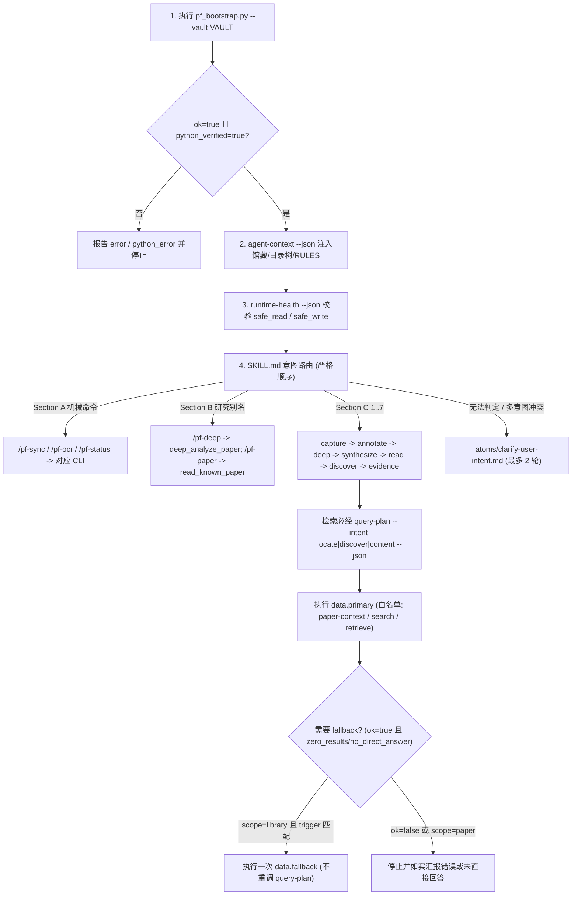

# 第 12 章：Agent Skills 分发、斜杠工作流与 AI 上下文命令

> 本章涵盖 PaperForge Agent Skill 的打包源管理与 Vault 部署协议、`/pf-*` 斜杠命令契约、基于 `SKILL.md` + `molecules/` + `atoms/` 的意图路由与检索执行协议、`deep-reading` → AI 写作 → `deep-finalize` 精读闭环，以及面向上下文注入与诊断的全部只读 CLI 命令。

## 1. 职责与非目标边界

### 1.1 核心职责

- **跨平台 Skill 唯一打包源与防篡改部署**：以包内 `paperforge/skills/paperforge/` 作为 Agent Skill 的唯一权威源，通过 `paperforge skill deploy` 将完整技能树部署到 Vault 内的 `.agents/skills/paperforge/`（或自定义 `--to <dir>`），基于整个文件树的 SHA-256 摘要识别一致跳过、冲突拦截与强制覆盖，且永不覆写用户自定义的 `AGENTS.md`。
- **零依赖启动探测与运行时指针绑定**：`pf_bootstrap.py` 可在任意宿主 Python 下运行，读取用户主目录 `.paperforge` 子目录下的 `runtime/pointer.json` 并以隔离模式（`-I`）验证 `paperforge` 运行时版本与能力探针，确保 Agent 后续调用全部绑定到已验证的 Python 解释器。
- **化合物（Compound）意图路由与检索协议**：通过 `SKILL.md` 定义机械命令、研究别名、7 类研究意图及澄清回退规则，通过 `atoms/retrieval-routing.md` 强制执行 `query-plan` 前置规划与“最多一次 fallback”协议。
- **精读脚手架、验证与讨论归档闭环**：串联只读队列检查（`deep-reading`）、三阶段脚手架与质检工具（`pf_deep.py`）、原子终结命令（`deep-finalize`）、动态认知记忆同步（`memory-card refine`）与问答会话归档（`paperforge.worker.discussion`）。
- **AI 上下文聚合与只读诊断面板**：通过 `agent-context`、`paper-context`、`context`、`paper-status`、`inspect`、`read` 及 4 条 Layer 4 网关命令（`paper-lookup`、`content-discovery`、`paper-navigation`、`scoped-fetch`）向上下文窗口投喂零路径猜测的结构化论文证据。

### 1.2 非目标边界

- **禁止由仓库内工作区替代打包源**：产品源码中唯一的 Skill 权威目录是 `paperforge/skills/paperforge/`；部署到具体 Vault 的技能目录由 `skill deploy` 管理，Agent 不得绕过打包源直接把某次试验的本地 `.agents/` 当作源头反向回写。
- **不将斜杠命令文档视为可执行代码**：`paperforge/command_files/` 下的 `/pf-*` Markdown 文件是 Agent 与用户的契约规范，实际数据状态变更必须经由 Python CLI（如 `paperforge sync`、`paperforge ocr`、`paperforge deep-finalize`）完成。
- **只读上下文与诊断命令绝不写盘**：`agent-context`、`paper-context`、`paper-status`、`inspect`、`deep-reading`、`read`、`context` 等查询面严格遵守只读契约（见 `tests/test_x13_query_read_only.py`），不得创建目录、修改 `.base` 视图或改动 Frontmatter。

---

## 2. 核心源码与单测映射表

| 模块 / 文件                                                                                         | 核心职责与关键符号                                                                                                                                                | 对应验证单测 / 集成测试                                                            |
| :-------------------------------------------------------------------------------------------------- | :---------------------------------------------------------------------------------------------------------------------------------------------------------------- | :--------------------------------------------------------------------------------- |
| `paperforge/services/skill_deploy.py`                                                               | Skill 部署服务 `deploy_skills()`、树摘要 `_skill_tree_digest()`、路径边界 `_validate_target()`、`AGENTS.md` 不覆盖策略                                            | `tests/cli/test_skill_deploy_cli.py`                                               |
| `paperforge/skills/paperforge/SKILL.md`                                                             | Compound 启动注入清单、`skill_version` / `skill_api_version: 2`、4 段式意图路由与阅读日志安全红线                                                                 | `tests/test_skill_graph_contracts.py`、`tests/test_skill_graph_layout.py`          |
| `paperforge/skills/paperforge/atoms/retrieval-routing.md`                                           | 单一权威检索路由协议（`query-plan` 白名单、Exactly-One-Fallback、Object Context Resolution Protocol）                                                             | `tests/test_skill_graph_contracts.py`                                              |
| `paperforge/skills/paperforge/atoms/update-paper-memory.md`                                         | Living Memory Card 读写规则（Read-Before-Speak、Refine-Don't-Append）                                                                                             | `tests/unit/test_agent_loop_closure.py`                                            |
| `paperforge/skills/paperforge/molecules/deep-analyze-paper.md`                                      | Keshav 三阶段精读编排（`paper-context --structure` → `pf_deep.py` → `deep-finalize` → `memory-card refine`）                                                      | `tests/unit/test_agent_loop_closure.py`                                            |
| `paperforge/skills/paperforge/molecules/annotate-paper-pdf.md`                                      | 人机协同 PDF 领读工作流（`annotations agent-mark` 4 种 `--lens` 与 3 级定位说明）                                                                                 | `tests/unit/test_pdf_grounding_and_agent_mark.py`                                  |
| `paperforge/skills/paperforge/scripts/pf_bootstrap.py`                                              | 零依赖启动自举 `main()`、指针校验 `_read_runtime_pointer()`、能力探测 `capabilities`                                                                              | `tests/test_pf_bootstrap_capabilities.py`、`tests/unit/test_agent_loop_closure.py` |
| `paperforge/skills/paperforge/scripts/pf_deep.py`                                                   | 精读辅助脚本（`queue`、`prepare`、`figure-index`、`figure-map`、`chart-type-scan`、`ensure-scaffold`、`postprocess-pass2`、`validate-selected`、`validate-note`） | `tests/unit/test_agent_loop_closure.py`                                            |
| `paperforge/command_files/pf-status.md` / `pf-sync.md` / `pf-ocr.md` / `pf-deep.md` / `pf-paper.md` | 5 个标准 `/pf-*` 命令契约文档                                                                                                                                     | `tests/test_command_docs.py`                                                       |
| `paperforge/worker/deep_reading.py` & `paperforge/commands/deep.py`                                 | 只读精读队列扫描 `run_deep_reading()` 与 `paperforge deep-reading [--json]`                                                                                       | `tests/test_x13_query_read_only.py`                                                |
| `paperforge/commands/finalize.py`                                                                   | 精读校验与终结 `paperforge deep-finalize <key>`（写 `deep_reading_status: "done"` 并刷新索引）                                                                    | `tests/test_finalize_command.py`                                                   |
| `paperforge/worker/discussion.py`                                                                   | AI 讨论会话原子追加归档 `record_session()`（写 `ai/discussion.md`）                                                                                               | `tests/test_discussion.py`                                                         |
| `paperforge/commands/agent_context.py`                                                              | 会话启动上下文注入 `COMMANDS`、`RULES` 与图书馆统计                                                                                                               | `tests/test_context.py`、`tests/unit/test_agent_loop_closure.py`                   |
| `paperforge/commands/paper_context.py`                                                              | 单篇论文全上下文打包 `_build_paper_context()`、`_build_compact_tree()`、`_load_living_memory()`、`_load_user_annotations()`                                       | `tests/test_paper_context_evidence.py`、`tests/unit/test_agent_loop_closure.py`    |
| `paperforge/commands/context.py`                                                                    | 基于 `formal-library.json` 投影 AI 就绪包 `_format_context_entry()`                                                                                               | `tests/test_context.py`                                                            |
| `paperforge/commands/paper_lookup.py`                                                               | Layer 4 文献查询与 `--from-path` 路径反查规范身份 `resolve_paper_context()`                                                                                       | `tests/test_paper_lookup_from_path.py`、`tests/test_layer4_gateway_commands.py`    |
| `paperforge/commands/content_discovery.py` / `paper_navigation.py` / `scoped_fetch.py`              | Layer 4 网关薄适配器，统一经 `gateway.route_gateway()` 分发                                                                                                       | `tests/test_layer4_gateway_commands.py`                                            |
| `paperforge/commands/inspect_paper.py`                                                              | 6 阶段端到端只读瓶颈诊断 `inspect_paper()`                                                                                                                        | `tests/test_x13_query_read_only.py`                                                |
| `paperforge/commands/paper_status.py` & `read.py`                                                   | 单篇状态查询与本地只读字面搜索                                                                                                                                    | `tests/test_local_read.py`、`tests/test_x13_query_read_only.py`                    |
| 闭环集成验证                                                                                        | 只读零写盘验证与探针-动作全闭环验证                                                                                                                               | `tests/test_x13_query_read_only.py`、`tests/test_x14_loop_closure.py`              |

---

## 3. 磁盘文件、数据库表与协议 JSON 字段字典

### 3.1 `paperforge/skills/paperforge/` 目录拓扑

```text
paperforge/skills/paperforge/
├── SKILL.md                             # Compound 主路由与启动清单 (skill_api_version: 2)
├── molecules/                           # 7 个顶层研究意图完整执行编排
│   ├── read-known-paper.md
│   ├── annotate-paper-pdf.md
│   ├── discover-papers.md
│   ├── find-supporting-evidence.md
│   ├── deep-analyze-paper.md
│   ├── synthesize-evidence-matrix.md
│   └── capture-project-knowledge.md
├── atoms/                               # 可复用协议原子与 20 份图表读图指南
│   ├── clarify-user-intent.md
│   ├── retrieval-routing.md
│   ├── update-paper-memory.md
│   ├── write-reading-log-jsonl.md
│   ├── write-project-reading-log.md
│   ├── write-project-log.md
│   ├── extract-methodology-card.md
│   ├── method-card-template.md
│   └── chart-reading/INDEX.md           # 含 20 类专科生物医学图表审查指南
├── scripts/
│   ├── pf_bootstrap.py
│   └── pf_deep.py
└── workflows/
    └── project-engineering.md
```

### 3.2 `pf_bootstrap.py` 输出 JSON 字段字典

```json
{
  "ok": true,
  "vault_root": "/Users/researcher/Vault",
  "skill_dir": "/Users/researcher/Vault/.agents/skills/paperforge",
  "runtime_pointer": {
    "path": "<USER_HOME>/.paperforge -> runtime/pointer.json",
    "status": "valid"
  },
  "paths": {
    "literature_dir": "...",
    "paperforge_dir": "...",
    "index_path": "...",
    "ocr_dir": "...",
    "exports_dir": "..."
  },
  "domains": ["Ortho"],
  "index_summary": { "Ortho": 120 },
  "python_candidate": "<RUNTIME_ENV_ROOT>/bin/python",
  "python_verified": true,
  "runtime_version": "2.2.0",
  "memory_layer": {
    "available": true,
    "paper_count": 120,
    "fts_search": true,
    "vector_search": true
  },
  "methodology_index": [
    { "id": "parameter-window-audit", "title": "...", "description": "..." }
  ],
  "capabilities": {
    "rg": true,
    "metadata_search": true,
    "paper_context": true,
    "semantic_enabled": true,
    "semantic_ready": true
  },
  "plugin_version": "2.2.0",
  "skill_version": "2026-07-27.1",
  "skill_api_version": 2
}
```

### 3.3 `paper-context --structure --json` 数据契约

`paperforge/commands/paper_context.py` 返回的 `PFResult.data` 包含以下顶层字段：

| 字段名             | 类型           | 说明                                                                                                                                                                                                                                           |
| :----------------- | :------------- | :--------------------------------------------------------------------------------------------------------------------------------------------------------------------------------------------------------------------------------------------- |
| `warning`          | `str`          | 固定提示 `"Prior reading notes are not verified facts. Re-check source before reuse."`                                                                                                                                                         |
| `paper`            | `dict`         | 包含 19 个核心数据库列，加上动态注入的 `ocr_evidence`（来自 `role-index.json`）、`body_units_count`、`fulltext_available`                                                                                                                      |
| `living_memory`    | `dict`         | `{paper_id, updated_at, facet_count, facets}`（优先工作区 `ai/memory-card.json`，无文件时回退 SQLite `paper_memory_cards`）                                                                                                                    |
| `prior_notes`      | `list[dict]`   | 从 `reading-log.jsonl` 加载并经 `project_record()` 实时计算 `provenance` 后的历史阅读记录                                                                                                                                                      |
| `corrections`      | `list[dict]`   | 关联的校正历史记录（含 `previous_note_id`），按时间倒序排列                                                                                                                                                                                    |
| `recheck_targets`  | `list[str]`    | `provenance.status` 非 `"matched"`/`"confirmed"` 的待回原文复核片段摘要                                                                                                                                                                        |
| `user_annotations` | `dict`         | `{total, questions, highlights}`，其中 `questions` 过滤 `intent == "question"`，条目经 `_project_annotation()` 裁剪为紧凑字段                                                                                                                  |
| `structure`        | `dict \| None` | 仅在传入 `--structure` 时出现；包含 `version`（`manifest.ocr_result_hash`）和 DFS 扁平化的 `nodes`（`node_id`, `parent_id`, `title`, `path`, `depth`, `own_block_count`, `subtree_block_count`, `child_count`, `page_span`, `document_order`） |

### 3.4 5 大核心 `/pf-*` 斜杠命令契约对照表

| 斜杠命令     | 文档路径                                | 类型       | 底层等效 / 核心动作                                                                          | 前置条件                                                           |
| :----------- | :-------------------------------------- | :--------- | :------------------------------------------------------------------------------------------- | :----------------------------------------------------------------- |
| `/pf-status` | `paperforge/command_files/pf-status.md` | 机械诊断   | `paperforge status --json` 或 `runtime-health --json`                                        | 无强制前置（配置残缺时仍尽力诊断）                                 |
| `/pf-sync`   | `paperforge/command_files/pf-sync.md`   | 机械同步   | `paperforge sync [--dry-run] [--domain D]`                                                   | Better BibTeX 导出 JSON 与 `paperforge.json` 就绪                  |
| `/pf-ocr`    | `paperforge/command_files/pf-ocr.md`    | 机械提取   | `paperforge ocr [--diagnose [--live]] [--key KEY]`                                           | 正式笔记 `do_ocr: true`、`has_pdf: true`、OCR 凭据就绪             |
| `/pf-deep`   | `paperforge/command_files/pf-deep.md`   | 研究精读   | `paperforge deep-reading` + `pf_deep.py` + AI 写 Pass 1-3 + `paperforge deep-finalize <KEY>` | 正式笔记 `analyze: true` 且 `ocr_status: done`、`fulltext.md` 非空 |
| `/pf-paper`  | `paperforge/command_files/pf-paper.md`  | 单篇工作台 | `paper-context` + 加载 `fulltext.md` Q&A（无 OCR 时降级元数据） + `discussion record` 归档   | 正式笔记/索引存在（不强制要求 OCR 完成）                           |

---

## 4. 核心执行链路、状态机与顺序不变量

### 4.1 Skill 部署与 `AGENTS.md` 保护链路

1. **目标路径解析与越界拦截（`_validate_target`）**：`deploy_skills()` 默认使用 `AGENT_SHARED_SKILL_DIR = ".agents/skills"`；若传入自定义 `--to <dir>`，强制要求相对路径、不能指向 Vault 根目录自身且 `resolved` 必须严格落在 `vault.resolve() + os.sep` 下。
2. **全树内容摘要比对（`_skill_tree_digest`）**：当 `<vault>/<target_dir>/paperforge` 已存在时，对源树和目标树递归遍历所有文件，按 POSIX 相对路径排序后将 `\r\n` 统一归一化为 `\n` 计算 SHA-256。摘要完全一致时直接返回 `noop: True, skill_deployed: True`；摘要不一致且未传 `--overwrite` 时返回 `already_exists: True, skill_deployed: False`（退出码 `1`）绝不静默合并；仅在 `--overwrite` 时先 `rmtree` 再 `copytree`。
3. **用户规则非覆写不变量**：仅当 `<vault>/AGENTS.md` 不存在时才从包旁路复制模板；只要 `AGENTS.md` 已存在，任何部署与升级操作都绝不改写其内容。

### 4.2 Agent Compound 启动、意图路由与检索闭环



核心路由约束（`SKILL.md` & `atoms/retrieval-routing.md`）：

- **Reading-Log Safety Rule**：`prior_notes` 只能决定优先复核目标，**绝不允许仅凭 reading-log 回答事实性问题**；须回原文/图表复核，推翻则写入校正记录。
- **Paper Context 优先门禁**：进入 `read-known-paper` 或 `deep-analyze-paper` 前必须先执行 `paper-context`，且优先排查 `user_annotations.questions` 并参考 `living_memory.facets`。
- **Object Context Resolution Protocol**：当 `retrieve` 返回 `source_kind: "object"` 且 `structure_resolved: false` 时属正常现象；仅当 caption 不足以回答问题时，在同一 `--paper <KEY>` 作用域下最多执行 1 次 contextual `retrieve` 补查正文引用（每次对话同对象最多 1 次，单问题最多 2 个对象）。

### 4.3 Deep-Reading 三阶段精读与终结闭环

```mermaid
sequenceDiagram
    participant Agent
    participant DeepScript as "pf_deep.py"
    participant Note as "Formal Note (KEY.md)"
    participant CLI as "paperforge CLI"

    Agent->>CLI: "paper-context {KEY} --structure --json"
    Note over Agent: "核对 ocr_status=done 且 analyze=true, 读取 living_memory 与 user_annotations"
    Agent->>DeepScript: "prepare --key {KEY} --vault $VAULT"
    DeepScript-->>Agent: "返回 figures, tables, figure_map, chart_type_map 并插入骨架"
    Agent->>Note: "写入 Pass 1 (概览/5 Cs/Figure导读) 并保存"
    Agent->>Note: "按图逐张写入 Pass 2 (精读还原 + 图表审查)"
    Agent->>DeepScript: "postprocess-pass2 {note_path} --figures N"
    Note over Agent,DeepScript: "校验不过最多修正 3 轮"
    Agent->>Note: "写入 Pass 3 (深度理解/遗留问题回应 user_annotations.questions)"
    Agent->>DeepScript: "validate-note {note_path} --fulltext {fulltext_path}"
    Note over Agent,DeepScript: "全量结构校验不过最多修正 3 轮"
    Agent->>CLI: "paperforge deep-finalize {KEY} --json"
    CLI->>Note: "校验 has_deep_reading_content -> 设置 deep_reading_status: done"
    CLI->>CLI: "refresh_index_entry(vault, KEY) 更新 formal-library.json"
    Agent->>CLI: "paperforge memory-card refine {KEY} --facet ... --content ..."
```

---

## 5. 配置项、环境变量、CLI 入口与错误码

### 5.1 平台枚举与路径配置（`paperforge/config.py`）

- **`AGENT_SHARED_SKILL_DIR`**：`".agents/skills"`（CLI `paperforge skill deploy` 默认 `--to` 目标，兼容 Claude Code、Codex、OpenCode、Cursor、Gemini CLI、Kilo、Crush、Kimi-cli、Pi/Oh My Pi）。
- **`AGENT_PLATFORM_IDS`**（15 项合法 `agent_platform` 枚举）：`"opencode"`, `"claude"`, `"codex"`, `"cursor"`, `"gemini"`, `"kilo"`, `"pi"`, `"omp"`, `"crush"`, `"kimi"`, `"github_copilot"`, `"cline"`, `"windsurf"`, `"augment"`, `"trae"`。对应配置键为 `agent_platform`（环境变量 `PAPERFORGE_AGENT_PLATFORM`），Skill 目录键为 `skill_dir`（环境变量 `PAPERFORGE_SKILL_DIR`，默认 `".agents/skills"`），命令目录键为 `command_dir`（环境变量 `PAPERFORGE_COMMAND_DIR`，默认 `".opencode/command"`）。

### 5.2 CLI 入口与参数矩阵

| CLI 命令                                              | 参数                                                        | 行为与说明                                                                                                         |
| :---------------------------------------------------- | :---------------------------------------------------------- | :----------------------------------------------------------------------------------------------------------------- |
| `paperforge skill deploy`                             | `[--to DIR]` `[--overwrite]` `[--json]`                     | 部署打包的 `paperforge` 技能树至 `<vault>/<DIR>/paperforge`                                                        |
| `paperforge deep-reading`                             | `[--json]`                                                  | 只读扫描精读队列，返回 `{queue, summary: {total, ready, blocked}}`                                                 |
| `paperforge deep-finalize <zotero_key>`               | `[--json]`                                                  | 校验正式笔记 `## 🔍 精读` 完整度后更新 `deep_reading_status: "done"` 并刷新规范索引                                |
| `python -m paperforge.worker.discussion record <KEY>` | `--vault PATH --agent NAME --model MODEL [--qa-pairs JSON]` | 原子带锁追加结构化 Q&A 会话至 `<ai_path>/discussion.md`                                                            |
| `paperforge agent-context`                            | `[--json]`                                                  | 输出全库统计、`_build_collection_tree()` 目录树、`COMMANDS`（10 项）与 `RULES`（15 条）                            |
| `paperforge paper-context <key>`                      | `[--structure]` `[--json]`                                  | 返回单篇全上下文包（含 `living_memory`、`user_annotations`、`prior_notes`、`ocr_evidence` 及可选紧凑 `structure`） |
| `paperforge context`                                  | `<key> \| --domain D \| --collection P \| --all`            | 从 `formal-library.json` 导出带 `_provenance` 与 `_ai_readiness` 的原始上下文包                                    |
| `paperforge paper-status <query>`                     | `[--json]`                                                  | 多路查找文献状态、健康度及 `recommended_action`                                                                    |
| `paperforge inspect <query>`                          | `[--json]`                                                  | 零锁只读 6 阶段管道诊断（`source` → `lineage` → `ocr` → `objects_and_render` → `memory` → `vectors`）              |
| `paperforge read <key>`                               | `--find TERM [--source {auto,fulltext,pdf}] [--json]`       | 本地字面子串检索（永不触发语义推理或写盘）                                                                         |
| `paperforge paper-lookup`                             | `<query> \| --from-path PATH [--limit N] [--json]`          | Layer 4 定位文献；`--from-path` 按 5 级优先顺序反查规范身份                                                        |
| `paperforge content-discovery <query>`                | `[--limit N] [--json]`                                      | 优先正文 FTS5（经血缘门控），无则降级元数据 FTS + 可选向量辅臂                                                     |
| `paperforge paper-navigation <query>`                 | `[--json]`                                                  | 输出 `structure-tree.json` 或降级输出 `role-index.json` 汇总                                                       |
| `paperforge scoped-fetch <query>`                     | `[--limit N] [--json]`                                      | 按 `KEY:section_path` 或 `KEY#node_id` 提取 `body_units` 与 `manifest`                                             |

### 5.3 错误码映射表

| 错误码 / 状态             | 触发场景                                                                                                                                                                                            |
| :------------------------ | :-------------------------------------------------------------------------------------------------------------------------------------------------------------------------------------------------- |
| `VALIDATION_ERROR`        | `deep-finalize` 缺少 `zotero_key`、笔记无有效 Frontmatter、key 不匹配或 `has_deep_reading_content` 未通过；`paper-lookup` 同时传入或同时缺省 `query` 与 `--from-path`；`paper-context` 参数读取异常 |
| `PATH_NOT_FOUND`          | `agent-context` 未找到 `paperforge.db`；`paper-context` / `paper-status` / `inspect` 未找到目标文献；`read` 返回 `no_readable_source`                                                               |
| `ACTION_SCOPE_INVALID`    | `read` 传入非法 `--source` 参数（退出码 `2`）                                                                                                                                                       |
| `INTERNAL_ERROR`          | `inspect` / `paper-status` / `read` 执行期意外异常；`paper-lookup --from-path` 无法解析 Vault                                                                                                       |
| `skill deploy` 退出码 `1` | 存在差异文件且未指定 `--overwrite`（`already_exists: true`），或 `--to` 试图逃逸 Vault 根目录                                                                                                       |

---

## 6. 边界防护与 Fail-Closed 防呆规则

1. **运行时指针 Fail-Closed（`pf_bootstrap.py`）**：当用户主目录 `.paperforge` 下的 `runtime/pointer.json` 存在但损坏/schema 不等于 `1`/路径非绝对时，`pointer_status == "invalid"`，直接返回 `python_verified: false` 并终止，**严禁回退到 Vault `.venv` 或系统全局 Python**。
2. **后台能力真值对齐（`pf_bootstrap.py`）**：`capabilities.semantic_ready` 强制由真实调用 `embed status --json` 且 `vector_state == "ready" and valid_total_chunks > 0` 决定，不被插件 `data.json` 中可能过期的开关状态欺骗。
3. **`paper-lookup --from-path` 严格互斥与反伪造（`paper_lookup.py`）**：位置参数 `query` 与 `--from-path` 必须二选一；经由目录名提取 8 位 key（如 `<KEY> - Title/`）时，**必须能在 `formal-library.json` 中查到对应条目**，找不到则 Fail-Closed 返回 `{"kind": "unknown"}`，防止孤立文件夹伪造规范身份。
4. **`deep-finalize` 校验前置与零强写（`finalize.py`）**：必须在 `has_deep_reading_content(text)` 检验通过后才可将 `deep_reading_status` 置为 `"done"`，未完成骨架或仅有 `（待补充）` 占位符的笔记直接拒绝修改并保持原文件字节零改动。
5. **`paperforge inspect` 无锁零副作用（`inspect_paper.py`）**：严格以 `?mode=ro` 直连 SQLite，不获取 `WriterLock` 或 `.read.lock`，不向磁盘写入任何诊断文件，确保在并发构建或权限受限场景下也能安全观测全部 6 个阶段瓶颈。
6. **只读命令全量零持久化（`tests/test_x13_query_read_only.py`）**：所有只读与报告命令（含 `agent-context`、`paper-status`、`search`、`deep-reading`、`runtime-health`、`probe` 等）执行前后整库所有非 SQLite 临时锁/SHM 文件的字节哈希与 mtime 必须保持一致。
7. **探针与动作全闭环（`tests/test_x14_loop_closure.py`）**：`probe` 与 `reconcile` 发布的每个 `action_id` 必须能在动作注册表中合法派发或携带显式无动作契约，消除死链引导。

---

## 7. 维修、调试与升级 Checklist

- [ ] **部署或升级 Vault 内 Skill**：运行 `paperforge skill deploy --json` 检查是否 `noop: true`；若版本升级后返回 `already_exists: true`，先备份自定义修改（如有）再执行 `paperforge skill deploy --overwrite --json`，并确认 `<vault>/AGENTS.md` 仍保留用户原有内容。若使用独立目录客户端（如 `.omp/skills`），追加 `--to <dir>`。
- [ ] **排查 Agent 启动失败或 Python 绑定异常**：在 Vault 根目录运行已部署的 `pf_bootstrap.py`（即 `<skill_dir>` 内的 `paperforge/skills/paperforge/scripts/pf_bootstrap.py` 副本，`--vault .`），核对 `runtime_pointer.status`、`python_verified` 与 `skill_api_version`；若指针失效或版本不匹配，运行 `paperforge runtime repair --json` 或 `paperforge runtime update --json`。
- [ ] **单篇流水线全链路排障**：对卡住的论文运行 `paperforge inspect <KEY> --json`，直接定位首个 `bottleneck_stage`（`source` / `lineage` / `ocr` / `objects_and_render` / `memory` / `vectors`）并按 `diagnosis.recommended_commands` 执行修复。
- [ ] **恢复失败的 `deep-finalize`**：若精读已完成写回但 `deep-finalize <KEY>` 报错 `deep-reading content is incomplete`，先运行已部署的 `pf_deep.py`（源码位于 `paperforge/skills/paperforge/scripts/pf_deep.py`）执行 `validate-note "<note_path>" --fulltext "<fulltext_path>"` 逐条排查缺失的必需小节或 figure 嵌入，补齐后重试 `deep-finalize`。
- [ ] **验证检索规划与上下文注入**：对复杂混合查询先执行 `paperforge query-plan "<query>" --intent content --json` 观察 `primary` 与 `runtime.retrieve_available`；执行 `paperforge paper-context <KEY> --structure --json` 确认 `living_memory`、`user_annotations` 与 `structure.nodes` 正常投喂。
- [ ] **回归验证测试集**：修改 Skill 分发、工作流脚本、`/pf-*` 契约或上下文命令后，执行 `pytest tests/cli/test_skill_deploy_cli.py tests/test_command_docs.py tests/test_skill_graph_contracts.py tests/test_skill_graph_layout.py tests/test_pf_bootstrap_capabilities.py tests/test_finalize_command.py tests/test_discussion.py tests/test_paper_context_evidence.py tests/test_paper_lookup_from_path.py tests/test_context.py tests/test_x13_query_read_only.py tests/test_x14_loop_closure.py tests/unit/test_agent_loop_closure.py`。

> 相关章节：`paperforge.db` 底层表结构、`vec0` 索引与混合检索打分细节见 [Chapter 10](10-memory-db-and-retrieval.md)；PDF 侧车批注定位引擎与 Living Memory Card 持久化见 [Chapter 11](11-annotations-and-living-memory.md)。
