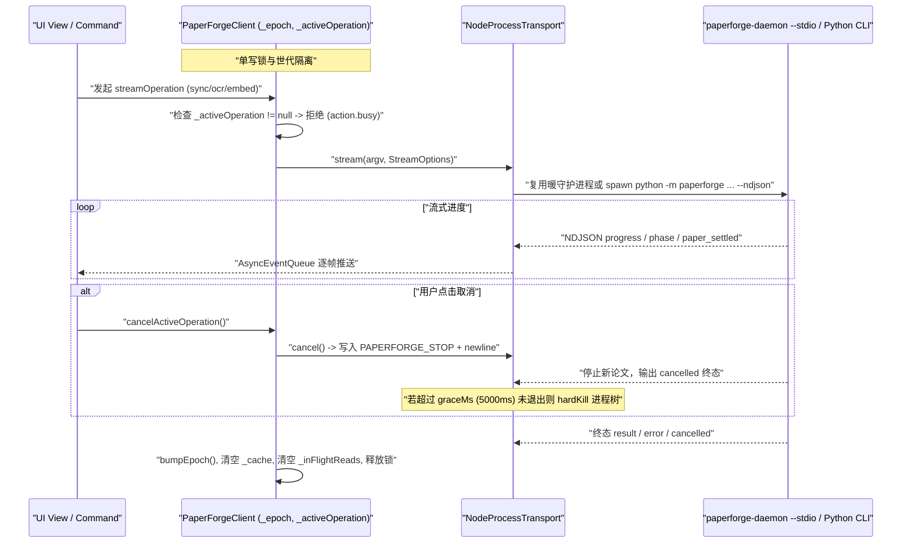

# 第 13 章：Obsidian Thin-Client 插件、Rust 侧车传输与核心视图交互

> **章节定位**：本文档剖析 PaperForge 的 Obsidian 前端插件架构（`paperforge/plugin/`），聚焦 Thin-Client 物理隔离约束、`NodeProcessTransport` 协同原生 Rust 守护进程（`paperforge-daemon`）与 `PaperForgeClient` 的双工/流式协议、2.0.2–2.0.6+ 的极速引导与 10 态确定性决策树、4 页设置中心与五大核心界面表面（`PaperForgeBasesView`、`PaperForgeStatusView`、`PaperForgePdfView`、`PaperForgeSettingTab`、`OcrWorkspaceView`）及 `uikit/` / `quick-switcher` 等交互原语的状态机与生命周期保障。构建/测试门禁见 [第 14 章](14-testing-gates-and-maintenance.md)。

---

## 1. 职责与非目标边界

PaperForge Obsidian 插件被严格定义为 **Thin-Client（纯展示与意图编排壳层）**。按照 [docs/design-thin-client-boundaries.md](../design-thin-client-boundaries.md) 与自动化架构门禁 [paperforge/plugin/tests/client/architecture-boundaries.test.ts](../../paperforge/plugin/tests/client/architecture-boundaries.test.ts) 的契约，插件端与后端（原生 Rust 守护进程 + 受管 Python 核心）之间实行单一事实源（Single Source of Truth）分工。

| 维度 | 插件端职责（允许执行） | 非目标边界（明确禁止，违者测试 FAIL） |
| :--- | :--- | :--- |
| **进程与环境边界** | 仅通过 `NodeProcessTransport` 启动受控 `paperforge-daemon --stdio` 或 Python 子进程（`execute` / `stream` / `launchRuntimeInstaller`） | 任何视图、设置页、`main.ts` 或服务层代码均禁止直接调用 `child_process`（`spawn` / `execFile` / `execFileSync`），且 `PaperForgeClient` 与 `NodeProcessTransport` 仅可在 `paperforge/plugin/src/main.ts` 实例化 |
| **配置与存储读写** | 调用 `configList` / `configSet` / `configValidate` / `configMigrate` 读写后端权威配置，并在 `data.json` 中仅保留只读展示镜像（Display Mirror）与插件 UI 偏好 | **禁止**直接读写/解析 Vault 内 `paperforge.json`、`formal-library.json`、`manifest.json`、SQLite `.db` 文件，也禁止自行调用 `processFrontMatter(`、`getFileCache(` 或访问 `.pre-rebuild` 等中间产物 |
| **凭据与密钥管理** | 通过 `authSetSecret` 经由 `stdin` 将用户输入的 OCR / Embedding API Key 写入 Python Keyring；提供 `migrateLegacySecret` 完成旧版 Obsidian `SecretStorage` 的一次性迁移与擦除 | 运行期**永不**从 Obsidian `SecretStorage` 读取密钥，**永不**将密钥写入命令行 `argv`、日志或进程环境变量（`stripCredentialEnv` 主动剔除敏感 env 前缀） |
| **路径与身份判定** | 调用 `client.resolvePaperContext(filePath)` 向后端查询当前活动文档属于 `paper` / `domain` / 全局；通过 `runtime-paths.ts` 消费 `config list` 返回的绝对目录映射 | **禁止**基于 Obsidian Active File 文件名正则猜测 `zotero_key`，禁止自行拼接外部 `resources_dir` / `indexes` 业务路径去直接写数据 |
| **业务逻辑与写回** | 分发标准化的 Action/CLI 命令并展示 `ProbeEnvelope` / `NdjsonEvent` / DTO 结果；PDF 批注与阅读记录通过 CLI JSON 子命令落库 | **禁止**在 TypeScript 中重新实现文献索引同步、OCR 状态机推断、Living Memory Facet 生成或文件版本快照写盘逻辑 |

> [!IMPORTANT]
> **为什么旧服务文件保持永久删除（Tombstone）？**
> [paperforge/plugin/tests/client/architecture-boundaries.test.ts](../../paperforge/plugin/tests/client/architecture-boundaries.test.ts) 对已退役模块建立了墓碑检查：一旦重新引入 `services/long-task-client.ts`、`services/action-client.ts`、`services/config-client.ts`、`services/version-history.ts` 或 `utils/zotero-path.ts` 等越权直连服务，CI 将立即拦截，防止"双权威状态漂移"。

---

## 2. 核心源码与单测映射表

### 2.1 客户端、传输与后端契约层 (`paperforge/plugin/src/client/`)

| 源码路径 | 核心导出符号 / 类 | 职责摘要 | 对应单测文件 |
| :--- | :--- | :--- | :--- |
| `paperforge/plugin/src/client/index.ts` | 统一重导出桶 | 汇总导出 `action-contract`、`transport`、`paperforge-client`、`node-transport` | `paperforge/plugin/tests/client/architecture-boundaries.test.ts` |
| `paperforge/plugin/src/client/transport.ts` | `Transport`、`NdjsonEvent`、`LongTaskOutcome`、`StreamDiagnostics`、`AsyncEventQueue` | 定义后端传输抽象接口、流式事件队列（支持异步迭代与句柄取消）与超时/信号诊断结构 | `paperforge/plugin/tests/client/node-transport.test.ts` |
| `paperforge/plugin/src/client/node-transport.ts` | `NodeProcessTransport`、`NdjsonStreamParser`、`ExecuteChildRegistry`、`runLongTask`、`paperforgeEnrichedEnv` | 唯一 `child_process` 权威；优先复用暖 `paperforge-daemon --stdio` 侧车（`cwd: os.tmpdir()` 防锁 Vault、热替换时单次无缝重试），回退 Python 子进程、`PAPERFORGE_STOP\n` 协同取消与整树收割 | `paperforge/plugin/tests/client/execute-child-reaping.test.ts`、`paperforge/plugin/tests/client/protocol-conformance.test.ts`、`paperforge/plugin/tests/client/daemon-transport.test.ts`、`paperforge/plugin/tests/client/native-rust-daemon.test.ts` |
| `paperforge/plugin/src/client/paperforge-client.ts` | `PaperForgeClient`、DTO 接口（`PdfAnnotationDto`、`PaperMemoryCardDto`、`BaseTableSnapshotDto`、`VaultUpgradePlanDto` 等） | 统一对外 RPC 客户端；持有 `OperationLock`（`_activeOperation`）互斥锁、`_epoch` 防复活读缓存、`invalidatePaperScope` 局部失效及结构升级/记忆读写强类型方法 | `paperforge/plugin/tests/client/paperforge-client.test.ts`、`paperforge/plugin/tests/client/x03-concurrency-isolation.test.ts`、`paperforge/plugin/tests/client/runtime-status-retry.test.ts`、`paperforge/plugin/tests/living-memory-and-reset.test.ts` |
| `paperforge/plugin/src/client/action-contract.ts` | `ActionScope`、`ActionRequest`、`ActionRunResult`、`buildActionArgv` | 将前端动作（`all`/`paper`/`papers`/`collection`）序列化为标准 CLI 参数数组，禁止自由拼接 shell | `paperforge/plugin/tests/client/probe-action-dispatch.test.ts` |
| `paperforge/plugin/src/client/probe-types.ts` | `ProbeEnvelope`、`ProbeAllEnvelope`、`CapabilityState`、`UserState`、`Severity`、`ActionPrimary` | 对应后端 `schema_version=2` 的能力探测信封契约，驱动设置页 10 态决策树与模块状态行 | `paperforge/plugin/tests/capability-state.test.ts` |
| `paperforge/plugin/src/client/trace.ts` | `traceRecord`、`dumpTrace`、`traceConsoleError`、`rejectionCode`、`rejectionData` | 200 条有界元数据环形缓冲区（`MAX_RECORDS = 200`）；仅记录命令身份/耗时/错误码，严禁输出敏感参数与密钥 | `paperforge/plugin/tests/client/trace.test.ts` |

### 2.2 基础设施、决策树与原生守护服务层 (`paperforge/plugin/src/services/` & `src/`)

| 源码路径 | 核心导出符号 | 职责摘要 | 对应单测 / 契约 |
| :--- | :--- | :--- | :--- |
| `paperforge/plugin/src/main.ts` | `PaperForgePlugin`、`ReleaseNotesModal`、`ConfirmMigrationModal` | 插件入口；将 `configList` / 后台探针延后至 `onLayoutReady` 空闲调度，定时同步前执行 `zotero.sqlite` / `-wal` `stat()` 指纹门禁，维护 `.state-seq.json` 监听与 `onunload` 清理 | `paperforge/plugin/tests/commands.test.ts`、`paperforge/plugin/tests/client/main-autosync-cutover.test.ts`、`paperforge/plugin/tests/client/main-ocr-run-cutover.test.ts`、`paperforge/plugin/tests/performance-hygiene.test.ts` |
| `paperforge/plugin/src/services/native-daemon.ts` | `resolveNativeDaemonBinary`、`ensureNativeDaemon`、`verifyBinarySha256` | 管理 `~/.paperforge/bin/` 内容寻址 `paperforge-daemon` 二进制下载、异步流式 SHA-256 校验（12h 本地完好缓存）与 `.daemon-meta.json` 热替换 | `paperforge/plugin/tests/client/native-rust-daemon.test.ts` |
| `paperforge/plugin/src/services/setup-decision-tree.ts` | `resolveSetupDecision`、`normalizeSemverForCompare`、`SetupDecision` | 控制中心 10 态确定性决策树单权威，保证任何时刻只渲染 1 张主卡片与 1 个最优先动作 | `paperforge/plugin/tests/real-upgrade-decision-tree.test.ts` |
| `paperforge/plugin/src/services/feedback.ts` | `translateErrorToPlainText`、`FeedbackNotice` | 统一 3 层交互反馈契约（瞬时轻提示 / 原位可操作卡片 / 白话报错翻译） | `paperforge/plugin/tests/feedback-i18n-unification.test.ts` |
| `paperforge/plugin/src/services/deferred.ts` | `scheduleIdleTask` / 延迟队列工具 | 2.0.6 启动零阻塞调度原语，将重初始化移出 `onload()` 关键路径 | `paperforge/plugin/tests/performance-hygiene.test.ts` |
| `paperforge/plugin/src/services/managed-runtime.ts` | `readRuntimePointer`、`resolveRuntimeCommand`、`PointerInfo` | 只读解析 `~/.paperforge/runtime/pointer.json`（强制校验 `schema_version === 1` 与绝对路径） | `paperforge/plugin/tests/managed-runtime.test.ts`、`paperforge/plugin/tests/managed-runtime-real-kill.test.ts` |
| `paperforge/plugin/src/services/runtime-installer-launcher.ts` | `normalizePep440Version`、`bootstrapPythonSource`、`installerRun` | 优先调用 `paperforge-daemon install-runtime` 或无黑框独立安装脚本（支持 `uv`、国内多镜像与 TUNA/Aliyun 回退） | `paperforge/plugin/tests/runtime-installer-launch.test.ts`、`paperforge/plugin/tests/uv-installer-bootstrap.test.ts` |
| `paperforge/plugin/src/services/secret-storage.ts` | `stripCredentialEnv`、`legacyEmbeddingSecretIds`、`migrateLegacySecret` | 环境变量凭据清洗；以及旧版密钥向 Python `auth set --stdin` 的一次性显式迁移 | `paperforge/plugin/tests/secret-storage.test.ts` |
| `paperforge/plugin/src/services/runtime-paths.ts` | `applyPathConfigFromList`、`readPathConfig`、`resolveVaultPaths`、`isConfigHydrated` | 从 `config list` 同步展示镜像与 Vault 相对路径解析；`isConfigHydrated()` 作为 `.state-seq.json` 监听前置守卫 | `paperforge/plugin/tests/client/foundation-maintenance-cutover.test.ts` |
| `paperforge/plugin/src/services/next-actions-orchestrator.ts` & `version-diff.ts` | `orchestrateFromSync`、`orchestrateNextActions` | `sync` 完成后防环编排后续动作与版本差异对比 | `paperforge/plugin/tests/next-actions-orchestrator.test.ts` |
| `paperforge/plugin/src/services/progress-parser.ts` & `python-bridge.ts` | `parseProgressLine`、`classifyError`、`classifySetupFailure` | 纯函数进度行解析与安装/环境错误分类 | `paperforge/plugin/tests/progress-parser.test.ts`、`paperforge/plugin/tests/errors.test.ts` |
| `paperforge/plugin/src/constants.ts`、`primitives.ts`、`i18n.ts` | `VIEW_TYPE_*`、`ACTIONS`、`CAPABILITY_MODULES`、`PaperForgeSettings`、`t()` | 视图 ID 常量、全局命令表、设置结构与 100% 对称中英双语词典 | `paperforge/plugin/tests/state-showcase.test.ts`、`paperforge/plugin/tests/feedback-i18n-unification.test.ts` |

### 2.3 五大核心视图、UIKit 原语与弹窗交互层 (`paperforge/plugin/src/views/`, `uikit/`, `settings.ts`)

| 源码路径 | 核心类与注册 ID | 职责摘要 | 对应单测文件 |
| :--- | :--- | :--- | :--- |
| `paperforge/plugin/src/views/paperforge-base-view.ts` | `PaperForgeBasesView` (`type = "paperforge-table"`) | 单一「文献库」Base 工作台；O(1) 路径索引、80 行分块流式渲染、固定 `<colgroup>` 列宽、Shift 连选、多选上下文栏 `.pf-base-selection-bar` 与缺失本地 PDF 诊断条 | `paperforge/plugin/tests/paperforge-base-view.test.ts`、`paperforge/plugin/tests/perf-benchmark.test.ts` |
| `paperforge/plugin/src/views/dashboard.ts` | `PaperForgeStatusView` (`type = "paperforge-status"`)、`MemoryFacetHistoryModal` | 右侧伴读 Companion 面板；`global`/`collection`/`paper` 三态切换、128 槽有界 LRU 缓存、`offref()` 严格卸载清理、Scoped `Ctrl+Enter`、`M`/`@` 双模检索、Living Paper Memory Card | `paperforge/plugin/tests/dashboard-runtime.test.ts`、`paperforge/plugin/tests/W18-resilience-evidence.test.ts`、`paperforge/plugin/tests/living-memory-and-reset.test.ts` |
| `paperforge/plugin/src/views/pdf-annotator.ts` | `PaperForgePdfView` (`type = "paperforge-pdf-view"`) | 内置 PDF.js + TextLayer + Sidecar 批注阅读器；macOS Preview 双层标记条、Human vs Agent 双层过滤、溯源校验（`provenance_status`）、笔记双向跳页 | `paperforge/plugin/tests/pdf-annotator.test.ts` |
| `paperforge/plugin/src/settings.ts` & `views/domain-preview.ts` & `views/upgrade-modal.ts` | `PaperForgeSettingTab`、`PaperForgeSetupWizardModal`、`PaperForgeUpgradeModal` | 2.0.2 一屏 Express Onboarding（含 A/B `domain_mode` 实时预览）、2.0.4 10 态决策树主卡、2.0.5 四页分页（`overview` / `module-detail` / `appearance` / `help`）、打开时脏标刷新与 `<3s` Vault 升级弹窗 | `paperforge/plugin/tests/modals.test.ts`、`paperforge/plugin/tests/installation-navigation.test.ts`、`paperforge/plugin/tests/module-detail-navigation.test.ts`、`paperforge/plugin/tests/upgrade-ux.test.ts` |
| `paperforge/plugin/src/views/ocr-workspace.ts` & `research-record.ts` & `paper-interactions.ts` | `OcrWorkspaceView` (`type = "paperforge-ocr-workspace"`)、`DiagnosticFulltextPreviewModal`、`VersionRestoreModal`、`ResearchRecordCaptureModal` | 每页 100 条分页 OCR 排错工作台、只读脱敏全文预览、版本回滚与“切回最新规范全文”、阅读记录采集与统一右键/Hover 预览菜单 | `paperforge/plugin/tests/ocr-workspace-runtime.test.ts`、`paperforge/plugin/tests/ocr-workspace-pagination.test.ts`、`paperforge/plugin/tests/ocr-diagnostic-privacy.test.ts` |
| `paperforge/plugin/src/views/quick-switcher.ts` & `views/ui-gallery.ts` & `uikit/` | `PaperForgeQuickSwitcherModal`、`PaperForgeGalleryView`、`filter-bar.ts`、`side-peek.ts`、`toast.ts`、`commands.ts` | 论文快速切换器、统一命令面板、引用插入、AsterLab UIKit 原语库与开发者 UI Gallery | `paperforge/plugin/tests/quick-switcher.test.ts`、`paperforge/plugin/tests/uikit-framework.test.ts`、`paperforge/plugin/tests/asterlab-ux-alignment.test.ts` |

> [!NOTE]
> 真实 Obsidian 宿主集成测试位于 `paperforge/plugin/test/specs/paperforge.e2e.ts`，配合测试 Vault 构造脚本 `paperforge/plugin/test/fixtures/build_e2e_vault.py` 与密钥环夹具 `paperforge/plugin/test/fixtures/e2e_keyring.py` 运行（由 `npm --prefix paperforge/plugin run test:e2e` 驱动）。

---

## 3. 磁盘文件、数据库表与协议 JSON 字段字典

### 3.1 插件侧关心的磁盘文件与索引信号

插件不直接操作 SQLite，也不自行解析业务配置，仅观察本地状态指针文件与 Obsidian 自身的插件配置目录：

| 文件路径（相对约定目录） | 拥有方 / 读写权限 | 关键字段与用途 |
| :--- | :--- | :--- |
| `~/.paperforge/bin/.daemon-meta.json` | 插件 `ensureNativeDaemon` 与 Rust 守护进程校验 | 记录内容寻址 `binaryPath`、`version`、`sha256`、`verifiedAt`（12h 本地完好免重验窗口） |
| `~/.paperforge/runtime/pointer.json` | Rust/Python `runtime_installer` 原子发布；插件 **只读**（`readRuntimePointer`） | `schema_version` (必须为 `1`)、`python_path` (绝对路径)、`environment_root` (绝对路径)、`paperforge_version` |
| `~/.paperforge/runtime/installer.log` | 安装器流式写入；插件 **只读**尾部诊断 | 含终端完成标记 `[PaperForge] Installer finished.` 与失败标记 `[PaperForge] Installer step failed.`，用于 3s 轮询感知进度 |
| `<indexesDir>/.state-seq.json` | Python 后端完成状态变更时原子替换；插件通过 `fs.watch` **只读**监听 | `seq` (单调递增整数)、`changed_keys` (字符串数组，指示受影响 `zotero_key`)；150ms 防抖后触发 `invalidateCache()` 与 `refreshBaseSnapshot()` |
| `<vault>/.obsidian/plugins/paperforge/data.json` | Obsidian 插件持久化存储（`loadData`/`saveData`） | 保存 UI 偏好（`ui_theme_mode`、`ui_density`、`ui_liquid_glass`、`ui_reduce_motion`、`autoSyncEnabled`、`autoSyncIntervalSeconds`、`debug_trace`、`_setup_complete`）、能力探针缓存与后端配置展示镜像 |

### 3.2 IPC 协议：NDJSON 长任务 10 类事件模型 (`node-transport.ts`)

流式命令（如 `sync`、`ocr`、`embed build`、`action run`）采用每行一条 JSON（`NdjsonStreamParser` 按 `\n` 切分，保留末尾不完整缓冲直到流关闭或下一行到来）的格式输出到 `stdout`。`KNOWN_EVENTS` 白名单严格限定以下 10 种事件；`TERMINAL_EVENTS` 为 `result`、`error`、`cancelled`，其余未知事件或非 JSON 行会被丢弃并计入诊断计数，不阻塞流消费。

| `event` 类型 | 所属类别 | 核心字段字典 | 前端处理行为 |
| :--- | :--- | :--- | :--- |
| `start` | 生命周期开始 | `op`, `total`?, `ts`? | 初始化流阶段状态 |
| `preflight` | 预检结果 | `ok`, `blocking`?, `warnings`? | 展示前置条件提示或阻止继续 |
| `phase` | 阶段切换 | `phase`, `label`?, `paper_key`? | 更新当前运行步骤文案（如阶段转换） |
| `progress` | 数值进度 | `current`, `total`, `paper_key`?, `item_status`? | 更新 `OcrWorkspaceView` 与 `PaperForgeBasesView` 进度条 |
| `paper_settled` | 单篇落盘 | `key`/`paper_key`, `status`, `reason`? | 触发对应论文卡片/行状态即时刷新 |
| `heartbeat` | 活跃保活 | `ts`?, `active_key`? | 维持前端运行态指示，防止误判假死 |
| `item_result` | 单项结果 | `key`, `ok`, `detail`? | 收集批处理逐篇执行摘要 |
| `result` | **终态（成功）** | `ok: true`, `data`, `command`? | 解析 `LongTaskOutcome.kind = "result"` 并释放 `OperationLock` |
| `error` | **终态（失败）** | `ok: false`, `code`, `message`, `data`? | 构造带 `code`/`data` 的结构化 Error 并释放 `OperationLock` |
| `cancelled` | **终态（已取消）** | `reason`?, `settled`? | 标记 `LongTaskOutcome.kind = "cancelled"`，保留已完成单篇成果 |

### 3.3 核心后端读模型 DTO 字段摘要 (`paperforge-client.ts`)

1. **`ProbeEnvelope` (`probe-types.ts`, `SCHEMA_VERSION = 2`)**
   - `schema_version`: `2`
   - `module`: `CapabilityModule`（`"installation" | "library" | "ocr" | "memory" | "maintenance" | "help"`）
   - `capability_state` / `activity_state` / `severity` / `user_state`（如 `"checking" | "ready" | "not_enabled" | "setup_required" | "detection_failed"`）
   - `reason`: `{ code, summary, detail? }`
   - `action_primary`: `{ action_id, label, safety_class, confirmation_required }` — 当 `safety_class !== "safe"` 且 `confirmation_required === true` 时前端必须弹出确认框。
   - `updated_at`: ISO 时间戳，用于检测初始占位信封或 `.stale` 过期状态。
2. **`PdfAnnotationDto` (`paperforge-client.ts`)**
   - 标识与定位：`ann_id`, `paper_id`, `page`, `rects` (`number[][]` 归一化页坐标), `section_path`, `block_id`, `figure_id`。
   - 分类与内容：`kind` (`"highlight" | "underline" | "strikethrough" | "area" | "note" | "textbox" | "shape" | "ink" | "margin"`), `color`, `intent`, `exact_text`, `comment`, `tags`。
   - 人机分层与样式：`author` (`"user" | "agent"`), `lens`, `grounding_tier`, `style` (`AnnotationStyleDto`)。
   - 溯源与引用资产：`pdf_sha256`, `provenance_status` (`"verified" | "changed" | "unknown"`), `crop_asset_rel`, `embed_wikilink`, `created_at`, `updated_at`。
3. **`PaperMemoryCardDto` & `MemoryFacetDto` (`paperforge-client.ts`)**
   - `paper_id`, `updated_at`, `facet_count`, `facets[]`（对应 5 个认知维度：`idea_logic`、`methods_params`、`research_craft`、`critique_limits`、`my_connection`）。
4. **`BaseTableSnapshotDto` & `BasePaperRowDto` (`paperforge-client.ts`)**
   - 顶层快照含 `seq`（对齐 `.state-seq.json`）、`state_authority`（`"sqlite" | "legacy_json_fallback"`）、`updated_at` 与 `rows: Record<string, BasePaperRowDto>`。
   - 每行 `BasePaperRowDto` 携带 `zotero_key`、`title`、`first_author`、`year`、`journal`、`impact_factor`、`domain`、`has_pdf`、`do_ocr`、`analyze`、`ocr_status`、`deep_reading_status`、`main_note_path`、`user_ann_count`、`agent_ann_count`、`memory_facet_count`、`memory_updated_at`、`needs_diagnostic`。

---

## 4. 核心执行链路、状态机与顺序不变量

### 4.1 `PaperForgeClient` 单通道锁与防复活读缓存

所有前端调用统一收敛在 `PaperForgeClient` 实例上，内部维持两套强时序机制：



1. **单一 `OperationLock`（`_activeOperation`）**：任意时刻整个插件至多存在一个流式写/重任务在运行；并发触发第二项流式任务时在客户端直接 fail-closed 返回冲突（`action.busy`），避免多条子进程争抢 SQLite 与 Vault Markdown。
2. **读缓存 Anti-Resurrection 门卫（`_epoch` + `_cachedRead`）**：
   - 读请求（如 `probeAll` 默认 60s TTL、`runtimeStatus` 30s TTL、`reconcile` 10s TTL）复用 `_inFlightReads` 进行并发去重并缓存到 `_cache`。
   - 请求发出前捕获局部常量 `startEpoch = this._epoch`；全局写操作或 `invalidateCache()`（如 `.state-seq.json` 触发）执行 `this._epoch++` 并清空 `_cache` 与 `_inFlightReads`；单篇文献批注或记忆分面变更则调用 `invalidatePaperScope(paperKey)`，仅精准淘汰目标文献缓存。
   - 当旧请求滞后返回时，若 `startEpoch !== this._epoch`，**严禁将过时结果回填 `_cache`**。
3. **`runtimeStatus` 瞬态重试策略**：`runtimeStatus(expectedVersion)` 设置 `30000ms` 超时，在遇到进程启动瞬态失败时仅允许最多一次 `500ms` 延迟重试；外部设置面板另设 `20000ms` Watchdog 防止界面无限悬挂。

### 4.2 零阻塞启动、`stat()` 同步门禁、`.state-seq.json` 与 `onunload` 收割闭环

1. **零阻塞启动调度（`main.ts` + `deferred.ts`）**：
   - `onload()` 仅注册视图、命令与轻量化设置对象；`configList` 水合、原生守护进程热校验与 `probeAll` 均延后至 `onLayoutReady()` 空闲阶段执行，保证 Obsidian 毫秒级冷启动。
2. **Zotero `stat()` 零开销自动同步门禁（`_autoSync`）**：
   - 定时同步周期下限钳制为 **30 秒**（默认 **120 秒**）；触发前先异步 `fs.stat()` 比对 `zotero.sqlite` 与 `zotero.sqlite-wal` 的 `mtimeMs` / `size`，数据库未变动时直接跳过 Python 同步。
3. **写入即时感知（`.state-seq.json` Watcher）**：
   - `main.ts` 在 `isConfigHydrated()` 成立后建立 `<indexesDir>` `fs.watch`，150ms 防抖后若 `seq` 推进则执行 `invalidateCache()` → `refreshBaseSnapshot(changedKeys)` → `workspace.trigger("paperforge:state-changed", ...)`。
4. **无泄漏卸载与子进程树收割（`onunload` + `reapAllExecuteChildren`）**：
   - `onunload()` 依次移除 `body` 主题类、清理定时器与 `_stateSeqWatcher`、分离插件视图叶片、取消流式任务、关闭守护进程并调用 `reapAllExecuteChildren()` 清扫子进程树（Windows `taskkill /T /F`，POSIX `-pid` `SIGKILL`）。

### 4.3 五大核心视图交互与状态机明细

#### 视图一：Bases 文献工作台（`PaperForgeBasesView`, `paperforge-table`）

- 通过 Obsidian Bases `registerBasesView("paperforge-table", ...)` 注册；数据源由原生 Rust `memory-card base-snapshot` 零 Python 极速提供。
- **性能与排版**：O(1) 路径索引、SVG 模板缓存、**80 行分块流式渲染**、局部勾选刷新（勾选不重建表格）、CSS `content-visibility` 隔离、`colgroup` 固定列宽分配与无框语义化 `<a>` 标题链接。
- **行内交互与批量栏**：标题列附带快速打开 PDF 按钮及右键/Hover 预览；支持复选框与 `Shift` 连选多篇文献，表头滑出上下文操作栏 `.pf-base-selection-bar`；检测到仅云端元数据未下载本地 PDF 时渲染缺失 PDF 诊断条。

#### 视图二：伴读右侧面板（`PaperForgeStatusView`, `paperforge-status`）

- **Obsidian 原生 `.nav-header` 顶栏**：外观与原生侧栏标签页一致，关闭时严格通过 `offref()` 释放 `active-leaf-change` 与 `vault.modify` 监听。
- **三态（`global` / `collection` / `paper`）上下文切换与粘滞**：点击伴读面板自身或 `OcrWorkspaceView` 时返回 `"keep"` 锁定当前伴读文献；`active-leaf-change` 带 **60ms 防抖**。
- **内存边界**：`_resolvedFileCache`、`_overviewTextCache`、`_memoryCardCache` 均限制 **128 条上限**并在 `onClose()` 清空。
- **Scoped 快捷键、检索与 Living Memory Card**：`/` 局部聚焦搜索框，`Ctrl+Enter` 仅在搜索框聚焦时动态 push `_ctrlEnterScope` 执行一次性深度检索；支持 `M`（混合语义）/ `@`（全库文献）双模切换与 5 维 Living Paper Memory Card 内联编辑、清空与历史回溯。

#### 视图三：内置 PDF 批注与人机分层阅读器（`PaperForgePdfView`, `paperforge-pdf-view`）

- 通过 Obsidian 原生 `loadPdfJs()` 加载 PDF 字节流，逐页挂载 **Canvas 渲染层 + TextLayer + Sidecar 批注叠加层（HTML/SVG）**。
- **Apple Preview 双层工具组**：支持划词高亮 / 下划线 / 删除线、框选区域截图（`area`）、自由墨迹（`ink`）、几何图形（`shape`）、文本框（`textbox`）与便签（`note`）。
- **Human vs Agent 双层协作与溯源**：支持 `all` / `user` / `agent` 图层过滤，对 Agent 批注执行 **Adopt** / **Promote** / **Clear**；`provenance_status === "changed"` 时展示 `Source PDF modified` 警报徽章；支持垂直分栏精读与双向跳页高亮。

#### 视图四：10 态决策树、Express Onboarding 与 4 页设置中心（`PaperForgeSettingTab` + `setup-decision-tree.ts`）

- 所有设置内容限定在 `.pf-settings-shell.pf-settings-scope` 容器内（支持 `pf-theme-asterlab` 默认暖中性与 `pf-theme-obsidian` 跟随主题，以及 2.0.6 默认零模糊纯色高性能模式与可选液态玻璃）。
- **4 页极简导航（2.0.5+）**：
  1. `overview`（概览）：顶部渲染 **10 态确定性决策树主卡**（`engine_updating` / `engine_quarantined` / `checking` / `engine_version_mismatch` / `engine_not_installed` / `engine_probe_failed` / `legacy_vault_upgrade` / `zotero_not_configured` / `library_sync_error` / `ready`），下方仅保留 5 行单行模块状态入口；设置页关闭时仅标脏，打开时再刷新 `probeAll`。
  2. `module-detail`（模块配置）：承接 `installation`（含存储维护/回滚）、`library`、`ocr`、`memory`、`agent`（含 MCP 一键安装/检测与 Skill 部署）五大配置详情页。
  3. `appearance`（外观）：独立管理主题、排版密度、液态玻璃与减弱动画开关。
  4. `help`（帮助）：内置更新日志、使用教程入口与开发者 UI Gallery。
- **一屏 Express Onboarding（`_renderExpressSetup`, 2.0.2+）**：未初始化用户默认进入一屏极速引导，支持「一键启用引擎并同步文献库」全自动串联、Zotero `zotero.sqlite` 自动探测、A/B `domain_mode` 实时目录预览（`domain-preview.ts`）与折叠式 AI/期刊配置；需要分步控制时可切换至 4-Stage 引导模式或由 `PaperForgeUpgradeModal` 执行 `<3s` 无损结构迁移。

#### 视图五：OCR 批量排错工作台、Quick Switcher 与弹窗家族（`OcrWorkspaceView`, `quick-switcher.ts`, `modals.ts`）

- `OcrWorkspaceView` 按每页 **100 条**（`PAGE_SIZE = 100`）分页加载 `queryOcrPapers`，配合 `DiagnosticFulltextPreviewModal`（只读脱敏全文预览）与 `VersionRestoreModal`（历史版本预览与切回最新规范全文）。
- `PaperForgeQuickSwitcherModal` 与统一命令面板提供键盘优先的论文直达、引用插入与主题/视图快速切换。
- 共用弹窗集中在 `paperforge/plugin/src/views/modals.ts`：`PaperForgeOrphanModal`、`PaperForgeConfirmModal`、`PaperForgeIssueDraftModal`（严格规则脱敏）。

---

## 5. 配置项、环境变量、CLI 入口与错误码

### 5.1 插件注册的 Obsidian 命令表 (`paperforge/plugin/src/main.ts`)

| Command ID | 命令用途 | 执行路由机制 |
| :--- | :--- | :--- |
| `paperforge-status-panel` | 打开 PaperForge Companion 面板 | `PaperForgeStatusView.open` |
| `paperforge-open-literature-base` | 打开 `Literature Hub.base` 或回退 Companion | `openLiteratureBase()` |
| `paperforge-ocr-workspace` | 打开 OCR 批量排错工作台 | `OcrWorkspaceView.open` |
| `open-ui-gallery` | 打开 AsterLab UI Gallery & Design System | `PaperForgeGalleryView.open` |
| `focus-companion-search` | 聚焦 Companion 搜索框 | 打开面板后 `view._searchInput?.focus()` |
| `open-paper-split-reading` | 当前 PDF 或笔记一键垂直分栏精读 | `resolvePaperContext` -> `openPaperSplitReading` |
| `paperforge-sync` | 同步 Zotero 文献库与生成规范笔记 | `client.sync()`（Stream / Action 队列） |
| `paperforge-ocr` | 批量执行全文 OCR 解析 | `requestOcrRun()` -> `client.streamAction` |
| `paperforge-doctor` | 运行环境、配置与路径全项体检 | `client.doctor()` |
| `paperforge-repair` | 修复三方状态分歧与路径断链并重建索引 | `client.repair()` |
| `paperforge-migrate-config` | 执行旧版配置迁移向导 | `ConfirmMigrationModal` -> `client.configMigrate()` |
| `paperforge-vault-upgrade` | 检查或执行旧版 Vault 无损结构升级 | `PaperForgeUpgradeModal` |
| `paperforge-quick-switcher` | 打开论文 Quick Switcher | `PaperForgeQuickSwitcherModal` |
| `paperforge-insert-citation` | 在当前光标处插入文献引用 | `PaperForgeQuickSwitcherModal` (citation mode) |
| `paperforge-command-palette` | 打开 PaperForge 统一命令面板 | `uikit/commands.ts` |
| `paperforge-open-current-pdf` | 打开当前文献 PDF（内置批注阅读器） | `openPaperPdf()` |
| `paperforge-ocr-current-paper` | 对当前文献执行单篇 OCR | `requestOcrRun()` |
| `paperforge-build-embeddings` | 构建向量检索索引 | `PaperForgeClient` (`embed` / Settings 跳转) |
| `paperforge-open-settings` | 打开 PaperForge Control Center 设置页 | `app.setting.openTabById` |
| `paperforge-cycle-theme` / `paperforge-cycle-density` / `paperforge-toggle-liquid-glass` / `paperforge-toggle-reduce-motion` | 快速切换外观主题、密度、液态玻璃与减弱动画 | 更新 `settings` 并应用 `body` 类 |
| `paperforge-check-orphans` | 扫描并清理孤儿文献工作区 | `PaperForgeOrphanModal` |

> [!NOTE]
> `constants.ts` 中定义的 `paperforge-ocr-redo` 在 `main.ts` 命令注册循环中被刻意跳过（属于内部调度入口，不暴露给普通用户命令面板）。

### 5.2 子进程环境变量注入与清理规则 (`paperforgeEnrichedEnv` & `stripCredentialEnv`)

1. **隔离宿主 Python 污染**：`paperforgeEnrichedEnv` 在构建子进程 `env` 前显式 `delete env.PYTHONPATH` 与 `delete env.PYTHONHOME`，保证系统或用户全局虚拟环境变量不会干扰受管 Runtime（`pointer.json` 指向的 Python）。
2. **凭据零泄漏**：调用 `stripCredentialEnv` 剥离敏感环境变量前缀（`PAPERFORGE_CREDENTIAL_`、`PADDLEOCR_`、`VECTOR_DB_`、`OPENAI_`、`EASYSCHOLAR_` 等），密钥统一走操作系统 Keyring 读取与 `auth set --stdin` 写入。
3. **PATH 补全与 UTF-8 强制**：在 macOS / Linux 下为 Electron GUI 进程常见缺失的路径补充 Homebrew（`/opt/homebrew/bin`）、`/usr/local/bin`、`~/.local/bin` 与当前 `python` 所在目录；强制注入 `PYTHONIOENCODING=utf-8` 防止 Windows 中文路径在管道通信中触发编码异常。
4. **Windows Store 别名屏蔽**：`discoverBasePython` 会跳过包含 `\microsoft\windowsapps\` 片段的伪 `python.exe` 桩文件，避免弹出 Microsoft Store 商店页阻塞无人值守安装。

### 5.3 核心前端/协议错误码与恢复语义 (`trace.ts` & `node-transport.ts`)

| 错误码 / 状态码 | 归类 | 触发条件与客户端行为 |
| :--- | :--- | :--- |
| `NO_PYTHON` | 可预期环境缺失 | 既未找到有效 `pointer.json` 也未发现基础 Python 3.11+；非原生快路径操作引导进入 Express Onboarding 一键安装 |
| `action.busy` | 可预期互斥冲突 | `_activeOperation` 非空时发起第二个流式任务；保留当前运行任务不中断 |
| `cancelled` / `action.cancelled` | 用户主动取消 | 收到 `PAPERFORGE_STOP\n` 后后端收敛退出，或前端达到 `graceMs` 后强制结束 |
| `credential.missing` / `credential.input_required` | 凭据未配置 | Keyring 中尚未配置对应 Provider 密钥，前端不报错刷屏（纳入 `EXPECTED_STATE_CODES` 静默处理），引导输入 |
| `config.not_found` / `migration_required` | 配置就绪门禁 | `dashboardStats` 或启动期 `configValidate` 检测到缺失或旧版配置结构，交由 10 态决策树呈现设置或升级主卡 |

---

## 6. 边界防护与 Fail-Closed 防呆规则

| 防护门 / 不变量编号 | 实施位置 | 机制说明 |
| :--- | :--- | :--- |
| **Thin-Client Gate A–E** | `paperforge/plugin/tests/client/architecture-boundaries.test.ts` | AST/文本静态扫盘：锁定 `child_process` 仅在 `node-transport.ts` 出现；锁定 `PaperForgeClient`/`NodeProcessTransport` 仅在 `main.ts` 构造；禁止 `client/` 纯逻辑文件导入 `obsidian`；严禁业务视图访问 `formal-library.json`、`manifest.json`、`fulltext.pre-rebuild` 等后端私有细节 |
| **Action 安全二次确认** | `paperforge/plugin/src/settings.ts` & `PaperForgeConfirmModal` | 当 `ProbeEnvelope.action_primary` 声明 `safety_class !== "safe"` 且 `confirmation_required === true` 时，点击按钮强制拦截并弹出模态框，用户显式确认后才调用 `runAction` / `streamAction` |
| **上下文识别 Fail-Closed** | `paperforge/plugin/src/views/dashboard.ts` (`_resolveModeForFile`) | 当 `client.resolvePaperContext(path)` 失败或返回未知类型时，一律回退 `mode = "global"`，绝不根据文件名/文件夹结构做启发式猜测 |
| **守护进程与安装器完整性校验** | `paperforge/plugin/src/services/native-daemon.ts` & `runtime-installer-launcher.ts` | `paperforge-daemon` 下载后强制执行异步流式 SHA-256 校验与目录归属检验；Python 运行时安装先验 candidates 后原子发布 `pointer.json`，并在 `installer.log` 捕获失败标记立即中止等待 |
| **版本规范化与零前置引导** | `normalizePep440Version`、`normalizeSemverForCompare`、`manifest.json` (`minEngineVersion`) | 将插件侧 SemVer 字符串归一化为 PEP 440，通过 `--min-engine-version` 透传兼容窗口避免 UI 热修触发后端全量重建；无系统 Python 时经 `uv`（强校验官方 SHA-256）自动引导托管 Python 3.12 |
| **面板级键盘与视图生命周期防护** | `OcrWorkspaceView._closed`、`PaperForgeStatusView._ctrlEnterScope`、`PaperForgePdfView._loadVersion` | 视图关闭或重新打开时立即递增 `_loadGeneration` / `_loadVersion`、置位 `_closed` 并调用 `offref()` 释放全局监听，同时无条件弹出焦点作用域键盘监听，防止快捷键与内存泄漏 |

---

## 7. 维修、调试与升级 Checklist

### 7.1 开启前端 Client Trace 与诊断导出

1. 在 Obsidian 设置 → PaperForge 底部或 Help 页开启 **`debug_trace`**，或排查故障时打开开发者控制台（`Ctrl+Shift+I`）。
2. 在控制台通过已加载插件实例查看脱敏诊断日志环：所有记录均不含 API Key 与路径隐私值，仅含 `op`、`ok`、`ms`、`epoch`、`code` 与流终态类型。
3. 若出现 `[PF] failed op=... stage=... code=... exit=...`（非 `EXPECTED_STATE_CODES` 类错误），结合 `client.lastStreamDiagnostics` 判断属于超时（`timedOut`）、信号终止、还是子进程非零退出码。

### 7.2 插件前端构建与热部署验证 Checklist

1. 修改 `paperforge/plugin/src/` 或 `paperforge/plugin/styles.css` 后，必须重新打包产物以保持受跟踪的 `paperforge/plugin/main.js` 同步（CI 的 `plugin-tests` Job 会校验源码与提交产物完全一致）：
   ```bash
   npm --prefix paperforge/plugin run typecheck
   npm --prefix paperforge/plugin run test
   npm --prefix paperforge/plugin run build
   ```
2. **主题变量回归核查**：若改动视觉样式，分别在 `ui_theme_mode: "asterlab"` 与 `"obsidian"` 以及亮/暗色模式下检查设置面板（`.pf-settings-scope`）是否误伤宿主 Vault 其他区域样式。
3. **跨视图交互核查**：修改 `PaperForgeStatusView`、`PaperForgeBasesView` 或 `PaperForgePdfView` 时，重点验证以下三条闭环链路：
   - 切换活动叶片或点击 Companion 内部卡片时，面板不会因为自我聚焦丢失 `paper` 模式上下文；
   - 在 Companion 搜索框按下 `Ctrl+Enter` 能且仅能触发一次 CLI 强制深度搜索，聚焦 Markdown 编辑器时原 `Ctrl+Enter`（新标签打开链接）不受影响；
   - `onunload` 卸载插件后，操作系统进程管理器中无残留 `paperforge-daemon` 或 `python -m paperforge` 子进程。

### 7.3 常见故障快速排障表

| 症状表现 | 优先怀疑根因 | 立即核查与恢复动作 |
| :--- | :--- | :--- |
| 插件报错 `NO_PYTHON` 或决策树停留在第 1 步 | `~/.paperforge/runtime/pointer.json` 损坏、缺失或被杀软拦截 | 在设置「概览」决策树主卡点击一键安装/修复引擎，或检查 `~/.paperforge/runtime/installer.log` 末行错误 |
| 点击同步/OCR 提示 `action.busy` 且迟迟不恢复 | 上一条流式子进程卡死在网络/下游 API，`OperationLock` 未释放 | 触发主动取消（写入 `PAPERFORGE_STOP\n`），等待 5s 宽限期自动收割进程树；若进程仍僵尸驻留，重载 Obsidian 插件 |
| Obsidian 中触发论文笔记/批注修改后 Companion 卡片与 Base 表格未刷新 | `<indexesDir>/.state-seq.json` 未发生序列号推进，或 `isConfigHydrated()` 为 false 导致未挂载 `fs.watch` | 检查配置是否已通过 `configList` 水合；手动执行 `paperforge status --json` 与 `paperforge sync` 观察 `.state-seq.json` 中的 `seq` 是否递增 |
| PDF 阅读器中批注未显示或提示 `Source PDF modified` | 本地 PDF 文件被替换/重新导出导致 `pdf_sha256` 变更，或 Zotero 库外 PDF 路径未被 `Platform.resourcePathPrefix` 正确映射 | 在 PDF 侧栏核对变动批注的页码锚点；确保外部 PDF 权限可读且通过 `paperforge annotations pdf-info <KEY> --json` 检查返回路径 |
| 修改了 TS 代码但 CI `plugin-tests` 在 `Committed bundle matches the sources` 失败 | 本地改完代码忘记执行 `npm --prefix paperforge/plugin run build` 并提交更新后的 `paperforge/plugin/main.js` | 在本地运行构建命令并检查 `git diff paperforge/plugin/main.js` 后补充提交 |
