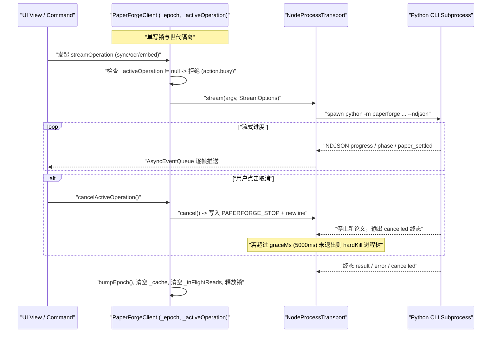

# 第 13 章：Obsidian Thin-Client 插件、IPC 传输与五大视图交互

> **章节定位**：本文档剖析 PaperForge 的 Obsidian 前端插件架构（`paperforge/plugin/`），聚焦 Thin-Client 物理隔离约束、`NodeProcessTransport` 与 `PaperForgeClient` 的单通道长任务/短命令协议、Managed Runtime 引导与旧密钥一次性迁移机制，以及五大核心界面表面（`PaperForgeBasesView`、`PaperForgeStatusView`、`PaperForgePdfView`、`PaperForgeSettingTab`、`OcrWorkspaceView`）的状态机与生命周期保障。构建/测试门禁见 [第 14 章](14-testing-gates-and-maintenance.md)。

---

## 1. 职责与非目标边界

PaperForge Obsidian 插件被严格定义为 **Thin-Client（纯展示与意图编排壳层）**。按照 [docs/design-thin-client-boundaries.md](../design-thin-client-boundaries.md) 与自动化架构门禁 [paperforge/plugin/tests/client/architecture-boundaries.test.ts](../../paperforge/plugin/tests/client/architecture-boundaries.test.ts) 的契约，插件端与 Python 核心后端之间实行单一事实源（Single Source of Truth）分工。

| 维度               | 插件端职责（允许执行）                                                                                                                                                      | 非目标边界（明确禁止，违者测试 FAIL）                                                                                                                                                                          |
| :----------------- | :-------------------------------------------------------------------------------------------------------------------------------------------------------------------------- | :------------------------------------------------------------------------------------------------------------------------------------------------------------------------------------------------------------- |
| **进程与环境边界** | 仅通过 `NodeProcessTransport` 启动受控 Python 子进程（`execute` / `stream` / `launchRuntimeInstaller`）                                                                     | 任何视图、设置页、`main.ts` 或服务层代码均禁止直接调用 `child_process`（`spawn` / `execFile` / `execFileSync`），且 `PaperForgeClient` 与 `NodeProcessTransport` 仅可在 `paperforge/plugin/src/main.ts` 实例化 |
| **配置与存储读写** | 调用 `configList` / `configSet` / `configValidate` / `configMigrate` 读写后端权威配置，并在 `data.json` 中仅保留只读展示镜像（Display Mirror）与插件 UI 偏好                | **禁止**直接读写/解析 Vault 内 `paperforge.json`、`formal-library.json`、`manifest.json`、SQLite `.db` 文件，也禁止自行调用 `processFrontMatter(`、`getFileCache(` 或访问 `.pre-rebuild` 等中间产物            |
| **凭据与密钥管理** | 通过 `authSetSecret` 经由 `stdin` 将用户输入的 OCR / Embedding API Key 写入 Python Keyring；提供 `migrateLegacySecret` 完成旧版 Obsidian `SecretStorage` 的一次性迁移与擦除 | 运行期**永不**从 Obsidian `SecretStorage` 读取密钥，**永不**将密钥写入命令行 `argv`、日志或进程环境变量（`stripCredentialEnv` 主动剔除敏感 env 前缀）                                                          |
| **路径与身份判定** | 调用 `client.resolvePaperContext(filePath)` 向后端查询当前活动文档属于 `paper` / `domain` / 全局；通过 `runtime-paths.ts` 消费 `config list` 返回的绝对目录映射             | **禁止**基于 Obsidian Active File 文件名正则猜测 `zotero_key`，禁止自行拼接外部 `resources_dir` / `indexes` 业务路径去直接写数据                                                                               |
| **业务逻辑与写回** | 分发标准化的 Action/CLI 命令并展示 `ProbeEnvelope` / `NdjsonEvent` / DTO 结果；PDF 批注与阅读记录通过 CLI JSON 子命令落库                                                   | **禁止**在 TypeScript 中重新实现文献索引同步、OCR 状态机推断、Living Memory Facet 生成或文件版本快照写盘逻辑                                                                                                   |

> [!IMPORTANT]
> **为什么旧服务文件保持永久删除（Tombstone）？**
> [paperforge/plugin/tests/client/architecture-boundaries.test.ts](../../paperforge/plugin/tests/client/architecture-boundaries.test.ts) 对已退役模块建立了墓碑检查：一旦重新引入 `services/long-task-client.ts`、`services/action-client.ts`、`services/config-client.ts`、`services/version-history.ts` 或 `utils/zotero-path.ts` 等越权直连服务，CI 将立即拦截，防止"双权威状态漂移"。

---

## 2. 核心源码与单测映射表

### 2.1 客户端、传输与后端契约层 (`paperforge/plugin/src/client/`)

| 源码路径                                            | 核心导出符号 / 类                                                                                                                                          | 职责摘要                                                                                                                                                                                                                                                                                         | 对应单测文件                                                                                                                                                                                                                                             |
| :-------------------------------------------------- | :--------------------------------------------------------------------------------------------------------------------------------------------------------- | :----------------------------------------------------------------------------------------------------------------------------------------------------------------------------------------------------------------------------------------------------------------------------------------------- | :------------------------------------------------------------------------------------------------------------------------------------------------------------------------------------------------------------------------------------------------------- |
| `paperforge/plugin/src/client/index.ts`             | 统一重导出桶                                                                                                                                               | 汇总导出 `action-contract`、`transport`、`paperforge-client`、`node-transport`                                                                                                                                                                                                                   | `paperforge/plugin/tests/client/architecture-boundaries.test.ts`                                                                                                                                                                                         |
| `paperforge/plugin/src/client/transport.ts`         | `Transport`、`NdjsonEvent`、`LongTaskOutcome`、`StreamDiagnostics`、`AsyncEventQueue`                                                                      | 定义后端传输抽象接口、流式事件队列（支持异步迭代与句柄取消）与超时/信号诊断结构                                                                                                                                                                                                                  | `paperforge/plugin/tests/client/node-transport.test.ts`                                                                                                                                                                                                  |
| `paperforge/plugin/src/client/node-transport.ts`    | `NodeProcessTransport`、`NdjsonStreamParser`、`ExecuteChildRegistry`、`runLongTask`、`paperforgeEnrichedEnv`                                               | 唯一 `child_process` 权威；实现 Python 发现、暖 `daemon --stdio` 复用（`cwd: os.tmpdir()` 防锁 Vault 目录、支持旧版本一次性降级回退，且 `shutdownDaemon()` 在强杀进程前清理超时器并拒绝所有在途并发 RPC 以便下次调用平滑重拉）、`PAPERFORGE_STOP\n` 协同取消、跨平台子进程树收割与 NDJSON 行解析 | `paperforge/plugin/tests/client/execute-child-reaping.test.ts`、`paperforge/plugin/tests/client/protocol-conformance.test.ts`、`paperforge/plugin/tests/client/daemon-transport.test.ts`                                                                 |
| `paperforge/plugin/src/client/paperforge-client.ts` | `PaperForgeClient`、DTO 接口（`PdfAnnotationDto`、`PaperMemoryCardDto`、`MemoryHistoryEntryDto`、`VersionsResetLiveResultDTO`、`BaseTableSnapshotDto` 等） | 统一对外 RPC 客户端；持有 `OperationLock`（`_activeOperation`）互斥锁、`generation`/`epoch` 防复活读缓存、`invalidatePaperScope` 局部缓存失效及版本切回/记忆读写强类型方法                                                                                                                       | `paperforge/plugin/tests/client/paperforge-client.test.ts`、`paperforge/plugin/tests/client/x03-concurrency-isolation.test.ts`、`paperforge/plugin/tests/client/runtime-status-retry.test.ts`、`paperforge/plugin/tests/living-memory-and-reset.test.ts` |
| `paperforge/plugin/src/client/action-contract.ts`   | `ActionScope`、`ActionRequest`、`ActionRunResult`、`buildActionArgv`                                                                                       | 将前端动作（`all`/`paper`/`papers`/`collection`）序列化为标准 CLI 参数数组，禁止自由拼接 shell                                                                                                                                                                                                   | `paperforge/plugin/tests/client/probe-action-dispatch.test.ts`                                                                                                                                                                                           |
| `paperforge/plugin/src/client/probe-types.ts`       | `ProbeEnvelope`、`ProbeAllEnvelope`、`CapabilityState`、`UserState`、`Severity`、`ActionPrimary`                                                           | 对应后端 `schema_version=2` 的能力探测信封契约，驱动设置页 Control Center 徽章与按钮动作                                                                                                                                                                                                         | `paperforge/plugin/tests/capability-state.test.ts`                                                                                                                                                                                                       |
| `paperforge/plugin/src/client/trace.ts`             | `traceRecord`、`dumpTrace`、`traceConsoleError`、`rejectionCode`、`rejectionData`                                                                          | 200 条有界元数据环形缓冲区（`MAX_RECORDS = 200`）；仅记录命令身份/耗时/错误码，严禁输出敏感参数与密钥                                                                                                                                                                                            | `paperforge/plugin/tests/client/trace.test.ts`                                                                                                                                                                                                           |

### 2.2 基础设施与编排服务层 (`paperforge/plugin/src/services/` & `src/`)

| 源码路径                                                                                 | 核心导出符号                                                                                                        | 职责摘要                                                                                                                                             | 对应单测 / 契约                                                                                                                                                           |
| :--------------------------------------------------------------------------------------- | :------------------------------------------------------------------------------------------------------------------ | :--------------------------------------------------------------------------------------------------------------------------------------------------- | :------------------------------------------------------------------------------------------------------------------------------------------------------------------------ |
| `paperforge/plugin/src/main.ts`                                                          | `PaperForgePlugin`、`ReleaseNotesModal`、`ConfirmMigrationModal`                                                    | 插件入口；注册视图与命令、维护 `.state-seq.json` 监听、运行收敛定时器（默认 120s）、管理 `openPaperPdf` / `openPaperSplitReading` 及 `onunload` 清理 | `paperforge/plugin/tests/commands.test.ts`、`paperforge/plugin/tests/client/main-autosync-cutover.test.ts`、`paperforge/plugin/tests/client/main-ocr-run-cutover.test.ts` |
| `paperforge/plugin/src/services/managed-runtime.ts`                                      | `readRuntimePointer`、`resolveRuntimeCommand`、`PointerInfo`                                                        | 只读解析 `pointer.json`（位于用户主目录 `.paperforge` 运行时子目录，强制校验 `schema_version === 1` 与绝对路径）                                     | `paperforge/plugin/tests/managed-runtime.test.ts`、`paperforge/plugin/tests/managed-runtime-real-kill.test.ts`                                                            |
| `paperforge/plugin/src/services/runtime-installer-launcher.ts`                           | `normalizePep440Version`、`bootstrapPythonSource`、`windowsInstallerScript`、`posixInstallerScript`、`installerRun` | 构造无控制台外部安装脚本（含 PEP 668 `--break-system-packages` 兼容及 TUNA 镜像回退）与 SemVer 转 PEP 440 归一化                                     | `paperforge/plugin/tests/runtime-installer-launch.test.ts`                                                                                                                |
| `paperforge/plugin/src/services/secret-storage.ts`                                       | `stripCredentialEnv`、`legacyEmbeddingSecretIds`、`migrateLegacySecret`                                             | 环境变量凭据清洗；以及从旧版 `paddleocr-api-key` / SHA-256 哈希化的 `vector-db-api-key-v2-*` 密钥向 Python `auth set --stdin` 的一次性显式迁移       | `paperforge/plugin/tests/secret-storage.test.ts`                                                                                                                          |
| `paperforge/plugin/src/services/runtime-paths.ts`                                        | `applyPathConfigFromList`、`readPathConfig`、`resolveVaultPaths`、`isConfigHydrated`                                | 从 `config list` 同步展示镜像与 Vault 相对路径解析；`isConfigHydrated()` 作为 `.state-seq.json` 监听前置守卫                                         | `paperforge/plugin/tests/client/foundation-maintenance-cutover.test.ts`                                                                                                   |
| `paperforge/plugin/src/services/next-actions-orchestrator.ts` & `next-actions-bridge.ts` | `orchestrateFromSync`、`orchestrateNextActions`                                                                     | `sync` 完成后编排后续推荐动作，内置 `_inFlight` 集合与深度防环守卫（`depth > 0` 抑制重入）                                                           | `paperforge/plugin/tests/next-actions-orchestrator.test.ts`                                                                                                               |
| `paperforge/plugin/src/services/progress-parser.ts` & `python-bridge.ts`                 | `parseProgressLine`、`classifyError`、`classifySetupFailure`                                                        | 纯函数进度行解析与安装/环境错误分类                                                                                                                  | `paperforge/plugin/tests/progress-parser.test.ts`、`paperforge/plugin/tests/errors.test.ts`                                                                               |
| `paperforge/plugin/src/constants.ts`、`primitives.ts`、`i18n.ts`                         | `VIEW_TYPE_*`、`ACTIONS`、`CAPABILITY_MODULES`、`PaperForgeSettings`、`t()`                                         | 视图 ID 常量、全局工具命令表、设置结构与中英双语 i18n                                                                                                | `paperforge/plugin/tests/state-showcase.test.ts`                                                                                                                          |

### 2.3 五大核心视图与弹窗交互层 (`paperforge/plugin/src/views/` & `settings.ts`)

| 源码路径                                                                                        | 核心类与注册 ID                                                                                                                                                        | 职责摘要                                                                                                                                                                             | 对应单测文件                                                                                                                                                                                                                             |
| :---------------------------------------------------------------------------------------------- | :--------------------------------------------------------------------------------------------------------------------------------------------------------------------- | :----------------------------------------------------------------------------------------------------------------------------------------------------------------------------------- | :--------------------------------------------------------------------------------------------------------------------------------------------------------------------------------------------------------------------------------------- |
| `paperforge/plugin/src/views/paperforge-base-view.ts`                                           | `PaperForgeBasesView` (`type = "paperforge-table"`)                                                                                                                    | Obsidian Bases 文献工作台视图；内嵌单行快速操作、Shift 连选、多选上下文顶栏（`.pf-base-selection-bar`）与实时解析进度条                                                              | `paperforge/plugin/tests/paperforge-base-view.test.ts`                                                                                                                                                                                   |
| `paperforge/plugin/src/views/dashboard.ts`                                                      | `PaperForgeStatusView` (`type = "paperforge-status"`)、`MemoryFacetHistoryModal`                                                                                       | 右侧伴读 Companion 面板；支持 `global`/`collection`/`paper` 三态自动切换、128 槽有界 LRU 缓存、Scoped `Ctrl+Enter`、`M`/`@` 双模检索、可交互 Living Paper Memory Card 与历史回溯弹窗 | `paperforge/plugin/tests/dashboard-runtime.test.ts`、`paperforge/plugin/tests/W18-resilience-evidence.test.ts`、`paperforge/plugin/tests/living-memory-and-reset.test.ts`                                                                |
| `paperforge/plugin/src/views/pdf-annotator.ts`                                                  | `PaperForgePdfView` (`type = "paperforge-pdf-view"`)                                                                                                                   | 内置 PDF.js + TextLayer + SVG/HTML Sidecar 批注阅读器；macOS Preview 风格批注工具条、Human vs Agent 双层过滤、溯源校验（`provenance_status`）、笔记双向跳页                          | `paperforge/plugin/tests/pdf-annotator.test.ts`                                                                                                                                                                                          |
| `paperforge/plugin/src/settings.ts` & `paperforge/plugin/src/views/modals.ts`                   | `PaperForgeSettingTab`、`PaperForgeSetupWizardModal`、`PaperForgeOrphanModal`、`PaperForgeIssueDraftModal`                                                             | 4-Stage 引导向导、01-05 Control Center 总览与 6 能力模块详情页（`.pf-settings-shell.pf-settings-scope`）、`.pf-cc-quick-filter` 快速检索、孤儿/问题脱敏报告弹窗                      | `paperforge/plugin/tests/modals.test.ts`、`paperforge/plugin/tests/installation-navigation.test.ts`、`paperforge/plugin/tests/module-detail-navigation.test.ts`、`paperforge/plugin/tests/maintenance-inbox.test.ts`                     |
| `paperforge/plugin/src/views/ocr-workspace.ts` & `research-record.ts` & `paper-interactions.ts` | `OcrWorkspaceView` (`type = "paperforge-ocr-workspace"`)、`DiagnosticFulltextPreviewModal`、`VersionRestoreModal`、`ResearchRecordCaptureModal`、`ResearchRecordModal` | 每页 100 条（`PAGE_SIZE = 100`）分页的 OCR 批次与单篇排错工作台、全文隐私脱敏预览、版本回滚与“切回最新规范全文”、阅读记录采集与统一右键/Hover 预览菜单                               | `paperforge/plugin/tests/ocr-workspace-runtime.test.ts`、`paperforge/plugin/tests/ocr-workspace-pagination.test.ts`、`paperforge/plugin/tests/ocr-diagnostic-privacy.test.ts`、`paperforge/plugin/tests/living-memory-and-reset.test.ts` |

> [!NOTE]
> 除 Vitest 单元测试外，真实 Obsidian 宿主集成测试位于 `paperforge/plugin/test/specs/paperforge.e2e.ts`，配合测试 Vault 构造脚本 `paperforge/plugin/test/fixtures/build_e2e_vault.py` 与密钥环夹具 `paperforge/plugin/test/fixtures/e2e_keyring.py` 运行（由 `npm --prefix paperforge/plugin run test:e2e` 驱动）。

---

## 3. 磁盘文件、数据库表与协议 JSON 字段字典

### 3.1 插件侧关心的磁盘文件与索引信号

插件不直接操作 SQLite，也不自行解析业务配置，仅观察两类轻量级本地状态指针文件与 Obsidian 自身的插件配置目录：

| 文件路径（相对约定目录）                                        | 拥有方 / 读写权限                                                          | 关键字段与用途                                                                                                                                                       |
| :-------------------------------------------------------------- | :------------------------------------------------------------------------- | :------------------------------------------------------------------------------------------------------------------------------------------------------------------- |
| 宿主主目录 `.paperforge` 下 `runtime` 子目录中的 `pointer.json` | Python `runtime_installer` 原子发布；插件 **只读**（`readRuntimePointer`） | `schema_version` (必须为 `1`)、`python_path` (绝对路径)、`environment_root` (绝对路径)、`paperforge_version`                                                         |
| `pointer_dir()` 内的 `installer.log` 与临时安装脚本             | 安装器脚本写入；插件 **只读**尾部诊断                                      | 含终端完成标记 `[PaperForge] Installer finished.` 与失败标记 `[PaperForge] Installer step failed.`，用于 3s 轮询即时感知进程结果                                     |
| `<indexesDir>/.state-seq.json`                                  | Python 后端完成状态变更时原子替换；插件通过 `fs.watch` **只读**监听        | `seq` (单调递增整数)、`changed_keys` (字符串数组，指示受影响 `zotero_key`)；150ms 防抖后触发 `invalidateCache()` 与 `refreshBaseSnapshot()`                          |
| Vault 内 `.obsidian` 插件目录下的 `data.json`                   | Obsidian 插件持久化存储（`loadData`/`saveData`）                           | 仅保存 UI 偏好（`ui_theme_mode`、`autoSyncEnabled`、`autoSyncIntervalSeconds`、`debug_trace`、`_setup_complete`）、能力探针缓存 `capabilityState` 与后端配置展示镜像 |

### 3.2 IPC 协议：NDJSON 长任务 10 类事件模型 (`node-transport.ts`)

流式命令（如 `sync`、`ocr`、`embed build`、`action run`）采用每行一条 JSON（`NdjsonStreamParser` 按 `\n` 切分，保留末尾不完整缓冲直到流关闭或下一行到来）的格式输出到 `stdout`。`KNOWN_EVENTS` 白名单严格限定以下 10 种事件；`TERMINAL_EVENTS` 为 `result`、`error`、`cancelled`，其余未知事件或非 JSON 行会被丢弃并计入诊断计数，不阻塞流消费。

| `event` 类型    | 所属类别           | 核心字段字典                                     | 前端处理行为                                                  |
| :-------------- | :----------------- | :----------------------------------------------- | :------------------------------------------------------------ |
| `start`         | 生命周期开始       | `op`, `total`?, `ts`?                            | 初始化流阶段状态                                              |
| `preflight`     | 预检结果           | `ok`, `blocking`?, `warnings`?                   | 展示前置条件提示或阻止继续                                    |
| `phase`         | 阶段切换           | `phase`, `label`?, `paper_key`?                  | 更新当前运行步骤文案（如阶段转换）                            |
| `progress`      | 数值进度           | `current`, `total`, `paper_key`?, `item_status`? | 更新 `OcrWorkspaceView` 与 `PaperForgeBasesView` 进度条       |
| `paper_settled` | 单篇落盘           | `key`/`paper_key`, `status`, `reason`?           | 触发对应论文卡片/行状态即时刷新                               |
| `heartbeat`     | 活跃保活           | `ts`?, `active_key`?                             | 维持前端运行态指示，防止误判假死                              |
| `item_result`   | 单项结果           | `key`, `ok`, `detail`?                           | 收集批处理逐篇执行摘要                                        |
| `result`        | **终态（成功）**   | `ok: true`, `data`, `command`?                   | 解析 `LongTaskOutcome.kind = "result"` 并释放 `OperationLock` |
| `error`         | **终态（失败）**   | `ok: false`, `code`, `message`, `data`?          | 构造带 `code`/`data` 的结构化 Error 并释放 `OperationLock`    |
| `cancelled`     | **终态（已取消）** | `reason`?, `settled`?                            | 标记 `LongTaskOutcome.kind = "cancelled"`，保留已完成单篇成果 |

### 3.3 核心后端读模型 DTO 字段摘要 (`paperforge-client.ts`)

1. **`ProbeEnvelope` (`probe-types.ts`, `SCHEMA_VERSION = 2`)**
   - `schema_version`: `2`
   - `module`: `CapabilityModule`（`"installation" | "library" | "ocr" | "memory" | "maintenance" | "help"`）
   - `capability_state` / `activity_state` / `severity` / `user_state`（如 `"checking" | "ready" | "not_enabled" | "setup_required" | "detection_failed"`）
   - `reason`: `{ code, summary, detail? }`
   - `action_primary`: `{ action_id, label, safety_class, confirmation_required }` — 当 `safety_class !== "safe"` 且 `confirmation_required === true` 时前端必须弹出确认框。
   - `updated_at`: ISO 时间戳，用于检测初始占位信封或 `.stale` 过期状态。
2. **`PdfAnnotationDto` (`paperforge-client.ts`)**
   - 标识与定位：`ann_id`, `paper_id`, `page`, `rects` (`number[][]` 归一化页坐标), `section_path`, `block_id`, `figure_id`。
   - 分类与内容：`kind` (`"highlight" | "underline" | "strikethrough" | "area" | "note" | "textbox" | "shape" | "ink" | "margin"`), `color` (`"yellow" | "green" | "blue" | "pink" | "red" | "purple" | "ink" | "gray" | "transparent"`), `intent` (`"evidence" | "question" | "method" | "quote" | "general"`), `exact_text`, `comment`, `tags`。
   - 人机分层与样式：`author` (`"user" | "agent"`), `lens`, `grounding_tier`, `style` (`AnnotationStyleDto`: `shape_type`, `stroke_color`, `fill_color`, `stroke_width`, `font_size`, `points`, `opacity`)。
   - 溯源与引用资产：`pdf_sha256`, `provenance_status` (`"verified" | "changed" | "unknown"`), `crop_asset_rel`, `embed_wikilink`, `created_at`, `updated_at`。
3. **`PaperMemoryCardDto` & `MemoryFacetDto` (`paperforge-client.ts`)**
   - `paper_id`, `updated_at`, `facet_count`, `facets[]`。
   - 每个 `MemoryFacetDto` 含 `facet`（对应后端 5 个认知维度：`idea_logic`、`methods_params`、`research_craft`、`critique_limits`、`my_connection`）、`label`、`content`、`revision`、`updated_at`。
4. **`BaseTableSnapshotDto` & `BasePaperRowDto` (`paperforge-client.ts`)**
   - 顶层快照含 `seq`（对齐 `.state-seq.json`）、`updated_at` 与 `rows: Record<string, BasePaperRowDto>`。
   - 每行 `BasePaperRowDto` 携带 `zotero_key`、`title`、`first_author`、`year`、`journal`、`impact_factor`、`domain`、`has_pdf`、`do_ocr`、`analyze`、`ocr_status`、`deep_reading_status`、`main_note_path`、`user_ann_count`、`agent_ann_count`、`memory_facet_count`、`memory_updated_at`、`needs_diagnostic`。

---

## 4. 核心执行链路、状态机与顺序不变量

### 4.1 `PaperForgeClient` 单通道锁与防复活读缓存

所有前端调用统一收敛在 `PaperForgeClient` 实例上，内部维持两套强时序机制：



1. **单一 `OperationLock`（`_activeOperation`）**：任意时刻整个插件至多存在一个流式写/重任务在运行；并发触发第二项流式任务时在客户端直接 fail-closed 返回或抛出冲突（`action.busy`），避免多条子进程争抢 SQLite 与 Vault Markdown。
2. **读缓存 Anti-Resurrection 门卫（`_epoch` + `_cachedRead`）**：
   - 读请求（如 `probeAll` 默认 60s TTL、`runtimeStatus` 30s TTL、`reconcile` 10s TTL）复用 `_inFlightReads` 进行并发去重并缓存到 `_cache`。
   - 请求发出前捕获局部常量 `startEpoch = this._epoch`；全局写操作或 `invalidateCache()`（如 `.state-seq.json` 触发）执行 `this._epoch++` 并清空 `_cache` 与 `_inFlightReads`；单篇文献批注或记忆分面变更则调用 `invalidatePaperScope(paperKey)`，仅精准淘汰目标文献的 `paper-status:<key>` / `paper-context:<key>` / `:<key>:` 缓存条目而不清空全局 `probe:*` 探针缓存。
   - 当旧请求滞后返回时，若 `startEpoch !== this._epoch`，**严禁将过时结果回填 `_cache`**，彻底杜绝"写后读到旧快照复活"。
3. **`runtimeStatus` 瞬态重试策略**：`runtimeStatus(expectedVersion)` 设置 `30000ms` 超时，在遇到进程启动瞬态失败时仅允许最多一次 `500ms` 延迟重试；外部设置面板另设 `20000ms` Watchdog 防止界面无限悬挂在检查状态。

### 4.2 `.state-seq.json` 状态同步、自动收敛与 `onunload` 收割闭环

1. **写入即时感知（`.state-seq.json` Watcher）**：
   - `main.ts` 在 `isConfigHydrated()` 成立后调用 `_startStateSeqWatcher(vaultBase)` 对 `<indexesDir>` 建立 `fs.watch`。
   - 仅当触发文件名空缺或为 `.state-seq.json` 时进入 `150ms` 防抖定时器；读取 `seq` 并与 `this._lastStateSeq` 去重对比。
   - 若序列号推进，依次执行：`this.getClient().invalidateCache()` → `this.refreshBaseSnapshot(changedKeys)` → `workspace.trigger("paperforge:state-changed", { snapshot, changedKeys })`。随后 `PaperForgeBasesView`、`PaperForgeStatusView`（含 Living Memory Card 与时间线）同步重绘。
2. **后台收敛轮询（`_startConvergenceTimer`）**：
   - 当 `autoSyncEnabled !== false` 时启动周期收敛器，最小周期下限钳制为 **30 秒**，默认 **120 秒**（`autoSyncIntervalSeconds: 120`），调用 `reconcile` 对齐前端展示与 Vault 状态。
3. **无泄漏卸载与子进程树收割（`onunload` + `reapAllExecuteChildren`）**：
   - `main.ts` 的 `onunload()` 依次移除 `body` 主题类、清理 `_pollTimer` 与 `_stateSeqTimer`、关闭 `_stateSeqWatcher`、分离 `VIEW_TYPE_PAPERFORGE` 与 `VIEW_TYPE_PAPERFORGE_PDF` 叶片、调用 `this._client?.cancelActiveOperation()` 中止流式任务，并调用 `NodeProcessTransport.reapAllExecuteChildren()` 清扫仍在运行的普通 `execute` 子进程。
   - `hardKill(pid)` 在 Windows 上执行 `taskkill /T /F /PID <pid>` 强制杀灭整棵进程树（Node + Python + 潜在衍生子进程），在 POSIX 上向 `-pid` 进程组发送 `SIGKILL` 并在必要时回退单 PID `kill -9`。

### 4.3 五大核心视图交互与状态机明细

#### 视图一：Bases 文献工作台（`PaperForgeBasesView`, `paperforge-table`）

- 通过 Obsidian Bases `registerBasesView("paperforge-table", ...)` 注册；数据源来自 `BaseTableSnapshotDto` 与 Bases 查询条目合并渲染。
- **列与状态徽章**：对 `year`、`impact_factor`、`annotations` 应用等宽数字对齐类（`.pf-tnum.is-num`）；`ocr_status` 渲染 `.pf-badge-outline` 状态胶囊（`done` / `done_incomplete` / `failed` / `processing` / `nopdf` / 未解析），其中失败与部分解析徽章可直接点击跳转 `openOcrDiagnostic`。
- **行内交互与批量栏**：标题列附带快速打开 PDF 按钮及右键/Hover 预览绑定（`openUnifiedPaperContextMenu` + `bindObsidianHoverPreview`）；支持复选框与 Shift 连选多篇文献，一旦 `selectedKeys.length >= 1`，顶部滑出上下文操作栏 `.pf-base-selection-bar` 提供取消选择、单篇打开 PDF、故障诊断跳转及库同步。

#### 视图二：伴读右侧面板（`PaperForgeStatusView`, `paperforge-status`）

- **Obsidian 原生 `.nav-header` 顶栏**：使用 `.paperforge-header.nav-header` + `.nav-buttons-container.paperforge-nav-actions` 承载右侧边栏工具栏按钮与三态上下文标题，外观与原生标签页一致。
- **三态（`global` / `collection` / `paper`）上下文切换状态机**：
  - 首先加载 `dashboardStats()` 与 `items`，随后执行 `_resolveWorkspaceContext(activeLeaf)`。
  - **上下文粘滞与防抖保护**：当用户点击 `PaperForgeStatusView` 或 `OcrWorkspaceView` 面板自身时，`_resolveWorkspaceContext` 若检测到 `this._currentMode` 已存在则直接返回 `"keep"`，防止伴读面板聚焦自身时意外丢失当前正在伴读的文献！`active-leaf-change` 监听带有 **60ms 防抖** 过滤快速切换抖动；若活动叶片为 `VIEW_TYPE_PAPERFORGE_PDF`，直接提取其 `getState().paperKey` 锁定 `paper` 模式。
- **内存与视觉连续性保障**：
  - `_resolvedFileCache`、`_overviewTextCache`、`_memoryCardCache` 三大 `Map` 均通过 `_setBoundedCache` 限定上限 **128 条（FIFO/LRU 淘汰）**，并在 `onClose()` 时显式清空。
  - `_scrollOffsets` 按模式/键保留与恢复滚动位置，减少文献切换闪烁。
- **Scoped 快捷键与搜索状态机**：
  - `/` 聚焦搜索框监听器绑定在 `this.containerEl` 上（**不污染全局键盘映射**），且明确避开 `input`、`textarea`、`select` 及 `.cm-editor, [contenteditable='true']`。
  - `Ctrl+Enter` 仅在搜索框聚焦时动态 push 独立的 `obsidian.Scope`（`_ctrlEnterScope`）注册 `["Ctrl"], "Enter"` 执行一次性强制深度检索，失焦或关闭视图时立即 `popScope`，绝不劫持编辑器 `editor:open-link-in-new-leaf`。
  - 双模切换：输入或按钮切换 **`M`（Memory / 语义混合检索）** 与 **`@`（文献实体/全库检索）**；支持触发 `ResearchRecordCaptureModal` 与 `ResearchRecordModal` 新增/修正阅读记录。
- **Living Paper Memory Card（可交互研究认知记忆卡片）**：
  - `_renderLivingMemoryCard` / `_renderLivingMemoryBody`（`.pf-living-memory-card`）展示 5 个规范认知维度并支持直接交互：`编辑` 打开内联多行编辑器调用 `refineMemoryCard()`、`清空` 调用 `clearMemoryFacet()`、`历史` 打开 `MemoryFacetHistoryModal` 查看既往修订并一键恢复；空白或未填满维度通过底部 `+ <维度名>` 芯片直接补全，同时继续响应后端 `.state-seq.json` 的外部更新刷新。

#### 视图三：内置 PDF 批注与人机分层阅读器（`PaperForgePdfView`, `paperforge-pdf-view`）

- 通过 Obsidian 原生 `loadPdfJs()` 加载 PDF 字节流（优先使用 Vault 资源路径，库外 Zotero 路径通过 `Platform.resourcePathPrefix` 拼接绝对本地 URL），逐页挂载 **Canvas 渲染层 + PDF.js TextLayer + Sidecar 批注叠加层（HTML/SVG）**。
- **工具组与标注种类**：顶栏 `.pf-pdf-toolbar`（页码跳转、缩放/适应宽度、侧栏开关、目录 TOC/缩略图/批注列表切换、全文页内搜索）与类 macOS Preview 标记条 `.pf-pdf-markup-bar`（选择划词高亮 `highlight` / 下划线 `underline` / 删除线 `strikethrough`、区域截框 `area`、自由墨迹 `ink`、几何图形 `shape` 含矩形/椭圆/箭头/直线、文本框 `textbox`、便签 `note`）。
- **Human vs Agent 双层协作与溯源**：
  - 工具栏支持 `all` / `user` / `agent` 图层过滤；Agent 自动生成的高亮带有独特视觉标记 `.pf-pdf-hl-agent` 与认知透镜 `lens` / `grounding_tier` 标签。
  - 支持对 Agent 批注执行 **Adopt（采纳转正 `adoptAnnotation`）**、**Promote（晋升写入论文笔记 / 记忆 `promoteAnnotation`）** 或 **Clear Agent Annotations（清空当前文献 Agent 批注层）**。
  - 若 `PdfAnnotationDto.provenance_status === "changed"`，顶栏展示显眼警报徽章（`Source PDF modified`），提示底层 PDF 哈希与批注采集时不一致。
  - **双向阅读同步**：支持 `openPaperSplitReading(paperKey, notePath)` 垂直分栏同时打开 PDF 与正式笔记；从笔记反跳 PDF 页码/批注 ID 时高亮聚焦 `.pf-pdf-split-highlight`。

#### 视图四：6 模块 Control Center 设置页与 4 阶段 Onboarding 向导（`PaperForgeSettingTab` + `modals.ts`）

- 所有设置页内容被限定在 `.pf-settings-shell.pf-settings-scope` 容器内（避免样式溢出 Obsidian 全局设置面板），双色主题通过切换 `document.body` 的 `pf-theme-asterlab`（暖中性默认）或 `pf-theme-obsidian`（桥接用户当前 Obsidian 主题变量）实现。
- **顶栏导航与总览 Control Center**：包含 Overview、Contextual `module-detail` 及 Help 子页，附带 `.pf-cc-quick-filter` 快速检索输入框；总览页以 `01`–`05` 编号卡片呈现五大操作视角（Foundation、`installation` / Library / OCR / Smart Retrieval `memory` / Agent Integration），而底层 `CAPABILITY_MODULES` 对接后端 6 大探测域（`installation`, `library`, `ocr`, `memory`, `maintenance`, `help`）。其中旧版冗余的 Maintenance Tab 已被移除（保留后端残余检查与一键清理入口 `PaperForgeOrphanModal` 以及错误报告脱敏弹窗 `PaperForgeIssueDraftModal`）。
- **4-Stage Setup Journey (`_setupStage` 1→4)**：既可内嵌在设置页顶部横幅，也可由 `PaperForgeSetupWizardModal` 打开：
  1. `Stage 1 Foundation`（`_renderSetupStageFoundation`）：检测运行指针文件 `pointer.json`（位于用户主目录 `.paperforge` 的 `runtime` 子目录）与 `runtimeStatus`，缺失或版本不匹配时调用 `launchRuntimeInstaller` 启动独立无窗口安装脚本并每 3s 轮询 `pointer.json` 与 `installer.log`（最长 25 分钟）。
  2. `Stage 2 Library`（`_renderSetupStageLibrary`）：配置 Vault、Zotero 与文献目录，先经 `configSet` + `configValidate`，通过后强制立即执行一次 `client.sync()` 构建规范文献索引（防止仅写配置而索引未建导致 `library` 探针误判）。
  3. `Stage 3 Optionals`（`_renderSetupStageOptionals`）：按需启用 PaddleOCR（Key 经 `stdin` 写入 Keyring）、Vector Embedding（支持 OpenAI SDK 兼容端点）及 Agent Integration 技能/平台部署。
  4. `Stage 4 Review`（`_renderSetupStageReview`）：汇总 `probeAll` 结果并触发最终就绪确认。

#### 视图五：OCR 批量排错工作台与弹窗家族（`OcrWorkspaceView` & `modals.ts`）

- `OcrWorkspaceView` 按每页 **100 条**（`PAGE_SIZE = 100`）分页加载 `queryOcrPapers`，支持按全部/未处理/需复核/已解析及 OCR 引擎版本筛选，展示实时解析进度及历史遗留活动提示。
- 双击或点击诊断按钮可打开 `DiagnosticFulltextPreviewModal`（在前端强制做隐私与敏感信息脱敏处理）及 `VersionRestoreModal`（通过后端 `versionsList` / `versionsPaths` / `versionsRestore` 从历史快照恢复展示全文，或通过 `切回最新规范全文` -> `versionsResetLive` 一键恢复最新规范全文并清除 `restore_provenance`）。
- 其他共用弹窗集中在 `paperforge/plugin/src/views/modals.ts`：`PaperForgeOrphanModal`（孤儿文件安全清理确认）、`PaperForgeConfirmModal`（破坏性或非 `safe` Action 二次确认）、`PaperForgeIssueDraftModal`（自动采集堆栈并执行规则脱敏生成可粘贴排查工单）。

---

## 5. 配置项、环境变量、CLI 入口与错误码

### 5.1 插件注册的 Obsidian 命令表 (`paperforge/plugin/src/main.ts`)

| Command ID                        | 命令用途                                    | 执行路由机制                                        |
| :-------------------------------- | :------------------------------------------ | :-------------------------------------------------- |
| `paperforge-status-panel`         | 打开 PaperForge Companion 面板              | `PaperForgeStatusView.open`                         |
| `paperforge-open-literature-base` | 打开 `Literature Hub.base` 或回退 Companion | `openLiteratureBase()`                              |
| `paperforge-ocr-workspace`        | 打开 OCR 批量排错工作台                     | `OcrWorkspaceView.open`                             |
| `focus-companion-search`          | 聚焦 Companion 搜索框                       | 打开面板后 `view._searchInput?.focus()`             |
| `open-paper-split-reading`        | 当前 PDF 或笔记一键垂直分栏精读             | `resolvePaperContext` -> `openPaperSplitReading`    |
| `paperforge-sync`                 | 同步 Zotero 文献库与生成规范笔记            | `client.sync()`（Stream / Action 队列）             |
| `paperforge-ocr`                  | 批量执行全文 OCR 解析                       | `requestOcrRun()` -> `client.streamAction`          |
| `paperforge-doctor`               | 运行环境、配置与路径全项体检                | `client.doctor()`                                   |
| `paperforge-repair`               | 修复三方状态分歧与路径断链并重建索引        | `client.repair()`                                   |
| `paperforge-migrate-config`       | 执行旧版 Vault 配置迁移向导                 | `ConfirmMigrationModal` -> `client.configMigrate()` |

> [!NOTE]
> `constants.ts` 中定义的 `paperforge-ocr-redo` 在 `main.ts` 命令注册循环中被刻意跳过（属于内部调度入口，不暴露给普通用户命令面板）。

### 5.2 子进程环境变量注入与清理规则 (`paperforgeEnrichedEnv` & `stripCredentialEnv`)

1. **隔离宿主 Python 污染**：`paperforgeEnrichedEnv` 在构建子进程 `env` 前显式 `delete env.PYTHONPATH` 与 `delete env.PYTHONHOME`，保证系统或用户全局虚拟环境变量不会干扰受管 Runtime（`pointer.json` 指向的 Python）。
2. **凭据零泄漏**：调用 `stripCredentialEnv` 剥离所有以 `PAPERFORGE_CREDENTIAL_`、`PADDLEOCR_`、`VECTOR_DB_`、`OPENAI_` 开头的环境变量，密钥统一走 Python 侧操作系统 Keyring 读取与 `auth set --stdin` 写入。
3. **PATH 补全与 UTF-8 强制**：在 macOS / Linux 下为 Electron GUI 进程常见缺失的路径补充 Homebrew（`/opt/homebrew/bin`）、`/usr/local/bin`、`~/.local/bin` 与当前 `python` 所在目录；强制注入 `PYTHONIOENCODING=utf-8` 防止 Windows 中文路径在管道通信中触发编码异常。
4. **Windows Store 别名屏蔽**：`discoverBasePython` 会跳过包含 `\microsoft\windowsapps\` 片段的伪 `python.exe` 桩文件，避免弹出 Microsoft Store 商店页阻塞无人值守安装。

### 5.3 核心前端/协议错误码与恢复语义 (`trace.ts` & `node-transport.ts`)

| 错误码 / 状态码                                    | 归类           | 触发条件与客户端行为                                                                                   |
| :------------------------------------------------- | :------------- | :----------------------------------------------------------------------------------------------------- |
| `NO_PYTHON`                                        | 可预期环境缺失 | `resolvePython` 既未找到有效 `pointer.json` 也未发现基础 Python 3.11+；引导进入 Setup Stage 1 安装     |
| `action.busy`                                      | 可预期互斥冲突 | `_activeOperation` 非空时发起第二个流式任务；保留当前运行任务不中断                                    |
| `cancelled` / `action.cancelled`                   | 用户主动取消   | 收到 `PAPERFORGE_STOP\n` 后后端收敛退出，或前端达到 `graceMs` 后强制结束                               |
| `credential.missing` / `credential.input_required` | 凭据未配置     | Keyring 中尚未配置对应 Provider 密钥，前端不报错刷屏（纳入 `EXPECTED_STATE_CODES` 静默处理），引导输入 |
| `config.not_found` / `migration_required`          | 配置就绪门禁   | `dashboardStats` 或启动期 `configValidate` 检测到缺失或旧版配置结构，显示一键设置或迁移横幅            |

---

## 6. 边界防护与 Fail-Closed 防呆规则

| 防护门 / 不变量编号              | 实施位置                                                                                             | 机制说明                                                                                                                                                                                                                                                                                               |
| :------------------------------- | :--------------------------------------------------------------------------------------------------- | :----------------------------------------------------------------------------------------------------------------------------------------------------------------------------------------------------------------------------------------------------------------------------------------------------- |
| **Thin-Client Gate A–E**         | `paperforge/plugin/tests/client/architecture-boundaries.test.ts`                                     | AST/文本静态扫盘：锁定 `child_process` 仅在 `node-transport.ts` 出现；锁定 `PaperForgeClient`/`NodeProcessTransport` 仅在 `main.ts` 构造；禁止 `client/` 纯逻辑文件导入 `obsidian`；严禁业务视图访问 `formal-library.json`、`manifest.json`、`fulltext.pre-rebuild` 等后端私有细节                     |
| **Action 安全二次确认**          | `paperforge/plugin/src/settings.ts` & `PaperForgeConfirmModal`                                       | 当 `ProbeEnvelope.action_primary` 声明 `safety_class !== "safe"` 且 `confirmation_required === true` 时，点击按钮强制拦截并弹出模态框，用户显式确认后才调用 `runAction` / `streamAction`                                                                                                               |
| **上下文识别 Fail-Closed**       | `paperforge/plugin/src/views/dashboard.ts` (`_resolveModeForFile`)                                   | 当 `client.resolvePaperContext(path)` 失败或返回未知类型时，一律回退 `mode = "global"`，绝不根据文件名/文件夹结构做启发式猜测                                                                                                                                                                          |
| **安装器无控制台超时兜底**       | `paperforge/plugin/src/services/runtime-installer-launcher.ts` & `settings.ts`                       | 脚本无黑框运行避免无桌面宿主挂死；前端 3s 轮询同时检查 `pointer.json` 与 `installer.log` 失败标记；一旦出现 `[PaperForge] Installer step failed.` 立即中止等待并高亮日志尾巴                                                                                                                           |
| **版本规范化与零前置引导**       | `normalizePep440Version`、`manifest.json` (`minEngineVersion`) & `uvInstallerScript`                 | 将插件侧 SemVer 字符串归一化为 PEP 440（`2.0.0rc6`），通过 `--min-engine-version` 透传兼容窗口避免 UI 热修触发后端全量重建；无系统 Python 时在 `allowUvDownload` 下经固定版本 `uv 0.13.9`（强校验官方 SHA-256）自动引导托管 Python 3.12（见 `paperforge/plugin/tests/uv-installer-bootstrap.test.ts`） |
| **面板级键盘与视图生命周期防护** | `OcrWorkspaceView._closed`、`PaperForgeStatusView._ctrlEnterScope`、`PaperForgePdfView._loadVersion` | 视图关闭或重新打开时立即递增 `_loadGeneration` / `_loadVersion` 并置位 `_closed`，丢弃一切在途异步回填与陈旧 DOM 渲染；同时无条件弹出焦点作用域键盘监听，防止快捷键泄漏                                                                                                                                |

---

## 7. 维修、调试与升级 Checklist

### 7.1 开启前端 Client Trace 与诊断导出

1. 在 Obsidian 设置 → PaperForge 设置底部开启 **`debug_trace`**，或排查故障时直接打开开发者控制台（`Ctrl+Shift+I`）。
2. 在控制台通过已加载插件实例查看脱敏诊断日志环：所有记录均不含 API Key 与路径隐私值，仅含 `op`（命令与子命令名）、`ok`、`ms`（耗时）、`epoch`、`code` 与流终态类型。
3. 若出现 `[PF] failed op=... stage=... code=... exit=...`（非 `EXPECTED_STATE_CODES` 类错误），结合 `client.lastStreamDiagnostics` 判断属于超时（`timedOut`）、信号终止、或 Python 非零退出码。

### 7.2 插件前端构建与热部署验证 Checklist

1. 修改 `paperforge/plugin/src/` 或 `paperforge/plugin/styles.css` 后，必须重新打包产物以保持受跟踪的 `paperforge/plugin/main.js` 同步（CI 的 `plugin-tests` Job 会校验源码与提交产物完全一致）：
   ```bash
   npm --prefix paperforge/plugin run typecheck
   npm --prefix paperforge/plugin run test
   npm --prefix paperforge/plugin run build
   ```
2. **主题变量回归核查**：若改动视觉样式，分别在 `ui_theme_mode: "asterlab"` 与 `"obsidian"` 以及亮/暗色模式下检查设置面板（`.pf-settings-scope`）是否误伤宿主 Vault 其他区域样式。
3. **跨视图交互核查**：修改 `PaperForgeStatusView`、`PaperForgeBasesView` 或 `PaperForgePdfView` 时，重点验证以下三条闭环链路：
   - 切换活动叶片或点击 Companion 内部卡片时，面板不会因为自我聚焦丢失 `paper` 模式上下文；
   - 在 Companion 搜索框按下 `Ctrl+Enter` 能且仅能触发一次 CLI 强制深度搜索，聚焦 Markdown 编辑器时原 `Ctrl+Enter`（新标签打开链接）不受影响；
   - `onunload` 卸载插件后，操作系统进程管理器中无残留 `python -m paperforge` 子进程。

### 7.3 常见故障快速排障表

| 症状表现                                                                          | 优先怀疑根因                                                                                                           | 立即核查与恢复动作                                                                                                                                                      |
| :-------------------------------------------------------------------------------- | :--------------------------------------------------------------------------------------------------------------------- | :---------------------------------------------------------------------------------------------------------------------------------------------------------------------- |
| 插件报错 `NO_PYTHON` 或长期卡在"正在检查运行时"                                   | `pointer.json` 损坏、含相对路径、`schema_version != 1`，或 Windows 上仅命中了 `WindowsApps` 假 `python.exe` 桩         | 删去用户主目录 `.paperforge` 运行时子目录下的坏掉 `pointer.json` 并查看同目录 `installer.log` 末行错误；确认本机已安装 Python >= 3.11 并从 Setup Stage 1 重新执行安装器 |
| 点击同步/OCR 提示 `action.busy` 且迟迟不恢复                                      | 上一条流式子进程卡死在网络/下游 API，`OperationLock` 未释放                                                            | 触发主动取消（写入 `PAPERFORGE_STOP\n`），等待 5s 宽限期自动收割进程树；若进程仍僵尸驻留，在系统任务管理器结束对应 PID 或重载 Obsidian 插件                             |
| Obsidian 中触发论文笔记/批注修改后 Companion 卡片与 Base 表格未刷新               | `<indexesDir>/.state-seq.json` 未发生序列号推进，或 `isConfigHydrated()` 为 false 导致未挂载 `fs.watch`                | 先检查配置是否已通过 `configList` 水合；手动执行 `paperforge status --json` 与 `paperforge sync` 观察 `.state-seq.json` 中的 `seq` 是否递增                             |
| PDF 阅读器中批注未显示或提示 `Source PDF modified`                                | 本地 PDF 文件被替换/重新导出导致 `pdf_sha256` 变更，或 Zotero 库外 PDF 路径未被 `Platform.resourcePathPrefix` 正确映射 | 在 PDF 侧栏核对变动批注的页码锚点；确保外部 PDF 权限可读且通过 `paperforge annotations pdf-info <KEY> --json` 检查返回路径                                              |
| 修改了 TS 代码但 CI `plugin-tests` 在 `Committed bundle matches the sources` 失败 | 本地改完代码忘记执行 `npm --prefix paperforge/plugin run build` 并提交更新后的 `paperforge/plugin/main.js`             | 在本地运行构建命令并检查 `git diff paperforge/plugin/main.js` 后补充提交                                                                                                |
