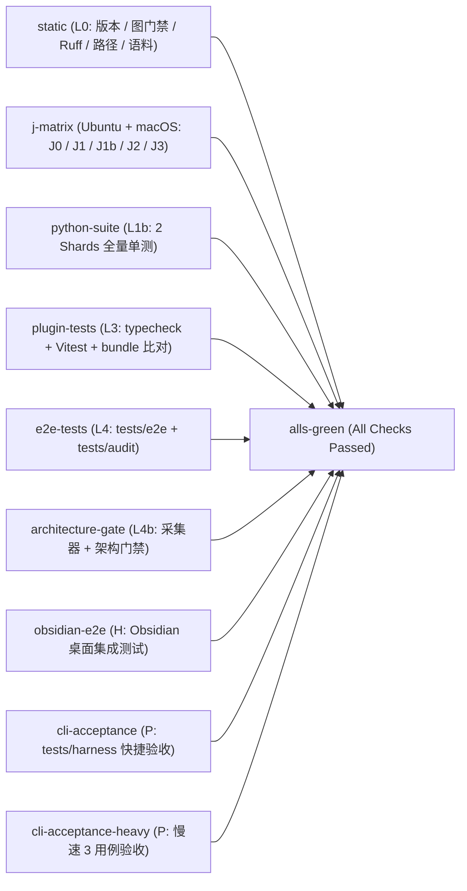
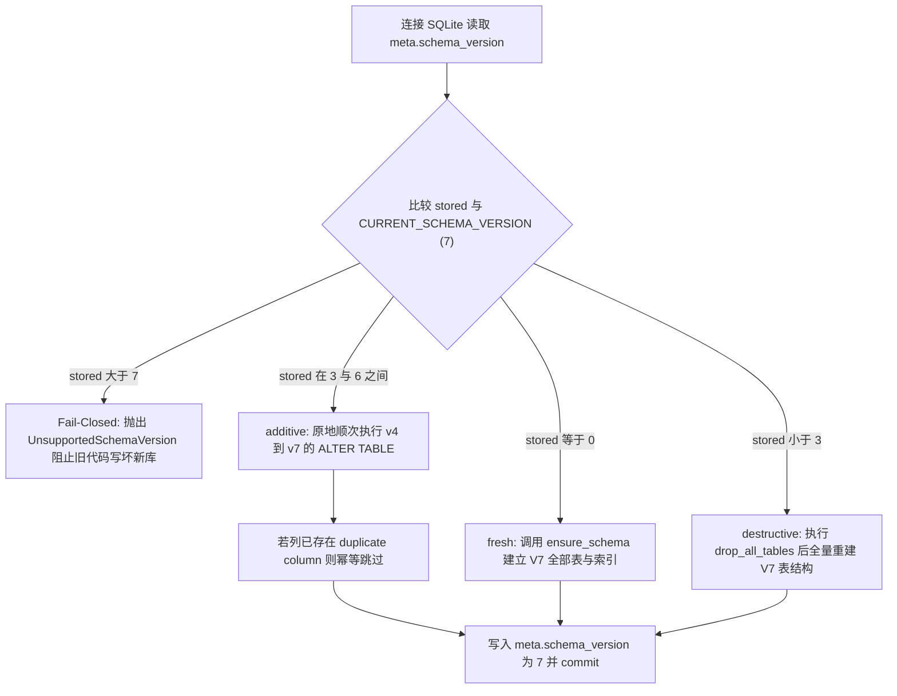

# 第 14 章：测试金字塔、静态契约门禁与维修升级手册

> **章节定位**：本文档全面梳理 PaperForge 的工程质量保障与运维体系，涵盖本地 `.husky/pre-commit` 提交钩子、`pyproject.toml` 与 Vitest 测试金字塔、5 大静态架构/安全门禁脚本、GitHub Actions 9 节点阻断流水线、OCR V3 "Rebuild Before Debug" 排障方法论、安全发版（`scripts/bump.py`）与插件打包、SQLite V7 Schema 演进规范、12 场景 UI 截图回归以及故障 Triage 手册。Obsidian 前端内部架构与 IPC 契约见 [第 13 章](13-obsidian-plugin-and-views.md)。

---

## 1. 职责与非目标边界

PaperForge 将**毫秒级静态契约门禁**、**确定性本地/CI 分片单测**与**重型集成/UI 验收**划分为职责清晰的多层防线：

| 门禁 / 流程层级                                   | 核心职责（强制覆盖）                                                                                                                                                                  | 非目标边界（明确不做，防门禁失焦）                                                                                                                                                                                                                                    |
| :------------------------------------------------ | :------------------------------------------------------------------------------------------------------------------------------------------------------------------------------------ | :-------------------------------------------------------------------------------------------------------------------------------------------------------------------------------------------------------------------------------------------------------------------- |
| **本地提交前钩子 (`.husky/pre-commit`)**          | 在 `git commit` 瞬间阻断"破坏性删除事故模式"、运行 `lint-staged` Prettier 自动格式化、TypeScript 静态检查与 `vitest run` 插件单测                                                     | 不在每次本地 commit 时跑完 3,800+ 条 Python 全量单测或连接外部 PaddleOCR / OpenAI 网络端点                                                                                                                                                                            |
| **静态架构与安全门禁 (`scripts/`)**               | 基于 Python AST 与文本正则守卫模块依赖环（R1）、跨包私有导入/成员访问（R2/R2b）、层级逆向依赖（R3）、顶层重依赖（R4）、6 处版本声明对齐、开发机真实路径零泄漏与研究语料零入库         | 静态图检查只分析语法层（无法解析 `importlib` 动态字符串导入或运行时注入），动态边界仍由 L1/L2 与 Harness 用例保障                                                                                                                                                     |
| **Python 分层测试金字塔 (`pyproject.toml`)**      | 通过 `--strict-markers` 强制归类 `unit`、`cli`、`e2e`、`journey`、`chaos`、`audit`、`integration`、`harness`、`e2e_fast`、`slow`、`snapshot` 共 11 类标记，并与 CI 分片及覆盖契约对齐 | [docs/INSTALL-AND-UPDATE-ARCHITECTURE.md](../INSTALL-AND-UPDATE-ARCHITECTURE.md) 规划的 Phase 2/3（`uv`、独立 `minEngineVersion` / `depsLockHash` 解耦）尚处于 **设计蓝图 / 待评审定稿** 状态，现行门禁仅验证已投产 Phase 1（1:1 版本对齐与 `pointer.json` 原子切换） |
| **发版准入裁判 (`scripts/release_readiness.py`)** | 纯只读审计候选产物指纹（`source_sha` / `wheel_sha256` / `bundle_sha256`）、能力矩阵与结构化验证流水账，输出零豁免发版资格结论                                                         | **永不**自行执行测试或篡改记录归档；禁止以 CLI-only 验收记录顶替 Obsidian 真机/UI（H/V 层）必测项                                                                                                                                                                     |

---

## 2. 核心源码与单测映射表

### 2.1 构建配置、钩子与静态门禁脚本

| 仓库路径                                                                | 门禁 / 工具名称              | 核心职责摘要                                                                                                                                                                     | 对应守护测试或契约文件                                                 |
| :---------------------------------------------------------------------- | :--------------------------- | :------------------------------------------------------------------------------------------------------------------------------------------------------------------------------- | :--------------------------------------------------------------------- |
| `.husky/pre-commit`                                                     | Git Pre-Commit 钩子          | 依次运行安全删除检查、`lint-staged`（配置于 `paperforge/plugin/.lintstagedrc`）、TS 类型检查与 Vitest 单测                                                                       | 提交阶段本地硬拦截                                                     |
| `pyproject.toml`                                                        | Python 工程与门禁配置        | 约束 `requires-python >= 3.11` 与 `pymupdf>=1.23.0,<2`（规避 PyMuPDF 2.0 导入即加载 `onnxruntime` 导致启动/OCR 卡顿）、定义 11 类 Pytest Marker 与 `[tool.ruff]` 规则            | `scripts/ci_local.py` & `static` Job                                   |
| `paperforge/plugin/package.json` & `paperforge/plugin/vitest.config.ts` | 插件构建与测试脚本           | 定义 `dev` / `build` / `test` / `typecheck` / `test:e2e` / `pretest:e2e`（Node `>=22`）；`vitest.config.ts` 使用 `jsdom` 环境与 `obsidian-test-mocks/obsidian` 别名              | CI `plugin-tests` & `obsidian-e2e`                                     |
| `scripts/check_module_graph.py`                                         | AST 模块依赖与棘轮门禁       | 校验 R1（依赖环）、R2/R2b（跨包私有导入/属性）、R3（`worker` 禁导 `commands`/`plugin`）、R4（顶层重依赖），提供 `--check`、`--write-ratchet`、`--reach --entry`                  | `tests/test_module_graph.py`、`tests/architecture_import_ratchet.json` |
| `scripts/check_version_sync.py`                                         | 6 处版本声明一致性检查       | 比对 `paperforge/__init__.py`、`paperforge/plugin/manifest.json`、`manifest.json`、`paperforge/plugin/versions.json`、`pyproject.toml` 与 `paperforge/plugin/main.js` 回退版本号 | CI `static` Job                                                        |
| `scripts/check_machine_paths.py`                                        | 开发机绝对路径扫描           | 扫描当前工作区已跟踪文件与指定 `--rev` 历史，拦截 Windows/POSIX 个人真实用户名与项目盘符路径泄漏                                                                                 | CI `static` Job                                                        |
| `scripts/check_no_evidence_tracking.py`                                 | 禁止研究实证语料入库         | 校验当前 Git Index 及 `--base REV` 以来提交历史，严防私有研究论文图片与本机实验语料进入版本库                                                                                    | CI `static` Job                                                        |
| `scripts/check_no_destructive_delete.py`                                | 2026-08-14 删库防呆扫描      | 扫描 `paperforge/` 运行时源码（排除 `trash.py`），禁止 `shutil.rmtree(..., ignore_errors=True)` 与空路径/当前路径 `rmtree(Path())`                                               | `.husky/pre-commit` 第一步                                             |
| `scripts/consistency_audit.py`                                          | 文档与命令一致性审计         | 强制 4 项检查：禁用已废弃旧命令名（Check 1）、禁止旧包名残留（Check 2）、Markdown 内部相对链接无死链（Check 3）、命令模板结构完整（Check 4）                                     | `tests/test_command_docs.py`                                           |
| `scripts/build_technical_reference.py`                                  | 技术参考手册编译器           | 将 `docs/handbook/` 第 01–14 章确定性汇编为单文件 `docs/PAPERFORGE-TECHNICAL-REFERENCE.md`，提供 `--check` 字节一致性校验                                                        | `tests/test_technical_docs_sync.py`                                    |
| `scripts/ci_shard.py` & `scripts/ci_local.py`                           | 分片映射生成器 & CI 本地复现 | 按 `tests/ci-shards.json` 将全量 Python 单测均分 2 片；`ci_local.py` 直接解析 `.github/workflows/ci.yml` 与 `.github/workflows/ci-chaos.yml` 在本地跑通可移植步骤                | `tests/test_ci_shard_map.py`、`tests/test_ci_coverage_contract.py`     |
| `scripts/bump.py` & `scripts/release_readiness.py`                      | 发版改号工具 & 准入裁判      | `bump.py` 从 `paperforge/__init__.py` 统一改号、写 `versions.json` 并提交打 tag；`release_readiness.py` 输出只读准入报告                                                         | `tests/test_release_readiness.py`                                      |

### 2.2 专项审计测试、OCR 聚焦集与 Dev 排障工具 (`tests/` & `scripts/dev/`)

| 仓库路径                                                                                                                                                                                                                          | 层级 / 角色               | 覆盖范围与执行时机                                                                                                                                                                                                                                                                                                                                                                                                                                                                                                                                                                |
| :-------------------------------------------------------------------------------------------------------------------------------------------------------------------------------------------------------------------------------- | :------------------------ | :-------------------------------------------------------------------------------------------------------------------------------------------------------------------------------------------------------------------------------------------------------------------------------------------------------------------------------------------------------------------------------------------------------------------------------------------------------------------------------------------------------------------------------------------------------------------------------- |
| `tests/test_ocr_high_risk_rule_audit.py`                                                                                                                                                                                          | OCR 高危规则文档审计      | 校验 `docs/ocr/high-risk-rule-audit.md` 7 个章节与 4 项基线计数指标（`direct_role_mutation_count` 等）完整存在                                                                                                                                                                                                                                                                                                                                                                                                                                                                    |
| `tests/test_ocr_route_audit.py`                                                                                                                                                                                                   | OCR 生产路由审计          | 校验 `docs/ocr/route-audit.md` 覆盖 10 阶段链路产物，并确认实验模块 `ocr_orchestrator.py` / `ocr_layout.py` / `ocr_attach.py` / `ocr_emit.py` 已删除或显式隔离标记                                                                                                                                                                                                                                                                                                                                                                                                                |
| `tests/test_technical_docs_sync.py`                                                                                                                                                                                               | 手册与代码真值漂移门禁    | 自动核对 `docs/handbook/` 14 章节结构、全部引用仓库路径均受 `git ls-files` 追踪且实存、CLI/Config/Probe/Action/SQLite 符号全量覆盖及 compiled reference `--check`                                                                                                                                                                                                                                                                                                                                                                                                                 |
| `tests/unit/test_path_authority_and_staging.py`、`tests/unit/test_stat_cache_and_fastpaths.py`、`tests/unit/test_daemon_and_stream_flag.py`、`tests/unit/test_ux_loop_closures.py`、`tests/unit/test_storage_migration_safety.py` | v2 核心闭环与安全回归集   | 覆盖 `resolve_paperforge_dir` 路径唯一权威与外置 R/P 舞台、`stat_cache` 2s Racy-Git 防护与 JSONL 压缩、`daemon --stdio`（含 `timing.reset()`）与 `--stream`、`versions reset-live` 与 `submitting_unconfirmed` OCR 恢复，以及 `migrate-storage` 事务回滚与工作区全文无损护栏                                                                                                                                                                                                                                                                                                      |
| `tests/test_ci_coverage_contract.py` & `tests/test_tracked_files_present.py`                                                                                                                                                      | CI 覆盖契约与追踪文件校验 | 确保每个有效测试目录均纳入 `.github/workflows/ci.yml` 收集边界，且核心受跟踪资产存在于磁盘                                                                                                                                                                                                                                                                                                                                                                                                                                                                                        |
| `tests/test_ocr_pipeline_v3.py`、`tests/test_ocr_object_writeback.py`、`tests/test_ocr_tail_settlement.py`、`tests/test_appendix_figure_numbering.py`、`tests/test_ocr_rendering.py`                                              | **OCR V3 聚焦核心套件**   | 改动 OCR 管线前必须全绿（当前共 112 条用例，历史资料常称 105 用例集；附加 `tests/test_ocr_render.py`、`tests/test_ocr_render_v2.py`、`tests/test_ocr_render_stabilization.py` 后共计 152 条）                                                                                                                                                                                                                                                                                                                                                                                     |
| `tests/test_ocr_figures.py`、`tests/test_ocr_figure_vnext_passes.py`、`tests/test_figure_identity.py`、`tests/unit/worker/test_figure_containment.py`                                                                             | Figure 匹配与包容完整套件 | 修改图表配对、`figure_inner_text` 侧边包容打分或 `apply_object_writebacks` 时必跑                                                                                                                                                                                                                                                                                                                                                                                                                                                                                                 |
| `tests/harness/`（CLI 真实宿主验收 `P` 层）                                                                                                                                                                                       | 夹具与底座                | 包含 20 个 CLI 子进程验收剧本及 `tests/harness/canonical.py`、`tests/harness/stub.py`、`tests/harness/stub_embed.py`、`tests/harness/harness_keyring.py`、`tests/harness/recorder.py`、`tests/harness/evidence.py` 隔离夹具                                                                                                                                                                                                                                                                                                                                                       |
| `tests/harness/` 配置与同步群组                                                                                                                                                                                                   | 基础契约组                | `tests/harness/test_a03_config_authority.py`、`tests/harness/test_a04_config_migration.py`、`tests/harness/test_a05_credential_authority.py`、`tests/harness/test_a06_provider_authority.py`、`tests/harness/test_b01_initial_sync.py`、`tests/harness/test_b02_changed_export.py`、`tests/harness/test_b07_workflow_flag.py`                                                                                                                                                                                                                                                     |
| `tests/harness/` OCR、向量、写回与晋升群组                                                                                                                                                                                        | 核心流水线组              | `tests/harness/test_d04_ocr_stop.py`、`tests/harness/test_d05_ocr_redo.py`、`tests/harness/test_d06_rebuild_derived.py`、`tests/harness/test_d07_version_restore.py`、`tests/harness/test_e01_client_action.py`、`tests/harness/test_e02_memory_restore.py`、`tests/harness/test_e03_embed_deep_search.py`、`tests/harness/test_e04_embed_stop.py`、`tests/harness/test_e05_chroma_migration.py`、`tests/harness/test_e06_memory_schema_repair.py`、`tests/harness/test_f02_promote_r.py`、`tests/harness/test_f03_accept_proposal.py`、`tests/harness/test_j02_partial_batch.py` |
| `tests/e2e/`（端到端脚本，`L4`）                                                                                                                                                                                                  | 全链路端到端              | 覆盖 `tests/e2e/test_legacy_ocr_backfill_smoke.py`、`tests/e2e/test_multi_domain_sync.py`、`tests/e2e/test_ocr_e2e.py`、`tests/e2e/test_status_doctor_repair.py`、`tests/e2e/test_sync_pipeline.py` 共 5 个脚本                                                                                                                                                                                                                                                                                                                                                                   |
| `scripts/dev/ocr_rebuild_paper.py`                                                                                                                                                                                                | V3 重建与诊断工具         | 落实 `AGENTS.md` **"Rebuild Before Debug"**：按现行代码从 `raw` 重建文献输出，并支持 `--trace` 输出 `block_trace.csv` 及 `--dump-stages` 导出 `stages_summary.json`                                                                                                                                                                                                                                                                                                                                                                                                               |
| `scripts/dev/corpus_v3_diff_full.py` & `scripts/dev/compare_figure_inventory_corpus.py`                                                                                                                                           | 大规模语料库 Diff 回归    | 在多篇论文语料库上全量对比 V3 vs Legacy 与 Figure Inventory 变更差异                                                                                                                                                                                                                                                                                                                                                                                                                                                                                                              |
| `scripts/dev/render_obsidian_ui_docs.py`                                                                                                                                                                                          | UI 多态截图渲染器         | 借助 `scripts/dev/_obsidian_browser_shim.ts` 与 `scripts/dev/_obsidian_ui_showcase.ts` 在 Playwright 无头浏览器中渲染 12 套状态快照至 `docs/images/ui-states/`                                                                                                                                                                                                                                                                                                                                                                                                                    |

---

## 3. 磁盘文件、数据库表与协议 JSON 字段字典

### 3.1 架构依赖棘轮快照 (`tests/architecture_import_ratchet.json`)

由 `python scripts/check_module_graph.py --write-ratchet` 维护，遵循 **"只减不增"** 约束：

| JSON 键名                          | 对应规则                      | 语义说明                                                                                                                                                                                                                  |
| :--------------------------------- | :---------------------------- | :------------------------------------------------------------------------------------------------------------------------------------------------------------------------------------------------------------------------ |
| `version`                          | 元信息                        | 快照格式版本（当前为 `1`）                                                                                                                                                                                                |
| `rings` & `r1_no_new_rings`        | **R1（循环依赖禁令）**        | 当前 `r1_no_new_rings: false`、`rings: []`（模块环必须严格为 `0`；仅当历史环数达到 `CYCLE_DOWNGRADE_THRESHOLD = 10` 时才退化为"禁新增环"）                                                                                |
| `private_imports`                  | **R2（跨包私有导入）**        | 记录 `"调用模块": ["行号:目标模块[:_成员]"]` 的历史存量白名单；禁止新增任何跨越子包边界对 `_` 前缀符号的直接导入                                                                                                          |
| `private_member_access_exceptions` | **R2b（跨模块私有属性访问）** | 按 `"目标模块:_成员"` 白名单豁免历史私有属性访问（忽略行号变化，防止无关代码移动触发假红）                                                                                                                                |
| `layer_violations`                 | **R3（单向分层依赖）**        | 限制 `paperforge.worker` 子树反向导入 `paperforge.commands` 或 `paperforge.plugin`，当前为空 `{}` 零容忍                                                                                                                  |
| `heavy_imports`                    | **R4（模块顶层重依赖隔离）**  | 限制在模块顶层（函数体与 `TYPE_CHECKING` 之外）导入 `torch`、`chromadb`、`fitz`、`pymupdf`、`pdfplumber`、`PIL`，避免拖慢 CLI `--json` 与探针冷启动（目前仅保留历史 `paperforge.embedding.backends.chroma_backend` 一例） |

### 3.2 GitHub Actions CI 流水线矩阵 (`.github/workflows/ci.yml` & `ci-chaos.yml`)

`ci.yml` 由 9 个独立阻断 Job 汇总到 **`alls-green` (`All Checks Passed`)**；另外每周日定期与手动触发 `.github/workflows/ci-chaos.yml` 执行破坏性 `L6` Chaos 测试：

各 Job 关键校验分解如下：

- **`static` (L0)**：先后执行 `check_version_sync.py`、`check_module_graph.py --check`、`ruff check .`、`check_machine_paths.py`、`check_no_evidence_tracking.py`（含 `--base` 提交区间审查）。
- **`j-matrix` (Ubuntu + macOS)**：按阶梯依次验证 `J0`（`tests/unit/`）、`J1`（`tests/test_probe.py`、`tests/test_read_model_cutover.py`、`tests/test_lineage.py`、`tests/test_credentials.py`、`tests/test_action_registry.py`、`tests/cli/test_json_contracts.py`、`tests/cli/test_text_contracts.py`、`tests/cli/test_ocr_progress_contracts.py`）、`J1b`（`tests/test_ci_coverage_contract.py`、`tests/test_architecture_boundaries.py`、`tests/test_note_set_flag.py`）、`J2`（`tests/journey/test_headless_sync_preservation.py`）、`J3`（`tests/test_ocr_state_machine.py`），并强制检验 Python `sqlite3.enable_load_extension` 可用性。
- **`python-suite` (L1b)**：通过 `scripts/ci_shard.py --shard <0|1> --of 2` 读取 `tests/ci-shards.json` 并行执行主测试集。
- **`plugin-tests` (L3)**：校验 TS `typecheck`、`vitest run`、协议一致性测试及 `Committed bundle matches the sources`（重编译并校验 `paperforge/plugin/main.js` 无未提交 Diff）。
- **`architecture-gate` (L4b)**：先运行 `python docs/architecture-audit-2026-08-06/build_audit.py --check`，再运行 `paperforge.architecture_audit.collectors.orchestrator` 消费 `docs/architecture-audit-2026-08-06/contract.json`，最后用 `paperforge.architecture_audit.report.gate --strict --json` 严格评估 `publication.uses_protocol`、`canonical.no_ui_writer`、`coverage.required_complete`、`collectors.deterministic`、`restore.display_only` 规则。
- **`cli-acceptance` & `cli-acceptance-heavy` (P)**：在 `windows-latest` 上安装 `.[test,vector,legacy-vector]` 依赖；其中 `test_e04_embed_stop.py`、`test_d05_ocr_redo.py`、`test_d04_ocr_stop.py` 三个长耗时用例拆出到 `cli-acceptance-heavy` 并行加速。

### 3.3 SQLite Memory Layer 表结构与 Schema V7 (`paperforge/memory/schema.py`)

`paperforge/memory/schema.py` 当前版本号为 **`CURRENT_SCHEMA_VERSION = 7`**（保存在 `meta` 表 `key = 'schema_version'`），由 `ALL_TABLES`（18 张表）+ 无条件创建的 `lineage` 表（合计 19 张关系与 FTS5 表）+ `VEC_TABLES`（3 张 `vec0` 向量虚表）共同构成完整 22 张表（逐字段定义详见 [第 10 章](10-memory-db-and-retrieval.md)）：

| 表分组                           | 表名                                                                                                     | 职责与容灾特性                                                                                                                                                                                                          |
| :------------------------------- | :------------------------------------------------------------------------------------------------------- | :---------------------------------------------------------------------------------------------------------------------------------------------------------------------------------------------------------------------- |
| **元数据与调度状态**             | `meta`、`lineage`、`build_state`                                                                         | 记录 `schema_version`、血缘链路投影状态与增量向量构建水位线                                                                                                                                                             |
| **核心文献实体与全文**           | `papers`、`paper_assets`、`paper_aliases`、`paper_events`、`paper_fts`                                   | 主文献索引、PDF/OCR 衍生路径与哈希、历史 Key 别名、事件审计流水及 `papers` 触发器联动的 FTS5 索引                                                                                                                       |
| **用户认知资产（不可轻易丢弃）** | `reading_log`、`project_log`、`paper_annotations`、`paper_memory_cards`、`paper_memory_history`          | 保存人类/Agent PDF 批注、阅读摘录与 5 维度活认知记忆（支持版本历史追溯）                                                                                                                                                |
| **结构检索与向量伴生表**         | `body_units`、`body_units_fts`、`object_units`、`vec_fulltext_meta`、`vec_body_meta`、`vec_objects_meta` | 配合 `vec_fulltext`、`vec_body`、`vec_objects` 三张可选 `sqlite-vec` 虚表（若系统缺失 `vec0` 扩展则优雅捕获 `OperationalError` 跳过虚表建设而不阻断建库）；V7 在此组新增 `node_id`、`section_path_json` 与 `unit_id` 列 |

### 3.4 Ruff 静态规则与 Pytest Marker 契约 (`pyproject.toml`)

1. **Pytest 分层标记（`--strict-markers` 强制校对，共 11 个合法标记）**：
   - 速度与隔离分级：`unit`（Level 1 快速隔离单测）、`cli`（Level 2 子进程 CLI 契约）、`integration`（多组件集成）、`e2e`（Level 4 临时 Vault 端到端）、`e2e_fast`（快速端到端）、`journey`（Level 5 全工作流旅程）、`chaos`（Level 6 破坏性场景）。
   - 专项契约与性能标记：`audit`（核对 L1 Mock 与 L4 真实产出一致性）、`harness`（真实 CLI 子进程对照一次性 Vault 验收）、`slow`（超过 30 秒的重型用例，日常开发可跳过）、`snapshot`（快照对比校验）。
2. **Ruff 静态规则与基线豁免表 (`[tool.ruff.lint]`)**：
   - 全局配置：`target-version = "py310"`、`line-length = 120`、`select = ["E", "F", "I", "UP", "B", "SIM"]`、`ignore = ["B904"]`（允许 Worker 错误包装中主动 `raise`）、`exclude = ["paperforge/skills"]`。
   - 受控历史豁免（`per-file-ignores`）：
     - `paperforge/worker/sync.py`：仅保留 `B007`、`E501` 风格豁免（已清零死代码并移除 `F821` 豁免，全库强制通过 `ruff check paperforge --select F821,F822,F823`）；
     - `paperforge/worker/ocr.py`、`paperforge/worker/repair.py`、`paperforge/ocr_diagnostics.py`、`paperforge/worker/status.py`：豁免预设 `SIM102`/`E501`/`B905`/`SIM105`/`F401` 风格历史遗留；
     - `scripts/consistency_audit.py`、`scripts/welcome.py`、`scripts/validate_setup.py`、`paperforge/architecture_audit/report/render_html.py`：分别豁免长 HTML 模板行与历史脚本格式项（新提交不得扩大豁免面）。

---

## 4. 核心执行链路、状态机与顺序不变量

### 4.1 四大强制工程顺序链

1. **OCR 排障 "Rebuild Before Debug" 链路 (`AGENTS.md` + `scripts/dev/ocr_rebuild_paper.py`)**：
   - 磁盘 Vault 中的 `fulltext.md` 与 `render/` 可能滞后于最新代码实现，**严禁直接拿旧输出推理 Bug**。
   - 标准动作：先运行 `python scripts/dev/ocr_rebuild_paper.py <KEY> --trace --dump-stages` 按 V3 流水线重算结果；随后审查生成的 `block_trace.csv`（每块 `role`、`role_confidence`、`seed_role`、`zone`）与 `stages_summary.json`（每阶段状态字段变迁）；修复完毕后必须先过 **OCR V3 聚焦套件**（若改动图文绑定再过 Figure 套件）。
2. **发版改号与插件打包链路 (`scripts/bump.py`)**：
   - 唯一允许改动版本的起点是 `paperforge/__init__.py` 或通过 `scripts/bump.py` 自动联动修改，严禁手动散改 `manifest.json`。
   - 标准动作：`npm --prefix paperforge/plugin run build`（编译生成最新 `paperforge/plugin/main.js`）→ `python scripts/bump.py <ver>`（依次替换 `paperforge/__init__.py`、`paperforge/plugin/manifest.json`、`manifest.json`，向 `paperforge/plugin/versions.json` 写入版本映射，提交并校验 `HEAD:paperforge/__init__.py` 后打 Git Tag）→ 运行 `python scripts/check_version_sync.py`。
3. **CI 测试地图与代码覆盖同步链路**：
   - 凡是在 `tests/` 下新增、拆解或重命名测试文件（非 `e2e`/`audit`/`chaos`/`harness` 目录），必须立刻运行 `python scripts/ci_shard.py --write` 更新 `tests/ci-shards.json`，否则 `tests/test_ci_shard_map.py` 与 `tests/test_ci_coverage_contract.py` 将在 L1b / J1b 阶段失败。
4. **SQLite Schema 迁移状态机 (`migrate_schema`)**：

### 4.2 安装与协同升级蓝图边界状态说明

维护者在评审升级机制改动时，必须严格区分 [docs/INSTALL-AND-UPDATE-ARCHITECTURE.md](../INSTALL-AND-UPDATE-ARCHITECTURE.md) 中的两阶段状态：

- **已上线（Phase 1 实装契约）**：`paperforge/runtime_installer.py` 的 `_normalize_release_version` 与前端 `runtime-installer-launcher.ts` 的 `normalizePep440Version` 已统一 SemVer 预发布标记（如 `2.0.0-rc.6` 对齐 PEP 440 `2.0.0rc6`）；候选环境验证完成后由 `paperforge/runtime_pointer.py` 的 `publish_pointer` 原子写入用户主目录 `.paperforge` 下 `runtime` 子目录中的 `pointer.json`，保留上一份可用环境供快速回滚。
- **规划蓝图（Phase 2/3，状态仍为"设计蓝图 / 待评审定稿"）**：`uv` + `python-build-standalone` 零前置托管 Python、全局 Wheel 硬链接极速热修、四维版本字段（`minEngineVersion` / `depsLockHash` / `skillTreeDigest`）解耦机制尚未上线；在此之前，前后端版本仍保持 1:1 对齐校验。

### 4.3 本地预演 (`ci_local.py`) 与 OCR 诊断字段语义

1. **`scripts/ci_local.py` 与真实 Runner 的边界差异**：`ci_local.py` 通过解析 `.github/workflows/ci.yml` 中各 Job 的 `run` 脚本实现与 CI 同源的执行命令，但会主动跳过 `uses:` 动作、`if:` 条件分支、包含 GitHub 上下文表达式的步骤以及未携带 `--include-install` 时的包安装步骤；因此跨平台 OS 矩阵（macOS Homebrew `sqlite3` / Windows NTFS 锁）最终仍需由远端 Runner 兜底裁决。
2. **`scripts/dev/ocr_rebuild_paper.py` 诊断产物字段**：
   - `block_trace.csv` 导出每块 `page`、`block_id`、`raw_label`、`content_preview`、`bbox`、`role`、`role_confidence`、`evidence`、`seed_role`、`seed_confidence`、`zone`、`style_family`、`marker_type`、`render_default`、`index_default`；
   - `stages_summary.json` 记录各流水线阶段间 `role`、`role_candidate`、`_object_owner_id`、`_object_association_reason` 四个核心控制字段的精确跃迁；
   - 按 `AGENTS.md` 交易原则：默认启用 V3（仅 `OCR_PIPELINE_V3=0` 回退 Legacy），555 篇全库影对比中 547 篇无差异、其余 5 篇差异均为 V3 更准确（多召回 3 幅图与修正 2 处块边界），排查歧义时以 V3 输出与 `apply_object_writebacks` 所有权归属证据为准。

---

## 5. 配置项、环境变量、CLI 入口与错误码

### 5.1 本地全套验证与维护命令速查

| 目的场景                              | 精确命令行                                                                                                                                                                      | 关键参数与检查重点                                                                                                                        |
| :------------------------------------ | :------------------------------------------------------------------------------------------------------------------------------------------------------------------------------ | :---------------------------------------------------------------------------------------------------------------------------------------- |
| **OCR V3 聚焦套件（提交前 Phase A）** | `pytest tests/test_ocr_pipeline_v3.py tests/test_ocr_object_writeback.py tests/test_ocr_tail_settlement.py tests/test_appendix_figure_numbering.py tests/test_ocr_rendering.py` | V3 流水线、对象写回、`figure_inner_text` 归属与尾注结算核心护栏                                                                           |
| **Figure 全量套件（提交前 Phase B）** | `pytest tests/test_ocr_figures.py tests/test_ocr_figure_vnext_passes.py tests/test_figure_identity.py tests/unit/worker/test_figure_containment.py`                             | 涉及图文配对、`ocr_figures` 或 `apply_object_writebacks` 改动时必跑                                                                       |
| **本地 CI 零漂移预演**                | `python scripts/ci_local.py --job static` / `python scripts/ci_local.py --keep-going`                                                                                           | 直接从 `.github/workflows/ci.yml` 读取命令行执行（加 `--include-install` 可覆盖依赖安装步骤）                                             |
| **静态代码质量与架构门禁**            | `ruff check .` & `python scripts/check_module_graph.py --check`                                                                                                                 | 核对 `[tool.ruff]` 规则（`line-length = 120`, 规则 `E/F/I/UP/B/SIM`）与 R1–R4 依赖棘轮                                                    |
| **清理历史依赖债并收紧棘轮**          | `python scripts/check_module_graph.py --write-ratchet`                                                                                                                          | 当重构消除了某条 `private_imports` 或 `private_member_access_exceptions` 时执行更新 `tests/architecture_import_ratchet.json`              |
| **四大基础合规门禁**                  | `python scripts/check_version_sync.py && python scripts/check_machine_paths.py && python scripts/check_no_evidence_tracking.py && python scripts/consistency_audit.py`          | 推送前一键排查版本号、本机路径、实证语料历史、旧命令与文档死链                                                                            |
| **OCR 单篇重建与分步追踪**            | `python scripts/dev/ocr_rebuild_paper.py <KEY> --trace --dump-stages`                                                                                                           | 常用开关：`--ocr-dir <PATH>`、`--dump-dir <PATH>`、`--trace-only`、`--dump-stages-only`                                                   |
| **多篇语料库全量影对比**              | `python scripts/dev/corpus_v3_diff_full.py` & `python scripts/dev/compare_figure_inventory_corpus.py`                                                                           | 验证算法调优前后全库零误伤回归                                                                                                            |
| **插件 TypeCheck、单测与构建**        | `npm --prefix paperforge/plugin run typecheck && npm --prefix paperforge/plugin run test && npm --prefix paperforge/plugin run build`                                           | 重新生成与源码严格一致的 `paperforge/plugin/main.js`                                                                                      |
| **Obsidian 真机 E2E 测试**            | `npm --prefix paperforge/plugin run test:e2e`                                                                                                                                   | 自动触发 `pretest:e2e` 编译插件并调用 `paperforge/plugin/test/fixtures/build_e2e_vault.py` 搭建隔离 Vault                                 |
| **12 场景 UI 状态截图生成**           | `python scripts/dev/render_obsidian_ui_docs.py`                                                                                                                                 | 启动 Playwright Chrome/Edge 将 live TS 组件 + `paperforge/plugin/styles.css` 渲染到 `docs/images/ui-states/`                              |
| **发版准入核查**                      | `python scripts/release_readiness.py`                                                                                                                                           | 读取候选清单与矩阵记录并输出 `VERIFIED` / `UNTESTED` / `NOT_APPLICABLE` / `UNDEFINED` 裁判报告（退出码 `0` 通过、`1` 拦截、`2` 用法错误） |

---

## 6. 边界防护与 Fail-Closed 防呆规则

| 防呆规则                              | 强制执行点                                                 | Fail-Closed 拦截逻辑                                                                                                                                                      |
| :------------------------------------ | :--------------------------------------------------------- | :------------------------------------------------------------------------------------------------------------------------------------------------------------------------ |
| **PyMuPDF `<2` 版本天花板**           | `pyproject.toml` (`"pymupdf>=1.23.0,<2"`)                  | 锁定 1.x 系列，阻止 pip 升级到 PyMuPDF 2.0 引起 `pymupdf.layout` / `onnxruntime` 在 import 时被激活从而拖慢或卡死 OCR CLI                                                 |
| **历史追加式研究语料拦截**            | `scripts/check_no_evidence_tracking.py --base <REV>`       | 利用 `git log --diff-filter=A` 追溯区间内曾被提交哪怕后续又删除的研究实证语料文件，杜绝私有论文数据进入提交历史                                                           |
| **高危删库模式提交阻断**              | `scripts/check_no_destructive_delete.py`                   | 在 `.husky/pre-commit` 最前端阻断任何含 `shutil.rmtree(..., ignore_errors=True)` 或空/当前路径 `rmtree` 的提交，迫使统一迁移至可恢复删除模块 `paperforge/worker/trash.py` |
| **数据库新版本降级保护**              | `paperforge/memory/schema.py` (`UnsupportedSchemaVersion`) | 当旧版 CLI 试图打开高于 `CURRENT_SCHEMA_VERSION`（`7`）的 SQLite 库时直接异常退出，防止旧逻辑破坏新版表字段                                                               |
| **棘轮不可逆收紧与禁止 R3**           | `scripts/check_module_graph.py`                            | `R3`（`worker -> commands/plugin`）存量为零且不允许加入白名单；消减存量私有导入时旧条目不报错，新增任何越界依赖立即判红                                                   |
| **Ruff 与 `--strict-markers` 零遗漏** | `pyproject.toml`                                           | `--strict-markers` 拒绝任何未在清单登记的临时 `@pytest.mark.*` 拼写错误；并通过 `addopts` 中的 `--ignore` 沙盒路径屏蔽指令隔离本地临时试验 Vault                          |
| **E2E 跳过即失败准入策略**            | `scripts/release_readiness.py`                             | 对 `skipped`、`timeout`、`PASS_WITH_WARNINGS`、`harness_cli` 冒充 `H/V` 层等情况一律按未验证（`UNTESTED`）判阻，拒绝降级放行                                              |

---

## 7. 维修、调试与升级 Checklist

### 7.1 SQLite Schema 升级演进 Checklist（以 V7 -> V8 为例）

1. **优先 Additive 增量列/表**：更新 `paperforge/memory/schema.py` 中的 `CURRENT_SCHEMA_VERSION`，并在 `migrate_schema()` 内追加 `if current_version < 8:` 分支，每条 `ALTER TABLE` 均须带合理 `DEFAULT` 值且捕获 `"duplicate column"` 异常保证重试幂等性。
2. **严格区分派生层与用户资产表**：`body_units`、`object_units`、`body_units_fts`、`vec_*` 可由 Vault 侧车文件安全重建；而 `paper_annotations`、`reading_log`、`paper_memory_cards` 含用户交互心血，绝不可因列调整误调用 `drop_all_tables`。
3. **强制回归验证**：运行 `pytest tests/harness/test_e06_memory_schema_repair.py tests/test_layer4_units_and_fts.py` 验证升级与损坏自愈能力。

### 7.2 UI 样式与组件改动回归 Checklist

1. 编辑 `paperforge/plugin/src/views/`、`paperforge/plugin/src/settings.ts` 或 `paperforge/plugin/styles.css` 后，依次跑通：`typecheck` → `test` → `build`（确认重新生成与源码严格一致的 `paperforge/plugin/main.js`）。
2. 执行 `python scripts/dev/render_obsidian_ui_docs.py` 生成以下全部 12 组 UI 状态截面图至 `docs/images/ui-states/`，并对照亮/暗双模式及 `asterlab` / `obsidian` 主题核查无文字截断或层次溢出：
   - Base 工作台：`01-base-workbench-all-states`、`02-base-empty-and-filtered-states`
   - 伴读 Companion：`03-dashboard-global-modes`、`04-dashboard-collection-mode`、`05-dashboard-paper-mode-living-memory`、`06-dashboard-search-and-recovery-states`
   - PDF 批注器：`07-pdf-annotator-human-and-ai-layers`、`08-pdf-annotator-provenance-and-empty-states`
   - Control Center 与向导：`09-settings-control-center-six-states`、`10-settings-setup-wizard-four-stages`、`11-settings-ocr-and-memory-details`
   - OCR 工作台与弹窗：`12-ocr-workspace-and-modals`
3. 对照 [docs/OBSIDIAN-UI-AND-BASE-DESIGN.md](../OBSIDIAN-UI-AND-BASE-DESIGN.md) 与 [第 13 章](13-obsidian-plugin-and-views.md) 更新视图或 CSS 变量契约。
4. 若涉及跨模块架构调整或文档发布，同步核查 `docs/maintainer-guide.md` 维护指南是否需要补充约束条目。

### 7.3 常见门禁报警快速 Triage 手册

| 报错现象 / CI 失败节点                                               | 高概率直接原因                                                                               | 立即核查与标准处置方案                                                                                                                                         |
| :------------------------------------------------------------------- | :------------------------------------------------------------------------------------------- | :------------------------------------------------------------------------------------------------------------------------------------------------------------- |
| `tests/test_ci_shard_map.py` 报错未登记文件                          | 在 `tests/` 下增删改了 `.py` 测试文件却没有同步分片表                                        | 运行 `python scripts/ci_shard.py --write` 重新生成 `tests/ci-shards.json` 并随代码提交                                                                         |
| `scripts/check_module_graph.py --check` 报 `R2` / `R2b` / `R3`       | 新代码跨包导入 `_helper`、读取他模块私有属性，或由 `worker` 反向导入 `commands`              | 将被复用的内部函数提升为模块公开接口（移除前导 `_`）或下沉至无环底层工具；严禁把 `R3` 违规写进棘轮白名单                                                       |
| `plugin-tests` 在 `Committed bundle matches the sources` 失败        | 修改了 TypeScript 源码后忘记重新打包 `paperforge/plugin/main.js`                             | 本地执行 `npm --prefix paperforge/plugin run build`，确认产物差异后追加提交                                                                                    |
| `scripts/check_version_sync.py` 报错版本号冲突                       | 手动只改了某个 `manifest.json` 或 `paperforge/__init__.py`，漏改 `versions.json` / `main.js` | 先用 `npm --prefix paperforge/plugin run build` 重编包，再通过 `python scripts/bump.py <ver> --no-git` 统一对齐全部 6 个位置                                   |
| `scripts/consistency_audit.py` Check 1 / Check 3 报红                | 文档/代码注释提及已移除旧命令，或 Markdown 存在失效相对路径与悬空页内锚点                    | 按 [docs/COMMANDS.md](../COMMANDS.md) 替换为现行稳定命令，修正失效链接路径后再复测                                                                             |
| `tests/test_command_docs.py` 或 `tests/test_ocr_route_audit.py` 失败 | 修改了暴露命令参数、新增测试文档或移动了 OCR 模块但审计文档未同步                            | 核对 [docs/COMMANDS.md](../COMMANDS.md)、[docs/ocr/route-audit.md](../ocr/route-audit.md) 及 [docs/maintainer-guide.md](../maintainer-guide.md) 后补全同步更新 |
| 某篇生产文献 OCR 渲染错段或丢图，但代码逻辑目测正常                  | Vault 内 `render/fulltext.md` 是旧引擎留下的陈旧缓存                                         | 先运行 `python scripts/dev/ocr_rebuild_paper.py <KEY> --trace --dump-stages` 按现行代码重演流水线，再基于新输出追查阶段边界                                    |

### 7.4 历史依赖债清理与发版前终审 Checklist

1. **消除存量私有导入并收紧棘轮**：
   - 使用 `python scripts/check_module_graph.py --reach --entry paperforge.worker.ocr_figures:build_figure_inventory` 确认遗留函数是否已失去生产可达调用方；
   - 重构把跨包私有函数转为公开接口或内联清理后，运行 `python scripts/check_module_graph.py --write-ratchet` 刷新 `tests/architecture_import_ratchet.json`（只减不增），再用 `python scripts/check_module_graph.py --check` 验证零回归。
2. **发版与打 Tag 前五项核验**：
   - 先执行 `npm --prefix paperforge/plugin run typecheck && npm --prefix paperforge/plugin run test && npm --prefix paperforge/plugin run build` 锁定 `paperforge/plugin/main.js`；
   - 运行 `python scripts/check_machine_paths.py --rev HEAD` 与 `python scripts/check_no_evidence_tracking.py --base origin/master`（按当前目标主干分支名核验）；
   - 通过 `python scripts/bump.py <ver> --dry-run` 预检全部版本文件清单，无误后正式改号提交；
   - 对照 `docs/COMMANDS.md` 与 Release Notes 检查面向用户的 CLI 行为变更均已记录；
   - 运行 `python scripts/release_readiness.py` 确认全部适用测试层结果均处于 `VERIFIED`（无 `UNTESTED` / `UNDEFINED`）状态。
